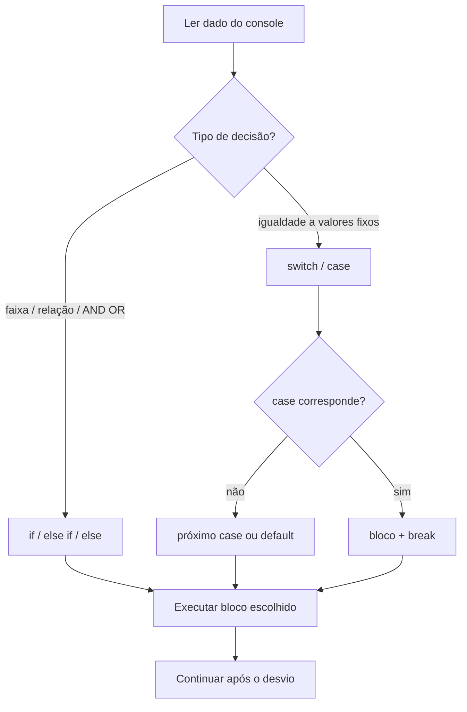
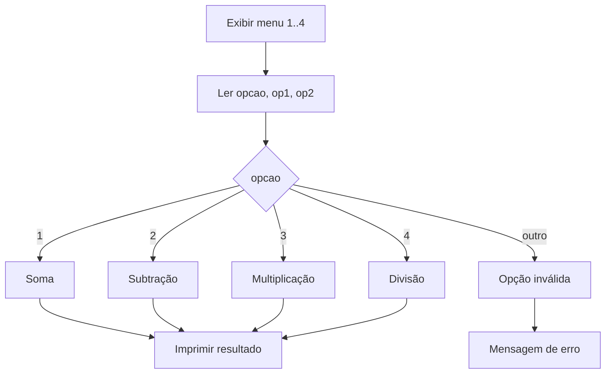

## Visão Geral do Conceito

Programas de console e de backend precisam **escolher caminhos**: validar entrada, montar menu, aplicar regra de negócio ou rejeitar opção inválida. Em C#, isso se faz com **comandos de decisão** (também chamados de **desvio**): <mark style="background-color: #242424; padding: 2px 4px; border-radius: 3px; color: inherit;">`if`</mark>, <mark style="background-color: #242424; padding: 2px 4px; border-radius: 3px; color: inherit;">`else`</mark>, <mark style="background-color: #242424; padding: 2px 4px; border-radius: 3px; color: inherit;">`else if`</mark> e <mark style="background-color: #242424; padding: 2px 4px; border-radius: 3px; color: inherit;">`switch`</mark>.

A lógica é a mesma que você já viu em Python (`if` / `elif` / `else`; em Python moderno há ainda <mark style="background-color: #242424; padding: 2px 4px; border-radius: 3px; color: inherit;">`match`</mark>/<mark style="background-color: #242424; padding: 2px 4px; border-radius: 3px; color: inherit;">`case`</mark> análogo ao switch). O que muda é a **sintaxe** e algumas regras do C# — em especial o <mark style="background-color: #242424; padding: 2px 4px; border-radius: 3px; color: inherit;">`break`</mark> obrigatório no <mark style="background-color: #242424; padding: 2px 4px; border-radius: 3px; color: inherit;">`switch`</mark>.

Nesta lição você reconstrói a aula: quatro projetos numa solution **Comandos de Decisão**, depois a **calculadora** em versões (if → switch → início de métodos com DRY/SRP).

> **Problema que resolve:** sem desvio condicional, o programa só executa uma sequência linear. Com `if`/`switch`, o fluxo **ramifica** conforme dados lidos do console ou regras de negócio.

## Modelo Mental

Pense no desvio como um **porteiro** na frente de um bloco de código:

1. Avalia uma **condição** (expressão que resulta em <mark style="background-color: #242424; padding: 2px 4px; border-radius: 3px; color: inherit;">`bool`</mark>: verdadeiro ou falso).
2. Se for verdadeira, **entra** no bloco (entre `{ }` no `if`).
3. Se for falsa, **pula** o bloco — ou vai para o `else` / próximo `else if` / `default`.

O <mark style="background-color: #242424; padding: 2px 4px; border-radius: 3px; color: inherit;">`switch`</mark> é um **atalho legível** para o caso especial “esta variável **é igual** a um destes valores fixos?”. Não serve para faixas (`>`, `<`) nem para combinações lógicas genéricas. A aula deixa explícito: *o switch podia nem existir* — tudo o que ele faz, um `if`/`else if` de igualdades também faz; a vantagem é **leitura e manutenção**.



## Mecânica Central

### Organização: solution com vários projetos

Para não espalhar exemplos, a aula usa **uma solution** (ex.: `ComandosDeDecisao`) e **um projeto console por comando** (`ComandoIf`, `ComandoIfElse`, `ComandoIfElseIf`, `ComandoSwitch`). A calculadora segue o mesmo padrão: solution `Calculadora` com projetos `Calculadora1`, `Calculadora2`, `Calculadora3`, …

> **Armadilha de IDE:** com vários projetos, o Visual Studio pode continuar a executar o **startup project** antigo. Sintoma típico: você altera o projeto novo e ainda vê o comportamento (ou o `Hello World`) do projeto anterior. Corrija em *Configure Startup Project* / seletor da engrenagem até o projeto desejado ficar em negrito.

Prefira o template **sem** top-level statements no início: ver <mark style="background-color: #242424; padding: 2px 4px; border-radius: 3px; color: inherit;">`namespace`</mark>, <mark style="background-color: #242424; padding: 2px 4px; border-radius: 3px; color: inherit;">`class Program`</mark> e <mark style="background-color: #242424; padding: 2px 4px; border-radius: 3px; color: inherit;">`Main`</mark> ajuda a entender o que o compilador gera “por baixo dos panos”.

### `if` simples

```csharp
Console.Write("Entre com um número: ");
int numero = int.Parse(Console.ReadLine());

if (numero > 0)
{
    Console.WriteLine("Número maior que zero");
}
```

- Condição verdadeira → executa o bloco.
- Falsa → **pula** o bloco e segue na linha seguinte (nenhuma mensagem se `numero <= 0`).

<mark style="background-color: #242424; padding: 2px 4px; border-radius: 3px; color: inherit;">`Console.ReadLine()`</mark> devolve <mark style="background-color: #242424; padding: 2px 4px; border-radius: 3px; color: inherit;">`string`</mark> (como o `input` do Python). Por isso usa-se <mark style="background-color: #242424; padding: 2px 4px; border-radius: 3px; color: inherit;">`int.Parse`</mark> / <mark style="background-color: #242424; padding: 2px 4px; border-radius: 3px; color: inherit;">`double.Parse`</mark>. Se o utilizador digitar letra, surge <mark style="background-color: #242424; padding: 2px 4px; border-radius: 3px; color: inherit;">`FormatException`</mark> — tratamento completo fica para aulas seguintes; aqui só reconheça o risco.

### `if` / `else`

```csharp
if (numero > 0)
{
    Console.WriteLine("Número maior que zero");
}
else
{
    Console.WriteLine("Número menor ou igual a zero");
}
```

Há **sempre** um dos dois blocos: verdadeiro → `if`; falso → `else`.

### `if` / `else if` / `else`

```csharp
if (numero > 0)
{
    Console.WriteLine("Número maior que zero");
}
else if (numero < 0)
{
    Console.WriteLine("Número menor que zero");
}
else
{
    Console.WriteLine("Número igual a zero");
}
```

- Avalia na ordem: primeira condição verdadeira “ganha” e as seguintes **não** são testadas.
- Pode haver **vários** `else if`.
- O `else` final cobre o que sobrou (aqui: só resta `== 0` para inteiros).

Equivalente Python: `if` / `elif` / `else`. Em C# o token é <mark style="background-color: #242424; padding: 2px 4px; border-radius: 3px; color: inherit;">`else if`</mark> (duas palavras).

### `switch` / `case` / `break` / `default`

Caso especial de cadeia de **igualdades**:

```csharp
Console.Write("Entre com uma opção: ");
int opcao = int.Parse(Console.ReadLine());

switch (opcao)
{
    case 1:
        Console.WriteLine("Novo");
        break;
    case 2:
        Console.WriteLine("Abrir");
        break;
    case 3:
        Console.WriteLine("Salvar");
        break;
    default:
        Console.WriteLine("Opção inválida");
        break;
}
```

Regras da aula:

| Regra | Detalhe |
|-------|---------|
| Só igualdade | Sem `>`, `<`, `>=`, `<=`, `!=` compostos no sentido de faixa; sem `&&`/`\|\|` como no `if` genérico |
| <mark style="background-color: #242424; padding: 2px 4px; border-radius: 3px; color: inherit;">`break`</mark> | **Obrigatório** em C# para encerrar o `case` (diferente do C clássico, onde fall-through é possível) |
| <mark style="background-color: #242424; padding: 2px 4px; border-radius: 3px; color: inherit;">`default`</mark> | Equivale ao `else`: nenhum `case` bateu |
| Chaves no `case` | **Opcionais**; muitos exemplos omitem `{ }` dentro do case para menos ruído visual |
| Origem histórica | Ideia herdada de C (e análogos: `case of` em Pascal; `match`/`case` em Python) |

O mesmo menu em `if`/`else if`:

```csharp
if (opcao == 1)
    Console.WriteLine("Novo");
else if (opcao == 2)
    Console.WriteLine("Abrir");
else if (opcao == 3)
    Console.WriteLine("Salvar");
else
    Console.WriteLine("Opção inválida");
```

> **Quando usar switch:** legibilidade em menus e “tabelas” de valores discretos. **Quando ficar no if:** qualquer condição que não seja igualdade a constantes simples.

### Aspas: `char` vs `string`

Em C# (e Java), <mark style="background-color: #242424; padding: 2px 4px; border-radius: 3px; color: inherit;">`"A"`</mark> é <mark style="background-color: #242424; padding: 2px 4px; border-radius: 3px; color: inherit;">`string`</mark>; <mark style="background-color: #242424; padding: 2px 4px; border-radius: 3px; color: inherit;">`'A'`</mark> é <mark style="background-color: #242424; padding: 2px 4px; border-radius: 3px; color: inherit;">`char`</mark>. Menus com letras exigem tipo coerente com os `case`. Em Python aspas simples e duplas são equivalentes para strings — **não** transfira essa regra.

### Namespace (pergunta da aula)

<mark style="background-color: #242424; padding: 2px 4px; border-radius: 3px; color: inherit;">`namespace`</mark> em C# assemelha-se à ideia de **pacote** (organização e unicidade de nomes). Dentro do mesmo namespace, nomes de tipo (ex.: `Program`) não se repetem; em namespaces diferentes, nomes iguais são permitidos. Detalhamento profundo fica para depois; aqui basta: **unicidade por espaço de nomes**.

## Uso Prático

### Calculadora v1 — menu com `if` / `else if`

Cenário ADS: ferramenta interna de console para operações aritméticas (protótipo antes de API/serviço).

```csharp
int opcao;
double op1, op2, resultado;

Console.WriteLine("Calculadora");
Console.WriteLine("1 - Soma");
Console.WriteLine("2 - Subtração");
Console.WriteLine("3 - Multiplicação");
Console.WriteLine("4 - Divisão");

Console.Write("Entre com a opção: ");
opcao = int.Parse(Console.ReadLine());

Console.Write("Entre com o operando 1: ");
op1 = double.Parse(Console.ReadLine());
Console.Write("Entre com o operando 2: ");
op2 = double.Parse(Console.ReadLine());

if (opcao == 1)
{
    resultado = op1 + op2;
    Console.WriteLine($"Soma = {resultado}");
}
else if (opcao == 2)
{
    resultado = op1 - op2;
    Console.WriteLine($"Subtração = {resultado}");
}
else if (opcao == 3)
{
    resultado = op1 * op2;
    Console.WriteLine($"Multiplicação = {resultado}");
}
else if (opcao == 4)
{
    resultado = op1 / op2;
    Console.WriteLine($"Divisão = {resultado}");
}
else
{
    Console.WriteLine("Erro: opção inválida");
}
```

Problemas **já identificados na aula** (não “corrigidos” ainda na v1):

1. **Divisão por zero** (`op2 == 0`) — comportamento inválido / Infinito; falta guarda.
2. **Opção inválida** ainda pede Op1 e Op2 antes do `else`.
3. **Letra no Parse** → <mark style="background-color: #242424; padding: 2px 4px; border-radius: 3px; color: inherit;">`FormatException`</mark> e quebra do programa.

A evolução é **incremental**: várias versões na mesma solution até o código ficar enxuto (e, mais tarde, orientado a objetos).

### Calculadora v2 — mesmo comportamento com `switch`

Trocar a cadeia de igualdades por `switch (opcao)` com `case 1..4` e `default` é a **primeira refatoração** mostrada: o resultado para o utilizador permanece o mesmo; muda a forma do código (mais limpa para menus).

```csharp
switch (opcao)
{
    case 1:
        resultado = op1 + op2;
        Console.WriteLine($"Soma = {resultado}");
        break;
    case 2:
        resultado = op1 - op2;
        Console.WriteLine($"Subtração = {resultado}");
        break;
    case 3:
        resultado = op1 * op2;
        Console.WriteLine($"Multiplicação = {resultado}");
        break;
    case 4:
        resultado = op1 / op2;
        Console.WriteLine($"Divisão = {resultado}");
        break;
    default:
        Console.WriteLine("Erro: opção inválida");
        break;
}
```



> **Refatoração (definição da aula):** reescrever o código **sem alterar o comportamento observável**. Se o resultado muda, não é só refatoração — é mudança de requisito.

### Calculadora v3 (início) — métodos, DRY e SRP

Em C#/Java o equivalente às “funções” do Python chama-se **método** (membros de uma classe, aqui `Program`). Convenção: métodos em C# começam com **letra maiúscula** (<mark style="background-color: #242424; padding: 2px 4px; border-radius: 3px; color: inherit;">`EntrarOpcao`</mark>, <mark style="background-color: #242424; padding: 2px 4px; border-radius: 3px; color: inherit;">`Main`</mark>) — em Java costumam ser camelCase; confundir isso pode custar entrevista/estágio.

Extrações feitas na aula:

| Método | Ideia | Princípio |
|--------|--------|-----------|
| <mark style="background-color: #242424; padding: 2px 4px; border-radius: 3px; color: inherit;">`ExibirMenu`</mark> | só imprime o menu (`void`) | SRP |
| <mark style="background-color: #242424; padding: 2px 4px; border-radius: 3px; color: inherit;">`EntrarOpcao`</mark> | chama o menu e lê/retorna `int` | SRP (após separar exibição) |
| <mark style="background-color: #242424; padding: 2px 4px; border-radius: 3px; color: inherit;">`EntrarOperando(string mensagem)`</mark> | uma rotina para Op1 e Op2 | DRY |

```csharp
public static void ExibirMenu()
{
    Console.WriteLine("Calculadora");
    Console.WriteLine("1 - Soma");
    Console.WriteLine("2 - Subtração");
    Console.WriteLine("3 - Multiplicação");
    Console.WriteLine("4 - Divisão");
}

public static int EntrarOpcao()
{
    ExibirMenu();
    Console.Write("Entre com a opção: ");
    return int.Parse(Console.ReadLine());
}

public static double EntrarOperando(string mensagem)
{
    Console.Write(mensagem);
    return double.Parse(Console.ReadLine());
}

// No Main (esboço):
int opcao = EntrarOpcao();
double op1 = EntrarOperando("Entre com o operando 1: ");
double op2 = EntrarOperando("Entre com o operando 2: ");
// ... switch como na v2 ...
```

- <mark style="background-color: #242424; padding: 2px 4px; border-radius: 3px; color: inherit;">`public`</mark>: acessível de fora da classe (detalhe de OO depois).
- <mark style="background-color: #242424; padding: 2px 4px; border-radius: 3px; color: inherit;">`static`</mark>: chamável sem instanciar `Program` (como o próprio `Main`).
- Tipo de retorno deve bater com o <mark style="background-color: #242424; padding: 2px 4px; border-radius: 3px; color: inherit;">`return`</mark> (linguagem **fortemente tipada**); <mark style="background-color: #242424; padding: 2px 4px; border-radius: 3px; color: inherit;">`void`</mark> = não retorna valor.

**DRY** (*Don't Repeat Yourself*): não duplicar a leitura de operandos.  
**SRP** (*Single Responsibility Principle*): o “S” do SOLID — cada método com **uma** responsabilidade (exibir menu ≠ ler opção).

Referências citadas na aula para estudo contínuo: *Refactoring* (Martin Fowler) e *Clean Code* (Robert C. Martin). A refatoração da calculadora **continua** na aula seguinte.

## Erros Comuns

1. **Startup project errado na solution**  
   **Sintoma:** código novo não parece executar; ainda aparece saída do projeto antigo.  
   **Correção:** definir o projeto correto como Startup Project.

2. **Esquecer `break` no `switch`**  
   **Sintoma:** erro de compilação no C#.  
   **Correção:** `break` (ou estrutura que termine o case) em cada ramo, inclusive no `default`.

3. **Usar `switch` para `numero > 0`**  
   **Sintoma:** modelo mental errado / código impossível no switch clássico da aula.  
   **Correção:** `if` / `else if` para relações e faixas.

4. **`int.Parse` / `double.Parse` com texto não numérico**  
   **Sintoma:** <mark style="background-color: #242424; padding: 2px 4px; border-radius: 3px; color: inherit;">`FormatException`</mark>.  
   **Correção (nesta fase):** evitar entrada inválida nos testes; tratamento com `try`/`catch` vem depois.

5. **Pedir operandos antes de validar a opção**  
   **Sintoma:** opção 7 ainda exige dois números e só depois diz “inválida”.  
   **Correção (evolução futura):** validar opção primeiro; só então ler operandos (e guardar divisão por zero).

6. **Confundir `"1"` com `'1'`**  
   **Sintoma:** tipos incompatíveis em `case` ou comparação.  
   **Correção:** string com aspas duplas; char com aspas simples.

7. **Método C# em camelCase por hábito de Java/Python**  
   **Sintoma:** código “funciona”, mas foge da convenção .NET.  
   **Correção:** PascalCase em nomes de método públicos.

## Visão Geral de Debugging

1. **Confirme qual projeto está a correr** (negrito / Startup Project) antes de caçar bug de lógica.
2. **Trace a condição:** imprima temporariamente a variável do desvio (`opcao`, `numero`) *antes* do `if`/`switch`.
3. **No `if`/`else if`:** lembre a ordem — a primeira condição verdadeira encerra a cadeia.
4. **No `switch`:** verifique se cada `case` tem `break` e se o `default` cobre o “resto”.
5. **Exceções de Parse:** se a pilha aponta `Parse`/`FormatException`, o problema é conversão de string, não o `if` em si.
6. **Calculadora:** teste deliberadamente opção inválida, divisão `x / 0` e letra no lugar de número — anote os buracos; a aula deixa claro que serão fechados incrementalmente.

<details>
<summary>Checklist rápido: if vs switch</summary>

- Preciso de `>`, `<`, intervalos ou `&&`/`||`? → **if**.
- Só listas de valores iguais (`1`, `2`, `3`…)? → **switch** (ou if de `==`; switch costuma ler melhor).
- Nada bateu? → `else` / `default`.
</details>

## Principais Pontos

- Desvio condicional ramifica o fluxo: `if`, `else`, `else if`, `switch`.
- `if` simples executa ou pula; `if`/`else` cobre os dois lados; `else if` encadeia testes.
- `switch` é caso especial de igualdades; não substitui relações numéricas.
- Em C#, `break` no `switch` é obrigatório; `default` é o “else” dos cases.
- `ReadLine` + `Parse` podem lançar `FormatException`.
- Solution multi-projeto exige cuidado com o Startup Project.
- Calculadora: v1 com if, v2 com switch (refatoração), v3 inicia métodos.
- Refatoração preserva comportamento; DRY evita duplicação; SRP isola responsabilidades.
- Métodos C#: PascalCase, tipo de retorno alinhado ao `return`, `void` quando não há retorno.

## Preparação para Prática

Antes do laboratório, você deve conseguir:

1. Classificar um valor com `if` / `else if` / `else`.
2. Mapear um menu de opções fixas com lógica equivalente a `switch`.
3. Explicar a diferença de uso entre `if` (faixas) e `switch` (igualdades).
4. Reconhecer no fluxo da calculadora onde validar opção, operandos e divisão por zero.
5. Nomear DRY/SRP ao extrair rotinas de menu e leitura.

O Editor Integrado do ISS executa **JavaScript**. Os desafios abaixo espelham a lógica C# da aula; os comentários `TODO` trazem o equivalente mental em C#. Pratique o mesmo algoritmo num Console App .NET 8 na sua máquina.

## Laboratório de Prática

### Easy — Classificar status de sensor

Contexto ADS: um serviço de monitoramento recebe leitura inteira de sensor e precisa rotular o status antes de gravar no log (positivo / negativo / zero), como o exemplo `numero > 0` / `< 0` / `else` da aula.

```javascript
/**
 * Espelho C#:
 * if (valor > 0) ...
 * else if (valor < 0) ...
 * else ...
 *
 * @param {number} valor
 * @returns {"positivo"|"negativo"|"zero"}
 */
function classificarLeituraSensor(valor) {
  // TODO: implementar cadeia if / else if / else
  return "zero";
}

// Smoke (não falha se TODO incompleto)
classificarLeituraSensor(3);
classificarLeituraSensor(-1);
classificarLeituraSensor(0);
```

### Medium — Roteador de menu (igualdades)

Contexto ADS: CLI interna com opções `1=novo`, `2=abrir`, `3=salvar`; qualquer outro código é inválido — o mesmo menu usado para introduzir `switch`/`default`.

```javascript
/**
 * Espelho C#: switch (opcao) { case 1: ... break; ... default: ... break; }
 * Também válido: if (opcao === 1) else if ... else
 *
 * @param {number} opcao
 * @returns {"novo"|"abrir"|"salvar"|"opcao_invalida"}
 */
function rotearMenuArquivo(opcao) {
  // TODO: mapear 1, 2, 3 e default
  return "opcao_invalida";
}

rotearMenuArquivo(1);
rotearMenuArquivo(4);
```

### Hard — Motor da calculadora com validação de opção

Contexto ADS: protótipo da calculadora da aula. Corrija o defeito da v1: **não calcule** se a opção for inválida; e na divisão, se `op2 === 0`, devolva erro em vez de dividir.

```javascript
/**
 * Espelho C#: validar opcao antes; switch/if para 1..4; guardar divisão por zero.
 *
 * @param {number} opcao - 1 soma, 2 sub, 3 mult, 4 div
 * @param {number} op1
 * @param {number} op2
 * @returns {{ ok: boolean, resultado: number|null, erro: string|null }}
 */
function executarCalculadora(opcao, op1, op2) {
  // TODO:
  // 1. Se opcao não estiver em 1..4, retornar ok:false, erro "opcao_invalida" (sem usar op1/op2).
  // 2. Se opcao === 4 e op2 === 0, retornar erro "divisao_por_zero".
  // 3. Caso contrário, calcular e retornar ok:true com resultado.
  return { ok: false, resultado: null, erro: "nao_implementado" };
}

executarCalculadora(1, 2, 3);
executarCalculadora(7, 1, 1);
executarCalculadora(4, 10, 0);
```

<!-- CONCEPT_EXTRACTION
concepts:
  - if simples
  - if-else
  - if-else if-else
  - switch / case / break / default
  - desvio condicional / comandos de decisão
  - igualdade vs operadores relacionais
  - Console.ReadLine + Parse
  - FormatException (introdução)
  - startup project em solution multi-projeto
  - menu console / calculadora
  - refatoração (mesmo comportamento)
  - DRY
  - SRP / SOLID (S)
  - métodos public static e void
  - PascalCase de métodos em C#
  - namespace e unicidade de nomes
  - char vs string (aspas)
skills:
  - Escrever cadeias if/else if/else para classificar valores
  - Montar switch de menu com break e default
  - Escolher if vs switch conforme o tipo de condição
  - Ler opção e operandos com Parse em console
  - Diagnosticar startup project errado e FormatException
  - Refatorar if de igualdades para switch sem mudar resultado
  - Extrair ExibirMenu, EntrarOpcao e EntrarOperando (DRY/SRP)
  - Validar opção inválida e divisão por zero no fluxo da calculadora
examples:
  - comando-if-numero-maior-zero
  - comando-if-else-if-positivo-negativo-zero
  - comando-switch-menu-novo-abrir-salvar
  - calculadora-v1-if-else-if
  - calculadora-v2-switch
  - calculadora-v3-metodos-dry-srp
  - lab-js-sensor-menu-calculadora
-->

<!-- EXERCISES_JSON
[
  {
    "id": "csharp-classificar-leitura-sensor",
    "slug": "csharp-classificar-leitura-sensor",
    "difficulty": "easy",
    "title": "Classificar status de sensor",
    "discipline": "fundamentos-csharp",
    "editorLanguage": "javascript",
    "tags": ["csharp", "if", "else-if", "condicionais"],
    "summary": "Classificar leitura numérica em positivo, negativo ou zero com cadeia if/else if/else."
  },
  {
    "id": "csharp-rotear-menu-arquivo",
    "slug": "csharp-rotear-menu-arquivo",
    "difficulty": "medium",
    "title": "Roteador de menu (igualdades)",
    "discipline": "fundamentos-csharp",
    "editorLanguage": "javascript",
    "tags": ["csharp", "switch", "menu", "default"],
    "summary": "Mapear opções 1/2/3 de menu para ações e default para opção inválida (lógica de switch)."
  },
  {
    "id": "csharp-motor-calculadora-validacao",
    "slug": "csharp-motor-calculadora-validacao",
    "difficulty": "hard",
    "title": "Motor da calculadora com validação",
    "discipline": "fundamentos-csharp",
    "editorLanguage": "javascript",
    "tags": ["csharp", "switch", "if", "calculadora", "validacao"],
    "summary": "Executar operação 1..4 só com opção válida e bloquear divisão por zero, corrigindo defeitos da v1."
  }
]
-->

<!--
lessons.json (NÃO aplicado por este worker — integração serial do orquestrador):
{
  "discipline": "fundamentos-csharp",
  "slug": "desvio-condicional-if-else-switch-csharp",
  "title": "Desvio condicional: if, else if, else e switch em C#",
  "order": 7,
  "file": "content/fundamentos-csharp/aula-07-desvio-condicional-if-else-switch-csharp.md"
}
-->
