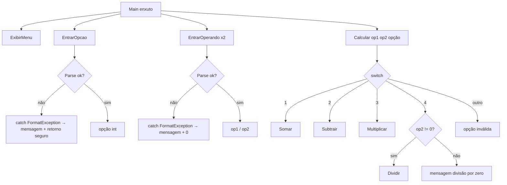

## Visão Geral do Conceito

Uma calculadora de console com menu, dois operandos e quatro operações parece um exercício trivial. Na prática, ela é o laboratório ideal para **refatoração** e **código limpo**: o programa começa monolítico no <mark style="background-color: #242424; padding: 2px 4px; border-radius: 3px; color: inherit;">`Main`</mark>, ganha <mark style="background-color: #242424; padding: 2px 4px; border-radius: 3px; color: inherit;">`switch`</mark>, depois métodos com **DRY** e **SRP**, e só então tratamento de entrada inválida com <mark style="background-color: #242424; padding: 2px 4px; border-radius: 3px; color: inherit;">`try`/`catch`</mark> e <mark style="background-color: #242424; padding: 2px 4px; border-radius: 3px; color: inherit;">`FormatException`</mark>.

Nesta lição você reconstrói a evolução vista em aula (versões 1→4): melhorar a qualidade do código **sem mudar o resultado**, deixar o <mark style="background-color: #242424; padding: 2px 4px; border-radius: 3px; color: inherit;">`Main`</mark> legível como o enunciado do problema, e impedir que letra no lugar de número **derrube** o processo.

> **Problema que resolve:** código que “funciona” mas é longo, duplicado e frágil. Em backend, isso atrasa manutenção, esconde bugs e torna impossível alterar uma regra sem quebrar o restante.

## Modelo Mental

Pense na calculadora como um **roteiro** que o usuário segue:

1. ver o menu;
2. escolher a operação;
3. informar operando 1 e operando 2;
4. executar a operação;
5. (versão 4) sobreviver a entradas inválidas sem crash.

**Refatoração** é reorganizar esse roteiro em peças nomeadas — sem mudar o que o usuário vê no final. **DRY** evita copiar o mesmo “ler número” duas vezes. **SRP** impede que um método faça duas histórias ao mesmo tempo (exibir menu **e** ler opção). O <mark style="background-color: #242424; padding: 2px 4px; border-radius: 3px; color: inherit;">`switch`</mark> (e depois o método <mark style="background-color: #242424; padding: 2px 4px; border-radius: 3px; color: inherit;">`Calcular`</mark>) é o **despacho**: dada a opção, chama a operação certa.



> **Analogia:** o <mark style="background-color: #242424; padding: 2px 4px; border-radius: 3px; color: inherit;">`Main`</mark> vira o **sumário** do livro; cada método é um **capítulo**. O livro fica com mais páginas no total, mas você encontra e altera um capítulo sem reescrever o sumário.

## Mecânica Central

### Refatoração (definição operacional)

> **Regra:** refatorar = alterar a **estrutura** do código **sem** alterar o **funcionamento**. Depois de cada pedaço: testar. O resultado antes e depois deve ser o mesmo.

Na aula, o fluxo foi incremental:

| Versão | Mudança central | Efeito no `Main` |
|--------|-----------------|------------------|
| 1 | Menu + operandos + <mark style="background-color: #242424; padding: 2px 4px; border-radius: 3px; color: inherit;">`if`/`else if`</mark> das operações | ~39 linhas, tudo misturado |
| 2 | Trocar <mark style="background-color: #242424; padding: 2px 4px; border-radius: 3px; color: inherit;">`if`/`else if`</mark> por <mark style="background-color: #242424; padding: 2px 4px; border-radius: 3px; color: inherit;">`switch`</mark> | Mesma lógica, despacho mais claro |
| 3 | Extrair menu, entrada, operações e <mark style="background-color: #242424; padding: 2px 4px; border-radius: 3px; color: inherit;">`Calcular`</mark> | ~11 linhas; programa total maior (~85), porém legível |
| 4 | <mark style="background-color: #242424; padding: 2px 4px; border-radius: 3px; color: inherit;">`try`/`catch`</mark> em <mark style="background-color: #242424; padding: 2px 4px; border-radius: 3px; color: inherit;">`Parse`</mark> | Entrada inválida não derruba o processo |

DRY e SRP são **agnósticos de linguagem**: valem em C#, Java, Python — são técnicas de código limpo, não “sintaxe C#”.

### DRY — Don't Repeat Yourself

Antes, “entrar operando 1” e “entrar operando 2” duplicavam o mesmo bloco (prompt + <mark style="background-color: #242424; padding: 2px 4px; border-radius: 3px; color: inherit;">`double.Parse`</mark>). A refatoração cria **um** método reutilizável:

```csharp
public static double EntrarOperando(string rotulo)
{
    Console.Write(rotulo);
    return double.Parse(Console.ReadLine());
}

// uso
double op1 = EntrarOperando("Operando 1: ");
double op2 = EntrarOperando("Operando 2: ");
```

Um único ponto de mudança: quando a versão 4 adiciona tratamento de erro, o <mark style="background-color: #242424; padding: 2px 4px; border-radius: 3px; color: inherit;">`try`/`catch`</mark> entra **nesse** método — não em dois lugares.

### SRP — Single Responsibility Principle

Na evolução intermediária, <mark style="background-color: #242424; padding: 2px 4px; border-radius: 3px; color: inherit;">`EntrarOpcao`</mark> exibia o menu **e** lia a opção. Isso são duas responsabilidades. A correção:

- <mark style="background-color: #242424; padding: 2px 4px; border-radius: 3px; color: inherit;">`ExibirMenu`</mark> — só imprime as opções;
- <mark style="background-color: #242424; padding: 2px 4px; border-radius: 3px; color: inherit;">`EntrarOpcao`</mark> — só obtém e devolve o inteiro da opção (pode chamar o menu, mas a responsabilidade de “mostrar” fica no método dedicado).

> **Regra SRP (na prática da aula):** um método faz **uma** coisa bem definida — tipicamente recebe parâmetros e devolve (ou aplica) **uma** informação/ação.

### Extração das operações e do `switch`

Assinatura tipicamente usada na aula (retorno <mark style="background-color: #242424; padding: 2px 4px; border-radius: 3px; color: inherit;">`void`</mark> — o método imprime o resultado):

```csharp
public static void Somar(double op1, double op2)
{
    double resultado = op1 + op2;
    Console.WriteLine($"Resultado: {resultado}");
}

public static void Subtrair(double op1, double op2) { /* ... */ }
public static void Multiplicar(double op1, double op2) { /* ... */ }

public static void Dividir(double op1, double op2)
{
    if (op2 != 0)
    {
        double resultado = op1 / op2;
        Console.WriteLine($"Resultado: {resultado}");
    }
    else
    {
        Console.WriteLine("Erro: divisão por zero.");
    }
}

public static void Calcular(double op1, double op2, int opcao)
{
    switch (opcao)
    {
        case 1: Somar(op1, op2); break;
        case 2: Subtrair(op1, op2); break;
        case 3: Multiplicar(op1, op2); break;
        case 4: Dividir(op1, op2); break;
        default: Console.WriteLine("Opção inválida."); break;
    }
}
```

Pontos mecânicos:

| Tema | Regra na aula |
|------|----------------|
| <mark style="background-color: #242424; padding: 2px 4px; border-radius: 3px; color: inherit;">`public`</mark> | Visível por outras classes (detalhe pleno na OO) |
| <mark style="background-color: #242424; padding: 2px 4px; border-radius: 3px; color: inherit;">`static`</mark> | Chamável sem instanciar a classe (detalhe pleno na OO) |
| <mark style="background-color: #242424; padding: 2px 4px; border-radius: 3px; color: inherit;">`void`</mark> | Não devolve valor; efeito colateral = escrever no console |
| Nome do método | Em C#, **PascalCase** (`Somar`, não `somar` — convenção Java) |
| Parâmetro vs argumento | Parâmetro = na **declaração**; argumento = na **chamada**; nomes podem diferir; **tipo e ordem** devem bater |
| Escopo | `resultado` em `Somar` ≠ `resultado` em `Subtrair` ≠ variável no `Main` — mesmo nome, **espaços diferentes** |
| Mesma classe | Métodos na mesma classe `Program` chamam-se sem “import”; classe externa (ex.: <mark style="background-color: #242424; padding: 2px 4px; border-radius: 3px; color: inherit;">`Math.Sqrt`</mark>) exige referenciar a classe |

### `Main` como enunciado

Após a versão 3, o programa principal fica próximo de:

```csharp
static void Main(string[] args)
{
    ExibirMenu();
    int opcao = EntrarOpcao();
    double op1 = EntrarOperando("Operando 1: ");
    double op2 = EntrarOperando("Operando 2: ");
    Calcular(op1, op2, opcao);
}
```

Quem lê o <mark style="background-color: #242424; padding: 2px 4px; border-radius: 3px; color: inherit;">`Main`</mark> lê o enunciado. Detalhes ficam nos métodos. Comentários do tipo “// entrar opção” **não** melhoram legibilidade — o nome do método já comunica. Comentários só quando agregam informação que o código não diz.

### Separar arquivos?

Enquanto **tudo** for responsabilidade da calculadora, manter no mesmo arquivo é adequado. Separar arquivos quando as responsabilidades forem **diferentes** (ex.: conexão com banco vs UI vs serviço) — como no projeto em camadas mostrado como analogia (repositório, serviço, menus, testes).

### Versão 4 — exceções e `FormatException`

Problemas que ainda quebravam o código na versão 3:

- opção com letra → <mark style="background-color: #242424; padding: 2px 4px; border-radius: 3px; color: inherit;">`int.Parse`</mark> lança <mark style="background-color: #242424; padding: 2px 4px; border-radius: 3px; color: inherit;">`FormatException`</mark>;
- operando com letra → <mark style="background-color: #242424; padding: 2px 4px; border-radius: 3px; color: inherit;">`double.Parse`</mark> idem;
- divisão por zero — **já tratável com** <mark style="background-color: #242424; padding: 2px 4px; border-radius: 3px; color: inherit;">`if`</mark> (preferível).

Modelo mental de exceção na aula: erro **difícil de controlar antecipadamente** (rede, banco, formato inesperado). Quando você **consegue** validar barato (divisor ≠ 0), use <mark style="background-color: #242424; padding: 2px 4px; border-radius: 3px; color: inherit;">`if`</mark>. <mark style="background-color: #242424; padding: 2px 4px; border-radius: 3px; color: inherit;">`try`/`catch`</mark> **não é de graça**: aloca objeto de exceção e consome mais recurso.

```csharp
public static int EntrarOpcao()
{
    ExibirMenu();
    Console.Write("Opção: ");
    try
    {
        int opcao = int.Parse(Console.ReadLine());
        return opcao;
    }
    catch (FormatException)
    {
        Console.WriteLine("Erro: opção inválida.");
        return 0; // caminho de retorno obrigatório em C#
    }
}
```

Regras críticas:

1. Preferir <mark style="background-color: #242424; padding: 2px 4px; border-radius: 3px; color: inherit;">`FormatException`</mark> (específico) a <mark style="background-color: #242424; padding: 2px 4px; border-radius: 3px; color: inherit;">`Exception`</mark> genérico quando você sabe o tipo do erro.
2. Se o método declara retorno `int`, **todos** os caminhos devem retornar — senão: *Not all code paths return a value*. No `catch`, devolver um valor seguro (ex.: `0`).
3. Quando a exceção ocorre **dentro** do <mark style="background-color: #242424; padding: 2px 4px; border-radius: 3px; color: inherit;">`try`</mark>, **nada** depois da linha que falhou no `try` é executado — o fluxo vai para o <mark style="background-color: #242424; padding: 2px 4px; border-radius: 3px; color: inherit;">`catch`</mark>.
4. Mensagens de erro devem ser **precisas** (“operando inválido”), não só “erro”. O objeto da exceção tem <mark style="background-color: #242424; padding: 2px 4px; border-radius: 3px; color: inherit;">`ex.Message`</mark> para enriquecer o texto ao usuário.
5. Linguagem fortemente tipada: variável de retorno sem valor definido no caminho de erro **não** compila — daí atribuir `0` (ou equivalente) no `catch`.

> **Não coberto de forma completa na fonte:** tratamento “completo” de entrada (loops até digitar válido) — o professor adiou aprimoramentos para depois dos comandos de repetição. Hierarquia completa de exceções / herança: só introduziu a ideia de árvore; pilares OO (encapsulamento, herança, polimorfismo) ficam para aulas futuras.

## Uso Prático

### Cenário ADS: micro-ferramenta de operações financeiras no console

Imagine um utilitário interno que aplica operações aritméticas a dois valores de uma planilha de taxas (mesmo esqueleto da calculadora). O fluxo refatorado:

```csharp
using System;

class Program
{
    static void Main(string[] args)
    {
        ExibirMenu();
        int opcao = EntrarOpcao();
        double op1 = EntrarOperando("Valor A: ");
        double op2 = EntrarOperando("Valor B: ");
        Calcular(op1, op2, opcao);
    }

    public static void ExibirMenu()
    {
        Console.WriteLine("1 - Soma");
        Console.WriteLine("2 - Subtração");
        Console.WriteLine("3 - Multiplicação");
        Console.WriteLine("4 - Divisão");
    }

    public static int EntrarOpcao()
    {
        Console.Write("Escolha: ");
        try
        {
            return int.Parse(Console.ReadLine());
        }
        catch (FormatException ex)
        {
            Console.WriteLine($"Erro: opção inválida. {ex.Message}");
            return 0;
        }
    }

    public static double EntrarOperando(string rotulo)
    {
        Console.Write(rotulo);
        try
        {
            return double.Parse(Console.ReadLine());
        }
        catch (FormatException ex)
        {
            Console.WriteLine($"Erro: operando inválido. {ex.Message}");
            return 0;
        }
    }

    public static void Calcular(double op1, double op2, int opcao)
    {
        switch (opcao)
        {
            case 1: Somar(op1, op2); break;
            case 2: Subtrair(op1, op2); break;
            case 3: Multiplicar(op1, op2); break;
            case 4: Dividir(op1, op2); break;
            default: Console.WriteLine("Opção inválida."); break;
        }
    }

    public static void Somar(double op1, double op2)
    {
        Console.WriteLine($"Resultado: {op1 + op2}");
    }

    public static void Subtrair(double op1, double op2)
    {
        Console.WriteLine($"Resultado: {op1 - op2}");
    }

    public static void Multiplicar(double op1, double op2)
    {
        Console.WriteLine($"Resultado: {op1 * op2}");
    }

    public static void Dividir(double op1, double op2)
    {
        if (op2 != 0)
            Console.WriteLine($"Resultado: {op1 / op2}");
        else
            Console.WriteLine("Erro: divisão por zero.");
    }
}
```

### Checklist de refatoração (como na aula)

1. Extrair um pedaço pequeno (ex.: só `Somar`).
2. Compilar e **testar** a operação.
3. Extrair o próximo pedaço.
4. Só depois mover o <mark style="background-color: #242424; padding: 2px 4px; border-radius: 3px; color: inherit;">`switch`</mark> inteiro para <mark style="background-color: #242424; padding: 2px 4px; border-radius: 3px; color: inherit;">`Calcular`</mark>.
5. Só depois blindar `Parse` com <mark style="background-color: #242424; padding: 2px 4px; border-radius: 3px; color: inherit;">`try`/`catch`</mark>.

### Ligação com a lista de exercícios básicos

O exercício 3 da lista de C# básico (“dois números reais: soma, subtração, multiplicação e divisão”) é o **núcleo funcional** desta calculadora. A aula acrescenta menu, <mark style="background-color: #242424; padding: 2px 4px; border-radius: 3px; color: inherit;">`switch`</mark>, métodos, DRY/SRP e tratamento de formato — camada de engenharia em cima da aritmética.

## Erros Comuns

1. **Achar que refatorar “pode mudar um pouco” o resultado**  
   Sintoma: após extrair método, divisão ou mensagens mudam.  
   Correção: cada passo deve ser acompanhado de teste com os mesmos casos (incluindo divisão por zero e opção inválida).

2. **Duplicar `EntrarOperando` em vez de parametrizar o rótulo**  
   Sintoma: dois métodos quase iguais; bug de parse corrigido só em um.  
   Correção: um método, parâmetro `string rotulo` (DRY).

3. **Misturar menu + leitura em um único método “faz-tudo”**  
   Sintoma: difícil reutilizar só a leitura ou só a UI.  
   Correção: SRP — `ExibirMenu` separado de `EntrarOpcao`.

4. **Usar `catch (Exception)` para tudo**  
   Sintoma: mascara bugs reais (null, overflow, lógica).  
   Correção: <mark style="background-color: #242424; padding: 2px 4px; border-radius: 3px; color: inherit;">`catch (FormatException)`</mark> quando o erro esperado é formato de string.

5. **`try` gigante com centenas de linhas**  
   Sintoma: qualquer falha cai no mesmo `catch` genérico.  
   Correção: `try` curto em torno do `Parse` (ou da chamada que realmente pode falhar).

6. **Esquecer `return` no `catch` em método com tipo de retorno**  
   Sintoma: *Not all code paths return a value*.  
   Correção: retornar valor seguro (`0`) no caminho de erro.

7. **Colocar `try/catch` na divisão por zero “porque pode”**  
   Sintoma: código mais pesado sem necessidade.  
   Correção: <mark style="background-color: #242424; padding: 2px 4px; border-radius: 3px; color: inherit;">`if (op2 != 0)`</mark>.

8. **Assumir que `resultado` no `Main` é o mesmo do método**  
   Sintoma: confusão de debug / valores “fantasma”.  
   Correção: lembrar escopo — cada bloco tem suas variáveis locais.

9. **Comentários que só repetem o nome do método**  
   Sintoma: ruído visual (“código sujo” no sentido Clean Code da aula).  
   Correção: nomes bons; comentário só para intenção não óbvia.

10. **camelCase em método público C# por hábito de Java**  
    Sintoma: código “funciona”, mas destoa da convenção .NET em entrevista.  
    Correção: PascalCase (`Somar`, `Calcular`).

## Visão Geral de Debugging

Quando a calculadora “quebra” ou se comporta mal:

1. **Reproduza com entrada mínima** — opção `a`, operando `x`, divisão `3/0`, opção `9`.
2. **Leia o tipo da exceção e o stack** — a aula destaca <mark style="background-color: #242424; padding: 2px 4px; border-radius: 3px; color: inherit;">`FormatException`</mark> e o caminho (linha do `Parse` → quem chamou).
3. **Confirme se o `catch` específico existe** — se o processo ainda cai, o `Parse` pode estar fora do `try`.
4. **Prove o salto do `try`** — coloque um `WriteLine` **depois** do `Parse` dentro do `try`: com entrada inválida ele **não** deve aparecer.
5. **Separe bug de lógica de bug de estrutura** — se a soma está errada, o problema é a operação; se só a opção letra derruba, é tratamento de entrada.
6. **Após cada extração de método**, reteste as quatro operações + default + divisão por zero antes de seguir.

<details>
<summary>Pista rápida: processo ainda termina com stack trace</summary>

O `Parse` provavelmente está fora do `try`, ou o `catch` captura outro tipo. Envolva só a linha de conversão e use `FormatException`. Garanta `return` no `catch` se o método não for `void`.
</details>

## Principais Pontos

- Refatoração melhora estrutura; o comportamento observável permanece.
- Refatoração e teste caminham juntos, pedaço a pedaço.
- DRY: um `EntrarOperando` para os dois operandos.
- SRP: menu separado da leitura da opção.
- `switch` (e depois `Calcular`) despacha operações sem inflar o `Main`.
- Métodos `public static void` com PascalCase; parâmetros tipados na ordem certa.
- Escopo: mesmo nome de variável ≠ mesma variável entre métodos.
- `Main` curto deve ler como o enunciado; código autoexplicativo > comentário redundante.
- Não separe arquivos sem responsabilidade diferente.
- `FormatException` + `try/catch` específico para `Parse`; `if` para divisão por zero.
- Todos os caminhos de um método com retorno devem retornar valor (C# é estrito).
- Exceção interrompe o restante do `try`.

## Preparação para Prática

Antes do laboratório, você deve conseguir:

- Explicar DRY e SRP com exemplos da calculadora.
- Extrair operações e um método `Calcular` com `switch`.
- Escolher `if` vs `try/catch` conforme o erro for prevenível.
- Escrever `try/catch (FormatException)` com retorno seguro.
- Manter o “orquestrador” (`Main` ou equivalente) curto e legível.

## Laboratório de Prática

> Editor ISS: exemplos do corpo em C#; exercícios abaixo em JavaScript com comentários de equivalente C# (`editorLanguage: "javascript"`), conforme mapa da disciplina.

### Easy — Extrair operação com assinatura única (DRY + método)

Contexto ADS: um serviço de tarifas aplica a mesma fórmula “operação binária” em vários pontos do código. Hoje a soma está inline em dois lugares. Extraia uma função reutilizável (análogo a `public static void Somar` / função que devolve o resultado).

```javascript
/**
 * Equivalente mental C#:
 *   public static double Somar(double op1, double op2) => op1 + op2;
 *
 * @param {number} op1
 * @param {number} op2
 * @returns {number} soma
 */
function somar(op1, op2) {
  // TODO: retornar op1 + op2 (sem side-effect; foque na extração pura)
  return 0;
}

/**
 * Simula dois call-sites que antes duplicavam a conta.
 * Não altere a assinatura — só use somar().
 */
function totalTaxasParciais(a, b, c, d) {
  // TODO: return somar(a, b) + somar(c, d);
  return 0;
}

// Smoke (não falha se TODO incompleto)
somar(1, 1);
totalTaxasParciais(1, 2, 3, 4);
```

### Medium — Despacho estilo `switch` / `Calcular` + divisão segura

Contexto ADS: endpoint interno recebe `opcao` (1..4) e dois valores de relatório. Implemente o despacho (análogo a `Calcular` + `Dividir` com `if`).

```javascript
/**
 * @param {number} op1
 * @param {number} op2
 * @param {number} opcao - 1 soma, 2 subtrai, 3 multiplica, 4 divide
 * @returns {{ ok: boolean, valor: number|null, erro: string|null }}
 *
 * Equivalente C#: switch + Dividir com if (op2 != 0)
 */
function calcular(op1, op2, opcao) {
  // TODO:
  // 1. switch/case (ou if-else) para 1..4.
  // 2. Em divisão, se op2 === 0 retornar { ok:false, valor:null, erro:"divisão por zero" }.
  // 3. Opção fora de 1..4 → erro "opção inválida".
  // 4. Sucesso → { ok:true, valor: resultado, erro:null }.
  return { ok: false, valor: null, erro: "não implementado" };
}

calcular(10, 2, 4);
calcular(10, 0, 4);
```

### Hard — Parse seguro + orquestrador enxuto (SRP / versão 4)

Contexto ADS: formulário de console (ou job CLI) lê strings de opção e operandos. Você deve (1) parsear inteiro e float com falha controlada (análogo a `FormatException`) e (2) orquestrar menu→opção→operandos→cálculo sem misturar responsabilidades numa função só.

```javascript
/**
 * @param {string} texto
 * @returns {{ ok: boolean, valor: number, erro: string|null }}
 * Equivalente: try { int.Parse } catch (FormatException)
 */
function parseIntSeguro(texto) {
  // TODO:
  // 1. Se texto não for inteiro decimal válido (ex.: /^\s*[+-]?\d+\s*$/), ok:false, valor:0.
  // 2. Senão ok:true e valor Number(texto).
  return { ok: false, valor: 0, erro: "não implementado" };
}

/**
 * @param {string} texto
 * @returns {{ ok: boolean, valor: number, erro: string|null }}
 * Equivalente: try { double.Parse } catch (FormatException)
 */
function parseFloatSeguro(texto) {
  // TODO: aceitar número com ponto (ex.: 3.5); inválido → ok:false, valor:0
  return { ok: false, valor: 0, erro: "não implementado" };
}

/**
 * Orquestrador (Main enxuto). Não faça aritmética aqui — delegue a calcular().
 * @param {string} opcaoStr
 * @param {string} op1Str
 * @param {string} op2Str
 */
function executarCalculadora(opcaoStr, op1Str, op2Str) {
  // TODO:
  // 1. parseIntSeguro(opcaoStr); se !ok, retornar { ok:false, erro: "opção inválida", resultado:null }.
  // 2. parseFloatSeguro para op1 e op2; se algum falhar, erro "operando inválido".
  // 3. Chamar calcular(op1, op2, opcao) do exercício Medium (mesma regra).
  // 4. Propagar ok/valor/erro.
  return { ok: false, erro: "não implementado", resultado: null };
}

// Smoke
parseIntSeguro("2");
parseFloatSeguro("3.5");
executarCalculadora("1", "10", "5");
executarCalculadora("a", "10", "5");
```

<!-- CONCEPT_EXTRACTION
concepts:
  - refatoração
  - DRY (Don't Repeat Yourself)
  - SRP (Single Responsibility Principle)
  - switch como despacho de operações
  - extração de métodos Somar Subtrair Multiplicar Dividir Calcular
  - ExibirMenu e EntrarOpcao
  - EntrarOperando reutilizável
  - public static void
  - PascalCase em métodos C#
  - parâmetros vs argumentos
  - escopo de variáveis locais
  - Main enxuto / código autoexplicativo
  - comentários necessários vs redundantes
  - quando separar arquivos por responsabilidade
  - FormatException
  - try/catch específico
  - int.Parse e double.Parse
  - Not all code paths return a value
  - fluxo interrompido no try após exceção
  - if vs try/catch para divisão por zero
  - mensagens de erro precisas e ex.Message
skills:
  - Refatorar código em passos testáveis sem mudar comportamento
  - Eliminar duplicação com método parametrizado (DRY)
  - Separar responsabilidades de UI e entrada (SRP)
  - Extrair switch para método Calcular
  - Declarar métodos public static void com PascalCase
  - Distinguir parâmetro de argumento e respeitar ordem/tipos
  - Explicar escopo de variáveis homônimas entre métodos
  - Tratar FormatException em Parse com retorno seguro
  - Preferir if para divisão por zero
  - Manter Main legível como enunciado do problema
examples:
  - calculadora-v1-if-v2-switch
  - dry-entrar-operando
  - srp-exibir-menu-entrar-opcao
  - extracao-somar-calcular
  - try-catch-formatexception-parse
  - if-divisao-por-zero
  - lab-js-somar-calcular-orquestrador
-->

<!-- EXERCISES_JSON
[
  {
    "id": "csharp-extrair-somar-dry",
    "slug": "csharp-extrair-somar-dry",
    "difficulty": "easy",
    "title": "Extrair soma reutilizável (DRY)",
    "discipline": "fundamentos-csharp",
    "editorLanguage": "javascript",
    "tags": ["csharp", "refatoracao", "dry", "metodos"],
    "summary": "Extrair função somar e reutilizá-la em dois call-sites de tarifas, espelhando extração de método em C#."
  },
  {
    "id": "csharp-calcular-switch-divisao-segura",
    "slug": "csharp-calcular-switch-divisao-segura",
    "difficulty": "medium",
    "title": "Despacho Calcular com divisão segura",
    "discipline": "fundamentos-csharp",
    "editorLanguage": "javascript",
    "tags": ["csharp", "switch", "divisao", "calcular"],
    "summary": "Implementar despacho 1..4 análogo a Calcular/switch e proteger divisão por zero com if."
  },
  {
    "id": "csharp-parse-seguro-orquestrador-srp",
    "slug": "csharp-parse-seguro-orquestrador-srp",
    "difficulty": "hard",
    "title": "Parse seguro e orquestrador enxuto",
    "discipline": "fundamentos-csharp",
    "editorLanguage": "javascript",
    "tags": ["csharp", "formatexception", "try-catch", "srp", "parse"],
    "summary": "Parsear opção/operandos com falha controlada e orquestrar o fluxo sem misturar responsabilidades."
  }
]
-->

<!--
lessons.json (NÃO aplicado por este worker — integração serial do orquestrador):
{
  "discipline": "fundamentos-csharp",
  "slug": "calculadora-refatoracao-dry-srp-switch",
  "title": "Calculadora: refatoração, DRY, SRP e switch",
  "order": 8,
  "file": "content/fundamentos-csharp/aula-08-calculadora-refatoracao-dry-srp-switch.md"
}
-->
