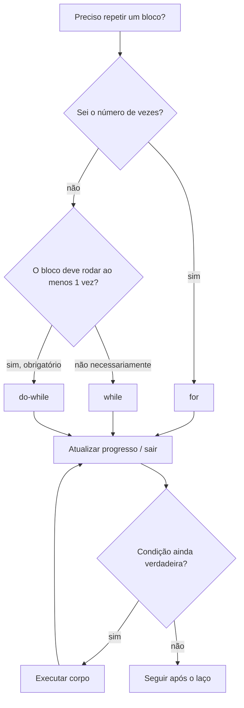
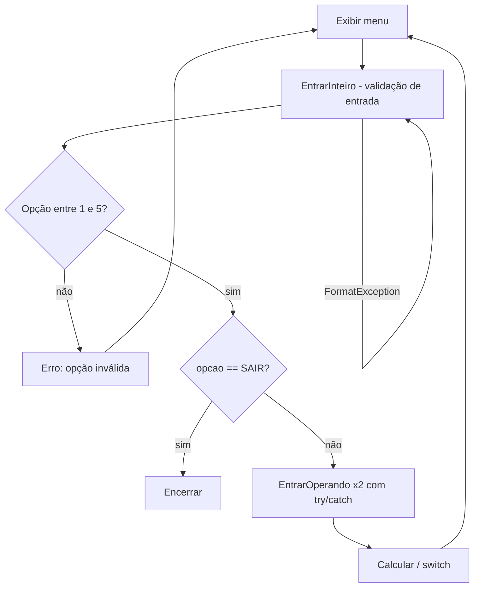

## Visão Geral do Conceito

Laços (loops) repetem um bloco de comandos enquanto uma condição for verdadeira. Em C# (e em Java), os quatro comandos clássicos são <mark style="background-color: #242424; padding: 2px 4px; border-radius: 3px; color: inherit;">`while`</mark>, <mark style="background-color: #242424; padding: 2px 4px; border-radius: 3px; color: inherit;">`do-while`</mark>, <mark style="background-color: #242424; padding: 2px 4px; border-radius: 3px; color: inherit;">`for`</mark> e <mark style="background-color: #242424; padding: 2px 4px; border-radius: 3px; color: inherit;">`foreach`</mark>. A escolha **não é de sintaxe**: é de **lógica** — você sabe quantas vezes vai repetir? O bloco precisa rodar ao menos uma vez?

Nesta aula o professor Luiz Maia reconstrói os laços a partir do <mark style="background-color: #242424; padding: 2px 4px; border-radius: 3px; color: inherit;">`while`</mark> (o mais geral), mostra <mark style="background-color: #242424; padding: 2px 4px; border-radius: 3px; color: inherit;">`for`</mark> e <mark style="background-color: #242424; padding: 2px 4px; border-radius: 3px; color: inherit;">`do-while`</mark> como casos particulares, introduz <mark style="background-color: #242424; padding: 2px 4px; border-radius: 3px; color: inherit;">`break`</mark> / <mark style="background-color: #242424; padding: 2px 4px; border-radius: 3px; color: inherit;">`continue`</mark> com cautela, e aplica tudo na **Calculadora 4**: menu que só encerra na opção sair, validação de opção e de operandos, <mark style="background-color: #242424; padding: 2px 4px; border-radius: 3px; color: inherit;">`const`</mark>, <mark style="background-color: #242424; padding: 2px 4px; border-radius: 3px; color: inherit;">`DRY`</mark> e <mark style="background-color: #242424; padding: 2px 4px; border-radius: 3px; color: inherit;">`SRP`</mark>.

> **Problema que resolve:** sem laços, repetiríamos o mesmo código N vezes à mão. Sem critério de escolha (while vs for vs do-while), o código vira loop infinito, divisão por zero ou validação misturada com regra de negócio.

> **Lacuna da fonte:** <mark style="background-color: #242424; padding: 2px 4px; border-radius: 3px; color: inherit;">`foreach`</mark> foi citado como um dos quatro comandos (“vou mostrar depois”), mas **não houve live coding** de `foreach` nesta sessão. Abaixo há só o encaixe mental; a prática profunda fica para material futuro / coleções.

## Modelo Mental

Pense em todo laço como um ciclo com três peças:

1. **Condição** — “ainda há trabalho?”
2. **Corpo** — o que fazer em cada volta
3. **Progresso** — algo que aproxima o fim (ler próximo número, incrementar contador, marcar `ok = true`)

O <mark style="background-color: #242424; padding: 2px 4px; border-radius: 3px; color: inherit;">`while`</mark> é o “motor” geral: testa **antes**. Se a condição já for falsa, o corpo **nunca** roda. O <mark style="background-color: #242424; padding: 2px 4px; border-radius: 3px; color: inherit;">`do-while`</mark> inverte: corpo **primeiro**, teste **no fim** — útil quando você **precisa** ler/pedir algo pelo menos uma vez. O <mark style="background-color: #242424; padding: 2px 4px; border-radius: 3px; color: inherit;">`for`</mark> empacota inicialização + condição + incremento num cabeçalho, típico quando a contagem é conhecida. O <mark style="background-color: #242424; padding: 2px 4px; border-radius: 3px; color: inherit;">`foreach`</mark> (visão) especializa o while para “percorrer cada elemento de uma coleção” sem gerenciar índice manualmente.

Analogia rápida: **while** = “enquanto houver itens na fila, processe”; **do-while** = “peça a senha e só pare quando for válida” (sempre pergunta ao menos uma vez); **for** = “repita exatamente 10 vezes”; **foreach** = “para cada linha do relatório…”.



## Mecânica Central

### `while` — condição antes, repetições desconhecidas

- Testa a condição **antes** de cada execução do bloco.
- Se a condição for falsa na primeira tentativa, o bloco **nunca** executa.
- Use quando **não** sabe o número de repetições: fim de arquivo, fim de tabela, valor sentinela (flag).

Exemplo da aula: somar números digitados **enquanto forem diferentes de zero**. O zero é a **bandeira** de término.

```csharp
const int FIM = 0; // constante: nome em MAIÚSCULAS
int numero;
int soma = 0;

Console.Write("Entre com um número: ");
numero = int.Parse(Console.ReadLine());

while (numero != FIM)
{
    soma += numero; // operador de atribuição composta
    Console.Write("Entre com um número: ");
    numero = int.Parse(Console.ReadLine());
}

Console.WriteLine("Soma = " + soma);
```

> **Flag:** o laço precisa de um sinal claro de fim. Sem progresso em direção a esse sinal → <mark style="background-color: #242424; padding: 2px 4px; border-radius: 3px; color: inherit;">`loop infinito`</mark>.

### `const` — valor que não muda

Em C# e Java existe constante de verdade (`const`). Em Python o “constante” é convenção (nome maiúsculo), mas o valor ainda pode ser alterado.

```csharp
const int FIM = 0;
// em vez de espalhar literais 0 pelo código
while (numero != FIM) { /* ... */ }
```

Vantagem: alterar o valor num **único ponto** propaga para todo o uso.

### DRY no laço — extrair `EntrarNumero`

A leitura + `Parse` se repetia (antes e dentro do while). Refatoração da aula:

```csharp
public static int EntrarNumero()
{
    Console.Write("Entre com um número: ");
    int num = int.Parse(Console.ReadLine());
    return num;
}

// uso
int numero = EntrarNumero();
while (numero != FIM)
{
    soma += numero;
    numero = EntrarNumero();
}
```

### Média, contador, divisão por zero e casting

Com média: precisa de <mark style="background-color: #242424; padding: 2px 4px; border-radius: 3px; color: inherit;">`soma`</mark> e <mark style="background-color: #242424; padding: 2px 4px; border-radius: 3px; color: inherit;">`conte`</mark> (contador). Incrementar só **dentro** do while (números válidos; o sentinela 0 não entra).

Problemas tratados na aula:

1. Se ninguém digitou número útil (`conte == 0`) → **não dividir**; mensagem “Não há números a serem processados”.
2. `soma / conte` com ambos `int` → **divisão inteira** (ex.: 10/4 = 2, não 2.5). Solução: **casting** explícito.

```csharp
double media;
if (conte > 0)
{
    // casting explícito: int → double; depois o compilador promove conte implicitamente
    media = (double)soma / conte;
    Console.WriteLine("Média = " + media);
}
else
{
    Console.WriteLine("Não há números a serem processados.");
}
```

> **Casting:** `(double)soma` é conversão **explícita**. Na divisão `double / int`, o `conte` sofre conversão **implícita** para `double`. Isso é herança de C, comum a C# e Java — contraste com Python (tipagem fraca nesse aspecto).

### `for` — contagem conhecida

Cabeçalho em três partes: **inicialização**, **condição**, **incremento**.

```csharp
for (int i = 1; i <= 10; i++)
{
    Console.Write(i + " ");
}
Console.WriteLine();
```

Fluxo:

1. `int i = 1` — executa **uma vez** no início.
2. Testa `i <= 10` **antes** de cada volta; se falso, sai.
3. Executa o corpo.
4. Executa `i++` (equivalente a `i = i + 1`) e volta ao teste.

Regras enfatizadas (C# e Java):

| Regra | Motivo |
|-------|--------|
| Não alterar a variável de controle **dentro** do corpo (só no incremento do `for`) | Evita lógica opaca e bugs de contagem |
| Não usar a variável de controle **fora** do `for` | Escopo local: `int i` declarado no `for` só existe dentro dele |
| Se precisar do valor depois, **copie** para outra variável antes de sair | Escopo + clareza |

Equivalente com `while` (mesma lógica):

```csharp
int j = 1;
while (j <= 10)
{
    Console.Write(j + " ");
    j++;
}
```

Crescente e decrescente:

```csharp
for (int i = 10; i >= 1; i--)
{
    Console.Write(i + " ");
}
```

> **Escopo:** redeclarar `int j` depois de já ter `j` no mesmo método gera erro. Dentro do `for`, `int i` é local ao laço — comportamento que Python não tem da mesma forma.

### `do-while` — pelo menos uma vez

Condição no **final**. Use quando não sabe o número de repetições, mas sabe que o bloco **será executado ao menos uma vez** (ex.: exigir número > 0).

```csharp
int num;
do
{
    Console.Write("Entre com um número maior que zero: ");
    num = int.Parse(Console.ReadLine());
    if (num <= 0)
    {
        Console.WriteLine("Erro: número inválido.");
    }
} while (num <= 0);
```

Python não tem `do-while` nativo; simula-se com `while True` + `break` (o que a aula liga ao próximo tópico).

### Regra de negócio × validação de entrada

No `do-while` de “número > 0”, digitar `"A"` quebra em <mark style="background-color: #242424; padding: 2px 4px; border-radius: 3px; color: inherit;">`FormatException`</mark>. A aula separou:

- **Regra de negócio:** número ≤ 0 → “número inválido” (ainda no laço externo).
- **Validação de entrada:** texto não numérico → “valor inválido” (método dedicado com `try/catch`).

```csharp
public static int EntrarNumero()
{
    int numero = 0;
    bool ok = false;
    while (!ok)
    {
        try
        {
            Console.Write("Entre com um número: ");
            numero = int.Parse(Console.ReadLine());
            ok = true;
        }
        catch (FormatException)
        {
            Console.WriteLine("Erro: valor inválido.");
        }
    }
    return numero;
}
```

Alternativa sem booleano: `while (true)` + <mark style="background-color: #242424; padding: 2px 4px; border-radius: 3px; color: inherit;">`break`</mark> após o `Parse` bem-sucedido.

### `break` e `continue` — desvios incondicionais

| Comando | Efeito |
|---------|--------|
| <mark style="background-color: #242424; padding: 2px 4px; border-radius: 3px; color: inherit;">`break`</mark> | Encerra o laço **abruptamente**; vai para o fim da repetição |
| <mark style="background-color: #242424; padding: 2px 4px; border-radius: 3px; color: inherit;">`continue`</mark> | Volta ao **início** da próxima iteração, também de forma abrupta |

Internamente, o compilador trata isso de forma análoga a um <mark style="background-color: #242424; padding: 2px 4px; border-radius: 3px; color: inherit;">`goto`</mark>: quebra a estrutura estruturada do código. O professor recomenda:

- Usar com **parcimônia** (código limpo).
- Preferir **no máximo um** `break` por método curto.
- Evitar `continue` sempre que possível; só quando a lógica ficar inviável sem ele.
- Referência histórica citada: artigo de Dijkstra (1968) sobre desvios incondicionais.

```csharp
public static int EntrarNumeroComBreak()
{
    int numero = 0;
    while (true)
    {
        try
        {
            Console.Write("Entre com um número: ");
            numero = int.Parse(Console.ReadLine());
            break; // sai do while(true) → return
        }
        catch (FormatException)
        {
            Console.WriteLine("Erro: valor inválido.");
        }
    }
    return numero;
}
```

### `foreach` — visão (não codificado na aula)

Citado como implementação específica de repetição sobre coleções (alternativa ao `while`/`for` com índice). Padrão típico em C# (para estudo; **não coberto com código ao vivo nesta fonte**):

```csharp
// Visão conceitual — não foi live-coded na Aula 09
string[] logs = { "INFO ok", "WARN delay", "ERROR fail" };
foreach (string linha in logs)
{
    Console.WriteLine(linha);
}
```

### Calculadora 4 — laços no projeto real

Evolução da Calculadora 3 (menu + `switch` + SRP) para a versão 4:

1. Opção **5 = Sair** com <mark style="background-color: #242424; padding: 2px 4px; border-radius: 3px; color: inherit;">`const int SAIR = 5`</mark>.
2. <mark style="background-color: #242424; padding: 2px 4px; border-radius: 3px; color: inherit;">`while (opcao != SAIR)`</mark> envolvendo o fluxo do menu.
3. <mark style="background-color: #242424; padding: 2px 4px; border-radius: 3px; color: inherit;">`do-while`</mark> / laço para validar opção na faixa 1–5 (regra de negócio) com mensagem “opção inválida”.
4. Método <mark style="background-color: #242424; padding: 2px 4px; border-radius: 3px; color: inherit;">`EntrarInteiro(string mensagem)`</mark>: `while (true)` + `try/catch (FormatException)` + `break` → “valor inválido”.
5. <mark style="background-color: #242424; padding: 2px 4px; border-radius: 3px; color: inherit;">`EntrarOperando`</mark> reutiliza o mesmo padrão (DRY) para op1 e op2.
6. Division-by-zero e `default` do `switch` permanecem como camadas extras.



## Uso Prático

### Soma com sentinela e média segura

Cenário ADS: acumular valores de medições até o operador digitar `0` (fim do lote) e emitir soma + média.

```csharp
const int FIM = 0;

public static int EntrarNumero()
{
    Console.Write("Medição (0 encerra): ");
    return int.Parse(Console.ReadLine());
}

int numero = EntrarNumero();
int soma = 0;
int conte = 0;

while (numero != FIM)
{
    soma += numero;
    conte++;
    numero = EntrarNumero();
}

if (conte > 0)
{
    double media = (double)soma / conte;
    Console.WriteLine("Soma = " + soma);
    Console.WriteLine("Média = " + media);
}
else
{
    Console.WriteLine("Não há números a serem processados.");
}
```

### Menu persistente da calculadora (esqueleto)

```csharp
const int SAIR = 5;

int opcao = EntrarOpcao(); // já valida faixa 1–5 e Parse
while (opcao != SAIR)
{
    double a = EntrarOperando("Entre o operando 1: ");
    double b = EntrarOperando("Entre o operando 2: ");
    Calcular(opcao, a, b);
    opcao = EntrarOpcao();
}
```

`EntrarOpcao` combina:

- chamada a `EntrarInteiro` (entrada),
- `do-while` / laço enquanto `opcao < 1 || opcao > 5` (negócio),
- mensagens distintas: “valor inválido” ≠ “opção inválida”.

### Contagem com `for` para relatório fixo

```csharp
// Emitir 1..N linhas de um relatório com tamanho conhecido
int n = 10;
for (int i = 1; i <= n; i++)
{
    Console.WriteLine("Linha " + i);
}
```

## Erros Comuns

1. **Loop infinito**  
   **Causa:** condição de saída nunca fica falsa (esqueceu incrementar / ler próximo / `break`).  
   **Sintoma:** console “travado”, programa não termina.  
   **Correção:** garantir progresso a cada volta; revisar `while`/`for` e flags.

2. **Divisão inteira na média**  
   **Causa:** `soma` e `conte` ambos `int` → `10/4 == 2`.  
   **Correção:** `(double)soma / conte` (ou declarar `soma` como `double`).

3. **Divisão por zero no `conte`**  
   **Causa:** usuário digitou `0` na primeira entrada; `conte` permanece 0.  
   **Correção:** `if (conte > 0)` antes de calcular a média.

4. **Alterar `i` dentro do corpo do `for`**  
   **Causa:** “atalho” que muda a contagem.  
   **Correção:** só o incremento do cabeçalho deve alterar a variável de controle.

5. **Usar `i` depois do `for`**  
   **Causa:** `int i` declarado no `for` tem escopo local.  
   **Correção:** copiar para outra variável se precisar do valor após o laço.

6. **Redeclarar variável já existente**  
   **Causa:** `int j` no método e de novo `int j` no `while` equivalente.  
   **Correção:** reinicializar (`j = 10`) sem novo `int`, ou usar nome novo.

7. **Misturar FormatException com regra de negócio**  
   **Causa:** um único `if` trata letra e número fora da faixa.  
   **Sintoma:** mensagens genéricas; método com duas responsabilidades.  
   **Correção:** `EntrarInteiro` (Parse + catch) separado de validação de faixa.

8. **`break`/`continue` em excesso**  
   **Causa:** vários desvios em método longo.  
   **Sintoma:** fluxo ilegível (efeito “goto”).  
   **Correção:** preferir flags/`while (!ok)`; no máximo um `break` em método curto.

## Visão Geral de Debugging

Quando o laço “não para” ou “não entra”:

1. **Imprima a condição** a cada volta (`Console.WriteLine` do contador / flag / opção).
2. Confirme se há **leitura/incremento** dentro do corpo.
3. No `do-while` de validação: teste `0`, negativo, letra e valor válido — devem produzir mensagens **diferentes**.
4. No `for`: confira `<` vs `<=` e `++` vs `--` (off-by-one e infinito).
5. Em `Parse`: envolva com `try/catch (FormatException)` e verifique se o `break`/`ok = true` só ocorre no caminho feliz.
6. Na calculadora: defina o projeto correto como Startup Project antes de culpar o laço.

<details>
<summary>Checklist rápido — Calculadora 4</summary>

- `const int SAIR = 5` e `while (opcao != SAIR)`.
- Opção fora de 1–5 → “opção inválida” (negócio).
- Letra na opção/operando → “valor inválido” (`FormatException`).
- `EntrarOperando` único reutilizado para op1 e op2 (DRY).
- Divisão por zero ainda tratada na operação de dividir.

</details>

## Principais Pontos

- Quatro laços em C#: `while`, `do-while`, `for`, `foreach` — todos especializações do while.
- `while`: não sabe quantas vezes; testa antes; pode executar zero vezes.
- `do-while`: pelo menos uma execução; condição no fim.
- `for`: número conhecido de repetições; não mexa na variável de controle no corpo.
- Flag/`const` marcam o fim do laço (ex.: `FIM = 0`, `SAIR = 5`).
- Casting `(double)soma` evita divisão inteira na média.
- Separe validação de entrada (`FormatException`) de regra de negócio (faixa).
- `break`/`continue` são desvios incondicionais — use com parcimônia.
- Calculadora 4: menu em `while`, validações em laços + SRP/DRY.
- `foreach`: citado, sem live coding nesta aula (lacuna).

## Preparação para Prática

Ao final desta lição você deve conseguir:

1. Implementar soma/média com `while` + sentinela + guarda de `conte > 0` + casting.
2. Reescrever uma contagem fixa com `for` e o equivalente em `while`.
3. Validar entrada obrigatória com `do-while` e/ou `while (true)` + `break`.
4. Separar métodos de Parse seguro e de regra de faixa (mensagens distintas).
5. Estender um menu console para repetir até “sair”, sem misturar responsabilidades.

## Laboratório de Prática

> Editor ISS: exemplos mentais em **C#**; boilerplate executável em **JavaScript** (`editorLanguage: javascript`), espelhando a lógica da aula.

### Easy — Soma até sentinela

Contexto ADS: lote de medições numéricas; `0` encerra. Some apenas os valores **antes** do sentinela (o `0` não entra na soma).

```javascript
/**
 * Equivalente mental C#:
 *   const int FIM = 0;
 *   int soma = 0;
 *   // while (numero != FIM) { soma += numero; numero = proximo; }
 *
 * @param {number[]} valores - sequência que inclui o sentinela 0 no fim (ou no meio para cortar)
 * @param {number} fim - sentinela (default 0)
 * @returns {number} soma dos valores estritamente antes do primeiro `fim`
 */
function somarAteSentinela(valores, fim = 0) {
  // TODO:
  // 1. Percorrer valores com índice ou for...of.
  // 2. Ao encontrar `fim`, interromper (não somar o sentinela).
  // 3. Somar os demais números.
  return 0;
}

somarAteSentinela([1, 2, 3, 0, 99]); // esperado após TODO: 6
```

### Medium — Média segura com casting mental

Contexto ADS: mesmo lote; calcule média em ponto flutuante. Se não houver números válidos antes do sentinela, retorne `null` (análogo à mensagem “não há números”).

```javascript
/**
 * Equivalente C#: if (conte > 0) media = (double)soma / conte; else ...
 *
 * @param {number[]} valores
 * @param {number} fim
 * @returns {{ soma: number, conte: number, media: number|null }}
 */
function mediaSeguraAteSentinela(valores, fim = 0) {
  // TODO:
  // 1. Somar e contar até o sentinela (sem incluí-lo).
  // 2. Se conte === 0, media = null.
  // 3. Senão media = soma / conte (divisão em ponto flutuante, não inteira).
  return { soma: 0, conte: 0, media: null };
}

mediaSeguraAteSentinela([1, 2, 3, 4, 0]);
```

### Hard — Menu com validação em duas camadas

Contexto ADS: console de operações (1–4) + sair (5). Simule o fluxo da Calculadora 4: rejeitar não-números (“valor inválido”) e fora da faixa (“opção inválida”); aceitar só 1..5; repetir até sair.

```javascript
/**
 * @param {string[]} entradas - fila simulada de ReadLine (ex.: ["A","9","1","5"])
 * @returns {{ opcoesAceitas: number[], logs: string[] }}
 *
 * Regras:
 * - Não numérico → log "valor inválido" e continua
 * - Número < 1 ou > 5 → log "opção inválida" e continua
 * - 1..4 → registra em opcoesAceitas e continua o "menu"
 * - 5 → encerra (não precisa registrar como operação)
 */
function simularMenuCalculadora(entradas) {
  const opcoesAceitas = [];
  const logs = [];
  let i = 0;

  // TODO:
  // 1. while "não saiu" e ainda há entradas:
  // 2. Ler entradas[i++]; tentar Number/parse.
  // 3. NaN → logs.push("valor inválido"); continue.
  // 4. Fora de 1..5 → logs.push("opção inválida"); continue.
  // 5. Se 5 → break (sair).
  // 6. Senão opcoesAceitas.push(n).
  // Espelhe SRP: pode criar helpers entrarInteiro / validarFaixa.

  return { opcoesAceitas, logs };
}

simularMenuCalculadora(["A", "0", "2", "5"]);
```

<!-- CONCEPT_EXTRACTION
concepts:
  - while
  - do-while
  - for
  - foreach (citado; sem live coding)
  - break
  - continue
  - flag / sentinela
  - const
  - variável de controle
  - escopo local no for
  - incremento i++ e decremento i--
  - casting explícito (double)soma
  - conversão implícita na divisão
  - divisão inteira vs real
  - DRY / método EntrarNumero
  - SRP
  - regra de negócio vs validação de entrada
  - FormatException
  - try/catch
  - while(true) + break
  - Calculadora 4 (menu + SAIR)
  - loop infinito
skills:
  - Escolher while, do-while ou for conforme contagem e obrigatoriedade da primeira execução
  - Implementar laço com sentinela e constante de fim
  - Extrair leitura repetida em método (DRY)
  - Calcular média com casting e guarda conte > 0
  - Declarar for com init/condição/incremento sem alterar o contador no corpo
  - Validar entrada com try/catch FormatException
  - Separar mensagens de valor inválido e opção/número inválido
  - Envolver menu em while até opção SAIR
  - Usar break com parcimônia em while(true)
examples:
  - while-soma-sentinela-zero
  - const-fim-sair
  - dry-entrar-numero
  - media-casting-double
  - for-1-a-10-e-equivalente-while
  - do-while-numero-maior-que-zero
  - break-continue-cautela
  - calculadora-4-menu-validacao-srp
  - lab-js-sentinela-media-menu
-->

<!-- EXERCISES_JSON
[
  {
    "id": "csharp-somar-ate-sentinela",
    "slug": "csharp-somar-ate-sentinela",
    "difficulty": "easy",
    "title": "Soma até sentinela",
    "discipline": "fundamentos-csharp",
    "editorLanguage": "javascript",
    "tags": ["csharp", "while", "sentinela", "loops"],
    "summary": "Somar valores de um lote até o sentinela 0, sem incluir o sentinela na soma."
  },
  {
    "id": "csharp-media-segura-ate-sentinela",
    "slug": "csharp-media-segura-ate-sentinela",
    "difficulty": "medium",
    "title": "Média segura com casting mental",
    "discipline": "fundamentos-csharp",
    "editorLanguage": "javascript",
    "tags": ["csharp", "while", "casting", "media", "divisao"],
    "summary": "Calcular soma, contagem e média em ponto flutuante até o sentinela, com guarda para lote vazio."
  },
  {
    "id": "csharp-simular-menu-calculadora-validacao",
    "slug": "csharp-simular-menu-calculadora-validacao",
    "difficulty": "hard",
    "title": "Menu com validação em duas camadas",
    "discipline": "fundamentos-csharp",
    "editorLanguage": "javascript",
    "tags": ["csharp", "do-while", "break", "validacao", "srp", "calculadora"],
    "summary": "Simular menu 1–5 com logs distintos para valor inválido e opção inválida até SAIR."
  }
]
-->

<!--
lessons.json (NÃO aplicado por este worker — integração serial do orquestrador):
{
  "discipline": "fundamentos-csharp",
  "slug": "loops-while-for-foreach-break-continue-csharp",
  "title": "Laços: while, for, foreach, break e continue",
  "order": 9,
  "file": "content/fundamentos-csharp/aula-09-loops-while-for-foreach-break-continue-csharp.md"
}
-->
