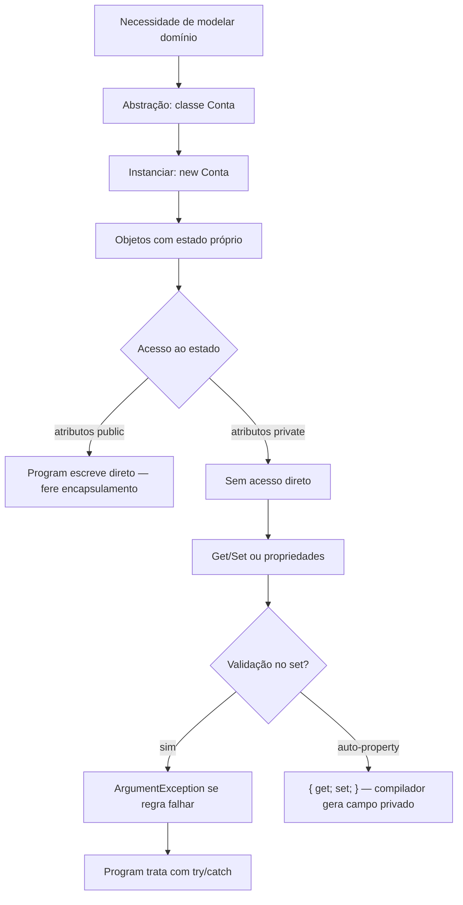

## Visão Geral do Conceito

Até aqui o foco era **comandos**: variáveis, condicionais, laços, `DateTime`. Orientação a objetos (OO / POO) muda a pergunta central: em vez de “qual o próximo comando?”, você pergunta **quais dados do domínio existem e quais regras os protegem**.

Nesta lição (primeira de uma sequência de semanas sobre OO) você reconstrói:

1. o **paradigma** e os **quatro pilares**;
2. a diferença **classe × objeto** (planta × casa);
3. a prática com a classe <mark style="background-color: #242424; padding: 2px 4px; border-radius: 3px; color: inherit;">`Conta`</mark> na pasta <mark style="background-color: #242424; padding: 2px 4px; border-radius: 3px; color: inherit;">`Models`</mark>;
4. a evolução **Encapsulamento 1 → 4**: atributos públicos → privados → Get/Set manuais → propriedades automáticas em C#.

> **Problema que resolve:** sem OO, regras de negócio (Id válido, nome preenchido, saldo não negativo) espalham-se pelo `Program`. Com classes e encapsulamento, o estado e o comportamento relacionados ficam **juntos** e protegidos.

> **Lacuna de fonte:** brief sem PDF obrigatório; conteúdo derivado da transcrição WebVTT da Aula 10 (18/08/2026). Herança, polimorfismo aprofundado, construtores e customização completa de propriedades ficam para aulas seguintes (declarado pelo professor).

## Modelo Mental

### Paradigma: dados primeiro

Antes da OO, o foco era **estrutura e modularização do código** (procedimentos/funções). Com OO, o software organiza-se em **objetos** que agrupam:

- **estado** — dados (atributos);
- **comportamento** — operações (métodos).

Na prática da aula: modele primeiro a <mark style="background-color: #242424; padding: 2px 4px; border-radius: 3px; color: inherit;">`Conta`</mark> (`Id`, `Nome`, `Saldo`) e as regras (Id > 0, nome não vazio, saldo ≥ 0). Só depois escreva o código que opera esses dados. Pensar nos dados revela as **regras de negócio** e antecipa a modelagem (inclusive a do banco, como comentado em aula).

### Classe × objeto: planta e casas

| Conceito | Analogia | No código |
|----------|----------|-----------|
| **Classe** | planta baixa | definição abstrata: quais atributos e métodos existem |
| **Objeto** | casa construída | instância na memória, com valores concretos |
| **Instanciar** | construir a partir da planta | `new Conta()` |

A classe **não tem** “cor” nem “endereço” reais. Os objetos, sim — e você pode criar dezenas a partir do mesmo molde (como casas idênticas de um condomínio, só mudando cor e endereço).

### Quatro pilares (mapa do curso)

| Pilar | Ideia nesta aula | Profundidade agora |
|-------|------------------|--------------------|
| **Abstração** | representar entidades do mundo (aluno, conta, produto) no software | introduzido |
| **Encapsulamento** | controlar acesso ao estado; proteger e validar | foco prático |
| **Herança** | — | só nomeado; aulas futuras |
| **Polimorfismo** | — | só nomeado; aulas futuras |



## Mecânica Central

### Abstração: atributos e métodos

A classe define:

- **atributos** (dados) — ex.: aluno com `nome`, `matricula`, `curso`;
- **métodos** (comportamentos) — ex.: consultar/alterar nome.

> **Vocabulário importa:** em entrevista e no código, use os nomes certos: classe, objeto, atributo, método, instância, encapsulamento.

### Convenção .NET: pasta `Models`

No ecossistema C# / .NET é **indicado** colocar as classes de domínio numa pasta <mark style="background-color: #242424; padding: 2px 4px; border-radius: 3px; color: inherit;">`Models`</mark> (em Java/Python o nome pode variar: `domain`, `entities`, etc.). No Rider/VS: botão direito no projeto → New Folder → `Models` → New Class → `Conta`.

- <mark style="background-color: #242424; padding: 2px 4px; border-radius: 3px; color: inherit;">`namespace`</mark> ≈ pacote Java (detalhe aprofundado depois).
- <mark style="background-color: #242424; padding: 2px 4px; border-radius: 3px; color: inherit;">`using`</mark> ≈ `import` — traz a classe de `Models` para o `Program`.

### Encapsulamento 1 — atributos públicos (anti-exemplo)

Primeiro passo pedagógico: classe “como se fosse Java”, tudo <mark style="background-color: #242424; padding: 2px 4px; border-radius: 3px; color: inherit;">`public`</mark>.

```csharp
namespace Encapsulamento1.Models;

public class Conta
{
    public int Id;
    public string Nome;
    public double Saldo;
}
```

```csharp
using Encapsulamento1.Models;

Conta conta1 = new Conta();
conta1.Id = 1;
conta1.Nome = "Pedro";
conta1.Saldo = 1000;

Conta conta2 = new Conta();
conta2.Id = 2;
conta2.Nome = "José";
conta2.Saldo = 2000;

Console.WriteLine($"{conta1.Id} {conta1.Nome} {conta1.Saldo}");
Console.WriteLine($"{conta2.Id} {conta2.Nome} {conta2.Saldo}");
```

A **classe** não guarda os valores finais; cada **objeto** tem o seu estado. Funciona — mas `Program` acessa os campos direto. Isso **fere o encapsulamento**.

> **Regra da aula:** atributos da classe de negócio devem ser **sempre privados**. Público é a API (métodos/propriedades), não o estado cru.

### Encapsulamento 2 — `private` sem API

```csharp
public class Conta
{
    private int id;
    private string nome;
    private double saldo;
}
```

Após tornar privados, `conta1.Id = 1` no `Program` deixa de compilar: outra classe não acessa o estado. Isso **é** encapsulamento — ainda incompleto, porque falta um caminho controlado de leitura/escrita.

### Getters e setters (estilo Java) + `this`

Métodos de acesso são **públicos** (senão o `Program` também não os alcança). Métodos privados ficam só para uso interno da classe.

Em C#, métodos começam com **letra maiúscula** (`SetId`, `GetId`). Em Java, o costume é minúscula (`setId`). Minúscula em C# **compila**, mas quebra a convenção da linguagem.

Quando o parâmetro tem o **mesmo nome** do atributo, use <mark style="background-color: #242424; padding: 2px 4px; border-radius: 3px; color: inherit;">`this`</mark> para apontar o atributo da instância:

```csharp
public void SetId(int id)
{
    this.id = id; // this.id = atributo; id = parâmetro
}

public int GetId()
{
    return id; // sem ambiguidade: this opcional
}

public void SetNome(string nome)
{
    this.nome = nome;
}

public string GetNome()
{
    return nome;
}

public void SetSaldo(double saldo)
{
    this.saldo = saldo;
}

public double GetSaldo()
{
    return saldo;
}
```

No `Program`:

```csharp
conta1.SetId(1);
conta1.SetNome("Pedro");
conta1.SetSaldo(1000);
Console.WriteLine($"{conta1.GetId()} {conta1.GetNome()} {conta1.GetSaldo()}");
```

> **Get vs Set:** em geral Get é público; Set pode ou não ser público — depende da regra (ex.: saldo só muda por operações internas). Detalhe aprofundado na [[encapsulamento-getters-setters-validacao-csharp]].

### Por que métodos? Validar regras (Encapsulamento 3)

Encapsulamento **não** é só esconder campos: é **proteger o estado** e **controlar** quem/como altera.

Regras da conta na aula:

| Campo | Regra |
|-------|--------|
| `Id` | não pode ser ≤ 0 |
| `Nome` | não nulo/vazio; comprimento ≥ 2 |
| `Saldo` | não pode ser negativo ao criar/atribuir |

**Errado** na classe de negócio: `Console.WriteLine("Erro...")` + `return`. Isso **acopla** o domínio ao console. Classe de negócio **não faz entrada nem saída de dados**.

**Certo:** lançar <mark style="background-color: #242424; padding: 2px 4px; border-radius: 3px; color: inherit;">`ArgumentException`</mark>; a camada de cima trata se quiser.

```csharp
public void SetId(int id)
{
    if (id <= 0)
        throw new ArgumentException("Erro: valor do Id inválido.");
    this.id = id;
}

public void SetNome(string nome)
{
    if (string.IsNullOrEmpty(nome) || nome.Length < 2)
        throw new ArgumentException("Erro: valor do nome inválido.");
    this.nome = nome;
}

public void SetSaldo(double saldo)
{
    if (saldo < 0)
        throw new ArgumentException("Erro: valor do saldo inválido.");
    this.saldo = saldo;
}
```

No `Program`, trate o tipo **específico** (código limpo): <mark style="background-color: #242424; padding: 2px 4px; border-radius: 3px; color: inherit;">`catch (ArgumentException)`</mark>, não `Exception` genérica. Coloque os prints **dentro** do `try` — se o set falhar, o fluxo pula para o `catch` e não imprime estado inconsistente.

```csharp
try
{
    conta1.SetId(0); // dispara ArgumentException
    Console.WriteLine(conta1.GetId());
}
catch (ArgumentException ex)
{
    Console.WriteLine(ex.Message);
}
```

> **Tipagem estática:** em C#/Java, passar `1000` onde o parâmetro é `string` é **erro de compilação** (o programa nem roda). Em Python isso passaria — daí a ênfase diferente em validação de tipo.

> **Desafio deixado em aula (não resolvido ao vivo):** exigir nome **e** sobrenome. Pista do professor: <mark style="background-color: #242424; padding: 2px 4px; border-radius: 3px; color: inherit;">`Split`</mark> no espaço gera um **array** de strings (não lista), e você valida a quantidade de partes.

### Encapsulamento 4 — propriedade automática em C#

C# **não** se programa “como Java” no dia a dia. A sintaxe idiomática:

```csharp
public class Conta
{
    public int Id { get; set; }
    public string Nome { get; set; }
    public double Saldo { get; set; }
}
```

Pontos críticos da aula:

- `Id`, `Nome`, `Saldo` **não** são atributos públicos “crus”: são **propriedades** (métodos get/set).
- O **compilador** gera, por trás, um campo privado + implementação de get/set.
- No `Program` você escreve `conta.Id = 1` — parece campo, mas passa pela propriedade.
- Customizar o comportamento (validação igual ao Encapsulamento 3) exige **expandir** a propriedade — tema da **próxima aula**.

```csharp
Conta conta1 = new Conta();
conta1.Id = 1;
conta1.Nome = "Pedro";
conta1.Saldo = 1000;
```

## Uso Prático

### Fluxo de solução console com Models

1. Criar solução/projeto console (ex.: `Encapsulamento1`).
2. Pasta `Models` + classe `Conta`.
3. Remover usings/template desnecessários; tornar a classe `public`.
4. No `Program`, `using` do namespace de Models; instanciar com `new`; atribuir via API pública; imprimir.
5. Evoluir: `private` → Get/Set → validação com exceção → propriedades `{ get; set; }`.

### Dois objetos, mesma classe

Cenário ADS: duas contas correntes no mesmo sistema — mesma estrutura, estados diferentes (como dois clientes no onboarding).

```csharp
Conta contaPedro = new Conta();
contaPedro.SetId(1);
contaPedro.SetNome("Pedro");
contaPedro.SetSaldo(1000);

Conta contaJose = new Conta();
contaJose.SetId(2);
contaJose.SetNome("José");
contaJose.SetSaldo(2000);
```

Alterar `contaPedro` **não** altera `contaJose`: cada instância tem memória própria.

### Getters que transformam (ideia citada)

Além de validar no set, o get pode **derivar** valor (ex.: devolver nome em maiúsculas, ou sobrenome antes do nome). A aula enfatizou o set para regras; o get transformador é extensão natural do mesmo princípio: a API controla o que o mundo externo vê.

## Erros Comuns

| Sintoma | Causa | Correção |
|---------|-------|----------|
| `Program` acessa `conta.id` e não compila | atributo `private` | usar Get/Set ou propriedade pública |
| Compila com campos `public`, mas Id = -1 entra | sem encapsulamento | tornar privado e validar no set |
| `SetId` imprime erro e segue com estado estranho | `Console` + `return` no domínio | `throw new ArgumentException(...)` |
| `catch (Exception)` engole tudo | catch genérico | `catch (ArgumentException)` (e outros catches se houver mais tipos) |
| Métodos `setId` / `getId` minúsculos | hábito Java | PascalCase em C#: `SetId` / `GetId` ou propriedades |
| Confundir parâmetro `id` com atributo `id` | shadowing | `this.id = id` |
| Após copiar projeto, namespace errado | paste de Encapsulamento2 em 3 | Rider: Fix namespaces / alinhar `using` |
| Achar que `{ get; set; }` é campo público | sintaxe enganosa | lembrar: é propriedade; compilador gera backing field |
| Cadeado / classe inacessível | classe criada fora do projeto ou pasta sem acesso | criar a classe **dentro** do projeto correto |

## Visão Geral de Debugging

1. **Não compila ao acessar campo?** Confira `private` vs API pública e o `using` de Models.
2. **Compila mas aceita lixo?** Ainda está em Encapsulamento 1 (campos públicos) ou auto-property sem validação — falta regra no set.
3. **Exceção não tratada quebra o processo?** O domínio lançou corretamente; falta `try/catch` no chamador (ou o catch é do tipo errado).
4. **Mensagem de erro aparece mas o fluxo “continua estranho”?** Prints fora do `try`, ou validação só com `WriteLine` sem interromper.
5. **Dois projetos na solução:** defina o projeto de startup certo antes de culpar o código da Conta.

<details>
<summary>Checklist rápido Encapsulamento 1→4</summary>

1. Conta em `Models`, classe `public`.
2. Estado `private` (ou só via propriedade).
3. Mutação só por Set/propriedade set.
4. Regras → `ArgumentException`, zero `Console` na Conta.
5. `Program` com `try/catch (ArgumentException)`.
6. Idioma C#: preferir propriedades; Get/Set manuais servem para entender o mecanismo.

</details>

## Principais Pontos

- OO organiza o software em objetos com **estado + comportamento**.
- **Classe** = molde; **objeto** = instância com valores.
- Pilares: abstração, encapsulamento, herança, polimorfismo — esta aula aprofunda os dois primeiros.
- Pense **dados e regras** antes dos comandos.
- Em .NET, classes de domínio costumam viver em <mark style="background-color: #242424; padding: 2px 4px; border-radius: 3px; color: inherit;">`Models`</mark>.
- Atributos de negócio: **privados**; acesso via métodos/propriedades.
- Encapsulamento protege estado e concentra validação.
- Domínio **não** imprime: lança <mark style="background-color: #242424; padding: 2px 4px; border-radius: 3px; color: inherit;">`ArgumentException`</mark>.
- C# idiomático: <mark style="background-color: #242424; padding: 2px 4px; border-radius: 3px; color: inherit;">`public int Id { get; set; }`</mark> — propriedade, não campo cru.
- Não programe C# “como se fosse Java”; os conceitos batem, a sintaxe não.

## Preparação para Prática

Antes do laboratório, você deve conseguir:

- explicar classe × objeto com a analogia planta/casa;
- montar mentalmente `Conta` com Id, Nome e Saldo e listar as três regras;
- distinguir acesso direto (ruim) de Get/Set ou propriedade (bom);
- descrever por que `ArgumentException` + try/catch específico substitui `Console` na classe.

O Editor Integrado do ISS executa **JavaScript**. Os desafios abaixo espelham a lógica da aula (estado encapsulado, setters com regra, exceção/resultado de erro); nos comentários está o equivalente C#. Pratique o mesmo desenho num Console App .NET 8 na sua máquina.

## Laboratório de Prática

### Easy — Instanciar “contas” e ler estado via API

Contexto ADS: um microserviço de onboarding bancário recebe dois correntistas. Você não expõe o objeto interno cru: só cria via fábrica e lê Id/nome/saldo por getters — análogo a `new Conta()` + `GetId`/`GetNome`/`GetSaldo`.

```javascript
/**
 * Equivalente mental C#:
 *   Conta c = new Conta();
 *   c.SetId(id); c.SetNome(nome); c.SetSaldo(saldo);
 *   return { id: c.GetId(), nome: c.GetNome(), saldo: c.GetSaldo() };
 *
 * @param {number} id
 * @param {string} nome
 * @param {number} saldo
 * @returns {{ id: number, nome: string, saldo: number }}
 */
function criarContaLeitura(id, nome, saldo) {
  // Estado "privado" do closure — não retornar o objeto interno cru.
  const conta = { _id: 0, _nome: "", _saldo: 0 };

  // TODO:
  // 1. Atribuir _id, _nome, _saldo a partir dos parâmetros (sem validação neste easy).
  // 2. Retornar apenas { id, nome, saldo } lidos dos campos privados (API pública).
  return { id: 0, nome: "", saldo: 0 };
}

criarContaLeitura(1, "Pedro", 1000);
criarContaLeitura(2, "José", 2000);
```

### Medium — Setters com regras (espelho do Encapsulamento 3)

Contexto ADS: a API de abertura de conta deve rejeitar Id ≤ 0, nome vazio/curto e saldo negativo — as mesmas regras da aula. Em C# isso seria `throw new ArgumentException`; aqui retorne um resultado estruturado para o editor não quebrar.

```javascript
/**
 * Equivalente C#:
 *   if (id <= 0) throw new ArgumentException("...");
 *   if (string.IsNullOrEmpty(nome) || nome.Length < 2) throw ...
 *   if (saldo < 0) throw ...
 *
 * @param {number} id
 * @param {string} nome
 * @param {number} saldo
 * @returns {{ ok: boolean, conta: {id:number,nome:string,saldo:number}|null, erro: string|null }}
 */
function abrirContaValidada(id, nome, saldo) {
  const conta = { _id: 0, _nome: "", _saldo: 0 };

  function setId(v) {
    // TODO: se v <= 0, return mensagem de erro; senão conta._id = v; return null
    return "não implementado";
  }
  function setNome(v) {
    // TODO: null/undefined/"" ou length < 2 → erro; senão conta._nome = v
    return "não implementado";
  }
  function setSaldo(v) {
    // TODO: v < 0 → erro; senão conta._saldo = v
    return "não implementado";
  }

  // TODO: chamar setId, setNome, setSaldo em sequência; no primeiro erro, ok:false
  // Se tudo ok, retornar ok:true e conta pública { id, nome, saldo }
  return { ok: false, conta: null, erro: "não implementado" };
}

abrirContaValidada(0, "Pedro", 1000);
abrirContaValidada(1, "", 1000);
abrirContaValidada(1, "LP", -10);
abrirContaValidada(1, "Pedro", 1000);
```

### Hard — Nome e sobrenome com Split + “camada Program”

Contexto ADS: compliance exige pelo menos **nome e sobrenome** (duas partes separadas por espaço). O domínio valida; a camada de apresentação agrega mensagens — como `try/catch` por conta no `Program` da aula. Use `split` (array, não lista).

```javascript
/**
 * Domínio: valida Id, nome (mín. 2 partes via split em espaço, cada parte length >= 1),
 * saldo >= 0. Não "imprime" — só retorna erro.
 *
 * Camada Program: tenta abrir várias contas e coleta resultados sem parar no primeiro erro.
 *
 * @param {Array<{id:number, nome:string, saldo:number}>} pedidos
 * @returns {{ abertas: Array<{id:number,nome:string,saldo:number}>, falhas: string[] }}
 */
function processarAberturas(pedidos) {
  function validarEAbrir(p) {
    // TODO:
    // 1. id <= 0 → throw ou return erro "Id inválido"
    // 2. partes = (p.nome || "").trim().split(/\s+/).filter(Boolean)
    //    se partes.length < 2 → erro "Nome deve ter nome e sobrenome"
    // 3. saldo < 0 → erro saldo
    // 4. sucesso → { id, nome: p.nome.trim(), saldo }
    return { ok: false, erro: "não implementado", conta: null };
  }

  const abertas = [];
  const falhas = [];

  // TODO: para cada pedido, validar; ok → abertas; senão → falhas.push(erro)
  return { abertas, falhas };
}

processarAberturas([
  { id: 1, nome: "Pedro Silva", saldo: 1000 },
  { id: 0, nome: "José Souza", saldo: 500 },
  { id: 3, nome: "Ana", saldo: 200 },
  { id: 4, nome: "LP Maia", saldo: -1 }
]);
```

<!-- CONCEPT_EXTRACTION
concepts:
  - orientação a objetos / POO
  - mudança de paradigma (código → dados)
  - quatro pilares: abstração encapsulamento herança polimorfismo
  - classe vs objeto vs instância
  - analogia planta / casa
  - atributo e método
  - pasta Models no .NET
  - namespace e using
  - public vs private
  - encapsulamento (proteger estado)
  - getter e setter estilo Java
  - convenção PascalCase de métodos em C#
  - this para desambiguar parâmetro/atributo
  - regras de negócio Id Nome Saldo
  - ArgumentException
  - try/catch específico vs Exception
  - acoplamento por Console na classe de negócio
  - string.IsNullOrEmpty e Length
  - Split → array de strings
  - propriedade automática { get; set; }
  - compilador gera backing field privado
skills:
  - Distinguir classe de objeto com vocabulário preciso
  - Criar classe de domínio em Models e instanciar com new
  - Encapsular estado com private e expor via Get/Set
  - Usar this quando parâmetro sombreia atributo
  - Validar Id, Nome e Saldo no setter
  - Lançar ArgumentException em vez de imprimir no domínio
  - Tratar ArgumentException no Program com try/catch específico
  - Reconhecer propriedade automática como API get/set gerada
  - Aplicar Split para validar nome e sobrenome
examples:
  - conta-atributos-publicos-anti-exemplo
  - conta-private-sem-api
  - conta-get-set-this
  - conta-validacao-argumentexception
  - conta-auto-property-csharp
  - lab-js-conta-encapsulada
-->

<!-- EXERCISES_JSON
[
  {
    "id": "csharp-oo-criar-conta-leitura",
    "slug": "csharp-oo-criar-conta-leitura",
    "difficulty": "easy",
    "title": "Instanciar contas e ler estado via API",
    "discipline": "fundamentos-csharp",
    "editorLanguage": "javascript",
    "tags": ["csharp", "oop", "classe", "objeto", "encapsulamento"],
    "summary": "Criar estado encapsulado e expor só Id/nome/saldo por uma API de leitura, análogo a new Conta + getters."
  },
  {
    "id": "csharp-oo-abrir-conta-validada",
    "slug": "csharp-oo-abrir-conta-validada",
    "difficulty": "medium",
    "title": "Setters com regras de Id, nome e saldo",
    "discipline": "fundamentos-csharp",
    "editorLanguage": "javascript",
    "tags": ["csharp", "oop", "encapsulamento", "validacao", "argumentexception"],
    "summary": "Validar Id > 0, nome com length >= 2 e saldo >= 0 nos setters, espelhando Encapsulamento 3."
  },
  {
    "id": "csharp-oo-processar-aberturas-split",
    "slug": "csharp-oo-processar-aberturas-split",
    "difficulty": "hard",
    "title": "Nome/sobrenome com Split e lote de aberturas",
    "discipline": "fundamentos-csharp",
    "editorLanguage": "javascript",
    "tags": ["csharp", "oop", "split", "validacao", "try-catch"],
    "summary": "Exigir nome e sobrenome via Split e processar várias contas coletando falhas, como Program com try/catch por conta."
  }
]
-->

<!--
lessons.json (NÃO aplicado por este worker — integração serial do orquestrador):
{
  "discipline": "fundamentos-csharp",
  "slug": "introducao-orientacao-objetos-csharp",
  "title": "Introdução à orientação a objetos em C#",
  "order": 10,
  "file": "content/fundamentos-csharp/aula-10-introducao-orientacao-objetos-csharp.md"
}
-->
