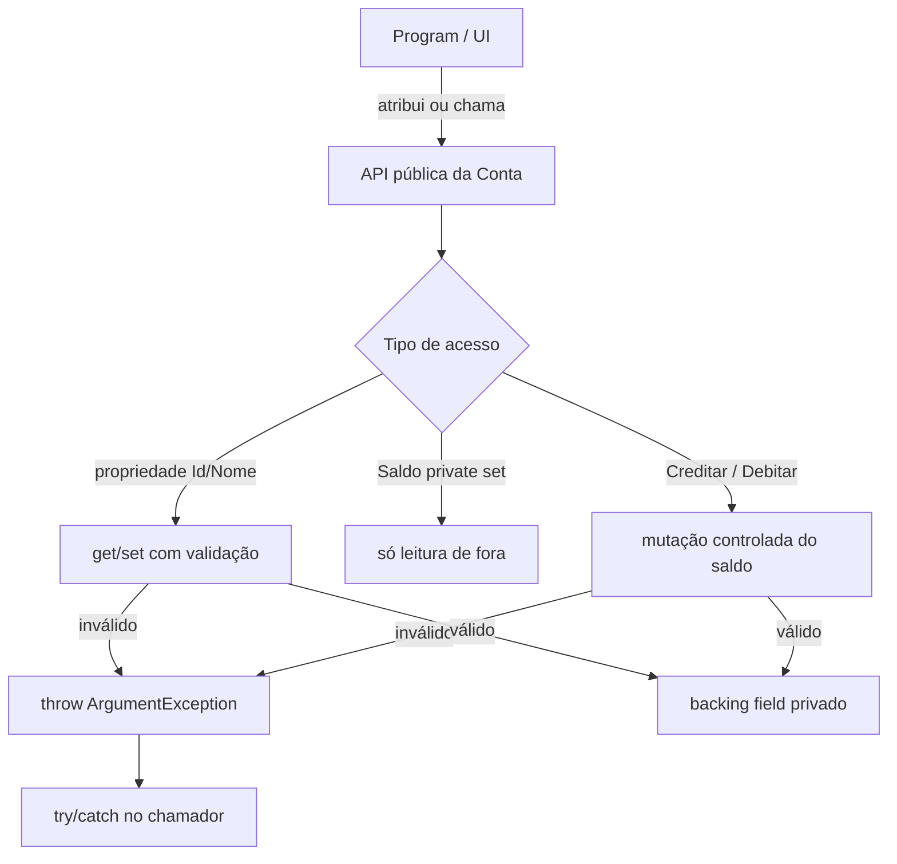
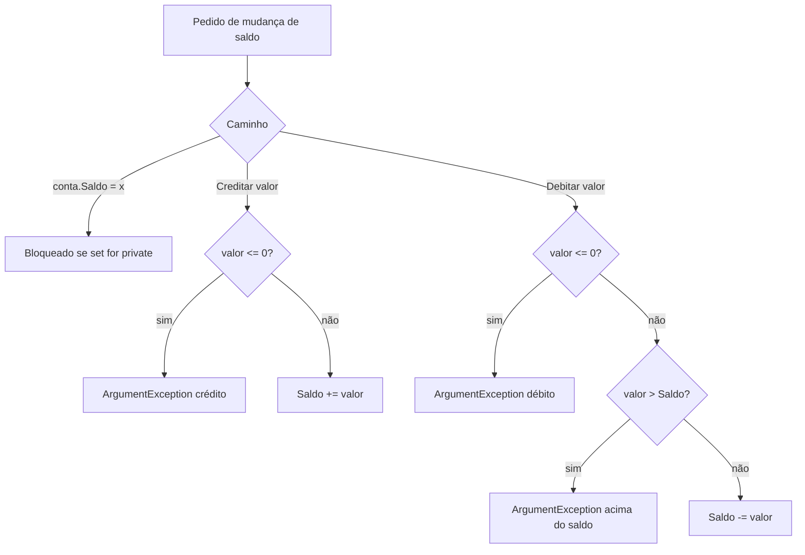

## Visão Geral do Conceito

Em sistemas de backend, uma **conta corrente**, um **pedido** ou um **saldo de carteira** não pode aceitar qualquer valor que o chamador jogue no objeto. Encapsulamento resolve isso: o estado interno fica protegido; a API pública (propriedades e métodos) controla leitura e escrita.

Nesta lição você reconstrói a evolução feita em aula:

1. atributos públicos → privados;
2. acesso via **getters/setters** (em C#: **propriedades**);
3. validação de regras de negócio no `set` com <mark style="background-color: #242424; padding: 2px 4px; border-radius: 3px; color: inherit;">`ArgumentException`</mark>;
4. saldo mutável só por <mark style="background-color: #242424; padding: 2px 4px; border-radius: 3px; color: inherit;">`Creditar`</mark> / <mark style="background-color: #242424; padding: 2px 4px; border-radius: 3px; color: inherit;">`Debitar`</mark>.

> **Problema que resolve:** sem encapsulamento, qualquer trecho do programa pode zerar o saldo, gravar `Id = -1` ou nome vazio. Com propriedades e métodos, as regras ficam **num único lugar** — a classe de negócio.

> **Lacuna de fonte:** não há PDF/slides obrigatórios nesta missão; o conteúdo abaixo deriva da transcrição WebVTT da Aula 11 (24/08/2026). Construtores e herança ficam para a aula seguinte (declarado pelo professor).

## Modelo Mental

Pense na conta como um **cofre com fichas na porta**:

| Peça | Papel |
|------|--------|
| Campo privado (`_id`, `_nome`, `_saldo`) | o dinheiro **dentro** do cofre |
| Propriedade (`Id`, `Nome`, `Saldo`) | a **ficha** na porta (get = olhar; set = colocar com regras) |
| Métodos `Creditar` / `Debitar` | operações oficiais que **mudam** o saldo quando o set público do saldo é retirado |

Em Java, costuma-se escrever `getX`/`setX` à mão. Em C#, a sintaxe <mark style="background-color: #242424; padding: 2px 4px; border-radius: 3px; color: inherit;">`{ get; set; }`</mark> é uma **propriedade automática**: parece um campo público, mas **é método** — e por isso pode (e deve) ser pública, enquanto o estado real permanece privado.



## Mecânica Central

### 1. Propriedades automáticas ≠ atributos

Trecho típico (estilo “encapsulamento 4/5” da aula):

```csharp
public class ContaCorrente
{
    // Propriedades automáticas — NÃO são atributos da classe
    public int Id { get; set; }
    public string Nome { get; set; }
    public decimal Saldo { get; set; }
}
```

O que o **compilador** gera por trás (versão expandida didática):

```csharp
public class ContaCorrente
{
    private int _id;
    private string _nome;
    private decimal _saldo;

    public int Id
    {
        get { return _id; }
        set { _id = value; }
    }

    public string Nome
    {
        get { return _nome; }
        set { _nome = value; }
    }

    public decimal Saldo
    {
        get { return _saldo; }
        set { _saldo = value; }
    }
}
```

> **Convenção:** o underscore (`_id`) marca o **atributo privado** de suporte. O identificador em PascalCase (`Id`) é a propriedade pública.

### 2. Setters com regras de negócio

Regras praticadas na aula (conta corrente):

| Campo | Regra inválida |
|-------|----------------|
| `Id` | `<= 0` |
| `Nome` | nulo/vazio **ou** comprimento `< 2` |
| `Saldo` | `< 0` (não abrir conta com saldo negativo na atribuição direta) |

Forma expandida do `set` (estilo “encapsulamento 6”):

```csharp
public int Id
{
    get { return _id; }
    set
    {
        if (value <= 0)
            throw new ArgumentException("Erro: valor do Id inválido.");
        _id = value;
    }
}

public string Nome
{
    get { return _nome; }
    set
    {
        if (string.IsNullOrEmpty(value) || value.Length < 2)
            throw new ArgumentException("Erro: valor do Nome inválido.");
        _nome = value;
    }
}

public decimal Saldo
{
    get { return _saldo; }
    set
    {
        if (value < 0)
            throw new ArgumentException("Erro: valor do Saldo inválido.");
        _saldo = value;
    }
}
```

Pontos críticos:

- Use <mark style="background-color: #242424; padding: 2px 4px; border-radius: 3px; color: inherit;">`ArgumentException`</mark> (não “print” na classe).
- Use <mark style="background-color: #242424; padding: 2px 4px; border-radius: 3px; color: inherit;">`string.IsNullOrEmpty`</mark> para nome nulo ou vazio.
- A palavra <mark style="background-color: #242424; padding: 2px 4px; border-radius: 3px; color: inherit;">`value`</mark> é o parâmetro implícito do `set`.

### 3. Quem trata o erro: o chamador

```csharp
try
{
    ContaCorrente conta = new ContaCorrente();
    conta.Id = 1;
    conta.Nome = "Pedro";
    conta.Saldo = 100;
}
catch (ArgumentException ex)
{
    Console.WriteLine(ex.Message);
}
```

> **Regra da aula:** trate a exceção **mais específica** possível (`ArgumentException`), não um `Exception` genérico “só para engolir tudo”. Classe de negócio **não** faz <mark style="background-color: #242424; padding: 2px 4px; border-radius: 3px; color: inherit;">`Console.WriteLine`</mark> para regra quebrada — lança; a camada de cima decide a mensagem.

### 4. Restringir o saldo: `private set` + Creditar/Debitar

No “encapsulamento 7”, o saldo deixa de ser atribuível livremente de fora:

```csharp
public decimal Saldo { get; private set; }

public void Creditar(decimal valor)
{
    if (valor <= 0)
        throw new ArgumentException("Erro: valor do crédito inválido.");
    Saldo += valor;
}

public void Debitar(decimal valor)
{
    if (valor <= 0)
        throw new ArgumentException("Erro: valor do débito inválido.");
    if (valor > Saldo)
        throw new ArgumentException("Erro: valor acima do saldo.");
    Saldo -= valor;
}
```

Fluxo de mutação:



### 5. Valor padrão sem construtor

Na demonstração, `Debitar(10)` falhou com “valor acima do saldo” **mesmo sem** atribuir saldo após `new ContaCorrente()`. Motivo: o compilador **inicializa** campos numéricos com o valor padrão (`0` para `decimal`/`int`). Construtores explícitos — próxima aula.

### 6. Início da calculadora OO (ponte)

Ao final, a aula começou a mover `Somar`/`Subtrair`/`Multiplicar`/`Dividir` para uma classe <mark style="background-color: #242424; padding: 2px 4px; border-radius: 3px; color: inherit;">`Calculadora`</mark> em pasta `Models`, com métodos de **instância** (não estáticos). Detalhamento e construtores ficam para a continuidade — não é o núcleo desta lição.

## Uso Prático

### Conta com validação no set + uso no Program

```csharp
using System;

namespace Encapsulamento6.Models
{
    public class ContaCorrente
    {
        private int _id;
        private string _nome;
        private decimal _saldo;

        public int Id
        {
            get => _id;
            set
            {
                if (value <= 0)
                    throw new ArgumentException("Erro: valor do Id inválido.");
                _id = value;
            }
        }

        public string Nome
        {
            get => _nome;
            set
            {
                if (string.IsNullOrEmpty(value) || value.Length < 2)
                    throw new ArgumentException("Erro: valor do Nome inválido.");
                _nome = value;
            }
        }

        public decimal Saldo
        {
            get => _saldo;
            set
            {
                if (value < 0)
                    throw new ArgumentException("Erro: valor do Saldo inválido.");
                _saldo = value;
            }
        }
    }
}
```

```csharp
try
{
    var conta = new ContaCorrente();
    conta.Id = 0; // dispara ArgumentException
}
catch (ArgumentException ex)
{
    Console.WriteLine(ex.Message);
}
```

### Conta com saldo só via operações

```csharp
public class ContaCorrente
{
    public int Id { get; set; }
    public string Nome { get; set; }
    public decimal Saldo { get; private set; }

    public void Creditar(decimal valor)
    {
        if (valor <= 0)
            throw new ArgumentException("Erro: valor do crédito inválido.");
        Saldo += valor;
    }

    public void Debitar(decimal valor)
    {
        if (valor <= 0)
            throw new ArgumentException("Erro: valor do débito inválido.");
        if (valor > Saldo)
            throw new ArgumentException("Erro: valor acima do saldo.");
        Saldo -= valor;
    }
}

// Uso
var c = new ContaCorrente { Id = 1, Nome = "Pedro" };
c.Creditar(50);
c.Debitar(10);
Console.WriteLine(c.Saldo); // 40
```

Cenário ADS típico: API de wallet, ledger interno ou microserviço de contas — a regra “não debitar acima do saldo” mora no domínio, não no controller HTTP.

## Erros Comuns

1. **Tratar propriedade automática como campo Java**  
   Sintoma: achar que `public int Id { get; set; }` “quebra” o encapsulamento porque é público.  
   Correção: o público é a **API**; o estado fica no backing field privado gerado. O risco real é um `set` sem validação.

2. **`Console.WriteLine` dentro da classe de negócio**  
   Sintoma: validação “funciona” no console app, mas a classe fica inutilizável em API/teste.  
   Correção: `throw new ArgumentException(...)`; quem chama trata.

3. **`catch (Exception)` genérico**  
   Sintoma: engole erros inesperados (null reference, IO, etc.).  
   Correção: `catch (ArgumentException)` alinhado ao que a conta lança.

4. **Validar só no Program e deixar set aberto**  
   Sintoma: outro método atribui `Saldo = -10` e contorna a regra.  
   Correção: regra no `set` ou em `Creditar`/`Debitar`; preferir `private set` no saldo.

5. **Esquecer valor padrão do saldo**  
   Sintoma: `Debitar` logo após `new` falha com “acima do saldo”.  
   Correção: entender inicialização padrão (`0`) ou (próxima aula) construtor que define saldo inicial.

6. **Confundir `string.IsNullOrEmpty` com só `Length`**  
   Sintoma: `NullReferenceException` se `value` for `null` antes de `value.Length`.  
   Correção: checar nulo/vazio primeiro (`IsNullOrEmpty`), depois comprimento.

## Visão Geral de Debugging

Quando a validação “não pega” ou o programa explode:

1. **Confirme o caminho de escrita** — a atribuição passa pelo `set` da propriedade ou por um campo público antigo?
2. **Leia o tipo da exceção** — deve ser <mark style="background-color: #242424; padding: 2px 4px; border-radius: 3px; color: inherit;">`ArgumentException`</mark> com a mensagem que você escreveu.
3. **Verifique o `catch`** — se não houver `try`/`catch`, o processo encerra; se o `catch` for genérico demais, a mensagem pode sumir no fluxo errado.
4. **Inspecione `Saldo` após `new`** — sem construtor, espere `0` antes de `Creditar`.
5. **Teste uma regra por vez** — Id `<= 0`, nome curto, crédito `0`, débito maior que saldo.

<details>
<summary>Checklist rápido de regressão (conta)</summary>

- `Id = 0` → mensagem de Id inválido  
- `Nome = ""` ou `"A"` → Nome inválido  
- `Saldo = -1` (se set público) → Saldo inválido  
- `Creditar(0)` → crédito inválido  
- `Debitar` com saldo `0` e valor `10` → acima do saldo  

</details>

## Principais Pontos

- Propriedade automática C# (`{ get; set; }`) **não** é atributo: o compilador gera campo privado + get/set.
- Underscore (`_saldo`) marca backing field privado na forma expandida.
- Regras de negócio no `set` (ou em métodos) usam <mark style="background-color: #242424; padding: 2px 4px; border-radius: 3px; color: inherit;">`ArgumentException`</mark>, não print.
- Classe de negócio não imprime; o chamador faz <mark style="background-color: #242424; padding: 2px 4px; border-radius: 3px; color: inherit;">`try`/`catch`</mark> específico.
- <mark style="background-color: #242424; padding: 2px 4px; border-radius: 3px; color: inherit;">`private set`</mark> no saldo + <mark style="background-color: #242424; padding: 2px 4px; border-radius: 3px; color: inherit;">`Creditar`</mark>/<mark style="background-color: #242424; padding: 2px 4px; border-radius: 3px; color: inherit;">`Debitar`</mark> fecha o encapsulamento das mutações.
- Sem construtor, campos numéricos começam no valor padrão (`0`).
- Calculadora OO e construtores: continuidade da trilha (próximas aulas).

## Preparação para Prática

Antes do laboratório, você deve conseguir:

- Explicar a diferença entre campo privado e propriedade pública em C#.
- Escrever validação de Id/Nome/Saldo com exceção.
- Modelar crédito/débito com regras e saldo de leitura pública.
- Escolher onde colocar `try`/`catch` (fora da classe de domínio).

O editor ISS usa JavaScript nos desafios; cada enunciado traz o **equivalente mental em C#** alinhado à aula.

## Laboratório de Prática

### Easy — Validar Id e Nome (espelho do set)

Contexto ADS: cadastro de conta em um BFF recebe `id` e `nome` de um formulário. Implemente as mesmas regras da aula sem imprimir dentro das funções de domínio — retorne erro estruturado (análogo a lançar/tratar `ArgumentException`).

```javascript
/**
 * Equivalente mental C#:
 *   set de Id: if (value <= 0) throw new ArgumentException("...");
 *   set de Nome: if (string.IsNullOrEmpty(value) || value.Length < 2) throw ...
 *
 * @param {number} id
 * @param {string|null|undefined} nome
 * @returns {{ ok: boolean, erro: string|null }}
 */
function validarIdNomeConta(id, nome) {
  // TODO:
  // 1. Se id <= 0, retornar { ok: false, erro: "Erro: valor do Id inválido." }.
  // 2. Se nome for null/undefined/"" (IsNullOrEmpty) OU nome.length < 2,
  //    retornar { ok: false, erro: "Erro: valor do Nome inválido." }.
  // 3. Caso contrário { ok: true, erro: null }.
  return { ok: false, erro: "não implementado" };
}

// Smoke (não falha se TODO incompleto)
validarIdNomeConta(1, "Pedro");
```

### Medium — Creditar e Debitar com saldo encapsulado

Contexto ADS: ledger simplificado de carteira. O saldo só muda por operações; crédito `<= 0`, débito `<= 0` e débito acima do saldo são inválidos.

```javascript
/**
 * Equivalente mental C#: Conta com Saldo { get; private set; }, Creditar, Debitar.
 */
function criarContaLedger(saldoInicial) {
  let saldo = Number(saldoInicial) || 0;

  function getSaldo() {
    return saldo;
  }

  /**
   * @param {number} valor
   * @returns {{ ok: boolean, saldo: number, erro: string|null }}
   */
  function creditar(valor) {
    // TODO:
    // 1. Se valor <= 0 → ok:false, erro crédito inválido, saldo inalterado.
    // 2. Senão saldo += valor e ok:true.
    return { ok: false, saldo, erro: "não implementado" };
  }

  /**
   * @param {number} valor
   * @returns {{ ok: boolean, saldo: number, erro: string|null }}
   */
  function debitar(valor) {
    // TODO:
    // 1. Se valor <= 0 → débito inválido.
    // 2. Se valor > saldo → "Erro: valor acima do saldo.".
    // 3. Senão saldo -= valor.
    return { ok: false, saldo, erro: "não implementado" };
  }

  return { getSaldo, creditar, debitar };
}

// Smoke
const conta = criarContaLedger(0);
conta.creditar(50);
conta.debitar(10);
conta.getSaldo();
```

### Hard — Orquestrar regras + “camada Program”

Contexto ADS: um endpoint recebe payload JSON e aplica as regras da conta (Id/Nome + crédito inicial via Creditar). A função de domínio **não** faz `console.log`; a orquestração devolve mensagem ao cliente.

```javascript
/**
 * Domínio: valida id/nome e credita valorInicial (se > 0).
 * Orquestração: traduz falhas em mensagem (análogo try/catch ArgumentException).
 *
 * @param {{ id: number, nome: string, valorInicial: number }} payload
 * @returns {{ status: "ok"|"erro", mensagem: string, saldo: number|null }}
 */
function abrirContaComCreditoInicial(payload) {
  // TODO:
  // 1. Reutilizar a lógica de validarIdNomeConta (ou inline equivalente).
  // 2. Se inválido, return { status: "erro", mensagem: <erro>, saldo: null }.
  // 3. Criar ledger com saldo 0; se valorInicial > 0, creditar; se crédito falhar, erro.
  // 4. Se valorInicial < 0, erro de saldo/crédito inválido (não aceitar negativo).
  // 5. Sucesso: status "ok", mensagem curta, saldo atual.
  return { status: "erro", mensagem: "não implementado", saldo: null };
}

abrirContaComCreditoInicial({ id: 1, nome: "Ana", valorInicial: 100 });
```

<!-- CONCEPT_EXTRACTION
concepts:
  - encapsulamento
  - propriedades automáticas { get; set; }
  - backing field privado e convenção underscore
  - get e set com corpo
  - palavra-chave value no set
  - regras de negócio em setter
  - ArgumentException
  - string.IsNullOrEmpty
  - classe de negócio sem Console.WriteLine
  - try/catch específico no chamador
  - private set
  - Creditar e Debitar
  - valor padrão de campos (0) sem construtor
  - diferença C# propriedades vs Java getters/setters
skills:
  - Expandir mentalmente propriedade automática em campo + get/set
  - Validar Id Nome e Saldo no set com ArgumentException
  - Isolar I/O de console fora da classe de domínio
  - Tratar ArgumentException com catch específico
  - Encapsular saldo com private set e métodos Creditar/Debitar
  - Diagnosticar saldo zero por inicialização padrão do compilador
examples:
  - propriedade-automatica-vs-expandida
  - setters-validacao-argumentexception
  - try-catch-argumentexception-program
  - saldo-private-set-creditar-debitar
  - lab-js-validar-ledger-abrir-conta
-->

<!-- EXERCISES_JSON
[
  {
    "id": "csharp-validar-id-nome-conta",
    "slug": "csharp-validar-id-nome-conta",
    "difficulty": "easy",
    "title": "Validar Id e Nome da conta",
    "discipline": "fundamentos-csharp",
    "editorLanguage": "javascript",
    "tags": ["csharp", "encapsulamento", "validacao", "argumentexception"],
    "summary": "Aplicar regras de Id (<=0) e Nome (vazio ou length < 2) espelhando setters C#."
  },
  {
    "id": "csharp-creditar-debitar-ledger",
    "slug": "csharp-creditar-debitar-ledger",
    "difficulty": "medium",
    "title": "Creditar e Debitar com saldo encapsulado",
    "discipline": "fundamentos-csharp",
    "editorLanguage": "javascript",
    "tags": ["csharp", "encapsulamento", "creditar", "debitar", "private-set"],
    "summary": "Mutar saldo só via creditar/debitar com regras de valor e saldo insuficiente."
  },
  {
    "id": "csharp-abrir-conta-credito-inicial",
    "slug": "csharp-abrir-conta-credito-inicial",
    "difficulty": "hard",
    "title": "Abrir conta com crédito inicial (domínio + orquestração)",
    "discipline": "fundamentos-csharp",
    "editorLanguage": "javascript",
    "tags": ["csharp", "encapsulamento", "validacao", "camadas", "argumentexception"],
    "summary": "Validar cadastro, creditar valor inicial e devolver erro/sucesso sem console no domínio."
  }
]
-->

<!--
lessons.json (NÃO aplicado por este worker — integração serial do orquestrador):
{
  "discipline": "fundamentos-csharp",
  "slug": "encapsulamento-getters-setters-validacao-csharp",
  "title": "Encapsulamento, getters/setters e validação de regras",
  "order": 11,
  "file": "content/fundamentos-csharp/aula-11-encapsulamento-getters-setters-validacao-csharp.md"
}
-->
