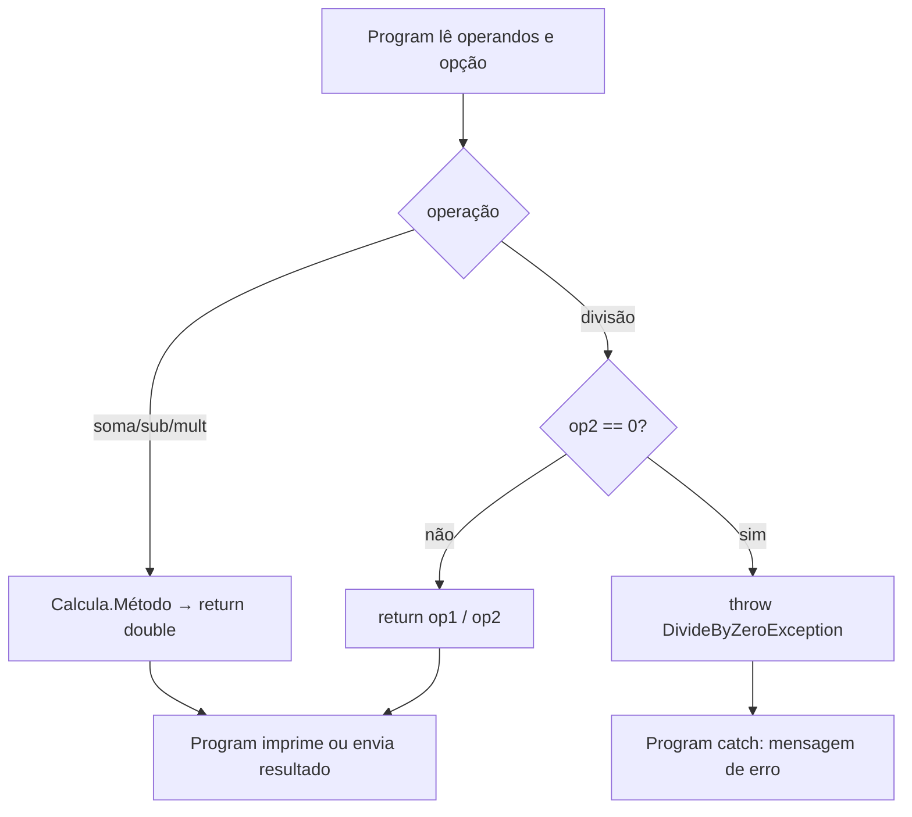
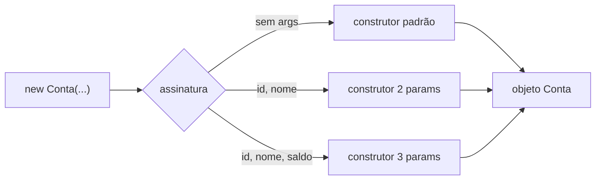

## Visão Geral do Conceito

Na aula anterior a calculadora já tinha virado classe e objeto. Nesta aula o foco muda: **a classe ainda estava errada no desenho**, mesmo “funcionando”.

O problema central é **responsabilidade**. Uma classe de domínio (`Calcula`, `Conta`) não deve imprimir no terminal, gravar ficheiro ou falar com API. Ela deve **calcular / validar / devolver resultado** (ou lançar exceção). Quem decide o destino da saída é o programa principal (ou outra camada).

> **Problema que resolve:** sem separar responsabilidades, qualquer mudança de interface (console → Web → log) obriga a reescrever a classe de negócio e espalha efeitos colaterais por todo o código.

Em paralelo, a aula introduz **construtores**: o método especial executado no <mark style="background-color: #242424; padding: 2px 4px; border-radius: 3px; color: inherit;">`new`</mark>, usado para inicializar estado — inclusive quando o <mark style="background-color: #242424; padding: 2px 4px; border-radius: 3px; color: inherit;">`set`</mark> do saldo é privado.

## Modelo Mental

Pense em duas caixas:

1. **Domínio** — `Calcula`, `Conta`: regras, contas, validações, retornos e exceções.
2. **Apresentação / orquestração** — `Program`: lê teclado, imprime ecrã, faz <mark style="background-color: #242424; padding: 2px 4px; border-radius: 3px; color: inherit;">`try/catch`</mark> e decide o que fazer com o valor.

Quando `Somar` faz <mark style="background-color: #242424; padding: 2px 4px; border-radius: 3px; color: inherit;">`Console.WriteLine`</mark>, a caixa de domínio fica **amarrada** (acoplada) ao terminal. Se amanhã o resultado for JSON numa API, a classe inteira precisa mudar.

O construtor é o **rito de nascimento** do objeto: corre **uma vez**, no <mark style="background-color: #242424; padding: 2px 4px; border-radius: 3px; color: inherit;">`new`</mark>, sem tipo de retorno (nem <mark style="background-color: #242424; padding: 2px 4px; border-radius: 3px; color: inherit;">`void`</mark>). Serve para deixar o objeto num estado válido desde o primeiro instante.



## Mecânica Central

### 1. Problemas na `Calcula` “que já funciona”

Na versão inicial da aula (solução `CalculadoraOO`), a classe tipicamente tinha:

| Problema | Porquê é problema |
|----------|-------------------|
| Atributos/`operacao` públicos e não usados | Ruído; estado morto na classe |
| Métodos <mark style="background-color: #242424; padding: 2px 4px; border-radius: 3px; color: inherit;">`void`</mark> que imprimem | Acoplamento ao console |
| Mensagem de divisão por zero dentro da classe | Acopla também o formato da mensagem de erro |

Correções imediatas vistas na aula:

- Remover o que não pertence (`operacao` “perdido”).
- Se precisar de operandos como estado: preferir **propriedades automáticas** (`public double Op1 { get; set; }`), lembrando que por baixo o compilador gera campo privado + métodos.
- Métodos de cálculo passam a devolver <mark style="background-color: #242424; padding: 2px 4px; border-radius: 3px; color: inherit;">`double`</mark>.

### 2. Acoplamento: classe não imprime

> **Regra:** classe de domínio **não** chama <mark style="background-color: #242424; padding: 2px 4px; border-radius: 3px; color: inherit;">`Console.WriteLine`</mark>. Ela **retorna** algo; o chamador faz o que quiser (ecrã, log, rede, banco).

**Antes (acoplado):**

```csharp
public void Somar(double op1, double op2)
{
    double resultado = op1 + op2;
    Console.WriteLine(resultado); // acoplamento ao terminal
}
```

**Depois (desacoplado):**

```csharp
public double Somar(double op1, double op2)
{
    return op1 + op2;
}

// no Program:
double resultado = calcula.Somar(op1, op2);
Console.WriteLine(resultado);
```

O `Program` é quem está “amarrado” ao terminal — e isso é aceitável nesta fase. A classe `Calcula` permanece reutilizável.

### 3. Escopo: dois `resultado` não são o mesmo

É comum o aluno achar que a variável `resultado` dentro de `Somar` e a do `Program` são a mesma.

Não são:

- A de `Somar` vive só enquanto o método corre.
- A do método `Calcular` / `Program` tem outro escopo.
- No fim do método, a local **desaparece**.

Nomes iguais ≠ identidade partilhada.

### 4. `return` direto vs variável temporária

Ambos são válidos:

```csharp
public double Subtrair(double op1, double op2)
{
    return op1 - op2; // sem temporária
}

public double Multiplicar(double op1, double op2)
{
    double resultado = op1 * op2;
    return resultado; // com temporária — ok se ajudar a ler
}
```

Na aula: preferência do professor pelo `return` direto por menos linhas; manter a temporária se a leitura ficar mais clara para si.

### 5. Divisão por zero: `throw`, não `WriteLine`

Com retorno <mark style="background-color: #242424; padding: 2px 4px; border-radius: 3px; color: inherit;">`double`</mark>, a mensagem de erro **não** pode ficar na classe como print. O padrão da aula:

```csharp
public double Dividir(double op1, double op2)
{
    if (op2 != 0)
    {
        return op1 / op2;
    }
    throw new DivideByZeroException("Erro: divisão por zero");
}
```

No `Program`:

```csharp
try
{
    resultado = calcula.Dividir(op1, op2);
    Console.WriteLine(resultado);
}
catch (DivideByZeroException ex)
{
    Console.WriteLine(ex.Message);
}
```

> Preferir a exceção **mais específica** possível (<mark style="background-color: #242424; padding: 2px 4px; border-radius: 3px; color: inherit;">`DivideByZeroException`</mark>), não um <mark style="background-color: #242424; padding: 2px 4px; border-radius: 3px; color: inherit;">`Exception`</mark> genérico “porque funciona”.

Fluxo: se `op2 != 0`, o <mark style="background-color: #242424; padding: 2px 4px; border-radius: 3px; color: inherit;">`return`</mark> sai do método e o <mark style="background-color: #242424; padding: 2px 4px; border-radius: 3px; color: inherit;">`throw`</mark> **não** corre.

### 6. Propriedades automáticas vs parâmetros

Na calculadora da aula, `Op1` / `Op2` como propriedades automáticas **ainda não eram usadas** pelos métodos: os métodos recebiam parâmetros `op1`/`op2`.

Consequência demonstrada:

```csharp
calcula.Op1 = 1;
calcula.Op2 = 2;
double r = calcula.Somar(1, 1); // usa os parâmetros → 2, não 3
```

Atribuir às propriedades **não altera** o resultado enquanto o método não as consultar. O professor deixou as propriedades para evolução futura (calculadora com estado / construtor — adiado).

Lembrete de encapsulamento: propriedade automática **não é atributo público cru** — o compilador gera campo privado + get/set. Em entrevista, saber explicar isso importa.

### 7. Construtores

| Característica | Detalhe |
|----------------|---------|
| Quando corre | No <mark style="background-color: #242424; padding: 2px 4px; border-radius: 3px; color: inherit;">`new Conta(...)`</mark> |
| Retorno | Nenhum (não declara <mark style="background-color: #242424; padding: 2px 4px; border-radius: 3px; color: inherit;">`void`</mark> nem tipo) |
| Quantas vezes | Uma vez por instanciação |
| Quem chama | O runtime, automaticamente — você não faz `conta.Conta()` |

**Construtor padrão (default):** se você não declarar nenhum, o compilador gera um sem parâmetros que inicializa campos (ex.: `int`/`double` → `0`, referência → `null`).

**Construtor customizado:**

```csharp
public Conta(int id, string nome, double saldo)
{
    Id = id;
    Nome = nome;
    if (saldo < 0)
        throw new ArgumentException("Erro: valor do saldo inválido");
    // saldo com set privado: atribuído aqui (ou via campo), não via UI
}
```

Regras críticas da aula:

1. Ao declarar um construtor com parâmetros, o **default some** — `new Conta()` deixa de compilar até o redeclarar.
2. Pode haver **vários** construtores = **sobrecarga** = **polimorfismo estático** (resolvido em compilação).
3. O que escolhe o construtor é a **assinatura** (lista/tipos dos parâmetros), não uma “prioridade” mágica.
4. **Dois construtores com a mesma assinatura** → erro.



### 8. Construtor + validação nos setters = classe autónoma

No exemplo `Conta` com validações de `Id` e `Nome` nos setters, o construtor pode fazer:

```csharp
Id = id;     // dispara o set com regra
Nome = nome; // dispara o set com regra
```

Se `id` ou `nome` forem inválidos, o <mark style="background-color: #242424; padding: 2px 4px; border-radius: 3px; color: inherit;">`ArgumentException`</mark> sobe na criação — o `Program` envolve o <mark style="background-color: #242424; padding: 2px 4px; border-radius: 3px; color: inherit;">`new`</mark> em <mark style="background-color: #242424; padding: 2px 4px; border-radius: 3px; color: inherit;">`try/catch`</mark>.

> **Classe autónoma:** mesmo que a UI valide, a classe **deve** manter as regras. Qualquer programador pode usar `Conta` sem passar pela interface.

Saldo com <mark style="background-color: #242424; padding: 2px 4px; border-radius: 3px; color: inherit;">`set`</mark> privado continua alterável só por <mark style="background-color: #242424; padding: 2px 4px; border-radius: 3px; color: inherit;">`Creditar`</mark>/<mark style="background-color: #242424; padding: 2px 4px; border-radius: 3px; color: inherit;">`Debitar`</mark> (e inicializado no construtor). Validar `saldo < 0` no construtor impede abrir conta negativa.

**Não coberto nesta aula (adiado explicitamente):** nova versão da calculadora usando construtores / propriedades de estado nos métodos. Próximo pilar anunciado: **herança**.

## Uso Prático

### Calculadora desacoplada (núcleo da aula)

```csharp
namespace CalculadoraOO2.Models;

public class Calcula
{
    public double Op1 { get; set; }
    public double Op2 { get; set; }

    public double Somar(double op1, double op2) => op1 + op2;
    public double Subtrair(double op1, double op2) => op1 - op2;
    public double Multiplicar(double op1, double op2) => op1 * op2;

    public double Dividir(double op1, double op2)
    {
        if (op2 != 0)
            return op1 / op2;
        throw new DivideByZeroException("Erro: divisão por zero");
    }
}
```

```csharp
// Program — I/O e tratamento ficam aqui
var calcula = new Calcula();
try
{
    double resultado = calcula.Dividir(op1, op2);
    Console.WriteLine(resultado);
}
catch (DivideByZeroException ex)
{
    Console.WriteLine(ex.Message);
}
```

Cenário ADS: o mesmo `Calcula` poderia alimentar um endpoint de tarifas ou um worker de batch — sem reescrever a classe, só mudando quem consome o `double`.

### Conta com sobrecarga de construtores e regras

```csharp
public class Conta
{
    public int Id
    {
        get => _id;
        set
        {
            if (value <= 0)
                throw new ArgumentException("Erro: valor de Id inválido");
            _id = value;
        }
    }
    private int _id;

    public string Nome
    {
        get => _nome;
        set
        {
            if (string.IsNullOrWhiteSpace(value) || value.Length < 2)
                throw new ArgumentException("Erro: valor do nome inválido");
            _nome = value;
        }
    }
    private string _nome = "";

    public double Saldo { get; private set; }

    public Conta() { } // default reexplicitado → permite new Conta()

    public Conta(int id, string nome)
    {
        Id = id;
        Nome = nome;
        Saldo = 0; // default de negócio
    }

    public Conta(int id, string nome, double saldo)
    {
        Id = id;
        Nome = nome;
        if (saldo < 0)
            throw new ArgumentException("Erro: valor do saldo inválido");
        Saldo = saldo;
    }

    public void Creditar(double valor) => Saldo += valor;
    public void Debitar(double valor) => Saldo -= valor;
}
```

```csharp
try
{
    var conta = new Conta(1, "Ana", 100);
    Console.WriteLine($"{conta.Id} {conta.Nome} {conta.Saldo}");
}
catch (ArgumentException ex)
{
    Console.WriteLine(ex.Message);
}
```

## Erros Comuns

1. **`WriteLine` dentro de `Somar`/`Dividir`**  
   Sintoma: classe “só serve” no console.  
   Correção: `return` + I/O no `Program`.

2. **Assumir que `Op1`/`Op2` (propriedades) alimentam o método**  
   Sintoma: atribui propriedades, passa outros parâmetros, resultado “ignora” o estado.  
   Correção: ou use parâmetros, ou leia as propriedades dentro do método — não misture sem intenção.

3. **Dois `resultado` “são o mesmo”**  
   Sintoma: confusão de debugging / expectativas.  
   Correção: pensar em escopo local por método.

4. **Declarar construtor com params e ainda chamar `new Conta()`**  
   Sintoma: erro de compilação — não há default.  
   Correção: passar args ou redeclarar construtor sem parâmetros.

5. **Dois construtores com a mesma assinatura**  
   Sintoma: erro de compilação.  
   Correção: alterar tipos/quantidade de parâmetros (assinatura distinta).

6. **Confiar só na validação da UI**  
   Sintoma: objetos inválidos criados por outro caminho.  
   Correção: regras na classe (setters/construtor).

7. **`catch (Exception)` genérico para divisão por zero**  
   Sintoma: engole erros não relacionados.  
   Correção: <mark style="background-color: #242424; padding: 2px 4px; border-radius: 3px; color: inherit;">`DivideByZeroException`</mark> / <mark style="background-color: #242424; padding: 2px 4px; border-radius: 3px; color: inherit;">`ArgumentException`</mark> específicos.

## Visão Geral de Debugging

Quando o resultado “não bate” ou a app “imprime sozinha”:

1. **Quem imprime?** Se for a classe de domínio → acoplamento; mova a saída.
2. **O método retorna o quê?** Se ainda for <mark style="background-color: #242424; padding: 2px 4px; border-radius: 3px; color: inherit;">`void`</mark>, o `Program` não tem valor para reutilizar.
3. **Parâmetros vs propriedades:** coloque breakpoint / `WriteLine` temporário **só no Program** e confira o que realmente entra no método.
4. **Exceção na criação:** falha no `new Conta(...)` costuma ser setter/construtor (`ArgumentException`). Envolva o `new` em `try/catch` e leia a mensagem.
5. **Qual construtor correu?** Conte os argumentos no `new` — a assinatura decide (polimorfismo estático).

<details>
<summary>Checklist rápido pós-refatoração da calculadora</summary>

- [ ] Nenhum `Console.WriteLine` em `Calcula`
- [ ] Operações retornam `double`
- [ ] Divisão por zero faz `throw`
- [ ] `Program` tem `try/catch` na divisão
- [ ] Namespace sincronizado se copiou o projeto (`Sync Namespace`)

</details>

## Principais Pontos

- Classe de domínio **retorna**; não imprime.
- Acoplamento ao terminal dificulta reuso (API, ficheiro, log, banco).
- `void` → `double` nos métodos de cálculo.
- Escopos locais: mesmo nome ≠ mesma variável.
- Divisão por zero: <mark style="background-color: #242424; padding: 2px 4px; border-radius: 3px; color: inherit;">`throw new DivideByZeroException`</mark>.
- Construtor corre no <mark style="background-color: #242424; padding: 2px 4px; border-radius: 3px; color: inherit;">`new`</mark>, sem tipo de retorno.
- Default some quando há construtor explícito (a menos que o redeclare).
- Sobrecarga de construtores = polimorfismo estático; assinatura deve ser única.
- Classe **autónoma**: valida regras mesmo que a UI também valide.
- Calculadora com construtores: **adiada** para aula seguinte; próximo pilar: herança.

## Preparação para Prática

Antes do laboratório, você deve conseguir:

1. Reescrever um método de serviço para retornar valor em vez de imprimir.
2. Lançar erro de domínio (`throw`) e tratar no chamador.
3. Explicar por que propriedades não usadas pelos métodos não afetam o cálculo.
4. Escolher/desenhar construtores com assinaturas diferentes e validação na criação.

## Laboratório de Prática

> Exemplos do corpo em C#. No Editor Integrado ISS use o boilerplate JavaScript abaixo (espelha a lógica). Equivalências: `throw` → `throw new Error`, retorno de função igual, `try/catch` igual.

### Easy — Serviço de soma sem acoplamento

Contexto ADS: microserviço interno calcula subtotal de itens de fatura. A função de domínio **não** pode logar; só devolve o total. O “orquestrador” formata a mensagem.

```javascript
/**
 * Equivalente C#: public double Somar(double op1, double op2) => op1 + op2;
 * NÃO usar console.log aqui (seria acoplamento).
 */
function somarSubtotal(op1, op2) {
  // TODO: retornar op1 + op2 (number)
  return 0;
}

/**
 * Camada de orquestração (análoga ao Program).
 */
function formatarSubtotal(op1, op2) {
  const total = somarSubtotal(op1, op2);
  // TODO: retornar string "Subtotal: {total}" usando o valor retornado
  return "";
}

// Smoke (não deve imprimir dentro de somarSubtotal)
formatarSubtotal(10, 5.5);
```

### Medium — Divisão de tarifa com erro de domínio

Contexto ADS: rateio de custo entre N postos. Se `postos === 0`, a função de domínio lança erro específico; o caller trata e devolve mensagem segura para log/API.

```javascript
/**
 * Equivalente C#: Dividir + throw new DivideByZeroException(...)
 */
function ratearCusto(custoTotal, postos) {
  // TODO:
  // 1. Se postos === 0, throw new Error("Erro: divisão por zero")
  // 2. Senão return custoTotal / postos
  return 0;
}

/**
 * Equivalente ao try/catch no Program.
 * @returns {{ ok: boolean, valor: number|null, erro: string|null }}
 */
function executarRateio(custoTotal, postos) {
  // TODO: try ratearCusto; catch → { ok:false, valor:null, erro: message }
  return { ok: false, valor: null, erro: "não implementado" };
}

executarRateio(1000, 4);
executarRateio(1000, 0);
```

### Hard — Conta bancária: construtores, assinatura e autonomia

Contexto ADS: abertura de conta em core bancário. Regras na classe/módulo de domínio:

- `id > 0`
- `nome` com comprimento ≥ 2
- `saldoInicial >= 0` (quando informado)
- sobrescrita de fábricas com assinaturas diferentes (análogo a sobrecarga de construtores)
- saldo só muda via `creditar` / `debitar` após criação

```javascript
/**
 * Modelo mental C#:
 * - new Conta(id, nome)
 * - new Conta(id, nome, saldo)
 * - set privado de Saldo + validação no "construtor"
 */
function criarConta(id, nome, saldoInicial) {
  // TODO:
  // 1. Validar id > 0 senão throw new Error("Erro: valor de Id inválido")
  // 2. Validar nome (string, trim, length >= 2) senão throw ...
  // 3. Se saldoInicial === undefined, usar 0
  // 4. Se saldoInicial < 0, throw new Error("Erro: valor do saldo inválido")
  // 5. Retornar objeto { id, nome, saldo, creditar(v), debitar(v) }
  //    (creditar/debitar alteram saldo; não expor setter livre de saldo)
  return null;
}

/**
 * Orquestração: tenta criar e devolve resultado sem rebentamento não tratado.
 */
function abrirContaSegura(id, nome, saldoInicial) {
  // TODO: try criarConta; catch → { ok:false, conta:null, erro }
  // sucesso → { ok:true, conta, erro:null }
  return { ok: false, conta: null, erro: "não implementado" };
}

abrirContaSegura(1, "Ana", 100);
abrirContaSegura(0, "Ana", 100);
abrirContaSegura(1, "A", 100);
abrirContaSegura(1, "Ana", -50);
```

<!-- CONCEPT_EXTRACTION
concepts:
  - acoplamento ao console / I/O
  - responsabilidades da classe de domínio
  - retorno double vs void
  - Console.WriteLine no Program
  - propriedades automáticas Op1 Op2
  - parâmetros vs estado da instância
  - escopo local de variáveis
  - return direto
  - DivideByZeroException
  - throw
  - try/catch específico
  - construtor
  - construtor padrão default
  - new chama construtor
  - construtor sem tipo de retorno
  - sobrecarga de construtores
  - polimorfismo estático
  - assinatura de método/construtor
  - ArgumentException
  - set privado e inicialização no construtor
  - classe autónoma / regras de negócio no domínio
  - Creditar Debitar
skills:
  - Remover WriteLine da classe de domínio e retornar valores
  - Refatorar métodos void para double
  - Lançar DivideByZeroException na divisão inválida
  - Tratar exceções específicas no Program
  - Distinguir escopo local entre métodos
  - Explicar propriedades automáticas vs campos privados gerados
  - Declarar construtores com e sem parâmetros
  - Usar sobrecarga sem colidir assinaturas
  - Validar Id Nome Saldo na criação do objeto
  - Manter regras de negócio na classe independentemente da UI
examples:
  - calcula-somar-return-double
  - calcula-dividir-throw-dividebyzero
  - program-try-catch-divisao
  - propriedades-ignoradas-vs-parametros
  - conta-construtor-sobrecarga-validacao
  - lab-js-subtotal-rateio-conta
-->

<!-- EXERCISES_JSON
[
  {
    "id": "csharp-servico-soma-sem-acoplamento",
    "slug": "csharp-servico-soma-sem-acoplamento",
    "difficulty": "easy",
    "title": "Serviço de soma sem acoplamento",
    "discipline": "fundamentos-csharp",
    "editorLanguage": "javascript",
    "tags": ["csharp", "oop", "acoplamento", "return"],
    "summary": "Separar função de domínio que só retorna soma da camada que formata a mensagem (sem console.log no domínio)."
  },
  {
    "id": "csharp-rateio-divisao-por-zero",
    "slug": "csharp-rateio-divisao-por-zero",
    "difficulty": "medium",
    "title": "Rateio de custo com divisão por zero",
    "discipline": "fundamentos-csharp",
    "editorLanguage": "javascript",
    "tags": ["csharp", "oop", "throw", "try-catch", "dividebyzero"],
    "summary": "Ratear custo entre postos lançando erro se postos=0 e tratar no orquestrador com ok/valor/erro."
  },
  {
    "id": "csharp-conta-construtores-autonomia",
    "slug": "csharp-conta-construtores-autonomia",
    "difficulty": "hard",
    "title": "Conta: criação validada e autonomia",
    "discipline": "fundamentos-csharp",
    "editorLanguage": "javascript",
    "tags": ["csharp", "oop", "construtor", "validacao", "encapsulamento"],
    "summary": "Criar conta com validação de id/nome/saldo, saldo mutável só via creditar/debitar, e abertura segura com try/catch."
  }
]
-->

<!--
lessons.json (NÃO aplicado por este worker — integração serial do orquestrador):
{
  "discipline": "fundamentos-csharp",
  "slug": "oop-calculadora-acoplamento-retorno-metodos",
  "title": "OO na calculadora: acoplamento, retorno de métodos e responsabilidades",
  "order": 12,
  "file": "content/fundamentos-csharp/aula-12-oop-calculadora-acoplamento-retorno-metodos.md"
}
-->
