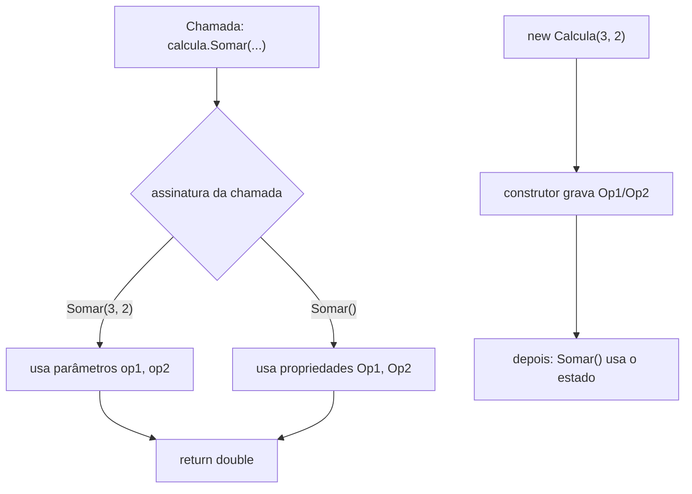
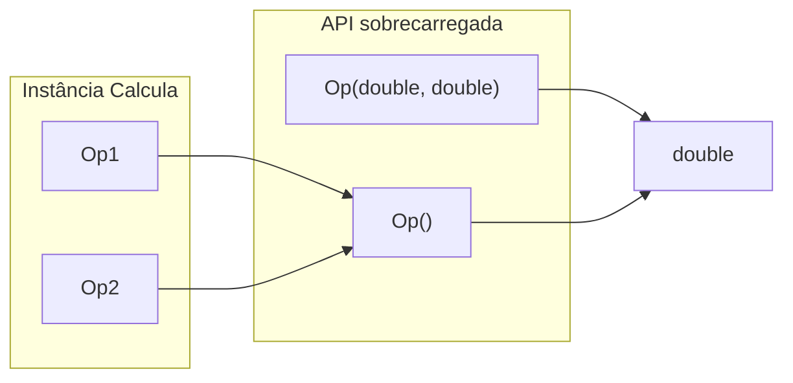

## Visão Geral do Conceito

Na aula anterior a `Calcula` já devolvia <mark style="background-color: #242424; padding: 2px 4px; border-radius: 3px; color: inherit;">`double`</mark> e deixava o <mark style="background-color: #242424; padding: 2px 4px; border-radius: 3px; color: inherit;">`Console`</mark> no `Program`. As propriedades <mark style="background-color: #242424; padding: 2px 4px; border-radius: 3px; color: inherit;">`Op1`</mark>/<mark style="background-color: #242424; padding: 2px 4px; border-radius: 3px; color: inherit;">`Op2`</mark> existiam, mas **não eram usadas** — os métodos só liam parâmetros.

Nesta aula a calculadora vira **versão 3** (`CalculadoraOO3`) para ensinar **sobrecarga**: vários membros com o **mesmo nome** e **assinaturas diferentes**. O compilador escolhe qual versão chamar em tempo de compilação (**polimorfismo estático**).

> **Problema que resolve:** permitir a mesma operação de duas formas — “calcular com valores passados agora” ou “calcular com o estado já gravado na instância” — sem inventar nomes como `SomarComParametros` / `SomarDoEstado`.

## Modelo Mental

Pense num **menu com o mesmo prato em duas porções**:

- `Somar(double op1, double op2)` — você traz os ingredientes na chamada.
- `Somar()` — a cozinha usa o que já está na despensa (`Op1`, `Op2`).

O nome do prato é o mesmo (`Somar`). O que muda é a **lista de ingredientes da receita** (= **assinatura**: quantidade e tipos dos parâmetros). O **tipo do prato servido** (retorno `double`) **não** entra na identidade da receita.

O **construtor** é o ritual de montar a despensa no <mark style="background-color: #242424; padding: 2px 4px; border-radius: 3px; color: inherit;">`new`</mark>. Sobrecarregar o construtor é o mesmo mecanismo: mesmo nome da classe, parâmetros diferentes. Por isso a aula trata **sobrecarga de construtor como caso particular da sobrecarga de métodos**.



## Mecânica Central

### 1. Projeto `CalculadoraOO3` e Sync Namespace

Fluxo da aula:

1. Novo projeto console (`CalculadoraOO3`).
2. Copiar a classe `Calcula` da versão anterior.
3. O <mark style="background-color: #242424; padding: 2px 4px; border-radius: 3px; color: inherit;">`namespace`</mark> ainda aponta para o projeto antigo → botão direito no projeto → **Sync Namespace** → Apply.

Sem sincronizar, o ficheiro compila “estranho” (namespace errado) e atrapalha organização da solução.

### 2. Propriedades sem uso → motivo da sobrecarga

Com métodos que só recebem parâmetros, o IDE mostra **0 referências** a `Op1`/`Op2`. Elas estão “perdidas” na classe.

Objetivo pedagógico:

- manter `Somar(double, double)` (API por parâmetros);
- adicionar `Somar()` que lê `Op1` e `Op2` (API por estado).

Isso **é sobrecarga de métodos** e **polimorfismo estático**: mesmo nome, assinaturas diferentes; o compilador gera código distinto para cada uma.

### 3. Assinatura: o que conta (e o que não conta)

| Faz parte da assinatura | Não faz parte |
|-------------------------|---------------|
| Nome do método | Tipo de retorno |
| Lista de parâmetros (tipos, ordem, quantidade) | Nome dos parâmetros |

> **Regra:** dois métodos com os **mesmos parâmetros** e retornos diferentes **não compilam**. Só os parâmetros diferenciam sobrecargas.

A **ordem de declaração** dos métodos na classe **não importa** — o compilador resolve pela assinatura da chamada.

### 4. Armadilha: `Somar()` sem estado inicializado

```csharp
var calcula = new Calcula(); // construtor padrão implícito
Console.WriteLine(calcula.Somar()); // 0
```

Porquê `0`?

- `double` sem valor explícito → **0** (inicialização do construtor padrão “escondido”).
- `Somar()` soma `Op1 + Op2` → `0 + 0`.

`Somar(3, 2)` continua a funcionar, porque ignora o estado e usa os parâmetros.

### 5. Sobrecarga de construtor para alimentar o estado

Para `Somar()` fazer sentido, inicialize as propriedades no construtor:

```csharp
public Calcula() { } // default reexplicitado (opcional, mas deixa claro)

public Calcula(double op1, double op2)
{
    Op1 = op1;
    Op2 = op2;
}
```

No `Program`:

```csharp
var calcula1 = new Calcula();
double r1 = calcula1.Somar(3, 2); // sobrecarga com parâmetros → 5

var calcula2 = new Calcula(3, 2);
double r2 = calcula2.Somar();     // sobrecarga sem parâmetros → 5
```

Pontos da aula:

- Construtor corre **só no** <mark style="background-color: #242424; padding: 2px 4px; border-radius: 3px; color: inherit;">`new`</mark>, **uma vez**.
- Métodos de instância (`Somar`, etc.) podem ser chamados **várias vezes** enquanto o objeto existir.
- São mecanismos diferentes: um **nasce** o objeto; o outro **usa** o objeto.

### 6. Repetir o padrão nas quatro operações

O mesmo desenho foi aplicado a:

- <mark style="background-color: #242424; padding: 2px 4px; border-radius: 3px; color: inherit;">`Subtrair`</mark>
- <mark style="background-color: #242424; padding: 2px 4px; border-radius: 3px; color: inherit;">`Multiplicar`</mark>
- <mark style="background-color: #242424; padding: 2px 4px; border-radius: 3px; color: inherit;">`Dividir`</mark>

Cada um com versão **com parâmetros** e versão **sem parâmetros** (lendo `Op1`/`Op2`). Erro típico ao testar: chamar a sobrecarga sem parâmetros em `calcula1` (sem estado) em vez de `calcula2` (construído com operandos).



### 7. Quando usar (e quando não há “receita”)

Não existe checklist “sempre use sobrecarga em X”. O professor enfatizou: primeiro entenda o mecanismo; depois reconheça no problema se faz sentido oferecer a **mesma operação** por caminhos diferentes (estado vs argumentos). A calculadora é exemplo real (mesmo sem UI gráfica) — funções objetivas que continuam a evoluir (herança vem a seguir).

**Lacuna desta lição ISS:** a segunda metade da aula ao vivo abriu o pilar **herança** (`Pessoa` / `Aluno` / `Funcionário` / `Professor`, `base`, herança simples). Esse conteúdo fica na trilha da aula [[heranca-pessoa-aluno-funcionario-professor-csharp]] — não é expandido aqui.

**Não coberto com demonstração detalhada na fonte desta lição:** sobrecarga de operadores (mencionada oralmente como tipo de polimorfismo já “visto”; sem exercício dedicado nesta versão da calculadora).

## Uso Prático

### Classe `Calcula` com sobrecargas (núcleo da aula)

```csharp
namespace CalculadoraOO3.Models;

public class Calcula
{
    public double Op1 { get; set; }
    public double Op2 { get; set; }

    public Calcula() { }

    public Calcula(double op1, double op2)
    {
        Op1 = op1;
        Op2 = op2;
    }

    public double Somar(double op1, double op2) => op1 + op2;
    public double Somar() => Op1 + Op2;

    public double Subtrair(double op1, double op2) => op1 - op2;
    public double Subtrair() => Op1 - Op2;

    public double Multiplicar(double op1, double op2) => op1 * op2;
    public double Multiplicar() => Op1 * Op2;

    public double Dividir(double op1, double op2)
    {
        if (op2 != 0)
            return op1 / op2;
        throw new DivideByZeroException("Erro: divisão por zero");
    }

    public double Dividir()
    {
        if (Op2 != 0)
            return Op1 / Op2;
        throw new DivideByZeroException("Erro: divisão por zero");
    }
}
```

### `Program`: duas formas de usar

```csharp
var calcula1 = new Calcula();
Console.WriteLine(calcula1.Somar(3, 2));      // 5 — parâmetros
Console.WriteLine(calcula1.Subtrair(5, 2));   // 3

var calcula2 = new Calcula(3, 2);
Console.WriteLine(calcula2.Somar());          // 5 — estado
Console.WriteLine(calcula2.Subtrair());       // 1
Console.WriteLine(calcula2.Multiplicar());    // 6
Console.WriteLine(calcula2.Dividir());        // 1.5
```

Cenário ADS: serviço de tarifas com **dois modos de chamada** — batch que já montou o objeto com valores lidos do ficheiro (`new Calcula(a, b)` + `Somar()`), e endpoint HTTP que envia operandos na requisição (`Somar(a, b)` sem depender de estado prévio).

## Erros Comuns

1. **Chamar `Somar()` sem ter inicializado `Op1`/`Op2`**  
   Sintoma: resultado `0` “misterioso”.  
   Correção: usar `new Calcula(op1, op2)` ou atribuir as propriedades antes; ou usar a sobrecarga com parâmetros.

2. **Achar que o retorno diferencia sobrecargas**  
   Sintoma: erro de compilação com dois métodos iguais nos parâmetros.  
   Correção: mudar a lista de parâmetros (tipos/quantidade), não só o retorno.

3. **Testar sobrecarga sem parâmetros no objeto errado**  
   Sintoma: na aula, `calcula1` no lugar de `calcula2`.  
   Correção: confirmar qual instância recebeu o construtor com operandos.

4. **Copiar projeto e esquecer Sync Namespace**  
   Sintoma: namespace do projeto antigo no ficheiro novo.  
   Correção: Sync Namespace no projeto destino.

5. **Tratar construtor como método chamável à vontade**  
   Sintoma: tentar “reinicializar” chamando o construtor de novo como se fosse `Reset()`.  
   Correção: construtor só no `new`; para mudar estado depois, use propriedades/métodos.

6. **Misturar operandos de propriedades com parâmetros na mesma lógica sem intenção**  
   Sintoma: atribui `Op1`/`Op2` e chama `Somar(1, 1)` — o estado é ignorado.  
   Correção: escolher conscientemente qual sobrecarga usar.

## Visão Geral de Debugging

Quando o resultado “não bate”:

1. **Qual sobrecarga foi chamada?** Conte os argumentos na chamada. Zero args → estado; dois args → parâmetros.
2. **Qual construtor correu?** `new Calcula()` vs `new Calcula(3, 2)` — inspeione `Op1`/`Op2` logo após o `new`.
3. **Defaults:** `double` → `0`. Se viu zero, suspeite de estado não inicializado.
4. **Erro de compilação “já definido”:** assinaturas colidem (quase sempre parâmetros iguais).
5. **Divisão:** a sobrecarga sem parâmetros também deve validar `Op2 == 0` e lançar <mark style="background-color: #242424; padding: 2px 4px; border-radius: 3px; color: inherit;">`DivideByZeroException`</mark>.

<details>
<summary>Checklist CalculadoraOO3</summary>

- [ ] Namespace sincronizado com o projeto atual
- [ ] `Somar`/`Subtrair`/`Multiplicar`/`Dividir` com e sem parâmetros
- [ ] Construtor `(double, double)` grava `Op1`/`Op2`
- [ ] Nenhuma sobrecarga depende só do retorno para se distinguir
- [ ] Testes cobrem `calcula1` (params) e `calcula2` (estado)

</details>

## Principais Pontos

- Sobrecarga = mesmo nome + **assinaturas diferentes**.
- Assinatura = parâmetros; **retorno não conta**.
- É **polimorfismo estático** (resolvido na compilação).
- `Somar()` lê estado; `Somar(a, b)` lê argumentos.
- Sem inicializar, `Op1`/`Op2` são `0` (construtor padrão).
- Construtor sobrecarregado inicializa o estado no <mark style="background-color: #242424; padding: 2px 4px; border-radius: 3px; color: inherit;">`new`</mark>.
- Construtor ≠ método de uso: um corre uma vez no nascimento; o outro, enquanto o objeto viver.
- Ordem dos métodos no ficheiro não importa para o compilador.
- Sync Namespace ao copiar classes entre projetos.
- Herança começou na mesma aula ao vivo, mas é tema da lição seguinte.

## Preparação para Prática

Antes do laboratório, você deve conseguir:

1. Escrever duas funções/métodos com o mesmo nome e listas de parâmetros diferentes.
2. Explicar por que só mudar o retorno não cria sobrecarga válida.
3. Inicializar estado num “construtor”/factory e expor operação sem argumentos.
4. Diagnosticar resultado `0` como estado default, não como “bug misterioso da soma”.

## Laboratório de Prática

> Exemplos do corpo em C#. No Editor Integrado ISS use o boilerplate JavaScript abaixo (espelha a lógica). Equivalências: classe → objeto/factory; sobrecarga → funções com aridades diferentes ou `undefined` opcional; `throw DivideByZeroException` → `throw new Error(...)`.

### Easy — Soma dual: parâmetros ou estado

Contexto ADS: microserviço de subtotal de fatura. Às vezes os valores vêm no request; às vezes o worker já materializou um “contexto” com `op1`/`op2`.

```javascript
/**
 * Equivalente C#:
 * Somar(double op1, double op2) e Somar() lendo Op1/Op2.
 */
function criarCalculadora(op1, op2) {
  const estado = {
    op1: op1 === undefined ? 0 : op1,
    op2: op2 === undefined ? 0 : op2,
  };

  function somar(a, b) {
    // TODO:
    // 1. Se a === undefined && b === undefined → return estado.op1 + estado.op2
    // 2. Senão return a + b
    return 0;
  }

  return { estado, somar };
}

const c1 = criarCalculadora();
c1.somar(3, 2); // deve ser 5

const c2 = criarCalculadora(3, 2);
c2.somar(); // deve ser 5
```

### Medium — Quatro operações com duas assinaturas

Contexto ADS: motor de tarifas de frete. O batch pré-carrega peso e fator; a API REST envia os dois números por chamada. Divisão por zero deve falhar de forma explícita.

```javascript
function criarMotorTarifa(op1, op2) {
  const estado = {
    op1: op1 === undefined ? 0 : op1,
    op2: op2 === undefined ? 0 : op2,
  };

  function resolver(a, b) {
    if (a === undefined && b === undefined) return [estado.op1, estado.op2];
    return [a, b];
  }

  function somar(a, b) {
    // TODO: usar resolver e retornar x + y
    return 0;
  }

  function subtrair(a, b) {
    // TODO: x - y
    return 0;
  }

  function multiplicar(a, b) {
    // TODO: x * y
    return 0;
  }

  function dividir(a, b) {
    // TODO:
    // const [x, y] = resolver(a, b)
    // se y === 0 → throw new Error("Erro: divisão por zero")
    // senão return x / y
    return 0;
  }

  return { estado, somar, subtrair, multiplicar, dividir };
}

const api = criarMotorTarifa();
api.somar(10, 2);
api.dividir(10, 2);

const batch = criarMotorTarifa(10, 2);
batch.multiplicar();
batch.dividir();
```

### Hard — Factory com “construtores” e escolha de sobrecarga

Contexto ADS: orquestrador de cálculo de imposto. Deve:

- criar motor **sem** operandos (`criarMotor()`) ou **com** operandos (`criarMotor(base, aliquota)`);
- expor `calcular(base, aliquota)` e `calcular()` (estado);
- rejeitar alíquota `0` na divisão implícita `base / aliquota` do modo estado (regra de negócio do exemplo);
- devolver resultado envelopado `{ ok, valor, erro }` sem deixar exceção subir.

```javascript
/**
 * Modelo mental C#:
 * new Calcula() / new Calcula(op1, op2)
 * + sobrecarga calcular(double, double) / calcular()
 */
function criarMotor(baseCalculo, aliquota) {
  // TODO:
  // 1. Se ambos undefined → estado { base: 0, aliquota: 0 }
  // 2. Se ambos number → gravar no estado
  // 3. Retornar { estado, calcular(base?, aliquota?) }
  //    calcular(): usa estado; se aliquota === 0 → throw new Error("Erro: divisão por zero")
  //    calcular(b, a): return b / a com a mesma regra de zero
  return {
    estado: { base: 0, aliquota: 0 },
    calcular() {
      return 0;
    },
  };
}

function executarCalculo(modo, baseCalculo, aliquota) {
  // TODO:
  // modo === "estado" → criarMotor(baseCalculo, aliquota).calcular()
  // modo === "params" → criarMotor().calcular(baseCalculo, aliquota)
  // try/catch → { ok, valor, erro }
  return { ok: false, valor: null, erro: "não implementado" };
}

executarCalculo("params", 1000, 10);
executarCalculo("estado", 1000, 10);
executarCalculo("estado", 1000, 0);
```

<!-- CONCEPT_EXTRACTION
concepts:
  - sobrecarga de métodos
  - sobrecarga de construtores
  - assinatura de método
  - polimorfismo estático
  - tipo de retorno fora da assinatura
  - propriedades Op1 e Op2
  - parâmetros vs estado da instância
  - construtor padrão e default de double
  - new e execução única do construtor
  - Sync Namespace
  - CalculadoraOO3
  - Somar/Subtrair/Multiplicar/Dividir com e sem parâmetros
skills:
  - Declarar sobrecargas com e sem parâmetros na mesma operação
  - Inicializar estado via construtor sobrecarregado
  - Distinguir qual sobrecarga o compilador escolhe pela chamada
  - Diagnosticar resultado zero por estado default
  - Explicar por que retorno não diferencia sobrecarga
  - Sincronizar namespace ao copiar classes entre projetos
examples:
  - calcula-oo3-somar-com-e-sem-parametros
  - construtor-op1-op2-mais-somar-estado
  - program-calcula1-params-vs-calcula2-estado
  - quatro-operacoes-sobrecarregadas
-->

<!-- EXERCISES_JSON
[
  {
    "id": "csharp-soma-dual-params-ou-estado",
    "slug": "csharp-soma-dual-params-ou-estado",
    "difficulty": "easy",
    "title": "Soma dual: parâmetros ou estado",
    "discipline": "fundamentos-csharp",
    "editorLanguage": "javascript",
    "tags": ["csharp", "oop", "sobrecarga", "metodos"],
    "summary": "Implementar somar(a,b) e somar() lendo estado, espelhando sobrecarga de métodos da Calcula."
  },
  {
    "id": "csharp-motor-tarifa-quatro-ops-sobrecarga",
    "slug": "csharp-motor-tarifa-quatro-ops-sobrecarga",
    "difficulty": "medium",
    "title": "Motor de tarifas com quatro operações sobrecarregadas",
    "discipline": "fundamentos-csharp",
    "editorLanguage": "javascript",
    "tags": ["csharp", "oop", "sobrecarga", "divisao-por-zero"],
    "summary": "Somar, subtrair, multiplicar e dividir com duas assinaturas; dividir lança erro se divisor for zero."
  },
  {
    "id": "csharp-factory-construtor-e-calculo-envelopado",
    "slug": "csharp-factory-construtor-e-calculo-envelopado",
    "difficulty": "hard",
    "title": "Factory com construtores e cálculo envelopado",
    "discipline": "fundamentos-csharp",
    "editorLanguage": "javascript",
    "tags": ["csharp", "oop", "construtor", "sobrecarga", "try-catch"],
    "summary": "Criar motor com/sem operandos, calcular por estado ou parâmetros, e devolver {ok,valor,erro}."
  }
]
-->

<!--
lessons.json (NÃO editado nesta missão — integração serial pelo orquestrador):
  discipline: fundamentos-csharp
  slug: sobrecarga-metodos-construtores-calculadora-csharp
  title: Sobrecarga de métodos e construtores na calculadora C#
  order: 13
  file: fundamentos-csharp/aula-13-sobrecarga-metodos-construtores-calculadora-csharp.md
-->
