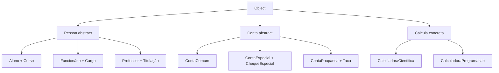
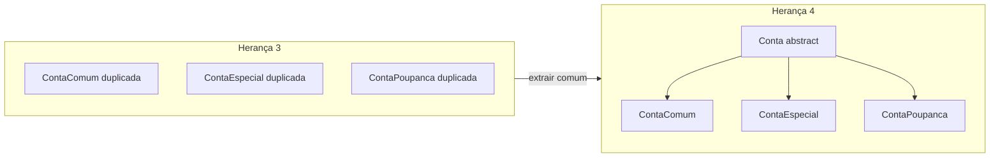

## Visão Geral do Conceito

Herança resolve **duplicação de estado e comportamento** entre tipos do mesmo domínio. Na aula, três classes (`Aluno`, `Funcionário`, `Professor`) repetiam Id, nome, endereço e telefone. A solução foi extrair uma superclasse <mark style="background-color: #242424; padding: 2px 4px; border-radius: 3px; color: inherit;">`Pessoa`</mark> e deixar em cada subclasse só o que é específico (curso, cargo, titulação).

No mesmo encontro o professor fecha o exemplo com:

1. **classe abstrata** — quando a superclasse não deve ser instanciada;
2. **sobrescrita de** <mark style="background-color: #242424; padding: 2px 4px; border-radius: 3px; color: inherit;">`ToString`</mark> — polimorfismo dinâmico;
3. herança na **calculadora** (`Calcula` → científica / programação);
4. refatoração **Conta comum / especial / poupança** → superclasse <mark style="background-color: #242424; padding: 2px 4px; border-radius: 3px; color: inherit;">`Conta`</mark>;
5. **Open/Closed** (O do SOLID) — não promover `ContaComum` a raiz da hierarquia.

> **Problema que resolve:** sem herança, cada tipo copia validação e campos; qualquer regra nova (telefone obrigatório, formato de Id) exige alterar N classes. Com herança bem desenhada, o comum vive num sítio e as especializações estendem sem reescrever o núcleo.

> **Lacuna de fonte:** brief sem PDF obrigatório; conteúdo reconstruído da transcrição WebVTT `Aula_14_-_01092026.bin`. Código no Drive (`herança.zip` / projetos Herança 1–4) não está no repositório — exemplos abaixo seguem o que foi ditado na aula, não um dump do zip.

## Modelo Mental

### Superclasse = contrato comum; subclasse = diferença

| Papel | Pergunta | Exemplo Pessoa | Exemplo Conta |
|-------|----------|----------------|---------------|
| Superclasse | O que **todas** as variantes têm? | Id, Nome, Endereço, Telefone + validação no construtor | Id, Nome, Saldo, `Creditar`, `ToString` base |
| Subclasse | O que **só este tipo** tem? | Curso / Cargo / Titulação | Cheque especial / Taxa + `CalcularSaldo` / `Debitar` próprio |

Analogia útil: a superclasse é o **formulário base** de cadastro; cada subclasse acrescenta campos do formulário especializado. Você não preenche um “formulário Pessoa genérico” se o sistema só cadastra aluno, funcionário ou professor.

### Abstrata vs concreta (depende do domínio)

- **Abstrata:** existe para herança; `new` é erro de compilação. Na UML aparece em *itálico*. Casos da aula: `Pessoa` (sistema acadêmico) e `Conta` (núcleo bancário sem “conta genérica” útil).
- **Concreta:** pode ser instanciada e ainda assim ser superclasse. Caso da aula: <mark style="background-color: #242424; padding: 2px 4px; border-radius: 3px; color: inherit;">`Calcula`</mark> — a calculadora “padrão” faz as quatro operações; científica e de programação estendem.

> **Regra:** “superclasse abstrata?” não é dogma — é decisão de modelagem. No mesmo curso, `Calcula` fica concreta e `Pessoa`/`Conta` ficam abstratas.

### Object está sempre na árvore

Toda classe C# herda de <mark style="background-color: #242424; padding: 2px 4px; border-radius: 3px; color: inherit;">`Object`</mark> automaticamente. Por isso o IntelliSense mostra métodos como <mark style="background-color: #242424; padding: 2px 4px; border-radius: 3px; color: inherit;">`ToString`</mark>, <mark style="background-color: #242424; padding: 2px 4px; border-radius: 3px; color: inherit;">`GetHashCode`</mark>, <mark style="background-color: #242424; padding: 2px 4px; border-radius: 3px; color: inherit;">`GetType`</mark> mesmo quando você não escreveu nada. `Aluno` herda de `Pessoa` **e**, indiretamente, de `Object`. Tentativa de herança múltipla explícita (`: Pessoa, Object`) gera erro — C# não permite múltiplas classes base.

### Estático vs dinâmico (mapa da aula)

| Tipo | Nome na aula | Quando resolve | Exemplos já vistos |
|------|--------------|----------------|--------------------|
| Estático | Overload | Compilação | Sobrecarga de operador (`+` em strings), construtor, método |
| Dinâmico | Override / sobrescrita | Execução | `override string ToString()` |



## Mecânica Central

### 1. De Herança 1 → Herança 2 (Pessoa)

**Antes (duplicado):** três classes com os mesmos campos e validações.

**Depois:**

- <mark style="background-color: #242424; padding: 2px 4px; border-radius: 3px; color: inherit;">`Pessoa`</mark> — Id, Nome, Endereço, Telefone; validação no construtor.
- <mark style="background-color: #242424; padding: 2px 4px; border-radius: 3px; color: inherit;">`Aluno`</mark> — + Curso; chama construtor da base.
- <mark style="background-color: #242424; padding: 2px 4px; border-radius: 3px; color: inherit;">`Funcionário`</mark> — + Cargo.
- <mark style="background-color: #242424; padding: 2px 4px; border-radius: 3px; color: inherit;">`Professor`</mark> — + Titulação.

Sintaxe essencial C#:

```csharp
public abstract class Pessoa
{
    public int Id { get; }
    public string Nome { get; }
    public string Endereco { get; }
    public string Telefone { get; }

    protected Pessoa(int id, string nome, string endereco, string telefone)
    {
        // Validação no construtor (padrão da aula)
        if (id <= 0) throw new ArgumentException("Id inválido");
        if (string.IsNullOrWhiteSpace(nome)) throw new ArgumentException("Nome inválido");
        // ... endereço / telefone conforme regras do projeto no Drive

        Id = id;
        Nome = nome;
        Endereco = endereco;
        Telefone = telefone;
    }

    public override string ToString()
        => $"Id: {Id}, Nome: {Nome}, Endereço: {Endereco}, Telefone: {Telefone}";
}

public class Aluno : Pessoa
{
    public string Curso { get; }

    public Aluno(int id, string nome, string endereco, string telefone, string curso)
        : base(id, nome, endereco, telefone)
    {
        if (string.IsNullOrWhiteSpace(curso)) throw new ArgumentException("Curso inválido");
        Curso = curso;
    }

    public override string ToString()
        => base.ToString() + $", Curso: {Curso}";
}
```

Pontos mecânicos:

- <mark style="background-color: #242424; padding: 2px 4px; border-radius: 3px; color: inherit;">`: Pessoa`</mark> — herança.
- <mark style="background-color: #242424; padding: 2px 4px; border-radius: 3px; color: inherit;">`: base(...)`</mark> — encadeia o construtor da superclasse (na aula: “chamar o construtor da superclasse”).
- <mark style="background-color: #242424; padding: 2px 4px; border-radius: 3px; color: inherit;">`abstract`</mark> — impede `new Pessoa(...)`.
- <mark style="background-color: #242424; padding: 2px 4px; border-radius: 3px; color: inherit;">`override`</mark> — sobrescreve `ToString` de `Object` / de `Pessoa`.
- <mark style="background-color: #242424; padding: 2px 4px; border-radius: 3px; color: inherit;">`base.ToString()`</mark> — reutiliza o texto da superclasse e concatena o campo local (curso, cargo, titulação).

O default de `ToString` (sem override) imprime namespace + nome da classe — pouco útil em log/API. Com override, `Console.WriteLine(aluno)` passa a mostrar dados de negócio.

### 2. Calculadora com herança (superclasse concreta)

Diagrama da aula (seta de herança UML):

- <mark style="background-color: #242424; padding: 2px 4px; border-radius: 3px; color: inherit;">`Calcula`</mark> — operandos + operações básicas; sobrecarga de métodos/construtores (já vista).
- <mark style="background-color: #242424; padding: 2px 4px; border-radius: 3px; color: inherit;">`CalculadoraCientifica`</mark> — + potência e raiz quadrada.
- <mark style="background-color: #242424; padding: 2px 4px; border-radius: 3px; color: inherit;">`CalculadoraProgramacao`</mark> — + decimal→binário e decimal→hexa (análogo às modos do Windows).

Construtores costumam **não** aparecer no diagrama de classes (comentário do professor). Código completo ficou no Drive como material de estudo — a aula não reimplementou do zero por falta de tempo.

### 3. Contas: Herança 3 → Herança 4

**Herança 3 (sem herança ainda):** três classes paralelas.

| Classe | Estado | Creditar | Debitar | Extra |
|--------|--------|----------|---------|-------|
| ContaComum | Id, Nome, Saldo | valor > 0 | não ultrapassar saldo | — |
| ContaEspecial | + ChequeEspecial | próprio | saldo efetivo = saldo + cheque | validação do cheque |
| ContaPoupanca | + Taxa | comum | como comum | `CalcularSaldo` = saldo + saldo × taxa |

**Herança 4 (refatoração):**

1. Extrair atributos comuns → <mark style="background-color: #242424; padding: 2px 4px; border-radius: 3px; color: inherit;">`Conta`</mark>.
2. Mover <mark style="background-color: #242424; padding: 2px 4px; border-radius: 3px; color: inherit;">`Creditar`</mark> para a base (igual em todas).
3. Deixar <mark style="background-color: #242424; padding: 2px 4px; border-radius: 3px; color: inherit;">`Debitar`</mark> nas subclasses (especial ≠ comum).
4. `ToString` na base; subclasses usam <mark style="background-color: #242424; padding: 2px 4px; border-radius: 3px; color: inherit;">`base.ToString()`</mark> + campos próprios.
5. Marcar `Conta` como <mark style="background-color: #242424; padding: 2px 4px; border-radius: 3px; color: inherit;">`abstract`</mark> — `new Conta(...)` falha; `new ContaComum(...)` ok.



### 4. Open/Closed (por que não herdar de ContaComum)

Pergunta da turma: “e se `ContaComum` fosse a superclasse das outras?”

Resposta alinhada ao **Open/Closed Principle** (O de SOLID):

- Classe deve estar **aberta a extensões** (novas subclasses).
- Classe deve estar **fechada a modificações** (evitar mexer na raiz a cada feature).

Se `ContaComum` for a raiz, qualquer mudança nela (ex.: regra de saldo/cheque) arrisca cascata nas especializações. Com `Conta` abstrata partilhada, `ContaComum` permanece **desacoplada**: pode evoluir sem forçar alteração em especial/poupança. O professor liga isso a “programar para o futuro” e ao **Single Responsibility** (S) já citado em aulas anteriores.

> **Não coberto na fonte em profundidade:** L, I, D do SOLID; métodos `virtual`/`abstract` além de `ToString`; polimorfismo com variáveis tipadas pela base (`Conta c = new ContaEspecial(...)`) — professor adia detalhes (“remédio em dose certa”).

## Uso Prático

### Cadastro acadêmico com Pessoa abstrata

```csharp
// Erro de compilação — Pessoa é abstract
// var p = new Pessoa(1, "Ana", "Rua A", "11999999999");

var aluno = new Aluno(1, "Ana", "Rua A", "11999999999", "ADS");
var func = new Funcionario(2, "Bruno", "Rua B", "11888888888", "Analista");
var prof = new Professor(3, "Carla", "Rua C", "11777777777", "Mestre");

Console.WriteLine(aluno); // ToString override em cadeia
Console.WriteLine(func);
Console.WriteLine(prof);
```

Em backend real: estes objetos alimentam endpoints de matrícula, RH acadêmico ou exportação CSV — o `ToString` override serve para log e diagnóstico; serialização JSON usaria propriedades, não `ToString`.

### Núcleo bancário após Herança 4

```csharp
public abstract class Conta
{
    public int Id { get; }
    public string Nome { get; }
    public decimal Saldo { get; protected set; }

    protected Conta(int id, string nome, decimal saldo)
    {
        if (id <= 0) throw new ArgumentException("Id inválido");
        if (string.IsNullOrWhiteSpace(nome)) throw new ArgumentException("Nome inválido");
        if (saldo < 0) throw new ArgumentException("Saldo inválido");
        Id = id;
        Nome = nome;
        Saldo = saldo;
    }

    public void Creditar(decimal valor)
    {
        if (valor <= 0) throw new ArgumentException("Valor de crédito inválido");
        Saldo += valor;
    }

    public override string ToString()
        => $"Conta Id={Id}, Nome={Nome}, Saldo={Saldo}";
}

public class ContaEspecial : Conta
{
    public decimal ChequeEspecial { get; }

    public ContaEspecial(int id, string nome, decimal saldo, decimal cheque)
        : base(id, nome, saldo)
    {
        if (cheque < 0) throw new ArgumentException("Cheque especial inválido");
        ChequeEspecial = cheque;
    }

    public void Debitar(decimal valor)
    {
        if (valor <= 0) throw new ArgumentException("Valor de débito inválido");
        if (valor > Saldo + ChequeEspecial)
            throw new ArgumentException("Saldo+cheque insuficiente");
        Saldo -= valor;
    }

    public override string ToString()
        => base.ToString() + $", Cheque={ChequeEspecial}";
}

public class ContaPoupanca : Conta
{
    public decimal Taxa { get; }

    public ContaPoupanca(int id, string nome, decimal saldo, decimal taxa)
        : base(id, nome, saldo)
    {
        if (taxa < 0) throw new ArgumentException("Valor da taxa inválida");
        Taxa = taxa;
    }

    public void Debitar(decimal valor)
    {
        if (valor <= 0) throw new ArgumentException("Valor de débito inválido");
        if (valor > Saldo) throw new ArgumentException("Saldo insuficiente");
        Saldo -= valor;
    }

    public decimal CalcularSaldo() => Saldo + Saldo * Taxa;

    public override string ToString()
        => base.ToString() + $", Taxa={Taxa}";
}
```

> **Atenção ao copy-paste:** na aula, mensagem de taxa inválida veio errada (“especial”) por colar código da outra classe — sintoma clássico de refatoração apressada.

### Concatenação com `+` e `\n`

No `Program`, montar relatório com <mark style="background-color: #242424; padding: 2px 4px; border-radius: 3px; color: inherit;">`+`</mark> entre strings e <mark style="background-color: #242424; padding: 2px 4px; border-radius: 3px; color: inherit;">`\n`</mark> é sobrecarga de operador (polimorfismo estático) — distinto do `override ToString`.

## Erros Comuns

1. **Instanciar classe abstrata**  
   Sintoma: erro de compilação ao fazer `new Pessoa` / `new Conta`.  
   Correção: instanciar só subclasses concretas (`Aluno`, `ContaComum`, …).

2. **Esquecer `: base(...)` no construtor da subclasse**  
   Sintoma: a base não inicializa Id/Nome/Saldo; código não compila se a base não tem construtor sem parâmetros.  
   Correção: encadear argumentos comuns no `base(...)` e validar só o campo local depois.

3. **Método novo sem `override` quando a intenção é sobrescrever**  
   Sintoma: `ToString` continua a imprimir o default de `Object`; ou aviso de *hiding*.  
   Correção: `public override string ToString()`.

4. **Não chamar `base.ToString()` na subclasse**  
   Sintoma: perde Id/Nome/Saldo na impressão; duplica formatação.  
   Correção: concatenar `base.ToString()` + campos específicos.

5. **Promover a classe “mais simples” a superclasse**  
   Sintoma: futuro pedido de mudança em `ContaComum` quebra especial/poupança.  
   Correção: extrair `Conta` abstrata; manter `ContaComum` como irmã, não como mãe (Open/Closed).

6. **Assumir herança múltipla de classes**  
   Sintoma: “não pode ter múltiplas classes base”.  
   Correção: uma classe base; `Object` já está implícito.

7. **Mensagens de exceção trocadas após copy-paste**  
   Sintoma: “cheque inválido” ao validar taxa (visto na aula).  
   Correção: revisar cada `throw` após mover código entre classes.

8. **Confundir overload com override**  
   Sintoma: esperar resolução em runtime numa sobrecarga de métodos.  
   Correção: overload = compilação; override = execução.

## Visão Geral de Debugging

Quando a hierarquia “compila mas se comporta mal”:

1. **Quem foi instanciado?** Confirme o tipo real (`GetType()` / debugger). `ToString` dinâmico depende do tipo em runtime.
2. **Construtor:** breakpoint no `base(...)` e no corpo da subclasse — validações da base correm primeiro.
3. **Abstract:** se o IDE reclama do `new`, leia a mensagem: quase sempre é tentativa de instanciar a raiz abstrata.
4. **Debitar:** compare `ContaComum` (só saldo) vs `ContaEspecial` (saldo + cheque). Valores limítrofes (igual ao limite) são os primeiros testes.
5. **Taxa absurda na demo:** se `CalcularSaldo` explode, confira o literal da taxa (na aula corrigiram de `0.2` para algo menor) antes de culpar a fórmula.
6. **Namespace:** ao copiar projeto Herança 3 → 4, sincronize namespace (como nas aulas anteriores) para o startup achar as classes.

<details>
<summary>Checklist pós-refatoração Herança 3 → 4</summary>

- [ ] Campos Id/Nome/Saldo só na `Conta`
- [ ] `Creditar` só na base
- [ ] `Debitar` permanece onde a regra diverge
- [ ] `Conta` é `abstract`; subclasses compilam com `new`
- [ ] Cada `ToString` de subclasse usa `base.ToString()`
- [ ] Mensagens de `ArgumentException` batem com o campo validado
- [ ] `ContaComum` **não** é base de especial/poupança

</details>

## Principais Pontos

- Herança elimina duplicação: comum na superclasse, específico na subclasse.
- `Pessoa` / `Conta` abstratas neste domínio; `Calcula` pode ser concreta.
- Toda classe herda de `Object`; `ToString` default é fraco para negócio.
- `override` + `base.ToString()` = sobrescrita (polimorfismo dinâmico).
- Overload (operador/construtor/método) = polimorfismo estático.
- `Creditar` comum sobe; `Debitar` divergente fica nas subclasses.
- Open/Closed: estenda com subclasses; evite alterar a raiz e evite raiz = `ContaComum`.
- UML: classe abstrata em itálico; seta de generalização = herança.
- Copy-paste entre subclasses é fonte clássica de bugs de mensagem/regra.

## Preparação para Prática

Antes do laboratório, você deve conseguir:

1. Decidir abstract vs concreta para uma superclasse dado o domínio.
2. Escrever subclasse com `: base(...)` e campo próprio validado.
3. Sobrescrever `ToString` reutilizando a base.
4. Extrair estado/comportamento comum de três tipos bancários sem colocar a variante “comum” no topo da árvore.

## Laboratório de Prática

> Exemplos do corpo em C#. No Editor Integrado ISS use o boilerplate JavaScript abaixo (espelha a lógica). Equivalências: `abstract` ≈ não exportar factory da base; `base(...)` ≈ chamar `criarPessoaBase` / `criarContaBase`; `override ToString` ≈ método `toString` na subclasse que concatena o da base; `throw` → `throw new Error`.

### Easy — `toString` em cadeia (Aluno)

Contexto ADS: log de matrícula precisa de uma linha legível com dados da pessoa + curso, sem repetir formatação do núcleo.

```javascript
/**
 * Equivalente C#: Pessoa.ToString() + override em Aluno com base.ToString()
 */
function pessoaToString(pessoa) {
  // TODO: retornar string "Id: {id}, Nome: {nome}, Endereço: {endereco}, Telefone: {telefone}"
  return "";
}

function alunoToString(aluno) {
  // aluno = { id, nome, endereco, telefone, curso }
  // TODO: retornar pessoaToString(aluno) + ", Curso: " + aluno.curso
  return "";
}

const a = {
  id: 1,
  nome: "Ana",
  endereco: "Rua A",
  telefone: "11999999999",
  curso: "ADS",
};
alunoToString(a);
```

### Medium — Conta especial: débito com cheque

Contexto ADS: core bancário permite ultrapassar o saldo até o limite do cheque especial; crédito continua com valor > 0.

```javascript
/**
 * Equivalente C#: ContaEspecial.Debitar / Creditar herdado
 * saldoEfetivo = saldo + chequeEspecial
 */
function criarContaEspecial(id, nome, saldo, chequeEspecial) {
  if (id <= 0) throw new Error("Id inválido");
  if (!nome || !String(nome).trim()) throw new Error("Nome inválido");
  if (saldo < 0) throw new Error("Saldo inválido");
  if (chequeEspecial < 0) throw new Error("Cheque especial inválido");

  return {
    id,
    nome,
    saldo,
    chequeEspecial,
    creditar(valor) {
      // TODO: se valor <= 0 throw; senão this.saldo += valor
    },
    debitar(valor) {
      // TODO:
      // 1. valor <= 0 → throw
      // 2. valor > this.saldo + this.chequeEspecial → throw
      // 3. this.saldo -= valor
    },
    toString() {
      // TODO: "Conta Id=..., Nome=..., Saldo=..., Cheque=..."
      return "";
    },
  };
}

const c = criarContaEspecial(10, "Bruno", 100, 50);
c.creditar(20);
c.debitar(150); // 120 saldo + 50 cheque = 170 → ok se implementado
c.toString();
```

### Hard — Refatorar três contas → base partilhada (Open/Closed)

Contexto ADS: três módulos de conta foram copiados. Extraia o comum num factory de base **abstrata** (não instanciável diretamente) e três factories concretas. `ContaComum` **não** deve ser a base das outras.

```javascript
/**
 * Modelo mental C#:
 * abstract class Conta { Creditar; ToString; }
 * ContaComum / ContaEspecial / ContaPoupanca : Conta
 * NÃO: ContaEspecial : ContaComum
 */

function criarContaBase(id, nome, saldo) {
  // TODO: validar id/nome/saldo; retornar { id, nome, saldo, creditar(v), toString() }
  // creditar: valor > 0
  // toString: "Conta Id=..., Nome=..., Saldo=..."
  return null;
}

function criarContaComum(id, nome, saldo) {
  // TODO: base = criarContaBase(...); acrescentar debitar(valor) limitado ao saldo
  return null;
}

function criarContaEspecial(id, nome, saldo, cheque) {
  // TODO: base + cheque validado; debitar até saldo+cheque; toString com Cheque=
  return null;
}

function criarContaPoupanca(id, nome, saldo, taxa) {
  // TODO: base + taxa validada; debitar como comum; calcularSaldo() = saldo + saldo*taxa
  // toString com Taxa=
  return null;
}

/** Orquestração: tenta criar e devolve { ok, conta, erro } sem rebentar. */
function abrirContaSegura(tipo, ...args) {
  // TODO: try { comum|especial|poupanca } catch → { ok:false, conta:null, erro }
  return { ok: false, conta: null, erro: "não implementado" };
}

abrirContaSegura("comum", 1, "Ana", 100);
abrirContaSegura("especial", 2, "Bruno", 100, 50);
abrirContaSegura("poupanca", 3, "Carla", 1000, 0.01);
```

<!-- CONCEPT_EXTRACTION
concepts:
  - herança
  - superclasse e subclasse
  - classe abstrata
  - UML itálico
  - Object raiz
  - ToString default vs override
  - base e base.ToString
  - polimorfismo dinâmico
  - polimorfismo estático
  - overload vs override
  - Calcula científica programação
  - Conta comum especial poupança
  - Creditar na base
  - Debitar específico
  - cheque especial
  - CalcularSaldo taxa
  - Open/Closed Principle
  - Single Responsibility Principle
  - desacoplar ContaComum da raiz
skills:
  - Extrair superclasse a partir de classes duplicadas
  - Declarar classe abstract e impedir new da raiz
  - Encadear construtor com base(...)
  - Sobrescrever ToString com override e base.ToString
  - Distinguir sobrecarga estática de sobrescrita dinâmica
  - Mover Creditar para a base e manter Debitar nas subclasses
  - Modelar ContaEspecial com limite saldo+cheque
  - Aplicar Open/Closed evitando ContaComum como superclasse
  - Detectar mensagens de ArgumentException trocadas por copy-paste
examples:
  - pessoa-aluno-funcionario-professor
  - override-tostring-cadeia
  - calcula-cientifica-programacao
  - conta-heranca3-para-heranca4
  - conta-especial-debitar-cheque
  - open-closed-conta-abstrata
  - lab-js-tostring-cheque-refatoracao
-->

<!-- EXERCISES_JSON
[
  {
    "id": "csharp-aluno-tostring-cadeia",
    "slug": "csharp-aluno-tostring-cadeia",
    "difficulty": "easy",
    "title": "ToString em cadeia (Aluno)",
    "discipline": "fundamentos-csharp",
    "editorLanguage": "javascript",
    "tags": ["csharp", "oop", "heranca", "tostring", "override"],
    "summary": "Montar toString de Aluno reutilizando o toString de Pessoa e acrescentando o curso."
  },
  {
    "id": "csharp-conta-especial-cheque",
    "slug": "csharp-conta-especial-cheque",
    "difficulty": "medium",
    "title": "Conta especial com cheque",
    "discipline": "fundamentos-csharp",
    "editorLanguage": "javascript",
    "tags": ["csharp", "oop", "heranca", "debitar", "cheque-especial"],
    "summary": "Implementar creditar e debitar de conta especial respeitando saldo + cheque especial e toString com cheque."
  },
  {
    "id": "csharp-refatorar-contas-open-closed",
    "slug": "csharp-refatorar-contas-open-closed",
    "difficulty": "hard",
    "title": "Refatorar contas com Open/Closed",
    "discipline": "fundamentos-csharp",
    "editorLanguage": "javascript",
    "tags": ["csharp", "oop", "heranca", "abstract", "solid", "open-closed"],
    "summary": "Extrair base partilhada e três contas concretas sem tornar ContaComum a superclasse das outras."
  }
]
-->

<!--
lessons.json (NÃO aplicado por este worker — integração serial do orquestrador):
{
  "discipline": "fundamentos-csharp",
  "slug": "heranca-pessoa-aluno-funcionario-professor-csharp",
  "title": "Herança: Pessoa, Aluno, Funcionário e Professor em C#",
  "order": 14,
  "file": "content/fundamentos-csharp/aula-14-heranca-pessoa-aluno-funcionario-professor-csharp.md"
}
-->
