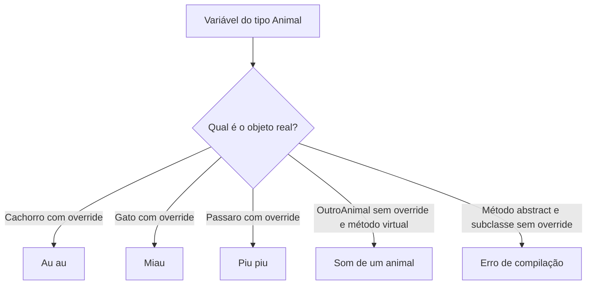

## Visão Geral do Conceito

Polimorfismo é o quarto pilar da orientação a objetos, depois de abstração, encapsulamento e herança (aula [[heranca-pessoa-aluno-funcionario-professor-csharp]]). A herança já montou a árvore. O polimorfismo permite **tratar essa árvore por um tipo comum** e, ainda assim, **cada objeto real responder de um jeito diferente**.

A palavra vem do grego: muitas formas. Em código, o mesmo método — <mark style="background-color: #242424; padding: 2px 4px; border-radius: 3px; color: inherit;">`EmitirSom`</mark> ou <mark style="background-color: #242424; padding: 2px 4px; border-radius: 3px; color: inherit;">`CalcularArea`</mark> — devolve resultados diferentes conforme o objeto que está por trás da referência.

> **Problema que resolve:** sem polimorfismo, cada figura ou cada animal exige variável, lista e <mark style="background-color: #242424; padding: 2px 4px; border-radius: 3px; color: inherit;">`if`</mark> próprios. Com uma superclasse (ou, na aula seguinte, uma interface), uma <mark style="background-color: #242424; padding: 2px 4px; border-radius: 3px; color: inherit;">`List`</mark> e um laço chamam o método; o runtime escolhe o corpo.

> **Lacuna de fonte:** não há PDF nem slides destas aulas 15–21 no pacote do repositório (há PDFs antigos de ambiente e de lista básica, que não cobrem este encontro). O zip do Drive citado pelo professor Luiz Maia não está no repositório. Os exemplos abaixo seguem a transcrição de 8 de setembro de 2026. Fórmulas e arquivos de projeto que ele só mostrou na tela e não ditou ficam marcados como não cobertos.

Nesta aula o dinâmico é **só com herança**. Interface fica para a lição seguinte. Dois mecanismos: <mark style="background-color: #242424; padding: 2px 4px; border-radius: 3px; color: inherit;">`virtual`</mark> (padrão opcional) e <mark style="background-color: #242424; padding: 2px 4px; border-radius: 3px; color: inherit;">`abstract`</mark> (implementação obrigatória).

## Modelo Mental

### Duas decisões, dois momentos

| Tipo | Nome na aula | Quando a linguagem escolhe o corpo | Mecanismo já visto ou novo |
|------|----------------|--------------------------------------|----------------------------|
| Estático | Sobrecarga (<mark style="background-color: #242424; padding: 2px 4px; border-radius: 3px; color: inherit;">`overload`</mark>) | Compilação | Operador <mark style="background-color: #242424; padding: 2px 4px; border-radius: 3px; color: inherit;">`+`</mark>, método, construtor |
| Dinâmico | Sobrescrita (<mark style="background-color: #242424; padding: 2px 4px; border-radius: 3px; color: inherit;">`override`</mark>) | Execução | Herança com <mark style="background-color: #242424; padding: 2px 4px; border-radius: 3px; color: inherit;">`virtual`</mark> ou <mark style="background-color: #242424; padding: 2px 4px; border-radius: 3px; color: inherit;">`abstract`</mark> |

O estático já apareceu nas aulas de calculadora: o compilador olha os tipos dos operandos e a assinatura e grava qual corpo vai correr. O dinâmico **não** decide isso na compilação. A variável pode ser do tipo da superclasse; o objeto real (cachorro, gato, quadrado) só é conhecido quando a linha executa.

Analogia da aula: a variável <mark style="background-color: #242424; padding: 2px 4px; border-radius: 3px; color: inherit;">`Animal`</mark> é a ficha “animal”. Quem late ou mia é o objeto que foi colocado nessa ficha. Trocar o objeto troca o som, sem trocar o nome do método.

### virtual versus abstract

- **<mark style="background-color: #242424; padding: 2px 4px; border-radius: 3px; color: inherit;">`virtual`</mark>:** a superclasse tem um corpo padrão. A subclasse **pode** sobrescrever. Se não sobrescrever, corre o padrão. A classe da base **pode** ser abstrata, mas não é obrigada a sê-lo só por ter um método virtual.
- **<mark style="background-color: #242424; padding: 2px 4px; border-radius: 3px; color: inherit;">`abstract`</mark>:** o método não tem corpo. Toda subclasse concreta **tem** de implementar. Classe que declara método abstrato **tem** de ser <mark style="background-color: #242424; padding: 2px 4px; border-radius: 3px; color: inherit;">`abstract`</mark> — não existe <mark style="background-color: #242424; padding: 2px 4px; border-radius: 3px; color: inherit;">`new`</mark> dessa classe.

> **Regra:** se existe um comportamento genérico útil ( “som de um animal” ), <mark style="background-color: #242424; padding: 2px 4px; border-radius: 3px; color: inherit;">`virtual`</mark> basta. Se não existe fórmula genérica (não há “área de uma figura qualquer”), o método é <mark style="background-color: #242424; padding: 2px 4px; border-radius: 3px; color: inherit;">`abstract`</mark>.



## Mecânica Central

Documentação de <mark style="background-color: #242424; padding: 2px 4px; border-radius: 3px; color: inherit;">`virtual`</mark>, <mark style="background-color: #242424; padding: 2px 4px; border-radius: 3px; color: inherit;">`override`</mark> e <mark style="background-color: #242424; padding: 2px 4px; border-radius: 3px; color: inherit;">`abstract`</mark>: [virtual](https://learn.microsoft.com/dotnet/csharp/language-reference/keywords/virtual), [override](https://learn.microsoft.com/dotnet/csharp/language-reference/keywords/override), [abstract](https://learn.microsoft.com/dotnet/csharp/language-reference/keywords/abstract).

### 1. Estático, só para ancorar o contraste

Três formas que o professor relembrou (já vistas; não são o foco novo):

1. **Sobrecarga de operador.** <mark style="background-color: #242424; padding: 2px 4px; border-radius: 3px; color: inherit;">`op1 + op2`</mark> com <mark style="background-color: #242424; padding: 2px 4px; border-radius: 3px; color: inherit;">`double`</mark> soma. <mark style="background-color: #242424; padding: 2px 4px; border-radius: 3px; color: inherit;">`string + double`</mark> converte o número e concatena.
2. **Sobrecarga de método.** <mark style="background-color: #242424; padding: 2px 4px; border-radius: 3px; color: inherit;">`Somar`</mark> com <mark style="background-color: #242424; padding: 2px 4px; border-radius: 3px; color: inherit;">`int`</mark> e <mark style="background-color: #242424; padding: 2px 4px; border-radius: 3px; color: inherit;">`Somar`</mark> com <mark style="background-color: #242424; padding: 2px 4px; border-radius: 3px; color: inherit;">`double`</mark> na calculadora: mesmo nome, assinatura diferente.
3. **Sobrecarga de construtor.** Construtor vazio e construtor com parâmetros. O compilador escolhe pelo que foi passado no <mark style="background-color: #242424; padding: 2px 4px; border-radius: 3px; color: inherit;">`new`</mark>.

> **Não coberto:** numa linha de <mark style="background-color: #242424; padding: 2px 4px; border-radius: 3px; color: inherit;">`Console.WriteLine`</mark> o professor disse haver três sobrecargas e explicou só a do <mark style="background-color: #242424; padding: 2px 4px; border-radius: 3px; color: inherit;">`+`</mark>. As outras duas não foram nomeadas. O quadro de slides que comparava virtual, abstrato e interface foi mostrado com o aviso de que não se entende só lendo; a coluna interface não foi exercitada neste encontro.

### 2. Animal com método virtual

A superclasse é abstrata neste exemplo (ele tirou <mark style="background-color: #242424; padding: 2px 4px; border-radius: 3px; color: inherit;">`abstract`</mark> só para mostrar que <mark style="background-color: #242424; padding: 2px 4px; border-radius: 3px; color: inherit;">`new Animal()`</mark> passaria a compilar, e voltou a marcar a classe como abstrata porque “animal genérico” não faz sentido no domínio). O método começa virtual, com corpo padrão.

```csharp
public abstract class Animal
{
    public string Nome { get; }

    protected Animal() { }

    protected Animal(string nome)
    {
        Nome = nome;
    }

    public virtual string EmitirSom() => "Som de um animal";
}

public class Cachorro : Animal
{
    public Cachorro(string nome) : base(nome) { }

    public override string EmitirSom() => "Au au";
}

public class Gato : Animal
{
    public override string EmitirSom() => "Miau";
}

public class Passaro : Animal
{
    public override string EmitirSom() => "Piu piu";
}

public class OutroAnimal : Animal
{
    // virtual: não é obrigatório override; corre EmitirSom da base
}
```

Pontos mecânicos:

- <mark style="background-color: #242424; padding: 2px 4px; border-radius: 3px; color: inherit;">`override`</mark> em C# é modificador, não anotação. Em Java o equivalente mostrado na aula é a anotação <mark style="background-color: #242424; padding: 2px 4px; border-radius: 3px; color: inherit;">`@Override`</mark>. O conceito é o mesmo; a sintaxe muda.
- <mark style="background-color: #242424; padding: 2px 4px; border-radius: 3px; color: inherit;">`: base(nome)`</mark> encadeia o construtor da superclasse. <mark style="background-color: #242424; padding: 2px 4px; border-radius: 3px; color: inherit;">`base`</mark> é palavra reservada.
- Referência da superclasse, objeto da subclasse:

```csharp
Animal animal = new Cachorro("Led");
Console.WriteLine(animal.GetType().Name);
Console.WriteLine(animal.EmitirSom());
animal = new Gato();
```

<mark style="background-color: #242424; padding: 2px 4px; border-radius: 3px; color: inherit;">`GetType().Name`</mark> mostra o tipo real (Cachorro, Gato, Passaro, OutroAnimal). <mark style="background-color: #242424; padding: 2px 4px; border-radius: 3px; color: inherit;">`EmitirSom`</mark> dispara o override. A segunda atribuição **substitui** a referência: o cachorro deixa de estar guardado em <mark style="background-color: #242424; padding: 2px 4px; border-radius: 3px; color: inherit;">`animal`</mark>.

Listas em C# são homogêneas (ao contrário das listas de Python, que o professor contrastou). Sem herança seriam quatro listas. Com herança, uma <mark style="background-color: #242424; padding: 2px 4px; border-radius: 3px; color: inherit;">`List<Animal>`</mark> aceita qualquer subclasse. O método de inclusão ditado foi <mark style="background-color: #242424; padding: 2px 4px; border-radius: 3px; color: inherit;">`Add`</mark>. A travessia foi <mark style="background-color: #242424; padding: 2px 4px; border-radius: 3px; color: inherit;">`foreach`</mark>.

```csharp
var animais = new List<Animal>();
animais.Add(new Cachorro("Led"));
animais.Add(new Gato());
animais.Add(new Passaro());
animais.Add(new OutroAnimal());

foreach (Animal item in animais)
{
    Console.WriteLine(item.GetType().Name);
    Console.WriteLine(item.EmitirSom());
}
```

Saída ditada para o caso virtual: cachorro Led au au; gato miau; pássaro piu piu; outro animal usa o texto da base. O primeiro exemplo de animal **não tinha construtor**; o nome foi acrescentado ao vivo só no cachorro. Gato, pássaro e outro animal ficaram sem nome nesse trecho.

### 3. O mesmo animal com método abstract

Trocar <mark style="background-color: #242424; padding: 2px 4px; border-radius: 3px; color: inherit;">`virtual string EmitirSom()`</mark> por <mark style="background-color: #242424; padding: 2px 4px; border-radius: 3px; color: inherit;">`abstract string EmitirSom();`</mark> (sem corpo) muda a obrigação:

- <mark style="background-color: #242424; padding: 2px 4px; border-radius: 3px; color: inherit;">`OutroAnimal`</mark> passa a precisar de <mark style="background-color: #242424; padding: 2px 4px; border-radius: 3px; color: inherit;">`override`</mark>. Sem isso o compilador avisa que falta implementar <mark style="background-color: #242424; padding: 2px 4px; border-radius: 3px; color: inherit;">`Animal.EmitirSom`</mark>.
- A classe <mark style="background-color: #242424; padding: 2px 4px; border-radius: 3px; color: inherit;">`Animal`</mark> **tem** de ser abstrata. Com método só virtual, abstrair a classe era escolha de domínio.

O programa principal (lista ou variável reatribuída) permanece o mesmo. O que muda é a regra de compilação, não a ideia de “muitas formas”.

### 4. Figuras: do código duplicado à lista única

Projeto sem polimorfismo (o professor chamou de polimorfismo 2.1), pasta <mark style="background-color: #242424; padding: 2px 4px; border-radius: 3px; color: inherit;">`Models`</mark>:

| Classe | Estado | Área |
|--------|--------|------|
| Quadrado | <mark style="background-color: #242424; padding: 2px 4px; border-radius: 3px; color: inherit;">`Lado`</mark> | lado × lado |
| Retangulo | base e altura | base × altura |
| Triangulo | base e altura | base × altura / 2 |

Demonstração ditada: quadrado de lado 2 → área 4; retângulo 3 por 2 → 6; triângulo 3 por 2 → 3.

<mark style="background-color: #242424; padding: 2px 4px; border-radius: 3px; color: inherit;">`base`</mark> não pode ser nome de parâmetro. Ele renomeou o campo da base do retângulo. Cada figura precisou da própria variável: uma variável declarada como <mark style="background-color: #242424; padding: 2px 4px; border-radius: 3px; color: inherit;">`Quadrado`</mark> não aceita um <mark style="background-color: #242424; padding: 2px 4px; border-radius: 3px; color: inherit;">`Retangulo`</mark>. Três listas seriam necessárias para guardar as três formas. Não há como chamar “calcular área” sem saber o tipo.

Projeto 2.2 extrai a superclasse. Não existe área genérica, logo método e classe são abstratos. Ao copiar as classes entre projetos, o <mark style="background-color: #242424; padding: 2px 4px; border-radius: 3px; color: inherit;">`namespace`</mark> veio do projeto antigo; o ajuste foi o comando de sincronizar namespaces do projeto.

```csharp
public abstract class Figura
{
    public abstract double CalcularArea();
}

public class Quadrado : Figura
{
    public double Lado { get; }

    public Quadrado(double lado) { Lado = lado; }

    public override double CalcularArea() => Lado * Lado;
}

public class Retangulo : Figura
{
    public double BaseRetangulo { get; }
    public double Altura { get; }

    public Retangulo(double baseRetangulo, double altura)
    {
        BaseRetangulo = baseRetangulo;
        Altura = altura;
    }

    public override double CalcularArea() => BaseRetangulo * Altura;
}

public class Triangulo : Figura
{
    public double BaseRetangulo { get; }
    public double Altura { get; }

    public Triangulo(double baseRetangulo, double altura)
    {
        BaseRetangulo = baseRetangulo;
        Altura = altura;
    }

    public override double CalcularArea() => BaseRetangulo * Altura / 2;
}
```

```csharp
var figuras = new List<Figura>();
figuras.Add(new Quadrado(2));
figuras.Add(new Retangulo(3, 2));
figuras.Add(new Triangulo(3, 2));

foreach (Figura figura in figuras)
{
    Console.WriteLine($"{figura.GetType().Name} {figura.CalcularArea()}");
}
```

Uma lista, um método, três áreas. O <mark style="background-color: #242424; padding: 2px 4px; border-radius: 3px; color: inherit;">`override`</mark> é o que faz o compilador aceitar a subclasse: o método já existia, mas sem <mark style="background-color: #242424; padding: 2px 4px; border-radius: 3px; color: inherit;">`override`</mark> ele não cumpre o contrato abstrato.

> **Conflito com a aula de 14 de setembro:** na recapitulação seguinte o professor, ao abrir o zip, disse que <mark style="background-color: #242424; padding: 2px 4px; border-radius: 3px; color: inherit;">`EmitirSom`</mark> do animal estava abstrato, não virtual. Nesta transcrição de 8 de setembro ele mostrou **as duas** versões, primeiro virtual (OutroAnimal sem override) e depois abstract (OutroAnimal obrigado a implementar). As duas estão corretas como variantes; não são o mesmo arquivo.

## Uso Prático

Cenário de cadastro acadêmico, no espírito do “exemplo de mercado” que ele anunciou para a aula seguinte (notificação) e do argumento que usou ao vivo: não guarde um número derivado se a regra muda por tipo.

Três papéis de funcionário calculam salário de formas diferentes. Guardar <mark style="background-color: #242424; padding: 2px 4px; border-radius: 3px; color: inherit;">`Salario`</mark> como campo fixo na superclasse repete o problema da área gravada no quadrado. O método abstrato força cada papel a dizer a própria regra; a folha percorre uma lista do tipo base.

```csharp
public abstract class FuncionarioFolha
{
    public string Nome { get; }

    protected FuncionarioFolha(string nome)
    {
        Nome = nome;
    }

    public abstract decimal CalcularSalario();
}

public class Vendedor : FuncionarioFolha
{
    public decimal Vendas { get; }
    public decimal Comissao { get; }

    public Vendedor(string nome, decimal vendas, decimal comissao) : base(nome)
    {
        Vendas = vendas;
        Comissao = comissao;
    }

    public override decimal CalcularSalario() => Vendas * Comissao;
}

public class Administrativo : FuncionarioFolha
{
    public decimal SalarioFixo { get; }

    public Administrativo(string nome, decimal salarioFixo) : base(nome)
    {
        SalarioFixo = salarioFixo;
    }

    public override decimal CalcularSalario() => SalarioFixo;
}
```

```csharp
var folha = new List<FuncionarioFolha>
{
    new Vendedor("Rui", 10000m, 0.05m),
    new Administrativo("Lia", 4500m),
};

foreach (FuncionarioFolha pessoa in folha)
{
    Console.WriteLine($"{pessoa.GetType().Name} {pessoa.Nome} {pessoa.CalcularSalario()}");
}
```

Os percentuais acima ilustram o desenho que ele descreveu (gerente, administrativo, vendedor; o cálculo depende do tipo). Ele **não** ditou fórmula de comissão nem de gerente nesta aula. Gerente fica de fora do código até haver regra na fonte.

O mesmo desenho, dito por ele, vale para conta corrente: saldo “de verdade” pode depender de conta comum, especial ou poupança, então o cálculo ocorre na execução da subclasse, não num campo genérico copiado cedo demais.

## Erros Comuns

**Instanciar a classe abstrata.** <mark style="background-color: #242424; padding: 2px 4px; border-radius: 3px; color: inherit;">`new Animal()`</mark> ou <mark style="background-color: #242424; padding: 2px 4px; border-radius: 3px; color: inherit;">`new Figura()`</mark> não compila enquanto a classe for <mark style="background-color: #242424; padding: 2px 4px; border-radius: 3px; color: inherit;">`abstract`</mark>. Sintoma: erro no <mark style="background-color: #242424; padding: 2px 4px; border-radius: 3px; color: inherit;">`new`</mark>. Correção: instanciar a subclasse, ou remover <mark style="background-color: #242424; padding: 2px 4px; border-radius: 3px; color: inherit;">`abstract`</mark> só se o domínio realmente tiver um objeto genérico útil.

**Esquecer <mark style="background-color: #242424; padding: 2px 4px; border-radius: 3px; color: inherit;">`override`</mark> no método abstrato.** O método “está lá”, mas o compilador não o reconhece como implementação. Mensagem vista na aula: a subclasse não está sobrescrevendo <mark style="background-color: #242424; padding: 2px 4px; border-radius: 3px; color: inherit;">`CalcularArea`</mark> / precisa implementar <mark style="background-color: #242424; padding: 2px 4px; border-radius: 3px; color: inherit;">`EmitirSom`</mark>. Correção: <mark style="background-color: #242424; padding: 2px 4px; border-radius: 3px; color: inherit;">`public override ...`</mark>.

**Tratar virtual como obrigatório.** <mark style="background-color: #242424; padding: 2px 4px; border-radius: 3px; color: inherit;">`OutroAnimal`</mark> sem override é válido no modelo virtual e inválido no modelo abstract. Confundir os dois faz ou um som padrão inesperado, ou um erro de compilação.

**Reutilizar uma variável e achar que a lista cresceu.** <mark style="background-color: #242424; padding: 2px 4px; border-radius: 3px; color: inherit;">`animal = new Gato()`</mark> não acumula. Quem acumula é <mark style="background-color: #242424; padding: 2px 4px; border-radius: 3px; color: inherit;">`Add`</mark>.

**Atribuir subclasse na variável da outra subclasse.** <mark style="background-color: #242424; padding: 2px 4px; border-radius: 3px; color: inherit;">`Quadrado figura = new Retangulo(...)`</mark> não compila. A variável comum tem de ser do tipo da **superclasse** (<mark style="background-color: #242424; padding: 2px 4px; border-radius: 3px; color: inherit;">`Figura`</mark>), não de um irmão.

**Parâmetro chamado <mark style="background-color: #242424; padding: 2px 4px; border-radius: 3px; color: inherit;">`base`</mark>.** Palavra reservada, usada no encadeamento de construtor. O parâmetro precisa de outro nome.

**Área (ou salário, ou saldo) gravada num campo.** O número fica stale quando o dado de entrada muda. Calcule no método.

**<mark style="background-color: #242424; padding: 2px 4px; border-radius: 3px; color: inherit;">`namespace`</mark> antigo depois de copiar o projeto.** O código deixa de enxergar os tipos. Sincronize o namespace do projeto destino.

## Visão Geral de Debugging

1. O erro é de **compilação** ou de **resultado errado na execução**? Abstract faltando e <mark style="background-color: #242424; padding: 2px 4px; border-radius: 3px; color: inherit;">`new`</mark> da classe abstrata quebram antes de rodar. Som errado ou área errada rodam e mentem.
2. Se compilou e o som foi o texto genérico, a subclasse **não** tem <mark style="background-color: #242424; padding: 2px 4px; border-radius: 3px; color: inherit;">`override`</mark> e o método da base é virtual. Confira <mark style="background-color: #242424; padding: 2px 4px; border-radius: 3px; color: inherit;">`GetType().Name`</mark> para ver o objeto real.
3. Se a lista “perde” animais, procure reatribuição da mesma variável em vez de <mark style="background-color: #242424; padding: 2px 4px; border-radius: 3px; color: inherit;">`Add`</mark>.
4. Linha em branco entre o nome e o som: na aula, gato e os outros nasceram sem <mark style="background-color: #242424; padding: 2px 4px; border-radius: 3px; color: inherit;">`Nome`</mark> e o <mark style="background-color: #242424; padding: 2px 4px; border-radius: 3px; color: inherit;">`WriteLine`</mark> do nome nulo separou a saída. Ele começou um teste de nulo e **não fechou** o conserto na gravação. Trate <mark style="background-color: #242424; padding: 2px 4px; border-radius: 3px; color: inherit;">`null`</mark> antes de imprimir.
5. Área inesperada: confira qual override corre (<mark style="background-color: #242424; padding: 2px 4px; border-radius: 3px; color: inherit;">`GetType().Name`</mark>) e se a base do retângulo não foi nomeada <mark style="background-color: #242424; padding: 2px 4px; border-radius: 3px; color: inherit;">`base`</mark>.

<details>
<summary>Sintoma do nome nulo no foreach</summary>

O laço imprimia tipo, nome e som. Sem nome, aparecia uma linha vazia entre o tipo e o som. O som em si estava certo. O defeito era de saída, não do despacho polimórfico.

</details>

## Principais Pontos

- Polimorfismo estático: compilação, sobrecarga de operador, método e construtor.
- Polimorfismo dinâmico nesta aula: execução, <mark style="background-color: #242424; padding: 2px 4px; border-radius: 3px; color: inherit;">`override`</mark>, herança.
- <mark style="background-color: #242424; padding: 2px 4px; border-radius: 3px; color: inherit;">`virtual`</mark>: há padrão; override é opcional.
- <mark style="background-color: #242424; padding: 2px 4px; border-radius: 3px; color: inherit;">`abstract`</mark>: não há padrão; override é obrigatório; a classe também é abstrata.
- A variável pode ser da superclasse; o método que corre é o do objeto real.
- Uma variável não acumula objetos; <mark style="background-color: #242424; padding: 2px 4px; border-radius: 3px; color: inherit;">`List<Animal>`</mark> ou <mark style="background-color: #242424; padding: 2px 4px; border-radius: 3px; color: inherit;">`List<Figura>`</mark> acumula.
- Listas de C# são homogêneas: o tipo comum é a superclasse.
- Não há área genérica de figura: <mark style="background-color: #242424; padding: 2px 4px; border-radius: 3px; color: inherit;">`CalcularArea`</mark> é abstrato.
- Valor derivado (área, salário, saldo) calcula na hora, não fica num campo fácil de desatualizar.
- Interface como segunda forma de polimorfismo dinâmico ficou para a próxima lição.

## Preparação para Prática

Antes do laboratório, você deve conseguir:

1. Dizer se um método de superclasse deve ser virtual ou abstrato a partir da pergunta “existe implementação genérica?”.
2. Montar uma lista do tipo da superclasse e percorrê-la chamando um único método.
3. Prever o que <mark style="background-color: #242424; padding: 2px 4px; border-radius: 3px; color: inherit;">`OutroAnimal`</mark> faz com virtual e o que o compilador faz com abstract sem override.
4. Recusar variável da subclasse irmã e recusar campo para valor que depende de outro estado.

## Laboratório de Prática

> Exemplos do corpo em C#. No Editor Integrado ISS use o boilerplate JavaScript abaixo (espelha a lógica). Equivalências: referência <mark style="background-color: #242424; padding: 2px 4px; border-radius: 3px; color: inherit;">`Animal`</mark> ≈ objeto com <mark style="background-color: #242424; padding: 2px 4px; border-radius: 3px; color: inherit;">`tipo`</mark>; <mark style="background-color: #242424; padding: 2px 4px; border-radius: 3px; color: inherit;">`virtual`</mark> sem override ≈ ramo padrão; <mark style="background-color: #242424; padding: 2px 4px; border-radius: 3px; color: inherit;">`abstract`</mark> sem implementação ≈ erro; <mark style="background-color: #242424; padding: 2px 4px; border-radius: 3px; color: inherit;">`List`</mark> + <mark style="background-color: #242424; padding: 2px 4px; border-radius: 3px; color: inherit;">`foreach`</mark> ≈ array e laço.

### Easy — Som por tipo real (virtual com padrão)

Contexto ADS: um log de abrigo precisa da mesma chamada para qualquer animal; quem não tem som próprio cai no texto padrão.

```javascript
function emitirSomVirtual(animal) {
  // animal = { tipo: "cachorro" | "gato" | "passaro" | "outro" }
  // TODO: cachorro → "Au au"; gato → "Miau"; passaro → "Piu piu"
  // TODO: qualquer outro tipo → "Som de um animal" (padrão do virtual)
  return "Som de um animal";
}

function descreverAnimal(animal) {
  // TODO: retornar animal.tipo + ": " + emitirSomVirtual(animal)
  return "";
}

descreverAnimal({ tipo: "cachorro" });
descreverAnimal({ tipo: "outro" });
```

### Medium — Figura abstrata: sem padrão, área obrigatória

Contexto ADS: o módulo de plantas de um imóvel não tem “área genérica”. Quadrado, retângulo e triângulo precisam de fórmula própria; tipo desconhecido deve falhar.

```javascript
function calcularArea(figura) {
  // figura.tipo: "quadrado" { lado }, "retangulo" { base, altura }, "triangulo" { base, altura }
  // TODO: quadrado → lado * lado
  // TODO: retangulo → base * altura
  // TODO: triangulo → (base * altura) / 2
  // TODO: outro tipo → throw new Error("Figura sem CalcularArea")
  return 0;
}

function areasDaLista(figuras) {
  // TODO: retornar array com calcularArea de cada item, na mesma ordem
  return [];
}

areasDaLista([
  { tipo: "quadrado", lado: 2 },
  { tipo: "retangulo", base: 3, altura: 2 },
  { tipo: "triangulo", base: 3, altura: 2 },
]);
```

### Hard — Folha polimórfica sem campo de salário stale

Contexto ADS: a folha não pode gravar salário na ficha se a regra muda por papel. Percorra uma lista heterogênea no domínio e homogênea no tipo “funcionário”, e recuse papel sem regra.

```javascript
function calcularSalario(funcionario) {
  // administrativo: { tipo, nome, salarioFixo }
  // vendedor: { tipo, nome, vendas, comissao } → vendas * comissao
  // TODO: implementar os dois ramos; tipo diferente → throw new Error("sem regra de salário")
  return 0;
}

function fecharFolha(funcionarios) {
  // TODO: retornar { linhas: [{ nome, tipo, salario }], total }
  // salario vem de calcularSalario; não leia um campo "salario" gravado
  return { linhas: [], total: 0 };
}

function acumularOuSubstituir(atual, proximo, lista) {
  // atual é UMA referência (como a variável Animal reatribuída)
  // lista é a List que acumula
  // TODO: retornar { referencia: proximo, lista: lista concatenada com proximo }
  // não apague os itens já presentes em lista
  return { referencia: atual, lista: lista.slice() };
}

fecharFolha([
  { tipo: "vendedor", nome: "Rui", vendas: 10000, comissao: 0.05 },
  { tipo: "administrativo", nome: "Lia", salarioFixo: 4500 },
]);
acumularOuSubstituir(null, { tipo: "cachorro" }, []);
```

<!-- CONCEPT_EXTRACTION
concepts:
  - polimorfismo estático
  - polimorfismo dinâmico
  - sobrecarga de operador método e construtor
  - virtual com corpo padrão
  - abstract sem corpo
  - override
  - classe abstrata obrigatória se houver método abstrato
  - referência da superclasse e objeto da subclasse
  - List homogênea
  - foreach e GetType().Name
  - Animal EmitirSom
  - Figura CalcularArea
  - área salário e saldo como cálculo e não como campo
skills:
  - Distinguir decisão em tempo de compilação de decisão em tempo de execução
  - Declarar método virtual com padrão e permitir subclasse sem override
  - Declarar método abstract e obrigar override na subclasse concreta
  - Impedir new da classe abstrata
  - Acumular subclasses numa List do tipo da superclasse
  - Chamar um único método e obter o comportamento do objeto real
  - Recusar parâmetro com o nome base
  - Calcular valor derivado no método em vez de armazená-lo
examples:
  - animal-virtual-outro-animal-padrao
  - animal-abstract-outro-animal-obrigatorio
  - referencia-reatribuida-versus-list-add
  - figuras-sem-polimorfismo-tres-variaveis
  - figura-abstrata-lista-areas-4-6-3
  - folha-vendedor-administrativo
  - lab-js-som-area-folha
-->

<!-- EXERCISES_JSON
[
  {
    "id": "csharp-emitir-som-virtual",
    "slug": "csharp-emitir-som-virtual",
    "difficulty": "easy",
    "title": "Som por tipo real com padrão virtual",
    "discipline": "fundamentos-csharp",
    "editorLanguage": "javascript",
    "tags": ["csharp", "polimorfismo", "virtual", "override"],
    "summary": "Devolver o som do tipo real e cair no texto padrão quando o tipo não tem override."
  },
  {
    "id": "csharp-calcular-area-abstrata",
    "slug": "csharp-calcular-area-abstrata",
    "difficulty": "medium",
    "title": "Área obrigatória por figura",
    "discipline": "fundamentos-csharp",
    "editorLanguage": "javascript",
    "tags": ["csharp", "polimorfismo", "abstract", "lista"],
    "summary": "Calcular área de quadrado, retângulo e triângulo e falhar quando o tipo não implementa a regra."
  },
  {
    "id": "csharp-folha-salario-polimorfico",
    "slug": "csharp-folha-salario-polimorfico",
    "difficulty": "hard",
    "title": "Folha sem salário gravado",
    "discipline": "fundamentos-csharp",
    "editorLanguage": "javascript",
    "tags": ["csharp", "polimorfismo", "abstract", "lista"],
    "summary": "Fechar a folha calculando salário por papel e acumular referências sem substituir a lista."
  }
]
-->

<!--
lessons.json (NÃO aplicado por este worker — integração serial do orquestrador):
{
  "discipline": "fundamentos-csharp",
  "slug": "polimorfismo-dinamico-heranca-virtual-abstrato-csharp",
  "title": "Polimorfismo dinâmico com herança: virtual e abstract",
  "order": 15,
  "file": "content/fundamentos-csharp/aula-15-polimorfismo-dinamico-heranca-virtual-abstrato-csharp.md"
}
-->
