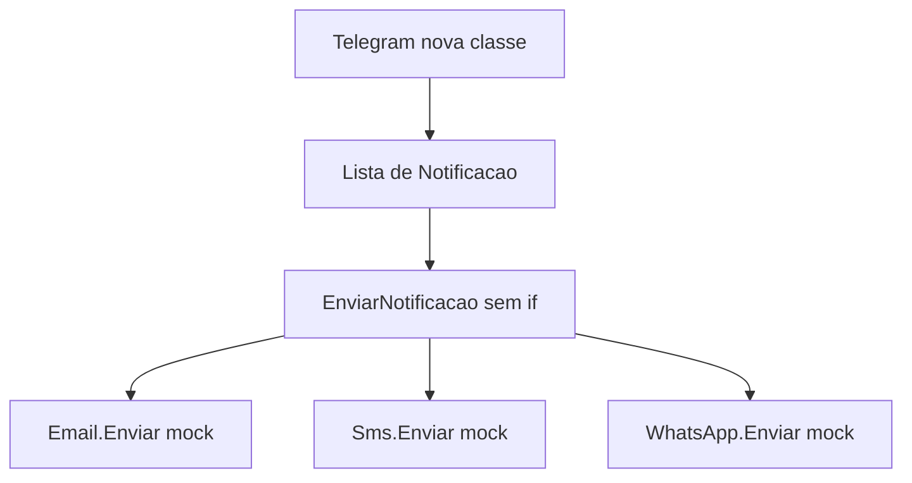

## Visão Geral do Conceito

A lição anterior fechou o polimorfismo dinâmico **com herança** em animal e figura. Esta aula repete a mesma estrutura em dois problemas de aplicação — notificação e frete — e abre a segunda via do dinâmico: **interface**. A interface é um contrato: diz o que a classe deve fazer e não diz como.

O professor Luiz Maia não digitou o código ao vivo (feriado de 7 de setembro e pouco tempo). Mostrou projetos prontos do Drive. O zip não está neste repositório.

> **Problema que resolve:** um método que pergunta “é e-mail? é SMS? é WhatsApp?” precisa ser editado a cada canal novo. O mesmo vale para “é frete normal, expresso ou internacional?”. Polimorfismo deixa o método fechado e abre espaço para uma classe nova.

> **Lacuna de fonte:** sem PDF desta aula no pacote. Fórmulas numéricas de frete (peso, distância, urgência) não foram ditadas — só a estrutura. A quarta assinatura de <mark style="background-color: #242424; padding: 2px 4px; border-radius: 3px; color: inherit;">`IFrete`</mark> também não foi ditada. Liskov, segregação de interface e inversão de dependência foram nomeados como “as letras que dependem de interface” e como usos possíveis (mocks, injeção de dependência, inversão de controle), sem exemplo. O professor estimou ter mostrado uma fração pequena do que interface permite.

> **Conflito de recapitulação:** ao reabrir o animal, ele disse que <mark style="background-color: #242424; padding: 2px 4px; border-radius: 3px; color: inherit;">`EmitirSom`</mark> estava <mark style="background-color: #242424; padding: 2px 4px; border-radius: 3px; color: inherit;">`abstract`</mark>, não <mark style="background-color: #242424; padding: 2px 4px; border-radius: 3px; color: inherit;">`virtual`</mark>. Na aula de 8 de setembro as duas variantes foram feitas. Aqui o zip que ele comentou era a variante abstrata.

## Modelo Mental

Os quatro exemplos (animal, figura, notificação, frete) têm a mesma cara:

1. Várias classes fazem a **mesma operação** com regra diferente.
2. A versão ingênua instancia cada uma e ramifica com <mark style="background-color: #242424; padding: 2px 4px; border-radius: 3px; color: inherit;">`if`</mark> / exceção.
3. A versão polimórfica cria um tipo comum (<mark style="background-color: #242424; padding: 2px 4px; border-radius: 3px; color: inherit;">`abstract`</mark> ou interface) com a operação.
4. Uma lista desse tipo comum é percorrida com uma chamada só.
5. Canal ou modalidade nova = classe nova. O laço não muda.

Isso é o que ele amarrou a duas letras do SOLID, como desenho e não como recurso de C#:

- **Responsabilidade única:** a classe ou o método faz uma coisa.
- **Aberto/fechado:** aberto para extensão (nova subclasse ou nova implementação), fechado para modificação (não reabrir <mark style="background-color: #242424; padding: 2px 4px; border-radius: 3px; color: inherit;">`EnviarNotificacao`</mark> nem a classe base).

DRY aparece no mesmo discurso: a superclasse (ou o contrato) existe para não repetir a estrutura do laço.

Analogia da interface, a que ele escolheu: o controle remoto da TV. Os botões (ligar, volume, canal) são o contrato. Quem aperta não precisa saber o circuito da TV. Outras analogias citadas e não desenvolvidas: tomada e dirigir um carro.



Herança comparada com interface, no recorte dele:

| | Herança | Interface |
|--|---------|-----------|
| O que se partilha | Código e estrutura da superclasse | Só a assinatura |
| Animais | Cachorro **é** Animal | Cachorro **implementa** o contrato de emitir som; não há superclasse comum |
| Lista | <mark style="background-color: #242424; padding: 2px 4px; border-radius: 3px; color: inherit;">`List&lt;Animal&gt;`</mark> | <mark style="background-color: #242424; padding: 2px 4px; border-radius: 3px; color: inherit;">`List&lt;IAnimal&gt;`</mark> |

## Mecânica Central

### 1. Notificação sem polimorfismo e com classe abstrata

Três classes soltas: e-mail, SMS, WhatsApp. O envio é um <mark style="background-color: #242424; padding: 2px 4px; border-radius: 3px; color: inherit;">`mock`</mark> (ele chamou de enganação): não há rotina real de envio. O programa principal cria os três e um método testa a string do canal. Canal desconhecido lança exceção. Telegram obriga a editar esse método.

Versão polimórfica: classe abstrata <mark style="background-color: #242424; padding: 2px 4px; border-radius: 3px; color: inherit;">`Notificacao`</mark> com <mark style="background-color: #242424; padding: 2px 4px; border-radius: 3px; color: inherit;">`Enviar`</mark> abstrato, sem corpo. Cada canal estende e faz <mark style="background-color: #242424; padding: 2px 4px; border-radius: 3px; color: inherit;">`override`</mark>.

Novidade de sintaxe: a lista nasce já preenchida, sem um <mark style="background-color: #242424; padding: 2px 4px; border-radius: 3px; color: inherit;">`Add`</mark> por item.

```csharp
public abstract class Notificacao
{
    public abstract void Enviar(string mensagem);
}

public class Email : Notificacao
{
    public override void Enviar(string mensagem)
    {
        // mock: não dispara e-mail de verdade
        Console.WriteLine($"email: {mensagem}");
    }
}

public class Sms : Notificacao
{
    public override void Enviar(string mensagem)
    {
        Console.WriteLine($"sms: {mensagem}");
    }
}

public class WhatsApp : Notificacao
{
    public override void Enviar(string mensagem)
    {
        Console.WriteLine($"whatsapp: {mensagem}");
    }
}

public static void EnviarNotificacao(Notificacao canal, string mensagem)
{
    canal.Enviar(mensagem);
}
```

```csharp
var notificacoes = new List<Notificacao>
{
    new Email(),
    new Sms(),
    new WhatsApp(),
};

foreach (Notificacao canal in notificacoes)
{
    EnviarNotificacao(canal, "pedido confirmado");
}
```

Telegram: nova classe que estende <mark style="background-color: #242424; padding: 2px 4px; border-radius: 3px; color: inherit;">`Notificacao`</mark>, mais um elemento na lista. <mark style="background-color: #242424; padding: 2px 4px; border-radius: 3px; color: inherit;">`EnviarNotificacao`</mark> permanece. Push foi citado como outro canal possível, sem classe escrita.

### 2. Frete: abstract obrigatório e virtual opcional

Sem polimorfismo, o principal instancia frete normal, expresso e internacional e um método pergunta qual é. Fora dos três, exceção. O cálculo citado é “baseado no peso”; expresso e internacional também consideram distância e urgência na versão seguinte. **Números e taxas não estão na transcrição.**

Com polimorfismo, a classe <mark style="background-color: #242424; padding: 2px 4px; border-radius: 3px; color: inherit;">`Frete`</mark> é abstrata. Três operações de cálculo, nomes iguais e parâmetros diferentes:

- <mark style="background-color: #242424; padding: 2px 4px; border-radius: 3px; color: inherit;">`Calcular`</mark> só com peso: **abstrato**. Toda subclasse sobrescreve.
- <mark style="background-color: #242424; padding: 2px 4px; border-radius: 3px; color: inherit;">`Calcular`</mark> com peso e distância: **virtual**. A subclasse herda o corpo da base se não sobrescrever.
- <mark style="background-color: #242424; padding: 2px 4px; border-radius: 3px; color: inherit;">`Calcular`</mark> com peso, distância e urgência: **virtual**, mesma regra.

Ele marcou os dois últimos como <mark style="background-color: #242424; padding: 2px 4px; border-radius: 3px; color: inherit;">`virtual`</mark> ao vivo e disse que atualizaria o Drive. Frete normal, expresso e internacional sobrescrevem o cálculo de peso. Os outros dois métodos, se a subclasse não os redefinir, executam o padrão da superclasse. Herdar é obrigatório; sobrescrever esses virtuais é opção. Dá para usar o herdado ou escrever outro corpo com <mark style="background-color: #242424; padding: 2px 4px; border-radius: 3px; color: inherit;">`override`</mark>.

```csharp
public abstract class Frete
{
    public abstract decimal Calcular(decimal peso);

    public virtual decimal Calcular(decimal peso, decimal distancia)
    {
        // corpo padrão da aula NÃO foi ditado; não inventar taxa
        return 0m;
    }

    public virtual decimal Calcular(decimal peso, decimal distancia, bool urgencia)
    {
        return 0m;
    }
}

public class FreteNormal : Frete
{
    public override decimal Calcular(decimal peso)
    {
        // regra numérica: não coberta na transcrição
        return 0m;
    }
}
```

O principal percorre a lista e chama o <mark style="background-color: #242424; padding: 2px 4px; border-radius: 3px; color: inherit;">`Calcular`</mark> de um parâmetro (o abstrato). Outras chamadas, ditas como calcular frete dois e três, passam distância e urgência. Um aluno perguntou se isso era sobrecarga. A resposta dele: não, porque há <mark style="background-color: #242424; padding: 2px 4px; border-radius: 3px; color: inherit;">`override`</mark>, o método vem da superclasse já marcado <mark style="background-color: #242424; padding: 2px 4px; border-radius: 3px; color: inherit;">`abstract`</mark> ou <mark style="background-color: #242424; padding: 2px 4px; border-radius: 3px; color: inherit;">`virtual`</mark>, e a resolução é em execução. Sobrecarga, no contraste que ele fez, não usa esses modificadores e resolve-se na compilação dentro da mesma classe.

> **Não coberto:** expressão que multiplica peso, distância ou urgência. O <mark style="background-color: #242424; padding: 2px 4px; border-radius: 3px; color: inherit;">`return 0m`</mark> acima só segura a forma; não é a tarifa do Drive.

### 3. Interface como contrato

Definição que ele pediu para gravar: a interface define **o que** a classe deve fazer e **não** a implementação.

Prefixo <mark style="background-color: #242424; padding: 2px 4px; border-radius: 3px; color: inherit;">`I`</mark> é preferência dele (<mark style="background-color: #242424; padding: 2px 4px; border-radius: 3px; color: inherit;">`ICalcula`</mark>). Ele citou Robert Martin e Martin Fowler como autores que não usam esse prefixo. Documentação: [interfaces](https://learn.microsoft.com/dotnet/csharp/fundamentals/types/interfaces).

A calculadora do curso vira contrato: dois <mark style="background-color: #242424; padding: 2px 4px; border-radius: 3px; color: inherit;">`Somar`</mark> (sobrecarga estática **dentro** do contrato), um <mark style="background-color: #242424; padding: 2px 4px; border-radius: 3px; color: inherit;">`Subtrair`</mark>, <mark style="background-color: #242424; padding: 2px 4px; border-radius: 3px; color: inherit;">`Multiplicar`</mark> e <mark style="background-color: #242424; padding: 2px 4px; border-radius: 3px; color: inherit;">`Dividir`</mark>. Só assinaturas.

Em C# os dois-pontos servem para herança e para implementação. Em Java ele contrastou <mark style="background-color: #242424; padding: 2px 4px; border-radius: 3px; color: inherit;">`extends`</mark> e <mark style="background-color: #242424; padding: 2px 4px; border-radius: 3px; color: inherit;">`implements`</mark>. Dá para fazer as duas coisas na mesma classe, separando com vírgula: uma classe base e uma ou mais interfaces. Membros de interface são públicos por omissão; ele escreve <mark style="background-color: #242424; padding: 2px 4px; border-radius: 3px; color: inherit;">`public`</mark> na mesma.

```csharp
public interface ICalcula
{
    double Somar(int a, int b);
    double Somar(double a, double b);
    double Subtrair(double a, double b);
    double Multiplicar(double a, double b);
    double Dividir(double a, double b);
}

public class Calcula : ICalcula
{
    public double Somar(int a, int b) => a + b;
    public double Somar(double a, double b) => a + b;
    public double Subtrair(double a, double b) => a - b;
    public double Multiplicar(double a, double b) => a * b;
    public double Dividir(double a, double b) => a / b;
}
```

Apagar um <mark style="background-color: #242424; padding: 2px 4px; border-radius: 3px; color: inherit;">`Somar`</mark> ou o <mark style="background-color: #242424; padding: 2px 4px; border-radius: 3px; color: inherit;">`Subtrair`</mark> faz o editor acusar que <mark style="background-color: #242424; padding: 2px 4px; border-radius: 3px; color: inherit;">`Calcula`</mark> não implementa <mark style="background-color: #242424; padding: 2px 4px; border-radius: 3px; color: inherit;">`ICalcula`</mark>. Os operandos e a sobrecarga de construtor da calculadora antiga continuam na classe; a interface não os substitui. O programa de teste soma com e sem argumentos conforme os construtores já conhecidos do curso — o corpo desses construtores não foi re ditado aqui.

### 4. Os mesmos exemplos, agora por interface

Não há hierarquia cachorro/gato. Cada classe implementa <mark style="background-color: #242424; padding: 2px 4px; border-radius: 3px; color: inherit;">`IAnimal`</mark>. A lista é do tipo da interface: entra quem cumprir o contrato.

```csharp
public interface IAnimal
{
    string EmitirSom();
}

public class Cachorro : IAnimal
{
    public string EmitirSom() => "Au au";
}

public class Gato : IAnimal
{
    public string EmitirSom() => "Miau";
}

public class Passaro : IAnimal
{
    public string EmitirSom() => "Piu piu";
}

public class OutroAnimal : IAnimal
{
    public string EmitirSom() => "Som de um animal";
}
```

```csharp
var animais = new List<IAnimal>
{
    new Cachorro(),
    new Gato(),
    new Passaro(),
    new OutroAnimal(),
};

foreach (IAnimal animal in animais)
{
    Console.WriteLine(animal.GetType().Name);
    Console.WriteLine(animal.EmitirSom());
}
```

Figura repete o padrão: interface com <mark style="background-color: #242424; padding: 2px 4px; border-radius: 3px; color: inherit;">`CalcularArea`</mark>, quadrado, retângulo e triângulo implementam, lista de <mark style="background-color: #242424; padding: 2px 4px; border-radius: 3px; color: inherit;">`IFigura`</mark>. Saída que ele leu: quadrado 4, retângulo 6, triângulo 3 (os mesmos números da aula anterior). Notificação: interface com enviar; e-mail, SMS e WhatsApp implementam; o laço não testa string.

O frete “para fundir a cabeça”, nas palavras dele, junta o bloco:

- Interface <mark style="background-color: #242424; padding: 2px 4px; border-radius: 3px; color: inherit;">`IFrete`</mark> com **quatro** métodos de cálculo (a quarta assinatura não foi lida em voz alta).
- Uma classe abstrata implementa a interface.
- Dois métodos dessa classe são abstratos; dois são virtuais.
- Frete expresso, frete nacional e frete normal implementam os dois abstratos.
- Os virtuais ficam herdados da superclasse se ninguém os sobrescrever.
- Há sobrecarga de construtor (estático) e reutilização de construtor nas subclasses.
- Há sobrescrita (dinâmico).

> **Não coberto:** lista literal dos quatro métodos e o corpo numérico. Sem o zip, a lição ensina a forma e não a tarifa.

## Uso Prático

Um serviço de pedidos que hoje manda e-mail e amanhã deve mandar Telegram não deve reabrir um <mark style="background-color: #242424; padding: 2px 4px; border-radius: 3px; color: inherit;">`switch`</mark> de strings. O canal é uma implementação; o pedido só conhece o contrato.

```csharp
public interface INotificacao
{
    void Enviar(string destino, string mensagem);
}

public class Telegram : INotificacao
{
    public void Enviar(string destino, string mensagem)
    {
        Console.WriteLine($"telegram para {destino}: {mensagem}");
    }
}

public static void AvisarPedido(INotificacao canal, string destino, string mensagem)
{
    canal.Enviar(destino, mensagem);
}
```

O mock continua mock: a aula não configurou SMTP, gateway de SMS nem API de WhatsApp. Trocar o mock por um cliente HTTP mais tarde não muda <mark style="background-color: #242424; padding: 2px 4px; border-radius: 3px; color: inherit;">`AvisarPedido`</mark>, desde que a assinatura se mantenha.

No frete, o uso prático que a aula permite sem inventar tarifa é este: o checkout chama <mark style="background-color: #242424; padding: 2px 4px; border-radius: 3px; color: inherit;">`Calcular(peso)`</mark> para qualquer item da lista, porque esse é o método abstrato que todas as modalidades implementam. Chamar a variante com distância só é seguro se a modalidade tiver override **ou** se o virtual da base for aceitável para esse negócio. Como o corpo virtual não foi ditado, em produção esse default não se copia da memória da aula.

## Erros Comuns

**Cadeia de <mark style="background-color: #242424; padding: 2px 4px; border-radius: 3px; color: inherit;">`if`</mark> por string.** Canal novo é esquecido e cai na exceção, ou o método inchado é editado à pressa. Sintoma: Telegram não sai, ou sai só depois de mudar o núcleo. Correção: tipo comum e lista.

**Achar que interface traz código de graça.** Sem herança, cachorro não recebe um <mark style="background-color: #242424; padding: 2px 4px; border-radius: 3px; color: inherit;">`EmitirSom`</mark> padrão. Quem implementa <mark style="background-color: #242424; padding: 2px 4px; border-radius: 3px; color: inherit;">`IAnimal`</mark> escreve o corpo. O “outro animal” da versão interface **tem** método; não herda o virtual da aula anterior.

**Implementar a interface pela metade.** Falta um <mark style="background-color: #242424; padding: 2px 4px; border-radius: 3px; color: inherit;">`Somar`</mark> ou o <mark style="background-color: #242424; padding: 2px 4px; border-radius: 3px; color: inherit;">`Subtrair`</mark> e a classe não compila. Correção: cumprir todas as assinaturas do contrato.

**Chamar de sobrecarga o <mark style="background-color: #242424; padding: 2px 4px; border-radius: 3px; color: inherit;">`override`</mark> do frete.** Os parâmetros diferentes existem, mas o que a subclasse faz com <mark style="background-color: #242424; padding: 2px 4px; border-radius: 3px; color: inherit;">`override`</mark> é sobrescrita. Misturar os nomes erra a resposta de prova que ele mesmo anunciou: estático na compilação, dinâmico na execução.

**Obrigar a subclasse a reescrever o virtual.** Expresso e internacional não são obrigados a redefinir peso+distância. Se o corpo da base não servir, aí sim há <mark style="background-color: #242424; padding: 2px 4px; border-radius: 3px; color: inherit;">`override`</mark>. Se servir, o silêncio herda o padrão.

**Achar que SOLID inteiro foi dado.** Nesta aula há responsabilidade única e aberto/fechado aplicados à notificação. As outras três letras não tiveram exemplo.

## Visão Geral de Debugging

1. Se um canal novo exige editar <mark style="background-color: #242424; padding: 2px 4px; border-radius: 3px; color: inherit;">`if`</mark>, o desenho ainda é o não polimórfico. Procure a string do tipo.
2. Se a lista não aceita Telegram, o tipo da lista não é a base nem a interface que Telegram implementa.
3. Se o editor diz que a classe não implementa a interface, conte as assinaturas (incluindo sobrecargas: os dois <mark style="background-color: #242424; padding: 2px 4px; border-radius: 3px; color: inherit;">`Somar`</mark> contam separados).
4. Se o frete com distância “ignora” a regra que você escreveu na subclasse, falta <mark style="background-color: #242424; padding: 2px 4px; border-radius: 3px; color: inherit;">`override`</mark> nesse virtual: está a correr o corpo da base.
5. Se o frete com distância faz algo surpreendente e você não escreveu override, o corpo é o virtual da superclasse — e esse corpo **não está** na transcrição. Não depure tarifa sem o zip.
6. Mock que “não mandou mensagem” pode estar certo: a aula só escreve no console.

## Principais Pontos

- Notificação e frete sem polimorfismo: <mark style="background-color: #242424; padding: 2px 4px; border-radius: 3px; color: inherit;">`if`</mark> por tipo e exceção no resto.
- Com classe abstrata, o laço chama um método; a classe nova entra na lista.
- Inicializador da <mark style="background-color: #242424; padding: 2px 4px; border-radius: 3px; color: inherit;">`List`</mark> declara e preenche no mesmo comando.
- Aberto/fechado e responsabilidade única foram as duas letras exercitadas.
- No frete, calcular só com peso é abstrato; as outras assinaturas mostradas são virtuais.
- Interface é contrato de assinaturas; dois-pontos implementam; vírgula junta classe base e interface.
- Membro de interface é público se o acesso não for escrito.
- <mark style="background-color: #242424; padding: 2px 4px; border-radius: 3px; color: inherit;">`List&lt;IAnimal&gt;`</mark> não exige que cachorro herde de gato.
- O exemplo final de frete mistura interface, classe abstrata, virtual, override e sobrecarga de construtor.
- Fórmulas de frete e a quarta assinatura de <mark style="background-color: #242424; padding: 2px 4px; border-radius: 3px; color: inherit;">`IFrete`</mark> não estão na fonte.

## Preparação para Prática

Antes do laboratório, você deve conseguir:

1. Transformar um despacho por string num despacho por contrato.
2. Acrescentar um canal sem editar o método que percorre a lista.
3. Cumprir todas as assinaturas de uma interface, sobrecargas incluídas.
4. Dizer qual cálculo de frete a subclasse é obrigada a escrever e qual pode herdar.

## Laboratório de Prática

> Corpo em C#. O editor do ISS executa JavaScript. Equivalências: classe abstrata ou interface ≈ objetos com a mesma função; <mark style="background-color: #242424; padding: 2px 4px; border-radius: 3px; color: inherit;">`if`</mark> por string ≈ despacho frágil; mock ≈ retorno de texto, sem rede.

### Easy — Um envio, vários canais

Contexto ADS: o pedido confirmado sai por canais diferentes com a mesma chamada. Canal desconhecido não pode cair num <mark style="background-color: #242424; padding: 2px 4px; border-radius: 3px; color: inherit;">`if`</mark> infinito; quem não está no mapa de implementações falha.

```javascript
function enviar(canal, mensagem) {
  // canal = { tipo: "email" | "sms" | "whatsapp" | "telegram", enviar: function }
  // TODO: se canal.enviar for função, retornar canal.enviar(mensagem)
  // TODO: senão throw new Error("canal sem Enviar")
  return "";
}

function avisarTodos(canais, mensagem) {
  // TODO: retornar array com enviar(canal, mensagem) de cada item
  return [];
}

const email = {
  tipo: "email",
  enviar(mensagem) {
    return "email: " + mensagem;
  },
};
avisarTodos([email], "pedido confirmado");
```

### Medium — Contrato da calculadora incompleto

Contexto ADS: um serviço de orçamento só aceita objeto que cumpra o contrato (dois somar, subtrair, multiplicar, dividir). Falta de método é erro de “não implementa”, não um resultado silencioso.

```javascript
const ASSINATURAS = ["somarInt", "somarDouble", "subtrair", "multiplicar", "dividir"];

function auditarContrato(calcula) {
  // TODO: retornar { ok: true } se todas as chaves de ASSINATURAS forem funções
  // TODO: senão { ok: false, faltando: [nomes ausentes] }
  return { ok: false, faltando: ASSINATURAS.slice() };
}

function somarPedido(calcula, a, b) {
  // TODO: se a e b forem números inteiros (Number.isInteger), usar somarInt
  // TODO: se forem números não inteiros, usar somarDouble
  // TODO: se o método exigido não existir, throw new Error("nao implementa")
  return 0;
}

auditarContrato({
  somarInt(a, b) { return a + b; },
  somarDouble(a, b) { return a + b; },
  subtrair(a, b) { return a - b; },
  multiplicar(a, b) { return a * b; },
  dividir(a, b) { return a / b; },
});
somarPedido(
  {
    somarInt(a, b) { return a + b; },
    somarDouble(a, b) { return a + b; },
  },
  2,
  3
);
```

### Hard — Frete: peso obrigatório, distância com padrão

Contexto ADS: toda modalidade de frete calcula por peso. Distância usa o padrão da base enquanto a modalidade não publicar outra regra. Sem tarifa do Drive, o padrão da base é peso × 1 e a modalidade expressa troca só o cálculo de peso para peso × 2. Isso fixa o laboratório; não é a tabela comercial da aula.

```javascript
function calcularPesoPadrao(peso) {
  // padrão virtual NÃO ditado; neste laboratório o default de distância é outro método
  return peso;
}

function criarFrete(nome, regraPeso, regraDistancia) {
  return {
    nome,
    calcularPeso(peso) {
      // TODO: se regraPeso for função, retornar regraPeso(peso)
      // TODO: senão throw new Error("Calcular peso é abstrato")
      return 0;
    },
    calcularPesoDistancia(peso, distancia) {
      // TODO: se regraDistancia for função, retornar regraDistancia(peso, distancia)
      // TODO: senão retornar peso * distancia (herança do virtual desta prática)
      return 0;
    },
  };
}

function fecharFretes(fretes, peso) {
  // TODO: retornar array de { nome, valor } chamando calcularPeso(peso) em cada frete
  return [];
}

const normal = criarFrete("normal", function (peso) {
  return peso * 1;
});
const expresso = criarFrete("expresso", function (peso) {
  return peso * 2;
});
fecharFretes([normal, expresso], 10);
expresso.calcularPesoDistancia(10, 3);
```

<!-- CONCEPT_EXTRACTION
concepts:
  - notificação por string versus tipo comum
  - mock de envio
  - Notificacao abstrata e Enviar
  - inicializador de lista
  - Telegram sem editar o laço
  - responsabilidade única
  - aberto/fechado
  - Frete abstract e virtuais de distância e urgência
  - override não é sobrecarga
  - interface como contrato
  - prefixo I
  - dois-pontos para implementar
  - vírgula entre classe base e interface
  - IAnimal IFigura INotificacao sem herança entre as classes
  - IFrete com quatro métodos não listados
skills:
  - Substituir despacho por string por chamada polimórfica
  - Estender um canal novo sem modificar o método fechado
  - Inicializar List com os objetos no mesmo comando
  - Marcar como abstrato o cálculo que toda subclasse implementa
  - Deixar virtual o cálculo que a subclasse pode herdar
  - Implementar todas as assinaturas de uma interface
  - Montar lista do tipo da interface
  - Recusar tarifa numérica que a transcrição não ditou
examples:
  - notificacao-if-versus-abstract
  - telegram-open-closed
  - frete-abstract-peso-virtual-distancia
  - icalcula-dois-somar
  - ianimal-lista-sem-heranca
  - ifrete-forma-sem-formula
  - lab-js-canais-contrato-frete
-->

<!-- EXERCISES_JSON
[
  {
    "id": "csharp-avisar-canais",
    "slug": "csharp-avisar-canais",
    "difficulty": "easy",
    "title": "Um envio, vários canais",
    "discipline": "fundamentos-csharp",
    "editorLanguage": "javascript",
    "tags": ["csharp", "polimorfismo", "interface", "notificacao"],
    "summary": "Enviar a mesma mensagem por objetos que implementam enviar e falhar se o contrato não existir."
  },
  {
    "id": "csharp-auditar-icalcula",
    "slug": "csharp-auditar-icalcula",
    "difficulty": "medium",
    "title": "Contrato da calculadora",
    "discipline": "fundamentos-csharp",
    "editorLanguage": "javascript",
    "tags": ["csharp", "interface", "sobrecarga"],
    "summary": "Verificar as cinco assinaturas do contrato e escolher somar inteiro ou somar double."
  },
  {
    "id": "csharp-frete-abstrato-virtual",
    "slug": "csharp-frete-abstrato-virtual",
    "difficulty": "hard",
    "title": "Frete com peso obrigatório",
    "discipline": "fundamentos-csharp",
    "editorLanguage": "javascript",
    "tags": ["csharp", "abstract", "virtual", "override"],
    "summary": "Exigir cálculo por peso e herdar um padrão de peso vezes distância quando a modalidade não sobrescreve."
  }
]
-->

<!--
lessons.json (NÃO aplicado por este worker — integração serial do orquestrador):
{
  "discipline": "fundamentos-csharp",
  "slug": "polimorfismo-notificacao-frete-interface-csharp",
  "title": "Notificação, frete e polimorfismo com interface",
  "order": 16,
  "file": "content/fundamentos-csharp/aula-16-polimorfismo-notificacao-frete-interface-csharp.md"
}
-->
