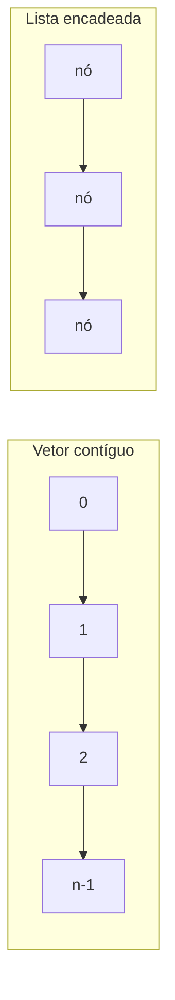

## Visão Geral do Conceito

Vetor (array de uma dimensão) guarda vários valores **do mesmo tipo** em posições contíguas, com tamanho escolhido na compilação. O acesso é por índice. O primeiro índice é 0. O último é o tamanho menos um.

O professor Luiz Maia contrastou isso com a lista de Python, que aceita tipos mistos e cresce em execução. Em C# e em Java o array não muda de tamanho: para “aumentar” cria-se outro array e copiam-se os elementos. Lista encadeada (a <mark style="background-color: #242424; padding: 2px 4px; border-radius: 3px; color: inherit;">`List`</mark> já usada no polimorfismo) insere e remove com mais facilidade e paga com ponteiros, memória e tempo. O vetor é rígido e mais direto na memória.

> **Problema que resolve:** quando a quantidade é conhecida e o tipo é único (notas de uma turma pequena, lote fixo de leituras), o array evita o custo da lista e o índice já é o endereço do elemento.

> **Lacuna de fonte:** não há PDF desta aula no pacote. O desenho “vetores versus listas” foi para o Drive e não está no repositório. A frase dele sobre o tamanho de array em Java (“acho que é <mark style="background-color: #242424; padding: 2px 4px; border-radius: 3px; color: inherit;">`Size`</mark>”) ficou em dúvida na própria aula; esta lição ensina só <mark style="background-color: #242424; padding: 2px 4px; border-radius: 3px; color: inherit;">`Length`</mark> de C#. NumPy e Pandas entraram como contraste de desempenho em Python, sem código. Classes prontas <mark style="background-color: #242424; padding: 2px 4px; border-radius: 3px; color: inherit;">`Stack`</mark>, <mark style="background-color: #242424; padding: 2px 4px; border-radius: 3px; color: inherit;">`Queue`</mark> e <mark style="background-color: #242424; padding: 2px 4px; border-radius: 3px; color: inherit;">`List`</mark> foram nomeadas, não implementadas.

Documentação: [arrays](https://learn.microsoft.com/dotnet/csharp/language-reference/builtin-types/arrays).

## Modelo Mental

Pense no vetor como uma fileira de gavetas numeradas, coladas uma na outra. A gaveta 0 é a primeira. Se há 10 gavetas, a última é a 9. Todas guardam o mesmo tipo de objeto. Não se abre uma gaveta 10: ela não foi construída.

A lista, no desenho da aula, é outra coisa: cada elemento aponta para o próximo e para o anterior (lista duplamente encadeada). Dá para encaixar um nó no meio. O índice, se existir, mora numa estrutura à parte — ele disse não saber qual estrutura C#, Java ou Python usam para isso. O vetor já traz o índice na própria fileira.

| | Vetor | Lista (como ele desenhou) |
|--|--------|---------------------------|
| Tipo dos elementos | Um só | No Python, misturado; em C# a <mark style="background-color: #242424; padding: 2px 4px; border-radius: 3px; color: inherit;">`List&lt;T&gt;`</mark> também é homogênea |
| Tamanho | Fixo na compilação | Pode crescer e encolher |
| Memória | Contígua | Nós ligados por ponteiro, podem estar dispersos |
| Inserir no meio / apagar | Não, sem reconstruir | Sim |
| Custo | Menor, no argumento dele | Maior, por causa dos ponteiros |

Trade-off que ele repetiu com SQL: mais camada (ORM, no exemplo SQLAlchemy em Python, Hibernate em Java, Entity Framework em .NET) compra facilidade e pode perder desempenho. SQL escrito à mão fica mais perto do banco. O mesmo eixo vale aqui: lista compra flexibilidade; vetor compra acesso direto. Dá para ter lista de vetores e vetor de listas, se o problema pedir.



## Mecânica Central

### Declaração, zero e índice

Projeto da aula: solução “vetores e matrizes”, projeto “vetor 1”.

```csharp
const int tamanho = 10;
int[] vetor = new int[tamanho];

for (int i = 0; i < tamanho; i++)
{
    Console.WriteLine(vetor[i]);
}
```

Os dez valores saem 0. O <mark style="background-color: #242424; padding: 2px 4px; border-radius: 3px; color: inherit;">`for`</mark> não grava <mark style="background-color: #242424; padding: 2px 4px; border-radius: 3px; color: inherit;">`i`</mark> no array. Quem zera é o construtor do <mark style="background-color: #242424; padding: 2px 4px; border-radius: 3px; color: inherit;">`int[]`</mark>. Não é “lixo” de lista.

Atribuição e impressão na mesma linha, com espaço em vez de quebra:

```csharp
for (int i = 0; i < vetor.Length; i++)
{
    vetor[i] = i + 1;
    Console.Write(vetor[i] + " ");
}
```

Saída: 1 a 10. <mark style="background-color: #242424; padding: 2px 4px; border-radius: 3px; color: inherit;">`Length`</mark> substitui a constante local quando o método só recebe o array — a constante <mark style="background-color: #242424; padding: 2px 4px; border-radius: 3px; color: inherit;">`tamanho`</mark> não existe dentro do método.

<mark style="background-color: #242424; padding: 2px 4px; border-radius: 3px; color: inherit;">`foreach`</mark> percorre o valor, sem índice:

```csharp
static void ExibirVetor(int[] vetor)
{
    foreach (int numero in vetor)
    {
        Console.Write(numero + " ");
    }
    Console.WriteLine();
}
```

<mark style="background-color: #242424; padding: 2px 4px; border-radius: 3px; color: inherit;">`Write`</mark> não quebra a linha; <mark style="background-color: #242424; padding: 2px 4px; border-radius: 3px; color: inherit;">`WriteLine`</mark> quebra. O prompt de leitura usa <mark style="background-color: #242424; padding: 2px 4px; border-radius: 3px; color: inherit;">`Write`</mark> para o texto ficar na mesma linha do que será digitado. <mark style="background-color: #242424; padding: 2px 4px; border-radius: 3px; color: inherit;">`WriteLine`</mark> dentro do <mark style="background-color: #242424; padding: 2px 4px; border-radius: 3px; color: inherit;">`foreach`</mark> põe cada número na própria linha. No fim do método, um <mark style="background-color: #242424; padding: 2px 4px; border-radius: 3px; color: inherit;">`WriteLine`</mark> só para separar vetores está certo.

### Soma, média e cast

```csharp
static int Somar(int[] vetor)
{
    int soma = 0;
    foreach (int numero in vetor)
    {
        soma += numero;
    }
    return soma;
}
```

Vetor 1..10 soma 55. Média com <mark style="background-color: #242424; padding: 2px 4px; border-radius: 3px; color: inherit;">`soma / vetor.Length`</mark> dá 5, porque os dois lados são <mark style="background-color: #242424; padding: 2px 4px; border-radius: 3px; color: inherit;">`int`</mark>. O conserto ditado foi cast para <mark style="background-color: #242424; padding: 2px 4px; border-radius: 3px; color: inherit;">`double`</mark>:

```csharp
double media = (double)Somar(vetor) / vetor.Length;
```

Ele classificou esse cast como polimorfismo estático, ao lado da sobrecarga de operador, de método e de construtor.

Leitura do teclado para cada posição: <mark style="background-color: #242424; padding: 2px 4px; border-radius: 3px; color: inherit;">`int.Parse(Console.ReadLine())`</mark>, dentro de um método <mark style="background-color: #242424; padding: 2px 4px; border-radius: 3px; color: inherit;">`Ler`</mark> que recebe <mark style="background-color: #242424; padding: 2px 4px; border-radius: 3px; color: inherit;">`int[]`</mark>.

### Inicializador e soma de dois vetores

Sem <mark style="background-color: #242424; padding: 2px 4px; border-radius: 3px; color: inherit;">`new`</mark> explícito, o compilador cria o array e o tamanho sai da quantidade de literais:

```csharp
int[] vetorUm = { 1, 2, 3, 4, 5, 6, 7, 8, 9, 10 };
int[] vetorDois = { 10, 20, 30, 40, 50, 60, 70, 80, 90, 100 };
int[] soma = new int[vetorUm.Length];

for (int i = 0; i < vetorUm.Length; i++)
{
    soma[i] = vetorUm[i] + vetorDois[i];
}
```

<mark style="background-color: #242424; padding: 2px 4px; border-radius: 3px; color: inherit;">`foreach`</mark> não fornece o índice, então a soma posição a posição usa <mark style="background-color: #242424; padding: 2px 4px; border-radius: 3px; color: inherit;">`for`</mark>. O destino precisa de tamanho conhecido: pega-se <mark style="background-color: #242424; padding: 2px 4px; border-radius: 3px; color: inherit;">`Length`</mark> de um dos lados. Saída ditada da soma: 11, 22, 33, 44 e assim por diante.

Acessar <mark style="background-color: #242424; padding: 2px 4px; border-radius: 3px; color: inherit;">`vetorUm[10]`</mark> num array de tamanho 10 dispara <mark style="background-color: #242424; padding: 2px 4px; border-radius: 3px; color: inherit;">`IndexOutOfRangeException`</mark> (<mark style="background-color: #242424; padding: 2px 4px; border-radius: 3px; color: inherit;">`Index was outside the bounds of the array`</mark>). Índice 10 seria o 11.º elemento. Quando o acesso pode sair do intervalo, o desenho da aula é <mark style="background-color: #242424; padding: 2px 4px; border-radius: 3px; color: inherit;">`try`</mark> / <mark style="background-color: #242424; padding: 2px 4px; border-radius: 3px; color: inherit;">`catch`</mark>.

Dois comprimentos diferentes não se somam elemento a elemento: não cabe um array de 8 dentro de um de 4. Ele estendeu o aviso a listas de 10 e de 4 elementos: a lógica da soma alinhada quebra do mesmo modo. Já “juntar e descartar repetidos” exige um destino cujo tamanho só se conhece depois da comparação; isso, disse ele, a lista dinâmica faz e o vetor fixo não faz sem ficar inadequado.

### Dois jeitos de devolver a soma

Os parâmetros podem ter nomes diferentes dos argumentos. O mesmo <mark style="background-color: #242424; padding: 2px 4px; border-radius: 3px; color: inherit;">`Exibir`</mark> serve para os três arrays.

Forma 1: <mark style="background-color: #242424; padding: 2px 4px; border-radius: 3px; color: inherit;">`void`</mark> e o resultado volta no parâmetro <mark style="background-color: #242424; padding: 2px 4px; border-radius: 3px; color: inherit;">`soma`</mark> (o array é o mesmo objeto; a aula seguinte explica passagem por referência).

Forma 2: o método **retorna** <mark style="background-color: #242424; padding: 2px 4px; border-radius: 3px; color: inherit;">`int[]`</mark>. Ele prefere esta quando há tempo, citando código limpo (Robert Martin): um método devolve um resultado no próprio retorno, não escondido num parâmetro. As duas funcionam. Com pressa, ele usa a primeira.

```csharp
static int[] SomarVetores(int[] vet1, int[] vet2)
{
    int[] soma = new int[vet1.Length];
    for (int i = 0; i < vet1.Length; i++)
    {
        soma[i] = vet1[i] + vet2[i];
    }
    return soma;
}
```

```csharp
int[] soma = SomarVetores(vetorUm, vetorDois);
```

> **Não coberto nesta aula:** <mark style="background-color: #242424; padding: 2px 4px; border-radius: 3px; color: inherit;">`ref`</mark> e <mark style="background-color: #242424; padding: 2px 4px; border-radius: 3px; color: inherit;">`out`</mark>. Na aula seguinte ele disse que C# tem formas adicionais de retorno de parâmetro e que não as ensinaria.

## Uso Prático

Um lote de leituras de sensor já limitado a N amostras (o hardware manda um bloco fixo) cabe num <mark style="background-color: #242424; padding: 2px 4px; border-radius: 3px; color: inherit;">`int[]`</mark>. A média do bloco não pode usar divisão inteira se a casa decimal importa para o alerta.

```csharp
static double MediaDoLote(int[] amostras)
{
    if (amostras.Length == 0)
    {
        throw new ArgumentException("lote vazio");
    }

    int soma = 0;
    for (int i = 0; i < amostras.Length; i++)
    {
        soma += amostras[i];
    }

    return (double)soma / amostras.Length;
}
```

O <mark style="background-color: #242424; padding: 2px 4px; border-radius: 3px; color: inherit;">`Length == 0`</mark> não foi exercitado na aula; o lançamento evita a divisão por zero que a fórmula da média produziria. Os exemplos ao vivo usaram tamanho 10.

Somar dois lotes do mesmo tamanho (duas séries alinhadas no tempo) é o <mark style="background-color: #242424; padding: 2px 4px; border-radius: 3px; color: inherit;">`SomarVetores`</mark> acima. Se um lote vier mais curto, não se estica o menor: ou se recusa o par, ou se muda para lista — a aula não mostrou a segunda opção em código.

## Erros Comuns

**Achar que o <mark style="background-color: #242424; padding: 2px 4px; border-radius: 3px; color: inherit;">`for`</mark> preenche o array com o índice.** Sem <mark style="background-color: #242424; padding: 2px 4px; border-radius: 3px; color: inherit;">`vetor[i] = ...`</mark> o conteúdo continua o valor padrão, 0 para <mark style="background-color: #242424; padding: 2px 4px; border-radius: 3px; color: inherit;">`int`</mark>.

**Índice igual ao tamanho.** Tamanho 10 usa 0..9. <mark style="background-color: #242424; padding: 2px 4px; border-radius: 3px; color: inherit;">`vetor[10]`</mark> é <mark style="background-color: #242424; padding: 2px 4px; border-radius: 3px; color: inherit;">`IndexOutOfRangeException`</mark>.

**Divisão inteira na média.** 55 / 10 em <mark style="background-color: #242424; padding: 2px 4px; border-radius: 3px; color: inherit;">`int`</mark> é 5. Cast de pelo menos um operando para <mark style="background-color: #242424; padding: 2px 4px; border-radius: 3px; color: inherit;">`double`</mark> antes da divisão.

**<mark style="background-color: #242424; padding: 2px 4px; border-radius: 3px; color: inherit;">`foreach`</mark> para escrever em <mark style="background-color: #242424; padding: 2px 4px; border-radius: 3px; color: inherit;">`soma[i]`</mark>.** Não há <mark style="background-color: #242424; padding: 2px 4px; border-radius: 3px; color: inherit;">`i`</mark>. Use <mark style="background-color: #242424; padding: 2px 4px; border-radius: 3px; color: inherit;">`for`</mark>.

**Somar comprimentos diferentes.** O lado maior estoura o menor. Não é peculiaridade só do array: a soma alinhada exige o mesmo número de posições.

**União sem repetidos num array de tamanho fixo.** O destino não tem comprimento conhecido antes de comparar. A aula apontou lista para esse caso e não mostrou o código.

**<mark style="background-color: #242424; padding: 2px 4px; border-radius: 3px; color: inherit;">`WriteLine`</mark> no meio do <mark style="background-color: #242424; padding: 2px 4px; border-radius: 3px; color: inherit;">`Exibir`</mark>.** Cada elemento ganha uma linha. Para uma linha só, <mark style="background-color: #242424; padding: 2px 4px; border-radius: 3px; color: inherit;">`Write`</mark> e uma quebra no fim.

**Constante <mark style="background-color: #242424; padding: 2px 4px; border-radius: 3px; color: inherit;">`tamanho`</mark> dentro do método.** Ela é local de quem declarou o array. No método, use <mark style="background-color: #242424; padding: 2px 4px; border-radius: 3px; color: inherit;">`vetor.Length`</mark>.

## Visão Geral de Debugging

1. Saída toda zero: confirme se existe atribuição <mark style="background-color: #242424; padding: 2px 4px; border-radius: 3px; color: inherit;">`vetor[i] =`</mark> ou se você só leu a memória zerada pelo construtor.
2. Exceção com “outside the bounds”: imprima <mark style="background-color: #242424; padding: 2px 4px; border-radius: 3px; color: inherit;">`Length`</mark> e o índice. O último índice válido é <mark style="background-color: #242424; padding: 2px 4px; border-radius: 3px; color: inherit;">`Length - 1`</mark>.
3. Média inteira demais: veja o tipo de <mark style="background-color: #242424; padding: 2px 4px; border-radius: 3px; color: inherit;">`soma`</mark> e de <mark style="background-color: #242424; padding: 2px 4px; border-radius: 3px; color: inherit;">`Length`</mark> no momento da divisão, não só o tipo da variável <mark style="background-color: #242424; padding: 2px 4px; border-radius: 3px; color: inherit;">`media`</mark>.
4. Soma “não volta” para o <mark style="background-color: #242424; padding: 2px 4px; border-radius: 3px; color: inherit;">`Main`</mark>: ou o método é <mark style="background-color: #242424; padding: 2px 4px; border-radius: 3px; color: inherit;">`void`</mark> e você esqueceu de ler o array que passou, ou ele retorna <mark style="background-color: #242424; padding: 2px 4px; border-radius: 3px; color: inherit;">`int[]`</mark> e você ignorou o <mark style="background-color: #242424; padding: 2px 4px; border-radius: 3px; color: inherit;">`return`</mark>.
5. Números empilhados na vertical: <mark style="background-color: #242424; padding: 2px 4px; border-radius: 3px; color: inherit;">`WriteLine`</mark> onde cabia <mark style="background-color: #242424; padding: 2px 4px; border-radius: 3px; color: inherit;">`Write`</mark>.

## Principais Pontos

- Vetor é agregado homogêneo, objeto, índice a partir de 0, último índice <mark style="background-color: #242424; padding: 2px 4px; border-radius: 3px; color: inherit;">`Length - 1`</mark>.
- Tamanho fixo na compilação; crescer implica outro array e cópia.
- Memória contígua, ao contrário da lista encadeada do desenho.
- <mark style="background-color: #242424; padding: 2px 4px; border-radius: 3px; color: inherit;">`new int[n]`</mark> zera os <mark style="background-color: #242424; padding: 2px 4px; border-radius: 3px; color: inherit;">`int`</mark>.
- Inicializador <mark style="background-color: #242424; padding: 2px 4px; border-radius: 3px; color: inherit;">`{ ... }`</mark> dispensa <mark style="background-color: #242424; padding: 2px 4px; border-radius: 3px; color: inherit;">`new`</mark> e define o tamanho pela quantidade de valores.
- <mark style="background-color: #242424; padding: 2px 4px; border-radius: 3px; color: inherit;">`foreach`</mark> não dá índice; soma posição a posição usa <mark style="background-color: #242424; padding: 2px 4px; border-radius: 3px; color: inherit;">`for`</mark>.
- Média de inteiros precisa de cast para <mark style="background-color: #242424; padding: 2px 4px; border-radius: 3px; color: inherit;">`double`</mark>.
- Fora do intervalo: <mark style="background-color: #242424; padding: 2px 4px; border-radius: 3px; color: inherit;">`IndexOutOfRangeException`</mark>.
- Retornar <mark style="background-color: #242424; padding: 2px 4px; border-radius: 3px; color: inherit;">`int[]`</mark> é a forma que ele alinhou a código limpo; preencher um parâmetro também funciona.
- Matriz fica para a próxima lição.

## Preparação para Prática

Antes do laboratório, você deve conseguir:

1. Criar um array, preenchê-lo e lê-lo sem passar de <mark style="background-color: #242424; padding: 2px 4px; border-radius: 3px; color: inherit;">`Length - 1`</mark>.
2. Somar dois arrays do mesmo tamanho num terceiro, devolvido pelo método.
3. Calcular média com casa decimal.
4. Recusar comprimentos diferentes em vez de acessar índice inválido.

## Laboratório de Prática

> Corpo em C#. O editor executa JavaScript. Equivalências: <mark style="background-color: #242424; padding: 2px 4px; border-radius: 3px; color: inherit;">`int[]`</mark> ≈ array de números; <mark style="background-color: #242424; padding: 2px 4px; border-radius: 3px; color: inherit;">`Length`</mark> ≈ <mark style="background-color: #242424; padding: 2px 4px; border-radius: 3px; color: inherit;">`length`</mark>; exceção de índice ≈ <mark style="background-color: #242424; padding: 2px 4px; border-radius: 3px; color: inherit;">`throw new Error`</mark>.

### Easy — Média do lote sem divisão inteira

Contexto ADS: um coletor grava um bloco fixo de contagens. A média operacional precisa da casa decimal. Bloco vazio não se divide.

```javascript
function mediaDoLote(amostras) {
  // TODO: se amostras.length === 0, throw new Error("lote vazio")
  // TODO: somar os elementos e retornar soma / amostras.length (divisão não inteira)
  return 0;
}

mediaDoLote([1, 2, 3, 4, 5, 6, 7, 8, 9, 10]);
```

### Medium — Soma alinhada ou recusa

Contexto ADS: duas séries de medição só se somam posição a posição se tiverem o mesmo comprimento. Índice fora do bloco é erro, não um zero inventado.

```javascript
function somarVetores(vet1, vet2) {
  // TODO: se vet1.length !== vet2.length, throw new Error("tamanhos diferentes")
  // TODO: retornar um array novo em que cada posição é vet1[i] + vet2[i]
  return [];
}

function lerPosicao(vetor, indice) {
  // TODO: se indice < 0 ou indice >= vetor.length, throw new Error("IndexOutOfRange")
  // TODO: senão retornar vetor[indice]
  return 0;
}

somarVetores([1, 2, 3, 4, 5, 6, 7, 8, 9, 10], [10, 20, 30, 40, 50, 60, 70, 80, 90, 100]);
lerPosicao([1, 2, 3], 0);
```

### Hard — Resultado no retorno, não num parâmetro mutável

Contexto ADS: o serviço de série temporal deve devolver a soma como valor do método. A função também expõe a forma “preencho o destino que você passou”, para comparar as duas, e um relatório que usa só o retorno.

```javascript
function somarNoDestino(vet1, vet2, destino) {
  // destino já tem o mesmo length; esta forma altera destino e retorna null
  // TODO: se os três lengths forem diferentes, throw new Error("tamanhos diferentes")
  // TODO: gravar vet1[i] + vet2[i] em destino[i]
  return null;
}

function somarNoRetorno(vet1, vet2) {
  // TODO: criar array novo, somar e retorná-lo; não pedir destino
  return [];
}

function relatorioDeSeries(serieA, serieB) {
  // TODO: soma = somarNoRetorno(serieA, serieB)
  // TODO: retornar { soma, media } com media = soma dos elementos de soma / soma.length
  // TODO: lengths diferentes → throw new Error("tamanhos diferentes")
  return { soma: [], media: 0 };
}

relatorioDeSeries([1, 2, 3, 4], [10, 20, 30, 40]);
```

<!-- CONCEPT_EXTRACTION
concepts:
  - vetor homogêneo
  - tamanho fixo na compilação
  - índice 0 até Length-1
  - construtor zera int
  - memória contígua versus lista encadeada
  - Length
  - for versus foreach
  - Write versus WriteLine
  - inicializador de array
  - soma posição a posição
  - IndexOutOfRangeException
  - divisão inteira e cast para double
  - retorno int[] versus void com parâmetro
  - código limpo e um resultado no retorno
skills:
  - Declarar int[] com new e com inicializador
  - Percorrer por índice e por foreach
  - Usar Length dentro do método
  - Somar dois vetores do mesmo tamanho
  - Lançar ou capturar acesso fora do intervalo
  - Calcular média com cast para double
  - Devolver o array soma no return
  - Recusar união de tamanho desconhecido em vetor fixo
examples:
  - vetor-dez-zeros
  - vetor-1-a-10-e-media-5-5
  - soma-11-22-33
  - index-out-of-range-posicao-10
  - somar-vetores-retorno
  - lab-js-media-soma-relatorio
-->

<!-- EXERCISES_JSON
[
  {
    "id": "csharp-media-lote",
    "slug": "csharp-media-lote",
    "difficulty": "easy",
    "title": "Média do lote",
    "discipline": "fundamentos-csharp",
    "editorLanguage": "javascript",
    "tags": ["csharp", "array", "media", "cast"],
    "summary": "Calcular a média de um bloco fixo com divisão não inteira e recusar lote vazio."
  },
  {
    "id": "csharp-somar-vetores-mesmo-tamanho",
    "slug": "csharp-somar-vetores-mesmo-tamanho",
    "difficulty": "medium",
    "title": "Soma alinhada de vetores",
    "discipline": "fundamentos-csharp",
    "editorLanguage": "javascript",
    "tags": ["csharp", "array", "indice"],
    "summary": "Somar dois arrays do mesmo comprimento e recusar índice fora do intervalo."
  },
  {
    "id": "csharp-soma-no-retorno",
    "slug": "csharp-soma-no-retorno",
    "difficulty": "hard",
    "title": "Soma devolvida pelo método",
    "discipline": "fundamentos-csharp",
    "editorLanguage": "javascript",
    "tags": ["csharp", "array", "retorno", "codigo-limpo"],
    "summary": "Comparar soma gravada num destino com soma retornada e montar relatório só com o retorno."
  }
]
-->

<!--
lessons.json (NÃO aplicado por este worker — integração serial do orquestrador):
{
  "discipline": "fundamentos-csharp",
  "slug": "vetores-arrays-homogeneos-csharp",
  "title": "Vetores: agregados homogêneos de tamanho fixo",
  "order": 17,
  "file": "content/fundamentos-csharp/aula-17-vetores-arrays-homogeneos-csharp.md"
}
-->
