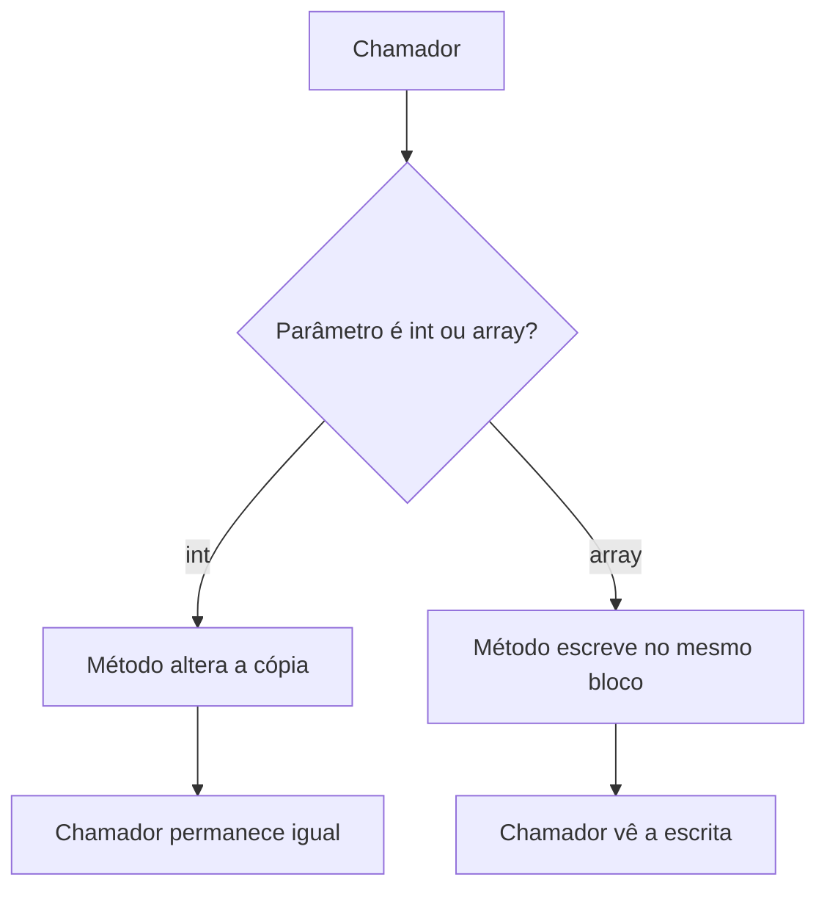

## Visão Geral do Conceito

Esta aula faz três movimentos. Primeiro fecha o vetor da lição [[vetores-arrays-homogeneos-csharp]]: método pode **devolver** o array ou **alterá-lo por parâmetro**, e a razão é passagem por referência. Segundo apresenta a matriz como array de duas dimensões, linha e coluna, tamanho fixo, percorrida com laços aninhados. Terceiro usa um boletim de alunos para mostrar a diferença entre pensar em estruturas paralelas e pensar num objeto <mark style="background-color: #242424; padding: 2px 4px; border-radius: 3px; color: inherit;">`Aluno`</mark>.

> **Problema que resolve:** sem distinguir valor e referência, um método “corrigido” não muda o <mark style="background-color: #242424; padding: 2px 4px; border-radius: 3px; color: inherit;">`int`</mark> do chamador e, ao contrário, muda o array sem <mark style="background-color: #242424; padding: 2px 4px; border-radius: 3px; color: inherit;">`return`</mark>. Sem matriz, tabela de notas vira um vetor achatado sem linha e coluna. Sem objeto, nome e nota só se encontram pelo mesmo índice.

> **Lacuna de fonte:** sem PDF no pacote. Código mostrado a partir do Drive, sem live code. Uma pergunta de um aluno sobre matrizes ficou sem resposta fechada: o professor disse que pesquisaria e não trouxe a conclusão nesta transcrição — o teor exato da pergunta não ficou inteligível. Dimensões acima de três (ele citou o limite de 256 dimensões em C#) não foram ensinadas. <mark style="background-color: #242424; padding: 2px 4px; border-radius: 3px; color: inherit;">`ref`</mark> / <mark style="background-color: #242424; padding: 2px 4px; border-radius: 3px; color: inherit;">`out`</mark> foram reconhecidos como existentes e excluídos da aula. Os literais da matriz 3×4 inicializada na declaração não foram lidos número a número; a transcrição só garante o formato e que o programa imprimia, sem somar.

## Modelo Mental

### Valor e referência

Um <mark style="background-color: #242424; padding: 2px 4px; border-radius: 3px; color: inherit;">`int`</mark> cabe numa cópia. O método brinca com a cópia e devolve o controle; o original fica como estava. Um array não cabe bem numa cópia: seriam mil, dez mil, um milhão de posições duplicadas. O método recebe o endereço e mexe no mesmo bloco que o chamador enxerga.

<mark style="background-color: #242424; padding: 2px 4px; border-radius: 3px; color: inherit;">`void`</mark> não significa “não altera nada”. Significa “não há valor de retorno”. Se o parâmetro for array, lista ou matriz, a alteração atravessa o <mark style="background-color: #242424; padding: 2px 4px; border-radius: 3px; color: inherit;">`void`</mark>. Se for <mark style="background-color: #242424; padding: 2px 4px; border-radius: 3px; color: inherit;">`int`</mark>, <mark style="background-color: #242424; padding: 2px 4px; border-radius: 3px; color: inherit;">`double`</mark>, <mark style="background-color: #242424; padding: 2px 4px; border-radius: 3px; color: inherit;">`bool`</mark> ou <mark style="background-color: #242424; padding: 2px 4px; border-radius: 3px; color: inherit;">`string`</mark>, no recorte desta aula, não atravessa.

### Matriz

A matriz de duas dimensões é uma tabela: linhas e colunas, como uma tabela SQL. Todas as linhas têm o mesmo número de colunas. Isso é fixado na compilação. Três dimensões, no máximo que ele se dispôs a nomear, seriam largura, altura e profundidade (o cubo). Além disso ele não avançou.

O elemento não tem um índice só. Tem linha e coluna: <mark style="background-color: #242424; padding: 2px 4px; border-radius: 3px; color: inherit;">`matriz[linha, coluna]`</mark>.

### Dois focos no boletim

Tamanho **físico** é o que foi reservado (50 alunos no array). Tamanho **lógico** é quantos foram de fato lidos (3, para o teste). O array não cresce sozinho. Passou do físico: exceção, a menos que se crie outro array e se copie.

No código antigo (ele chamou o arquivo de POO e avisou que **não** era orientação a objetos), nome mora num vetor e notas moram numa matriz. O vínculo é o índice. No código com objeto, o aluno carrega nome e notas; o vetor guarda alunos, não colunas soltas.



## Mecânica Central

### Passagem por valor

```csharp
static void AlterarValor(int i)
{
    i = i + 1;
    Console.WriteLine(i);
}

int i = 0;
AlterarValor(i);
Console.WriteLine(i);
```

Dentro do método aparece 1. Depois da chamada, o chamador ainda imprime 0. Para o chamador ficar com 1:

```csharp
static int AlterarValor(int i)
{
    return i + 1;
}

i = AlterarValor(i);
```

<mark style="background-color: #242424; padding: 2px 4px; border-radius: 3px; color: inherit;">`string`</mark> entrou no mesmo grupo na fala dele: mexer na string dentro do método não altera a variável de quem chamou.

### Passagem por referência do vetor

```csharp
static void Preencher(int[] vetor)
{
    for (int i = 0; i < vetor.Length; i++)
    {
        vetor[i] = i + 1;
    }
}
```

Mesmo com <mark style="background-color: #242424; padding: 2px 4px; border-radius: 3px; color: inherit;">`void`</mark>, quem chamou vê 1..n. A forma que ele prefere, repetindo a aula anterior, devolve o array:

```csharp
static int[] Preencher(int tamanho)
{
    int[] vetor = new int[tamanho];
    for (int i = 0; i < vetor.Length; i++)
    {
        vetor[i] = i + 1;
    }
    return vetor;
}
```

Havia duas leituras no projeto do Drive: uma devolve o array preenchido; a outra recebe o array e escreve nele. Soma de dois vetores: ou <mark style="background-color: #242424; padding: 2px 4px; border-radius: 3px; color: inherit;">`int[] Somar(...)`</mark> ou <mark style="background-color: #242424; padding: 2px 4px; border-radius: 3px; color: inherit;">`void`</mark> com o destino nos parâmetros. As duas são válidas. Na forma <mark style="background-color: #242424; padding: 2px 4px; border-radius: 3px; color: inherit;">`void`</mark>, vetor um, vetor dois e soma são referências: uma escrita em qualquer um deles aparece no chamador. Por isso ele não quer usar essa forma para “proteger” os operandos — o destino é quem deve mudar, e o lugar claro disso é o <mark style="background-color: #242424; padding: 2px 4px; border-radius: 3px; color: inherit;">`return`</mark>.

### Matriz 3×4

Constantes para linhas e colunas foram apresentadas como boa prática, não como obrigação.

```csharp
const int linhas = 3;
const int colunas = 4;
int[,] matriz = new int[linhas, colunas];

for (int i = 0; i < matriz.GetLength(0); i++)
{
    for (int j = 0; j < matriz.GetLength(1); j++)
    {
        matriz[i, j] = i + j;
        Console.Write($"{matriz[i, j]} ");
    }
    Console.WriteLine();
}
```

<mark style="background-color: #242424; padding: 2px 4px; border-radius: 3px; color: inherit;">`GetLength(0)`</mark> é o número de linhas. <mark style="background-color: #242424; padding: 2px 4px; border-radius: 3px; color: inherit;">`GetLength(1)`</mark> é o número de colunas. <mark style="background-color: #242424; padding: 2px 4px; border-radius: 3px; color: inherit;">`GetLength(2)`</mark> seria a terceira dimensão, se existisse. O laço externo anda a linha; o interno anda todas as colunas dessa linha. Linhas não têm comprimentos diferentes.

Com <mark style="background-color: #242424; padding: 2px 4px; border-radius: 3px; color: inherit;">`matriz[i, j] = i + j`</mark>, a grade 3×4 fica:

| | 0 | 1 | 2 | 3 |
|--|---|---|---|---|
| 0 | 0 | 1 | 2 | 3 |
| 1 | 1 | 2 | 3 | 4 |
| 2 | 2 | 3 | 4 | 5 |

A fala da saída no áudio está truncada; a tabela é a consequência direta de somar <mark style="background-color: #242424; padding: 2px 4px; border-radius: 3px; color: inherit;">`i`</mark> e <mark style="background-color: #242424; padding: 2px 4px; border-radius: 3px; color: inherit;">`j`</mark>, que é o que ele pediu para a turma explicar. Um segundo exemplo só **imprime** uma matriz 3×4 criada já com literais, sem soma. Os literais não foram ditados. Formatar com largura fixa alinha colunas; <mark style="background-color: #242424; padding: 2px 4px; border-radius: 3px; color: inherit;">`Write`</mark> sem esse formato embaralha a leitura. Ele afirmou que matriz se resolve na compilação e lista na execução.

Arrays e matrizes em C#, Java e Python são objetos, no contraste que ele fez com C, em que não são. Mudar o tamanho: nova matriz e cópia. Documentação de arrays multidimensionais: [arrays](https://learn.microsoft.com/dotnet/csharp/language-reference/builtin-types/arrays).

### Boletim procedural

Constantes: número de alunos (físico; no teste, 3 em vez de 50), número de notas (nota 1, nota 2 e média na terceira linha), aprovação fora dos métodos, visível na classe. Leitura até o nome <mark style="background-color: #242424; padding: 2px 4px; border-radius: 3px; color: inherit;">`"fim"`</mark> ou até encher o físico. Índice liga <mark style="background-color: #242424; padding: 2px 4px; border-radius: 3px; color: inherit;">`nomes[k]`</mark> a <mark style="background-color: #242424; padding: 2px 4px; border-radius: 3px; color: inherit;">`notas[0, k]`</mark>, <mark style="background-color: #242424; padding: 2px 4px; border-radius: 3px; color: inherit;">`notas[1, k]`</mark> e <mark style="background-color: #242424; padding: 2px 4px; border-radius: 3px; color: inherit;">`notas[2, k]`</mark> (média). A orientação linhas×alunos pode ser invertida; ele disse que tanto faz, desde que o resto do código acompanhe. No teste ficou matriz 3×3.

O bug confirmado: a verificação de aprovação comparava com a **média da turma** onde devia comparar com a **constante de aprovação** (apontamento por volta da linha 122). Sintoma discutido: média 5,5 tratada como se passasse, com corte 6 na conversa. Ele agradeceu e disse que o erro tinha anos. Não há, na transcrição, o diff final do <mark style="background-color: #242424; padding: 2px 4px; border-radius: 3px; color: inherit;">`if`</mark>.

### Boletim com objeto

```csharp
public class Aluno
{
    public string Nome { get; }
    public double Nota1 { get; }
    public double Nota2 { get; }

    public Aluno(string nome, double nota1, double nota2)
    {
        Nome = nome;
        Nota1 = nota1;
        Nota2 = nota2;
    }

    public double CalcularMedia() => (Nota1 + Nota2) / 2;
}
```

O vetor passa a ser <mark style="background-color: #242424; padding: 2px 4px; border-radius: 3px; color: inherit;">`Aluno[]`</mark>. A leitura cria objetos e guarda-os até <mark style="background-color: #242424; padding: 2px 4px; border-radius: 3px; color: inherit;">`"fim"`</mark> ou até o tamanho físico. A média calcula na hora, não ocupa uma terceira linha de matriz. Média da turma, aprovação e “acima da média da turma” percorrem alunos, não colunas paralelas. O tamanho lógico é o quanto foi preenchido.

## Uso Prático

Um fechamento de turma pequeno (o teste usou três alunos) pode viver num <mark style="background-color: #242424; padding: 2px 4px; border-radius: 3px; color: inherit;">`Aluno[]`</mark> de capacidade fixa. Quem chama passa o array; o método de leitura escreve nos buracos e devolve quantos ficaram ocupados — esse inteiro é o tamanho lógico, retornado de propósito, porque o físico continua <mark style="background-color: #242424; padding: 2px 4px; border-radius: 3px; color: inherit;">`Length`</mark>.

```csharp
static bool Aprovado(Aluno aluno, double notaMinima)
{
    return aluno.CalcularMedia() >= notaMinima;
}
```

A comparação usa a constante de aprovação, não a média da turma. “Acima da média da turma” é outro relatório, o que o programa também mostrava, e não substitui o corte.

Para uma grade de ocupação 3×4 (salas por faixa de horário, por exemplo), o mesmo <mark style="background-color: #242424; padding: 2px 4px; border-radius: 3px; color: inherit;">`GetLength`</mark> impede chutar o número de colunas quando a matriz já existe.

## Erros Comuns

**Esperar que <mark style="background-color: #242424; padding: 2px 4px; border-radius: 3px; color: inherit;">`void`</mark> com <mark style="background-color: #242424; padding: 2px 4px; border-radius: 3px; color: inherit;">`int`</mark> atualize o chamador.** A cópia morre no método. Falta atribuir o retorno.

**Esperar que <mark style="background-color: #242424; padding: 2px 4px; border-radius: 3px; color: inherit;">`void`</mark> com array não altere o chamador.** Altera. Operando passado “só para ler” pode ser escrito por engano.

**Trocar <mark style="background-color: #242424; padding: 2px 4px; border-radius: 3px; color: inherit;">`GetLength(0)`</mark> e <mark style="background-color: #242424; padding: 2px 4px; border-radius: 3px; color: inherit;">`GetLength(1)`</mark>.** Linhas e colunas trocadas varrem a tabela de lado ou estouram o intervalo.

**Matriz irregular.** A aula foi explícita: linhas do mesmo comprimento, colunas do mesmo comprimento, definido na compilação. Não é a lista de listas de Python.

**Comparar aprovação com a média da turma.** Foi o bug da linha citada. O corte é a constante; a média da turma serve ao outro relatório.

**Encher além do tamanho físico.** O nome seguinte não entra; a aula mostrou mensagem de máximo alcançado. Sem o teste, vem exceção de índice.

**Achar que o primeiro arquivo era orientação a objetos porque o nome do projeto dizia POO.** Ele corrigiu: o foco ainda era vetor de nomes mais matriz de notas.

## Visão Geral de Debugging

1. “O contador não sobe” depois da chamada: confirme se o parâmetro é <mark style="background-color: #242424; padding: 2px 4px; border-radius: 3px; color: inherit;">`int`</mark>. Se for, olhe se o <mark style="background-color: #242424; padding: 2px 4px; border-radius: 3px; color: inherit;">`return`</mark> foi atribuído.
2. “O array mudou sozinho”: o método recebeu a referência. Procure atribuição <mark style="background-color: #242424; padding: 2px 4px; border-radius: 3px; color: inherit;">`vetor[i] =`</mark> dentro dele.
3. Grade de matriz torta: imprima <mark style="background-color: #242424; padding: 2px 4px; border-radius: 3px; color: inherit;">`i`</mark> e <mark style="background-color: #242424; padding: 2px 4px; border-radius: 3px; color: inherit;">`j`</mark> numa célula. O valor <mark style="background-color: #242424; padding: 2px 4px; border-radius: 3px; color: inherit;">`i + j`</mark> identifica a célula.
4. Aluno com 5,5 “aprovado” quando o corte é 6: a condição está a usar outra variável (média da turma, ou um <mark style="background-color: #242424; padding: 2px 4px; border-radius: 3px; color: inherit;">`>=`</mark> no lugar errado). A turma localizou isso na comparação, não no cálculo da média do aluno.
5. Nome sem nota: no modelo paralelo, o índice de <mark style="background-color: #242424; padding: 2px 4px; border-radius: 3px; color: inherit;">`nomes`</mark> e o índice de <mark style="background-color: #242424; padding: 2px 4px; border-radius: 3px; color: inherit;">`notas`</mark> divergiram. No modelo objeto, nome e notas nascem juntos no construtor.

## Principais Pontos

- <mark style="background-color: #242424; padding: 2px 4px; border-radius: 3px; color: inherit;">`int`</mark>, <mark style="background-color: #242424; padding: 2px 4px; border-radius: 3px; color: inherit;">`double`</mark>, <mark style="background-color: #242424; padding: 2px 4px; border-radius: 3px; color: inherit;">`bool`</mark> e <mark style="background-color: #242424; padding: 2px 4px; border-radius: 3px; color: inherit;">`string`</mark>, nesta aula, passam por valor.
- Array, lista e matriz passam por referência para não copiar o bloco inteiro.
- <mark style="background-color: #242424; padding: 2px 4px; border-radius: 3px; color: inherit;">`void`</mark> não impede efeito no array.
- Devolver um resultado no <mark style="background-color: #242424; padding: 2px 4px; border-radius: 3px; color: inherit;">`return`</mark> continua a ser a forma que ele prefere.
- Matriz 2D: <mark style="background-color: #242424; padding: 2px 4px; border-radius: 3px; color: inherit;">`GetLength(0)`</mark> linhas, <mark style="background-color: #242424; padding: 2px 4px; border-radius: 3px; color: inherit;">`GetLength(1)`</mark> colunas, retangular, tamanho na compilação.
- Tamanho físico é a capacidade; tamanho lógico é o quanto foi usado.
- Boletim procedural: vetor de nomes + matriz de notas, ligados pelo índice.
- Boletim com objeto: <mark style="background-color: #242424; padding: 2px 4px; border-radius: 3px; color: inherit;">`Aluno`</mark> com média calculada, vetor de alunos.
- Aprovação compara com a constante de corte, não com a média da turma.
- Arquivo texto e CSV ficam para a próxima lição.

## Preparação para Prática

Antes do laboratório, você deve conseguir:

1. Mostrar um <mark style="background-color: #242424; padding: 2px 4px; border-radius: 3px; color: inherit;">`int`</mark> que não muda e um array que muda, ambos em método <mark style="background-color: #242424; padding: 2px 4px; border-radius: 3px; color: inherit;">`void`</mark>.
2. Preencher e ler uma matriz com os dois <mark style="background-color: #242424; padding: 2px 4px; border-radius: 3px; color: inherit;">`GetLength`</mark>.
3. Aprovar aluno pela nota mínima e listar quem está acima da média da turma como critérios separados.
4. Parar a leitura quando o nome é <mark style="background-color: #242424; padding: 2px 4px; border-radius: 3px; color: inherit;">`"fim"`</mark> ou quando o tamanho físico enche.

## Laboratório de Prática

> Corpo em C#. O editor executa JavaScript. Equivalências: número solto ≈ passagem por valor (devolva o novo número); array ≈ o mesmo objeto se a função escrever nele; matriz ≈ array de arrays **nesta prática**, com linhas do mesmo comprimento.

### Easy — Cópia do inteiro, mesmo array

Contexto ADS: um contador de tentativas de login não pode “subir” só porque uma função interna incrementou o parâmetro. Já a lista de IPs bloqueados, passada como array, grava no mesmo bloco.

```javascript
function incrementarCopia(valor) {
  // TODO: retornar valor + 1 sem que o exercício dependa de alterar o argumento original
  return valor;
}

function registrarBloqueio(lista, ip) {
  // lista é o mesmo array do chamador
  // TODO: se lista.length estiver no máximo físico (use lista.capacidade se existir, senão não estoure)
  // TODO: acrescentar ip em lista e retornar lista
  lista.capacidade = lista.capacidade || 4;
  return lista;
}

const tentativas = 0;
incrementarCopia(tentativas);
registrarBloqueio([], "10.0.0.8");
```

### Medium — Grade 3×4

Contexto ADS: um mapa de bancada (3 faixas, 4 postos) guarda um código numérico em cada célula. O preenchimento da aula é linha + coluna. Linha torta é erro.

```javascript
function criarGrade(linhas, colunas, valorDaCelula) {
  // TODO: criar matriz linhas×colunas
  // TODO: célula [i][j] = valorDaCelula(i, j)
  // TODO: se alguma linha tiver comprimento diferente, throw new Error("matriz irregular")
  return [];
}

function somaCelulas(grade) {
  // TODO: somar todas as células usando o comprimento da linha 0 como número de colunas
  // TODO: grade vazia → 0
  return 0;
}

criarGrade(3, 4, function (i, j) {
  return i + j;
});
```

### Hard — Boletim com corte e média da turma

Contexto ADS: a secretaria lê alunos até `"fim"` ou até lotar o vetor físico. Aprovado é quem tem média **maior ou igual** à nota mínima. Outro relatório lista quem está acima da média da turma. Os dois critérios não se misturam.

```javascript
function mediaAluno(aluno) {
  // aluno = { nome, nota1, nota2 }
  // TODO: retornar (nota1 + nota2) / 2
  return 0;
}

function lerAlunos(entradas, capacidade) {
  // entradas: array de { nome, nota1, nota2 } já lidas; "fim" vem como { nome: "fim" }
  // TODO: copiar para um array novo até capacidade ou até nome "fim"
  // TODO: retornar { alunos, tamanhoLogico }
  // não inclua o registro "fim"
  return { alunos: [], tamanhoLogico: 0 };
}

function fecharTurma(alunos, tamanhoLogico, notaMinima) {
  // TODO: usar só os tamanhoLogico primeiros
  // TODO: aprovados = média >= notaMinima
  // TODO: mediaTurma = média das médias desses alunos (0 se tamanhoLogico === 0)
  // TODO: acimaDaTurma = média > mediaTurma
  // TODO: retornar { aprovados, mediaTurma, acimaDaTurma }
  return { aprovados: [], mediaTurma: 0, acimaDaTurma: [] };
}

fecharTurma(
  [
    { nome: "Lia", nota1: 5, nota2: 6 },
    { nome: "Rui", nota1: 8, nota2: 9 },
  ],
  2,
  6
);
```

<!-- CONCEPT_EXTRACTION
concepts:
  - passagem por valor de int double bool string
  - passagem por referência de array lista e matriz
  - void não implica ausência de efeito
  - retorno preferido no nome do método
  - matriz retangular
  - GetLength 0 e 1
  - i + j na célula
  - tamanho físico e tamanho lógico
  - sentinela fim
  - estruturas paralelas nomes e notas
  - Aluno com CalcularMedia
  - aprovação pela constante e não pela média da turma
skills:
  - Prever o valor do chamador depois de um método void
  - Alterar um array compartilhado e devolver outro pelo return
  - Varrer matriz com laços aninhados e GetLength
  - Distinguir capacidade de quantidade lida
  - Ligar nome e nota pelo mesmo índice no modelo procedural
  - Agrupar nome e notas num objeto Aluno
  - Separar corte de aprovação e comparação com a média da turma
examples:
  - int-zero-permanece-zero
  - array-preenchido-em-void
  - matriz-3x4-i-mais-j
  - boletim-procedural-bug-linha-122
  - boletim-vetor-de-aluno
  - lab-js-copia-grade-turma
-->

<!-- EXERCISES_JSON
[
  {
    "id": "csharp-valor-versus-array",
    "slug": "csharp-valor-versus-array",
    "difficulty": "easy",
    "title": "Cópia do inteiro e o mesmo array",
    "discipline": "fundamentos-csharp",
    "editorLanguage": "javascript",
    "tags": ["csharp", "passagem-por-valor", "array"],
    "summary": "Incrementar um número devolvendo a cópia e registrar um IP no mesmo array do chamador."
  },
  {
    "id": "csharp-grade-3x4",
    "slug": "csharp-grade-3x4",
    "difficulty": "medium",
    "title": "Grade retangular",
    "discipline": "fundamentos-csharp",
    "editorLanguage": "javascript",
    "tags": ["csharp", "matriz", "getlength"],
    "summary": "Criar uma grade 3 por 4 com célula igual a linha mais coluna e somar as células."
  },
  {
    "id": "csharp-boletim-corte",
    "slug": "csharp-boletim-corte",
    "difficulty": "hard",
    "title": "Boletim com dois critérios",
    "discipline": "fundamentos-csharp",
    "editorLanguage": "javascript",
    "tags": ["csharp", "aluno", "matriz", "aprovacao"],
    "summary": "Ler alunos até fim ou até a capacidade e separar aprovação por nota mínima de quem está acima da média da turma."
  }
]
-->

<!--
lessons.json (NÃO aplicado por este worker — integração serial do orquestrador):
{
  "discipline": "fundamentos-csharp",
  "slug": "matrizes-passagem-referencia-paradigma-csharp",
  "title": "Matrizes, passagem por valor e o foco no objeto Aluno",
  "order": 18,
  "file": "content/fundamentos-csharp/aula-18-matrizes-passagem-referencia-paradigma-csharp.md"
}
-->
