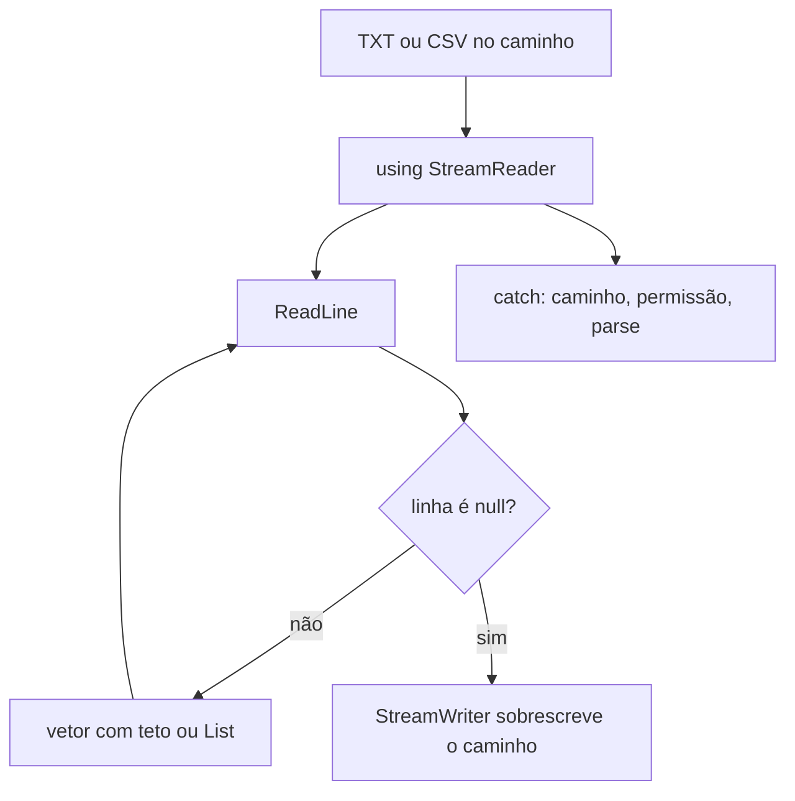

## Visão Geral do Conceito

Arquivo em disco é a forma de o lote sobreviver ao fim do processo. Nesta aula o TXT de nomes entra num **vetor** de tamanho fixo (capacidade física versus o quanto foi ocupado, como em [[vetores-arrays-homogeneos-csharp]]). O CSV de alunos entra numa **<mark style="background-color: #242424; padding: 2px 4px; border-radius: 3px; color: inherit;">`List&lt;Aluno&gt;`</mark>**, que cresce, com o custo de memória e tempo que o professor Luiz Maia já tinha atribuído à lista.

A leitura usa <mark style="background-color: #242424; padding: 2px 4px; border-radius: 3px; color: inherit;">`StreamReader`</mark>. A gravação usa <mark style="background-color: #242424; padding: 2px 4px; border-radius: 3px; color: inherit;">`StreamWriter`</mark>. O <mark style="background-color: #242424; padding: 2px 4px; border-radius: 3px; color: inherit;">`using`</mark> abre e fecha, no papel do <mark style="background-color: #242424; padding: 2px 4px; border-radius: 3px; color: inherit;">`with`</mark> de Python que ele citou. Sem <mark style="background-color: #242424; padding: 2px 4px; border-radius: 3px; color: inherit;">`try`</mark> / <mark style="background-color: #242424; padding: 2px 4px; border-radius: 3px; color: inherit;">`catch`</mark> não se mexe em arquivo: caminho errado, permissão, arquivo corrompido, nome errado, ou <mark style="background-color: #242424; padding: 2px 4px; border-radius: 3px; color: inherit;">`double.Parse`</mark> que não converte.

> **Problema que resolve:** o console só dura a execução. O vetor perde o nome quando o programa acaba. O TXT e o CSV devolvem o lote. O CSV ainda parte uma linha em campos para construir o objeto <mark style="background-color: #242424; padding: 2px 4px; border-radius: 3px; color: inherit;">`Aluno`</mark>.

> **Lacuna de fonte:** sem PDF desta aula no pacote. Código mostrado do Drive, não digitado ao vivo. Não há, na fala dele, uma API pronta para “a pasta do projeto” como em Python; o equivalente em C# “exige malabarismos” e esses malabarismos não foram mostrados. Pandas numa chamada só foi contraste, sem código C#. SQL puro no SQL Server versus Entity Framework (com SQLAlchemy em Python e Hibernate em Java como primos) foi **anúncio da semana seguinte**, não implementação. Entity Framework é da plataforma .NET, não um recurso exclusivo da linguagem C#. Esta lição não ensina ORM.

Documentação: [StreamReader](https://learn.microsoft.com/dotnet/api/system.io.streamreader), [StreamWriter](https://learn.microsoft.com/dotnet/api/system.io.streamwriter).

## Modelo Mental

O arquivo é uma sequência de linhas. <mark style="background-color: #242424; padding: 2px 4px; border-radius: 3px; color: inherit;">`ReadLine`</mark> entrega a próxima. Quando não há próxima, devolve <mark style="background-color: #242424; padding: 2px 4px; border-radius: 3px; color: inherit;">`null`</mark>. Isso é o fim, não uma linha vazia a guardar.

No TXT, cada linha é um nome e ocupa uma gaveta do vetor. Gavetas a mais ficam sem uso (tamanho lógico menor que o físico). Gaveta que não existe não recebe nome: o programa avisa e para de incluir. Gravar percorre só o que foi ocupado e **substitui** o arquivo. Se o caminho não aponta para o TXT que você está a olhar, o <mark style="background-color: #242424; padding: 2px 4px; border-radius: 3px; color: inherit;">`StreamWriter`</mark> pode criar um arquivo novo noutro sítio. Foi o que aconteceu ao vivo: o disco “não mudou” porque a gravação foi para outro caminho.

No CSV, a linha é nome, nota 1 e nota 2 separados por <mark style="background-color: #242424; padding: 2px 4px; border-radius: 3px; color: inherit;">`;`</mark>. <mark style="background-color: #242424; padding: 2px 4px; border-radius: 3px; color: inherit;">`Split`</mark> produz um array de três strings. A posição 0 é o nome, a 1 é a primeira nota, a 2 é a segunda. Cada trio vira um <mark style="background-color: #242424; padding: 2px 4px; border-radius: 3px; color: inherit;">`Aluno`</mark> e entra na lista.



## Mecânica Central

### Caminho

```csharp
string caminho = "C:\\curso\\nomes.txt";
string caminhoVerbatim = @"C:\curso\nomes.txt";
```

As duas formas evitam que <mark style="background-color: #242424; padding: 2px 4px; border-radius: 3px; color: inherit;">`\n`</mark> ou <mark style="background-color: #242424; padding: 2px 4px; border-radius: 3px; color: inherit;">`\t`</mark> engulam pedaços do caminho. O endereço do professor não é o do aluno. Na conversa sobre a entrega do trabalho, apagar as pastas <mark style="background-color: #242424; padding: 2px 4px; border-radius: 3px; color: inherit;">`bin`</mark> e <mark style="background-color: #242424; padding: 2px 4px; border-radius: 3px; color: inherit;">`obj`</mark> antes do zip foi orientação prática: elas são recriadas ao executar e incham o arquivo.

### TXT no vetor, versão longa

Tamanho físico 5 no exemplo. O arquivo de demonstração tinha quatro nomes (Daniel, Bruno, André, Lucas). <mark style="background-color: #242424; padding: 2px 4px; border-radius: 3px; color: inherit;">`var`</mark> no <mark style="background-color: #242424; padding: 2px 4px; border-radius: 3px; color: inherit;">`new StreamReader`</mark> deixa o compilador acertar o tipo; escrever o tipo <mark style="background-color: #242424; padding: 2px 4px; border-radius: 3px; color: inherit;">`StreamReader`</mark> à esquerda é o mesmo, com mais texto.

```csharp
static int LerArquivo(string caminho, string[] nomes)
{
    int conte = 0;
    try
    {
        using (var arquivo = new StreamReader(caminho))
        {
            string linha = arquivo.ReadLine();
            while (linha != null)
            {
                if (conte >= nomes.Length)
                {
                    Console.WriteLine("Número máximo do vetor alcançado");
                    break;
                }

                nomes[conte] = linha;
                conte++;
                linha = arquivo.ReadLine();
            }
        }
    }
    catch (Exception ex)
    {
        Console.WriteLine(ex.Message);
    }

    return conte;
}
```

O vetor chega por referência: as gavetas preenchidas aparecem em quem chamou. O <mark style="background-color: #242424; padding: 2px 4px; border-radius: 3px; color: inherit;">`return conte`</mark> é o tamanho lógico. Com físico 5 e quatro linhas, ainda cabe um nome. Com físico 4, o nome seguinte é recusado. No primeiro run, com quatro linhas e tamanho 5, apareceu o aviso de máximo; ele ficou em dúvida e, depois de ajustar, mostrou que cinco lugares com quatro nomes ainda aceitam inclusão. A condição <mark style="background-color: #242424; padding: 2px 4px; border-radius: 3px; color: inherit;">`conte >= nomes.Length`</mark> **antes** de gravar é o critério coerente com essa demonstração final. O aviso prematuro da primeira execução ficou sem diff fechado na gravação.

### Versão curta, mesma lógica

```csharp
while ((linha = arquivo.ReadLine()) != null)
{
    if (conte >= nomes.Length)
    {
        Console.WriteLine("Número máximo do vetor alcançado");
        break;
    }

    nomes[conte++] = linha;
}
```

A atribuição dentro do <mark style="background-color: #242424; padding: 2px 4px; border-radius: 3px; color: inherit;">`while`</mark> lê e testa o fim. <mark style="background-color: #242424; padding: 2px 4px; border-radius: 3px; color: inherit;">`conte++`</mark> grava e depois incrementa. Quem achar opaco fica na versão longa. Desempenho: sem diferença que ele considerasse relevante.

Incluir um nome novo usa a mesma ideia, se ainda houver lugar. O contador é <mark style="background-color: #242424; padding: 2px 4px; border-radius: 3px; color: inherit;">`int`</mark>. Na aula anterior, <mark style="background-color: #242424; padding: 2px 4px; border-radius: 3px; color: inherit;">`int`</mark> passado por valor **não** volta sozinho, e <mark style="background-color: #242424; padding: 2px 4px; border-radius: 3px; color: inherit;">`ref`</mark> não foi ensinado. O modo exato do parâmetro contador no método de inclusão **não foi soletrado**. Forma alinhada ao que ele já prefere: devolver o novo contador.

```csharp
static int IncluirNome(string[] nomes, int conte, string novoNome)
{
    if (conte >= nomes.Length)
    {
        Console.WriteLine("Não é possível incluir novos nomes no vetor");
        return conte;
    }

    nomes[conte] = novoNome;
    return conte + 1;
}
```

### Gravação

```csharp
static void GravarArquivo(string caminho, string[] nomes, int conte)
{
    try
    {
        using (var arquivo = new StreamWriter(caminho))
        {
            for (int i = 0; i < conte; i++)
            {
                arquivo.WriteLine(nomes[i]);
            }
        }
    }
    catch (Exception ex)
    {
        Console.WriteLine(ex.Message);
    }
}
```

Arquivo existente no caminho certo: o conteúdo anterior sai e entra o vetor. Arquivo inexistente naquele caminho: cria-se outro. “Arquivo gravado” no console não prova que o TXT aberto no editor mudou. Confira o caminho.

### CSV, lista e Aluno

Separador <mark style="background-color: #242424; padding: 2px 4px; border-radius: 3px; color: inherit;">`;`</mark>. Classe com nome, nota 1, nota 2, construtor e <mark style="background-color: #242424; padding: 2px 4px; border-radius: 3px; color: inherit;">`override`</mark> de <mark style="background-color: #242424; padding: 2px 4px; border-radius: 3px; color: inherit;">`ToString`</mark>. Nomes da demonstração que funcionou depois de corrigir o caminho: Daniel Sá, Bruno Ribeiro, Lucas Sá.

```csharp
public class Aluno
{
    public string Nome { get; }
    public double Nota1 { get; }
    public double Nota2 { get; }

    public Aluno(string nome, double nota1, double nota2)
    {
        Nome = nome;
        Nota1 = nota1;
        Nota2 = nota2;
    }

    public override string ToString() => $"{Nome} {Nota1} {Nota2}";
}

static List<Aluno> LerCsv(string caminho)
{
    var alunos = new List<Aluno>();
    try
    {
        using (var arquivo = new StreamReader(caminho))
        {
            string linha;
            while ((linha = arquivo.ReadLine()) != null)
            {
                string[] campos = linha.Split(';');
                alunos.Add(new Aluno(
                    campos[0],
                    double.Parse(campos[1]),
                    double.Parse(campos[2])));
            }
        }
    }
    catch (Exception ex)
    {
        Console.WriteLine(ex.Message);
    }

    return alunos;
}
```

<mark style="background-color: #242424; padding: 2px 4px; border-radius: 3px; color: inherit;">`foreach`</mark> mostra os alunos via <mark style="background-color: #242424; padding: 2px 4px; border-radius: 3px; color: inherit;">`ToString`</mark>. Incluir na lista não grava disco. Gravar é outro passo: percorrer a lista, converter as notas de volta a texto e escrever com o mesmo <mark style="background-color: #242424; padding: 2px 4px; border-radius: 3px; color: inherit;">`;`</mark>. O <mark style="background-color: #242424; padding: 2px 4px; border-radius: 3px; color: inherit;">`catch`</mark> também cobre falha de <mark style="background-color: #242424; padding: 2px 4px; border-radius: 3px; color: inherit;">`Parse`</mark>.

> **Não coberto:** <mark style="background-color: #242424; padding: 2px 4px; border-radius: 3px; color: inherit;">`CultureInfo`</mark> no <mark style="background-color: #242424; padding: 2px 4px; border-radius: 3px; color: inherit;">`double.Parse`</mark>. Ele explicou o motivo do separador e não ditou cultura. Linha com menos de três campos não teve tratamento além do <mark style="background-color: #242424; padding: 2px 4px; border-radius: 3px; color: inherit;">`catch`</mark> genérico, que também apanha o índice inexistente.

## Uso Prático

Um exportado da secretaria, com dezenas de linhas e não milhares, cabe na <mark style="background-color: #242424; padding: 2px 4px; border-radius: 3px; color: inherit;">`List&lt;Aluno&gt;`</mark> da aula. O serviço não deve engolir a falha em silêncio: caminho inacessível e nota “abc” caem no mesmo <mark style="background-color: #242424; padding: 2px 4px; border-radius: 3px; color: inherit;">`catch (Exception)`</mark> se os tipos não forem separados. A aula usou um catch só e mostrou a mensagem.

Para um lote com teto conhecido (cinco vagas), o vetor recusa o nome extra em vez de crescer. Grave só <mark style="background-color: #242424; padding: 2px 4px; border-radius: 3px; color: inherit;">`conte`</mark> linhas. Entrega discutida neste dia, à parte do <mark style="background-color: #242424; padding: 2px 4px; border-radius: 3px; color: inherit;">`StreamReader`</mark>: uma solução, um projeto por exercício; ele preferiu zip de código a PDF. O enunciado, disse depois, pedia PDF. Isso não muda a leitura do arquivo.

## Erros Comuns

**Caminho com <mark style="background-color: #242424; padding: 2px 4px; border-radius: 3px; color: inherit;">`\n`</mark> acidental.** Uma barra só antes de `n` não é pasta. Use <mark style="background-color: #242424; padding: 2px 4px; border-radius: 3px; color: inherit;">`\\`</mark> ou <mark style="background-color: #242424; padding: 2px 4px; border-radius: 3px; color: inherit;">`@`</mark>.

**Achar que gravou porque o console disse que gravou.** O <mark style="background-color: #242424; padding: 2px 4px; border-radius: 3px; color: inherit;">`StreamWriter`</mark> cria arquivo se o caminho não existir. Abra o TXT da string.

**Estourar o vetor em silêncio.** Sem <mark style="background-color: #242424; padding: 2px 4px; border-radius: 3px; color: inherit;">`conte >= nomes.Length`</mark>, a próxima linha é <mark style="background-color: #242424; padding: 2px 4px; border-radius: 3px; color: inherit;">`IndexOutOfRangeException`</mark>.

**Gravar o tamanho físico.** Linhas nulas entram no TXT. O laço vai até <mark style="background-color: #242424; padding: 2px 4px; border-radius: 3px; color: inherit;">`conte`</mark>.

**<mark style="background-color: #242424; padding: 2px 4px; border-radius: 3px; color: inherit;">`conte++`</mark> antes de gravar.** Pula a posição 0 ou deixa a última de fora. No índice, o pós-incremento grava e só então avança.

**Vírgula como separador com nota brasileira.** O campo parte no meio do decimal. O separador da aula é ponto e vírgula.

**Incluir na lista e supor que o disco mudou.** <mark style="background-color: #242424; padding: 2px 4px; border-radius: 3px; color: inherit;">`Add`</mark> é memória. Disco é <mark style="background-color: #242424; padding: 2px 4px; border-radius: 3px; color: inherit;">`StreamWriter`</mark>.

**Nota não numérica sem <mark style="background-color: #242424; padding: 2px 4px; border-radius: 3px; color: inherit;">`try`</mark>.** <mark style="background-color: #242424; padding: 2px 4px; border-radius: 3px; color: inherit;">`double.Parse`</mark> derruba o processo.

## Visão Geral de Debugging

1. Exceção na abertura: compare o caminho da string com o arquivo aberto, caractere a caractere.
2. Console diz que gravou e o TXT aberto está igual: procure outro arquivo no caminho da string, inclusive debaixo de <mark style="background-color: #242424; padding: 2px 4px; border-radius: 3px; color: inherit;">`bin`</mark>. Foi onde ele procurou.
3. Aviso de máximo com lugares livres: imprima <mark style="background-color: #242424; padding: 2px 4px; border-radius: 3px; color: inherit;">`conte`</mark> e <mark style="background-color: #242424; padding: 2px 4px; border-radius: 3px; color: inherit;">`nomes.Length`</mark> antes do <mark style="background-color: #242424; padding: 2px 4px; border-radius: 3px; color: inherit;">`if`</mark>. O primeiro run da aula fez esse aviso cedo demais.
4. CSV com notas trocadas ou exceção no <mark style="background-color: #242424; padding: 2px 4px; border-radius: 3px; color: inherit;">`Parse`</mark>: depois do <mark style="background-color: #242424; padding: 2px 4px; border-radius: 3px; color: inherit;">`Split(';')`</mark> a ordem é 0, 1, 2. Separador errado deixa um campo só.
5. Lista mostra o aluno novo e o arquivo não: o gravar não correu, ou gravou noutro caminho.

## Principais Pontos

- <mark style="background-color: #242424; padding: 2px 4px; border-radius: 3px; color: inherit;">`\\`</mark> ou <mark style="background-color: #242424; padding: 2px 4px; border-radius: 3px; color: inherit;">`@`</mark> no caminho; o diretório muda por máquina.
- <mark style="background-color: #242424; padding: 2px 4px; border-radius: 3px; color: inherit;">`using`</mark> fecha leitor e escritor.
- Fim de arquivo: <mark style="background-color: #242424; padding: 2px 4px; border-radius: 3px; color: inherit;">`ReadLine`</mark> devolve <mark style="background-color: #242424; padding: 2px 4px; border-radius: 3px; color: inherit;">`null`</mark>.
- Vetor: pare quando <mark style="background-color: #242424; padding: 2px 4px; border-radius: 3px; color: inherit;">`conte`</mark> alcança <mark style="background-color: #242424; padding: 2px 4px; border-radius: 3px; color: inherit;">`Length`</mark>. Grave só até <mark style="background-color: #242424; padding: 2px 4px; border-radius: 3px; color: inherit;">`conte`</mark>.
- A versão curta não é mais rápida.
- <mark style="background-color: #242424; padding: 2px 4px; border-radius: 3px; color: inherit;">`StreamWriter`</mark> sobrescreve; caminho errado cria outro arquivo.
- CSV da aula: <mark style="background-color: #242424; padding: 2px 4px; border-radius: 3px; color: inherit;">`;`</mark>, três campos, lista de <mark style="background-color: #242424; padding: 2px 4px; border-radius: 3px; color: inherit;">`Aluno`</mark>, <mark style="background-color: #242424; padding: 2px 4px; border-radius: 3px; color: inherit;">`ToString`</mark>.
- <mark style="background-color: #242424; padding: 2px 4px; border-radius: 3px; color: inherit;">`try`</mark> / <mark style="background-color: #242424; padding: 2px 4px; border-radius: 3px; color: inherit;">`catch`</mark> em arquivo e em <mark style="background-color: #242424; padding: 2px 4px; border-radius: 3px; color: inherit;">`Parse`</mark>.
- Lista na memória não é disco.
- ORM ficou anunciado, não ensinado.

## Preparação para Prática

Antes do laboratório, você deve conseguir:

1. Ler linhas até o fim sem passar do tamanho do vetor.
2. Incluir mais um nome só se ainda houver lugar e descrever a gravação só com os ocupados.
3. Partir <mark style="background-color: #242424; padding: 2px 4px; border-radius: 3px; color: inherit;">`nome;nota1;nota2`</mark> num objeto e recusar linha curta ou nota inválida.
4. Separar “entrou na lista” de “foi escrito no CSV”.

## Laboratório de Prática

> Corpo em C#. O editor executa JavaScript e não tem disco: o arquivo é um array de linhas. Equivalências: fim do <mark style="background-color: #242424; padding: 2px 4px; border-radius: 3px; color: inherit;">`ReadLine`</mark> ≈ acabar o array; teto do vetor ≈ <mark style="background-color: #242424; padding: 2px 4px; border-radius: 3px; color: inherit;">`capacidade`</mark>; <mark style="background-color: #242424; padding: 2px 4px; border-radius: 3px; color: inherit;">`Split(';')`</mark> ≈ <mark style="background-color: #242424; padding: 2px 4px; border-radius: 3px; color: inherit;">`split(";")`</mark>.

### Easy — Nomes até o teto

Contexto ADS: a monitoria tem cinco vagas. O TXT pode ter mais linhas; o que não cabe é aviso. O retorno traz o tamanho lógico.

```javascript
function lerNomes(linhas, capacidade) {
  // TODO: copiar linhas para um array novo enquanto houver lugar
  // TODO: se sobrar linha, aviso true
  // TODO: retornar { nomes, tamanhoLogico, aviso }
  return { nomes: [], tamanhoLogico: 0, aviso: false };
}

lerNomes(["Daniel", "Bruno", "André", "Lucas"], 5);
```

### Medium — Incluir e descrever a sobrescrita

Contexto ADS: depois da leitura, acrescenta-se um nome e o TXT é regravado por completo. Caminho vazio não grava.

```javascript
function incluirNome(nomes, tamanhoLogico, capacidade, novoNome) {
  // TODO: se tamanhoLogico >= capacidade, retornar { ok: false, nomes, tamanhoLogico }
  // TODO: senão acrescentar novoNome e somar 1 ao tamanho lógico
  return { ok: false, nomes: nomes.slice(), tamanhoLogico };
}

function gravarNomes(caminho, nomes, tamanhoLogico) {
  // TODO: se caminho for string vazia, throw new Error("caminho invalido")
  // TODO: retornar { caminho, linhas } só com as tamanhoLogico primeiras
  return { caminho: "", linhas: [] };
}

const lidos = ["Daniel", "Bruno", "André", "Lucas"];
const incluso = incluirNome(lidos, 4, 5, "Novo Nome");
gravarNomes("C:/curso/nomes.txt", incluso.nomes, incluso.tamanhoLogico);
```

### Hard — CSV com três campos e gravação separada da lista

Contexto ADS: a pauta vem em CSV com ponto e vírgula. Linha sem três campos ou com nota não numérica não pode derrubar as linhas já lidas: registre o erro e siga. Gravar é uma segunda função.

```javascript
function lerCsv(linhas) {
  // cada linha "nome;nota1;nota2"
  // TODO: para cada linha, split por ";"
  // TODO: se não houver 3 campos, ou se a nota não for número finito, guarde a mensagem em erros e não adicione o aluno
  // TODO: senão adicione { nome, nota1, nota2 }
  // TODO: retornar { alunos, erros }
  return { alunos: [], erros: [] };
}

function gravarCsv(alunos) {
  // TODO: retornar array de strings "nome;nota1;nota2" na ordem da lista
  // não leia disco; isto é o conteúdo que o StreamWriter escreveria
  return [];
}

function toStringAluno(aluno) {
  // TODO: retornar nome + " " + nota1 + " " + nota2
  return "";
}

lerCsv(["Daniel Sá;8;9", "Bruno Ribeiro;7;6", "linha ruim", "Lucas Sá;5;abc"]);
```

<!-- CONCEPT_EXTRACTION
concepts:
  - caminho com barra duplicada ou string verbatim
  - StreamReader e StreamWriter
  - using no papel do with
  - ReadLine null como fim
  - var inferido do new
  - tamanho físico versus lógico no arquivo
  - while com atribuição
  - pós-incremento no índice
  - sobrescrita e arquivo criado se o caminho não existe
  - CSV com ponto e vírgula
  - Split em três campos
  - List de Aluno e ToString
  - try catch para IO e Parse
  - ORM anunciado e não implementado
skills:
  - Ler um TXT linha a linha até null
  - Recusar inclusão quando o vetor enche
  - Devolver o contador lógico sem depender de ref
  - Gravar só as posições ocupadas
  - Conferir o caminho quando o TXT aberto não muda
  - Partir CSV com Split e double.Parse
  - Separar Add na lista de Write no disco
  - Capturar falha de arquivo e de conversão
examples:
  - txt-daniel-bruno-andre-lucas
  - incluir-quinto-nome-capacidade-5
  - gravacao-no-caminho-errado
  - csv-daniel-sa-bruno-ribeiro-lucas-sa
  - split-tres-campos
  - lab-js-teto-gravar-csv
-->

<!-- EXERCISES_JSON
[
  {
    "id": "csharp-ler-nomes-teto",
    "slug": "csharp-ler-nomes-teto",
    "difficulty": "easy",
    "title": "Nomes até o teto do vetor",
    "discipline": "fundamentos-csharp",
    "editorLanguage": "javascript",
    "tags": ["csharp", "arquivo", "array"],
    "summary": "Copiar linhas de nomes respeitando a capacidade e avisar se sobrar linha."
  },
  {
    "id": "csharp-incluir-e-gravar-nomes",
    "slug": "csharp-incluir-e-gravar-nomes",
    "difficulty": "medium",
    "title": "Incluir nome e descrever a gravação",
    "discipline": "fundamentos-csharp",
    "editorLanguage": "javascript",
    "tags": ["csharp", "arquivo", "streamwriter"],
    "summary": "Acrescentar um nome se houver lugar e devolver só as linhas ocupadas para sobrescrever o arquivo."
  },
  {
    "id": "csharp-csv-aluno",
    "slug": "csharp-csv-aluno",
    "difficulty": "hard",
    "title": "CSV de alunos com erro por linha",
    "discipline": "fundamentos-csharp",
    "editorLanguage": "javascript",
    "tags": ["csharp", "csv", "split", "lista"],
    "summary": "Partir linhas por ponto e vírgula, recusar nota inválida sem perder as linhas boas e remontar o CSV."
  }
]
-->

<!--
lessons.json (NÃO aplicado por este worker — integração serial do orquestrador):
{
  "discipline": "fundamentos-csharp",
  "slug": "arquivos-texto-csv-stream-csharp",
  "title": "Arquivos texto e CSV: StreamReader, vetor e lista de Aluno",
  "order": 19,
  "file": "content/fundamentos-csharp/aula-19-arquivos-texto-csv-stream-csharp.md"
}
-->
