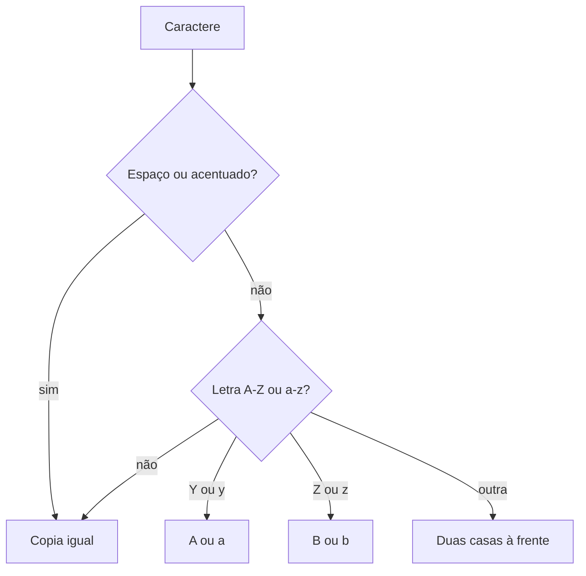

## Visão Geral do Conceito

O encontro de 28 de setembro de 2026 não abriu matéria nova. Foi rodízio de dúvidas do AT, com apresentação pública ou em sala privada. O que a transcrição sustenta como técnica cabe em três blocos: a regra do **cifrador** (e o enunciado cuja saída estava errada), o **teto do vetor** já ensinado, e a **organização em classes** na pasta <mark style="background-color: #242424; padding: 2px 4px; border-radius: 3px; color: inherit;">`Models`</mark>. O resto é logística de entrega ou conversa que não virou especificação.

> **Problema que resolve:** uma saída “oficial” com mais letras do que a entrada faz o teste passar no enunciado e falhar na regra. Contar letras é o critério que o professor Luiz Maia usou ao vivo. Entregar código com <mark style="background-color: #242424; padding: 2px 4px; border-radius: 3px; color: inherit;">`=>`</mark> sem saber o que o símbolo faz foi motivo, no relato dele, para não aceitar o trabalho.

> **Lacuna de fonte:** sem PDF desta sessão. O gabarito (“a minha solução”) ficou prometido para a quinta-feira e **não está** na transcrição. As salas privadas não foram transcritas. Números de questão conflitam no áudio (abaixo). Enunciados completos das questões 1, 4, 5, 7, 8, 9, 10 e 11 não foram lidos. Não se reconstrói essas questões aqui.

> **Conflito de numeração:** num momento ele chama a questão 3 de cifrador, dado em sala, muito fácil, com saída esperada errada. Mais tarde, quando perguntam a saída da questão 2, ele confirma que a questão 2 é o cifrador e corrige o enunciado na hora. Noutro trecho a questão 3 volta como “manipulação de alunos”, muito fácil. Esta lição ensina a **regra do cifrador** e não escolhe um número de questão contra o áudio.

## Modelo Mental

O cifrador empurra cada letra duas casas no alfabeto. As duas últimas não têm casa à frente: Y cai em A, Z cai em B. A caixa acompanha a letra. O que não é letra cifrada — espaço e, no exemplo dito, o nome com acento — **permanece**. “Ignorar” aqui foi “não transformar”, não “apagar”: ele disse que espaços e Cecília são mantidos.

Há três jeitos que ele nomeou, sem mostrar o fonte:

- um vetor de letras;
- um teste manual só para Y e Z;
- o operador de resto, pouco código e mais difícil de ler. Foi assim que ele implementou. A expressão não foi ditada.

A entrada, no teste dele, estava escrita no código, não lida com <mark style="background-color: #242424; padding: 2px 4px; border-radius: 3px; color: inherit;">`ReadLine`</mark> a cada execução. O <mark style="background-color: #242424; padding: 2px 4px; border-radius: 3px; color: inherit;">`ReadLine`</mark> pode entrar depois.



## Mecânica Central

### O que a contagem de letras desmentiu

Ele pediu para contar. Carlos tem seis letras; a saída impressa no enunciado tinha sete. Silva tem cinco; a saída tinha seis. Essa saída está errada. Quem a reproduzir tem o código errado, mesmo que “bata com o PDF”.

Deslocar duas casas, preservando a caixa, em “Carlos Silva”:

| Entrada | C | a | r | l | o | s | espaço | S | i | l | v | a |
|---------|---|---|---|---|---|---|--------|---|---|---|---|---|
| Saída | E | c | t | n | q | u | espaço | U | k | n | x | c |

Texto: <mark style="background-color: #242424; padding: 2px 4px; border-radius: 3px; color: inherit;">`Ectnqu Uknxc`</mark>. No áudio, ao editar o enunciado, os fragmentos soaram também em maiúsculas (<mark style="background-color: #242424; padding: 2px 4px; border-radius: 3px; color: inherit;">`ECTNQU`</mark>, <mark style="background-color: #242424; padding: 2px 4px; border-radius: 3px; color: inherit;">`UKNXC`</mark>). A regra de caixa que ele enunciou para Y/y e Z/z é a da tabela. A string exata que ficou gravada no enunciado corrigido não foi relida por completo; o teste extra com Cecília, Y e Z foi anunciado e a saída desse teste **não** foi lida em voz alta.

Reconstrução pedagógica do resto (não é o gabarito do Drive): para uma letra, a base é <mark style="background-color: #242424; padding: 2px 4px; border-radius: 3px; color: inherit;">`'A'`</mark> ou <mark style="background-color: #242424; padding: 2px 4px; border-radius: 3px; color: inherit;">`'a'`</mark>, soma-se 2 e o resto da divisão por 26 devolve a volta. Y+2 e Z+2 caem em A e B. Isso coincide com a regra dita. Não está escrito assim na transcrição.

```csharp
static char Deslocar(char c)
{
    if (c >= 'A' && c <= 'Z')
    {
        return (char)('A' + (c - 'A' + 2) % 26);
    }

    if (c >= 'a' && c <= 'z')
    {
        return (char)('a' + (c - 'a' + 2) % 26);
    }

    return c;
}
```

Caractere fora de A–Z e a–z volta igual. É o que cabe na frase “espaços e acentos mantêm-se”. Ç e letras acentuadas não estão no intervalo A–Z, então permanecem. Ele não percorreu “Cecília” letra a letra na gravação.

### O que ele classificou, sem enunciar o problema

| Fala | Dificuldade que ele deu | Especificação na transcrição |
|------|-------------------------|------------------------------|
| Questão 1 | Muito fácil; “nem deveria estar aí” | Não lida |
| Questão 2, mais tarde | Média; confirmada como cifrador | Regra acima |
| Questão 3, num trecho | Muito fácil; cifrador; saída do enunciado errada | Conflita com a linha da questão 2 |
| Questão 3, noutro trecho | Muito fácil; manipulação de alunos | Conflita com o cifrador |
| Questões 4 e 5 | Médias; data e remédio | Algoritmo não lido |
| Questão 7 | Média; banco | Regras não lidas |
| Questão 8 | Muito fácil | Tema não nomeado |
| Cálculo de salário | Entre média e fácil | Número da questão não fechado |
| Questão 9 A e B | Difícil; vetor com tamanho máximo; enunciado confuso | O teto do array é o da lição [[vetores-arrays-homogeneos-csharp]]. Campos do problema não foram lidos |
| Questão 10 | Fácil; “jogo” | Regras não lidas |
| Cadastro de contatos | Dificuldade parecida com a 9 | Campos não lidos |
| Questão 12 | A mais difícil; depende da 11 | Exibir os mesmos contatos de outro modo, de forma uniforme |

Questão 11 errada arrasta a 12. Ele pediu, em público, classe e subclasses na pasta <mark style="background-color: #242424; padding: 2px 4px; border-radius: 3px; color: inherit;">`Models`</mark>, inclusive a classe contato e as classes do formatador. Pasta extra só para o formatador: não é necessária.

### Entrega e código que não se explica

Para o zip caber: apagar <mark style="background-color: #242424; padding: 2px 4px; border-radius: 3px; color: inherit;">`bin`</mark> e <mark style="background-color: #242424; padding: 2px 4px; border-radius: 3px; color: inherit;">`obj`</mark>. Ele imagina **uma** solução com um projeto por exercício. A questão 9 tem A e B, então contou 13 projetos para 12 questões. O enunciado pedia PDF (coordenação); ele não mudou o enunciado e disse que aceitaria PDF ou zip. Isso não é regra de C#.

Sobre o símbolo <mark style="background-color: #242424; padding: 2px 4px; border-radius: 3px; color: inherit;">`=>`</mark>: um trabalho o usava e o aluno não soube dizer o que era. A sessão **não ensinou** expressão lambda. O critério dito foi outro: usar código, inclusive de ferramenta automática, só se der para explicar. Não há sintaxe de lambda nesta lição.

## Uso Prático

O teste que ele descreveu para não redigitar a cada corrida: a frase fica numa variável, a função devolve a cifra, o console mostra a saída. Quando a saída estabiliza, troca-se a constante por <mark style="background-color: #242424; padding: 2px 4px; border-radius: 3px; color: inherit;">`Console.ReadLine`</mark>.

```csharp
static string Cifrar(string texto)
{
    var saida = new char[texto.Length];
    for (int i = 0; i < texto.Length; i++)
    {
        saida[i] = Deslocar(texto[i]);
    }

    return new string(saida);
}

const string entrada = "Carlos Silva";
string saida = Cifrar(entrada);
Console.WriteLine(saida);
Console.WriteLine(entrada.Count(char.IsLetter) == saida.Count(char.IsLetter));
```

A contagem de letras da entrada e da saída tem de bater, porque espaço e acentuado continuam lá e cada letra vira uma letra. Foi esse o teste mental do enunciado. <mark style="background-color: #242424; padding: 2px 4px; border-radius: 3px; color: inherit;">`Count`</mark> com <mark style="background-color: #242424; padding: 2px 4px; border-radius: 3px; color: inherit;">`char.IsLetter`</mark> é reconstrução do “conte o número de letras”; ele não ditou LINQ nesta sessão. Dá para contar com um <mark style="background-color: #242424; padding: 2px 4px; border-radius: 3px; color: inherit;">`for`</mark>.

Para a questão 9, o uso prático que a sessão autoriza é o já visto: capacidade fixa, não escrever além de <mark style="background-color: #242424; padding: 2px 4px; border-radius: 3px; color: inherit;">`Length - 1`</mark>. Os campos do cadastro não foram ditos.

## Erros Comuns

**Reproduzir a saída comprida do enunciado.** Sete letras onde Carlos tem seis. A correção encolhe a saída até o número de letras da entrada.

**Apagar espaços.** A frase deixa de ser comparável com “Carlos Silva” e com a manutenção de Cecília. Espaço copia.

**Cifrar ç como se fosse c, ou o contrário, sem regra dita.** A transcrição não desloca acentuados. O intervalo A–Z não inclui ç.

**Y virar C.** Isso seria +2 sem volta, ou +4. A regra dita é Y→A e Z→B.

**Trocar a caixa.** Y maiúsculo vira A maiúsculo; y minúsculo vira a.

**<mark style="background-color: #242424; padding: 2px 4px; border-radius: 3px; color: inherit;">`=>`</mark> colado sem explicação.** A sessão não deu a sintaxe. Se o símbolo está no trabalho, o autor tem de saber dizê-lo; o encontro não forneceu essa aula.

**Questão 12 com uma classe só, ou com pasta de formatador obrigatória.** O pedido público foi classe e subclasses dentro de <mark style="background-color: #242424; padding: 2px 4px; border-radius: 3px; color: inherit;">`Models`</mark>.

**Inventar o feedback da sala privada.** Não está na fonte.

## Visão Geral de Debugging

1. Saída “quase” certa e mais longa que a entrada: conte letras dos dois lados antes de mexer no deslocamento. Foi assim que o enunciado caiu.
2. Y ou Z no meio da palavra e a letra seguinte “não existe”: falta a volta ao início. Teste uma string que termine em Y e em Z, como ele disse que fez, e confira A/a e B/b.
3. Espaço sumiu ou virou letra: o ramo que não é A–Z está a deslocar. Devolva o caractere original.
4. Questão 12 não compila ou não lista contato: a 11 não produz a coleção que a 12 percorre. Ele avisou essa dependência. Os tipos exatos não estão na gravação pública.
5. Zip recusado por tamanho: <mark style="background-color: #242424; padding: 2px 4px; border-radius: 3px; color: inherit;">`bin`</mark> e <mark style="background-color: #242424; padding: 2px 4px; border-radius: 3px; color: inherit;">`obj`</mark> ainda estão dentro.

## Principais Pontos

- A sessão é de dúvidas; não há matéria nova além do que foi respondido em público.
- Cifrador: +2, Y/y→A/a, Z/z→B/b, espaço e acentuado mantidos.
- Saída do enunciado com mais letras que a entrada está errada.
- “Carlos Silva” com essa regra fica <mark style="background-color: #242424; padding: 2px 4px; border-radius: 3px; color: inherit;">`Ectnqu Uknxc`</mark> se a caixa da entrada for preservada.
- O resto da divisão por 26 é a implementação que ele nomeou, sem o fonte.
- Gabarito e salas privadas: não cobertos.
- Números 2 e 3 do cifrador conflitam no áudio.
- Questão 9: teto de array; campos não ditos.
- Questão 12: classes na pasta <mark style="background-color: #242424; padding: 2px 4px; border-radius: 3px; color: inherit;">`Models`</mark>, depende da 11, exibição uniforme.
- <mark style="background-color: #242424; padding: 2px 4px; border-radius: 3px; color: inherit;">`=>`</mark> não foi ensinado.

## Preparação para Prática

Antes do laboratório, você deve conseguir:

1. Deslocar uma letra, inclusive Y e Z, sem perder a caixa.
2. Cifrar uma frase inteira sem apagar espaços.
3. Recusar uma saída cujo número de letras não bate com a entrada.
4. Apontar o que a questão 12 pediu em público e o que a transcrição não contém.

## Laboratório de Prática

> Corpo em C#. O editor executa JavaScript. A regra é a da sessão, não um gabarito ausente.

### Easy — Uma letra, com volta

Contexto ADS: o primeiro teste do cifrador é a letra isolada, antes da frase. Y e Z são o caso que o enunciado não ajudava a ver.

```javascript
function deslocarLetra(c) {
  // c é string de um caractere
  // TODO: A-Z e a-z avançam 2 casas; Y/y → A/a; Z/z → B/b
  // TODO: qualquer outro caractere volta igual
  return c;
}

deslocarLetra("Y");
deslocarLetra("z");
deslocarLetra("C");
deslocarLetra(" ");
```

### Medium — Frase com espaço

Contexto ADS: o campo “nome” do teste inclui espaço. O espaço não é letra e não pode sumir nem virar outra letra.

```javascript
function cifrar(texto) {
  // TODO: aplicar deslocarLetra a cada caractere e juntar
  // se deslocarLetra ainda não existir aqui, repita a regra no laço
  return "";
}

cifrar("Carlos Silva");
```

### Hard — A saída do enunciado não pode mentir no comprimento

Contexto ADS: um enunciado de teste automatizado trouxe uma saída maior que a entrada. O corretor conta letras antes de comparar texto. Acentuados contam como letras para esse teste só se <mark style="background-color: #242424; padding: 2px 4px; border-radius: 3px; color: inherit;">`cifrar`</mark> os mantiver: o número de letras não muda.

```javascript
function contarLetrasAz(texto) {
  // TODO: contar apenas A-Z e a-z; espaço e o resto não entram
  return 0;
}

function auditarSaida(entrada, saidaEsperada) {
  // TODO: cifrar entrada
  // TODO: retornar { obtida, bateTexto, bateContagem }
  // bateTexto: obtida === saidaEsperada
  // bateContagem: contarLetrasAz(entrada) === contarLetrasAz(obtida)
  // saidaEsperada errada do enunciado deve falhar em bateTexto e, se tiver letras a mais, a contagem da esperada não é a da entrada
  return { obtida: "", bateTexto: false, bateContagem: false };
}

auditarSaida("Carlos Silva", "Ectnqu Uknxc");
auditarSaida("Carlos Silva", "EctnquX Uknxc");
```

<!-- CONCEPT_EXTRACTION
concepts:
  - sessão de dúvidas sem matéria nova
  - cifrador deslocamento 2
  - Y e Z voltam para A e B
  - espaço e acentuado mantidos
  - saída do enunciado com contagem de letras errada
  - conflito questão 2 versus questão 3
  - operador resto nomeado e não ditado
  - gabarito e sala privada ausentes
  - questão 9 teto de array
  - questão 12 Models classe e subclasse
  - bin e obj no zip
  - seta de função não ensinada
skills:
  - Deslocar letra com volta ao início do alfabeto
  - Preservar caixa espaço e caractere fora de A-Z
  - Contar letras para invalidar uma saída esperada
  - Recusar reproduzir o enunciado quando a contagem não fecha
  - Colocar classes de contato e formatador em Models
  - Separar o que a transcrição pública contém do que a sala privada não registou
examples:
  - carlos-silva-ectnqu-uknxc
  - enunciado-sete-letras-contra-seis
  - y-para-a-z-para-b
  - models-contato-formatador
  - lab-js-deslocar-cifrar-auditar
-->

<!-- EXERCISES_JSON
[
  {
    "id": "csharp-deslocar-letra",
    "slug": "csharp-deslocar-letra",
    "difficulty": "easy",
    "title": "Deslocar uma letra com volta",
    "discipline": "fundamentos-csharp",
    "editorLanguage": "javascript",
    "tags": ["csharp", "cifrador", "resto"],
    "summary": "Avançar duas casas no alfabeto, com Y e Z voltando para A e B, e copiar o que não é letra."
  },
  {
    "id": "csharp-cifrar-frase",
    "slug": "csharp-cifrar-frase",
    "difficulty": "medium",
    "title": "Cifrar frase com espaço",
    "discipline": "fundamentos-csharp",
    "editorLanguage": "javascript",
    "tags": ["csharp", "cifrador", "string"],
    "summary": "Cifrar cada caractere de uma frase sem apagar o espaço."
  },
  {
    "id": "csharp-auditar-saida-cifrador",
    "slug": "csharp-auditar-saida-cifrador",
    "difficulty": "hard",
    "title": "Auditar a saída pelo número de letras",
    "discipline": "fundamentos-csharp",
    "editorLanguage": "javascript",
    "tags": ["csharp", "cifrador", "teste"],
    "summary": "Comparar a cifra obtida com a saída esperada e verificar se o número de letras A-Z se manteve."
  }
]
-->

<!--
lessons.json (NÃO aplicado por este worker — integração serial do orquestrador):
{
  "discipline": "fundamentos-csharp",
  "slug": "revisao-duvidas-at-cifrador-csharp",
  "title": "Revisão de dúvidas do AT: cifrador, vetor e Models",
  "order": 20,
  "file": "content/fundamentos-csharp/aula-20-revisao-duvidas-at-cifrador-csharp.md"
}
-->
