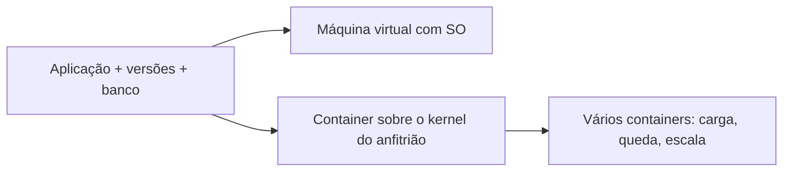

## Visão Geral do Conceito

A última aula do trimestre, 29 de setembro de 2026, ficou aberta para dúvidas do AT. A transcrição pública não traz correção de exercício. O trecho técnico que existe é a resposta a uma pergunta sobre Docker.

Antigamente, o ambiente isolado de desenvolvimento e teste era uma **máquina virtual**. Ela leva sistema operativo, banco, versão de linguagem e pacotes, e pode ser copiada para outro computador. O custo é memória e processador, porque o sistema operativo vai inteiro. **Docker** foi apresentado como caminho mais leve para o mesmo fim: um **container** feito a partir de uma **imagem**, com a aplicação e o que ela precisa, executável noutra máquina sem herdar as versões instaladas lá.

> **Problema que resolve:** “funciona na minha máquina” deixa de ser o critério de entrega. Versão de Java, versão de .NET, versão de banco, pacotes, firewall e permissões deixam de ser um quebra-cabeça novo em cada computador, porque o que a aplicação exige viaja com o container.

> **Lacuna de fonte:** sem PDF. Nenhum comando <mark style="background-color: #242424; padding: 2px 4px; border-radius: 3px; color: inherit;">`docker`</mark>, nenhum Dockerfile, nenhuma porta, nenhum YAML. Kubernetes foi definido em uma frase de orquestração, sem ferramenta. A frase “não precisa dos recursos da máquina local” é dele; o container ainda corre no anfitrião — o que a aula sustentou com clareza é que **as versões instaladas na máquina deixam de ser a dependência**. Instalação de Docker no Linux foi situada noutro bloco (ciência da computação), não feita aqui. Conversa sobre calendário, ênfase full stack versus agentes, engenheiro de prompt e empregabilidade não é procedimento e não vira tutorial.

## Modelo Mental

Duas caixas para a mesma aplicação.

A máquina virtual é um computador dentro do computador. Traz o sistema operativo. Por isso pesa. Em troca, o que foi instalado dentro dela (banco, Java, pacotes) aparece igual quando a caixa muda de sítio. Ferramentas citadas: VMware e VirtualBox.

O container é a caixa mais fina. O professor disse que o Docker usa funções do **kernel** do sistema anfitrião, e por isso gasta menos memória e menos processador. Continua a ser um pacote portátil: imagem pronta (ele falou em milhares de imagens), mais a aplicação, mais o banco se for preciso. Leva-se a caixa; o conteúdo arranca do mesmo modo.

Kubernetes, do jeito que foi pronunciado na aula, não é outro tipo de caixa. É quem **organiza várias caixas** da mesma aplicação: reparte carga, mantém o serviço se uma cair, cria mais quando a procura sobe.



“Funciona aqui e não funciona ao lado” não é mistério de código, no exemplo dele. É diferença de configuração. O container reduz esse eixo: o que importa passa a ser o conteúdo da caixa, não o que estava instalado na máquina de quem recebe.

## Mecânica Central

Não há sintaxe desta aula. A mecânica é a relação entre as peças que ele nomeou.

1. **Imagem.** Ponto de partida. Existem muitas prontas. A partir da imagem cria-se o container.
2. **Container.** Onde entram a aplicação e, se precisar, o banco e os pacotes. É a unidade que se copia.
3. **Anfitrião.** A máquina onde o container corre. O kernel é do anfitrião, na comparação que ele fez com a máquina virtual. Firewall e permissões foram citados como parte do que quebra a cópia **sem** container, não como configuração ensinada do Docker.
4. **Orquestração.** Vários containers da mesma aplicação. Motivos ditos: balanceamento de carga quando o volume de acessos é grande; disponibilidade quando um container cai e os outros seguem; escala, criar containers conforme a procura.

O que ele afirmou sobre o curso, sem dar aula disso: no bloco de ciência da computação de ADS o Docker aparece (instalar no Linux, criar container, executar, instalar coisas dentro), em nível que ele próprio chamou de não muito profundo; a ênfase full stack, no site que estava a olhar, menciona Docker; a de agentes, disse “provavelmente não”, sem certeza. CI/CD foi nomeado como conteúdo dessa área da grade, sem definição operacional além das palavras integração contínua e entrega contínua.

.NET, no mesmo encontro, voltou só como lembrete já dito na aula de arquivos: .NET não é a linguagem C#; a plataforma admite outras linguagens. O trimestre seguinte começaria com um trecho ainda de C# que o plano pede antes da parte web, resumido em uma ou duas aulas. Não houve código.

> **Não aplicável como comando:** não existe, na fonte, <mark style="background-color: #242424; padding: 2px 4px; border-radius: 3px; color: inherit;">`docker run`</mark>, ficheiro de imagem, nem objeto de Kubernetes. Inventar esses passos sairia da aula.

## Uso Prático

O uso que a explicação permite é decidir **o que tem de viajar com a aplicação** antes de copiar a pasta para outro computador. Se a lista abaixo muda entre as duas máquinas, o relato dele prevê falha. Se essa lista vai dentro do container, a máquina de destino deixa de precisar das mesmas instalações.

```csharp
public sealed class Ambiente
{
    public string Runtime { get; init; } = "";
    public string VersaoRuntime { get; init; } = "";
    public string VersaoBanco { get; init; } = "";
    public string Pacotes { get; init; } = "";
}

public static bool MesmaConfiguracao(Ambiente origem, Ambiente destino)
{
    return origem.Runtime == destino.Runtime
        && origem.VersaoRuntime == destino.VersaoRuntime
        && origem.VersaoBanco == destino.VersaoBanco
        && origem.Pacotes == destino.Pacotes;
}
```

<mark style="background-color: #242424; padding: 2px 4px; border-radius: 3px; color: inherit;">`MesmaConfiguracao`</mark> devolve falso quando Java, .NET, banco ou pacotes divergem — as diferenças que ele listou. Não cria container. Só torna visível o motivo de a cópia nua falhar. Firewall e permissão ficaram na fala e não têm campo aqui, porque ele não disse como se representam.

Três containers da mesma aplicação, ainda sem ferramenta: se um para, os outros dois é que sustentam o serviço, no desenho de disponibilidade. A aula não deu número mínimo de réplicas.

## Erros Comuns

**Tratar Docker como máquina virtual com outro nome.** As duas isolam e as duas se levam. A diferença que ele marcou é o sistema operativo completo versus o uso do kernel do anfitrião, e o peso de memória e CPU.

**Achar que o container dispensa CPU e memória do anfitrião.** A frase da aula nesse ponto é folgada. O que fica de pé no resto da explicação: gasta **menos** do que a VM, e não depende das versões instaladas à parte na máquina.

**Copiar só o código e esperar o mesmo banco.** Versão de banco diferente está na lista de causas. Sem o banco dentro do ambiente isolado, a aplicação volta a depender da máquina.

**Procurar Kubernetes para “criar um container”.** Na aula, criar a caixa é Docker; Kubernetes entra quando já há **vários** containers para repartir carga, sobreviver a uma queda ou crescer.

**Transformar a conversa de ênfase de curso em decisão técnica.** Ele recusou prognosticar full stack versus agentes, e recusou dizer que engenheiro de prompt fosse um papel estável. Não há critério implementável.

## Visão Geral de Debugging

1. “Na minha máquina passa, na outra não.” Compare runtime, versão, banco e pacotes antes de reler o código. É a ordem que a explicação sugere.
2. A caixa virtual está lenta e grande. Pergunte se o sistema operativo inteiro precisa de ir junto. Se não, o desenho que ele ofereceu é o container.
3. Um container caiu e o serviço morreu. Pela definição dada, faltou mais do que uma caixa, ou faltou quem as organize. A aula não mostrou como se configura isso.
4. Não há log de <mark style="background-color: #242424; padding: 2px 4px; border-radius: 3px; color: inherit;">`docker`</mark> nesta lição. Se o problema é um comando, ele não foi dado aqui; o bloco citado para instalação é outro.

## Principais Pontos

- Máquina virtual: ambiente isolado com sistema operativo, portátil e pesado. Exemplos ditos: VMware, VirtualBox.
- Docker: container a partir de imagem, mais leve porque usa o kernel do anfitrião.
- O container existe para a aplicação não depender da configuração solta de cada máquina.
- Kubernetes, nesta aula: orquestrar vários containers (carga, queda, escala).
- Sem comando, sem Dockerfile, sem instalação.
- .NET não é sinónimo de C#; isso já tinha sido dito e não foi exercitado.
- Carreira e ênfase de curso: conversa, sem recomendação e sem procedimento.

## Preparação para Prática

Antes do laboratório, você deve conseguir:

1. Listar por que uma cópia da aplicação falha noutra máquina, com as causas ditas na aula.
2. Escolher VM ou container a partir de “precisa do sistema operativo inteiro?” e do peso.
3. Dizer o que vários containers resolvem, sem inventar comando.
4. Recusar preencher lacuna com Dockerfile ou com conselho de ênfase.

## Laboratório de Prática

> Não houve código na aula. O editor executa JavaScript que modela só as distinções ditas: configuração que viaja, peso da VM contra o container, e o que acontece quando uma de várias caixas cai. Não há CLI.

### Easy — A cópia nua quebra se a versão muda

Contexto ADS: o mesmo serviço de pedidos sai da máquina de desenvolvimento para a do cliente. Runtime, versão e banco têm de coincidir se não houver container.

```javascript
function mesmaConfiguracao(origem, destino) {
  // origem e destino: { runtime, versaoRuntime, versaoBanco, pacotes }
  // TODO: retornar true só se os quatro campos forem iguais
  return false;
}

function diagnostico(origem, destino) {
  // TODO: se mesmaConfiguracao, retornar "configuracao compativel"
  // TODO: senão retornar "funciona na origem e pode falhar no destino"
  return "";
}

diagnostico(
  { runtime: "dotnet", versaoRuntime: "8", versaoBanco: "16", pacotes: "a" },
  { runtime: "dotnet", versaoRuntime: "6", versaoBanco: "16", pacotes: "a" }
);
```

### Medium — VM carrega o sistema; container marca o kernel do anfitrião

Contexto ADS: o time escolhe o pacote do ambiente. VM sempre leva sistema operativo. Container, no modelo da aula, não leva um sistema operativo próprio: apoia-se no kernel do anfitrião e gasta menos.

```javascript
function descreverAmbiente(tipo) {
  // tipo: "vm" ou "container"
  // TODO: vm → { levaSistemaOperativo: true, usaKernelDoAnfitriao: false, peso: "alto" }
  // TODO: container → { levaSistemaOperativo: false, usaKernelDoAnfitriao: true, peso: "menor" }
  // TODO: outro tipo → throw new Error("tipo nao descrito na aula")
  return { levaSistemaOperativo: false, usaKernelDoAnfitriao: false, peso: "" };
}

descreverAmbiente("vm");
descreverAmbiente("container");
```

### Hard — Um container cai; os outros seguem

Contexto ADS: há mais do que uma caixa da mesma API. O serviço continua se sobrar ao menos uma em execução. Isso é o critério de disponibilidade dito na aula, não um manifesto de orquestrador.

```javascript
function servir(containers) {
  // containers: array de { id, ativo }
  // TODO: ativos = os que têm ativo true
  // TODO: se não houver nenhum, retornar { ok: false, emExecucao: 0 }
  // TODO: senão { ok: true, emExecucao: quantidade, ids: ids ativos }
  return { ok: false, emExecucao: 0, ids: [] };
}

function cabeEscala(procurando, emExecucao) {
  // TODO: retornar true se emExecucao >= procurando e procurando > 0
  // a aula não deu número mínimo; o laboratório só compara a procura com as caixas vivas
  return false;
}

servir([
  { id: "a", ativo: false },
  { id: "b", ativo: true },
  { id: "c", ativo: true },
]);
cabeEscala(2, 2);
```

<!-- CONCEPT_EXTRACTION
concepts:
  - funciona na minha máquina
  - máquina virtual com sistema operativo
  - VMware e VirtualBox
  - imagem e container
  - Docker usa o kernel do anfitrião
  - menos memória e CPU que a VM
  - portabilidade de aplicação banco e pacotes
  - Kubernetes como orquestração
  - carga disponibilidade e escala
  - sem comando nesta aula
  - .NET não é a linguagem
skills:
  - Diagnosticar divergência de runtime versão banco e pacotes
  - Contrastar VM com SO completo e container apoiado no kernel
  - Recusar tratar container como máquina sem consumo de recursos
  - Explicar por que vários containers respondem a carga queda e procura
  - Separar conceito dito de instalação não feita
  - Não converter conversa de carreira em procedimento
examples:
  - copia-nua-versao-dotnet-diferente
  - vm-versus-container-peso
  - tres-containers-um-cai
  - kubernetes-so-definicao
  - lab-js-config-ambiente-servir
-->

<!-- EXERCISES_JSON
[
  {
    "id": "csharp-mesma-configuracao",
    "slug": "csharp-mesma-configuracao",
    "difficulty": "easy",
    "title": "Configuração que a cópia nua exige",
    "discipline": "fundamentos-csharp",
    "editorLanguage": "javascript",
    "tags": ["docker", "container", "portabilidade"],
    "summary": "Comparar runtime, versão, banco e pacotes e avisar quando a outra máquina pode falhar."
  },
  {
    "id": "csharp-vm-versus-container",
    "slug": "csharp-vm-versus-container",
    "difficulty": "medium",
    "title": "VM e container segundo a aula",
    "discipline": "fundamentos-csharp",
    "editorLanguage": "javascript",
    "tags": ["docker", "vm", "kernel"],
    "summary": "Descrever se o ambiente leva sistema operativo próprio, se usa o kernel do anfitrião e o peso relativo."
  },
  {
    "id": "csharp-containers-disponibilidade",
    "slug": "csharp-containers-disponibilidade",
    "difficulty": "hard",
    "title": "Serviço com vários containers",
    "discipline": "fundamentos-csharp",
    "editorLanguage": "javascript",
    "tags": ["kubernetes", "container", "disponibilidade"],
    "summary": "Manter o serviço quando sobra container ativo e comparar a procura com a quantidade em execução."
  }
]
-->

<!--
lessons.json (NÃO aplicado por este worker — integração serial do orquestrador):
{
  "discipline": "fundamentos-csharp",
  "slug": "containers-docker-conceitos-csharp",
  "title": "Containers: máquina virtual, Docker e orquestração",
  "order": 21,
  "file": "content/fundamentos-csharp/aula-21-containers-docker-conceitos-csharp.md"
}
-->
