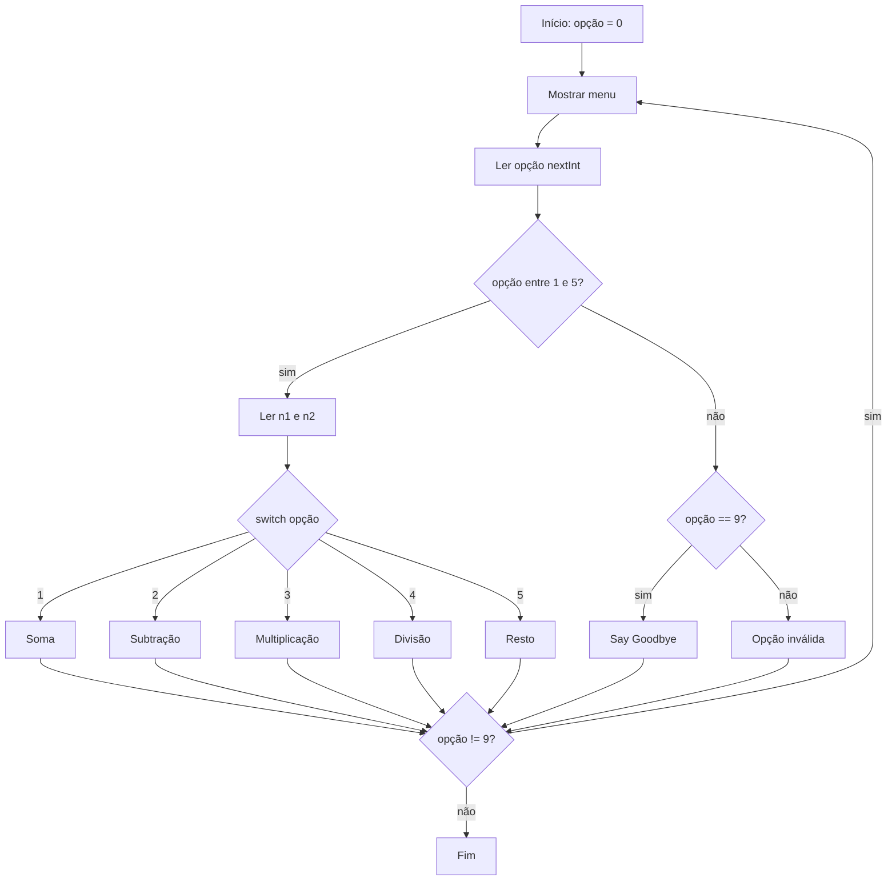
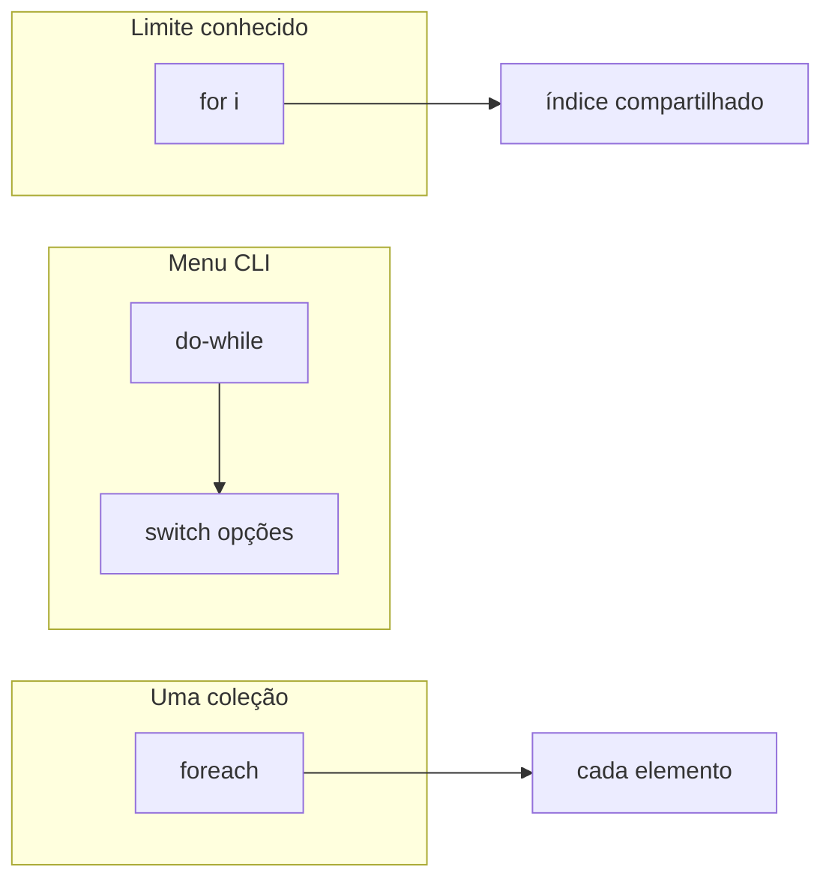

## Visão Geral do Conceito

A calculadora das aulas anteriores **sempre** lia dois números e imprimia soma, subtração, multiplicação, divisão e resto de uma vez. Em uso real, o operador escolhe **uma** operação, vê o resultado e — se quiser — escolhe de novo, até decidir sair.

Nesta lição você transforma essa classe em um **menu interativo**:

1. Mostra opções (1–5 operações; 9 sair).
2. Lê a opção com <mark style="background-color: #242424; padding: 2px 4px; border-radius: 3px; color: inherit;">`Scanner`</mark>.
3. Repete o ciclo com <mark style="background-color: #242424; padding: 2px 4px; border-radius: 3px; color: inherit;">`do-while`</mark> enquanto a opção for diferente de 9.
4. Organiza as operações com <mark style="background-color: #242424; padding: 2px 4px; border-radius: 3px; color: inherit;">`switch`</mark> / <mark style="background-color: #242424; padding: 2px 4px; border-radius: 3px; color: inherit;">`case`</mark> / <mark style="background-color: #242424; padding: 2px 4px; border-radius: 3px; color: inherit;">`break`</mark>.
5. No mesmo encontro, a turma ainda conhece <mark style="background-color: #242424; padding: 2px 4px; border-radius: 3px; color: inherit;">`for`</mark> e <mark style="background-color: #242424; padding: 2px 4px; border-radius: 3px; color: inherit;">`foreach`</mark> (for aprimorado) para repetição controlada e leitura de coleções.

> **Problema que resolve:** controlar o fluxo de um CLI (Command-Line Interface) simples — menu → operação → resultado → menu de novo — sem reiniciar o programa a cada conta, e sem uma cascata de `if`/`else if` difícil de ler quando as opções são valores discretos.

**Lacuna de fontes:** não há pasta `documents/Java` nem slides/PDF desta disciplina em `downloads/documents`. O material foi reconstruído a partir da transcrição WebVTT `Aula_07_-_13082026.bin` (prof. Elberth Moraes). O `.java` exato da IDE não está no repositório; os exemplos refletem o algoritmo ditado oralmente (ASR por vezes escreve “Doyle” = `do-while`, “suíte” = `switch`, “Fó/Ford” = `for`, “Fore It” = `foreach`).

---

## Modelo Mental

Pense em um **guichê de atendimento** da calculadora:

1. O cliente **sempre** chega e vê o cardápio (menu) pelo menos uma vez → isso é <mark style="background-color: #242424; padding: 2px 4px; border-radius: 3px; color: inherit;">`do-while`</mark>: executa, depois pergunta se continua.
2. Ele escolhe um número no cardápio → cada número é um **caso** no <mark style="background-color: #242424; padding: 2px 4px; border-radius: 3px; color: inherit;">`switch`</mark>.
3. Depois da conta, se não pediu “sair” (9), volta ao cardápio.
4. Se digitou algo fora do cardápio válido (ex.: 8, −1, 12), o guichê responde “opção inválida” e o loop continua.



**Analogia do `switch`:** um prédio com andares numerados. Você sobe direto ao andar da opção. Sem <mark style="background-color: #242424; padding: 2px 4px; border-radius: 3px; color: inherit;">`break`</mark>, a escada continua e você “escorrega” para o andar de baixo (fall-through) — às vezes desejado (agrupar meses num quadrimestre), às vezes bug (soma + subtração na mesma escolha).

**Analogia do `for`:** você já sabe **quantas** voltas dar (0 até 10, ou 0 até `args.length`). O <mark style="background-color: #242424; padding: 2px 4px; border-radius: 3px; color: inherit;">`do-while`</mark> do menu não sabe de antemão; depende do usuário. O <mark style="background-color: #242424; padding: 2px 4px; border-radius: 3px; color: inherit;">`foreach`</mark> é “para cada item desta coleção, faça…” sem gerir o índice à mão.

---

## Mecânica Central

### 1. Menu: opções e saída

Contrato da aula sobre a calculadora:

| Opção | Comportamento |
|-------|----------------|
| 1 | Soma |
| 2 | Subtração |
| 3 | Multiplicação |
| 4 | Divisão |
| 5 | Resto (`%`) |
| 9 | Sair (“Say Goodbye”) |
| outras | Opção inválida |

Prompt sem pular linha (cursor ao lado do texto) com <mark style="background-color: #242424; padding: 2px 4px; border-radius: 3px; color: inherit;">`System.out.printf`</mark>; leitura da opção com <mark style="background-color: #242424; padding: 2px 4px; border-radius: 3px; color: inherit;">`scanner.nextInt()`</mark> numa variável <mark style="background-color: #242424; padding: 2px 4px; border-radius: 3px; color: inherit;">`int opção`</mark>.

### 2. Primeira versão: `if` / `else if` (e o problema)

Antes do `switch`, a turma mapeou cada opção com cadeia `if` / `else if`. Funciona, mas:

- o programa **terminava** após uma operação (precisava rodar de novo);
- havia **duplicação** de “informe o primeiro/segundo número” em cada ramo;
- opções inválidas não tinham tratamento claro no fluxo básico.

### 3. `do-while`: manter o menu vivo

> **Regra:** `do { ... } while (opção != 9);` — entra pelo menos uma vez; só sai quando a opção for 9.

Escopo (mesmo padrão da aula anterior):

```java
int opção = 0; // declaração + inicialização FORA do do

do {
    System.out.printf("Escolha uma opção: ");
    opção = scanner.nextInt(); // atribuição DENTRO

    // ... menu / operações / mensagens ...

} while (opção != 9);
```

Se `opção` nascer só dentro do `do`, a condição do `while` **não enxerga** a variável.

### 4. Validação: intervalo com `&&`

Só executa as operações se a opção estiver no intervalo válido:

```java
if (opção >= 1 && opção <= 5) {
    // ler operandos + executar operação (if/else if ou switch)
} else if (opção == 9) {
    System.out.println("Say Goodbye");
} else {
    System.out.println("Opção inválida");
}
```

Alternativa equivalente citada na aula: `opção == 1 || opção == 2 || ... || opção == 5`. O intervalo com <mark style="background-color: #242424; padding: 2px 4px; border-radius: 3px; color: inherit;">`&&`</mark> fica mais curto.

> **Nota:** a aula ainda **não** cobre `try`/`catch` para letra no lugar de número (`InputMismatchException`). Se o usuário digitar texto, o `nextInt()` quebra antes do `if` — lacuna explícita na fonte (“Action Tri Cat… a gente ainda não estudou”).

### 5. DRY: subir a leitura dos operandos

Em vez de pedir `n1`/`n2` em cada ramo, a aula **move** as leituras para cima, ainda dentro do bloco de opções válidas (1–5), aumentando o escopo compartilhado:

```java
if (opção >= 1 && opção <= 5) {
    System.out.print("Informe o primeiro número: ");
    double n1 = scanner.nextDouble();
    System.out.print("Informe o segundo número: ");
    double n2 = scanner.nextDouble();

    // agora cada case/ramo só calcula e imprime
}
```

Isso não é “estado da arte” com métodos — a turma ainda não formalizou funções próprias — mas já reduz duplicação **só movimentando código**.

### 6. `switch` / `case` / `break` / `default`

Substitui a cascata de opções discretas:

```java
switch (opção) {
    case 1:
        System.out.println("Soma = " + (n1 + n2));
        break;
    case 2:
        System.out.println("Subtração = " + (n1 - n2));
        break;
    case 3:
        System.out.println("Multiplicação = " + (n1 * n2));
        break;
    case 4:
        System.out.println("Divisão = " + (n1 / n2));
        break;
    case 5:
        System.out.println("Resto = " + (n1 % n2));
        break;
    default:
        // neste desenho, o if externo (1..5) impede chegar aqui
        // com opções inválidas; default fica para quando o switch
        // for a única barreira
        break;
}
```

- <mark style="background-color: #242424; padding: 2px 4px; border-radius: 3px; color: inherit;">`case`</mark>: valor discreto comparado à expressão do `switch`.
- <mark style="background-color: #242424; padding: 2px 4px; border-radius: 3px; color: inherit;">`break`</mark>: encerra o `switch` após o ramo; sem ele ocorre **fall-through**.
- <mark style="background-color: #242424; padding: 2px 4px; border-radius: 3px; color: inherit;">`default`</mark>: opções não mapeadas. Na calculadora da aula, o `if (1..5)` já filtra — então o `default` “não tem chance de entrar” enquanto essa guarda existir.

### 7. Fall-through intencional (agrupar casos)

Sem `break`, vários `case` compartilham o mesmo bloco. Exemplos da aula:

- meses 1–4 → 1º quadrimestre; 5–8 → 2º; 9–12 → 3º;
- códigos de benefício (ex.: 31, 32, 91, 92) com o **mesmo** cálculo.

```java
switch (mês) {
    case 1:
    case 2:
    case 3:
    case 4:
        System.out.println("1º quadrimestre");
        break;
    case 5: case 6: case 7: case 8:
        System.out.println("2º quadrimestre");
        break;
    case 9: case 10: case 11: case 12:
        System.out.println("3º quadrimestre");
        break;
    default:
        System.out.println("Mês inválido");
}
```

### 8. `switch` vs `if` (trade-off da aula)

| Preferir | Quando |
|----------|--------|
| `switch` | Valores discretos / grupos de casos; menu, dia da semana, posição no time, código de benefício |
| `if` | Predicados compostos (`salário > X && idade < Y`, faixas contínuas, várias variáveis) |

Sobre performance: o professor enfatizou que o custo raro não está no `if`/`switch` em si, e sim no **miolo** (ex.: método dentro do `if` que varre tabela enorme por CPF sem índice). Não invente micro-otimização trocando `if` por `switch`.

### 9. `for`: inicialização, condição, incremento

```java
for (int i = 0; i < 11; i++) {
    System.out.println(i); // imprime 0..10
}
```

Três partes:

1. **Inicialização** — roda uma vez (`int i = 0`).
2. **Condição** — como um `if` antes de cada volta (`i < 11`).
3. **Incremento** — após o corpo (`i++`).

Escopo: `i` declarado no `for` só existe **dentro** do laço.

Aula também contrastou <mark style="background-color: #242424; padding: 2px 4px; border-radius: 3px; color: inherit;">`i++`</mark> (usa o valor atual; incrementa “para a próxima vez”) e <mark style="background-color: #242424; padding: 2px 4px; border-radius: 3px; color: inherit;">`++i`</mark> (incrementa antes de usar na mesma expressão).

### 10. `foreach` e coleções (`args`, vetores)

`String[] args` do `main` é uma **coleção** de `String`. Percorrer com índice:

```java
for (int índice = 0; índice < args.length; índice++) {
    System.out.println(args[índice]);
}
```

Equivalente com for aprimorado:

```java
for (String nome : args) {
    System.out.println(nome);
}
```

Sintaxe mental da aula: **tipo do elemento**, **variável singular**, `:` , **coleção**.

```java
int[] idades = {10, 20, 30, 40, 50};
for (int idade : idades) {
    System.out.println(idade);
}
```

> **Limite do foreach:** percorre **uma** coleção por vez. Para relatório alinhado (nome + idade + salário em vetores paralelos do mesmo tamanho), use `for` tradicional com o mesmo índice nas três estruturas — como no fechamento da aula (jogadores / idades / salários).



---

## Uso Prático

### Calculadora com menu + `do-while` + `switch`

Cenário ADS: utilitário interno de console para operadores de suporte recalcularem totais sem reabrir a JVM a cada operação.

```java
import java.util.Scanner;

public class CalculadoraMenu {
    public static void main(String[] args) {
        Scanner scanner = new Scanner(System.in);
        int opção = 0;

        do {
            System.out.println("1 Soma | 2 Sub | 3 Mult | 4 Div | 5 Resto | 9 Sair");
            System.out.printf("Escolha uma opção: ");
            opção = scanner.nextInt();

            if (opção >= 1 && opção <= 5) {
                System.out.print("Primeiro número: ");
                double n1 = scanner.nextDouble();
                System.out.print("Segundo número: ");
                double n2 = scanner.nextDouble();

                switch (opção) {
                    case 1:
                        System.out.println("Soma = " + (n1 + n2));
                        break;
                    case 2:
                        System.out.println("Subtração = " + (n1 - n2));
                        break;
                    case 3:
                        System.out.println("Multiplicação = " + (n1 * n2));
                        break;
                    case 4:
                        System.out.println("Divisão = " + (n1 / n2));
                        break;
                    case 5:
                        System.out.println("Resto = " + (n1 % n2));
                        break;
                    default:
                        break;
                }
            } else if (opção == 9) {
                System.out.println("Say Goodbye");
            } else {
                System.out.println("Opção inválida");
            }
        } while (opção != 9);

        scanner.close();
    }
}
```

### Relatório com `for` e vetores paralelos

Cenário: três arrays alinhados por índice (nome em `args`, idades e salários) — relatório “Jogador X tem Y anos e recebe Z”.

```java
public class RelatorioElenco {
    public static void main(String[] args) {
        int[] idades = {22, 28, 31, 25, 27};
        double[] salários = {100, 200, 300, 400, 500};

        // pressupõe args.length == idades.length == salários.length
        for (int i = 0; i < args.length; i++) {
            System.out.println(
                "O jogador " + args[i]
                + " tem " + idades[i]
                + " anos e recebe " + salários[i]
            );
        }
    }
}
```

### Demo de fall-through (bug vs feature)

```java
// BUG se o objetivo era só somar:
switch (opção) {
    case 1:
        System.out.println("soma");
        // break omitido de propósito — também executa case 2
    case 2:
        System.out.println("subtração");
        break;
}
```

---

## Erros Comuns

1. **`opção` declarada dentro do `do`**  
   **Sintoma:** erro de compilação na condição `while (opção != 9)`.  
   **Correção:** `int opção = 0;` antes do `do`; só a atribuição fica dentro.

2. **Esquecer `break` no `case` da calculadora**  
   **Sintoma:** escolher 1 imprime soma **e** subtração (e talvez mais).  
   **Correção:** `break` após cada operação, salvo fall-through **intencional** e comentado.

3. **Confiar no `default` enquanto um `if (1..5)` envolve o `switch`**  
   **Sintoma:** `default` “nunca roda”; inválidos caem no `else` externo.  
   **Correção:** entenda as duas camadas — ou valide no `if`/`else`, ou deixe inválidos no `default`, mas não espere os dois tratarem o mesmo caso ao mesmo tempo sem desenhar o fluxo.

4. **Duplicar leitura de `n1`/`n2` em cada `case`**  
   **Sintoma:** código enorme, frases repetidas, risco de divergência.  
   **Correção:** ler operandos uma vez no bloco das opções válidas (como na refatoração da aula).

5. **Usar `foreach` para cruzar três vetores**  
   **Sintoma:** não há índice compartilhado; relatório desalinha.  
   **Correção:** `for` tradicional com o mesmo `i` em `args[i]`, `idades[i]`, `salários[i]`.

6. **Condição do `for` com `<=` no lugar de `<` (ou o inverso)**  
   **Sintoma:** imprime um elemento a mais/a menos; `ArrayIndexOutOfBoundsException` se usar `i <= args.length`.  
   **Correção:** para índices 0..n-1 use `i < args.length`.

7. **Esperar que `nextInt()` aceite letra**  
   **Sintoma:** exceção em runtime.  
   **Correção:** fora do escopo desta aula; na prática futura, validar token ou usar `try`/`catch` (não coberto na fonte).

---

## Visão Geral de Debugging

Quando o menu “não volta”, “sai cedo” ou “faz duas contas”:

1. **Imprima a opção** logo após o `nextInt()` — confira o valor real.
2. **Confira a condição do `while`** — deve ser `!= 9` (sair só no nove), não `== 9` invertido por engano.
3. **No `switch`, coloque um `println` por `case`** — se dois cases imprimirem, falta `break`.
4. **Escopo:** se o compilador reclama de `opção`, suba a declaração.
5. **No `for` de relatório:** imprima `i`, `args.length`, `idades.length` — tamanhos diferentes quebram o alinhamento.

<details>
<summary>Checklist rápido do menu</summary>

- [ ] `opção` fora do `do`, inicializada
- [ ] menu impresso dentro do loop
- [ ] `break` em cada `case` de operação
- [ ] `else` para inválidos; mensagem de saída no 9
- [ ] leituras de `n1`/`n2` só quando `1..5`

</details>

---

## Principais Pontos

- Menu = opções discretas + loop até comando de saída.
- <mark style="background-color: #242424; padding: 2px 4px; border-radius: 3px; color: inherit;">`do-while`</mark> = mostra o menu pelo menos uma vez; testa depois (`opção != 9`).
- Declare <mark style="background-color: #242424; padding: 2px 4px; border-radius: 3px; color: inherit;">`opção`</mark> no escopo da condição do `while`.
- Valide `1..5` com <mark style="background-color: #242424; padding: 2px 4px; border-radius: 3px; color: inherit;">`&&`</mark>; trate 9 e inválidos à parte.
- <mark style="background-color: #242424; padding: 2px 4px; border-radius: 3px; color: inherit;">`switch`</mark> organiza casos discretos melhor que cascata longa de `else if`.
- <mark style="background-color: #242424; padding: 2px 4px; border-radius: 3px; color: inherit;">`break`</mark> evita fall-through acidental; fall-through consciente agrupa casos.
- <mark style="background-color: #242424; padding: 2px 4px; border-radius: 3px; color: inherit;">`default`</mark> só age se a opção chegar lá — a guarda `if (1..5)` pode impedir.
- Prefira <mark style="background-color: #242424; padding: 2px 4px; border-radius: 3px; color: inherit;">`if`</mark> para condições compostas; `switch` para rótulos/grupos.
- <mark style="background-color: #242424; padding: 2px 4px; border-radius: 3px; color: inherit;">`for`</mark> = limite conhecido (init; condição; incremento).
- <mark style="background-color: #242424; padding: 2px 4px; border-radius: 3px; color: inherit;">`foreach`</mark> = uma coleção por vez; vetores paralelos pedem `for` com índice.
- Lentidão rara vem do **miolo** (I/O, busca sem índice), não da escolha trivial `if` vs `switch`.
- **Não coberto na fonte:** `try`/`catch` para entrada não numérica; métodos/funções próprios para menu/validação (apenas sugeridos como próximo passo).

---

## Preparação para Prática

Antes do laboratório, você deve conseguir:

1. Descrever o fluxo do menu com `do-while` e condição de saída.
2. Escrever um `switch` com `case`/`break` para operações 1–5.
3. Explicar o efeito de remover um `break`.
4. Validar intervalo com `&&` e tratar inválido.
5. Percorrer um array com `for` e com `foreach`, sabendo quando cada um serve.

O editor integrado do ISS usa JavaScript; os desafios implementam a **mesma lógica** da aula Java. Comentários trazem o equivalente Java.

---

## Laboratório de Prática

### Easy — Despachar operação com `switch`

**Contexto:** microserviço de precificação interna recebe `opcao` e dois operandos já validados. Você deve devolver o resultado da operação (1 soma, 2 sub, 3 mult, 4 div, 5 resto) ou `null` se a opção for desconhecida.

```javascript
// Java equivalente: switch (opcao) { case 1: ... break; ... default: return null; }

function executarOperacao(opcao, n1, n2) {
  // TODO: switch/case (ou if equivalente) para 1..5; default → null
  // 4 = divisão; 5 = resto (n1 % n2)
  return null;
}

console.log(executarOperacao(1, 10, 5)); // 15
console.log(executarOperacao(2, 10, 5)); // 5
console.log(executarOperacao(3, 10, 5)); // 50
console.log(executarOperacao(4, 10, 5)); // 2
console.log(executarOperacao(5, 10, 5)); // 0
console.log(executarOperacao(8, 10, 5)); // null
```

### Medium — Simular um ciclo de menu (`do-while` mental)

**Contexto:** testes automatizados alimentam uma fila de opções escolhidas pelo usuário (sem `Scanner`). Processe a fila como o `do-while` da aula: para cada opção, classifique `operacao` | `sair` | `invalida`. Pare ao encontrar `9` (inclua o evento `sair` no histórico).

```javascript
// Java: do { opção = ... } while (opção != 9);

function processarFilaMenu(opcoes) {
  const historico = [];
  let i = 0;
  let opcao = 0;

  // TODO: laço estilo do-while:
  // - ler opcoes[i] (se acabar a fila sem 9, trate)
  // - se 1..5 → historico.push({ tipo: "operacao", opcao })
  // - se 9 → historico.push({ tipo: "sair", opcao }) e parar
  // - senão → historico.push({ tipo: "invalida", opcao })
  // - continuar enquanto opcao !== 9 e houver itens

  return historico;
}

console.log(processarFilaMenu([1, 8, 2, 9]));
// esperado conceitual:
// [{tipo:"operacao",opcao:1},{tipo:"invalida",opcao:8},{tipo:"operacao",opcao:2},{tipo:"sair",opcao:9}]
```

### Hard — Relatório com índice compartilhado + fall-through de plano

**Contexto:** RH envia três arrays paralelos (`nomes`, `idades`, `salarios`) e um código de benefício. (1) Monte linhas `"Nome | idade=X | salario=Y"`. (2) Classifique o benefício com fall-through: códigos `31` e `32` → `"aposentadoria"`; `91` e `92` → `"acidente"`; outros → `"desconhecido"`.

```javascript
// Java: for (int i = 0; i < nomes.length; i++) { ... }
// Java: switch (codigo) { case 31: case 32: ... break; case 91: case 92: ... }

function montarRelatorio(nomes, idades, salarios) {
  const linhas = [];
  // TODO: for com mesmo índice; se tamanhos diferirem, retornar []
  return linhas;
}

function classificarBeneficio(codigo) {
  // TODO: fall-through / agrupamento de cases
  return "desconhecido";
}

console.log(montarRelatorio(
  ["Rossi", "Ortiz"],
  [30, 28],
  [5000, 4500]
));
// ["Rossi | idade=30 | salario=5000", "Ortiz | idade=28 | salario=4500"]

console.log(classificarBeneficio(31)); // aposentadoria
console.log(classificarBeneficio(92)); // acidente
console.log(classificarBeneficio(10)); // desconhecido
```

---

<!-- LESSONS_JSON_META
discipline: fundamentos-java
slug: switch-menu-do-while-calculadora-java
title: Switch, menu e do-while na calculadora Java
order: 7
file: content/fundamentos-java/aula-07-switch-menu-do-while-calculadora-java.md
NOTE: lessons.json / search-index.json NÃO editados nesta missão (integração serial pelo orquestrador).
-->

<!-- CONCEPT_EXTRACTION
concepts:
  - menu interativo CLI
  - do-while (executa depois testa)
  - switch / case / break / default
  - fall-through (acidental e intencional)
  - validação de opção com && (intervalo 1..5)
  - escopo de variável no loop do menu
  - DRY movendo leitura de operandos
  - System.out.printf (prompt sem newline)
  - Scanner.nextInt()
  - for (inicialização; condição; incremento)
  - i++ vs ++i
  - foreach / for aprimorado
  - String[] args como coleção
  - vetores paralelos com índice compartilhado
  - switch vs if (trade-off)
skills:
  - Montar menu de calculadora com opções e saída
  - Envolver interação em do-while até opção de saída
  - Declarar opção no escopo correto para o while
  - Validar intervalo de opções com &&
  - Substituir cadeia if/else if por switch/case
  - Usar break para impedir fall-through indesejado
  - Agrupar cases com fall-through consciente
  - Escolher switch ou if conforme o tipo de condição
  - Escrever for com init/condição/incremento
  - Percorrer coleção com foreach
  - Cruzar vetores paralelos com for indexado
examples:
  - calculadora-menu-do-while-switch
  - validacao-opcao-intervalo-and
  - fall-through-quadrimestre-beneficios
  - for-0-ate-10
  - foreach-args-idades-salarios
  - relatorio-vetores-paralelos
-->

<!-- EXERCISES_JSON
[
  {
    "id": "java-aula07-switch-operacao",
    "slug": "java-aula07-switch-operacao",
    "difficulty": "easy",
    "title": "Despachar operação com switch",
    "discipline": "fundamentos-java",
    "editorLanguage": "javascript",
    "tags": ["java", "switch", "case", "calculadora"],
    "summary": "Implementar dispatch 1..5 (soma/sub/mult/div/resto) com switch/case e default null."
  },
  {
    "id": "java-aula07-fila-menu-do-while",
    "slug": "java-aula07-fila-menu-do-while",
    "difficulty": "medium",
    "title": "Simular ciclo de menu estilo do-while",
    "discipline": "fundamentos-java",
    "editorLanguage": "javascript",
    "tags": ["java", "do-while", "menu", "validacao"],
    "summary": "Processar fila de opções classificando operacao/sair/invalida até encontrar 9."
  },
  {
    "id": "java-aula07-relatorio-fallthrough-beneficio",
    "slug": "java-aula07-relatorio-fallthrough-beneficio",
    "difficulty": "hard",
    "title": "Relatório paralelo e fall-through de benefício",
    "discipline": "fundamentos-java",
    "editorLanguage": "javascript",
    "tags": ["java", "for", "fall-through", "vetores-paralelos"],
    "summary": "Montar relatório com índice compartilhado e classificar códigos de benefício com cases agrupados."
  }
]
-->
