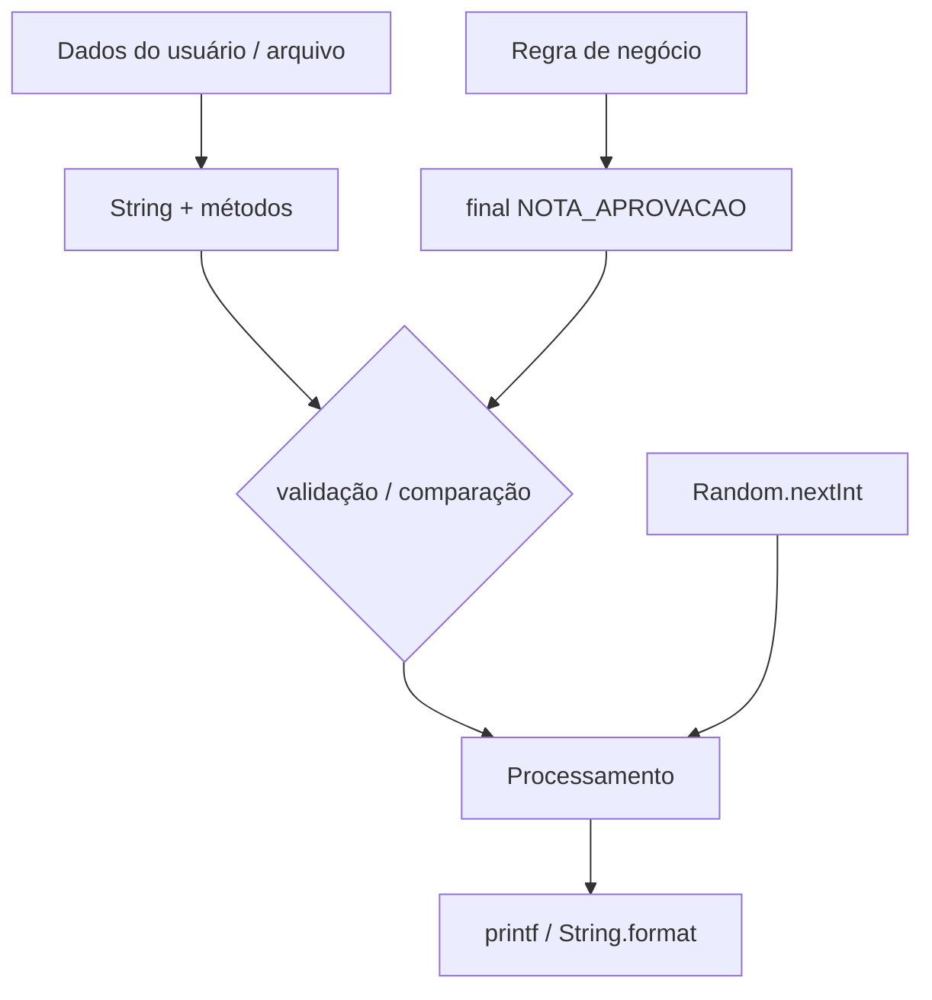
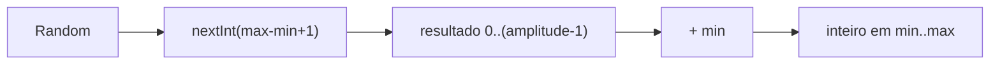

## Visão Geral do Conceito

Até aqui o curso cobriu variáveis, `Scanner`, condicionais, `switch`, `do-while` e programas como média/calculadora. Esta aula **fecha lacunas** da primeira etapa: valores que **não devem mudar**, saída **formatada**, a classe <mark style="background-color: #242424; padding: 2px 4px; border-radius: 3px; color: inherit;">`String`</mark> como API (não só “caixa de texto”), e números **aleatórios** usados no TP.

Problemas que estes recursos resolvem:

| Necessidade | Ferramenta |
|-------------|------------|
| Limite de aprovação que não pode “mudar no meio do caminho” | <mark style="background-color: #242424; padding: 2px 4px; border-radius: 3px; color: inherit;">`final`</mark> + nome em caixa alta |
| Média `double` com dezenas de casas no console | <mark style="background-color: #242424; padding: 2px 4px; border-radius: 3px; color: inherit;">`System.out.printf`</mark> |
| Contar caracteres, comparar nomes, partir CSV/linha de arquivo | métodos de `String` |
| Pedir nome até deixar de estar vazio (teste **antes** do miolo) | <mark style="background-color: #242424; padding: 2px 4px; border-radius: 3px; color: inherit;">`while`</mark> |
| Sortear inteiro sem digitar no teclado | <mark style="background-color: #242424; padding: 2px 4px; border-radius: 3px; color: inherit;">`java.util.Random`</mark> |

> **Lacuna de fonte:** não há pasta `documents/Java` nem PDF/slides obrigatórios para esta aula. O material abaixo reconstruído a partir da transcrição WebVTT `Aula_08_-_14082026.bin` (14/08/2026, prof. Elberth Moraes). Conceitos só mencionados de passagem (ex.: `BigDecimal`, certificações, roadmap OOP) aparecem como contexto, não como núcleo avaliado.

## Modelo Mental

Pense em quatro “camadas” no mesmo programa:



1. **Constante** — nomeia um valor de domínio (nota mínima, faixa de sorteio). Variável varia; constante é decisão de “não reatribuir”.
2. **String** — objeto com métodos. `toUpperCase()` devolve **outra** string; a original permanece. Comparar conteúdo ≠ comparar referência.
3. **printf** — o valor na memória pode ter muitas casas; a **apresentação** é outra decisão (`%.2f`, `%s`, `\n`).
4. **Random** — gera inteiros; o bound de `nextInt(n)` costuma ir de `0` até `n-1`. Para `[min, max]` inclusivo, desloca com a fórmula vista em aula.

Analogia rápida: constante é placa de limite de velocidade; variável é a velocidade do carro; printf é o painel (mostra 80,0 mesmo que o sensor interno tenha mais precisão); Random é um dado — você define o intervalo, não o resultado.

## Mecânica Central

### 1. Constantes com `final`

Sintaxe vista na classe de revisão (“esquecidos”):

```java
final double NOTA_APROVACAO = 7.0;
double notaAluno = 6.0;

if (notaAluno > NOTA_APROVACAO) {
    System.out.println("Aprovado");
} else {
    System.out.println("Perdeu");
}

// NOTA_APROVACAO = 5.0; // erro de compilação: final local variable
```

Regras da aula:

- Use <mark style="background-color: #242424; padding: 2px 4px; border-radius: 3px; color: inherit;">`final`</mark> para valores de **regra** (limite, mínimo/máximo de sorteio), não para a nota que muda a cada aluno.
- Nome em **SCREAMING_SNAKE_CASE** (`NOTA_APROVACAO`, `VALOR_MINIMO`) — sinal visual de constante. Variáveis comuns continuam em camelCase (`notaAluno`, `irpf`).
- Evite **magic numbers** soltos (`if (nota > 7)`): o `7` sem nome não explica o negócio; se a faculdade mudar para `8`, você altera **um** lugar.
- Não declare variáveis comuns em caixa alta: o código “parece” constante e atrasa quem lê na milésima linha.

### 2. `System.out.printf` — impressão formatada

Herdado da família C: placeholders no texto + argumentos na ordem.

| Placeholder | Uso típico na aula |
|-------------|--------------------|
| <mark style="background-color: #242424; padding: 2px 4px; border-radius: 3px; color: inherit;">`%s`</mark> | texto (`String`) |
| <mark style="background-color: #242424; padding: 2px 4px; border-radius: 3px; color: inherit;">`%d`</mark> | inteiro (`int` / tipos inteiros) |
| <mark style="background-color: #242424; padding: 2px 4px; border-radius: 3px; color: inherit;">`%f`</mark> | real (`float` / `double`) |
| <mark style="background-color: #242424; padding: 2px 4px; border-radius: 3px; color: inherit;">`%.2f`</mark> | real com **duas** casas decimais |
| <mark style="background-color: #242424; padding: 2px 4px; border-radius: 3px; color: inherit;">`\n`</mark> | quebra de linha (printf **não** pula sozinho) |

```java
String nome = "Elberth";
double media = 7.356789;
String situacao = "aprovado";

System.out.printf("A média do aluno %s é igual a %.2f%n", nome, media);
System.out.printf("O aluno %s está %s%n", nome, situacao);
```

> **Regra:** `println` = imprime e pula linha. `printf` = imprime **formatado**; quem manda pular linha é você (`\n` / `%n`).

Booleanos na apresentação: costuma-se usar `%s` com `"true"`/`"false"` ou um ternário que vira texto (`"sim"`/`"não"`).

**Interpolação clássica** (estilo `$nome` em outras linguagens) **não** existe em `String` literal “crua” do Java tradicional. Alternativas vistas na aula: concatenação com `+`, `printf`, e <mark style="background-color: #242424; padding: 2px 4px; border-radius: 3px; color: inherit;">`String.format`</mark> (mesma ideia de placeholders, sem necessariamente imprimir).

Contexto de precisão: o professor citou cálculo de benefício com `float` falhando em centavos e a migração para `BigDecimal` em sistema real — para média simples de três notas, `double` + `%.2f` basta. Detalhe aprofundado de `BigDecimal` **não** é o núcleo desta aula.

### 3. Métodos essenciais de `String`

`String` é classe (cor diferente no IDE, API rica). Exemplos trabalhados:

```java
String nome = scanner.nextLine();

System.out.println(nome.length());           // quantidade de caracteres
System.out.println(nome.toLowerCase());    // visualização minúscula
System.out.println(nome.toUpperCase());    // visualização maiúscula
System.out.println(nome);                  // original intacto

if (nome.equals("Michael")) { /* ... */ }
if (nome.equalsIgnoreCase("Michael")) { /* ignora maiúsculas/minúsculas */ }

if (nome.isBlank()) { /* vazio ou só espaços — validação de entrada */ }
```

Comparação:

- <mark style="background-color: #242424; padding: 2px 4px; border-radius: 3px; color: inherit;">`==`</mark> entre objetos: identidade/referência — inadequado para “o texto é igual?”.
- <mark style="background-color: #242424; padding: 2px 4px; border-radius: 3px; color: inherit;">`equals`</mark> / <mark style="background-color: #242424; padding: 2px 4px; border-radius: 3px; color: inherit;">`equalsIgnoreCase`</mark>: conteúdo.

**NullPointerException (história da certificação):** variável de referência local precisa ser inicializada; atributo de referência não inicializado tende a `null`. Chamar `instituicao.equals("Infnet")` com `instituicao == null` explode. Padrão defensivo:

```java
String instituicao = null; // cenário problemático

// ruim se instituicao for null:
// instituicao.equals("Infnet");

// melhor: literal à esquerda
if ("Infnet".equals(instituicao)) {
    System.out.println("sim");
} else {
    System.out.println("nao"); // null → false, sem NPE
}
```

**`split`:** parte um texto por delimitador e devolve <mark style="background-color: #242424; padding: 2px 4px; border-radius: 3px; color: inherit;">`String[]`</mark>.

```java
String diasSemana = "domingo;segunda;terca;quarta;quinta;sexta;sabado";
String[] dias = diasSemana.split(";");

for (String dia : dias) {
    System.out.printf("- %s%n", dia);
}
```

Uso corporativo citado: linha de arquivo `Elberth;47;1.80;85` → `split(";")` → campos por índice (nome, idade, …); depois conversão de tipos e carga em relatório/banco. Arquivos posicionais (nome com 15 caracteres fixos) foram só mencionados.

**`trim`:** remove espaços nas extremidades — útil quando o campo do arquivo traz padding.

```java
String nome = informacoes[0].trim();
System.out.println("[" + nome + "]");
```

### 4. `while` na validação de entrada (revisão contrastiva)

Para “enquanto o nome estiver vazio, peça de novo”:

```java
Scanner in = new Scanner(System.in);
String nome = in.nextLine();

while (nome.isBlank()) {
    System.out.println("Informe o nome:");
    nome = in.nextLine();
}
```

Mapa mental da aula (quatro estruturas):

| Estrutura | Quando usar |
|-----------|-------------|
| <mark style="background-color: #242424; padding: 2px 4px; border-radius: 3px; color: inherit;">`while`</mark> | testa **antes**; pode não executar o miolo |
| <mark style="background-color: #242424; padding: 2px 4px; border-radius: 3px; color: inherit;">`do-while`</mark> | executa **pelo menos uma vez**, depois testa |
| `for` | quantidade conhecida de repetições |
| `for-each` | percorrer uma coleção/vetor inteiro |

### 5. `java.util.Random`

```java
import java.util.Random;

final int VALOR_MINIMO = 1;
final int VALOR_MAXIMO = 10;

Random random = new Random();
int sorteado = random.nextInt(VALOR_MAXIMO - VALOR_MINIMO + 1) + VALOR_MINIMO;

System.out.printf(
    "Número sorteado entre %d e %d: %d%n",
    VALOR_MINIMO, VALOR_MAXIMO, sorteado
);
```

Pontos da demo:

- `Random` vive em <mark style="background-color: #242424; padding: 2px 4px; border-radius: 3px; color: inherit;">`java.util`</mark> (mesmo “bairro” do `Scanner`).
- <mark style="background-color: #242424; padding: 2px 4px; border-radius: 3px; color: inherit;">`nextInt()`</mark> sem bound: qualquer `int`.
- <mark style="background-color: #242424; padding: 2px 4px; border-radius: 3px; color: inherit;">`nextInt(10)`</mark>: tipicamente `0..9` (o limite superior é **excluído**).
- Para `[1, 10]` inclusivo: `nextInt(max - min + 1) + min`.
- Constantes nomeiam min/max de negócio; o `+ 1` da fórmula é ajuste de intervalo, não “regra de faculdade”.

O professor notou pouco uso de `Random` em sistemas corporativos “sérios”; no bloco, aparece no **TP** e em jogos/atividades.



## Uso Prático

### Cenário A — Boletim com constante e printf

```java
public class BoletimFormatado {
    public static void main(String[] args) {
        final double NOTA_APROVACAO = 7.0;
        final double NOTA_RECUPERACAO = 5.0;

        String aluno = "Elberth";
        double media = 7.356789;
        String situacao;

        if (media >= NOTA_APROVACAO) {
            situacao = "aprovado";
        } else if (media >= NOTA_RECUPERACAO) {
            situacao = "recuperacao";
        } else {
            situacao = "reprovado";
        }

        System.out.printf("A média do aluno %s é igual a %.2f%n", aluno, media);
        System.out.printf("O aluno %s está %s%n", aluno, situacao);
    }
}
```

### Cenário B — Validar nome e prêmio (equalsIgnoreCase)

```java
Scanner in = new Scanner(System.in);
System.out.print("Nome: ");
String nome = in.nextLine().trim();

while (nome.isBlank()) {
    System.out.print("Nome obrigatorio: ");
    nome = in.nextLine().trim();
}

if ("Michael".equalsIgnoreCase(nome)) {
    System.out.println("Vai ganhar um premio");
} else {
    System.out.println("Sem premio desta vez");
}

System.out.printf("Caracteres: %d | maiusculo: %s%n",
        nome.length(), nome.toUpperCase());
```

### Cenário C — Linha delimitada → campos (split + trim)

```java
String linha = "Elberth;47;1.80;85";
String[] info = linha.split(";");

String nome = info[0].trim();
// idade/altura/peso: converter depois (Integer.parseInt, Double.parseDouble)
System.out.printf("Nome importado: [%s]%n", nome);
```

### Cenário D — Sorteio com Random + constantes + printf

```java
import java.util.Random;

final int VALOR_MINIMO = 1;
final int VALOR_MAXIMO = 10;
Random random = new Random();
int n = random.nextInt(VALOR_MAXIMO - VALOR_MINIMO + 1) + VALOR_MINIMO;
System.out.printf("Sorteado entre %d e %d: %d%n", VALOR_MINIMO, VALOR_MAXIMO, n);
```

## Erros Comuns

1. **Reatribuir o limiar de aprovação**  
   Sintoma: alunos diferentes “aprovados” com regras diferentes no mesmo run.  
   Correção: `final` + nome `NOTA_APROVACAO`; só a nota do aluno varia.

2. **`printf` sem `\n` e sem `%.2f`**  
   Sintoma: tudo numa linha; média ilegível.  
   Correção: `%.2f` + `%n`/`\n`.

3. **Achar que `toUpperCase()` altera a variável**  
   Sintoma: na prova, “depois do upper o original ficou maiúsculo”.  
   Correção: métodos devolvem nova `String`; só muda se você **atribuir** de volta.

4. **Comparar `String` com `==`**  
   Sintoma: “digitei Michael e não entrou no if”.  
   Correção: `equals` / `equalsIgnoreCase`.

5. **`variavel.equals("texto")` com referência null**  
   Sintoma: <mark style="background-color: #242424; padding: 2px 4px; border-radius: 3px; color: inherit;">`NullPointerException`</mark>.  
   Correção: `"texto".equals(variavel)`.

6. **`nextInt(10)` esperando 1..10**  
   Sintoma: nunca sai 10; ou sai 0.  
   Correção: `nextInt(max - min + 1) + min`.

7. **Variável comum em SCREAMING_SNAKE**  
   Sintoma: leitor acha que é constante.  
   Correção: caixa alta só com `final` de verdade (convenção da aula/empresa).

8. **Esquecer `trim` após `split` de arquivo**  
   Sintoma: `"[Elberth ]"` com espaço; equals falha.  
   Correção: `info[0].trim()`.

## Visão Geral de Debugging

Quando o programa “não faz o que a regra diz”:

1. **Constante** — o limiar ainda é magic number? Há reatribuição? O compilador já gritou `final`?
2. **Apresentação vs valor** — imprima cru (`println(media)`) e formatado (`%.2f`) lado a lado.
3. **String** — imprima `length`, `"[%s]"` com colchetes (revela espaços), e o resultado de `equals` / `equalsIgnoreCase`.
4. **NPE** — quem está à esquerda do `.`? Pode ser null? Invertá o literal.
5. **Random** — rode várias vezes; confira se o intervalo observado bate com a fórmula (inclui min e max?).
6. **Loop** — `while` vs `do-while`: o teste roda antes da primeira leitura ou depois?

<details>
<summary>Checklist rápido de NPE em equals</summary>

- Referência local sem inicialização → erro de compilação (obrigatório inicializar).
- Campo/atributo `String` sem valor → default `null` → NPE em `campo.equals(...)`.
- Literal `"Infnet".equals(campo)` → seguro quando `campo` é null.

</details>

## Principais Pontos

- Variável pode mudar; <mark style="background-color: #242424; padding: 2px 4px; border-radius: 3px; color: inherit;">`final`</mark> impede reatribuição e nomeia regra de negócio.
- SCREAMING_SNAKE_CASE sinaliza constante; não use caixa alta em variável comum.
- <mark style="background-color: #242424; padding: 2px 4px; border-radius: 3px; color: inherit;">`printf`</mark>: `%s` / `%d` / `%f` / `%.2f` + `\n` explícito.
- Valor na memória ≠ como você apresenta no console.
- Métodos de `String` em geral **não** mutam o original.
- Conteúdo de texto: `equals` / `equalsIgnoreCase`, nunca `==` “por hábito”.
- Literal à esquerda de `equals` evita NPE.
- `split(delimitador)` → `String[]`; combine com `for-each` e `trim`.
- `while` testa antes; `do-while` executa primeiro; `for` conta; `for-each` percorre coleção.
- `Random.nextInt(bound)` exclui o bound; use `nextInt(max - min + 1) + min` para intervalo inclusivo.
- Java tradicional não tem interpolação clássica em string crua; use `+`, `printf` ou `String.format`.

**Prévia (não coberta em profundidade):** roadmap OOP (classes/objetos, construtores, encapsulamento, herança, polimorfismo, abstração, interfaces, exceções, arquivos) — “semana que vem” na fala do professor.

**Não coberto na fonte com rigor de API:** tabela completa de sobrecargas de `nextInt`, regex avançada de `split`, `BigDecimal` hands-on, text blocks / interpolação de versões muito novas do Java.

## Preparação para Prática

Antes do laboratório, você deve conseguir:

1. Trocar magic numbers de aprovação/sorteio por `final` nomeado.
2. Montar mensagens com `printf` (`%s`, `%d`, `%.2f`, quebra de linha).
3. Contar caracteres, normalizar caixa e comparar nomes com `equalsIgnoreCase`.
4. Partir uma linha delimitada com `split` e limpar campos com `trim`.
5. Explicar o intervalo inclusivo de `Random` com min/max constantes.
6. Escolher `while` quando a condição deve ser testada antes de repetir a leitura.

O editor integrado do ISS para esta disciplina usa <mark style="background-color: #242424; padding: 2px 4px; border-radius: 3px; color: inherit;">`editorLanguage: "javascript"`</mark>. Os desafios implementam a **mesma lógica** da aula; comentários trazem o equivalente Java.

---

## Laboratório de Prática

### Easy — Constante de aprovação + relatório formatado

**Contexto:** microserviço de boletim acadêmico recebe média e nome; o limiar de aprovação é regra institucional e não pode ser reatribuído no fluxo.

**Regras:** usar limiar `7.0` como constante de domínio; situação `aprovado` se `media >= 7`, senão `reprovado`; devolver texto no estilo printf (`média com 2 casas`).

```javascript
// Java: final double NOTA_APROVACAO = 7.0;
// System.out.printf("A média do aluno %s é igual a %.2f%n", nome, media);

const NOTA_APROVACAO = 7.0; // tratar como final — não reatribuir

function relatorioBoletim(nome, media) {
  // TODO: situacao = media >= NOTA_APROVACAO ? "aprovado" : "reprovado"
  // TODO: retornar string: `A média do aluno ${nome} é igual a ${media.toFixed(2)}` + quebra
  //       e segunda linha `O aluno ${nome} está ${situacao}`
  return "TODO";
}

console.log(relatorioBoletim("Elberth", 7.356789));
console.log(relatorioBoletim("Ana", 6.2));
```

### Medium — Normalizar e comparar login (String)

**Contexto:** portal interno libera brinde se o nome informado for “Michael”, ignorando maiúsculas/minúsculas; entradas só com espaços devem ser rejeitadas; espaços nas bordas devem ser removidos.

```javascript
// Java: trim, isBlank, equalsIgnoreCase, length, toUpperCase

function avaliarPremio(nomeBruto) {
  // TODO: nome = trim(nomeBruto)
  // TODO: se vazio/blank → { ok: false, motivo: "nome obrigatorio" }
  // TODO: ganhou = equalsIgnoreCase(nome, "Michael")
  // TODO: retornar { ok: true, ganhou, caracteres: length(nome), maiusculo: toUpperCase(nome) }
  return { ok: false, motivo: "TODO" };
}

console.log(avaliarPremio("  michael  ")); // ganhou true
console.log(avaliarPremio("Maria"));       // ganhou false
console.log(avaliarPremio("   "));         // ok false
```

### Hard — Importar linha + sortear faixa com Random

**Contexto:** job batch lê linha `nome;idade;altura;peso` (separador `;`), limpa o nome, e sorteia um código de auditoria inteiro entre `VALOR_MINIMO` e `VALOR_MAXIMO` (inclusivos), usando a mesma fórmula do `nextInt` da aula.

```javascript
// Java: split(";"), trim, final VALOR_MINIMO/MAXIMO,
// random.nextInt(max - min + 1) + min, printf

const VALOR_MINIMO = 1;
const VALOR_MAXIMO = 10;

function processarLinhaArquivo(linha, nextIntBound) {
  // nextIntBound(n) simula Random.nextInt(n): devolve inteiro em [0, n)
  // TODO: partes = linha.split(";")
  // TODO: nome = trim(partes[0]); demais campos como string por enquanto
  // TODO: amplitude = VALOR_MAXIMO - VALOR_MINIMO + 1
  // TODO: codigo = nextIntBound(amplitude) + VALOR_MINIMO
  // TODO: mensagem = `Nome importado: [${nome}] | auditoria entre ${VALOR_MINIMO} e ${VALOR_MAXIMO}: ${codigo}`
  return { nome: null, codigo: null, mensagem: "TODO" };
}

// gerador determinístico só para teste (0 → cai no mínimo)
function fakeNextInt(n) {
  return 0;
}

console.log(processarLinhaArquivo("Elberth ;47;1.80;85", fakeNextInt));
// esperado: nome "Elberth", codigo 1, mensagem com colchetes sem espaço extra
```

---

<!-- LESSONS_JSON_META
discipline: fundamentos-java
slug: constantes-string-printf-random-java
title: Constantes, String, printf e Random em Java
order: 8
file: content/fundamentos-java/aula-08-constantes-string-printf-random-java.md
NOTE: lessons.json / search-index.json NÃO editados nesta missão (integração serial pelo orquestrador).
-->

<!-- CONCEPT_EXTRACTION
concepts:
  - final / constantes
  - SCREAMING_SNAKE_CASE
  - magic numbers
  - System.out.printf
  - %s %d %f %.2f
  - quebra de linha em printf
  - String.length
  - toLowerCase / toUpperCase
  - equals / equalsIgnoreCase
  - NullPointerException em equals
  - literal.equals(variavel)
  - String.split
  - String.trim
  - isBlank
  - while vs do-while vs for vs for-each
  - java.util.Random
  - nextInt intervalo inclusivo
  - String.format (menção)
skills:
  - Declarar constantes final para regras de negócio
  - Formatando saída numérica e textual com printf
  - Comparar Strings por conteúdo sem NPE
  - Normalizar entrada com trim e isBlank
  - Partir linhas delimitadas com split em vetor
  - Validar entrada com while antes do processamento
  - Sortear inteiros em intervalo inclusivo com Random
  - Distinguir valor armazenado de apresentação formatada
examples:
  - nota-aprovacao-final
  - boletim-printf-duas-casas
  - premio-michael-equalsIgnoreCase
  - npe-infnet-equals-invertido
  - split-dias-semana-foreach
  - trim-campo-arquivo-remessa
  - while-nome-isBlank
  - random-min-max-constantes
-->

<!-- EXERCISES_JSON
[
  {
    "id": "java-aula08-boletim-constante-printf",
    "slug": "java-aula08-boletim-constante-printf",
    "difficulty": "easy",
    "title": "Constante de aprovação + relatório formatado",
    "discipline": "fundamentos-java",
    "editorLanguage": "javascript",
    "tags": ["java", "final", "printf", "boletim"],
    "summary": "Usar limiar final 7.0 e montar relatório de média com duas casas e situação aprovado/reprovado."
  },
  {
    "id": "java-aula08-premio-equals-ignore-case",
    "slug": "java-aula08-premio-equals-ignore-case",
    "difficulty": "medium",
    "title": "Normalizar e comparar login (String)",
    "discipline": "fundamentos-java",
    "editorLanguage": "javascript",
    "tags": ["java", "string", "equalsIgnoreCase", "trim", "isBlank"],
    "summary": "Aplicar trim/isBlank e equalsIgnoreCase para prêmio Michael, expondo length e toUpperCase."
  },
  {
    "id": "java-aula08-split-random-auditoria",
    "slug": "java-aula08-split-random-auditoria",
    "difficulty": "hard",
    "title": "Importar linha + sortear faixa com Random",
    "discipline": "fundamentos-java",
    "editorLanguage": "javascript",
    "tags": ["java", "split", "trim", "random", "constantes"],
    "summary": "Fazer split de linha delimitada, trim do nome e sortear código inclusivo min..max com fórmula nextInt."
  }
]
-->
