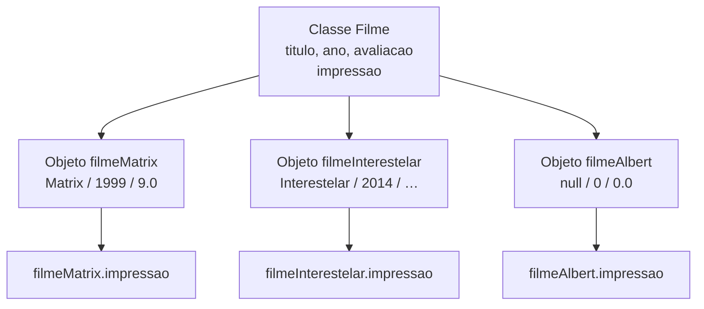
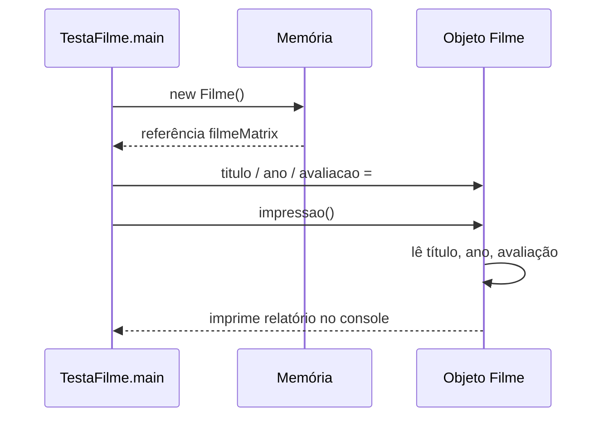

## Visão Geral do Conceito

Até esta aula, o foco era responder: **como executo determinada tarefa?** Variáveis soltas, `Scanner`, condicionais, `printf` e laços resolvem o algoritmo — mas, quando o mesmo “tipo de coisa” aparece várias vezes (dois filmes, dez alunos), o código vira `titulo1`, `titulo2`, `ano1`, `ano2`…

A **programação orientada a objetos (OOP)** muda a pergunta: **quais coisas existem no problema?** Depois: **quais informações cada coisa guarda?** E por fim: **o que cada coisa pode fazer?**

> **Problema que resolve:** agrupar dados relacionados e as ações sobre esses dados numa unidade (`classe` → `objetos`), em vez de espalhar variáveis duplicadas pelo `main`.

> **Lacuna de fonte:** não existe pasta `documents/Java` (nem PDF/slides extraídos obrigatórios). Esta lição foi reconstruída a partir da transcrição WebVTT da Aula 09 (20/08/2026). Detalhes visuais de slides (diagramas do professor) não estão no material textual — a analogia planta/casa e o domínio `Filme` vêm da fala da aula.

## Modelo Mental

### De variáveis soltas para “coisas” do domínio

Num sistema acadêmico você enxerga aluno, professor, disciplina. Numa locadora: veículo, cliente, contrato. Numa biblioteca: livro, autor, empréstimo. No exemplo da aula: **filme**.

Cada “coisa” tem:

| Peça | Nome técnico | Pergunta |
|------|--------------|----------|
| Informações que a caracterizam | **estado** / **atributos** (campos) | O que este filme *é* agora? |
| Ações que ela pode realizar | **comportamento** / **métodos** | O que este filme *faz*? |

Para um filme na aula: estado ≈ `titulo`, `ano`, `avaliacao`; comportamento ≈ impressão de relatório.

### Classe versus objeto

- **Classe** — definição / molde. Diz quais características e comportamentos um certo tipo de objeto deve ter. Analogia da aula: a **planta** de uma casa descreve como construir; a planta **não** é a casa.
- **Objeto (instância)** — concreto, criado a partir da classe. Várias casas a partir da mesma planta; vários alunos (`João`, `Maria`, `Ana`) a partir da classe `Aluno`; vários filmes (`Matrix`, `Interestelar`) a partir da classe `Filme`.

> **Regra:** todos os objetos de uma classe compartilham a **mesma estrutura** de atributos e métodos; cada um tem o **seu próprio estado** (valores).



### Método como responsabilidade

Você já usou métodos (`main`, métodos de <mark style="background-color: #242424; padding: 2px 4px; border-radius: 3px; color: inherit;">`String`</mark>, <mark style="background-color: #242424; padding: 2px 4px; border-radius: 3px; color: inherit;">`Scanner`</mark>). Agora começa a **criar** os seus. Um método não é só um bloco de linhas: o nome comunica a intenção (`calcularMedia`, `registrarViagem`, `impressao`).

Nas próximas aulas a trilha aprofunda o que o método **recebe**, o que **faz** e o que **devolve** (<mark style="background-color: #242424; padding: 2px 4px; border-radius: 3px; color: inherit;">`void`</mark>, <mark style="background-color: #242424; padding: 2px 4px; border-radius: 3px; color: inherit;">`return`</mark>, parâmetros). Nesta abertura o foco é: mover o comportamento para dentro da classe.

### Preview (não aprofundado nesta aula)

A aula **menciona** para o roadmap do TP3: getters/setters, encapsulamento, construtores e o papel de <mark style="background-color: #242424; padding: 2px 4px; border-radius: 3px; color: inherit;">`new`</mark> no nascimento do objeto. O detalhe de proteção de estado e construtores fica para aulas seguintes — aqui o essencial é classe, objeto, atributos e um método simples.

## Mecânica Central

### 1. O problema que motiva a classe

Começo procedural (já conhecido): três variáveis e um <mark style="background-color: #242424; padding: 2px 4px; border-radius: 3px; color: inherit;">`printf`</mark> com `%s`, `%d` e `%.2f`.

```java
String titulo = "Matrix";
int ano = 1999;
double avaliacao = 9.0;

System.out.printf(
    "Filme %s lançado em %d teve avaliação %.2f%n",
    titulo, ano, avaliacao
);
```

Para um segundo filme, as variáveis **não podem** repetir o mesmo nome → `titulo1` / `titulo2`, `ano1` / `ano2`… Com dez ou cem filmes isso não escala. O domínio grita por um tipo `Filme`.

### 2. Declarar a classe e os atributos

Nome da classe em **PascalCase** / CamelCase com inicial maiúscula (`Filme`). Atributos: tipo + nome + `;`.

```java
public class Filme {
    String titulo;
    int ano;
    double avaliacao;
}
```

Neste momento você definiu **como é um filme**, mas ainda **não criou** nenhum filme concreto (nenhum Matrix, nenhum Interestelar).

> **Regra:** a classe de domínio desta etapa **não precisa** de `main`. Quem tem `main` é a classe de execução (na aula: algo como `TestaFilme`).

### 3. Classe sem `main` não é Java Application

- Classe **com** <mark style="background-color: #242424; padding: 2px 4px; border-radius: 3px; color: inherit;">`main`</mark> → a IDE oferece *Run as → Java Application*.
- Classe **só** com atributos/métodos → não executa sozinha; outra classe no mesmo pacote instancia e usa.

### 4. Criar objeto: tipo, referência e `new`

```java
Filme filmeMatrix = new Filme();
```

Leitura técnica:

| Parte | Papel |
|-------|--------|
| <mark style="background-color: #242424; padding: 2px 4px; border-radius: 3px; color: inherit;">`Filme`</mark> | tipo que **você** definiu (não é só `int`/`String` da linguagem) |
| <mark style="background-color: #242424; padding: 2px 4px; border-radius: 3px; color: inherit;">`filmeMatrix`</mark> | variável de **referência** (nome livre: `a`, `filmeMatrix`, …) |
| <mark style="background-color: #242424; padding: 2px 4px; border-radius: 3px; color: inherit;">`new Filme()`</mark> | cria a instância na memória |

Só `new Filme();` sem atribuir à variável cria o objeto e **perde** o acesso — analogia da aula: grão de areia na praia.

Você já usou o mesmo padrão com <mark style="background-color: #242424; padding: 2px 4px; border-radius: 3px; color: inherit;">`new Scanner(System.in)`</mark>.

### 5. Preencher o estado via `referencia.campo`

Com a referência, o ponto (`.`) expõe os campos (e depois os métodos) do objeto:

```java
filmeMatrix.titulo = "Matrix";
filmeMatrix.ano = 1999;
filmeMatrix.avaliacao = 9.0;
```

Vários objetos = mesma classe, estados independentes:

```java
Filme filmeInterestelar = new Filme();
filmeInterestelar.titulo = "Interestelar";
filmeInterestelar.ano = 2014;
filmeInterestelar.avaliacao = 9.5;
```

### 6. Estado inicial padrão

Se você instancia e **não** preenche:

| Tipo do atributo | Valor inicial típico (campos de instância) |
|------------------|--------------------------------------------|
| <mark style="background-color: #242424; padding: 2px 4px; border-radius: 3px; color: inherit;">`String`</mark> | <mark style="background-color: #242424; padding: 2px 4px; border-radius: 3px; color: inherit;">`null`</mark> |
| <mark style="background-color: #242424; padding: 2px 4px; border-radius: 3px; color: inherit;">`int`</mark> | `0` |
| <mark style="background-color: #242424; padding: 2px 4px; border-radius: 3px; color: inherit;">`double`</mark> | `0.0` |

Na aula, um terceiro objeto (`filmeAlbert`) sem preenchimento ilustra exatamente isso na impressão.

### 7. Comportamento: método `impressao` na classe

Duplicar o `printf` em cada objeto no `main` ainda é frágil: muda o formato do relatório (colchetes, `!!!`) e você edita em N lugares. O comportamento “imprimir relatório” pertence a `Filme`.

```java
public class Filme {
    String titulo;
    int ano;
    double avaliacao;

    void impressao() {
        System.out.printf(
            "Filme %s lançado em %d teve avaliação %.2f%n",
            titulo, ano, avaliacao
        );
    }
}
```

Dentro do método você usa os **atributos da própria classe** (`titulo`, `ano`, `avaliacao`) — não `filmeMatrix.titulo`. Fora, no `main`:

```java
filmeMatrix.impressao();
filmeInterestelar.impressao();
```

A palavra <mark style="background-color: #242424; padding: 2px 4px; border-radius: 3px; color: inherit;">`void`</mark> aparece aqui como no `main`: o método **não devolve** valor (aprofundamento nas aulas de métodos). A ideia de “esconder” o formato do relatório na classe é o primeiro cheiro de **encapsulamento** (caixa-preta): quem chama sabe *que* imprime; o *como* fica num só lugar.



### 8. Fluxo pensar → modelar → usar

Síntese pedida na aula para o bloco OOP / TP3:

1. **Pensar** — o que existe no problema?
2. **Modelar** — quais classes, atributos e comportamentos?
3. **Usar** — criar objetos, atribuir estados, chamar métodos, observar o sistema.

Contextos citados para o TP3 (produto, conta bancária, figuras geométricas): **não resolvidos na aula** — ficam como estudo do aluno.

### 9. Contexto secundário da mesma gravação (Git)

A aula também configura repositório Git/GitHub da disciplina (histórico de fontes, `git init` / `add` / `commit` / `push`, evitar versionar `.class`). Isso **não** é o núcleo conceitual desta lição ISS; serve como hábito de evolução do código OOP. Detalhe de Git fica para prática de ambiente — não inventamos comandos além do que a fala ilustra.

## Uso Prático

### Antes: dois filmes com variáveis numeradas

```java
public class TestaFilmeProcedural {
    public static void main(String[] args) {
        String titulo1 = "Matrix";
        int ano1 = 1999;
        double avaliacao1 = 9.0;

        String titulo2 = "Interestelar";
        int ano2 = 2014;
        double avaliacao2 = 9.5;

        System.out.printf("Filme %s lançado em %d teve avaliação %.2f%n",
            titulo1, ano1, avaliacao1);
        System.out.printf("Filme %s lançado em %d teve avaliação %.2f%n",
            titulo2, ano2, avaliacao2);
    }
}
```

Funciona para dois. Para catálogo de streaming / acervo de locadora, vira cópia mecânica.

### Depois: classe de domínio + classe de teste

```java
public class Filme {
    String titulo;
    int ano;
    double avaliacao;

    void impressao() {
        System.out.printf(
            "[Filme] %s lançado em %d teve avaliação %.2f!!!%n",
            titulo, ano, avaliacao
        );
    }
}
```

```java
public class TestaFilme {
    public static void main(String[] args) {
        Filme filmeMatrix = new Filme();
        filmeMatrix.titulo = "Matrix";
        filmeMatrix.ano = 1999;
        filmeMatrix.avaliacao = 9.0;
        filmeMatrix.impressao();

        Filme filmeInterestelar = new Filme();
        filmeInterestelar.titulo = "Interestelar";
        filmeInterestelar.ano = 2014;
        filmeInterestelar.avaliacao = 9.5;
        filmeInterestelar.impressao();

        Filme filmeAlbert = new Filme();
        filmeAlbert.impressao(); // estado inicial: null, 0, 0.0
    }
}
```

Mudou o texto do relatório? Altera **só** `impressao()` em `Filme` — todos os objetos passam a usar o novo formato.

### Modelagem rápida noutros domínios ADS

Mesmo raciocínio da aula, sem inventar API além do padrão visto:

| Domínio | Classe | Atributos (estado) | Método (comportamento) |
|---------|--------|--------------------|-------------------------|
| Cadastro | `Cliente` | `nome`, `documento` | `imprimirFicha()` |
| Academia | `Aluno` | `nome`, `matricula`, `nota` | `exibirBoletim()` |
| Logística | `Produto` | `codigo`, `preco`, `estoque` | `relatorioEstoque()` |

> **Não coberto na fonte desta aula:** getters/setters implementados, `private`, construtores com parâmetros, herança. Aparecem no plano das aulas seguintes / TP3.

## Erros Comuns

1. **Tratar a classe como se já fosse o objeto**  
   Declarar `Filme` e esperar ver Matrix no console sem `new` + preenchimento + chamada de método. A classe é o molde; o objeto precisa ser criado e usado.

2. **`new Filme()` sem variável de referência**  
   O objeto nasce e some. Sempre: `Filme f = new Filme();`.

3. **Tentar *Run as Java Application* na classe de domínio**  
   Sem `main`, a IDE não oferece execução. Rode a classe de teste.

4. **Repetir nomes de variáveis soltas em vez de vários objetos**  
   Continuar com `titulo3`, `ano3` depois de já ter `Filme` anula o ganho da modelagem.

5. **Usar `filmeMatrix.titulo` dentro do método da classe**  
   Dentro de `impressao()`, o contexto já é o objeto atual: use `titulo`, `ano`, `avaliacao`.

6. **Assumir que dois objetos compartilham valores**  
   Mesmos *atributos* ≠ mesmos *valores*. Cada instância tem estado próprio.

7. **Confundir estado inicial com “erro”**  
   Imprimir um `Filme` recém-criado e ver `null` / `0` / `0.0` é o padrão dos campos — falta atribuir, não necessariamente bug de compilação.

8. **Esquecer que `printf` mistura formatos**  
   `%s` (String), `%d` (int), `%.2f` (double) precisam bater com a ordem dos argumentos — padrão já visto na trilha e reutilizado no relatório do filme.

## Visão Geral de Debugging

Quando o código OOP “não colabora”, siga esta ordem (alinhada ao que a aula mostrou ao quebrar referências):

1. **Compila?** Se o IDE marca campo “não encontrado”, você removeu ou renomeou o atributo / a referência e o `printf` ou a atribuição ainda aponta para o nome antigo.
2. **Executa a classe certa?** Confirme que o *Run* está na classe com `main`.
3. **O objeto existe?** Há `= new Filme()` guardado numa variável?
4. **O estado foi preenchido?** Imprima ou inspecione `titulo` / `ano` / `avaliacao` antes de `impressao()` — estado inicial explica `null` e zeros.
5. **O método certo foi chamado?** `filmeMatrix.impressao()` versus imprimir variáveis soltas esquecidas no `main`.
6. **Formato do relatório** — se a saída está “estranha”, o bug pode estar só dentro de `impressao()` (um lugar), não em cada chamada.

<details>
<summary>Checklist rápido pós-refatoração procedural → OOP</summary>

- [ ] Uma classe de domínio com atributos tipados
- [ ] Uma classe de teste com `main`
- [ ] Pelo menos dois `new` com estados diferentes
- [ ] Relatório concentrado num método da classe
- [ ] Nenhuma dependência de `titulo1`/`titulo2` no caminho feliz

</details>

## Principais Pontos

- OOP organiza software em torno das **coisas do problema**, não só das tarefas.
- **Estado** = atributos; **comportamento** = métodos.
- **Classe** = definição; **objeto** = instância com estado próprio.
- <mark style="background-color: #242424; padding: 2px 4px; border-radius: 3px; color: inherit;">`new`</mark> cria o objeto; a variável guarda a **referência**.
- Acesso a campo/método: <mark style="background-color: #242424; padding: 2px 4px; border-radius: 3px; color: inherit;">`referencia.membro`</mark>.
- Classe sem `main` não executa sozinha — precisa de classe de teste.
- Estado inicial típico: `null` / `0` / `0.0` até você atribuir.
- Colocar `impressao()` em `Filme` evita duplicar formato do relatório (primeiro passo de encapsulamento).
- Getters, construtores ricos e encapsulamento forte: **preview** / aulas seguintes.
- Sem slides em `documents/Java`: conteúdo ancorado na transcrição da Aula 09.

## Preparação para Prática

Antes do laboratório, você deve conseguir:

1. Explicar com as próprias palavras classe × objeto × estado × comportamento.
2. Escrever uma classe Java com 2–3 atributos e um método `void` de relatório.
3. Em outra classe com `main`, instanciar dois objetos, preencher estados distintos e chamar o método.
4. Prever a saída de um objeto criado sem atribuições (estado inicial).
5. Apontar por que variáveis `campo1`/`campo2` são sinal de modelagem faltando.

## Laboratório de Prática

> Editor ISS: `editorLanguage` = `javascript` (mapa da disciplina). Os exercícios espelham a lógica Java da aula com comentários `// Espelho Java:`; implemente o comportamento equivalente.

### Easy — Relatório de um filme a partir do estado

**Contexto:** catálogo interno de um streaming. Você recebe título, ano e avaliação e deve montar **uma** linha de relatório no espírito do `printf` da aula.

```javascript
function relatorioFilme(titulo, ano, avaliacao) {
  // Espelho Java: System.out.printf("Filme %s lançado em %d teve avaliação %.2f%n", ...)
  // TODO: retornar string no formato:
  // "Filme {titulo} lançado em {ano} teve avaliação {avaliacao com 2 casas}"
  return "";
}

console.log(relatorioFilme("Matrix", 1999, 9));
console.log(relatorioFilme("Interestelar", 2014, 9.5));
```

### Medium — Dois objetos lógicos sem `titulo1`/`titulo2`

**Contexto:** mesma ficha para dois títulos do acervo. Modele cada filme como objeto `{ titulo, ano, avaliacao }` (espelho da instância Java) e produza o relatório de cada um **sem** variáveis numeradas soltas.

```javascript
function relatoriosCatalogo(filmes) {
  // Espelho Java:
  // Filme a = new Filme(); a.titulo=...; a.impressao();
  // Filme b = new Filme(); ...
  // TODO: para cada item de filmes, montar a mesma linha do Easy
  // TODO: devolver array de strings (um relatório por filme)
  return [];
}

console.log(
  relatoriosCatalogo([
    { titulo: "Matrix", ano: 1999, avaliacao: 9.0 },
    { titulo: "Interestelar", ano: 2014, avaliacao: 9.5 },
  ])
);
```

### Hard — Método de comportamento + estado inicial

**Contexto:** biblioteca de testes do domínio `Filme`. Implemente:

1. `criarFilme(titulo, ano, avaliacao)` — se algum argumento for `undefined`/`null`, trate como “não preenchido” (espelho do objeto só com `new`: título vazio/`null` → use `null` na saída; ano/`avaliacao` ausentes → `0` / `0.0`).
2. `impressao(filme)` — comportamento na “classe”: formata o relatório a partir do estado do objeto (único lugar do formato).
3. `demoTresFilmes()` — devolve os três relatórios: Matrix preenchido, Interestelar preenchido, e um terceiro só “instanciado” (estado inicial), como na aula.

```javascript
function criarFilme(titulo, ano, avaliacao) {
  // Espelho Java: Filme f = new Filme(); // + atribuições opcionais
  // TODO: devolver { titulo, ano, avaliacao } com defaults null / 0 / 0.0
  return { titulo: null, ano: 0, avaliacao: 0.0 };
}

function impressao(filme) {
  // Espelho Java: void impressao() { printf com titulo, ano, avaliacao }
  // TODO: formatar relatório; avaliação com 2 casas
  return "";
}

function demoTresFilmes() {
  // TODO: matrix e interestelar preenchidos; terceiro só criarFilme() sem args úteis
  // TODO: return [impressao(m), impressao(i), impressao(vazio)]
  return [];
}

console.log(demoTresFilmes());
```

<!-- CONCEPT_EXTRACTION
concepts:
  - programação orientada a objetos
  - classe como definição / molde
  - objeto / instância
  - atributos / campos
  - estado do objeto
  - comportamento / métodos
  - new e criação de instância
  - variável de referência
  - acesso via ponto (referencia.campo / referencia.metodo)
  - estado inicial null / 0 / 0.0
  - classe de domínio sem main
  - classe de execução com main
  - void (introdução em método de instância)
  - encapsulamento (introdução / caixa-preta)
  - printf com %s %d %.2f
  - modelagem de domínio (Filme)
  - pensar → modelar → usar
skills:
  - Distinguir classe de objeto e estado compartilhado de estrutura vs valores
  - Declarar classe Java com atributos tipados
  - Instanciar com new e guardar referência
  - Preencher estado via referencia.atributo
  - Extrair comportamento duplicado para método de instância
  - Separar classe de domínio e classe de teste com main
  - Prever saída com estado inicial padrão
  - Reconhecer quando variáveis numeradas pedem modelagem OOP
examples:
  - filme-procedural-titulo1-titulo2
  - classe-filme-atributos
  - new-filme-referencia
  - preencher-estado-matrix-interestelar
  - estado-inicial-filme-albert
  - metodo-impressao-void
  - testa-filme-main
-->

<!-- EXERCISES_JSON
[
  {
    "id": "jv09-relatorio-filme-estado",
    "slug": "jv09-relatorio-filme-estado",
    "difficulty": "easy",
    "title": "Relatório de um filme a partir do estado",
    "discipline": "fundamentos-java",
    "editorLanguage": "javascript",
    "tags": ["java", "oop", "printf", "estado"],
    "summary": "Montar a linha de relatório Filme/ano/avaliação no formato da aula."
  },
  {
    "id": "jv09-catalogo-dois-objetos",
    "slug": "jv09-catalogo-dois-objetos",
    "difficulty": "medium",
    "title": "Dois objetos lógicos sem titulo1/titulo2",
    "discipline": "fundamentos-java",
    "editorLanguage": "javascript",
    "tags": ["java", "oop", "objeto", "catalogo"],
    "summary": "Gerar relatórios a partir de lista de objetos filme sem variáveis numeradas."
  },
  {
    "id": "jv09-impressao-estado-inicial",
    "slug": "jv09-impressao-estado-inicial",
    "difficulty": "hard",
    "title": "Método de comportamento + estado inicial",
    "discipline": "fundamentos-java",
    "editorLanguage": "javascript",
    "tags": ["java", "oop", "metodo", "new", "estado-inicial"],
    "summary": "Criar filmes com defaults, centralizar impressao e demonstrar três instâncias como na aula."
  }
]
-->

<!--
lessons.json (orquestrador — NÃO editar neste worker):
  discipline: fundamentos-java
  slug: introducao-oop-classe-objeto-java
  title: Introdução a OOP: classe, objeto, atributos e métodos
  order: 9
  file: content/fundamentos-java/aula-09-introducao-oop-classe-objeto-java.md
-->
