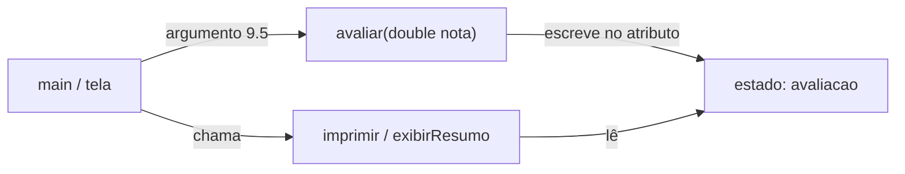
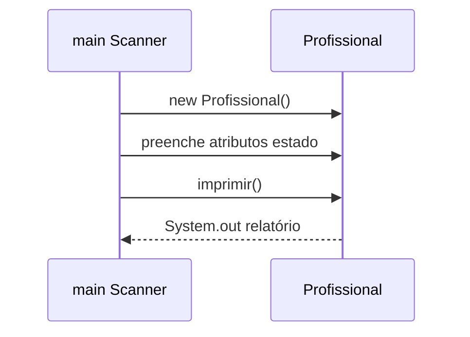

## Visão Geral do Conceito

Na aula anterior você aprendeu a criar uma <mark style="background-color: #242424; padding: 2px 4px; border-radius: 3px; color: inherit;">`classe`</mark>, declarar <mark style="background-color: #242424; padding: 2px 4px; border-radius: 3px; color: inherit;">atributos</mark> e <mark style="background-color: #242424; padding: 2px 4px; border-radius: 3px; color: inherit;">`new`</mark> para instanciar objetos. Isso resolve o problema de **organizar dados** — vários filmes, cada um com título, ano e avaliação.

Só guardar dados não basta. Em sistemas reais, o objeto também **age**: avaliar um filme, atualizar o ano, imprimir um resumo, montar o boletim do aluno. Essa capacidade de executar ações é o **comportamento**.

> **Problema que resolve:** mover a responsabilidade de consultar e modificar o estado para **dentro da classe**, via métodos, em vez de o `main` (ou qualquer código externo) ficar mexendo direto nos campos.

Nesta lição você continua a classe <mark style="background-color: #242424; padding: 2px 4px; border-radius: 3px; color: inherit;">`Filme`</mark> e aplica a mesma ideia a <mark style="background-color: #242424; padding: 2px 4px; border-radius: 3px; color: inherit;">`Aluno`</mark> e <mark style="background-color: #242424; padding: 2px 4px; border-radius: 3px; color: inherit;">`Profissional`</mark>: estado, comportamento, <mark style="background-color: #242424; padding: 2px 4px; border-radius: 3px; color: inherit;">parâmetros</mark>, <mark style="background-color: #242424; padding: 2px 4px; border-radius: 3px; color: inherit;">argumentos</mark> e alteração de estado.

**Lacuna de fontes:** não há pasta `downloads/documents` para Java (slides/PDF). O material foi reconstruído a partir da transcrição WebVTT `Aula_10_-_21082026.bin` (prof. Elberth Moraes). O código-fonte exato das classes da aula não está no repositório; os exemplos refletem o algoritmo ditado oralmente.

---

## Modelo Mental

Pense em um objeto como uma **ficha viva**:

| Peça | Papel | Exemplo em `Filme` |
|------|--------|---------------------|
| **Estado** | o que o objeto *é* agora (valores dos atributos) | `titulo = "Matrix"`, `ano = 1999`, `avaliacao = 9.0` |
| **Comportamento** | o que o objeto *faz* (métodos) | `avaliar(...)`, `atualizarAno(...)`, `imprimir()`, `exibirResumo()` |

O código externo não deveria “abrir a gaveta” e trocar a avaliação à mão (`filme.avaliacao = -20`). Em vez disso, pede ao objeto: “avalie com esta nota” — e o método decide o que fazer com o valor.



**Analogia:** o formulário HTML manda a nota digitada; a classe `Filme` é o “back-end” daquela ficha — recebe o parâmetro e atualiza o estado. Mais tarde você pode **blindar** (rejeitar nota negativa, esconder atributo com `private`). Hoje o ganho imediato é de **responsabilidade**: quem muda o estado é a própria classe.

> **Regra:** parâmetro = o que o método **declara** que precisa; argumento = o valor que você **passa** na chamada.

---

## Mecânica Central

### 1. Anatomia do método (nesta aula: `void`)

Um método tem, nesta etapa:

1. **Tipo de retorno** — aqui, <mark style="background-color: #242424; padding: 2px 4px; border-radius: 3px; color: inherit;">`void`</mark> (executa e não devolve valor). Métodos com retorno ficam para a próxima aula.
2. **Nome** — verbo de ação: `avaliar`, `atualizarAno`, `imprimir`, `exibirResumo`.
3. **Lista de parâmetros** — entre `(...)`: tipo + nome local (`double nota`, `int novoAno`).
4. **Corpo** — o que acontece com o estado ou com a saída.

```java
public class Filme {
    String titulo;
    int ano;
    double avaliacao;

    void avaliar(double nota) {
        avaliacao = nota; // parâmetro → atributo (muda o estado)
    }

    void atualizarAno(int novoAno) {
        ano = novoAno;
    }

    void imprimir() {
        System.out.println(titulo + " | " + ano + " | " + avaliacao);
    }

    void exibirResumo() {
        System.out.println(titulo + " " + ano);
    }
}
```

### 2. Parâmetro versus argumento

```java
Filme matrix = new Filme();
matrix.titulo = "Matrix";
matrix.ano = 1999;

matrix.avaliar(9.5); // 9.5 = argumento
```

| Termo | Onde aparece | Exemplo |
|-------|--------------|---------|
| **Parâmetro** | declaração do método | `double nota` em `avaliar` |
| **Argumento** | chamada | `9.5` em `matrix.avaliar(9.5)` |

O parâmetro é um “slot” tipado: “para me avaliar, preciso receber um `double`”. O argumento é o valor concreto que preenche esse slot naquela execução.

### 3. Alteração de estado e ordem de execução

Atributos nascem com **valores padrão** se você não atribuir nada:

- <mark style="background-color: #242424; padding: 2px 4px; border-radius: 3px; color: inherit;">`String`</mark> → `null`
- <mark style="background-color: #242424; padding: 2px 4px; border-radius: 3px; color: inherit;">`int`</mark> → `0`
- <mark style="background-color: #242424; padding: 2px 4px; border-radius: 3px; color: inherit;">`double`</mark> → `0.0`

Se você chama `imprimir()` **antes** de `avaliar(10)`, a avaliação aparece `0.0`. Depois de `avaliar(10)`, o **mesmo objeto** já tem estado diferente — o método mudou a ficha.

```java
Filme f = new Filme();
f.titulo = "Interestelar";
f.imprimir();      // avaliacao ainda 0.0
f.avaliar(10);
f.imprimir();      // avaliacao 10.0
```

Cada chamada age **sobre o objeto que recebeu a mensagem**. O método está definido uma vez na classe; o estado afetado é o da instância (`matrix`, `interestelar`, etc.).

### 4. Atribuição invertida (bug clássico)

```java
void atualizarAno(int novoAno) {
    novoAno = ano; // ERRADO: sobrescreve o parâmetro; o atributo não muda
}
```

Passar `matrix.atualizarAno(2000)` não altera `ano` se o corpo estiver invertido. O correto é:

```java
void atualizarAno(int novoAno) {
    ano = novoAno; // atributo recebe o argumento
}
```

O parâmetro tem **vida útil só dentro do método**. Se você não o usar do lado direito de uma atribuição ao atributo, o valor “morre” ao sair do método.

### 5. Encapsulamento (prévia — não aprofundado)

Hoje `filme.avaliacao = -20` e `filme.avaliar(-20)` produzem o mesmo efeito numérico. A diferença de desenho é:

- atribuição direta: o código externo decide o estado;
- método: a classe pode, no futuro, validar (`if (nota < 0) return;`) e esconder o campo com <mark style="background-color: #242424; padding: 2px 4px; border-radius: 3px; color: inherit;">`private`</mark>.

> **Não coberto em profundidade nesta fonte:** modificadores de visibilidade (`private`/`public`) e validação completa dentro do método — o professor apenas antecipa.

### 6. Atributo versus parâmetro (trade-off)

| Estratégia | Quando usar | Risco |
|------------|-------------|--------|
| **Atributo** | o dado faz parte do estado duradouro do objeto | muitos campos para preencher antes de agir |
| **Só parâmetro** | o valor serve só àquela operação | mudar a assinatura do método **quebra** quem já chama |

Exemplo da aula: app com botão que calcula IMC — `calcularImc(peso, altura)`. Se amanhã você remover um parâmetro, quem ainda chama com dois argumentos deixa de compilar. Por isso, às vezes é mais estável manter a assinatura do método e evoluir **atributos** por dentro da classe.

### 7. Referência em memória e chamada em uma linha

```java
Aluno a = new Aluno();
a.imprimir(nome); // ok: variável segura a referência
```

```java
new Aluno(); // objeto criado e “perdido” — sem variável, não chama método depois
```

```java
new Aluno().imprimir(nome); // cria, chama uma vez, e o objeto fica sem referência (uso pontual)
```

Sem variável guardando a referência, você não encadeia um segundo método no **mesmo** objeto: outro `new` seria outra instância.

### 8. Prévia: sobrecarga de métodos

É possível ter vários métodos com o **mesmo nome** se a lista de parâmetros diferir (quantidade e/ou tipos) — por exemplo `imprimir()` e `imprimir(String nome)`. A assinatura completa (nome + parâmetros) identifica o método.

> **Não coberto em profundidade nesta fonte:** aula dedicada a sobrecarga; aqui só a regra de existência foi citada.

### 9. Debug (IDE)

Para entender estado e ordem:

1. Coloque um **breakpoint** na linha suspeita.
2. Execute em modo **Debug** (não só Run).
3. Inspecione o objeto: atributos, valores padrão, pacote, <mark style="background-color: #242424; padding: 2px 4px; border-radius: 3px; color: inherit;">hashCode</mark> (identificação da instância).
4. Use **Step Into** (entrar no método) vs **Step Over** (executar a linha e seguir).

Isso torna visível o bug `novoAno = ano` e o momento em que `avaliacao` deixa de ser `0.0`.

---

## Uso Prático

### Cenário A — Catálogo de filmes (estado + métodos)

```java
public class AppFilmes {
    public static void main(String[] args) {
        Filme matrix = new Filme();
        matrix.titulo = "Matrix";
        matrix.ano = 1999;
        matrix.avaliar(9.0);
        matrix.atualizarAno(2000);
        matrix.imprimir();      // relatório completo
        matrix.exibirResumo();  // só título + ano

        Filme interestelar = new Filme();
        interestelar.titulo = "Interestelar";
        interestelar.ano = 2014;
        interestelar.avaliar(9.5);
        interestelar.exibirResumo();
    }
}
```

A classe evolui conforme a regra de negócio: impressão detalhada **e** resumo — duas funcionalidades, mesmo estado.

### Cenário B — Refatorar leitura de nome para `Aluno`

Código procedural lia o nome com `Scanner`/`do-while` e imprimia no `main`. Passo da aula:

1. Criar classe `Aluno` com atributo `nome` **ou** método `imprimir(String nome)` só com parâmetro.
2. Instanciar no fim do fluxo: `Aluno aluno = new Aluno();`
3. Se houver atributo: `aluno.nome = nome;` depois `aluno.imprimir();`
4. Se só parâmetro: `aluno.imprimir(nome);` — sem campo na classe.

**Armadilha vista na aula:** chamar `imprimir()` do aluno **sem** ter preenchido o atributo → imprime `null`, enquanto o `println` do `main` ainda mostra o nome correto (variável local preenchida; atributo não).

### Cenário C — `Profissional` a partir do perfil formatado

Vários campos (`nome`, `profissao`, `idade`, `cidade`, `salario`, …) + relatório com concatenação e ternário:

1. Criar classe `Profissional` com atributos **sem** valores fixos no corpo da classe (senão todo objeto nasce “Elberth / programador / 47…”).
2. Mover o bloco de impressão para `void imprimir()`.
3. No `main`: `new Profissional()`, preencher estado campo a campo, chamar `profissional.imprimir()`.

Resultado: `main` vira “tela” (entrada + montagem do objeto); a classe guarda estado e comportamento de relatório.



---

## Erros Comuns

1. **Tratar objeto só como saco de variáveis**  
   **Sintoma:** todo o `System.out` e toda a regra ficam no `main`.  
   **Correção:** extrair comportamento para métodos na classe do domínio (`Filme`, `Aluno`, `Profissional`).

2. **Confundir parâmetro com argumento**  
   **Sintoma:** achar que `nota` e `9.5` são “a mesma coisa com nomes diferentes”.  
   **Correção:** parâmetro na assinatura; argumento na chamada.

3. **Atribuição invertida no setter informal**  
   **Sintoma:** `atualizarAno(2000)` e o objeto continua com `1999`.  
   **Correção:** `ano = novoAno;`. Confirmar no Debug.

4. **Imprimir antes de preencher / avaliar**  
   **Sintoma:** `0`, `0.0` ou `null` no console.  
   **Correção:** respeitar a ordem: instanciar → preencher/avaliar → imprimir.

5. **Criar `new` sem guardar referência e tentar reutilizar**  
   **Sintoma:** não há variável para chamar o segundo método no mesmo objeto.  
   **Correção:** `Tipo ref = new Tipo();` antes de múltiplas operações.

6. **Inicializar atributos com dados de um exemplo concreto na classe**  
   **Sintoma:** todo `new Profissional()` já vem com o mesmo nome/cidade.  
   **Correção:** declarar atributos “vazios” (padrão da JVM) e preencher por instância.

7. **Esquecer de passar argumento quando o método exige parâmetro**  
   **Sintoma:** erro de compilação na chamada a `imprimir` / `avaliar`.  
   **Correção:** alinhar a chamada à assinatura (`imprimir(String)` precisa de uma `String`).

8. **Achar que dois `imprimir` iguais com os mesmos parâmetros são sobrecarga válida**  
   **Sintoma:** a IDE/compilador rejeita métodos duplicados.  
   **Correção:** mudar tipos/quantidade de parâmetros **ou** usar nomes distintos (`imprimir` vs `exibirBoletim`).

---

## Visão Geral de Debugging

Quando o estado “não bate” com o que você passou:

1. **Breakpoint** na linha da chamada (`avaliar`, `atualizarAno`) e dentro do método.
2. **Step Into** para ver o parâmetro receber o argumento e a atribuição ao atributo.
3. Inspecionar a instância: título/ano/avaliação antes e depois da linha.
4. Confirmar se o `imprimir` olha o **atributo** certo (e não uma variável local homônima no `main`).
5. Em refatorações (`Aluno`/`Profissional`), verificar se ainda existe atribuição `objeto.campo = variavelLocal` quando o relatório depende do atributo.

<details>
<summary>Caso guiado: ano não atualiza para 2000</summary>

No Debug, ao entrar em `atualizarAno`, `novoAno` vale `2000` e `ano` vale `1999`. Se a próxima linha for `novoAno = ano`, ambos ficam `1999` e o atributo nunca muda. Corrija para `ano = novoAno` e repita o Step Over: os dois devem mostrar `2000` após a linha.

</details>

---

## Principais Pontos

- Objeto = **estado** (atributos) + **comportamento** (métodos).
- <mark style="background-color: #242424; padding: 2px 4px; border-radius: 3px; color: inherit;">`void`</mark> executa; retorno de valor fica para a próxima aula.
- **Parâmetro** na assinatura; **argumento** na chamada.
- Métodos podem **alterar o estado** da instância que os recebeu.
- Ordem importa: padrão (`null`/`0`/`0.0`) até você atribuir ou avaliar.
- Atribuição invertida (`param = atributo`) é bug silencioso — use Debug.
- Preferir método para preparar encapsulamento e validação futura.
- Atributo = estado duradouro; parâmetro só = dado da operação.
- Guarde a referência do `new` se for usar o objeto mais de uma vez.
- Classe de domínio ≠ classe com `main`/Scanner (“tela” de exercício).
- Sobrecarga: mesmo nome, parâmetros diferentes (prévia).

**Não coberto na fonte (adiado):** retornos diferentes de `void`, `private`/encapsulamento completo, sobrecarga em profundidade, APIs de data (`LocalDate` etc. — o TP de idade em dias é lógica com inteiros, não API de data).

---

## Preparação para Prática

Antes do laboratório, você deve conseguir:

1. Desenhar mentalmente estado vs comportamento de um objeto de domínio.
2. Escrever um método `void` com parâmetro que atualiza um atributo.
3. Nomear corretamente parâmetro vs argumento numa chamada.
4. Explicar por que imprimir antes de avaliar mostra valor padrão.
5. Escolher entre guardar em atributo ou receber só no parâmetro.

O editor integrado do ISS usa JavaScript; os desafios implementam a **mesma lógica** da aula. Comentários trazem o equivalente Java.

---

## Laboratório de Prática

### Easy — Avaliar filme (parâmetro → estado)

**Contexto:** microserviço de catálogo recebe a nota do espectador e atualiza a ficha do título antes de gerar o card.

```javascript
// Java equivalente:
// class Filme { String titulo; double avaliacao; void avaliar(double nota) { avaliacao = nota; } }

function criarFilme(titulo) {
  return { titulo: titulo, avaliacao: 0 };
}

function avaliar(filme, nota) {
  // TODO: alterar o estado — filme.avaliacao = nota (equivalente a this.avaliacao = nota)
  return filme;
}

function resumo(filme) {
  return filme.titulo + " | " + filme.avaliacao;
}

// Smoke tests (não altere)
let matrix = criarFilme("Matrix");
console.log(resumo(matrix));           // Matrix | 0
matrix = avaliar(matrix, 9.5);
console.log(resumo(matrix));           // Matrix | 9.5
```

### Medium — Atualizar ano sem inverter a atribuição

**Contexto:** curadoria corrige o ano de lançamento. Um bug clássico inverte parâmetro e atributo.

```javascript
function atualizarAno(filme, novoAno) {
  // TODO: filme.ano = novoAno  (NÃO novoAno = filme.ano)
  return filme;
}

function exibirResumo(filme) {
  // TODO: retornar "titulo ano" (ex.: "Matrix 2000")
  return "TODO";
}

let f = { titulo: "Matrix", ano: 1999, avaliacao: 9 };
f = atualizarAno(f, 2000);
console.log(exibirResumo(f)); // esperado: Matrix 2000
console.log(f.ano);           // esperado: 2000
```

### Hard — Aluno: atributo vs parâmetro + ordem do relatório

**Contexto:** após validar o nome com loop (já feito noutro módulo), o backend monta um `Aluno` e emite duas saídas: impressão pelo **estado** e impressão só com **argumento** (sem depender do atributo).

```javascript
function criarAluno() {
  return { nome: null };
}

function preencherNome(aluno, nomeLido) {
  // TODO: aluno.nome = nomeLido
  return aluno;
}

function imprimirPorEstado(aluno) {
  // TODO: retornar aluno.nome (pode ser null se esquecer preencher)
  return "TODO";
}

function imprimirPorParametro(nome) {
  // TODO: retornar o próprio argumento nome (não usa atributo)
  return "TODO";
}

function montarSaida(nomeLido) {
  let aluno = criarAluno();
  // TODO: preencher estado, depois montar objeto:
  // { porEstado: imprimirPorEstado(aluno), porParametro: imprimirPorParametro(nomeLido) }
  return { porEstado: null, porParametro: null };
}

console.log(montarSaida("Elberth"));
// esperado: { porEstado: "Elberth", porParametro: "Elberth" }

let semPreencher = criarAluno();
console.log(imprimirPorEstado(semPreencher)); // esperado: null
console.log(imprimirPorParametro("Elberth")); // esperado: Elberth
```

---

<!-- LESSONS_JSON_META
discipline: fundamentos-java
slug: estado-comportamento-metodos-parametros-java
title: Estado, comportamento, métodos e parâmetros em objetos Java
order: 10
file: content/fundamentos-java/aula-10-estado-comportamento-metodos-parametros-java.md
NOTE: lessons.json / search-index.json NÃO editados nesta missão (integração serial pelo orquestrador / brief W2-JV10).
-->

<!-- CONCEPT_EXTRACTION
concepts:
  - estado do objeto (atributos)
  - comportamento (métodos)
  - anatomia de método void
  - parâmetro
  - argumento
  - alteração de estado via método
  - encapsulamento (introdução / prévia)
  - valores padrão null / 0 / 0.0
  - ordem de execução
  - atribuição invertida (bug)
  - debug Step Into / Step Over
  - atributo vs parâmetro (trade-off)
  - referência e new sem variável
  - sobrecarga de métodos (prévia)
  - classe de domínio vs classe main/Scanner
skills:
  - Declarar métodos void com parâmetros tipados
  - Invocar métodos passando argumentos
  - Distinguir parâmetro de argumento
  - Atualizar atributos através de métodos avaliar/atualizarAno
  - Diagnosticar atribuição invertida com debug
  - Escolher atributo vs parâmetro conforme o ciclo de vida do dado
  - Refatorar relatório procedural para método imprimir na classe
  - Evitar new sem referência quando o objeto será reutilizado
  - Não inicializar atributos com dados de um único exemplo na classe
examples:
  - filme-avaliar-parametro-estado
  - filme-atualizar-ano-bug-invertido
  - filme-imprimir-vs-exibir-resumo
  - aluno-atributo-vs-parametro-imprimir
  - profissional-estado-imprimir-relatorio
  - new-aluno-chamada-uma-linha
-->

<!-- EXERCISES_JSON
[
  {
    "id": "java-aula10-avaliar-filme-estado",
    "slug": "java-aula10-avaliar-filme-estado",
    "difficulty": "easy",
    "title": "Avaliar filme (parâmetro → estado)",
    "discipline": "fundamentos-java",
    "editorLanguage": "javascript",
    "tags": ["java", "oop", "metodos", "estado", "parametros"],
    "summary": "Implementar avaliar(filme, nota) alterando avaliacao e gerar resumo titulo|nota."
  },
  {
    "id": "java-aula10-atualizar-ano-sem-inverter",
    "slug": "java-aula10-atualizar-ano-sem-inverter",
    "difficulty": "medium",
    "title": "Atualizar ano sem inverter a atribuição",
    "discipline": "fundamentos-java",
    "editorLanguage": "javascript",
    "tags": ["java", "oop", "metodos", "debug", "atributos"],
    "summary": "Corrigir atualizarAno para filme.ano = novoAno e exibir resumo titulo+ano."
  },
  {
    "id": "java-aula10-aluno-atributo-vs-parametro",
    "slug": "java-aula10-aluno-atributo-vs-parametro",
    "difficulty": "hard",
    "title": "Aluno: atributo vs parâmetro no relatório",
    "discipline": "fundamentos-java",
    "editorLanguage": "javascript",
    "tags": ["java", "oop", "parametros", "estado", "refatoracao"],
    "summary": "Preencher estado do aluno, imprimir por atributo e por parâmetro, evidenciar null sem preenchimento."
  }
]
-->
