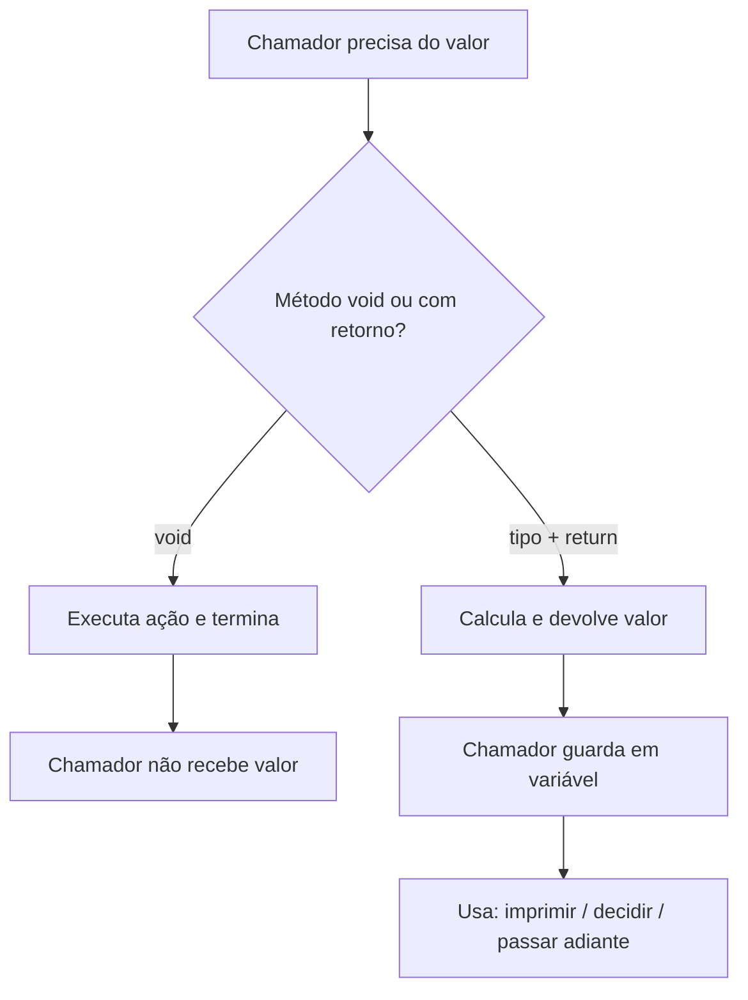
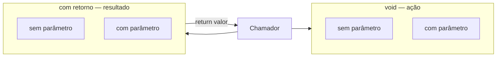

## Visão Geral do Conceito

Até agora, muitos métodos da trilha OOP eram <mark style="background-color: #242424; padding: 2px 4px; border-radius: 3px; color: inherit;">`void`</mark>: recebem uma ordem, **fazem algo** (imprimir, guardar nota, atualizar ano) e acabam.

Nesta aula o salto é outro: o método também pode **produzir um resultado** e **devolver** esse valor a quem o chamou, usando um tipo de retorno (`double`, `String`, …) e a palavra <mark style="background-color: #242424; padding: 2px 4px; border-radius: 3px; color: inherit;">`return`</mark>.

Problema que isso resolve:

- Nem todo comportamento só **modifica** o objeto.
- Valores **derivados** (estrelas a partir da avaliação; média e situação a partir das notas) não precisam ser campos editáveis de fora.
- Quem imprime o relatório não precisa recalcular a regra — pede o resultado a um método especializado.

> **Lacuna de fonte:** não há pasta `documents/Java` nem PDF/slides obrigatórios nesta missão. O conteúdo abaixo reconstrói a Aula 11 (27/08/2026) a partir da **transcrição** `Aula_11_-_27082026.bin`. Getters/setters/encapsulamento foram mencionados como tema futuro — **não cobertos** em profundidade aqui.

## Modelo Mental

Pense em dois tipos de pedido ao objeto:

| Pedido | Mental model | Assinatura típica |
|--------|----------------|-------------------|
| “Faça isso” | ordem / ação | `void nome(...)` |
| “Me diga quanto / qual é” | consulta / produção | `Tipo nome(...)` + `return` |

Analogia usada na aula (equipe Filme):

- **Elberth** calcula estrelas (só o número).
- **Lucas** imprime o relatório detalhado.
- **Pedro** exibe o resumo (título + ano).

Se “calcular estrelas” também imprime, o método tem **duas responsabilidades**. O cálculo deve **devolver** o `double`; a impressão fica com quem imprime.



Outra decisão da aula: **campo persistido** vs **cálculo sob demanda**.

- Vale a pena ter atributo `media` / `situacao` / `notaEmEstrelas`?
- Ou calcular quando precisar, com as notas/avaliação que já estão no objeto?

Para média e situação do aluno, a aula caminhou para **métodos com retorno**, sem manter esses campos como estado “oficial” editável de fora.

## Mecânica Central

### 1. Métodos `void`: executam ação

Na classe <mark style="background-color: #242424; padding: 2px 4px; border-radius: 3px; color: inherit;">`Filme`</mark> (revisão):

- <mark style="background-color: #242424; padding: 2px 4px; border-radius: 3px; color: inherit;">`imprimir`</mark> / impressão detalhada — escreve no console.
- <mark style="background-color: #242424; padding: 2px 4px; border-radius: 3px; color: inherit;">`exibirResumo`</mark> — título e ano.
- <mark style="background-color: #242424; padding: 2px 4px; border-radius: 3px; color: inherit;">`avaliar(nota)`</mark> — recebe nota de fora e atualiza o estado (`avaliacao`).
- atualizar ano — recebe ano e atualiza atributo.

Esses métodos **não devolvem** valor útil ao chamador: o efeito é colateral (estado ou I/O).

### 2. Primeira tentativa: `void` que calcula e imprime

Exemplo didático: estrelas = <mark style="background-color: #242424; padding: 2px 4px; border-radius: 3px; color: inherit;">`avaliacao / 2`</mark> (nota 10 → 5 estrelas; 9 → 4.5).

```java
public void calcularNotaEmEstrelas() {
    double estrelas = this.avaliacao / 2.0;
    System.out.println("estrelas " + estrelas);
}
```

Funciona, mas:

- o chamador **não** recebe `estrelas` para reutilizar;
- se vários pontos do teste precisam das estrelas, você espalha chamadas;
- o nome sugere **cálculo**, mas o corpo também **imprime** (duas responsabilidades).

### 3. Método chamando método (mesma classe)

Em vez de o teste chamar `calcularNotaEmEstrelas` em todo filme, a impressão/resumo pode chamar o cálculo **de dentro** da classe:

```java
// dentro de um método de Filme — sem objeto.ponto
calcularNotaEmEstrelas();
```

Fora da classe: `filme.calcularNotaEmEstrelas();`  
Dentro da classe: só o nome do método (o `this` está implícito).

Isso centraliza a regra: mudar o algoritmo num só lugar afeta todos os caminhos que já o usam.

### 4. Atributo compartilhado (solução intermediária — e seus limites)

Para a impressão “ver” o valor calculado, uma solução mostrada foi subir `notaEmEstrelas` para **campo da classe** e preencher no cálculo.

Problema demonstrado na aula: alguém de fora pode fazer `filme.notaEmEstrelas = 5` e mentir o relatório — Matrix “ganha” 5 estrelas sem seguir a regra `avaliacao / 2`. Isso antecipa **encapsulamento** (tema futuro; não aprofundado nesta aula).

### 5. Método com retorno: tipo na assinatura + `return`

Regra central da aula:

> **Regra:** se o método **não** é `void`, o tipo na assinatura é o tipo do valor produzido — e o corpo precisa de <mark style="background-color: #242424; padding: 2px 4px; border-radius: 3px; color: inherit;">`return`</mark> com valor compatível.

```java
public double calcularNotaEmEstrelas() {
    return this.avaliacao / 2.0;
}
```

No chamador (ex.: método de impressão):

```java
double notaEmEstrelas = calcularNotaEmEstrelas();
System.out.printf("estrelas %.1f%n", notaEmEstrelas);
```

O método vira “caixa preta”: quem chama sabe **o que** pede; o **como** (dividir por 2, ou regra mais complexa) fica encapsulado no cálculo.

### 6. Aplicação em `Aluno`: média e situação

Antes: atributos `media` e `situacao` preenchidos no fluxo externo.  
Depois: remover esses campos; produzir sob demanda.

```java
public double calcularMedia() {
    return (this.nota1 + this.nota2 + this.nota3) / 3.0;
}

public String obterSituacao(double media) {
    if (media > 7) {
        return "aprovado";
    }
    if (media >= 5) {
        return "recuperacao";
    }
    return "reprovado";
}

public void imprimir() {
    double media = calcularMedia();
    String situacao = obterSituacao(media);
    // monta relatório com nome, notas, media, situacao
}
```

Pontos mecânicos:

- **Tipo de retorno** = tipo da informação principal do método (`double` para média, `String` para situação).
- **Múltiplos `return`:** permitidos; o primeiro atingido **encerra** o método.
- **Parâmetro:** `obterSituacao` recebe a média — não recalcula por conta própria (responsabilidade única). Quem orquestra (`imprimir`) chama `calcularMedia` uma vez e passa o valor.
- Evitar chamar `calcularMedia` de novo dentro de `obterSituacao` se o chamador já tem a média (menos trabalho / menos “reais” no exemplo de produtividade da aula).

### 7. Quatro combinações de assinatura

A aula fecha o mapa:

| | Sem parâmetro | Com parâmetro |
|--|---------------|---------------|
| **void** | ação sem entrada extra | ação com dado de fora (`avaliar(nota)`) |
| **com retorno** | produz valor do estado (`calcularMedia()`) | produz valor a partir de entrada (`obterSituacao(media)`) |



## Uso Prático

### Filme: estrelas reutilizáveis no relatório

```java
public class Filme {
    String titulo;
    int ano;
    double avaliacao;

    public void avaliar(double nota) {
        this.avaliacao = nota;
    }

    public double calcularNotaEmEstrelas() {
        return this.avaliacao / 2.0;
    }

    public void exibirResumo() {
        System.out.println(titulo + " (" + ano + ")");
    }

    public void imprimir() {
        double estrelas = calcularNotaEmEstrelas();
        System.out.println("Título: " + titulo);
        System.out.println("Ano: " + ano);
        System.out.println("Avaliação: " + avaliacao);
        System.out.println("Estrelas: " + estrelas);
    }
}
```

No teste: preenche título/ano, chama `avaliar(10)`, depois `imprimir()` — o relatório usa o retorno; o teste não precisa repetir a fórmula.

### Aluno: orquestração no `imprimir`

```java
public class Aluno {
    String nome;
    double nota1;
    double nota2;
    double nota3;

    public double calcularMedia() {
        return (nota1 + nota2 + nota3) / 3.0;
    }

    public String obterSituacao(double media) {
        if (media > 7) {
            return "aprovado";
        }
        if (media >= 5) {
            return "recuperacao";
        }
        return "reprovado";
    }

    public void imprimir() {
        double media = calcularMedia();
        String situacao = obterSituacao(media);
        System.out.println("Aluno: " + nome);
        System.out.println("Média: " + media);
        System.out.println("Situação: " + situacao);
    }
}
```

> **Critérios de situação na fonte:** a transcrição fixa explicitamente média **maior que 7** → aprovado, e o exemplo com média **6** → recuperação (“antes de sete”). O corte inferior para reprovado segue o padrão da trilha (faixa com recuperação a partir de 5). Se o seu código da aula usou `>= 7`, alinhe com o critério que o professor fechou no Eclipse nessa sessão.

### Reduzir código morto no `return`

Versão verbosa (didática):

```java
public double calcularMedia() {
    double media = 0;
    media = (nota1 + nota2 + nota3) / 3.0;
    return media;
}
```

Versão direta (mesma semântica):

```java
public double calcularMedia() {
    return (nota1 + nota2 + nota3) / 3.0;
}
```

## Erros Comuns

1. **Método com tipo de retorno sem `return`**  
   Sintoma: erro de compilação (“missing return statement”).  
   Correção: todo caminho de execução deve devolver valor do tipo declarado (ou lançar exceção — fora do escopo desta aula).

2. **`return` em método `void` com valor**  
   Sintoma: incompatibilidade de tipos.  
   Em `void`, `return;` só encerra; não devolve dado. Para devolver, mude a assinatura.

3. **Calcular e imprimir no mesmo método “calcular…”**  
   Sintoma: não dá para reutilizar o número noutro relatório/teste.  
   Correção: método de cálculo com retorno; impressão noutro método.

4. **Espalhar a mesma chamada `void` em todos os filmes do teste**  
   Sintoma: mudança de regra exige editar vários pontos.  
   Correção: método interno chamado pelos métodos de exibição, ou retorno consumido num único `imprimir`.

5. **Campo derivado editável de fora (`notaEmEstrelas = 5`)**  
   Sintoma: relatório inconsistente com `avaliacao`.  
   Correção (nesta etapa): preferir método com retorno; encapsulamento formal vem depois.

6. **`obterSituacao` recalcular média por conta própria enquanto `imprimir` já calculou**  
   Sintoma: lógica duplicada / duas fontes de verdade.  
   Correção: receber `media` por parâmetro.

7. **Ignorar que um `return` interrompe o método**  
   Sintoma: código “morto” abaixo do `return` que o aluno acha que ainda roda.  
   Correção: entender early exit — só um `return` por invocação é efetivo.

## Visão Geral de Debugging

Quando o relatório “mente” ou o compilador reclama:

1. **Olhe a assinatura** — é `void` ou tem tipo? O chamador espera valor?
2. **Siga o `return`** — qual ramo foi tomado? Coloque um `println` temporário antes de cada `return` em `obterSituacao`.
3. **Confira a ordem das chamadas** — `avaliar` antes de `calcularNotaEmEstrelas`; notas preenchidas antes de `calcularMedia`.
4. **Não confie em campo derivado** — se ainda existe atributo `media`/`estrelas`, verifique se alguém atribuiu valor “na mão”.
5. **Compare tipo declarado × tipo devolvido** — `String` vs `double` misturados geram erro cedo (tipagem forte).

<details>
<summary>Checklist rápido — Filme com estrelas erradas</summary>

1. `avaliacao` foi setada via `avaliar`?
2. `calcularNotaEmEstrelas` usa `avaliacao / 2` e **retorna**?
3. `imprimir` guarda o retorno numa variável local antes de imprimir?
4. Ninguém sobrescreveu um campo `notaEmEstrelas` no teste?

</details>

## Principais Pontos

- `void` = ação; tipo na assinatura = método **produz** valor.
- Sem `void` ⇒ precisa de `return` compatível.
- Quem chama guarda o retorno em variável e decide o uso.
- Métodos da mesma classe chamam-se pelo nome (sem `objeto.`).
- Separe cálculo de impressão (uma responsabilidade por método).
- Preferir calcular derivados sob demanda a expor campos editáveis.
- Combinações: void/retorno × com/sem parâmetro.
- Vários `return` ok; o primeiro atingido encerra o método.
- Encapsulamento / getters-setters: citados, **não** aprofundados nesta aula.

## Preparação para Prática

Antes do laboratório, você deve conseguir:

1. Reescrever um `void` que imprime um cálculo como método com retorno + uso no chamador.
2. Implementar `calcularMedia()` e `obterSituacao(media)` com `return`.
3. Orquestrar no método de relatório: calcular uma vez → obter situação → montar saída.
4. Explicar por que não “hackear” a situação/estrelas atribuindo campo de fora.

## Laboratório de Prática

> Editor ISS: `editorLanguage: "javascript"` (mapa da disciplina). Os exercícios **espelham** a lógica Java da aula; comentários marcam o equivalente em Java.

### Easy — Devolver estrelas em vez de só imprimir

**Contexto:** catálogo de streaming. A avaliação do título (0–10) deve virar “estrelas” (`avaliacao / 2`). Complete a função para **retornar** o número; a impressão fica com o chamador.

```javascript
function calcularNotaEmEstrelas(avaliacao) {
  // Espelho Java: public double calcularNotaEmEstrelas() { return this.avaliacao / 2.0; }
  // TODO: retornar avaliacao / 2
  return 0;
}

const avaliacaoMatrix = 10;
const estrelas = calcularNotaEmEstrelas(avaliacaoMatrix);
console.log("estrelas " + estrelas);
```

### Medium — Média com retorno + situação com parâmetros e múltiplos return

**Contexto:** boletim acadêmico. Sem atributos `media`/`situacao`: calcule a média das três notas e classifique a situação (`aprovado` se média > 7; `recuperacao` se média >= 5; senão `reprovado`).

```javascript
function calcularMedia(nota1, nota2, nota3) {
  // Espelho Java: return (nota1 + nota2 + nota3) / 3.0;
  // TODO: retornar média aritmética
  return 0;
}

function obterSituacao(media) {
  // Espelho Java: vários return; primeiro atingido encerra
  // TODO: if media > 7 → return "aprovado"
  // TODO: if media >= 5 → return "recuperacao"
  // TODO: return "reprovado"
  return "TODO";
}

function imprimirBoletim(nome, nota1, nota2, nota3) {
  // TODO: media = calcularMedia(...); situacao = obterSituacao(media);
  // TODO: retornar string "Aluno: {nome} | Media: {media} | Situacao: {situacao}"
  return "";
}

console.log(imprimirBoletim("Elvis", 6, 6, 6));
console.log(imprimirBoletim("Ana", 8, 8, 8));
console.log(imprimirBoletim("Joao", 3, 4, 4));
```

### Hard — Orquestrar relatório de filme sem campo derivado editável

**Contexto:** API interna de catálogo. O objeto filme só guarda `titulo`, `ano`, `avaliacao`. O relatório detalhado precisa de estrelas **calculadas**. Proibido “inventar” estrelas no objeto; use função com retorno. Se `avaliacao` for inválida (`< 0` ou `> 10`), retorne mensagem de erro sem calcular.

```javascript
function criarFilme(titulo, ano, avaliacao) {
  return { titulo, ano, avaliacao };
}

function calcularNotaEmEstrelas(filme) {
  // TODO: return filme.avaliacao / 2
  return 0;
}

function montarRelatorioFilme(filme) {
  // Espelho Java: imprimir() chama calcularNotaEmEstrelas() e monta o texto
  // TODO: se avaliacao < 0 || avaliacao > 10 → return "Avaliacao invalida"
  // TODO: estrelas = calcularNotaEmEstrelas(filme)
  // TODO: return string com titulo, ano, avaliacao e estrelas
  return "";
}

const matrix = criarFilme("Matrix", 1999, 9);
const invalido = criarFilme("Bug", 2020, 20);
console.log(montarRelatorioFilme(matrix));
console.log(montarRelatorioFilme(invalido));
```

---

<!-- LESSONS_JSON_META
discipline: fundamentos-java
slug: metodos-com-retorno-void-vs-resultado-java
title: Métodos com retorno: void vs produzir resultado
order: 11
file: content/fundamentos-java/aula-11-metodos-com-retorno-void-vs-resultado-java.md
NOTE: lessons.json / search-index.json NÃO editados nesta missão (integração serial pelo orquestrador).
-->

<!-- CONCEPT_EXTRACTION
concepts:
  - métodos com retorno
  - void vs tipo de retorno
  - return
  - múltiplos return / early exit
  - método chamando método (mesma classe)
  - responsabilidade única (cálculo vs impressão)
  - cálculo sob demanda vs atributo derivado
  - parâmetros em métodos com retorno
  - combinações void/retorno × com/sem parâmetro
  - classe Filme (estrelas = avaliacao / 2)
  - classe Aluno (calcularMedia, obterSituacao, imprimir)
skills:
  - Distinguir método void de método com tipo de retorno
  - Escrever return compatível com a assinatura
  - Guardar resultado do método em variável local no chamador
  - Separar cálculo de impressão em métodos distintos
  - Orquestrar calcularMedia e obterSituacao no relatório
  - Passar média como parâmetro para obterSituacao
  - Centralizar regra de negócio num único método reutilizável
examples:
  - filme-void-calcular-e-imprimir-estrelas
  - filme-double-return-estrelas
  - metodo-interno-chama-calculo
  - aluno-calcular-media-return
  - aluno-obter-situacao-multiplos-return
  - aluno-imprimir-orquestra-media-situacao
-->

<!-- EXERCISES_JSON
[
  {
    "id": "jv11-estrelas-com-retorno",
    "slug": "jv11-estrelas-com-retorno",
    "difficulty": "easy",
    "title": "Devolver estrelas em vez de só imprimir",
    "discipline": "fundamentos-java",
    "editorLanguage": "javascript",
    "tags": ["java", "return", "metodos", "void-vs-retorno"],
    "summary": "Implementar calcularNotaEmEstrelas retornando avaliacao/2 para o chamador imprimir."
  },
  {
    "id": "jv11-media-situacao-retorno",
    "slug": "jv11-media-situacao-retorno",
    "difficulty": "medium",
    "title": "Média com retorno + situação com parâmetros",
    "discipline": "fundamentos-java",
    "editorLanguage": "javascript",
    "tags": ["java", "return", "parametros", "boletim"],
    "summary": "calcularMedia, obterSituacao com múltiplos return e imprimirBoletim orquestrando os dois."
  },
  {
    "id": "jv11-relatorio-filme-sem-campo-derivado",
    "slug": "jv11-relatorio-filme-sem-campo-derivado",
    "difficulty": "hard",
    "title": "Relatório de filme sem campo derivado editável",
    "discipline": "fundamentos-java",
    "editorLanguage": "javascript",
    "tags": ["java", "return", "validacao", "responsabilidade"],
    "summary": "Validar avaliação, calcular estrelas via retorno e montar relatório sem atributo estrelas mutável."
  }
]
-->
