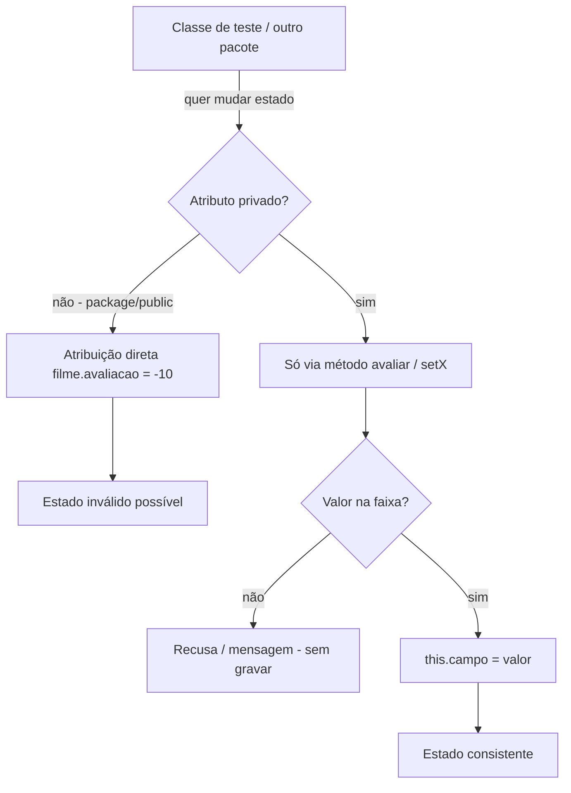

## Visão Geral do Conceito

Objetos têm **estado**: título, ano, avaliação, notas do aluno. Enquanto qualquer trecho do programa puder escrever direto nos campos (`filme.avaliacao = 11`), o estado pode ficar **inválido** — e o resto do código (estrelas, média, relatório) herda o erro.

**Encapsulamento** resolve isso: você **esconde** o estado (e às vezes métodos internos) e só permite mudança/leitura por caminhos controlados — métodos com regras.

Nesta aula (continuação da trilha OOP com <mark style="background-color: #242424; padding: 2px 4px; border-radius: 3px; color: inherit;">`Filme`</mark> e <mark style="background-color: #242424; padding: 2px 4px; border-radius: 3px; color: inherit;">`Aluno`</mark>):

1. provocação de estados inválidos;
2. visibilidade <mark style="background-color: #242424; padding: 2px 4px; border-radius: 3px; color: inherit;">`private`</mark> / <mark style="background-color: #242424; padding: 2px 4px; border-radius: 3px; color: inherit;">`public`</mark> / package (default);
3. getters/setters e a palavra <mark style="background-color: #242424; padding: 2px 4px; border-radius: 3px; color: inherit;">`this`</mark>;
4. validação inicial no método <mark style="background-color: #242424; padding: 2px 4px; border-radius: 3px; color: inherit;">`avaliar`</mark>;
5. organização em pacotes <mark style="background-color: #242424; padding: 2px 4px; border-radius: 3px; color: inherit;">`model`</mark> vs testes.

> **Lacuna de fonte:** não há pasta `documents/Java` nem PDF/slides obrigatórios. Conteúdo reconstruído da transcrição `Aula_12_-_28082026.bin`. Construtores (próxima semana), <mark style="background-color: #242424; padding: 2px 4px; border-radius: 3px; color: inherit;">`Exception`</mark> e <mark style="background-color: #242424; padding: 2px 4px; border-radius: 3px; color: inherit;">`protected`</mark>/herança foram só citados — **não cobertos** em profundidade.

## Modelo Mental

Pense na classe como um **cofre com portas nomeadas**:

| Peça | Papel |
|------|--------|
| Atributo <mark style="background-color: #242424; padding: 2px 4px; border-radius: 3px; color: inherit;">`private`</mark> | valor **dentro** do cofre |
| Método de domínio (`avaliar`, `setTitulo`) | porta que **aceita** entrada com regras |
| Getter (`getTitulo`) | porta de **leitura**, só se alguém de fora precisar |
| Método <mark style="background-color: #242424; padding: 2px 4px; border-radius: 3px; color: inherit;">`private`</mark> (`calcularNotaEmEstrelas`) | ferramenta **só de funcionários** (uso interno) |

Sem encapsulamento: qualquer “visitante” mexe no cofre. Com encapsulamento: o visitante chama a porta oficial; por trás, a classe decide se aceita.



Analogia da aula: o método <mark style="background-color: #242424; padding: 2px 4px; border-radius: 3px; color: inherit;">`avaliar`</mark> cria um **intervalo de tempo** entre a chegada do parâmetro e a atribuição ao campo — nesse intervalo você **testa** o valor.

## Mecânica Central

### 1. Estado aberto = risco

Com campos acessíveis no mesmo pacote (visibilidade default), isto compila e roda:

```java
filmeElberth.avaliacao = -10; // sobrescreve nota 10 já validada via avaliar
```

O relatório passa a mostrar estrelas absurdas. O problema não é “esquecer o método”: é **deixar dois caminhos** de escrita.

> **Regra:** esconda atributos; centralize escrita em métodos da própria classe.

### 2. Visibilidade em Java (o que a aula usou)

| Modificador | Quem vê |
|-------------|---------|
| *(nenhum)* — **package** | classes do **mesmo pacote** |
| <mark style="background-color: #242424; padding: 2px 4px; border-radius: 3px; color: inherit;">`private`</mark> | **só** a própria classe |
| <mark style="background-color: #242424; padding: 2px 4px; border-radius: 3px; color: inherit;">`public`</mark> | qualquer classe, **qualquer** pacote |

Demo da aula: mover o teste para outro pacote “quebra” tudo que era package — atributos e métodos deixam de ser visíveis. Aí você escolhe o que torna <mark style="background-color: #242424; padding: 2px 4px; border-radius: 3px; color: inherit;">`public`</mark> (API) e o que fica <mark style="background-color: #242424; padding: 2px 4px; border-radius: 3px; color: inherit;">`private`</mark> (interno).

> **Não coberto em profundidade:** <mark style="background-color: #242424; padding: 2px 4px; border-radius: 3px; color: inherit;">`protected`</mark> (ligado a herança) — só mencionado.

### 3. Método privado auxiliar

<mark style="background-color: #242424; padding: 2px 4px; border-radius: 3px; color: inherit;">`calcularNotaEmEstrelas`</mark> é usado por <mark style="background-color: #242424; padding: 2px 4px; border-radius: 3px; color: inherit;">`imprimir`</mark> e <mark style="background-color: #242424; padding: 2px 4px; border-radius: 3px; color: inherit;">`exibirResumo`</mark>. Não precisa (e muitas vezes **não deve**) ser API pública:

```java
private double calcularNotaEmEstrelas() {
    return this.avaliacao / 2.0;
}
```

Benefícios:

- evita duplicar `avaliacao / 2` em vários métodos;
- se a regra mudar (÷2 → ÷3), altera **um** lugar;
- IDE avisa se o método privado ficar sem chamadas internas (ninguém de fora consegue usá-lo).

### 4. Atributos privados + responsabilidade de preenchimento

```java
private String titulo;
private int ano;
private double avaliacao;

public void avaliar(double nota) {
    // validação — ver secção seguinte
    this.avaliacao = nota;
}
```

Dentro da classe, <mark style="background-color: #242424; padding: 2px 4px; border-radius: 3px; color: inherit;">`private`</mark> continua acessível. Fora, o campo some do autocomplete — o cliente não “adivinha” o nome do campo para hackear.

### 5. Validação inicial no `avaliar`

Regra de negócio da aula: nota válida **≥ 0 e ≤ 10**.

Condição positiva (só atribui se OK) exige <mark style="background-color: #242424; padding: 2px 4px; border-radius: 3px; color: inherit;">`&&`</mark> (as duas partes verdadeiras). Com <mark style="background-color: #242424; padding: 2px 4px; border-radius: 3px; color: inherit;">`||`</mark>, `11` passaria no “≥ 0” e entraria indevidamente.

Barreira (rejeitar inválidos) usa o **oposto** com <mark style="background-color: #242424; padding: 2px 4px; border-radius: 3px; color: inherit;">`||`</mark>:

```java
public void avaliar(double nota) {
    if (nota < 0 || nota > 10) {
        System.out.println("deu ruim: nota fora da faixa 0..10");
        return; // não preenche
    }
    this.avaliacao = nota;
}
```

> **Lacuna explícita na fonte:** tratamento elegante com <mark style="background-color: #242424; padding: 2px 4px; border-radius: 3px; color: inherit;">`Exception`</mark> fica para aulas futuras. Hoje: **não atribuir** (e, na demo, mensagem simples).

### 6. Getters e setters — padrão e critério

Padrão Java (literatura / Generate Getters and Setters da IDE):

| Tipo | Assinatura típica | Papel |
|------|-------------------|--------|
| Setter | `public void setTitulo(String titulo)` | recebe valor → grava no campo |
| Getter | `public String getTitulo()` | devolve o valor do campo |

```java
public void setTitulo(String titulo) {
    this.titulo = titulo;
}

public String getTitulo() {
    return this.titulo;
}
```

**Critério da aula (importante):** não force “3 atributos ⇒ 6 métodos”.

- Crie **set** se for preciso receber valor de fora.
- Crie **get** se for preciso **ler** de fora.
- Prefira método de domínio quando o nome expressa a ação: <mark style="background-color: #242424; padding: 2px 4px; border-radius: 3px; color: inherit;">`avaliar`</mark> em vez de um `setAvaliacao` “seco”, se a intenção for avaliar o filme.
- `atualizarAno` “cheira a cadastro” → a aula renomeia para <mark style="background-color: #242424; padding: 2px 4px; border-radius: 3px; color: inherit;">`setAno`</mark> no padrão de encapsulamento.

### 7. A palavra `this`

Quando parâmetro e atributo têm o **mesmo nome**, o identificador sem qualificador refere-se ao **parâmetro**. <mark style="background-color: #242424; padding: 2px 4px; border-radius: 3px; color: inherit;">`this`</mark> aponta para o **objeto atual**:

```java
public void setTitulo(String titulo) {
    this.titulo = titulo; // campo ← parâmetro
}
```

Se o parâmetro chama-se `nota` e o campo `avaliacao`, o `this` é opcional na atribuição — mas usar o mesmo nome + `this` é a boa prática mostrada na aula.

### 8. Pacotes `model` e testes

Organização praticada:

- pacote **model** (domínio): `Filme`, `Aluno`, …
- pacote **testes**: classes com <mark style="background-color: #242424; padding: 2px 4px; border-radius: 3px; color: inherit;">`main`</mark>

Efeitos:

1. teste precisa de <mark style="background-color: #242424; padding: 2px 4px; border-radius: 3px; color: inherit;">`import`</mark> do model (atalho IDE: organizar imports);
2. métodos/API usados pelo teste precisam ser <mark style="background-color: #242424; padding: 2px 4px; border-radius: 3px; color: inherit;">`public`</mark>;
3. helpers internos e campos permanecem <mark style="background-color: #242424; padding: 2px 4px; border-radius: 3px; color: inherit;">`private`</mark>.

Nome `model` **não é regra universal** — é organização comum em projetos; cada empresa pode variar.

### 9. Aplicação em `Aluno`

Mesmo padrão:

- `nome`, `nota1`, `nota2`, `nota3` → <mark style="background-color: #242424; padding: 2px 4px; border-radius: 3px; color: inherit;">`private`</mark>;
- setters gerados / escritos (`setNome`, `setNota1`…);
- <mark style="background-color: #242424; padding: 2px 4px; border-radius: 3px; color: inherit;">`imprimir`</mark> público (chamado do teste em outro pacote);
- <mark style="background-color: #242424; padding: 2px 4px; border-radius: 3px; color: inherit;">`calcularMedia`</mark> (e similares) **private** se só servem ao relatório interno — responsabilidade única: imprimir imprime; calcular calcula.

Ideia discutida (melhoria): receber as três notas juntas e só preencher se a avaliação em conjunto fizer sentido — evita média “quebrada” com zeros de campos ainda não preenchidos. Detalhe de API completa: **raciocínio da aula**, não um contrato fechado de assinatura além dos setters.

### 10. Encapsulamento no mapa OOP

A aula fecha: encapsulamento é **um pilar**. Outros (herança, polimorfismo; abstração citada) virão depois. Construtor = outra forma de encapsular estado inicial (próxima semana).

## Uso Prático

### Filme — esqueleto alinhado à aula

```java
package model;

public class Filme {
    private String titulo;
    private int ano;
    private double avaliacao;

    public void setTitulo(String titulo) {
        this.titulo = titulo;
    }

    public void setAno(int ano) {
        this.ano = ano;
    }

    public void avaliar(double nota) {
        if (nota < 0 || nota > 10) {
            System.out.println("deu ruim: nota fora da faixa 0..10");
            return;
        }
        this.avaliacao = nota;
    }

    private double calcularNotaEmEstrelas() {
        return this.avaliacao / 2.0;
    }

    public void exibirResumo() {
        System.out.println(titulo + " (" + ano + ") - estrelas: " + calcularNotaEmEstrelas());
    }

    public void imprimir() {
        System.out.println("Titulo: " + titulo);
        System.out.println("Ano: " + ano);
        System.out.println("Avaliacao: " + avaliacao);
        System.out.println("Estrelas: " + calcularNotaEmEstrelas());
    }
}
```

### Teste em outro pacote

```java
package testes;

import model.Filme;

public class TestaFilme {
    public static void main(String[] args) {
        Filme matrix = new Filme();
        matrix.setTitulo("Matrix");
        matrix.setAno(1999);
        matrix.avaliar(10);
        // matrix.avaliacao = -10; // NÃO COMPILA — campo private
        matrix.avaliar(11);       // recusa; estado anterior permanece
        matrix.imprimir();
        matrix.exibirResumo();
    }
}
```

### Aluno — campos privados + setters + helper privado

```java
package model;

public class Aluno {
    private String nome;
    private double nota1;
    private double nota2;
    private double nota3;

    public void setNome(String nome) {
        this.nome = nome;
    }

    public void setNota1(double nota1) {
        this.nota1 = nota1;
    }

    public void setNota2(double nota2) {
        this.nota2 = nota2;
    }

    public void setNota3(double nota3) {
        this.nota3 = nota3;
    }

    private double calcularMedia() {
        return (nota1 + nota2 + nota3) / 3.0;
    }

    public void imprimir() {
        double media = calcularMedia();
        System.out.println("Aluno: " + nome + " | Media: " + media);
    }
}
```

No teste: só <mark style="background-color: #242424; padding: 2px 4px; border-radius: 3px; color: inherit;">`set*`</mark> + <mark style="background-color: #242424; padding: 2px 4px; border-radius: 3px; color: inherit;">`imprimir`</mark> — sem getters se ninguém lê os campos de fora.

## Erros Comuns

1. **Atributo package/public “porque a IDE sugeriu”**  
   Ao mover pacotes, a IDE pode sugerir tornar o **campo** public. Isso desfaz o encapsulamento. Prefira criar/ajustar **setter** público e manter o campo private.

2. **Validar com `||` na condição positiva**  
   `nota >= 0 || nota <= 10` é quase sempre verdadeira. Use `&&` para “dentro da faixa”.

3. **Criar get/set cegamente para todos os campos**  
   Gera API inflada e convida mutação indevida. Pergunte: alguém de fora precisa ler/escrever?

4. **Método privado sem chamadas internas**  
   Vira código morto (aviso amarelo na IDE). Ou use-o de `imprimir`/`exibirResumo`, ou remova.

5. **Esquecer `public` na API após separar pacotes**  
   Sintoma: “método invisível” / não resolve no teste. Campos ficam private; métodos de uso externo ficam public.

6. **Atribuir `titulo = titulo` sem `this`**  
   Com nomes iguais, a linha não grava no campo — só reatribui o parâmetro a si mesmo.

7. **Expor `calcularMedia` / `calcularNotaEmEstrelas` como public sem necessidade**  
   Espalha regra de negócio e cria clientes acoplados a detalhes internos.

## Visão Geral de Debugging

Quando o estado “não bate” com o que você passou no método:

1. **Há atribuição direta ao campo em algum teste antigo?** Procure `objeto.campo =` — deve sumir após private.
2. **A validação realmente impede a gravação?** Coloque breakpoint / log no `if` inválido e confirme que o `return` ocorre antes de `this.campo = …`.
3. **Conector lógico errado?** Teste mentalmente com `11` e `-1` nas duas formas (`&&` vs `||`).
4. **Erro de compilação após mover pacote?** Verifique `import` e se a API usada é `public`.
5. **Autocomplete não mostra o campo?** Bom sinal se for private — use o método de acesso.
6. **Média estranha no Aluno?** Confirme se as três notas foram setadas; zeros default distorcem a média (ponto levantado na aula).

<details>
<summary>Checklist rápido Filme</summary>

1. `titulo`, `ano`, `avaliacao` estão `private`?
2. Escrita externa só via `setTitulo` / `setAno` / `avaliar`?
3. `calcularNotaEmEstrelas` é `private` e chamado só de dentro?
4. `imprimir` / `exibirResumo` / setters necessários estão `public` se o teste está noutro pacote?
5. `avaliar(11)` e `avaliar(-1)` não alteram o campo?

</details>

## Principais Pontos

- Encapsulamento = proteger estado + expor API controlada.
- `private` no atributo fecha o atalho `objeto.campo = …`.
- Package default ≠ privado: outro pacote “quebra” o acesso.
- Método privado = reuso interno sem virar API.
- Getter lê; setter grava; `this` desambigua nomes iguais.
- Não gere get/set em massa por obrigação — sob demanda.
- Validação no método cria a barreira antes da atribuição.
- Pacotes model/testes forçam `public` na API e `import`.
- Construtores / exceptions / herança: próximos passos (citados, não aprofundados).

## Preparação para Prática

Antes do laboratório, você deve conseguir:

1. Explicar a diferença entre package, private e public no cenário Filme/teste.
2. Reescrever atribuições diretas como `setX` / `avaliar` com `this`.
3. Implementar barreira `nota < 0 || nota > 10` sem gravar o inválido.
4. Decidir o que fica private (campo/helper) e o que fica public (API do teste).

## Laboratório de Prática

> Editor ISS: `editorLanguage: "javascript"` (mapa da disciplina). Os exercícios **espelham** a lógica Java da aula; comentários marcam o equivalente em Java.

### Easy — Setter com `this` e leitura controlada

**Contexto:** cadastro de título no catálogo. O estado interno não deve ser escrito com `filme.titulo = …`. Complete `setTitulo` / `getTitulo` (espelho dos métodos Java).

```javascript
function criarFilme() {
  // Espelho Java: campos private na classe
  return { _titulo: "" };
}

function setTitulo(filme, titulo) {
  // Espelho Java: public void setTitulo(String titulo) { this.titulo = titulo; }
  // TODO: gravar titulo no campo interno _titulo
}

function getTitulo(filme) {
  // Espelho Java: public String getTitulo() { return this.titulo; }
  // TODO: retornar _titulo
  return "";
}

const matrix = criarFilme();
setTitulo(matrix, "Matrix");
console.log(getTitulo(matrix));
```

### Medium — Validar avaliação antes de gravar

**Contexto:** streaming só aceita notas de 0 a 10. Se inválida, **não** altere `avaliacao` e devolva `false`; se válida, grave e devolva `true`.

```javascript
function criarFilme(titulo, ano, avaliacao) {
  return { titulo, ano, avaliacao };
}

function avaliar(filme, nota) {
  // Espelho Java: if (nota < 0 || nota > 10) { msg; return; } this.avaliacao = nota;
  // TODO: se nota < 0 || nota > 10 → return false (sem mudar filme.avaliacao)
  // TODO: senão filme.avaliacao = nota; return true
  return false;
}

const matrix = criarFilme("Matrix", 1999, 0);
console.log(avaliar(matrix, 10), matrix.avaliacao); // true, 10
console.log(avaliar(matrix, 11), matrix.avaliacao); // false, 10
console.log(avaliar(matrix, -1), matrix.avaliacao); // false, 10
```

### Hard — API pública vs helper privado + relatório

**Contexto:** módulo de catálogo. De fora só existem `setTitulo`, `setAno`, `avaliar`, `imprimir`. O cálculo de estrelas é detalhe interno (não faça o chamador chamar `calcularNotaEmEstrelas`). Se a avaliação for inválida no `avaliar`, mantenha o valor anterior.

```javascript
function criarFilmeEncapsulado() {
  // Espelho Java: private String titulo; private int ano; private double avaliacao;
  const estado = { titulo: "", ano: 0, avaliacao: 0 };

  function calcularNotaEmEstrelas() {
    // Espelho Java: private double calcularNotaEmEstrelas()
    // TODO: return estado.avaliacao / 2
    return 0;
  }

  return {
    setTitulo(titulo) {
      // TODO: estado.titulo = titulo
    },
    setAno(ano) {
      // TODO: estado.ano = ano
    },
    avaliar(nota) {
      // TODO: validar 0..10; só então estado.avaliacao = nota; retornar boolean
      return false;
    },
    imprimir() {
      // TODO: retornar string com titulo, ano, avaliacao e estrelas (via calcularNotaEmEstrelas)
      // NÃO expor calcularNotaEmEstrelas no objeto retornado
      return "";
    }
  };
}

const f = criarFilmeEncapsulado();
f.setTitulo("Interestelar");
f.setAno(2014);
f.avaliar(9);
console.log(f.imprimir());
console.log(typeof f.calcularNotaEmEstrelas); // deve ser "undefined"
f.avaliar(20);
console.log(f.imprimir()); // avaliação continua 9
```

---

<!-- LESSONS_JSON_META
discipline: fundamentos-java
slug: encapsulamento-getters-setters-estado-java
title: Encapsulamento, getters/setters e proteção de estado em Java
order: 12
file: content/fundamentos-java/aula-12-encapsulamento-getters-setters-estado-java.md
NOTE: lessons.json / search-index.json NÃO editados nesta missão (integração serial pelo orquestrador).
-->

<!-- CONCEPT_EXTRACTION
concepts:
  - encapsulamento
  - proteção de estado / estados inválidos
  - visibilidade private
  - visibilidade public
  - visibilidade package (default)
  - getters
  - setters
  - this
  - validação no método avaliar
  - operadores && e || na faixa 0..10
  - método privado auxiliar
  - API pública vs detalhe interno
  - pacote model vs pacote testes
  - import entre pacotes
  - get/set sob demanda (não em massa)
  - método de domínio (avaliar) vs set genérico
  - pilares OOP (encapsulamento citado; herança/polimorfismo futuros)
skills:
  - Restringir atributos com private
  - Expor só métodos públicos necessários após separar pacotes
  - Escrever setX/getX com this
  - Validar nota na faixa 0..10 antes de atribuir
  - Escolher && vs || conforme barreira positiva ou negativa
  - Marcar helpers de cálculo como private
  - Organizar classes em model e testes com import
  - Decidir quando não criar getter
examples:
  - filme-avaliacao-privada-vs-atribuicao-direta
  - filme-calcular-estrelas-private
  - filme-avaliar-validacao-0-10
  - filme-setTitulo-this
  - pacotes-model-testes-public-import
  - aluno-setters-calcularMedia-private
-->

<!-- EXERCISES_JSON
[
  {
    "id": "jv12-setter-this-getTitulo",
    "slug": "jv12-setter-this-getTitulo",
    "difficulty": "easy",
    "title": "Setter com this e leitura controlada",
    "discipline": "fundamentos-java",
    "editorLanguage": "javascript",
    "tags": ["java", "encapsulamento", "setter", "getter", "this"],
    "summary": "Implementar setTitulo/getTitulo espelhando campos privados e this do Java."
  },
  {
    "id": "jv12-avaliar-validacao-faixa",
    "slug": "jv12-avaliar-validacao-faixa",
    "difficulty": "medium",
    "title": "Validar avaliação antes de gravar",
    "discipline": "fundamentos-java",
    "editorLanguage": "javascript",
    "tags": ["java", "encapsulamento", "validacao", "avaliar"],
    "summary": "Recusar nota fora de 0..10 sem alterar estado; gravar só se válida."
  },
  {
    "id": "jv12-api-publica-helper-privado",
    "slug": "jv12-api-publica-helper-privado",
    "difficulty": "hard",
    "title": "API pública vs helper privado + relatório",
    "discipline": "fundamentos-java",
    "editorLanguage": "javascript",
    "tags": ["java", "private", "public", "estrelas", "encapsulamento"],
    "summary": "Encapsular estado, validar avaliar, imprimir com estrelas internas sem expor o cálculo."
  }
]
-->
