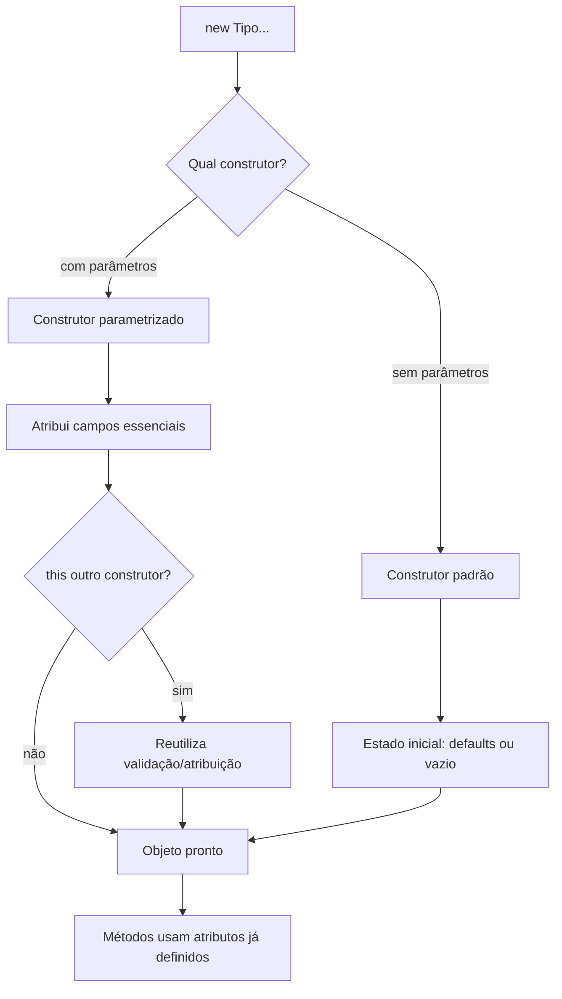
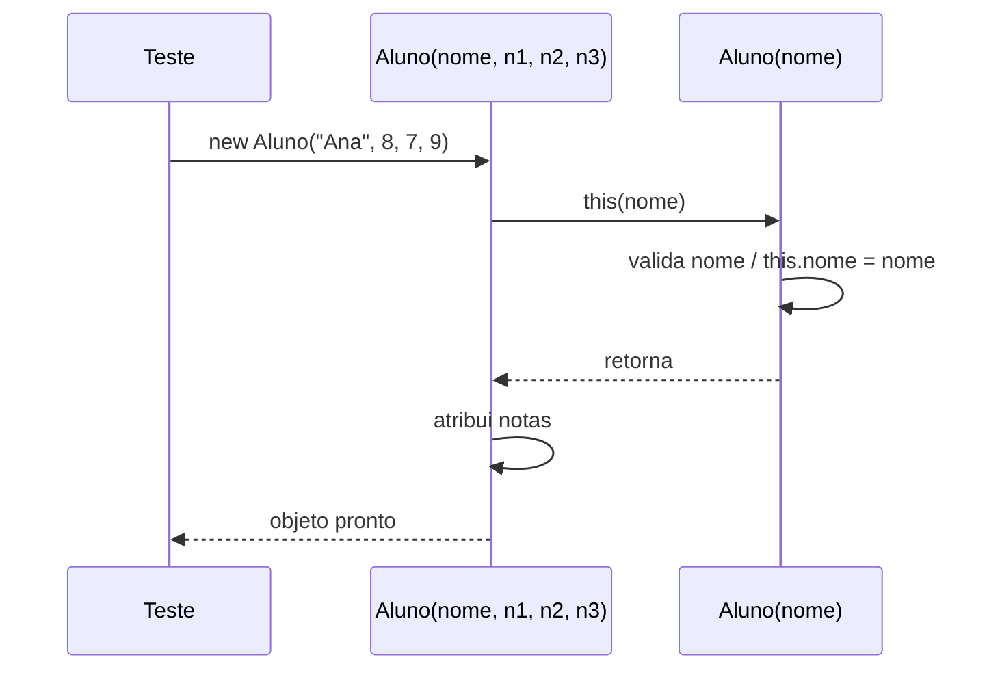

## Visão Geral do Conceito

Até aqui a trilha OOP já cobriu classe/objeto, estado e comportamento, métodos com parâmetros e retorno, e encapsulamento (getters/setters). O objeto já **guarda** dados e **age** sobre eles — mas ainda nascia “vazio” e só depois era configurado.

Nesta aula o foco muda para o **nascimento** do objeto: o momento do <mark style="background-color: #242424; padding: 2px 4px; border-radius: 3px; color: inherit;">`new`</mark>.

Problema que o construtor resolve:

- Sistemas maiores não toleram bem objetos **incompletos** ou **inconsistentes**.
- Criar e só depois preencher com <mark style="background-color: #242424; padding: 2px 4px; border-radius: 3px; color: inherit;">`setTitulo`</mark> / <mark style="background-color: #242424; padding: 2px 4px; border-radius: 3px; color: inherit;">`setAno`</mark> funciona, mas deixa uma janela em que o objeto já existe sem as informações essenciais.
- Relatórios, médias e regras de negócio dependem de dados que deveriam existir **desde o início**.

> **Lacuna de fonte:** não há pasta `documents/Java` nem PDF/slides obrigatórios. Conteúdo reconstruído a partir da transcrição `Aula_13_-_03092026.bin` (prof. Elberth Moraes). Exceções “de verdade”, métodos dedicados de validação e gestão formal de configuração foram **mencionados**, não aprofundados.

## Modelo Mental

Pense em três estratégias de criação:

| Estratégia | Ideia | Risco |
|------------|--------|--------|
| `new` + setters depois | cria vazio, configura depois | objeto incompleto entre as linhas |
| Construtor padrão com defaults | nasce com valores internos (“não informado”, ano atual) | relatório pode mostrar lixo “bonitinho” |
| Construtor com parâmetros | nasce só se o chamador passar o essencial | contrato claro; responsabilidade no uso |

Analogia da aula (equipe / andares):

- Você é dono da classe <mark style="background-color: #242424; padding: 2px 4px; border-radius: 3px; color: inherit;">`Filme`</mark> ou <mark style="background-color: #242424; padding: 2px 4px; border-radius: 3px; color: inherit;">`Aluno`</mark>.
- Outra equipe (classe de teste / UI) **usa** a sua classe.
- O chefe decide: “filme sem título e ano não pode existir”.
- Validar título/ano em **todo** método público (`imprimir`, `exibirResumo`, …) espalha a mesma regra. Melhor: tornar o preenchimento **obrigatório na criação**.



> **Regra:** o construtor é a **primeira mudança de estado** controlada depois dos valores padrão da JVM. Tudo que estiver nele roda antes de qualquer método de negócio no objeto recém-criado.

## Mecânica Central

### 1. Já usávamos construtor sem nomeá-lo

Em classes de teste, trechos como:

```java
Filme filme = new Filme();
Aluno aluno = new Aluno();
Scanner sc = new Scanner(System.in);
```

já são **construção**. Toda classe tem um caminho de construção; se você não escreve nenhum construtor, o Java oferece um **construtor padrão** implícito (sem parâmetros).

### 2. Construtor explícito padrão — defaults no nascimento

Cenário da aula na classe <mark style="background-color: #242424; padding: 2px 4px; border-radius: 3px; color: inherit;">`Filme`</mark>: se título/ano não vierem de fora, o negócio pede defaults — título `"não informado"`, ano `2026`.

```java
public class Filme {
    private String titulo;
    private int ano;
    private double avaliacao;

    public Filme() {
        this.titulo = "não informado";
        this.ano = 2026;
    }

    // getters/setters, avaliar, imprimir...
}
```

Pontos da aula:

- O corpo do construtor parece um <mark style="background-color: #242424; padding: 2px 4px; border-radius: 3px; color: inherit;">`set`</mark>, mas roda **na criação**, sem parâmetro externo.
- Com o construtor explícito, o IDE/navegação deixa de “cair” só na classe e aponta para o construtor em <mark style="background-color: #242424; padding: 2px 4px; border-radius: 3px; color: inherit;">`new Filme()`</mark>.
- <mark style="background-color: #242424; padding: 2px 4px; border-radius: 3px; color: inherit;">`avaliacao`</mark> continua protegida pelo fluxo de <mark style="background-color: #242424; padding: 2px 4px; border-radius: 3px; color: inherit;">`avaliar`</mark> — nem todo atributo precisa nascer preenchido.

### 3. Construtor com parâmetros — informações obrigatórias

Exigência de negócio: **não criar filme sem título e ano**.

```java
public Filme(String titulo, int ano) {
    this.titulo = titulo;
    this.ano = ano;
}
```

Efeito no cliente:

```java
// Antes
Filme f = new Filme();
f.setTitulo("Interestelar");
f.setAno(2014);

// Depois (obrigatório na criação)
Filme f = new Filme("Interestelar", 2014);
```

Se o construtor parametrizado **substitui** o papel dos setters essenciais, o teste deixa de chamar <mark style="background-color: #242424; padding: 2px 4px; border-radius: 3px; color: inherit;">`setTitulo`</mark> / <mark style="background-color: #242424; padding: 2px 4px; border-radius: 3px; color: inherit;">`setAno`</mark> e passa os valores no <mark style="background-color: #242424; padding: 2px 4px; border-radius: 3px; color: inherit;">`new`</mark>.

### 4. Sobrecarga de construtores

Ter **dois** (ou mais) construtores na mesma classe, com o **mesmo nome** (nome da classe) e **parâmetros diferentes**:

```java
public Filme() { /* defaults */ }

public Filme(String titulo, int ano) {
    this.titulo = titulo;
    this.ano = ano;
}
```

Isso é <mark style="background-color: #242424; padding: 2px 4px; border-radius: 3px; color: inherit;">`sobrecarga`</mark> (overload): o compilador escolhe pela assinatura. A aula liga o mesmo conceito à **sobrecarga de métodos** (ex.: dois <mark style="background-color: #242424; padding: 2px 4px; border-radius: 3px; color: inherit;">`imprimir`</mark>, com e sem parâmetros).

Regras enfatizadas:

- Pode haver quantos construtores fizerem sentido.
- Assinaturas iguais colidem: `(String)` e `(String)` — o **nome** do parâmetro não diferencia.
- Pode haver mesma **quantidade** de parâmetros se os **tipos** forem diferentes.

### 5. Remover o construtor sem parâmetros

Quando o negócio não aceita mais “não informado” no relatório, remove-se o construtor padrão. Quem fazia `new Filme()` **quebra**: só resta o caminho com título e ano.

Responsabilidade:

- A classe exige o contrato (dois dados essenciais).
- Quem chama decide o que passar; passar `null` / `0` é risco **do chamador**, não “jeitinho” dentro da classe para mascarar dado ausente.

### 6. Aplicação em `Aluno` — transição e múltiplas formas de nascer

Na média do aluno:

1. Construtor com **nome** obrigatório (`new Aluno(nome)`); notas ainda via setters.
2. Depois, sobrecarga com **nome + notaTp1 + notaTp2 + notaTp3** para quem deve nascer já com boletim completo.
3. Em transição, as duas formas podem coexistir (clientes antigos vs novos).

```java
public class Aluno {
    private String nome;
    private double notaTp1;
    private double notaTp2;
    private double notaTp3;

    public Aluno(String nome) {
        if (nome == null || nome.length() < 3) {
            System.err.println("nome precisa ter pelo menos 3 letras");
            return; // aula: demonstração; exceção real ficou para depois
        }
        this.nome = nome;
    }

    public Aluno(String nome, double notaTp1, double notaTp2, double notaTp3) {
        this(nome); // reutiliza validação + atribuição do nome
        this.notaTp1 = notaTp1;
        this.notaTp2 = notaTp2;
        this.notaTp3 = notaTp3;
    }
}
```

### 7. `this(...)` — um construtor chama o outro

Para evitar duplicar validação do nome:

- Na **primeira linha** do construtor “completo”: <mark style="background-color: #242424; padding: 2px 4px; border-radius: 3px; color: inherit;">`this(nome)`</mark>.
- O fluxo entra no construtor `(String)`, valida/preenche `nome`, **volta** e só então atribui as notas.



Didática extra na aula: um terceiro construtor só com três notas, e <mark style="background-color: #242424; padding: 2px 4px; border-radius: 3px; color: inherit;">`this(notaTp1, notaTp2, notaTp3)`</mark> a partir do de quatro parâmetros — mesma ideia de encadeamento pela lista de tipos.

### 8. Efeito colateral em outros arquivos

Ao remover o construtor padrão de <mark style="background-color: #242424; padding: 2px 4px; border-radius: 3px; color: inherit;">`Aluno`</mark>, classes de teste que ainda faziam `new Aluno()` passam a falhar (“construtor não definido”). A aula usa isso para falar de **dependentes / clientes** da sua API: quem muda o contrato precisa saber quem consome.

**Não coberto em profundidade:** exceções formais para abortar construção; biblioteca de validação; prefixos de mensagem de commit (só comentário de fluxo de aula).

## Uso Prático

### Filme: de setters para criação com contrato

```java
public class TesteFilme {
    public static void main(String[] args) {
        Filme a = new Filme("Interestelar", 2014);
        a.avaliar(9.0);
        a.imprimir();

        Filme b = new Filme("Matrix", 1999);
        b.avaliar(8.5);
        b.imprimir();
    }
}
```

O essencial (título/ano) entra no <mark style="background-color: #242424; padding: 2px 4px; border-radius: 3px; color: inherit;">`new`</mark>; avaliação continua pelo comportamento encapsulado <mark style="background-color: #242424; padding: 2px 4px; border-radius: 3px; color: inherit;">`avaliar`</mark>.

### Aluno: duas formas de criação no mesmo teste

```java
Scanner sc = new Scanner(System.in);

String nome1 = sc.nextLine();
Aluno aluno1 = new Aluno(nome1);
aluno1.setNotaTp1(sc.nextDouble());
aluno1.setNotaTp2(sc.nextDouble());
aluno1.setNotaTp3(sc.nextDouble());
aluno1.imprimir();

String nome2 = sc.nextLine();
double n1 = sc.nextDouble();
double n2 = sc.nextDouble();
double n3 = sc.nextDouble();
Aluno aluno2 = new Aluno(nome2, n1, n2, n3);
aluno2.imprimir();
```

Padrão importante da aula: ler entradas em **variáveis locais** e só então chamar o construtor — evita misturar `nextLine`/`nextDouble` “dentro” da lista de argumentos de forma confusa.

### Escolher o `imprimir` certo após mudar o construtor

Com sobrecarga de métodos, um <mark style="background-color: #242424; padding: 2px 4px; border-radius: 3px; color: inherit;">`imprimir`</mark> sem notas pode saudar só o nome; outro calcula média/situação. Se o objeto nasceu só com nome e as notas ficaram `0.0`, o boletim completo pode marcar reprovado sem o aluno ter “zerado de verdade” — o problema é **estado inicial incompleto para aquele relatório**, não o cálculo em si.

## Erros Comuns

1. **Objeto incompleto entre `new` e setters**  
   **Sintoma:** relatório com título/ano vazios ou zeros; média zero.  
   **Causa:** criação vazia + esquecimento de setter, ou outro time chama só parte da API.  
   **Correção:** tornar essenciais obrigatórios no construtor.

2. **Duplicar validação em todo método público**  
   **Sintoma:** mesma checagem de nulo/vazio em `imprimir`, `exibirResumo`, etc.  
   **Causa:** tentar “proteger o fim” em vez do nascimento.  
   **Correção:** contrato no construtor (+ reuso com `this(...)`).

3. **Assinaturas iguais de construtor**  
   **Sintoma:** erro de compilação ao declarar dois `(String)`.  
   **Causa:** achar que o nome do parâmetro diferencia.  
   **Correção:** mudar tipos/quantidade; nunca só o nome.

4. **`this(...)` fora da primeira linha**  
   **Sintoma:** erro de compilação.  
   **Causa:** atribuir campos antes de encadear.  
   **Correção:** `this(...)` primeiro; depois o restante.

5. **Remover o construtor padrão sem atualizar clientes**  
   **Sintoma:** “The constructor Aluno() is undefined” em outros pacotes/testes.  
   **Causa:** mudança de contrato sem mapear dependentes.  
   **Correção:** avisar clientes ou manter sobrecarga de transição.

6. **Passar `null`/zeros “para calar” o compilador**  
   **Sintoma:** relatório lixo; culpa volta para o dono da classe.  
   **Causa:** burlar o contrato em vez de obter dados reais.  
   **Correção:** o chamador fornece dados válidos; a classe não mascara ausência.

## Visão Geral de Debugging

Quando o objeto “nasce errado” ou o cliente não compila:

1. Inspecione **qual** construtor o `new` está resolvendo (IDE: ir para definição).
2. Confirme se ainda existe construtor **sem** parâmetros — se sumiu, todo `new Tipo()` precisa migrar.
3. No construtor encadeado, coloque breakpoint na primeira linha (`this(...)`) e no construtor alvo: valide ordem (nome antes das notas).
4. Se a média sai zero, pergunte: as notas foram atribuídas **neste** construtor ou ficaram no default? Qual `imprimir` foi chamado?
5. Após mudar a API da classe, busque no projeto todos os `new Aluno` / `new Filme` (dependentes).

<details>
<summary>Checklist rápido pós-refatoração de construtor</summary>

- [ ] Assinaturas distintas por tipos/quantidade?
- [ ] `this(...)` só na primeira linha?
- [ ] Clientes antigos compilando ou com sobrecarga de transição?
- [ ] Relatório usa atributos preenchidos no nascimento, não só defaults?
</details>

## Principais Pontos

- Construtor define **estado inicial** no `new` — primeira mudança controlada de estado.
- `new` + setters deixa janela de objeto **incompleto**.
- Construtor padrão pode aplicar **defaults**; pode ser removido se o negócio exigir dados reais.
- Construtor com parâmetros torna informações **obrigatórias** no contrato da classe.
- **Sobrecarga**: mesmo nome, parâmetros diferentes (tipos/quantidade).
- <mark style="background-color: #242424; padding: 2px 4px; border-radius: 3px; color: inherit;">`this(...)`</mark> reutiliza outro construtor; deve ser a **primeira** instrução.
- Quem usa a classe assume a responsabilidade de passar dados corretos.
- Mudar construtores quebra clientes — pense em dependentes da API.

## Preparação para Prática

Antes do laboratório, você deve conseguir:

1. Reescrever criação de `Filme`/`Aluno` com parâmetros obrigatórios.
2. Declarar dois construtores sobrecarregados sem colisão de assinatura.
3. Encadear com `this(...)` para não duplicar validação de nome.
4. Explicar por que `new Aluno()` deixa de compilar após remover o padrão.

## Laboratório de Prática

> Editor ISS: `editorLanguage` = `javascript` (mapa da disciplina). Escreva a lógica em estilo Java nos comentários/`TODO`; o objetivo é o raciocínio de construtores.

### Easy — Defaults no construtor padrão de `Filme`

Um catálogo interno ainda cria filmes sem dados externos. Implemente o construtor sem parâmetros com título `"não informado"` e ano `2026`, e um construtor `(titulo, ano)`.

```javascript
// Laboratório Easy — estilo Java (Fundamentos Java)
// class Filme { private String titulo; private int ano; ... }

function criarFilmePadrao() {
  // TODO: equivaler a new Filme() com titulo="não informado", ano=2026
  return { titulo: "", ano: 0 };
}

function criarFilmeComDados(titulo, ano) {
  // TODO: equivaler a new Filme(titulo, ano)
  return { titulo: null, ano: null };
}

// smoke (não lança)
criarFilmePadrao();
criarFilmeComDados("Interestelar", 2014);
```

### Medium — `Aluno` com nome obrigatório + sobrecarga completa

Sistema acadêmico: (1) nascer só com nome; (2) nascer com nome e três notas. Validar nome com comprimento ≥ 3 no construtor curto; o completo deve reutilizar essa lógica (ideia de `this(nome)`).

```javascript
// Laboratório Medium — estilo Java
// Aluno(String nome) e Aluno(String nome, double n1, double n2, double n3)

function criarAlunoSoNome(nome) {
  // TODO: rejeitar nome null/undefined ou length < 3 (retornar null se inválido)
  // TODO: retornar { nome, notaTp1: 0, notaTp2: 0, notaTp3: 0 }
  return null;
}

function criarAlunoCompleto(nome, n1, n2, n3) {
  // TODO: reutilizar criarAlunoSoNome(nome); se null, retornar null
  // TODO: atribuir as três notas no objeto retornado
  return null;
}

criarAlunoSoNome("Ana");
criarAlunoCompleto("João", 8, 7, 9);
```

### Hard — Encadeamento + relatório sem estado mentiroso

Há dois caminhos de criação. O relatório de média só deve rodar se as três notas foram definidas na criação completa. Simule `this(...)`: o factory completo chama o de nome; depois preenche notas. Exponha `podeEmitirBoletim(aluno)` e `media(aluno)`.

```javascript
// Laboratório Hard — contrato de nascimento + boletim

function alunoComNome(nome) {
  // TODO: validar nome (length >= 3); marcar notasDefinidas = false
  return null;
}

function alunoCompleto(nome, n1, n2, n3) {
  // TODO: base = alunoComNome(nome); se inválido, null
  // TODO: preencher notas e notasDefinidas = true
  return null;
}

function podeEmitirBoletim(aluno) {
  // TODO: true somente se aluno != null && notasDefinidas
  return false;
}

function media(aluno) {
  // TODO: se !podeEmitirBoletim(aluno) retornar null (não inventar 0.0)
  // TODO: senão média aritmética das três notas
  return null;
}

alunoCompleto("Maria", 10, 8, 6);
podeEmitirBoletim(alunoComNome("Li")); // nome curto → null / sem boletim
```

<!-- lessons.json (orquestrador): NÃO editar neste worker
discipline: fundamentos-java
slug: construtores-estado-inicial-sobrecarga-java
title: Construtores, estado inicial e sobrecarga em Java
order: 13
file: content/fundamentos-java/aula-13-construtores-estado-inicial-sobrecarga-java.md
-->

<!-- CONCEPT_EXTRACTION
concepts:
  - construtor
  - estado inicial do objeto
  - construtor padrão
  - construtor com parâmetros
  - informações obrigatórias na criação
  - sobrecarga de construtores
  - this() encadeamento de construtores
  - assinatura por tipos de parâmetros
  - responsabilidade do chamador vs dono da classe
  - sobrecarga de métodos (paralelo)
skills:
  - Definir estado inicial no construtor em vez de só com setters
  - Tornar atributos essenciais obrigatórios via parâmetros do construtor
  - Declarar sobrecarga de construtores com assinaturas distintas
  - Encadear construtores com this(...) na primeira linha
  - Migrar clientes de new Tipo() para new Tipo(args) após remover o padrão
  - Separar leitura de entrada (variáveis locais) da chamada ao construtor
examples:
  - filme-construtor-padrao-defaults
  - filme-construtor-titulo-ano
  - remocao-construtor-padrao-quebra-new
  - aluno-construtor-somente-nome
  - aluno-construtor-nome-e-notas
  - this-chama-construtor-nome
  - sobrecarga-imprimir-paralelo
-->

<!-- EXERCISES_JSON
[
  {
    "id": "jv13-filme-construtor-padrao-e-parametros",
    "slug": "jv13-filme-construtor-padrao-e-parametros",
    "difficulty": "easy",
    "title": "Defaults no construtor padrão de Filme",
    "discipline": "fundamentos-java",
    "editorLanguage": "javascript",
    "tags": ["java", "construtor", "estado-inicial", "sobrecarga"],
    "summary": "Implementar criação padrão (não informado/2026) e criação com título e ano."
  },
  {
    "id": "jv13-aluno-nome-obrigatorio-sobrecarga",
    "slug": "jv13-aluno-nome-obrigatorio-sobrecarga",
    "difficulty": "medium",
    "title": "Aluno com nome obrigatório + sobrecarga completa",
    "discipline": "fundamentos-java",
    "editorLanguage": "javascript",
    "tags": ["java", "construtor", "sobrecarga", "validacao"],
    "summary": "Validar nome (>=3) no construtor curto e reutilizar no construtor com três notas."
  },
  {
    "id": "jv13-encadeamento-boletim-sem-zero-falso",
    "slug": "jv13-encadeamento-boletim-sem-zero-falso",
    "difficulty": "hard",
    "title": "Encadeamento + boletim só com notas definidas",
    "discipline": "fundamentos-java",
    "editorLanguage": "javascript",
    "tags": ["java", "this", "construtor", "estado-inicial", "media"],
    "summary": "Simular this(nome), marcar notasDefinidas e recusar média quando o nascimento foi só com nome."
  }
]
-->
