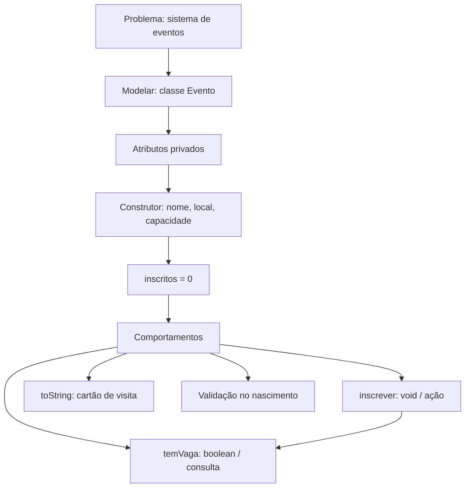

## Visão Geral do Conceito

Nas aulas anteriores, a trilha OOP chegou em **partes**: classe/objeto, estado e comportamento, parâmetros, retorno, encapsulamento com <mark style="background-color: #242424; padding: 2px 4px; border-radius: 3px; color: inherit;">`private`</mark> / getters-setters, e construtores.

Esta aula **não introduz palavra-chave nova do Java**. O objetivo é **integrar**: pegar um problema realista e decidir sozinho o que modelar — classes, atributos, métodos, proteção de estado e como o objeto nasce.

Problema da aula: parte de um **sistema de eventos**. Cada evento tem:

- <mark style="background-color: #242424; padding: 2px 4px; border-radius: 3px; color: inherit;">`nome`</mark>
- <mark style="background-color: #242424; padding: 2px 4px; border-radius: 3px; color: inherit;">`local`</mark>
- <mark style="background-color: #242424; padding: 2px 4px; border-radius: 3px; color: inherit;">`capacidade`</mark> (máximo de pessoas)
- <mark style="background-color: #242424; padding: 2px 4px; border-radius: 3px; color: inherit;">`quantidadeInscritos`</mark> (inscritos atuais)

Ciclo pedagógico usado:

1. **Modelar** o problema  
2. **Implementar**  
3. **Testar**  
4. **Melhorar** (e modelar de novo)

> **Lacuna de fonte:** não existe pasta `downloads/documents/Java` nem PDF/slides obrigatórios. O conteúdo reconstrói a Aula 14 (04/09/2026) a partir da transcrição `Aula_14_-_04092026.bin`. Herança profunda, exceções no construtor e listas dinâmicas foram só antecipadas — **não cobertas** como tópico central.

## Modelo Mental

No mundo real, ninguém diz: “agora use um atributo; agora use encapsulamento”. Você olha o domínio e pergunta:

| Pergunta | Decisão típica |
|----------|----------------|
| Que entidade resolve o problema? | Classe `Evento` |
| O que precisa ser lembrado? | Atributos (estado) |
| Como o objeto nasce? | Construtor com o mínimo obrigatório |
| O que o evento **faz**? | Métodos de negócio |
| Quem controla o estado? | O próprio objeto (`private` + operações) |

Dois objetos da mesma classe podem ter **estados diferentes**:

- Café Ágil — sala 1 — capacidade 30 — 22 inscritos  
- Java Day — auditório — capacidade 100 — 80 inscritos  

Mesma planta (`Evento`), estados distintos.



Dois tipos de pedido ao objeto (revisão integrada):

| Pedido | Papel | Exemplo |
|--------|--------|---------|
| “Faça” | ação (`void`) | <mark style="background-color: #242424; padding: 2px 4px; border-radius: 3px; color: inherit;">`inscrever()`</mark> |
| “Me diga” | consulta (tipo + <mark style="background-color: #242424; padding: 2px 4px; border-radius: 3px; color: inherit;">`return`</mark>) | <mark style="background-color: #242424; padding: 2px 4px; border-radius: 3px; color: inherit;">`temVaga()`</mark> |

## Mecânica Central

### 1. Classe, atributos e encapsulamento

Atributos representam o **estado**. Deixá-los acessíveis de fora permite absurdos (capacidade `-1000`). Por isso a aula marca os campos como <mark style="background-color: #242424; padding: 2px 4px; border-radius: 3px; color: inherit;">`private`</mark>:

> **Regra:** não use `private` só porque “livro/curso manda”. Use porque o **objeto deve controlar o próprio estado**.

```java
public class Evento {
    private String nome;
    private String local;
    private int capacidade;
    private int quantidadeInscritos;
}
```

### 2. Construtor: o que é obrigatório no nascimento

Construtor **não** significa “passar todos os campos”. É decisão de modelagem:

- `nome`, `local`, `capacidade` → necessários no cadastro  
- `quantidadeInscritos` → começa em **0** (ainda ninguém se inscreveu)

```java
public Evento(String nome, String local, int capacidade) {
    this.nome = nome;
    this.local = local;
    this.capacidade = capacidade;
    // quantidadeInscritos permanece 0 (default de int)
}
```

- <mark style="background-color: #242424; padding: 2px 4px; border-radius: 3px; color: inherit;">`this.nome`</mark> = atributo; `nome` = parâmetro.  
- Geradores do Eclipse podem inserir <mark style="background-color: #242424; padding: 2px 4px; border-radius: 3px; color: inherit;">`super()`</mark> — chamada ao construtor de <mark style="background-color: #242424; padding: 2px 4px; border-radius: 3px; color: inherit;">`Object`</mark>. Na aula, removeu-se o `super()` vazio para limpar o algoritmo (não era necessário para o exercício).

Dois objetos, mesmo construtor, estados diferentes:

```java
Evento e1 = new Evento("Café Ágil", "Sala 1", 30);
Evento e2 = new Evento("Java Day", "Auditório", 100);
```

Parâmetro = variável que **recebe**; argumento = valor **enviado** na chamada.

### 3. Comportamento: `inscrever` (void)

Pergunta de modelagem: o que um evento deveria fazer? Inscrever, check-in, cancelar, verificar vagas, exibir dados…

Versão inicial: incrementar inscritos. Como a alteração é interna e não precisa devolver valor:

```java
public void inscrever() {
    this.quantidadeInscritos = this.quantidadeInscritos + 1;
    // equivalente usado na aula: quantidadeInscritos++;
}
```

- Sem parâmetros: a informação já está no objeto.  
- Tipo de retorno <mark style="background-color: #242424; padding: 2px 4px; border-radius: 3px; color: inherit;">`void`</mark>: só altera estado.

Sintaticamente correto, semanticamente incompleto: chamar 31 vezes com capacidade 30 ainda “funciona” — e viola a regra do domínio.

### 4. Regra de negócio + consulta `temVaga`

OOP **não substitui** `if`, operadores e cálculo. Organiza **onde** a regra mora.

```java
public boolean temVaga() {
    return this.quantidadeInscritos < this.capacidade;
}

public void inscrever() {
    if (temVaga()) {
        this.quantidadeInscritos++;
    }
}
```

Por que extrair <mark style="background-color: #242424; padding: 2px 4px; border-radius: 3px; color: inherit;">`temVaga()`</mark>?

- A expressão `inscritos < capacidade` é um <mark style="background-color: #242424; padding: 2px 4px; border-radius: 3px; color: inherit;">`boolean`</mark>.  
- Pode ser usada **dentro** da classe e **fora** (UI, testes, orquestração).  
- Se a regra de disponibilidade mudar, há **um** lugar para alterar (evita duplicar condição).

Refino possível (aula mostrou o caminho até uma linha): vários `return`, ternário, ou `return quantidadeInscritos < capacidade` — mesmo resultado booleano.

### 5. Getters/setters não são obrigatórios em par

Não é necessário `set` para todos os atributos.

- `quantidadeInscritos` muda via <mark style="background-color: #242424; padding: 2px 4px; border-radius: 3px; color: inherit;">`inscrever()`</mark>, não via atribuição livre.  
- `nome` / `local` / `capacidade` entram pelo construtor.  
- Preferir **operações de negócio** a `setXxx` genéricos quando a mudança tem regra.

> **Não coberto em profundidade na fonte:** desenho completo de getters; validação avançada com exceções; herança (só antecipada: `super` vs `this` no futuro).

### 6. Validação no construtor

`private` + métodos de negócio **não** impedem `new Evento("X", "Y", -200)`.

Tentativa “boazinha” (`if (capacidade > 0) this.capacidade = capacidade`) ainda deixa o objeto nascer com capacidade **0** (default de `int`) se a condição falhar — incompleto.

A aula destaca o trade-off: validar cedo (construtor), durante operações, e/ou no fim do fluxo. Sem entrar em exceções nesta sessão — só “blindar” e pensar nas regras no nascimento.

### 7. `toString` e `@Override`

Imprimir o objeto sem `toString` próprio usa a implementação de <mark style="background-color: #242424; padding: 2px 4px; border-radius: 3px; color: inherit;">`Object`</mark> (pacote.classe@hashCode).

Sobrescrever com <mark style="background-color: #242424; padding: 2px 4px; border-radius: 3px; color: inherit;">`@Override`</mark> deixa claro que o método já existia na classe mãe:

```java
@Override
public String toString() {
    return String.format(
        "nome=%s | local=%s | capacidade=%d | inscritos=%d",
        nome, local, capacidade, quantidadeInscritos
    );
}
```

- <mark style="background-color: #242424; padding: 2px 4px; border-radius: 3px; color: inherit;">`toString`</mark> = “cartão de visita” do objeto.  
- Cuidado: `return this.toString()` (ou `return toString()` sem base) vira recursão infinita; a chamada à implementação mãe seria `super.toString()`.

## Uso Prático

### Projeto `Integracao` — classe de domínio

```java
package integracao;

public class Evento {
    private String nome;
    private String local;
    private int capacidade;
    private int quantidadeInscritos;

    public Evento(String nome, String local, int capacidade) {
        this.nome = nome;
        this.local = local;
        if (capacidade > 0) {
            this.capacidade = capacidade;
        }
        // se inválida, permanece 0 — limitação discutida na aula
    }

    public boolean temVaga() {
        return quantidadeInscritos < capacidade;
    }

    public void inscrever() {
        if (temVaga()) {
            quantidadeInscritos++;
        }
    }

    @Override
    public String toString() {
        return String.format(
            "nome=%s | local=%s | capacidade=%d | inscritos=%d",
            nome, local, capacidade, quantidadeInscritos
        );
    }
}
```

### Teste: orquestrar consulta + ação

```java
Evento e1 = new Evento("Café Ágil", "Sala 1", 30);

if (e1.temVaga()) {
    System.out.println("Ainda temos vagas");
    e1.inscrever();
} else {
    System.out.println("Game Over");
}

System.out.println(e1); // usa toString
```

### Integração com fundamentos anteriores (vetor + `for` aninhado)

A segunda metade da aula reutiliza vetores, <mark style="background-color: #242424; padding: 2px 4px; border-radius: 3px; color: inherit;">`final`</mark>, `for` e `if` **em cima** da classe `Evento` — mostrando que OOP organiza regras; o resto da sintaxe continua necessária.

Ideia do experimento:

1. Vetor de nomes e vetor de capacidades.  
2. Para cada evento, tentar `INSCRICOES` (constante, ex.: 5) vezes.  
3. Se <mark style="background-color: #242424; padding: 2px 4px; border-radius: 3px; color: inherit;">`temVaga()`</mark> → <mark style="background-color: #242424; padding: 2px 4px; border-radius: 3px; color: inherit;">`inscrever()`</mark>; senão registrar falha (ex.: guardar `toString` num vetor de “sem inscrição”).

```java
final int INSCRICOES = 5;
String[] nomes = { "Café Ágil", "Java Day", "Aula de Fundamentos" };
int[] capacidades = { 3, 2, 4 };

for (int i = 0; i < nomes.length; i++) {
    Evento evento = new Evento(nomes[i], "Local", capacidades[i]);
    for (int j = 0; j < INSCRICOES; j++) {
        if (evento.temVaga()) {
            evento.inscrever();
        } else {
            System.out.println("Sem inscrição: " + evento);
        }
    }
}
```

Com capacidades 3, 2 e 4 e 5 tentativas cada: falham 2 + 3 + 1 = 6 tentativas — exatamente o que a aula observou no console.

Detalhe de índice ao popular vetor de falhas: <mark style="background-color: #242424; padding: 2px 4px; border-radius: 3px; color: inherit;">`x++`</mark> no índice usa o valor **antes** do incremento; <mark style="background-color: #242424; padding: 2px 4px; border-radius: 3px; color: inherit;">`++x`</mark> incrementa **antes** de usar. Posições não preenchidas de um `String[]` ficam <mark style="background-color: #242424; padding: 2px 4px; border-radius: 3px; color: inherit;">`null`</mark>.

## Erros Comuns

1. **Acesso direto a campos públicos**  
   Sintoma: `evento.capacidade = -1000` compila.  
   Correção: `private` + construtor/métodos com regra.

2. **Construtor “enche tudo” sem critério**  
   Sintoma: forçar `quantidadeInscritos` no `new` mesmo quando o domínio começa em zero.  
   Correção: perguntar o que é obrigatório no nascimento.

3. **`inscrever` sem limite**  
   Sintoma: inscritos > capacidade.  
   Correção: condicionar com `temVaga()` (ou equivalente).

4. **Duplicar a condição de vaga**  
   Sintoma: `if (inscritos < capacidade)` espalhado no teste e na classe.  
   Correção: método único <mark style="background-color: #242424; padding: 2px 4px; border-radius: 3px; color: inherit;">`temVaga()`</mark>.

5. **`set` para tudo**  
   Sintoma: `setQuantidadeInscritos(999)` contorna a regra de inscrição.  
   Correção: operação de negócio; setter só quando atribuição direta fizer sentido.

6. **Validação “boazinha” incompleta**  
   Sintoma: capacidade negativa é ignorada, mas o objeto nasce com 0 e segue “válido”.  
   Correção: decidir se invalida o nascimento (exceção — futuro) ou aplica default consciente.

7. **`toString` recursivo**  
   Sintoma: `StackOverflowError` ao imprimir.  
   Correção: montar a `String` com atributos / `String.format`; não chamar `this.toString()` sem saída.

8. **Índice fixo `nomes[0]` dentro do `for`**  
   Sintoma: todos os eventos nascem com o mesmo nome.  
   Correção: usar o índice do laço (`nomes[i]`).

## Visão Geral de Debugging

Quando o domínio “não se comporta”:

1. **Imprima o objeto** (`toString`) depois de cada operação — veja capacidade vs inscritos.  
2. **Conte tentativas vs vagas**: se o teste faz N inscrições e a capacidade é C, espere `max(0, N - C)` falhas.  
3. **Separe sintaxe de semântica**: o método pode compilar e ainda violar a regra de negócio.  
4. **Confirme quem altera o estado**: só `inscrever` (e eventualmente setters conscientes) deve mudar inscritos.  
5. **No construtor**, teste argumentos extremos (0, negativo) e observe o estado resultante.  
6. **Em vetores de falha**, verifique índices (`x++` vs `++x`) e slots `null` não usados.

<details>
<summary>Checklist rápido pós-implementação</summary>

- [ ] Campos privados  
- [ ] Construtor só com o necessário  
- [ ] `inscrever` respeita capacidade  
- [ ] `temVaga` reutilizado (interno e externo)  
- [ ] Sem `set` que quebre a regra  
- [ ] `toString` legível e sem recursão  

</details>

## Principais Pontos

- Aula de **integração**: juntar peças OOP diante de um problema, sem sintaxe nova.  
- Ciclo: modelar → implementar → testar → melhorar.  
- `Evento`: nome, local, capacidade, quantidadeInscritos.  
- `private` = controle de estado, não decoração.  
- Construtor com 3 args; inscritos começam em 0.  
- `inscrever` = void/ação; `temVaga` = boolean/consulta.  
- Método chama método para não duplicar regra.  
- Operações de negócio > set genérico cego.  
- Validar no nascimento ainda é necessário além do `private`.  
- `toString` + `@Override` = representação legível (cartão de visita).  
- OOP organiza; `if`/`for`/vetores/`final` continuam no toolkit.

## Preparação para Prática

Antes do laboratório, você deve conseguir:

1. Modelar `Evento` a partir da descrição do domínio.  
2. Escolher assinaturas (void vs retorno; com/sem parâmetro).  
3. Implementar inscrição limitada por capacidade via consulta reutilizável.  
4. Explicar por que nem todo atributo precisa de setter.  
5. Produzir uma representação textual estável do objeto.

## Laboratório de Prática

> Editor ISS: boilerplate em JavaScript espelhando a lógica Java da aula (`Evento`). Nos comentários, a assinatura Java equivalente.

### Easy — Consulta `temVaga` a partir do estado

**Contexto:** API interna de inscrição em meetup. Dados do evento já existem; você só responde se ainda há vaga (`inscritos < capacidade`).

```javascript
function temVaga(capacidade, quantidadeInscritos) {
  // Espelho Java: public boolean temVaga() { return inscritos < capacidade; }
  // TODO: retornar true se quantidadeInscritos < capacidade
  return false;
}

console.log(temVaga(30, 22)); // true
console.log(temVaga(30, 30)); // false
console.log(temVaga(2, 5));   // false
```

### Medium — `inscrever` reutilizando a consulta

**Contexto:** serviço de check-in simplificado. Mutar inscritos **somente** se houver vaga. Sem parâmetros extras: o estado já está no objeto.

```javascript
function criarEvento(nome, local, capacidade) {
  // Espelho Java: new Evento(nome, local, capacidade); inscritos = 0
  return {
    nome,
    local,
    capacidade,
    quantidadeInscritos: 0
  };
}

function temVaga(evento) {
  // TODO: return evento.quantidadeInscritos < evento.capacidade
  return false;
}

function inscrever(evento) {
  // Espelho Java: if (temVaga()) quantidadeInscritos++;
  // TODO: se temVaga(evento), incrementar quantidadeInscritos
  // TODO: retornar o próprio evento (para encadear asserts no console)
  return evento;
}

const cafe = criarEvento("Café Ágil", "Sala 1", 3);
inscrever(cafe);
inscrever(cafe);
inscrever(cafe);
inscrever(cafe); // 4ª tentativa: não deve ultrapassar 3
console.log(cafe.quantidadeInscritos); // 3
console.log(temVaga(cafe)); // false
```

### Hard — Lote de tentativas + falhas sem ultrapassar capacidade

**Contexto:** script de carga para três eventos (capacidades 3, 2, 4). Para cada evento, tentar `INSCRICOES` (5) vezes. Contar quantas tentativas **falharam** (sem vaga). O total de falhas deve ser 2 + 3 + 1 = 6.

```javascript
const INSCRICOES = 5;
const nomes = ["Café Ágil", "Java Day", "Aula de Fundamentos"];
const capacidades = [3, 2, 4];

function criarEvento(nome, local, capacidade) {
  return { nome, local, capacidade, quantidadeInscritos: 0 };
}

function temVaga(evento) {
  // TODO
  return false;
}

function inscrever(evento) {
  // TODO: incrementar só se temVaga
  return evento;
}

function simularLote(nomes, capacidades, tentativasPorEvento) {
  let falhas = 0;
  const resumo = [];

  // TODO: for i sobre nomes
  // TODO: evento = criarEvento(nomes[i], "Local", capacidades[i])
  // TODO: for j de 0 até tentativasPorEvento-1
  // TODO:   se temVaga → inscrever; senão falhas++
  // TODO: resumo.push({ nome: evento.nome, inscritos: evento.quantidadeInscritos, capacidade: evento.capacidade })

  return { falhas, resumo };
}

const resultado = simularLote(nomes, capacidades, INSCRICOES);
console.log(resultado.falhas); // esperado: 6
console.log(resultado.resumo);
```

---

<!-- LESSONS_JSON_META
discipline: fundamentos-java
slug: integracao-oop-classes-metodos-encapsulamento-construtores
title: Integração OOP: classes, métodos, encapsulamento e construtores
order: 14
file: content/fundamentos-java/aula-14-integracao-oop-classes-metodos-encapsulamento-construtores.md
NOTE: lessons.json / search-index.json NÃO editados nesta missão (integração serial pelo orquestrador).
-->

<!-- CONCEPT_EXTRACTION
concepts:
  - integração OOP
  - modelagem problema → classes
  - classe Evento
  - atributos e estado
  - encapsulamento private
  - construtor com campos obrigatórios
  - quantidadeInscritos inicia em zero
  - this vs parâmetro
  - Object e super (intro)
  - método void inscrever
  - método boolean temVaga
  - método chamando método
  - regra de capacidade
  - operações de negócio vs getters/setters
  - validação no construtor
  - toString e @Override
  - String.format
  - integração com for, vetor, final
skills:
  - Transformar problema de domínio em classe e atributos
  - Decidir o que entra no construtor vs default
  - Proteger estado com private e operações
  - Distinguir ação void de consulta com retorno
  - Extrair regra temVaga para reuso interno/externo
  - Limitar inscrição pela capacidade
  - Preferir método de negócio a setter cego
  - Sobrescrever toString com @Override
  - Orquestrar Evento com laços e vetores no teste
examples:
  - evento-atributos-privados
  - evento-construtor-tres-campos
  - evento-inscrever-void
  - evento-tem-vaga-boolean
  - evento-inscrever-chama-tem-vaga
  - evento-tostring-string-format
  - teste-lote-for-aninhado-capacidades
-->

<!-- EXERCISES_JSON
[
  {
    "id": "jv14-tem-vaga-consulta",
    "slug": "jv14-tem-vaga-consulta",
    "difficulty": "easy",
    "title": "Consulta temVaga a partir do estado",
    "discipline": "fundamentos-java",
    "editorLanguage": "javascript",
    "tags": ["java", "oop", "boolean", "return", "evento"],
    "summary": "Implementar temVaga retornando inscritos < capacidade."
  },
  {
    "id": "jv14-inscrever-com-tem-vaga",
    "slug": "jv14-inscrever-com-tem-vaga",
    "difficulty": "medium",
    "title": "inscrever reutilizando temVaga",
    "discipline": "fundamentos-java",
    "editorLanguage": "javascript",
    "tags": ["java", "oop", "void", "encapsulamento", "regra-negocio"],
    "summary": "Incrementar inscritos só quando temVaga; não ultrapassar capacidade."
  },
  {
    "id": "jv14-lote-tentativas-falhas",
    "slug": "jv14-lote-tentativas-falhas",
    "difficulty": "hard",
    "title": "Lote de tentativas e contagem de falhas",
    "discipline": "fundamentos-java",
    "editorLanguage": "javascript",
    "tags": ["java", "oop", "for", "capacidade", "integracao"],
    "summary": "Simular 5 tentativas em 3 eventos (caps 3,2,4) e obter 6 falhas sem ultrapassar capacidade."
  }
]
-->
