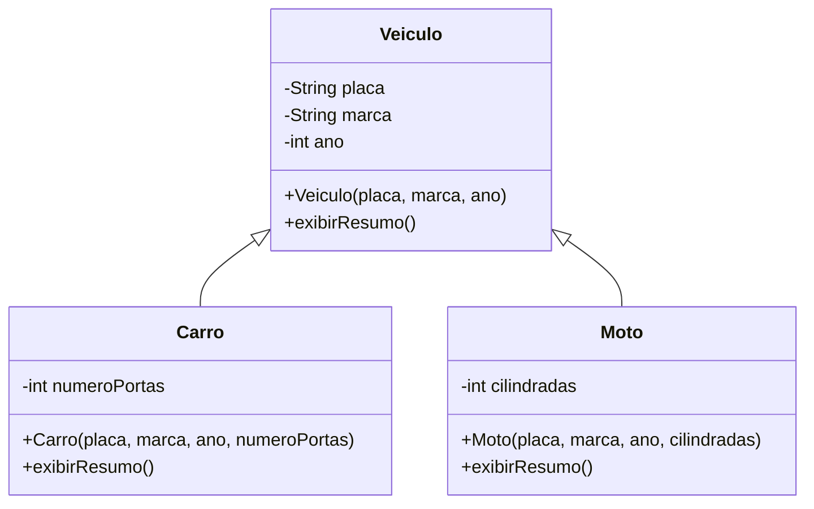

## Visão Geral do Conceito

O projeto da aula é o **GaragemService**, pacote <mark style="background-color: #242424; padding: 2px 4px; border-radius: 3px; color: inherit;">`br.infnet.garagem`</mark>. O primeiro recorte não pede a palavra <mark style="background-color: #242424; padding: 2px 4px; border-radius: 3px; color: inherit;">`extends`</mark>. Pede duas classes que já sabemos escrever.

<mark style="background-color: #242424; padding: 2px 4px; border-radius: 3px; color: inherit;">`Carro`</mark> nasce com <mark style="background-color: #242424; padding: 2px 4px; border-radius: 3px; color: inherit;">`placa`</mark>, <mark style="background-color: #242424; padding: 2px 4px; border-radius: 3px; color: inherit;">`marca`</mark> e <mark style="background-color: #242424; padding: 2px 4px; border-radius: 3px; color: inherit;">`ano`</mark>, construtor completo e <mark style="background-color: #242424; padding: 2px 4px; border-radius: 3px; color: inherit;">`exibirResumo()`</mark>. <mark style="background-color: #242424; padding: 2px 4px; border-radius: 3px; color: inherit;">`Moto`</mark> nasce com os mesmos três campos, o mesmo desenho de construtor e um <mark style="background-color: #242424; padding: 2px 4px; border-radius: 3px; color: inherit;">`exibirResumo()`</mark> que só troca o rótulo. <mark style="background-color: #242424; padding: 2px 4px; border-radius: 3px; color: inherit;">`GaragemApp`</mark> instancia os dois e imprime. O programa funciona.

O problema aparece nessa repetição: duas classes do mesmo domínio copiam estado e comportamento. Carro e moto são veículos. A herança, nesta aula, é a relação de modelagem que guarda numa superclasse o que todo veículo tem, e deixa na subclasse só o que especializa.

O segundo movimento é o polimorfismo: um vetor declarado como <mark style="background-color: #242424; padding: 2px 4px; border-radius: 3px; color: inherit;">`Veiculo[]`</mark> aceita carro e moto, e <mark style="background-color: #242424; padding: 2px 4px; border-radius: 3px; color: inherit;">`exibirResumo()`</mark> executa a versão do objeto que está na posição — a da filha, quando ela sobrescreveu; a da mãe, quando a filha não declarou o método.

> **Lacuna de fonte:** não há PDF nem slides desta aula. O texto reconstrói a transcrição de 10/09/2026. Ruído inicial de legenda foi ignorado. <mark style="background-color: #242424; padding: 2px 4px; border-radius: 3px; color: inherit;">`record`</mark> foi citado como assunto da disciplina seguinte e não é conteúdo desta lição.

Pré-requisito: [[integracao-oop-classes-metodos-encapsulamento-construtores]].

## Modelo Mental

Pergunta da modelagem, antes da sintaxe: **um carro é um veículo?** **Uma moto é um veículo?** Se as duas frases valem no domínio, há um candidato a herança.

| Papel | Quem | O que guarda |
|-------|------|----------------|
| Superclasse (classe mãe) | <mark style="background-color: #242424; padding: 2px 4px; border-radius: 3px; color: inherit;">`Veiculo`</mark> | Placa, marca, ano e o miolo comum de <mark style="background-color: #242424; padding: 2px 4px; border-radius: 3px; color: inherit;">`exibirResumo()`</mark> |
| Subclasse | <mark style="background-color: #242424; padding: 2px 4px; border-radius: 3px; color: inherit;">`Carro`</mark> | O que só o carro tem (depois: número de portas) e o cabeçalho do relatório |
| Subclasse | <mark style="background-color: #242424; padding: 2px 4px; border-radius: 3px; color: inherit;">`Moto`</mark> | O que só a moto tem (depois: cilindradas) e o cabeçalho dela |

A filha aponta para a mãe (<mark style="background-color: #242424; padding: 2px 4px; border-radius: 3px; color: inherit;">`extends`</mark>). A mãe não lista as filhas. Se a filha tem o método, usa o dela. Se não tem, usa o da mãe. <mark style="background-color: #242424; padding: 2px 4px; border-radius: 3px; color: inherit;">`Object`</mark> continua sendo a classe no topo de toda classe Java; <mark style="background-color: #242424; padding: 2px 4px; border-radius: 3px; color: inherit;">`Veiculo`</mark> fica entre <mark style="background-color: #242424; padding: 2px 4px; border-radius: 3px; color: inherit;">`Object`</mark> e as filhas.

Polimorfismo, no recorte desta aula, é **muitas formas na mesma coleção**: a variável diz <mark style="background-color: #242424; padding: 2px 4px; border-radius: 3px; color: inherit;">`Veiculo`</mark>; o objeto guardado é carro ou moto. A chamada <mark style="background-color: #242424; padding: 2px 4px; border-radius: 3px; color: inherit;">`v.exibirResumo()`</mark> só se resolve quando aquele objeto está na mão.



## Mecânica Central

### 1. Duplicação que a herança reorganiza

Campos <mark style="background-color: #242424; padding: 2px 4px; border-radius: 3px; color: inherit;">`private`</mark>, como nas aulas anteriores: o objeto controla o próprio estado.

```java
public class Carro {
    private String placa;
    private String marca;
    private int ano;

    public Carro(String placa, String marca, int ano) {
        this.placa = placa;
        this.marca = marca;
        this.ano = ano;
    }

    public void exibirResumo() {
        System.out.printf("Carro: %s %s %d%n", placa, marca, ano);
    }
}
```

<mark style="background-color: #242424; padding: 2px 4px; border-radius: 3px; color: inherit;">`Moto`</mark> repete a estrutura. <mark style="background-color: #242424; padding: 2px 4px; border-radius: 3px; color: inherit;">`printf`</mark> formata e **não** quebra linha; quem quebra linha é <mark style="background-color: #242424; padding: 2px 4px; border-radius: 3px; color: inherit;">`%n`</mark> ou <mark style="background-color: #242424; padding: 2px 4px; border-radius: 3px; color: inherit;">`println`</mark>. Por isso dois <mark style="background-color: #242424; padding: 2px 4px; border-radius: 3px; color: inherit;">`printf`</mark> seguidos (filha e mãe) podem aparecer na **mesma** linha do console. Documentação: [System.out.printf](https://docs.oracle.com/en/java/javase/17/docs/api/java.base/java/io/PrintStream.html#printf(java.lang.String,java.lang.Object...)).

### 2. `extends` e o construtor da mãe

<mark style="background-color: #242424; padding: 2px 4px; border-radius: 3px; color: inherit;">`Carro extends Veiculo`</mark> significa: carro aproveita características e comportamentos definidos em veículo.

Construtor **padrão** é o construtor sem parâmetros. Quando a mãe só tem construtor **com** parâmetros, a filha é obrigada a chamá-lo. A chamada ao construtor da mãe é <mark style="background-color: #242424; padding: 2px 4px; border-radius: 3px; color: inherit;">`super(...)`</mark>, e essa chamada é a primeira instrução do construtor da filha. <mark style="background-color: #242424; padding: 2px 4px; border-radius: 3px; color: inherit;">`this(...)`</mark> continua sendo chamada a outro construtor da **mesma** classe — recurso já visto na sobrecarga.

```java
public class Veiculo {
    private String placa;
    private String marca;
    private int ano;

    public Veiculo(String placa, String marca, int ano) {
        this.placa = placa;
        this.marca = marca;
        this.ano = ano;
    }

    public void exibirResumo() {
        System.out.printf("%s %s %d", placa, marca, ano);
    }
}

public class Carro extends Veiculo {
    public Carro(String placa, String marca, int ano) {
        super(placa, marca, ano);
    }
}
```

Depois do <mark style="background-color: #242424; padding: 2px 4px; border-radius: 3px; color: inherit;">`extends`</mark>, placa, marca e ano **saem** de <mark style="background-color: #242424; padding: 2px 4px; border-radius: 3px; color: inherit;">`Carro`</mark> e de <mark style="background-color: #242424; padding: 2px 4px; border-radius: 3px; color: inherit;">`Moto`</mark>. Ficam uma vez em <mark style="background-color: #242424; padding: 2px 4px; border-radius: 3px; color: inherit;">`Veiculo`</mark>. O <mark style="background-color: #242424; padding: 2px 4px; border-radius: 3px; color: inherit;">`super()`</mark> vazio que o gerador de IDE insere pode ser removido quando não há trabalho extra — a aula já tinha feito isso em construtores anteriores.

### 3. Sobrescrita e `super.metodo()`

A filha pode declarar <mark style="background-color: #242424; padding: 2px 4px; border-radius: 3px; color: inherit;">`exibirResumo`</mark> de novo. Isso é **sobrescrita**: especializar um comportamento herdado. A anotação <mark style="background-color: #242424; padding: 2px 4px; border-radius: 3px; color: inherit;">`@Override`</mark> documenta a intenção e faz o compilador avisar se o nome ou a lista de parâmetros não bater com a mãe.

```java
public class Carro extends Veiculo {
    private int numeroPortas;

    public Carro(String placa, String marca, int ano, int numeroPortas) {
        super(placa, marca, ano);
        this.numeroPortas = numeroPortas;
    }

    @Override
    public void exibirResumo() {
        System.out.printf("Carro ");
        super.exibirResumo();
        System.out.printf(" %d portas%n", numeroPortas);
    }
}
```

<mark style="background-color: #242424; padding: 2px 4px; border-radius: 3px; color: inherit;">`Moto`</mark> faz o mesmo com <mark style="background-color: #242424; padding: 2px 4px; border-radius: 3px; color: inherit;">`cilindradas`</mark>. A mãe tira o <mark style="background-color: #242424; padding: 2px 4px; border-radius: 3px; color: inherit;">`%n`</mark> do miolo comum para o salto de linha ficar no fim do relatório da filha. Campo que só uma filha usa fica **nela**, não em <mark style="background-color: #242424; padding: 2px 4px; border-radius: 3px; color: inherit;">`Veiculo`</mark>.

A filha pode nascer só com construtor e sobrescrita, sem atributo próprio. Quando o atributo específico entra, o construtor da filha fica **mais largo** que o da mãe e ainda assim chama <mark style="background-color: #242424; padding: 2px 4px; border-radius: 3px; color: inherit;">`super`</mark> com placa, marca e ano.

| | Sobrecarga | Sobrescrita |
|--|------------|-------------|
| Onde | Mesma classe | Superclasse e subclasse |
| Assinatura | Parâmetros diferentes | Mesmo nome e mesmos parâmetros |
| Herança | Não é necessária | Depende de herança |
| Intenção | Mais de uma forma de chamar | Especializar o que foi herdado |

Exemplos de sobrecarga já vistos: dois construtores, ou <mark style="background-color: #242424; padding: 2px 4px; border-radius: 3px; color: inherit;">`calcular`</mark> com um parâmetro e <mark style="background-color: #242424; padding: 2px 4px; border-radius: 3px; color: inherit;">`calcular`</mark> com dois. A assinatura que distingue os métodos começa no **nome** e vai até os parênteses. Na sobrescrita, a visibilidade não pode ficar mais restrita que a da mãe, e o retorno precisa ser compatível com o método herdado. A aula resumiu isso como “mesma assinatura”; o compilador ainda exige essa compatibilidade.

### 4. Vetor e despacho polimórfico

Um vetor tem tamanho fixo. Índices de um <mark style="background-color: #242424; padding: 2px 4px; border-radius: 3px; color: inherit;">`new Carro[4]`</mark> vão de 0 a 3. Dá para guardar a referência numa variável e depois copiar para o vetor, ou criar direto na posição:

```java
Veiculo[] veiculos = new Veiculo[4];
veiculos[0] = new Carro("ABC1D23", "Toyota", 2024, 4);
veiculos[1] = new Carro("DEF2G46", "Fiat", 1947, 2);
veiculos[2] = new Moto("XYZ9A87", "Honda", 2023, 1000);
veiculos[3] = new Moto("QWE1R25", "Yamaha", 2026, 125);

for (Veiculo v : veiculos) {
    v.exibirResumo();
}
```

<mark style="background-color: #242424; padding: 2px 4px; border-radius: 3px; color: inherit;">`for-each`</mark> lê: para cada elemento da coleção, faça. A variável <mark style="background-color: #242424; padding: 2px 4px; border-radius: 3px; color: inherit;">`v`</mark> é <mark style="background-color: #242424; padding: 2px 4px; border-radius: 3px; color: inherit;">`Veiculo`</mark>. Na execução, se o objeto for <mark style="background-color: #242424; padding: 2px 4px; border-radius: 3px; color: inherit;">`Carro`</mark> e a classe tiver <mark style="background-color: #242424; padding: 2px 4px; border-radius: 3px; color: inherit;">`exibirResumo`</mark>, entra em <mark style="background-color: #242424; padding: 2px 4px; border-radius: 3px; color: inherit;">`Carro`</mark> (e de lá pode ir à mãe via <mark style="background-color: #242424; padding: 2px 4px; border-radius: 3px; color: inherit;">`super`</mark>). Se o método tiver sido apagado na filha, o depurador entra direto em <mark style="background-color: #242424; padding: 2px 4px; border-radius: 3px; color: inherit;">`Veiculo`</mark>. A aula mostrou isso com **Step Into**: o tipo declarado não esconde o tipo real.

Um <mark style="background-color: #242424; padding: 2px 4px; border-radius: 3px; color: inherit;">`Carro[]`</mark> só guarda carro. Um <mark style="background-color: #242424; padding: 2px 4px; border-radius: 3px; color: inherit;">`Moto[]`</mark> só guarda moto. O vetor de <mark style="background-color: #242424; padding: 2px 4px; border-radius: 3px; color: inherit;">`Veiculo`</mark> guarda os dois porque cada um **é um** veículo.

## Uso Prático

Cadastro mínimo da garagem, já com o campo específico de cada filha. Valores usados na aula: Toyota 2024 com 4 portas; Honda 2023; a segunda moto ilustrada foi uma Yamaha 2026 de 125 cilindradas.

```java
Carro toyota = new Carro("ABC1D23", "Toyota", 2024, 4);
Moto honda = new Moto("XYZ9A87", "Honda", 2023, 1000);
toyota.exibirResumo();
honda.exibirResumo();
```

Saída esperada, numa linha cada, porque o <mark style="background-color: #242424; padding: 2px 4px; border-radius: 3px; color: inherit;">`%n`</mark> ficou na filha:

```text
Carro ABC1D23 Toyota 2024 4 portas
Moto XYZ9A87 Honda 2023 1000 cc
```

No pátio, o laço não precisa de um <mark style="background-color: #242424; padding: 2px 4px; border-radius: 3px; color: inherit;">`if`</mark> por tipo para imprimir o resumo. Quem varia é o objeto. A referência temporária (<mark style="background-color: #242424; padding: 2px 4px; border-radius: 3px; color: inherit;">`Carro c1 = new Carro(...)`</mark>) só é necessária se o código for usar esse nome de novo; se a única destino é o vetor, <mark style="background-color: #242424; padding: 2px 4px; border-radius: 3px; color: inherit;">`veiculos[i] = new Carro(...)`</mark> basta. Sem referência, o objeto deixa de ser alcançável.

Tutorial de herança: [Subclasses](https://docs.oracle.com/javase/tutorial/java/IandI/subclasses.html). Polimorfismo no mesmo guia: [Polymorphism](https://docs.oracle.com/javase/tutorial/java/IandI/polymorphism.html).

## Erros Comuns

**Chamar o próprio <mark style="background-color: #242424; padding: 2px 4px; border-radius: 3px; color: inherit;">`exibirResumo()`</mark> dentro da sobrescrita.** A resolução cai de novo na filha. A aula descreveu o efeito como recursão que não para. A chamada ao miolo herdado é <mark style="background-color: #242424; padding: 2px 4px; border-radius: 3px; color: inherit;">`super.exibirResumo()`</mark>.

**Deixar placa, marca e ano na filha depois do <mark style="background-color: #242424; padding: 2px 4px; border-radius: 3px; color: inherit;">`extends`</mark>.** O estado comum fica duplicado de novo, e o <mark style="background-color: #242424; padding: 2px 4px; border-radius: 3px; color: inherit;">`exibirResumo`</mark> da filha que ainda lê campos locais quebra quando esses campos são removidos — foi o erro de compilação que apareceu na aula no meio da extração.

**Esquecer <mark style="background-color: #242424; padding: 2px 4px; border-radius: 3px; color: inherit;">`super(placa, marca, ano)`</mark>.** Com a mãe sem construtor padrão, o compilador exige o construtor de três argumentos. Criar um construtor vazio na mãe só para “calar” o erro muda a regra de nascimento do veículo.

**<mark style="background-color: #242424; padding: 2px 4px; border-radius: 3px; color: inherit;">`@Override`</mark> com nome ou parâmetros errados.** O compilador recusa. Sem a anotação, um typo vira um método novo e o laço polimórfico continua chamando a versão da mãe.

**Confundir sobrecarga com sobrescrita.** Dois <mark style="background-color: #242424; padding: 2px 4px; border-radius: 3px; color: inherit;">`exibirResumo`</mark> na mesma classe, com parâmetros diferentes, são sobrecarga. O par mãe/filha com a mesma lista de parâmetros é sobrescrita.

**Cadeia <mark style="background-color: #242424; padding: 2px 4px; border-radius: 3px; color: inherit;">`instanceof`</mark> dentro de <mark style="background-color: #242424; padding: 2px 4px; border-radius: 3px; color: inherit;">`Veiculo`</mark> para descobrir a filha.** A aula mostrou <mark style="background-color: #242424; padding: 2px 4px; border-radius: 3px; color: inherit;">`v instanceof Carro`</mark> como **anti-exemplo**: a mãe não conhece as filhas. O relatório comum não deve perguntar o tipo concreto se o método sobrescrito já resolve o comportamento.

**Achar que <mark style="background-color: #242424; padding: 2px 4px; border-radius: 3px; color: inherit;">`printf`</mark> quebra linha porque está em outra linha do fonte.** A quebra vem de <mark style="background-color: #242424; padding: 2px 4px; border-radius: 3px; color: inherit;">`println`</mark> ou de <mark style="background-color: #242424; padding: 2px 4px; border-radius: 3px; color: inherit;">`%n`</mark>. Trocar o cabeçalho para <mark style="background-color: #242424; padding: 2px 4px; border-radius: 3px; color: inherit;">`println`</mark> separa o rótulo “Carro” dos dados da mãe — foi o teste feito na aula para responder essa dúvida.

## Visão Geral de Debugging

1. O programa imprime só “Carro” / “Moto”, sem placa? O <mark style="background-color: #242424; padding: 2px 4px; border-radius: 3px; color: inherit;">`exibirResumo`</mark> da filha existe e não chama <mark style="background-color: #242424; padding: 2px 4px; border-radius: 3px; color: inherit;">`super.exibirResumo()`</mark>. Ctrl+clique no método em <mark style="background-color: #242424; padding: 2px 4px; border-radius: 3px; color: inherit;">`GaragemApp`</mark> mostra se a navegação cai na filha ou na mãe.
2. Compilação pede construtor em <mark style="background-color: #242424; padding: 2px 4px; border-radius: 3px; color: inherit;">`Carro`</mark>? A mãe deixou de ter construtor padrão. A filha precisa de <mark style="background-color: #242424; padding: 2px 4px; border-radius: 3px; color: inherit;">`super`</mark> com os três argumentos.
3. Campos da filha não compilam depois da extração? Eles foram apagados da filha e o método ainda os usa como se fossem locais. Ou passam a ser lidos via comportamento da mãe, ou são campos novos e específicos.
4. O <mark style="background-color: #242424; padding: 2px 4px; border-radius: 3px; color: inherit;">`for-each`</mark> “não entra” na filha no depurador? Confira se o método ainda existe naquela classe. Step Into segue o objeto real: carro sem sobrescrita cai em <mark style="background-color: #242424; padding: 2px 4px; border-radius: 3px; color: inherit;">`Veiculo`</mark>; moto com sobrescrita entra em <mark style="background-color: #242424; padding: 2px 4px; border-radius: 3px; color: inherit;">`Moto`</mark> e, na linha do <mark style="background-color: #242424; padding: 2px 4px; border-radius: 3px; color: inherit;">`super`</mark>, vai à mãe e volta.
5. <mark style="background-color: #242424; padding: 2px 4px; border-radius: 3px; color: inherit;">`ArrayIndexOutOfBoundsException`</mark> ao preencher? O último índice válido é <mark style="background-color: #242424; padding: 2px 4px; border-radius: 3px; color: inherit;">`length - 1`</mark>.

<details>
<summary>O que o depurador mostrou na coleção mista</summary>

No breakpoint do <mark style="background-color: #242424; padding: 2px 4px; border-radius: 3px; color: inherit;">`for-each`</mark>, cada elemento traz o tipo concreto (pacote e classe) e os campos herdados (ano, marca, placa) mais o campo da filha. Step Over avança no laço; Step Into entra no <mark style="background-color: #242424; padding: 2px 4px; border-radius: 3px; color: inherit;">`exibirResumo`</mark> da classe daquele objeto.

</details>

## Principais Pontos

- Herança aqui responde a “é um?”: carro é um veículo, moto é um veículo.
- <mark style="background-color: #242424; padding: 2px 4px; border-radius: 3px; color: inherit;">`extends`</mark> faz a filha aproveitar o que a mãe define; a mãe não enumera as filhas.
- Sem construtor padrão na mãe, toda filha chama <mark style="background-color: #242424; padding: 2px 4px; border-radius: 3px; color: inherit;">`super(...)`</mark> com placa, marca e ano.
- Sobrescrita é o mesmo método na mãe e na filha; <mark style="background-color: #242424; padding: 2px 4px; border-radius: 3px; color: inherit;">`@Override`</mark> deixa o compilador conferir.
- <mark style="background-color: #242424; padding: 2px 4px; border-radius: 3px; color: inherit;">`super.exibirResumo()`</mark> escolhe a versão da mãe; a chamada sem <mark style="background-color: #242424; padding: 2px 4px; border-radius: 3px; color: inherit;">`super`</mark> escolhe a da filha.
- Número de portas fica em <mark style="background-color: #242424; padding: 2px 4px; border-radius: 3px; color: inherit;">`Carro`</mark>; cilindradas ficam em <mark style="background-color: #242424; padding: 2px 4px; border-radius: 3px; color: inherit;">`Moto`</mark>.
- <mark style="background-color: #242424; padding: 2px 4px; border-radius: 3px; color: inherit;">`Veiculo[]`</mark> mais <mark style="background-color: #242424; padding: 2px 4px; border-radius: 3px; color: inherit;">`for-each`</mark> é o polimorfismo desta aula: uma chamada, várias implementações.
- <mark style="background-color: #242424; padding: 2px 4px; border-radius: 3px; color: inherit;">`instanceof`</mark> na mãe para descobrir a filha foi apresentado como anti-exemplo.

## Preparação para Prática

Antes do laboratório, você deve conseguir:

1. Decidir o que sobe para <mark style="background-color: #242424; padding: 2px 4px; border-radius: 3px; color: inherit;">`Veiculo`</mark> e o que permanece na filha.
2. Escrever o construtor da filha com <mark style="background-color: #242424; padding: 2px 4px; border-radius: 3px; color: inherit;">`super`</mark> nos três campos comuns e <mark style="background-color: #242424; padding: 2px 4px; border-radius: 3px; color: inherit;">`this`</mark> no campo específico.
3. Montar o resumo como cabeçalho da filha + resumo da mãe + dado específico, na mesma linha.
4. Percorrer uma coleção mista e obter o texto de cada objeto sem um <mark style="background-color: #242424; padding: 2px 4px; border-radius: 3px; color: inherit;">`if`</mark> de tipo dentro da classe mãe.
5. Explicar por que apagar <mark style="background-color: #242424; padding: 2px 4px; border-radius: 3px; color: inherit;">`exibirResumo`</mark> na filha faz o laço usar a versão de <mark style="background-color: #242424; padding: 2px 4px; border-radius: 3px; color: inherit;">`Veiculo`</mark>.

## Laboratório de Prática

> Editor ISS: boilerplate em JavaScript espelhando a lógica Java da garagem. Nos comentários, a assinatura Java equivalente. O arquivo executa com os <mark style="background-color: #242424; padding: 2px 4px; border-radius: 3px; color: inherit;">`TODO`</mark> ainda abertos.

### Easy — Miolo comum do resumo

**Contexto:** o relatório da garagem separou o texto que todo veículo tem (placa, marca, ano) do rótulo da especialização. Implemente só a parte da superclasse.

```javascript
function resumoBase(placa, marca, ano) {
  // Espelho Java: System.out.printf("%s %s %d", placa, marca, ano);
  // TODO: retornar placa, marca e ano separados por um espaço
  return "";
}

console.log(resumoBase("ABC1D23", "Toyota", 2024)); // ABC1D23 Toyota 2024
console.log(resumoBase("XYZ9A87", "Honda", 2023));  // XYZ9A87 Honda 2023
```

### Medium — Sobrescrita que chama o resumo da mãe

**Contexto:** carro e moto já são veículos. O relatório da filha não duplica placa/marca/ano: usa o miolo comum e acrescenta o campo específico.

```javascript
function resumoBase(veiculo) {
  return veiculo.placa + " " + veiculo.marca + " " + veiculo.ano;
}

function exibirResumo(veiculo) {
  // Espelho Java: printf do tipo; super.exibirResumo(); printf do campo da filha
  // Carro -> "Carro " + resumoBase + " " + numeroPortas + " portas"
  // Moto  -> "Moto " + resumoBase + " " + cilindradas + " cc"
  // TODO: montar a linha conforme veiculo.tipo
  return "";
}

const toyota = { tipo: "Carro", placa: "ABC1D23", marca: "Toyota", ano: 2024, numeroPortas: 4 };
const honda = { tipo: "Moto", placa: "XYZ9A87", marca: "Honda", ano: 2023, cilindradas: 1000 };
console.log(exibirResumo(toyota)); // Carro ABC1D23 Toyota 2024 4 portas
console.log(exibirResumo(honda));  // Moto XYZ9A87 Honda 2023 1000 cc
```

### Hard — Pátio polimórfico

**Contexto:** a garagem guarda quatro veículos no mesmo vetor (dois carros, duas motos) e precisa do resumo de cada um mais a contagem por especialização. Uma função só, despachada pelo objeto — sem reimplementar placa/marca/ano em cada ramo além do que <mark style="background-color: #242424; padding: 2px 4px; border-radius: 3px; color: inherit;">`exibirResumo`</mark> já faz.

```javascript
function resumoBase(veiculo) {
  return veiculo.placa + " " + veiculo.marca + " " + veiculo.ano;
}

function exibirResumo(veiculo) {
  // TODO: igual ao Medium (Carro / Moto + resumoBase + campo específico)
  return "";
}

function patrulharPatio(veiculos) {
  const linhas = [];
  let carros = 0;
  let motos = 0;
  // TODO: for...of em veiculos
  // TODO: linhas.push(exibirResumo(v))
  // TODO: contar carros e motos pelo tipo
  return { linhas, carros, motos };
}

const patio = [
  { tipo: "Carro", placa: "ABC1D23", marca: "Toyota", ano: 2024, numeroPortas: 4 },
  { tipo: "Carro", placa: "DEF2G46", marca: "Fiat", ano: 1947, numeroPortas: 2 },
  { tipo: "Moto", placa: "XYZ9A87", marca: "Honda", ano: 2023, cilindradas: 1000 },
  { tipo: "Moto", placa: "QWE1R25", marca: "Yamaha", ano: 2026, cilindradas: 125 }
];

const relatorio = patrulharPatio(patio);
console.log(relatorio.carros); // 2
console.log(relatorio.motos);  // 2
console.log(relatorio.linhas);
// Carro ABC1D23 Toyota 2024 4 portas
// Carro DEF2G46 Fiat 1947 2 portas
// Moto XYZ9A87 Honda 2023 1000 cc
// Moto QWE1R25 Yamaha 2026 125 cc
```

---

<!-- LESSONS_JSON_META
discipline: fundamentos-java
slug: heranca-polimorfismo-veiculo-java
title: Herança e polimorfismo: veículo, carro e moto
order: 15
file: content/fundamentos-java/aula-15-heranca-polimorfismo-veiculo-java.md
NOTE: lessons.json / search-index.json / disciplines.json NÃO editados nesta missão (integração serial pelo orquestrador).
-->

<!-- CONCEPT_EXTRACTION
concepts:
  - herança é-um
  - superclasse Veiculo
  - subclasse Carro e Moto
  - extends
  - construtor padrão versus construtor com parâmetros
  - super no construtor
  - super.exibirResumo
  - sobrescrita e @Override
  - sobrecarga versus sobrescrita
  - campo específico da filha
  - Veiculo[] polimórfico
  - for-each
  - despacho pelo tipo real
  - instanceof como anti-exemplo
  - printf sem quebra de linha
skills:
  - Extrair estado repetido para uma superclasse quando a relação é-um vale
  - Ligar a subclasse com extends e inicializar a mãe com super
  - Sobrescrever exibirResumo com @Override sem recursão
  - Manter número de portas e cilindradas nas classes especializadas
  - Percorrer um vetor de Veiculo e obter o resumo de cada objeto real
  - Distinguir sobrecarga na mesma classe de sobrescrita entre mãe e filha
examples:
  - carro-moto-duplicados
  - veiculo-construtor-tres-campos
  - carro-super-e-override
  - moto-cilindradas
  - vetor-veiculo-for-each
-->

<!-- EXERCISES_JSON
[
  {
    "id": "jv15-resumo-base-veiculo",
    "slug": "jv15-resumo-base-veiculo",
    "difficulty": "easy",
    "title": "Miolo comum do resumo",
    "discipline": "fundamentos-java",
    "editorLanguage": "javascript",
    "tags": ["java", "heranca", "veiculo", "printf"],
    "summary": "Montar o texto placa marca ano que a superclasse Veiculo imprime."
  },
  {
    "id": "jv15-sobrescrita-super-resumo",
    "slug": "jv15-sobrescrita-super-resumo",
    "difficulty": "medium",
    "title": "Sobrescrita que chama o resumo da mãe",
    "discipline": "fundamentos-java",
    "editorLanguage": "javascript",
    "tags": ["java", "override", "super", "carro", "moto"],
    "summary": "Prefixar Carro ou Moto, reutilizar o resumo base e anexar portas ou cilindradas."
  },
  {
    "id": "jv15-patio-polimorfico",
    "slug": "jv15-patio-polimorfico",
    "difficulty": "hard",
    "title": "Pátio polimórfico",
    "discipline": "fundamentos-java",
    "editorLanguage": "javascript",
    "tags": ["java", "polimorfismo", "for-each", "veiculo"],
    "summary": "Percorrer quatro veículos mistos, gerar as linhas de resumo e contar 2 carros e 2 motos."
  }
]
-->
