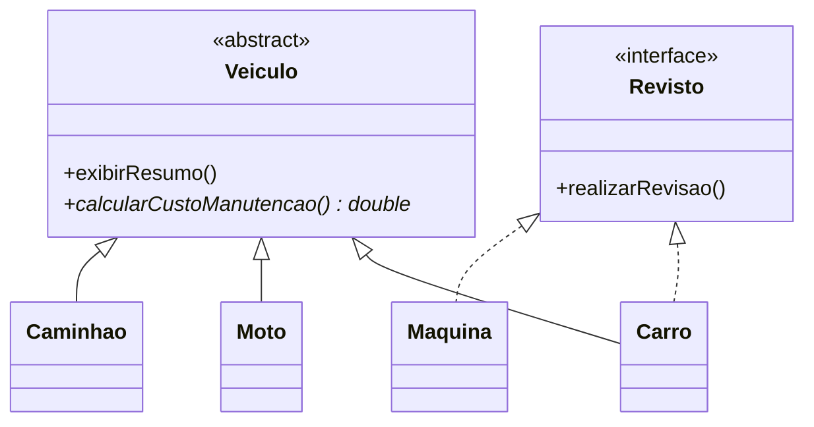

## Visão Geral do Conceito

A garagem já tem <mark style="background-color: #242424; padding: 2px 4px; border-radius: 3px; color: inherit;">`Veiculo`</mark>, <mark style="background-color: #242424; padding: 2px 4px; border-radius: 3px; color: inherit;">`Carro`</mark> e <mark style="background-color: #242424; padding: 2px 4px; border-radius: 3px; color: inherit;">`Moto`</mark> ([[heranca-polimorfismo-veiculo-java]]). O primeiro acréscimo desta aula é <mark style="background-color: #242424; padding: 2px 4px; border-radius: 3px; color: inherit;">`Caminhao`</mark>, com o campo específico <mark style="background-color: #242424; padding: 2px 4px; border-radius: 3px; color: inherit;">`capacidadeCarga`</mark> (<mark style="background-color: #242424; padding: 2px 4px; border-radius: 3px; color: inherit;">`double`</mark>), <mark style="background-color: #242424; padding: 2px 4px; border-radius: 3px; color: inherit;">`extends Veiculo`</mark>, <mark style="background-color: #242424; padding: 2px 4px; border-radius: 3px; color: inherit;">`super(placa, marca, ano)`</mark> e <mark style="background-color: #242424; padding: 2px 4px; border-radius: 3px; color: inherit;">`exibirResumo`</mark> sobrescrito. Capacidade de carga **não** sobe para a mãe: carro e moto não têm esse dado.

Em seguida o domínio reclama de outra coisa. <mark style="background-color: #242424; padding: 2px 4px; border-radius: 3px; color: inherit;">`new Veiculo(...)`</mark> compila enquanto a classe é concreta, mas o objeto não é carro, nem moto, nem caminhão. É um veículo genérico, com resumo só de placa, marca e ano. A classe continua necessária como base. Ela deixa de ser instanciável: vira <mark style="background-color: #242424; padding: 2px 4px; border-radius: 3px; color: inherit;">`abstract`</mark>.

Há também comportamento que todo veículo concreto precisa oferecer e que a mãe **não** sabe calcular de um jeito único: <mark style="background-color: #242424; padding: 2px 4px; border-radius: 3px; color: inherit;">`calcularCustoManutencao()`</mark>. A mãe declara o método sem corpo. Cada filha concreta escreve a regra. Os números da aula são um algoritmo de sala, combinado como exemplo de cliente, não uma tabela real de oficina.

Dois modificadores fecham o meio da aula. <mark style="background-color: #242424; padding: 2px 4px; border-radius: 3px; color: inherit;">`final`</mark> impede uma alteração: nova atribuição, sobrescrita ou <mark style="background-color: #242424; padding: 2px 4px; border-radius: 3px; color: inherit;">`extends`</mark>, conforme o lugar. A interface <mark style="background-color: #242424; padding: 2px 4px; border-radius: 3px; color: inherit;">`Revisto`</mark> descreve uma **capacidade** (<mark style="background-color: #242424; padding: 2px 4px; border-radius: 3px; color: inherit;">`realizarRevisao`</mark>) que carro e máquina de lavar podem assumir sem que máquina seja um veículo.

> **Lacuna de fonte:** sem PDF/slides. Transcrição de 11/09/2026. Menções a commit Git e à disciplina seguinte não entram como capítulo. A interface, no código ao vivo, foi nomeada <mark style="background-color: #242424; padding: 2px 4px; border-radius: 3px; color: inherit;">`Revisto`</mark> (coleção <mark style="background-color: #242424; padding: 2px 4px; border-radius: 3px; color: inherit;">`revistos`</mark>), com o método <mark style="background-color: #242424; padding: 2px 4px; border-radius: 3px; color: inherit;">`realizarRevisao`</mark>.

## Modelo Mental

| Ideia | Como pensar | Na garagem |
|-------|-------------|------------|
| Classe abstrata | Base conceitual útil, que não deve nascer sozinha | <mark style="background-color: #242424; padding: 2px 4px; border-radius: 3px; color: inherit;">`Veiculo`</mark> |
| Método concreto | A mãe diz **como** fazer; a filha pode herdar ou sobrescrever | <mark style="background-color: #242424; padding: 2px 4px; border-radius: 3px; color: inherit;">`exibirResumo`</mark> |
| Método abstrato | A mãe diz **que** precisa existir; a filha concreta diz como | <mark style="background-color: #242424; padding: 2px 4px; border-radius: 3px; color: inherit;">`calcularCustoManutencao`</mark> |
| <mark style="background-color: #242424; padding: 2px 4px; border-radius: 3px; color: inherit;">`final`</mark> | Trava de propósito: não reatribuir, não sobrescrever ou não estender | taxa, <mark style="background-color: #242424; padding: 2px 4px; border-radius: 3px; color: inherit;">`exibirIdentificacao`</mark>, <mark style="background-color: #242424; padding: 2px 4px; border-radius: 3px; color: inherit;">`Documento`</mark> |
| Interface | Contrato de capacidade, fora da árvore é-um | <mark style="background-color: #242424; padding: 2px 4px; border-radius: 3px; color: inherit;">`Revisto`</mark> |

Herança continua sendo “é um”. Interface, na comparação que a aula montou, é “é capaz de”. Carro **é um** veículo e **é capaz de** realizar revisão. Máquina **é capaz de** realizar revisão e **não é** um veículo. Inventar <mark style="background-color: #242424; padding: 2px 4px; border-radius: 3px; color: inherit;">`Maquina extends Veiculo`</mark> só porque as duas passam por revisão estraga o domínio.

Nem toda mãe é abstrata. O exemplo da aula: <mark style="background-color: #242424; padding: 2px 4px; border-radius: 3px; color: inherit;">`Coordenador extends Professor`</mark>. Professor (CPF, nome, e-mail) pode ser instanciado; coordenador acrescenta o curso. Há herança e as duas classes nascem como objetos.



## Mecânica Central

### 1. Caminhão na hierarquia que já existe

```java
public class Caminhao extends Veiculo {
    private double capacidadeCarga;

    public Caminhao(String placa, String marca, int ano, double capacidadeCarga) {
        super(placa, marca, ano);
        this.capacidadeCarga = capacidadeCarga;
    }

    @Override
    public void exibirResumo() {
        System.out.printf("Caminhao ");
        super.exibirResumo();
        System.out.printf(" %.2f t%n", capacidadeCarga);
    }
}
```

<mark style="background-color: #242424; padding: 2px 4px; border-radius: 3px; color: inherit;">`%.2f`</mark> formata o <mark style="background-color: #242424; padding: 2px 4px; border-radius: 3px; color: inherit;">`double`</mark> com duas casas. O caminhão entra no <mark style="background-color: #242424; padding: 2px 4px; border-radius: 3px; color: inherit;">`Veiculo[]`</mark> pelo mesmo polimorfismo da aula anterior. Exemplo da aula: placa, marca, ano 2021, 18,5 toneladas.

### 2. Classe abstrata

```java
public abstract class Veiculo {
    // campos, construtor e exibirResumo concretos continuam
}
```

Depois de salvar, <mark style="background-color: #242424; padding: 2px 4px; border-radius: 3px; color: inherit;">`new Veiculo(...)`</mark> deixa de compilar: não é possível instanciar o tipo abstrato. Atributos, construtor e métodos concretos permanecem. <mark style="background-color: #242424; padding: 2px 4px; border-radius: 3px; color: inherit;">`new Carro(...)`</mark> ainda executa <mark style="background-color: #242424; padding: 2px 4px; border-radius: 3px; color: inherit;">`super`</mark>, então a mãe participa do nascimento sem nascer sozinha.

> **Regra:** <mark style="background-color: #242424; padding: 2px 4px; border-radius: 3px; color: inherit;">`abstract`</mark> na classe quando objetos diretos daquele tipo não fazem sentido no domínio. Herança sozinha não exige <mark style="background-color: #242424; padding: 2px 4px; border-radius: 3px; color: inherit;">`abstract`</mark>.

### 3. Método abstrato e as três regras da aula

Um método abstrato declara a responsabilidade e **não** abre chaves. A classe que o declara tem de ser abstrata. A subclasse concreta implementa, ou também vira abstrata (a aula citou mãe abstrata e filha abstrata como possível, e evitou essa cadeia na garagem).

```java
public abstract double calcularCustoManutencao();
```

| | Método concreto | Método abstrato |
|--|-----------------|-----------------|
| Corpo | Tem implementação entre chaves | Não tem corpo |
| Quem define o como | A superclasse (a filha pode sobrescrever) | A subclasse concreta |
| Se a filha não implementar | Usa o da mãe | Erro de compilação, ou a filha também é <mark style="background-color: #242424; padding: 2px 4px; border-radius: 3px; color: inherit;">`abstract`</mark> |

Regras numeradas na aula, todas ainda polimórficas no <mark style="background-color: #242424; padding: 2px 4px; border-radius: 3px; color: inherit;">`Veiculo[]`</mark>:

1. Método concreto na mãe: toda filha tem; pode sobrescrever (<mark style="background-color: #242424; padding: 2px 4px; border-radius: 3px; color: inherit;">`@Override`</mark>) ou usar o da mãe.
2. Método abstrato na mãe: toda filha concreta implementa. Quem percorre <mark style="background-color: #242424; padding: 2px 4px; border-radius: 3px; color: inherit;">`Veiculo`</mark> pode chamar o método com a garantia de que o objeto real tem corpo.
3. O código do laço permanece em termos de <mark style="background-color: #242424; padding: 2px 4px; border-radius: 3px; color: inherit;">`Veiculo`</mark>; a execução é carro, moto ou caminhão.

Fórmulas escritas na aula:

```java
// Caminhao
return capacidadeCarga * 100 + 1500;

// Carro
return numeroPortas * 50 + 800;

// Moto
return cilindradas + 300;
```

Conferência feita no console: 4 portas → 1000; 2 portas → 900; 1000 cilindradas → 1300; 125 cilindradas → 425; caminhão pela capacidade vezes 100 mais 1500. O relatório percorre o vetor, guarda o <mark style="background-color: #242424; padding: 2px 4px; border-radius: 3px; color: inherit;">`double`</mark> e imprime com <mark style="background-color: #242424; padding: 2px 4px; border-radius: 3px; color: inherit;">`%.2f`</mark>.

### 4. `final` em três lugares

<mark style="background-color: #242424; padding: 2px 4px; border-radius: 3px; color: inherit;">`abstract`</mark> deixa algo para ser completado. <mark style="background-color: #242424; padding: 2px 4px; border-radius: 3px; color: inherit;">`final`</mark> impede uma alteração. A palavra já apareceu em constantes; aqui ganha método e classe.

```java
public final class Documento {
    public void exibirResumo() {
        System.out.println("Classe que não pode ser estendida.");
    }
}

final double taxa = 0.10; // taxa = 50; não compila

public final void exibirIdentificacao() {
    // filha não pode sobrescrever
}
```

| Onde está o <mark style="background-color: #242424; padding: 2px 4px; border-radius: 3px; color: inherit;">`final`</mark> | Efeito na aula |
|---|---|
| Variável | Vira constante: nova atribuição não compila |
| Método | Impede sobrescrita (<mark style="background-color: #242424; padding: 2px 4px; border-radius: 3px; color: inherit;">`exibirIdentificacao`</mark> em <mark style="background-color: #242424; padding: 2px 4px; border-radius: 3px; color: inherit;">`Veiculo`</mark>) |
| Classe | Impede <mark style="background-color: #242424; padding: 2px 4px; border-radius: 3px; color: inherit;">`extends`</mark> (<mark style="background-color: #242424; padding: 2px 4px; border-radius: 3px; color: inherit;">`Documento`</mark>) |

A aula pediu para não espalhar <mark style="background-color: #242424; padding: 2px 4px; border-radius: 3px; color: inherit;">`final`</mark> sem uma restrição que faça parte do modelo.

### 5. Interface `Revisto`

Interface não é tela. É um tipo, parecido com arquivo de classe, que publica assinaturas. Quem já viu método abstrato reconhece o formato: sem corpo. Não há construtor nem atributo de instância nesse uso da aula. Visibilidade <mark style="background-color: #242424; padding: 2px 4px; border-radius: 3px; color: inherit;">`private`</mark> no método não serve — o contrato precisa ser oferecido a quem implementa. A aula omitiu <mark style="background-color: #242424; padding: 2px 4px; border-radius: 3px; color: inherit;">`public`</mark> na assinatura.

O nome no código foi <mark style="background-color: #242424; padding: 2px 4px; border-radius: 3px; color: inherit;">`Revisto`</mark>. A convenção comentada em sala (identificável, vendável, adjetivo de capacidade) explica o formato; o prefixo “I” foi citado como hábito antigo que a aula dispensou.

```java
public interface Revisto {
    void realizarRevisao();
}

public class Carro extends Veiculo implements Revisto {
    @Override
    public void realizarRevisao() {
        System.out.println("Realizando a revisão de itens de um carro.");
    }
}

public class Maquina implements Revisto {
    private String nome;

    public Maquina(String nome) {
        this.nome = nome;
    }

    @Override
    public void realizarRevisao() {
        System.out.println("Revisando a máquina " + nome);
    }
}
```

<mark style="background-color: #242424; padding: 2px 4px; border-radius: 3px; color: inherit;">`implements`</mark> no lugar de <mark style="background-color: #242424; padding: 2px 4px; border-radius: 3px; color: inherit;">`extends`</mark>. Esquecer o método gera o mesmo tipo de erro do método abstrato não implementado: implementar ou tornar a classe abstrata.

<mark style="background-color: #242424; padding: 2px 4px; border-radius: 3px; color: inherit;">`Maquina`</mark> não entra em <mark style="background-color: #242424; padding: 2px 4px; border-radius: 3px; color: inherit;">`Veiculo[]`</mark>. Cabe em <mark style="background-color: #242424; padding: 2px 4px; border-radius: 3px; color: inherit;">`Revisto[]`</mark> junto com <mark style="background-color: #242424; padding: 2px 4px; border-radius: 3px; color: inherit;">`Carro`</mark>:

```java
Revisto[] revistos = new Revisto[2];
revistos[0] = new Maquina("lavadora");
revistos[1] = new Carro("ABC1D23", "Toyota", 2024, 4);
for (Revisto r : revistos) {
    r.realizarRevisao();
}
```

Uma classe Java estende **uma** mãe e pode implementar a interface além disso. A aula contrastou o acoplamento: mudança de construtor, método <mark style="background-color: #242424; padding: 2px 4px; border-radius: 3px; color: inherit;">`final`</mark> ou método abstrato novo na mãe obriga a filha; a interface só obriga quem declarou <mark style="background-color: #242424; padding: 2px 4px; border-radius: 3px; color: inherit;">`implements`</mark>.

| | Herança | Interface |
|--|---------|-----------|
| Relação | É um | É capaz de |
| Palavra | <mark style="background-color: #242424; padding: 2px 4px; border-radius: 3px; color: inherit;">`extends`</mark> | <mark style="background-color: #242424; padding: 2px 4px; border-radius: 3px; color: inherit;">`implements`</mark> |
| Objetivo na aula | Especializar tipos | Compartilhar capacidade |
| Exemplo | Carro é um veículo | Carro é um revisto; máquina também |

Guia: [Abstract Methods and Classes](https://docs.oracle.com/javase/tutorial/java/IandI/abstract.html) e [Interfaces](https://docs.oracle.com/javase/tutorial/java/IandI/createinterface.html).

## Uso Prático

Ordem de trabalho da garagem nesta aula:

1. Incluir caminhão no vetor de veículos e conferir <mark style="background-color: #242424; padding: 2px 4px; border-radius: 3px; color: inherit;">`exibirResumo`</mark>.
2. Marcar <mark style="background-color: #242424; padding: 2px 4px; border-radius: 3px; color: inherit;">`Veiculo`</mark> como <mark style="background-color: #242424; padding: 2px 4px; border-radius: 3px; color: inherit;">`abstract`</mark> e apagar o <mark style="background-color: #242424; padding: 2px 4px; border-radius: 3px; color: inherit;">`new Veiculo`</mark>.
3. Declarar <mark style="background-color: #242424; padding: 2px 4px; border-radius: 3px; color: inherit;">`calcularCustoManutencao`</mark> e implementar nas três filhas.
4. No <mark style="background-color: #242424; padding: 2px 4px; border-radius: 3px; color: inherit;">`for-each`</mark>, imprimir o custo logo depois do resumo.
5. Para revisão, montar outro vetor, do tipo <mark style="background-color: #242424; padding: 2px 4px; border-radius: 3px; color: inherit;">`Revisto`</mark>, com a lavadora e um carro.

```java
for (Veiculo v : veiculos) {
    v.exibirResumo();
    double custo = v.calcularCustoManutencao();
    System.out.printf("Manutenção estimada: R$ %.2f%n", custo);
}
```

O laço não pergunta se <mark style="background-color: #242424; padding: 2px 4px; border-radius: 3px; color: inherit;">`v`</mark> é caminhão. O método abstrato garante o corpo no objeto concreto.

## Erros Comuns

**Subir <mark style="background-color: #242424; padding: 2px 4px; border-radius: 3px; color: inherit;">`capacidadeCarga`</mark> para <mark style="background-color: #242424; padding: 2px 4px; border-radius: 3px; color: inherit;">`Veiculo`</mark>.** O dado é específico do caminhão. A mãe fica com campos que carro e moto não possuem.

**Tratar <mark style="background-color: #242424; padding: 2px 4px; border-radius: 3px; color: inherit;">`abstract`</mark> como sinônimo de “tem filha”.** <mark style="background-color: #242424; padding: 2px 4px; border-radius: 3px; color: inherit;">`Professor`</mark> pode ser concreto e ainda assim ter <mark style="background-color: #242424; padding: 2px 4px; border-radius: 3px; color: inherit;">`Coordenador`</mark>.

**Método abstrato em classe concreta.** O compilador exige <mark style="background-color: #242424; padding: 2px 4px; border-radius: 3px; color: inherit;">`abstract`</mark> na classe. A mensagem vista em sala: o método abstrato só pode ser definido em classe abstrata.

**Tornar <mark style="background-color: #242424; padding: 2px 4px; border-radius: 3px; color: inherit;">`Caminhao`</mark> abstrata para calar o erro.** O <mark style="background-color: #242424; padding: 2px 4px; border-radius: 3px; color: inherit;">`new Caminhao`</mark> da garagem quebra. A saída usada na aula foi implementar o método e manter a classe concreta.

**Um único corpo de manutenção na mãe.** A aula rejeitou fórmula única justamente porque carro, moto e caminhão calculam diferente. Método concreto serviria se a regra fosse a mesma.

**<mark style="background-color: #242424; padding: 2px 4px; border-radius: 3px; color: inherit;">`extends Documento`</mark> ou sobrescrita de método <mark style="background-color: #242424; padding: 2px 4px; border-radius: 3px; color: inherit;">`final`</mark>.** Os dois deixam de compilar. Reatribuir <mark style="background-color: #242424; padding: 2px 4px; border-radius: 3px; color: inherit;">`taxa`</mark> também.

**Guardar <mark style="background-color: #242424; padding: 2px 4px; border-radius: 3px; color: inherit;">`Maquina`</mark> em <mark style="background-color: #242424; padding: 2px 4px; border-radius: 3px; color: inherit;">`Veiculo[]`</mark>.** Tipos incompatíveis: máquina não é subclasse de veículo. O vetor certo para a revisão é <mark style="background-color: #242424; padding: 2px 4px; border-radius: 3px; color: inherit;">`Revisto[]`</mark>.

**Interface sem o método na classe.** O mesmo diagnóstico do método abstrato pendente.

## Visão Geral de Debugging

1. <mark style="background-color: #242424; padding: 2px 4px; border-radius: 3px; color: inherit;">`new Veiculo`</mark> ficou vermelho depois do <mark style="background-color: #242424; padding: 2px 4px; border-radius: 3px; color: inherit;">`abstract`</mark>? Era o objetivo. Apague essa instanciação. Carro, moto e caminhão continuam válidos.
2. As três filhas ficaram vermelhas juntas? Procure método abstrato novo em <mark style="background-color: #242424; padding: 2px 4px; border-radius: 3px; color: inherit;">`Veiculo`</mark>. Cada classe concreta precisa do <mark style="background-color: #242424; padding: 2px 4px; border-radius: 3px; color: inherit;">`@Override`</mark> com retorno <mark style="background-color: #242424; padding: 2px 4px; border-radius: 3px; color: inherit;">`double`</mark>.
3. O custo impresso não bate com a fórmula? Recalcule com o campo daquela filha (portas, cilindradas ou capacidade), não com um número genérico.
4. Sobrescrita de <mark style="background-color: #242424; padding: 2px 4px; border-radius: 3px; color: inherit;">`exibirIdentificacao`</mark> recusada? O método na mãe está <mark style="background-color: #242424; padding: 2px 4px; border-radius: 3px; color: inherit;">`final`</mark>.
5. Posição do vetor de veículos não aceita a lavadora? Troque o tipo da coleção para <mark style="background-color: #242424; padding: 2px 4px; border-radius: 3px; color: inherit;">`Revisto`</mark> se a operação for <mark style="background-color: #242424; padding: 2px 4px; border-radius: 3px; color: inherit;">`realizarRevisao`</mark>.
6. Tamanho do vetor maior que a quantidade de objetos preenchidos pode estourar <mark style="background-color: #242424; padding: 2px 4px; border-radius: 3px; color: inherit;">`NullPointerException`</mark> no <mark style="background-color: #242424; padding: 2px 4px; border-radius: 3px; color: inherit;">`for-each`</mark>. A aula esbarrou nisso ao apontar uma posição a mais. O tratamento sistemático de nulo fica para a leitura de arquivo; aqui o sintoma é posição nunca atribuída.

## Principais Pontos

- Dado só do caminhão fica em <mark style="background-color: #242424; padding: 2px 4px; border-radius: 3px; color: inherit;">`Caminhao`</mark>; placa, marca e ano continuam na mãe.
- <mark style="background-color: #242424; padding: 2px 4px; border-radius: 3px; color: inherit;">`abstract class Veiculo`</mark> impede <mark style="background-color: #242424; padding: 2px 4px; border-radius: 3px; color: inherit;">`new Veiculo`</mark> e mantém o construtor para as filhas.
- Método abstrato não tem corpo; a classe dele é abstrata; a filha concreta implementa.
- Custos da aula: portas × 50 + 800; cilindradas + 300; capacidade × 100 + 1500.
- <mark style="background-color: #242424; padding: 2px 4px; border-radius: 3px; color: inherit;">`final`</mark> em variável, método ou classe trava atribuição, sobrescrita ou herança.
- <mark style="background-color: #242424; padding: 2px 4px; border-radius: 3px; color: inherit;">`Revisto`</mark> publica <mark style="background-color: #242424; padding: 2px 4px; border-radius: 3px; color: inherit;">`realizarRevisao`</mark>; carro e máquina implementam sem mãe comum.
- <mark style="background-color: #242424; padding: 2px 4px; border-radius: 3px; color: inherit;">`Veiculo[]`</mark> e <mark style="background-color: #242424; padding: 2px 4px; border-radius: 3px; color: inherit;">`Revisto[]`</mark> são polimorfismos de famílias diferentes.

## Preparação para Prática

Antes do laboratório, você deve conseguir:

1. Recusar a instanciação de um tipo que só existe como base.
2. Calcular o custo com a fórmula da especialização, não com uma fórmula única.
3. Percorrer uma lista heterogênea de veículos e obter o <mark style="background-color: #242424; padding: 2px 4px; border-radius: 3px; color: inherit;">`double`</mark> de cada um.
4. Separar quem entra na coleção “é um veículo” de quem entra na coleção “é capaz de revisar”.
5. Dizer o que <mark style="background-color: #242424; padding: 2px 4px; border-radius: 3px; color: inherit;">`final`</mark> impede em cada um dos três lugares.

## Laboratório de Prática

> Editor ISS: JavaScript espelhando as regras Java. O arquivo roda com os <mark style="background-color: #242424; padding: 2px 4px; border-radius: 3px; color: inherit;">`TODO`</mark> abertos.

### Easy — Custo do carro

**Contexto:** a oficina pediu a estimativa do carro: número de portas vezes 50, mais 800. Quatro portas dão 1000; duas dão 900.

```javascript
function calcularCustoCarro(numeroPortas) {
  // Espelho Java: return numeroPortas * 50 + 800;
  // TODO: aplicar a fórmula do carro
  return 0;
}

console.log(calcularCustoCarro(4)); // 1000
console.log(calcularCustoCarro(2)); // 900
```

### Medium — Despacho do método abstrato

**Contexto:** o relatório da garagem chama um único cálculo por veículo. Carro, moto e caminhão têm regras diferentes. O tipo genérico <mark style="background-color: #242424; padding: 2px 4px; border-radius: 3px; color: inherit;">`veiculo`</mark> não pode ser calculado: a classe abstrata não nasce sozinha.

```javascript
function calcularCustoManutencao(veiculo) {
  // Espelho Java: double custo = v.calcularCustoManutencao();
  // carro:    numeroPortas * 50 + 800
  // moto:     cilindradas + 300
  // caminhao: capacidadeCarga * 100 + 1500
  // tipo "veiculo": retornar null (não há implementação concreta)
  // TODO: despachar pela propriedade tipo
  return null;
}

console.log(calcularCustoManutencao({ tipo: "carro", numeroPortas: 4 }));          // 1000
console.log(calcularCustoManutencao({ tipo: "moto", cilindradas: 125 }));           // 425
console.log(calcularCustoManutencao({ tipo: "caminhao", capacidadeCarga: 18.5 })); // 3350
console.log(calcularCustoManutencao({ tipo: "veiculo" }));                          // null
```

### Hard — Duas coleções: veículos e revistos

**Contexto:** o pátio lista veículos para o custo. A agenda de revisão lista quem implementa o contrato, inclusive a lavadora, que não é veículo. Devolva quantos entram em cada coleção e a soma dos custos só dos veículos.

```javascript
function entraEmVeiculos(item) {
  // TODO: true só para carro, moto e caminhao
  return false;
}

function entraEmRevistos(item) {
  // TODO: true para quem tem revisar === true (carro e maquina na massa de teste)
  return false;
}

function calcularCustoManutencao(veiculo) {
  // TODO: reutilizar as três fórmulas do Medium; tipo fora delas -> 0
  return 0;
}

function fecharDia(itens) {
  let veiculos = 0;
  let revistos = 0;
  let somaCustos = 0;
  // TODO: percorrer itens
  // TODO: se entraEmVeiculos, veiculos++ e somar calcularCustoManutencao
  // TODO: se entraEmRevistos, revistos++
  return { veiculos, revistos, somaCustos };
}

const dia = [
  { tipo: "carro", numeroPortas: 4, revisar: true },
  { tipo: "moto", cilindradas: 1000, revisar: false },
  { tipo: "caminhao", capacidadeCarga: 18.5, revisar: false },
  { tipo: "maquina", nome: "lavadora", revisar: true }
];

console.log(fecharDia(dia));
// veiculos: 3, revistos: 2, somaCustos: 1000 + 1300 + 3350 = 5650
```

---

<!-- LESSONS_JSON_META
discipline: fundamentos-java
slug: abstracao-interface-final-java
title: Abstração, método abstrato, final e interface
order: 16
file: content/fundamentos-java/aula-16-abstracao-interface-final-java.md
NOTE: lessons.json / search-index.json / disciplines.json NÃO editados nesta missão (integração serial pelo orquestrador).
-->

<!-- CONCEPT_EXTRACTION
concepts:
  - Caminhao e capacidadeCarga
  - classe abstrata Veiculo
  - new Veiculo proibido
  - construtor da abstrata chamado via super
  - método abstrato calcularCustoManutencao
  - método concreto versus abstrato
  - filha concreta obrigada a implementar
  - Professor e Coordenador como herança sem abstract
  - final em variável, método e classe
  - interface Revisto
  - implements e realizarRevisao
  - Maquina fora de Veiculo[]
  - Revisto[] polimórfico
  - é-um versus é-capaz-de
skills:
  - Especializar Caminhao sem poluir a superclasse
  - Impedir instanciação de tipo genérico com abstract
  - Declarar responsabilidade sem corpo e implementá-la nas filhas
  - Escolher final só quando a restrição é intencional
  - Separar hierarquia de veículo de contrato de revisão
  - Percorrer Revisto[] chamando realizarRevisao
examples:
  - caminhao-override-resumo
  - veiculo-abstract
  - custos-tres-formulas
  - documento-final
  - revisto-carro-e-maquina
-->

<!-- EXERCISES_JSON
[
  {
    "id": "jv16-custo-carro",
    "slug": "jv16-custo-carro",
    "difficulty": "easy",
    "title": "Custo do carro",
    "discipline": "fundamentos-java",
    "editorLanguage": "javascript",
    "tags": ["java", "metodo-abstrato", "carro"],
    "summary": "Calcular numeroPortas * 50 + 800 para a estimativa de manutenção do carro."
  },
  {
    "id": "jv16-despacho-custo",
    "slug": "jv16-despacho-custo",
    "difficulty": "medium",
    "title": "Despacho do método abstrato",
    "discipline": "fundamentos-java",
    "editorLanguage": "javascript",
    "tags": ["java", "abstract", "polimorfismo", "caminhao"],
    "summary": "Despachar o custo de carro, moto e caminhao e recusar o tipo veiculo genérico."
  },
  {
    "id": "jv16-veiculos-e-revistos",
    "slug": "jv16-veiculos-e-revistos",
    "difficulty": "hard",
    "title": "Duas coleções: veículos e revistos",
    "discipline": "fundamentos-java",
    "editorLanguage": "javascript",
    "tags": ["java", "interface", "heranca", "revisao"],
    "summary": "Contar 3 veículos e 2 revistos e somar os custos 1000, 1300 e 3350 sem incluir a máquina no custo."
  }
]
-->
