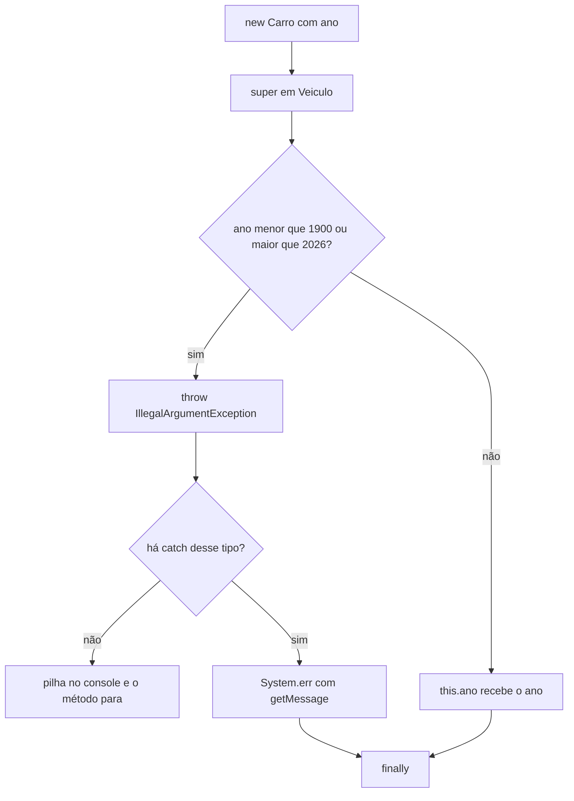

## Visão Geral do Conceito

A garagem já cria carro, moto e caminhão, calcula manutenção e agrupa revisão pela interface <mark style="background-color: #242424; padding: 2px 4px; border-radius: 3px; color: inherit;">`Revisto`</mark> ([[abstracao-interface-final-java]]). Dois problemas novos, descritos como requisitos funcionais — o que o sistema **deve** fazer, vindo da especificação, não de um ajuste silencioso do programador:

1. O programa precisa continuar quando algo inesperado acontece.
2. Os dados precisam existir depois que o programa termina. Nesta aula começa a **leitura** do texto; a montagem completa dos objetos, o vetor sem buracos e a **escrita** do relatório ficam na lição seguinte.

Exceção, no recorte da aula, é uma situação anormal na execução. Quem conhece a regra **lança**. Quem usa a operação e sabe o que fazer **trata**. O primeiro requisito escrito no bloco de notas:

> O sistema deve rejeitar veículos cujo ano seja menor que 1900 ou maior que 2026.

O ano entra pelo construtor. Carro, moto e caminhão delegam esse campo a <mark style="background-color: #242424; padding: 2px 4px; border-radius: 3px; color: inherit;">`super`</mark>. O <mark style="background-color: #242424; padding: 2px 4px; border-radius: 3px; color: inherit;">`if`</mark> fica em <mark style="background-color: #242424; padding: 2px 4px; border-radius: 3px; color: inherit;">`Veiculo`</mark>. Ano 2030 é um <mark style="background-color: #242424; padding: 2px 4px; border-radius: 3px; color: inherit;">`int`</mark> válido para a linguagem e inválido para o domínio. A aula recusou “consertar” 1700 para 1900: o requisito manda **rejeitar**.

O quarto requisito abre <mark style="background-color: #242424; padding: 2px 4px; border-radius: 3px; color: inherit;">`veiculos.csv`</mark>. Arquivo CSV, aqui, é arquivo **texto**. A combinação ensinada é <mark style="background-color: #242424; padding: 2px 4px; border-radius: 3px; color: inherit;">`FileReader`</mark> mais <mark style="background-color: #242424; padding: 2px 4px; border-radius: 3px; color: inherit;">`BufferedReader`</mark>.

> **Lacuna de fonte:** sem PDF/slides. Transcrição de 18/09/2026. Processamento em lote com Spring Batch foi exemplo oral de janela de horário e **não** é capítulo. Projeto web com banco foi adianto da disciplina seguinte. A aula citou que converter texto inválido em número dispara uma exceção específica e **não nomeou** a classe. <mark style="background-color: #242424; padding: 2px 4px; border-radius: 3px; color: inherit;">`try-with-resources`</mark> não foi usado.

## Modelo Mental

Duas responsabilidades:

| Quem | Faz | Na garagem |
|------|-----|------------|
| <mark style="background-color: #242424; padding: 2px 4px; border-radius: 3px; color: inherit;">`Veiculo`</mark> | Identifica ano ilegal e lança | <mark style="background-color: #242424; padding: 2px 4px; border-radius: 3px; color: inherit;">`throw`</mark> no construtor |
| <mark style="background-color: #242424; padding: 2px 4px; border-radius: 3px; color: inherit;">`GaragemExceptionApp`</mark> | Decide a mensagem e segue para o próximo veículo | <mark style="background-color: #242424; padding: 2px 4px; border-radius: 3px; color: inherit;">`try/catch`</mark> |
| Bloco <mark style="background-color: #242424; padding: 2px 4px; border-radius: 3px; color: inherit;">`finally`</mark> | Corre no fim da tentativa, com falha ou com sucesso | “fim do programa” |

Sem tratamento, o <mark style="background-color: #242424; padding: 2px 4px; border-radius: 3px; color: inherit;">`throw`</mark> aborta o método. Um Fiat válido impresso **antes** do Toyota 2030 aparece; a moto que viria **depois**, no mesmo fluxo sem <mark style="background-color: #242424; padding: 2px 4px; border-radius: 3px; color: inherit;">`catch`</mark>, não roda. A pilha impressa no console começa no <mark style="background-color: #242424; padding: 2px 4px; border-radius: 3px; color: inherit;">`main`</mark>, passa pelo construtor de <mark style="background-color: #242424; padding: 2px 4px; border-radius: 3px; color: inherit;">`Carro`</mark> e aponta a linha do <mark style="background-color: #242424; padding: 2px 4px; border-radius: 3px; color: inherit;">`throw`</mark> em <mark style="background-color: #242424; padding: 2px 4px; border-radius: 3px; color: inherit;">`Veiculo`</mark>. Essa pilha é útil para quem desenvolve e ruim como texto único para quem opera o sistema. O <mark style="background-color: #242424; padding: 2px 4px; border-radius: 3px; color: inherit;">`catch`</mark> troca a pilha por uma mensagem curta mais <mark style="background-color: #242424; padding: 2px 4px; border-radius: 3px; color: inherit;">`getMessage()`</mark>.



Na leitura, <mark style="background-color: #242424; padding: 2px 4px; border-radius: 3px; color: inherit;">`FileReader`</mark> aponta o arquivo. <mark style="background-color: #242424; padding: 2px 4px; border-radius: 3px; color: inherit;">`BufferedReader`</mark> lê por cima dele, linha a linha, com buffer. <mark style="background-color: #242424; padding: 2px 4px; border-radius: 3px; color: inherit;">`readLine()`</mark> devolve o texto ou <mark style="background-color: #242424; padding: 2px 4px; border-radius: 3px; color: inherit;">`null`</mark> quando acabou.

## Mecânica Central

### 1. Lançar no construtor, com o texto do requisito

Os limites no <mark style="background-color: #242424; padding: 2px 4px; border-radius: 3px; color: inherit;">`if`</mark> repetem os números da especificação: menor que 1900 **ou** maior que 2026. Equivalências matemáticas (maior ou igual a 2027) não foram o critério da aula, para o código continuar reconhecível na revisão do requisito.

```java
public Veiculo(String placa, String marca, int ano) {
    if (ano < 1900 || ano > 2026) {
        throw new IllegalArgumentException("Ano do veículo inválido: " + ano);
    }
    this.placa = placa;
    this.marca = marca;
    this.ano = ano;
}
```

<mark style="background-color: #242424; padding: 2px 4px; border-radius: 3px; color: inherit;">`throw`</mark> sinaliza. <mark style="background-color: #242424; padding: 2px 4px; border-radius: 3px; color: inherit;">`new IllegalArgumentException(mensagem)`</mark> usa o construtor que recebe o texto. Argumento ilegal: o chamador mandou um ano que a regra não aceita. Depois do <mark style="background-color: #242424; padding: 2px 4px; border-radius: 3px; color: inherit;">`throw`</mark>, <mark style="background-color: #242424; padding: 2px 4px; border-radius: 3px; color: inherit;">`this.ano = ano`</mark> **não** executa. O objeto não nasce com ano inválido.

<mark style="background-color: #242424; padding: 2px 4px; border-radius: 3px; color: inherit;">`IllegalArgumentException`</mark> herda de <mark style="background-color: #242424; padding: 2px 4px; border-radius: 3px; color: inherit;">`RuntimeException`</mark>, que herda de <mark style="background-color: #242424; padding: 2px 4px; border-radius: 3px; color: inherit;">`Exception`</mark>, que herda de <mark style="background-color: #242424; padding: 2px 4px; border-radius: 3px; color: inherit;">`Throwable`</mark>. A mensagem fica no detalhe que <mark style="background-color: #242424; padding: 2px 4px; border-radius: 3px; color: inherit;">`getMessage()`</mark> devolve. API: [IllegalArgumentException](https://docs.oracle.com/en/java/javase/17/docs/api/java.base/java/lang/IllegalArgumentException.html).

O requisito de mensagem compreensível é esse texto no construtor da exceção. O requisito de não derrubar a aplicação inteira é o tratamento em quem chama.

### 2. `try/catch` específico e um bloco por tentativa

```java
try {
    Carro toyota = new Carro("ABC1D23", "Toyota", 2030, 4);
    toyota.exibirResumo();
} catch (IllegalArgumentException e) {
    System.err.println("Não foi possível criar o veículo: " + e.getMessage());
}
```

<mark style="background-color: #242424; padding: 2px 4px; border-radius: 3px; color: inherit;">`e`</mark> é o objeto da exceção lançada, no mesmo sentido em que uma variável guarda um <mark style="background-color: #242424; padding: 2px 4px; border-radius: 3px; color: inherit;">`Carro`</mark>. <mark style="background-color: #242424; padding: 2px 4px; border-radius: 3px; color: inherit;">`System.err`</mark> foi o canal usado para o registro, separado da saída normal.

<mark style="background-color: #242424; padding: 2px 4px; border-radius: 3px; color: inherit;">`catch (Exception e)`</mark> também capturaria, porque <mark style="background-color: #242424; padding: 2px 4px; border-radius: 3px; color: inherit;">`Exception`</mark> é ancestral. A aula pediu o tipo **específico** que o construtor lança. No depurador: o ano 2030 falha no segundo teste do <mark style="background-color: #242424; padding: 2px 4px; border-radius: 3px; color: inherit;">`if`</mark>, o <mark style="background-color: #242424; padding: 2px 4px; border-radius: 3px; color: inherit;">`throw`</mark> salta, a atribuição não ocorre, e o <mark style="background-color: #242424; padding: 2px 4px; border-radius: 3px; color: inherit;">`catch`</mark> compatível recebe o objeto. Ano 1847 cai no primeiro teste (menor que 1900). Ano 1947 passa.

Vários <mark style="background-color: #242424; padding: 2px 4px; border-radius: 3px; color: inherit;">`new`</mark> dentro do **mesmo** <mark style="background-color: #242424; padding: 2px 4px; border-radius: 3px; color: inherit;">`try`</mark>: o primeiro <mark style="background-color: #242424; padding: 2px 4px; border-radius: 3px; color: inherit;">`throw`</mark> pula o restante daquele bloco. Um <mark style="background-color: #242424; padding: 2px 4px; border-radius: 3px; color: inherit;">`try/catch`</mark> **por** criação deixa o próximo veículo ser tentado. A aula reconheceu a repetição e lembrou que, com muitos registros, o miolo vai para um laço — um <mark style="background-color: #242424; padding: 2px 4px; border-radius: 3px; color: inherit;">`try`</mark> dentro da repetição, não cem cópias manuscritas. Foi o que o requisito 3 pedia: tratar criação inválida sem encerrar toda a aplicação.

### 3. `finally`

<mark style="background-color: #242424; padding: 2px 4px; border-radius: 3px; color: inherit;">`finally`</mark> executa ao término do <mark style="background-color: #242424; padding: 2px 4px; border-radius: 3px; color: inherit;">`try`</mark>, tenha havido <mark style="background-color: #242424; padding: 2px 4px; border-radius: 3px; color: inherit;">`catch`</mark> ou não. A aula usou esse bloco para o encerramento (“fim do programa”), não para decidir se o ano é válido.

```java
try {
    try {
        Carro fiat = new Carro("DEF2G46", "Fiat", 1847, 2);
        fiat.exibirResumo();
    } catch (IllegalArgumentException e) {
        System.err.println("Não foi possível criar o veículo: " + e.getMessage());
    }
    try {
        Moto honda = new Moto("XYZ9A87", "Honda", 2023, 1000);
        honda.exibirResumo();
    } catch (IllegalArgumentException e) {
        System.err.println("Não foi possível criar o veículo: " + e.getMessage());
    }
} finally {
    System.out.println("fim do programa");
}
```

Dá para aninhar. Dá para escrever <mark style="background-color: #242424; padding: 2px 4px; border-radius: 3px; color: inherit;">`try/catch/finally`</mark> no mesmo nível: o <mark style="background-color: #242424; padding: 2px 4px; border-radius: 3px; color: inherit;">`catch`</mark> trata; o <mark style="background-color: #242424; padding: 2px 4px; border-radius: 3px; color: inherit;">`finally`</mark> corre nos dois desfechos. Se dois veículos inválidos dividem um único <mark style="background-color: #242424; padding: 2px 4px; border-radius: 3px; color: inherit;">`try`</mark>, só o primeiro erro aparece e o segundo <mark style="background-color: #242424; padding: 2px 4px; border-radius: 3px; color: inherit;">`new`</mark> não é avaliado — o <mark style="background-color: #242424; padding: 2px 4px; border-radius: 3px; color: inherit;">`finally`</mark> externo ainda imprime o fim.

### 4. Leitura: exceção verificada pelo compilador

<mark style="background-color: #242424; padding: 2px 4px; border-radius: 3px; color: inherit;">`FileReader`</mark> pode não achar o arquivo. O compilador exige decisão: declarar <mark style="background-color: #242424; padding: 2px 4px; border-radius: 3px; color: inherit;">`throws FileNotFoundException`</mark> no método, empurrando a responsabilidade para quem chama, ou tratar ali. No <mark style="background-color: #242424; padding: 2px 4px; border-radius: 3px; color: inherit;">`main`</mark>, a aula tratou no próprio método: não há outra classe da garagem para receber essa bola.

<mark style="background-color: #242424; padding: 2px 4px; border-radius: 3px; color: inherit;">`FileNotFoundException`</mark> herda de <mark style="background-color: #242424; padding: 2px 4px; border-radius: 3px; color: inherit;">`IOException`</mark>, que herda de <mark style="background-color: #242424; padding: 2px 4px; border-radius: 3px; color: inherit;">`Exception`</mark>. <mark style="background-color: #242424; padding: 2px 4px; border-radius: 3px; color: inherit;">`readLine`</mark> declara <mark style="background-color: #242424; padding: 2px 4px; border-radius: 3px; color: inherit;">`IOException`</mark> (leitura que falha, arquivo inacessível no meio do caminho). Um <mark style="background-color: #242424; padding: 2px 4px; border-radius: 3px; color: inherit;">`catch (IOException)`</mark> sozinho cobre os dois, porque o tipo do arquivo ausente é filho. A forma que a aula preferiu mostrar em seguida foram **dois** <mark style="background-color: #242424; padding: 2px 4px; border-radius: 3px; color: inherit;">`catch`</mark>, o mais específico primeiro:

```java
FileReader arquivo = null;
BufferedReader leitura = null;
try {
    arquivo = new FileReader("veiculos.csv");
    leitura = new BufferedReader(arquivo);
    String linha = leitura.readLine();
    while (linha != null) {
        System.out.println(linha);
        linha = leitura.readLine();
    }
} catch (FileNotFoundException e) {
    System.err.println("Impossível abrir o arquivo: " + e.getMessage());
} catch (IOException e) {
    System.err.println("Impossível ler o arquivo: " + e.getMessage());
} finally {
    System.out.println("fim do processamento");
}
```

Nome trocado para <mark style="background-color: #242424; padding: 2px 4px; border-radius: 3px; color: inherit;">`veiculos.txt`</mark> quando o arquivo era <mark style="background-color: #242424; padding: 2px 4px; border-radius: 3px; color: inherit;">`veiculos.csv`</mark> caiu no primeiro <mark style="background-color: #242424; padding: 2px 4px; border-radius: 3px; color: inherit;">`catch`</mark>. <mark style="background-color: #242424; padding: 2px 4px; border-radius: 3px; color: inherit;">`printStackTrace()`</mark> reimprime a pilha; a aula tirou essa chamada e ficou com <mark style="background-color: #242424; padding: 2px 4px; border-radius: 3px; color: inherit;">`getMessage()`</mark>.

<mark style="background-color: #242424; padding: 2px 4px; border-radius: 3px; color: inherit;">`IllegalArgumentException`</mark> não obriga <mark style="background-color: #242424; padding: 2px 4px; border-radius: 3px; color: inherit;">`throws`</mark> nem <mark style="background-color: #242424; padding: 2px 4px; border-radius: 3px; color: inherit;">`catch`</mark> para o código compilar. <mark style="background-color: #242424; padding: 2px 4px; border-radius: 3px; color: inherit;">`FileNotFoundException`</mark> e <mark style="background-color: #242424; padding: 2px 4px; border-radius: 3px; color: inherit;">`IOException`</mark> obrigam. Essa diferença é o que o compilador mostrou na aula ao sublinhar o <mark style="background-color: #242424; padding: 2px 4px; border-radius: 3px; color: inherit;">`FileReader`</mark>.

### 5. Fim de arquivo e o laço que não relê

Três <mark style="background-color: #242424; padding: 2px 4px; border-radius: 3px; color: inherit;">`readLine`</mark> seguidos numa arquivo de duas linhas imprimem a primeira, a segunda e <mark style="background-color: #242424; padding: 2px 4px; border-radius: 3px; color: inherit;">`null`</mark>. Esse <mark style="background-color: #242424; padding: 2px 4px; border-radius: 3px; color: inherit;">`null`</mark> é o fim, não uma linha vazia com texto.

O <mark style="background-color: #242424; padding: 2px 4px; border-radius: 3px; color: inherit;">`while`</mark> que testa <mark style="background-color: #242424; padding: 2px 4px; border-radius: 3px; color: inherit;">`linha != null`</mark> e **não** chama <mark style="background-color: #242424; padding: 2px 4px; border-radius: 3px; color: inherit;">`readLine`</mark> de novo imprime a mesma linha sem parar. A leitura seguinte fica no fim do corpo. A aula também mostrou a atribuição dentro da condição do <mark style="background-color: #242424; padding: 2px 4px; border-radius: 3px; color: inherit;">`while`</mark> e voltou para a forma tradicional, que é a que esta lição fixa.

Pacotes reorganizados no mesmo encontro, sem mudar o comportamento: classes de domínio (veículo, carro, moto, caminhão, máquina, documento) em <mark style="background-color: #242424; padding: 2px 4px; border-radius: 3px; color: inherit;">`model`</mark>; <mark style="background-color: #242424; padding: 2px 4px; border-radius: 3px; color: inherit;">`Revisto`</mark> em <mark style="background-color: #242424; padding: 2px 4px; border-radius: 3px; color: inherit;">`interfaces`</mark>; classes com <mark style="background-color: #242424; padding: 2px 4px; border-radius: 3px; color: inherit;">`main`</mark> permanecem no pacote da garagem. A classe de leitura foi <mark style="background-color: #242424; padding: 2px 4px; border-radius: 3px; color: inherit;">`GaragemArquivosApp`</mark>.

O <mark style="background-color: #242424; padding: 2px 4px; border-radius: 3px; color: inherit;">`split`</mark> e o <mark style="background-color: #242424; padding: 2px 4px; border-radius: 3px; color: inherit;">`switch`</mark> do tipo da linha foram **iniciados** e não fechados com objetos reais. Isso é a próxima lição: [[leitura-escrita-arquivo-polimorfismo-java]].

Guia de exceções: [Exceptions](https://docs.oracle.com/javase/tutorial/essential/exceptions/index.html). Leitura: [BufferedReader.readLine](https://docs.oracle.com/en/java/javase/17/docs/api/java.base/java/io/BufferedReader.html#readLine()).

## Uso Prático

Massas usadas em sala para o ano: Toyota com 2030 (rejeitado), Fiat com 1947 (aceito), outra tentativa com 1847 (rejeitada). Cada rejeição imprime a mensagem e o programa segue até o <mark style="background-color: #242424; padding: 2px 4px; border-radius: 3px; color: inherit;">`finally`</mark>.

Arquivo de trabalho, ainda só como texto (o significado de cada coluna é requisito da aula seguinte; aqui a meta é obter as linhas):

```text
AP;ABC1D23;Toyota;2024;4
M;XYZ9A87;Honda;2023;1000
```

Com o nome certo, o laço imprime as duas linhas e o <mark style="background-color: #242424; padding: 2px 4px; border-radius: 3px; color: inherit;">`finally`</mark> avisa o fim. Com o nome errado, só a mensagem de abertura e o fim — o <mark style="background-color: #242424; padding: 2px 4px; border-radius: 3px; color: inherit;">`while`</mark> não começa.

O aviso amarelo de recurso não fechado apareceu no <mark style="background-color: #242424; padding: 2px 4px; border-radius: 3px; color: inherit;">`BufferedReader`</mark>. O <mark style="background-color: #242424; padding: 2px 4px; border-radius: 3px; color: inherit;">`close()`</mark> foi aplicado de fato na aula seguinte, quando o fluxo de leitura já estava estável. Nesta lição o ponto é: abrir, ler até <mark style="background-color: #242424; padding: 2px 4px; border-radius: 3px; color: inherit;">`null`</mark>, distinguir arquivo ausente de falha de leitura.

## Erros Comuns

**Validar o ano só numa filha.** Moto e caminhão continuam aceitando 2030 pelo construtor da mãe.

**Ajustar o ano inválido para 1900 ou 2026.** O requisito manda rejeitar. O atributo não deve ser gravado com um valor que o chamador não enviou.

**Trocar o limite da especificação por uma desigualdade “equivalente” sem necessidade.** A aula manteve `< 1900` e `> 2026` para o código bater com o texto do requisito.

**<mark style="background-color: #242424; padding: 2px 4px; border-radius: 3px; color: inherit;">`catch (Exception)`</mark> quando a exceção lançada já é conhecida.** Funciona e esconde qual falha aquele bloco pretende tratar. O <mark style="background-color: #242424; padding: 2px 4px; border-radius: 3px; color: inherit;">`catch`</mark> da aula nomeia <mark style="background-color: #242424; padding: 2px 4px; border-radius: 3px; color: inherit;">`IllegalArgumentException`</mark>.

**Um <mark style="background-color: #242424; padding: 2px 4px; border-radius: 3px; color: inherit;">`try`</mark> para o lote inteiro quando cada item deve ser tentado.** O primeiro <mark style="background-color: #242424; padding: 2px 4px; border-radius: 3px; color: inherit;">`throw`</mark> abandona o resto do bloco. O <mark style="background-color: #242424; padding: 2px 4px; border-radius: 3px; color: inherit;">`finally`</mark> não “volta” para o próximo <mark style="background-color: #242424; padding: 2px 4px; border-radius: 3px; color: inherit;">`new`</mark>.

**Achar que <mark style="background-color: #242424; padding: 2px 4px; border-radius: 3px; color: inherit;">`finally`</mark> só corre quando há erro.** A frase impressa em sala apareceu com rejeição e com sucesso.

**<mark style="background-color: #242424; padding: 2px 4px; border-radius: 3px; color: inherit;">`throws FileNotFoundException`</mark> no <mark style="background-color: #242424; padding: 2px 4px; border-radius: 3px; color: inherit;">`main`</mark> como solução final.** A declaração empurra o problema para quem chamou. No aplicativo de teste, quem chamou é o próprio início do programa. A aula removeu o <mark style="background-color: #242424; padding: 2px 4px; border-radius: 3px; color: inherit;">`throws`</mark> e tratou no <mark style="background-color: #242424; padding: 2px 4px; border-radius: 3px; color: inherit;">`catch`</mark>.

**Catch de <mark style="background-color: #242424; padding: 2px 4px; border-radius: 3px; color: inherit;">`IOException`</mark> antes de <mark style="background-color: #242424; padding: 2px 4px; border-radius: 3px; color: inherit;">`FileNotFoundException`</mark>.** O filho ficaria inalcançável: o ancestral já teria capturado. A ordem da aula é arquivo ausente primeiro, leitura depois.

**Laço que não relê.** Sintoma: a primeira linha repetida até interromper o processo. A próxima <mark style="background-color: #242424; padding: 2px 4px; border-radius: 3px; color: inherit;">`readLine`</mark> precisa acontecer a cada volta.

## Visão Geral de Debugging

1. A pilha cita <mark style="background-color: #242424; padding: 2px 4px; border-radius: 3px; color: inherit;">`GaragemExceptionApp`</mark>, depois <mark style="background-color: #242424; padding: 2px 4px; border-radius: 3px; color: inherit;">`Carro`</mark>, depois <mark style="background-color: #242424; padding: 2px 4px; border-radius: 3px; color: inherit;">`Veiculo`</mark>? O <mark style="background-color: #242424; padding: 2px 4px; border-radius: 3px; color: inherit;">`new`</mark> está na primeira linha, o <mark style="background-color: #242424; padding: 2px 4px; border-radius: 3px; color: inherit;">`super`</mark> na segunda, o <mark style="background-color: #242424; padding: 2px 4px; border-radius: 3px; color: inherit;">`throw`</mark> na terceira. Confira o ano contra 1900 e 2026.
2. “fim do programa” não aparece? O fluxo estourou sem <mark style="background-color: #242424; padding: 2px 4px; border-radius: 3px; color: inherit;">`catch`</mark> e o <mark style="background-color: #242424; padding: 2px 4px; border-radius: 3px; color: inherit;">`println`</mark> estava **depois** do código que lança, fora de um <mark style="background-color: #242424; padding: 2px 4px; border-radius: 3px; color: inherit;">`finally`</mark>.
3. Só um dos dois anos inválidos foi reportado? Os dois <mark style="background-color: #242424; padding: 2px 4px; border-radius: 3px; color: inherit;">`new`</mark> estão no mesmo <mark style="background-color: #242424; padding: 2px 4px; border-radius: 3px; color: inherit;">`try`</mark>.
4. No depurador, <mark style="background-color: #242424; padding: 2px 4px; border-radius: 3px; color: inherit;">`detailMessage`</mark> do objeto capturado deve ser o texto passado ao construtor da exceção. Se <mark style="background-color: #242424; padding: 2px 4px; border-radius: 3px; color: inherit;">`getMessage()`</mark> vier vazio, o <mark style="background-color: #242424; padding: 2px 4px; border-radius: 3px; color: inherit;">`throw`</mark> usou um construtor sem mensagem.
5. Nenhum veículo impresso e a mensagem é de arquivo? O nome passado ao <mark style="background-color: #242424; padding: 2px 4px; border-radius: 3px; color: inherit;">`FileReader`</mark> não é o arquivo do projeto. Esse caminho nem chega no <mark style="background-color: #242424; padding: 2px 4px; border-radius: 3px; color: inherit;">`while`</mark>.
6. Linha infinita? Breakpoint no <mark style="background-color: #242424; padding: 2px 4px; border-radius: 3px; color: inherit;">`while`</mark>: se <mark style="background-color: #242424; padding: 2px 4px; border-radius: 3px; color: inherit;">`linha`</mark> não muda, falta <mark style="background-color: #242424; padding: 2px 4px; border-radius: 3px; color: inherit;">`readLine`</mark> no corpo.

<details>
<summary>Ordem do depurador no ano 2030</summary>

Entra em <mark style="background-color: #242424; padding: 2px 4px; border-radius: 3px; color: inherit;">`Carro`</mark>, segue o <mark style="background-color: #242424; padding: 2px 4px; border-radius: 3px; color: inherit;">`super`</mark> para <mark style="background-color: #242424; padding: 2px 4px; border-radius: 3px; color: inherit;">`Veiculo`</mark>, avalia `ano < 1900` (falso) e `ano > 2026` (verdadeiro), lança, não atribui os campos e cai no <mark style="background-color: #242424; padding: 2px 4px; border-radius: 3px; color: inherit;">`catch`</mark> cujo tipo é o da exceção ou um ancestral. Em seguida o <mark style="background-color: #242424; padding: 2px 4px; border-radius: 3px; color: inherit;">`finally`</mark>, se existir.

</details>

## Principais Pontos

- Requisito funcional descreve o que rejeitar; o programador não substitui o ano por um limite “próximo”.
- <mark style="background-color: #242424; padding: 2px 4px; border-radius: 3px; color: inherit;">`throw new IllegalArgumentException`</mark> no construtor de <mark style="background-color: #242424; padding: 2px 4px; border-radius: 3px; color: inherit;">`Veiculo`</mark> impede <mark style="background-color: #242424; padding: 2px 4px; border-radius: 3px; color: inherit;">`this.ano = ano`</mark>.
- Quem lança não é, nesta aula, quem trata. O <mark style="background-color: #242424; padding: 2px 4px; border-radius: 3px; color: inherit;">`main`</mark> de teste captura e segue.
- Um <mark style="background-color: #242424; padding: 2px 4px; border-radius: 3px; color: inherit;">`try`</mark> por tentativa (ou por volta do laço) deixa o próximo veículo nascer.
- <mark style="background-color: #242424; padding: 2px 4px; border-radius: 3px; color: inherit;">`finally`</mark> corre com erro e sem erro.
- <mark style="background-color: #242424; padding: 2px 4px; border-radius: 3px; color: inherit;">`FileNotFoundException`</mark> é filha de <mark style="background-color: #242424; padding: 2px 4px; border-radius: 3px; color: inherit;">`IOException`</mark>; o <mark style="background-color: #242424; padding: 2px 4px; border-radius: 3px; color: inherit;">`catch`</mark> específico vem primeiro.
- <mark style="background-color: #242424; padding: 2px 4px; border-radius: 3px; color: inherit;">`readLine() == null`</mark> encerra o arquivo; a próxima leitura fica dentro do <mark style="background-color: #242424; padding: 2px 4px; border-radius: 3px; color: inherit;">`while`</mark>.

## Preparação para Prática

Antes do laboratório, você deve conseguir:

1. Rejeitar ano menor que 1900 ou maior que 2026 com uma mensagem que inclui o valor.
2. Processar uma lista de anos em que um inválido não apaga os válidos seguintes.
3. Garantir um encerramento impresso mesmo quando houve rejeição.
4. Abrir um nome de arquivo e, se não existir, devolver erro de abertura sem ler linhas.
5. Copiar linhas até o marcador de fim, sem repetir a primeira para sempre.

## Laboratório de Prática

> Editor ISS: JavaScript espelhando a lógica. Lançar exceção de verdade derrubaria o script se ninguém capturasse; o laboratório devolve o resultado do tratamento, que é o que o <mark style="background-color: #242424; padding: 2px 4px; border-radius: 3px; color: inherit;">`catch`</mark> da aula produz. O arquivo roda com os <mark style="background-color: #242424; padding: 2px 4px; border-radius: 3px; color: inherit;">`TODO`</mark> abertos.

### Easy — Ano do requisito

**Contexto:** cadastro de veículo. 1947 entra. 1847 e 2030 são argumento ilegal. A mensagem leva o ano recebido.

```javascript
function avaliarAno(ano) {
  // Espelho Java: if (ano < 1900 || ano > 2026) throw new IllegalArgumentException("Ano do veículo inválido: " + ano);
  // TODO: se fora da faixa, retornar { aceito: false, mensagem: "Ano do veículo inválido: " + ano }
  // TODO: se dentro, retornar { aceito: true, mensagem: "" }
  return { aceito: true, mensagem: "" };
}

console.log(avaliarAno(1947)); // { aceito: true, mensagem: "" }
console.log(avaliarAno(2030)); // { aceito: false, mensagem: "Ano do veículo inválido: 2030" }
console.log(avaliarAno(1847)); // { aceito: false, mensagem: "Ano do veículo inválido: 1847" }
```

### Medium — Cada tentativa isolada e o finally

**Contexto:** o programa principal recebe quatro anos. Dois são inválidos. Os válidos devem ser aceitos, os inválidos registrados, e o encerramento precisa aparecer sempre.

```javascript
function avaliarAno(ano) {
  if (ano < 1900 || ano > 2026) {
    return { aceito: false, mensagem: "Ano do veículo inválido: " + ano };
  }
  return { aceito: true, mensagem: "" };
}

function processarCadastros(anos) {
  const aceitos = [];
  const rejeitados = [];
  let encerramento = "";
  // Espelho Java: um try/catch por veículo, finally com "fim do programa"
  // TODO: para cada ano, se aceito, aceitos.push(ano); senão rejeitados.push(mensagem)
  // TODO: encerramento = "fim do programa" depois das tentativas, haja rejeição ou não
  return { aceitos, rejeitados, encerramento };
}

const lote = processarCadastros([1947, 2030, 2024, 1847]);
console.log(lote.aceitos);      // [1947, 2024]
console.log(lote.rejeitados);   // duas mensagens, 2030 e 1847
console.log(lote.encerramento); // fim do programa
```

### Hard — Abrir o arquivo e ler até null

**Contexto:** importação noturna. O mapa simula o disco. Chave ausente é arquivo não encontrado. O valor <mark style="background-color: #242424; padding: 2px 4px; border-radius: 3px; color: inherit;">`null`</mark> dentro da lista é o fim devolvido por <mark style="background-color: #242424; padding: 2px 4px; border-radius: 3px; color: inherit;">`readLine`</mark> e não entra nas linhas úteis.

```javascript
function lerArquivo(nome, arquivos) {
  const linhas = [];
  let erro = "";
  let encerramento = "";
  // TODO: se arquivos[nome] for undefined, erro = "Impossível abrir o arquivo: " + nome
  // TODO: senão, percorrer o array e parar ao encontrar null, sem incluir o null
  // TODO: encerramento = "fim do processamento" nos dois casos
  return { erro, linhas, encerramento };
}

const disco = {
  "veiculos.csv": ["AP;ABC1D23;Toyota;2024;4", "M;XYZ9A87;Honda;2023;1000", null]
};

console.log(lerArquivo("veiculos.csv", disco).linhas.length); // 2
console.log(lerArquivo("veiculos.txt", disco).erro);          // Impossível abrir o arquivo: veiculos.txt
console.log(lerArquivo("veiculos.csv", disco).encerramento);  // fim do processamento
```

---

<!-- LESSONS_JSON_META
discipline: fundamentos-java
slug: excecoes-leitura-arquivo-java
title: Exceções e leitura de arquivo texto
order: 17
file: content/fundamentos-java/aula-17-excecoes-leitura-arquivo-java.md
NOTE: lessons.json / search-index.json / disciplines.json NÃO editados nesta missão (integração serial pelo orquestrador).
-->

<!-- CONCEPT_EXTRACTION
concepts:
  - requisito funcional
  - ano menor que 1900 ou maior que 2026
  - validação no construtor de Veiculo
  - throw IllegalArgumentException
  - pilha de execução
  - try/catch específico
  - getMessage e System.err
  - um try por criação
  - finally
  - try aninhado
  - RuntimeException versus IOException
  - FileReader e BufferedReader
  - FileNotFoundException antes de IOException
  - readLine null
  - while que relê a linha
  - pacotes model e interfaces
skills:
  - Rejeitar ano ilegal sem gravar o atributo
  - Separar quem lança de quem trata
  - Capturar IllegalArgumentException e seguir para o próximo veículo
  - Encerrar com finally nos dois desfechos
  - Abrir arquivo texto e distinguir ausência de falha de leitura
  - Interromper a leitura quando readLine devolve null
examples:
  - veiculo-throw-ano
  - garagem-exception-app-try-por-veiculo
  - try-catch-finally-fim
  - file-reader-buffered-reader
  - while-readline-null
-->

<!-- EXERCISES_JSON
[
  {
    "id": "jv17-avaliar-ano",
    "slug": "jv17-avaliar-ano",
    "difficulty": "easy",
    "title": "Ano do requisito",
    "discipline": "fundamentos-java",
    "editorLanguage": "javascript",
    "tags": ["java", "excecao", "illegal-argument", "ano"],
    "summary": "Rejeitar ano menor que 1900 ou maior que 2026 com a mensagem que inclui o valor."
  },
  {
    "id": "jv17-cadastros-isolados",
    "slug": "jv17-cadastros-isolados",
    "difficulty": "medium",
    "title": "Cada tentativa isolada e o finally",
    "discipline": "fundamentos-java",
    "editorLanguage": "javascript",
    "tags": ["java", "try-catch", "finally", "lote"],
    "summary": "Aceitar 1947 e 2024, registrar 2030 e 1847, e sempre encerrar com fim do programa."
  },
  {
    "id": "jv17-ler-ate-null",
    "slug": "jv17-ler-ate-null",
    "difficulty": "hard",
    "title": "Abrir o arquivo e ler até null",
    "discipline": "fundamentos-java",
    "editorLanguage": "javascript",
    "tags": ["java", "arquivo", "filenotfound", "readline"],
    "summary": "Ler duas linhas de veiculos.csv, parar no null e falhar a abertura de veiculos.txt."
  }
]
-->
