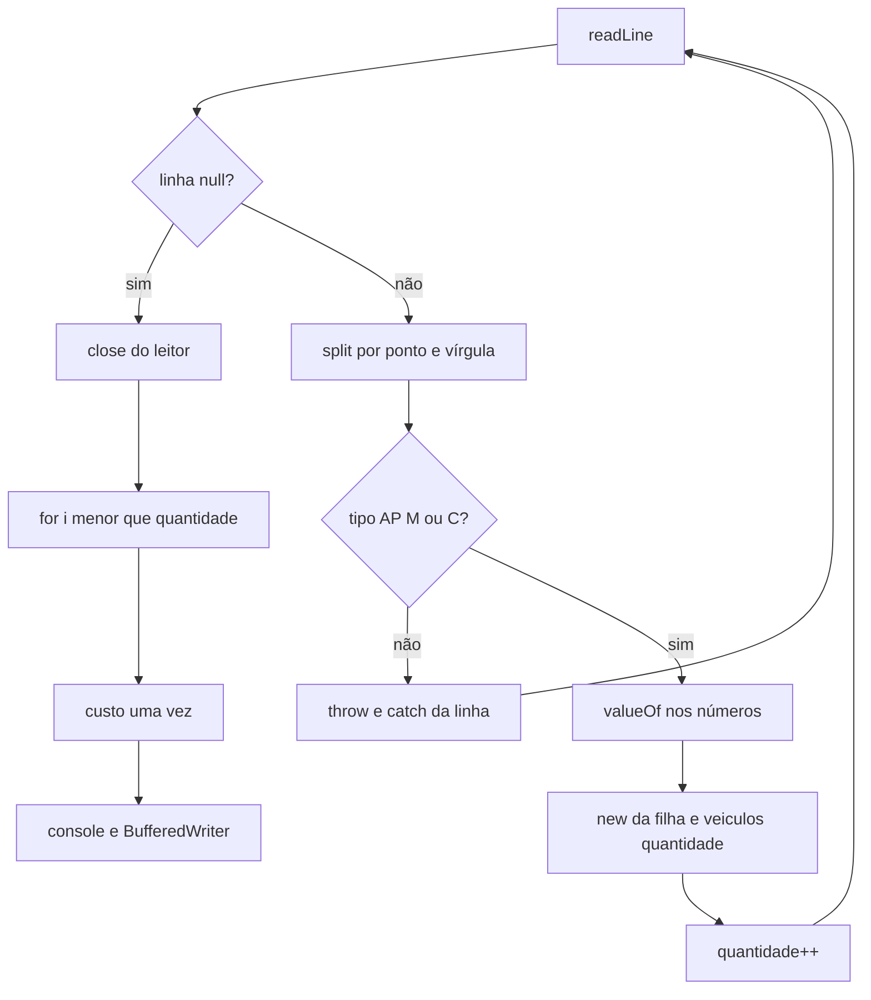

## Visão Geral do Conceito

A leitura de <mark style="background-color: #242424; padding: 2px 4px; border-radius: 3px; color: inherit;">`veiculos.csv`</mark> já abre o arquivo, trata <mark style="background-color: #242424; padding: 2px 4px; border-radius: 3px; color: inherit;">`FileNotFoundException`</mark> e <mark style="background-color: #242424; padding: 2px 4px; border-radius: 3px; color: inherit;">`IOException`</mark> e para quando <mark style="background-color: #242424; padding: 2px 4px; border-radius: 3px; color: inherit;">`readLine`</mark> devolve <mark style="background-color: #242424; padding: 2px 4px; border-radius: 3px; color: inherit;">`null`</mark> ([[excecoes-leitura-arquivo-java]]). O ano ilegal já nasce como <mark style="background-color: #242424; padding: 2px 4px; border-radius: 3px; color: inherit;">`IllegalArgumentException`</mark> no construtor de <mark style="background-color: #242424; padding: 2px 4px; border-radius: 3px; color: inherit;">`Veiculo`</mark>. Esta aula **termina** o fluxo que a anterior deixou no meio do <mark style="background-color: #242424; padding: 2px 4px; border-radius: 3px; color: inherit;">`switch`</mark>.

Requisitos que passam a valer por completo:

- Cada linha informa tipo, placa, marca, ano e um dado específico.
- O sistema cria carro, moto ou caminhão conforme o tipo.
- Linha inválida é informada e a linha seguinte continua.
- Depois da leitura, o sistema percorre os veículos **carregados** e chama <mark style="background-color: #242424; padding: 2px 4px; border-radius: 3px; color: inherit;">`calcularCustoManutencao`</mark> por polimorfismo.
- Gera <mark style="background-color: #242424; padding: 2px 4px; border-radius: 3px; color: inherit;">`relatorio-garagem.txt`</mark> com resumo e custo.
- Falha de acesso ao arquivo continua tratada de forma curta; o leitor e o escritor são fechados.

O vetor continua sendo a única coleção usada. Tamanho fixo: a aula alocou 10 e preencheu só quem passou na linha. <mark style="background-color: #242424; padding: 2px 4px; border-radius: 3px; color: inherit;">`for-each`</mark> no array inteiro encontra <mark style="background-color: #242424; padding: 2px 4px; border-radius: 3px; color: inherit;">`null`</mark> e lança <mark style="background-color: #242424; padding: 2px 4px; border-radius: 3px; color: inherit;">`NullPointerException`</mark>. O contador de quantos objetos entraram permite um <mark style="background-color: #242424; padding: 2px 4px; border-radius: 3px; color: inherit;">`for`</mark> clássico que para na quantidade real.

> **Lacuna de fonte:** sem PDF/slides. Transcrição de 24/09/2026. Na aula anterior o caminhão chegou a ser cogitado com a letra <mark style="background-color: #242424; padding: 2px 4px; border-radius: 3px; color: inherit;">`T`</mark> (truck). O código revisto em 24/09 usa <mark style="background-color: #242424; padding: 2px 4px; border-radius: 3px; color: inherit;">`AP`</mark> (automóvel particular → carro), <mark style="background-color: #242424; padding: 2px 4px; border-radius: 3px; color: inherit;">`M`</mark> (moto) e <mark style="background-color: #242424; padding: 2px 4px; border-radius: 3px; color: inherit;">`C`</mark> (caminhão). Letra <mark style="background-color: #242424; padding: 2px 4px; border-radius: 3px; color: inherit;">`A`</mark> cai no <mark style="background-color: #242424; padding: 2px 4px; border-radius: 3px; color: inherit;">`default`</mark>. Entrega do trabalho (Git, zip, Moodle) foi orientação de prazo, não conteúdo técnico. <mark style="background-color: #242424; padding: 2px 4px; border-radius: 3px; color: inherit;">`toString`</mark> especializado em cada filha foi comentado como evolução e **não** implementado: o arquivo gravou o <mark style="background-color: #242424; padding: 2px 4px; border-radius: 3px; color: inherit;">`toString`</mark> da mãe (placa, marca, ano) mais o custo.

## Modelo Mental

Uma linha válida é um veículo esperando construtor. Uma linha inválida é um registro para o log, não um motivo para abandonar o arquivo.



O <mark style="background-color: #242424; padding: 2px 4px; border-radius: 3px; color: inherit;">`switch`</mark> escolhe a classe. A variável que recebe o <mark style="background-color: #242424; padding: 2px 4px; border-radius: 3px; color: inherit;">`new`</mark> é do tipo <mark style="background-color: #242424; padding: 2px 4px; border-radius: 3px; color: inherit;">`Veiculo`</mark>: ora carro, ora moto, ora caminhão. A inclusão no array fica **uma** vez, depois do <mark style="background-color: #242424; padding: 2px 4px; border-radius: 3px; color: inherit;">`switch`</mark>. Se o <mark style="background-color: #242424; padding: 2px 4px; border-radius: 3px; color: inherit;">`default`</mark> lança, essa inclusão não executa e o <mark style="background-color: #242424; padding: 2px 4px; border-radius: 3px; color: inherit;">`catch`</mark> daquela volta registra a linha.

Índices da linha, do zero:

| Índice | Campo | Uso |
|--------|--------|-----|
| 0 | tipo | <mark style="background-color: #242424; padding: 2px 4px; border-radius: 3px; color: inherit;">`AP`</mark>, <mark style="background-color: #242424; padding: 2px 4px; border-radius: 3px; color: inherit;">`M`</mark>, <mark style="background-color: #242424; padding: 2px 4px; border-radius: 3px; color: inherit;">`C`</mark> |
| 1 | placa | <mark style="background-color: #242424; padding: 2px 4px; border-radius: 3px; color: inherit;">`String`</mark> |
| 2 | marca | <mark style="background-color: #242424; padding: 2px 4px; border-radius: 3px; color: inherit;">`String`</mark> |
| 3 | ano | texto → <mark style="background-color: #242424; padding: 2px 4px; border-radius: 3px; color: inherit;">`int`</mark> |
| 4 | específico | portas ou cilindradas (<mark style="background-color: #242424; padding: 2px 4px; border-radius: 3px; color: inherit;">`int`</mark>); no caminhão, capacidade (<mark style="background-color: #242424; padding: 2px 4px; border-radius: 3px; color: inherit;">`double`</mark>) |

## Mecânica Central

### 1. `split`, `switch` e conversão

```java
String[] campos = linha.split(";");
String tipo = campos[0];
```

<mark style="background-color: #242424; padding: 2px 4px; border-radius: 3px; color: inherit;">`split`</mark> devolve <mark style="background-color: #242424; padding: 2px 4px; border-radius: 3px; color: inherit;">`String[]`</mark>. Comparar texto com <mark style="background-color: #242424; padding: 2px 4px; border-radius: 3px; color: inherit;">`==`</mark> não é o critério da aula: <mark style="background-color: #242424; padding: 2px 4px; border-radius: 3px; color: inherit;">`String`</mark> usa <mark style="background-color: #242424; padding: 2px 4px; border-radius: 3px; color: inherit;">`equals`</mark> (ou <mark style="background-color: #242424; padding: 2px 4px; border-radius: 3px; color: inherit;">`equalsIgnoreCase`</mark>). O <mark style="background-color: #242424; padding: 2px 4px; border-radius: 3px; color: inherit;">`switch`</mark> sobre o tipo organiza os três casos que o <mark style="background-color: #242424; padding: 2px 4px; border-radius: 3px; color: inherit;">`if`</mark> também conseguiria escrever.

O construtor de <mark style="background-color: #242424; padding: 2px 4px; border-radius: 3px; color: inherit;">`Carro`</mark> espera <mark style="background-color: #242424; padding: 2px 4px; border-radius: 3px; color: inherit;">`String, String, int, int`</mark>. <mark style="background-color: #242424; padding: 2px 4px; border-radius: 3px; color: inherit;">`campos[3]`</mark> e <mark style="background-color: #242424; padding: 2px 4px; border-radius: 3px; color: inherit;">`campos[4]`</mark> ainda são texto. A aula abriu a classe empacotadora <mark style="background-color: #242424; padding: 2px 4px; border-radius: 3px; color: inherit;">`Integer`</mark> (ao lado do primitivo <mark style="background-color: #242424; padding: 2px 4px; border-radius: 3px; color: inherit;">`int`</mark>) e usou <mark style="background-color: #242424; padding: 2px 4px; border-radius: 3px; color: inherit;">`Integer.valueOf`</mark>. Viu também <mark style="background-color: #242424; padding: 2px 4px; border-radius: 3px; color: inherit;">`parseInt`</mark> na lista de métodos e ficou com <mark style="background-color: #242424; padding: 2px 4px; border-radius: 3px; color: inherit;">`valueOf`</mark>. O caminhão usa <mark style="background-color: #242424; padding: 2px 4px; border-radius: 3px; color: inherit;">`Double.valueOf`</mark> na capacidade. O valor retornado encaixa no parâmetro primitivo do construtor.

```java
Veiculo veiculo;
switch (tipo) {
    case "AP":
        veiculo = new Carro(
            campos[1], campos[2],
            Integer.valueOf(campos[3]),
            Integer.valueOf(campos[4]));
        break;
    case "M":
        veiculo = new Moto(
            campos[1], campos[2],
            Integer.valueOf(campos[3]),
            Integer.valueOf(campos[4]));
        break;
    case "C":
        veiculo = new Caminhao(
            campos[1], campos[2],
            Integer.valueOf(campos[3]),
            Double.valueOf(campos[4]));
        break;
    default:
        throw new IllegalArgumentException("Tipo de veículo inválido: " + tipo);
}
veiculos[quantidade] = veiculo;
quantidade++;
```

O <mark style="background-color: #242424; padding: 2px 4px; border-radius: 3px; color: inherit;">`break`</mark> do <mark style="background-color: #242424; padding: 2px 4px; border-radius: 3px; color: inherit;">`default`</mark> foi removido na aula porque o <mark style="background-color: #242424; padding: 2px 4px; border-radius: 3px; color: inherit;">`throw`</mark> já abandona o bloco. Ano fora de 1900–2026 estoura no <mark style="background-color: #242424; padding: 2px 4px; border-radius: 3px; color: inherit;">`super`</mark> de <mark style="background-color: #242424; padding: 2px 4px; border-radius: 3px; color: inherit;">`Veiculo`</mark> com a mesma família de exceção, sem linha nova de validação.

Esse <mark style="background-color: #242424; padding: 2px 4px; border-radius: 3px; color: inherit;">`switch`</mark> fica **dentro** de um <mark style="background-color: #242424; padding: 2px 4px; border-radius: 3px; color: inherit;">`try`</mark> que está **dentro** do <mark style="background-color: #242424; padding: 2px 4px; border-radius: 3px; color: inherit;">`while`</mark>. O <mark style="background-color: #242424; padding: 2px 4px; border-radius: 3px; color: inherit;">`catch`</mark> nomeia <mark style="background-color: #242424; padding: 2px 4px; border-radius: 3px; color: inherit;">`IllegalArgumentException`</mark>:

```java
} catch (IllegalArgumentException e) {
    System.err.println("Linha inválida: " + linha);
    System.err.println("Motivo: " + e.getMessage());
}
```

A volta acaba, o <mark style="background-color: #242424; padding: 2px 4px; border-radius: 3px; color: inherit;">`while`</mark> lê a próxima linha. Foi o requisito das linhas inválidas. Um <mark style="background-color: #242424; padding: 2px 4px; border-radius: 3px; color: inherit;">`throw`</mark> sem esse <mark style="background-color: #242424; padding: 2px 4px; border-radius: 3px; color: inherit;">`catch`</mark> interno parou o arquivo inteiro na primeira letra desconhecida — a aula viu o corte e então cercou o miolo.

### 2. Vetor, nulos e o contador

```java
Veiculo[] veiculos = new Veiculo[10];
int quantidade = 0;
```

Referência em Java nasce <mark style="background-color: #242424; padding: 2px 4px; border-radius: 3px; color: inherit;">`null`</mark>. Dez posições significam dez <mark style="background-color: #242424; padding: 2px 4px; border-radius: 3px; color: inherit;">`null`</mark> até alguém atribuir. <mark style="background-color: #242424; padding: 2px 4px; border-radius: 3px; color: inherit;">`for (Veiculo v : veiculos) v.exibirResumo()`</mark> chama método em <mark style="background-color: #242424; padding: 2px 4px; border-radius: 3px; color: inherit;">`null`</mark> na primeira posição vazia: <mark style="background-color: #242424; padding: 2px 4px; border-radius: 3px; color: inherit;">`NullPointerException`</mark>.

Filtrar com <mark style="background-color: #242424; padding: 2px 4px; border-radius: 3px; color: inherit;">`if (v != null)`</mark> faz o relatório aparecer e ainda percorre as posições vazias. Com capacidade 10 e 5 veículos o desperdício é pequeno; a aula usou esse caso para recusar o <mark style="background-color: #242424; padding: 2px 4px; border-radius: 3px; color: inherit;">`for-each`</mark> quando a coleção tem buraco. O <mark style="background-color: #242424; padding: 2px 4px; border-radius: 3px; color: inherit;">`for`</mark> tradicional vai até <mark style="background-color: #242424; padding: 2px 4px; border-radius: 3px; color: inherit;">`quantidade`</mark>, que é 5, não até <mark style="background-color: #242424; padding: 2px 4px; border-radius: 3px; color: inherit;">`veiculos.length`</mark>.

O contador começa em 0, que é o primeiro índice. Cada inclusão bem-sucedida grava em <mark style="background-color: #242424; padding: 2px 4px; border-radius: 3px; color: inherit;">`veiculos[quantidade]`</mark> e só então incrementa. Incrementar dentro de cada <mark style="background-color: #242424; padding: 2px 4px; border-radius: 3px; color: inherit;">`case`</mark> também funcionou; a versão final faz as duas operações uma vez, fora do <mark style="background-color: #242424; padding: 2px 4px; border-radius: 3px; color: inherit;">`switch`</mark>, na variável <mark style="background-color: #242424; padding: 2px 4px; border-radius: 3px; color: inherit;">`Veiculo`</mark>. A variável precisa ser declarada **fora** do <mark style="background-color: #242424; padding: 2px 4px; border-radius: 3px; color: inherit;">`switch`</mark> para existir na atribuição ao array.

Estourar o índice 10 não foi exercitado com um arquivo maior. A aula fixou a capacidade em 10 como limite conhecido do exercício.

### 3. Relatório polimórfico

```java
System.out.println("Veículos processados");
for (int i = 0; i < quantidade; i++) {
    Veiculo v = veiculos[i];
    v.exibirResumo();
    double custo = v.calcularCustoManutencao();
    System.out.printf("Custo de manutenção: %.2f%n", custo);
}
```

<mark style="background-color: #242424; padding: 2px 4px; border-radius: 3px; color: inherit;">`calcularCustoManutencao`</mark> é abstrato em <mark style="background-color: #242424; padding: 2px 4px; border-radius: 3px; color: inherit;">`Veiculo`</mark> e concreto em cada filha ([[abstracao-interface-final-java]]). O <mark style="background-color: #242424; padding: 2px 4px; border-radius: 3px; color: inherit;">`for`</mark> não escolhe a fórmula. Quatro portas continuam dando 1000; duas portas, 900; 1000 cilindradas, 1300.

<mark style="background-color: #242424; padding: 2px 4px; border-radius: 3px; color: inherit;">`exibirResumo`</mark> da mãe passou a poder delegar a um <mark style="background-color: #242424; padding: 2px 4px; border-radius: 3px; color: inherit;">`toString`</mark> com <mark style="background-color: #242424; padding: 2px 4px; border-radius: 3px; color: inherit;">`String.format`</mark>, que devolve o texto em vez de imprimir — o mesmo desenho do <mark style="background-color: #242424; padding: 2px 4px; border-radius: 3px; color: inherit;">`printf`</mark>, com retorno:

```java
@Override
public String toString() {
    return String.format("%s %s %d", placa, marca, ano);
}
```

<mark style="background-color: #242424; padding: 2px 4px; border-radius: 3px; color: inherit;">`toString`</mark> sobrescreve o método de <mark style="background-color: #242424; padding: 2px 4px; border-radius: 3px; color: inherit;">`Object`</mark>. Sem sobrescrita, a impressão do objeto é o nome da classe e o identificador. As filhas mantiveram <mark style="background-color: #242424; padding: 2px 4px; border-radius: 3px; color: inherit;">`exibirResumo`</mark> com cabeçalho e campo específico para o console. O arquivo, na versão fechada em sala, gravou o <mark style="background-color: #242424; padding: 2px 4px; border-radius: 3px; color: inherit;">`toString`</mark> da mãe e o custo, sem o prefixo “Carro” nem o número de portas.

### 4. Escrita

O par de escrita espelha o par de leitura: <mark style="background-color: #242424; padding: 2px 4px; border-radius: 3px; color: inherit;">`FileWriter`</mark> aponta <mark style="background-color: #242424; padding: 2px 4px; border-radius: 3px; color: inherit;">`relatorio-garagem.txt`</mark>; <mark style="background-color: #242424; padding: 2px 4px; border-radius: 3px; color: inherit;">`BufferedWriter`</mark> escreve por cima. <mark style="background-color: #242424; padding: 2px 4px; border-radius: 3px; color: inherit;">`write`</mark> coloca texto. <mark style="background-color: #242424; padding: 2px 4px; border-radius: 3px; color: inherit;">`newLine()`</mark> quebra a linha. Sem isso, dois <mark style="background-color: #242424; padding: 2px 4px; border-radius: 3px; color: inherit;">`write`</mark> ficam na mesma linha. <mark style="background-color: #242424; padding: 2px 4px; border-radius: 3px; color: inherit;">`close()`</mark> no escritor e no leitor tira o aviso de recurso aberto. A aula colocou o <mark style="background-color: #242424; padding: 2px 4px; border-radius: 3px; color: inherit;">`close`</mark> do leitor ao sair do <mark style="background-color: #242424; padding: 2px 4px; border-radius: 3px; color: inherit;">`while`</mark>, ainda no caminho de sucesso da leitura, e o do escritor depois dos <mark style="background-color: #242424; padding: 2px 4px; border-radius: 3px; color: inherit;">`write`</mark>.

```java
FileWriter arquivoSaida = new FileWriter("relatorio-garagem.txt");
BufferedWriter escrita = new BufferedWriter(arquivoSaida);
escrita.write("Relatório da garagem");
escrita.newLine();
for (int i = 0; i < quantidade; i++) {
    Veiculo v = veiculos[i];
    double custo = v.calcularCustoManutencao();
    escrita.write(v.toString());
    escrita.newLine();
    escrita.write("Custo de manutenção: " + custo);
    escrita.newLine();
}
escrita.close();
```

O <mark style="background-color: #242424; padding: 2px 4px; border-radius: 3px; color: inherit;">`double custo`</mark> alimenta o console e o arquivo. A segunda chamada ao método foi o que a aula eliminou.

<mark style="background-color: #242424; padding: 2px 4px; border-radius: 3px; color: inherit;">`FileWriter`</mark> também pode falhar ao abrir o destino. Esse caminho entra no tratamento de <mark style="background-color: #242424; padding: 2px 4px; border-radius: 3px; color: inherit;">`IOException`</mark> já usado na leitura — o requisito final de “problema de acesso apresentado de forma amigável” reaproveita <mark style="background-color: #242424; padding: 2px 4px; border-radius: 3px; color: inherit;">`getMessage()`</mark>, sem pilha crua. API: [BufferedWriter](https://docs.oracle.com/en/java/javase/17/docs/api/java.base/java/io/BufferedWriter.html).

## Uso Prático

Arquivo de cinco veículos e uma linha com tipo <mark style="background-color: #242424; padding: 2px 4px; border-radius: 3px; color: inherit;">`A`</mark>, no espírito do teste da aula (o inválido no meio, os demais processados):

```text
AP;ABC1D23;Toyota;2024;4
AP;DEF2G46;Fiat;1947;2
A;ZZZ0000;Foo;2020;1
M;XYZ9A87;Honda;2023;1000
C;AKL1234;Volvo;2021;18.5
```

Ordem observada em sala: as mensagens de linha inválida aparecem **durante** a leitura; o bloco “veículos processados” só depois que o <mark style="background-color: #242424; padding: 2px 4px; border-radius: 3px; color: inherit;">`while`</mark> termina. Custos dessa massa: Toyota 1000, Fiat 900, Honda 1300, Volvo 18,5 × 100 + 1500 = 3350. A linha <mark style="background-color: #242424; padding: 2px 4px; border-radius: 3px; color: inherit;">`A`</mark> não ocupa posição no array.

No disco, depois do refresh do projeto, surge <mark style="background-color: #242424; padding: 2px 4px; border-radius: 3px; color: inherit;">`relatorio-garagem.txt`</mark> com o cabeçalho, cada <mark style="background-color: #242424; padding: 2px 4px; border-radius: 3px; color: inherit;">`toString`</mark> e o custo. O console pode continuar mais rico se <mark style="background-color: #242424; padding: 2px 4px; border-radius: 3px; color: inherit;">`exibirResumo`</mark> das filhas ainda imprimir o tipo e o campo específico.

## Erros Comuns

**Passar <mark style="background-color: #242424; padding: 2px 4px; border-radius: 3px; color: inherit;">`campos[3]`</mark> direto para o <mark style="background-color: #242424; padding: 2px 4px; border-radius: 3px; color: inherit;">`int`</mark>.** Não há construtor <mark style="background-color: #242424; padding: 2px 4px; border-radius: 3px; color: inherit;">`String, String, String, String`</mark>. A conversão é <mark style="background-color: #242424; padding: 2px 4px; border-radius: 3px; color: inherit;">`Integer.valueOf`</mark> ou, no caminhão, <mark style="background-color: #242424; padding: 2px 4px; border-radius: 3px; color: inherit;">`Double.valueOf`</mark>.

**Incrementar <mark style="background-color: #242424; padding: 2px 4px; border-radius: 3px; color: inherit;">`quantidade`</mark> também no <mark style="background-color: #242424; padding: 2px 4px; border-radius: 3px; color: inherit;">`default`</mark> que lança.** O <mark style="background-color: #242424; padding: 2px 4px; border-radius: 3px; color: inherit;">`throw`</mark> deve ocorrer antes da gravação no array. Senão a posição guarda <mark style="background-color: #242424; padding: 2px 4px; border-radius: 3px; color: inherit;">`null`</mark> ou um objeto de outro <mark style="background-color: #242424; padding: 2px 4px; border-radius: 3px; color: inherit;">`case`</mark> que não rodou.

**<mark style="background-color: #242424; padding: 2px 4px; border-radius: 3px; color: inherit;">`try`</mark> por fora do <mark style="background-color: #242424; padding: 2px 4px; border-radius: 3px; color: inherit;">`while`</mark>.** A primeira linha inválida encerra a leitura. O <mark style="background-color: #242424; padding: 2px 4px; border-radius: 3px; color: inherit;">`catch`</mark> precisa estar na volta.

**<mark style="background-color: #242424; padding: 2px 4px; border-radius: 3px; color: inherit;">`for-each`</mark> até <mark style="background-color: #242424; padding: 2px 4px; border-radius: 3px; color: inherit;">`length`</mark> com posições nunca atribuídas.** Sintoma: <mark style="background-color: #242424; padding: 2px 4px; border-radius: 3px; color: inherit;">`NullPointerException`</mark> em <mark style="background-color: #242424; padding: 2px 4px; border-radius: 3px; color: inherit;">`exibirResumo`</mark>, mesmo com cinco veículos corretos no início do array.

**Gravar sempre no índice 0.** Toda linha sobrescreve a anterior. O índice tem de avançar só depois de um <mark style="background-color: #242424; padding: 2px 4px; border-radius: 3px; color: inherit;">`new`</mark> bem-sucedido.

**Chamar <mark style="background-color: #242424; padding: 2px 4px; border-radius: 3px; color: inherit;">`calcularCustoManutencao`</mark> duas vezes, uma para cada destino.** O resultado é o mesmo e o método roda em dobro. A variável <mark style="background-color: #242424; padding: 2px 4px; border-radius: 3px; color: inherit;">`double`</mark> é o corte que a aula fez.

**Esquecer <mark style="background-color: #242424; padding: 2px 4px; border-radius: 3px; color: inherit;">`newLine`</mark> ou <mark style="background-color: #242424; padding: 2px 4px; border-radius: 3px; color: inherit;">`close`</mark>.** O texto cola na mesma linha; o aviso de recurso aberto volta no escritor, como já tinha voltado no leitor.

**Procurar o tipo e as portas dentro do arquivo e achar só placa, marca e ano.** Essa foi a versão de <mark style="background-color: #242424; padding: 2px 4px; border-radius: 3px; color: inherit;">`toString`</mark> da mãe. O cabeçalho da filha continuou no <mark style="background-color: #242424; padding: 2px 4px; border-radius: 3px; color: inherit;">`exibirResumo`</mark> do console.

## Visão Geral de Debugging

1. Erro de construtor “String, String, String, String”? Olhe o <mark style="background-color: #242424; padding: 2px 4px; border-radius: 3px; color: inherit;">`new`</mark> e envolva ano e campo específico com <mark style="background-color: #242424; padding: 2px 4px; border-radius: 3px; color: inherit;">`valueOf`</mark>. Caminhão: o quarto argumento de negócio é <mark style="background-color: #242424; padding: 2px 4px; border-radius: 3px; color: inherit;">`Double`</mark>, não <mark style="background-color: #242424; padding: 2px 4px; border-radius: 3px; color: inherit;">`Integer`</mark>.
2. O arquivo parou na linha <mark style="background-color: #242424; padding: 2px 4px; border-radius: 3px; color: inherit;">`A`</mark> e o console mostra a pilha? Falta o <mark style="background-color: #242424; padding: 2px 4px; border-radius: 3px; color: inherit;">`catch (IllegalArgumentException)`</mark> **dentro** do laço. Com ele, a mensagem “Tipo de veículo inválido” vem de <mark style="background-color: #242424; padding: 2px 4px; border-radius: 3px; color: inherit;">`getMessage()`</mark> e a moto seguinte aparece.
3. Cinco veículos no log e <mark style="background-color: #242424; padding: 2px 4px; border-radius: 3px; color: inherit;">`NullPointerException`</mark> no relatório? Imprima <mark style="background-color: #242424; padding: 2px 4px; border-radius: 3px; color: inherit;">`quantidade`</mark> e troque o <mark style="background-color: #242424; padding: 2px 4px; border-radius: 3px; color: inherit;">`for-each`</mark> por <mark style="background-color: #242424; padding: 2px 4px; border-radius: 3px; color: inherit;">`for (int i = 0; i < quantidade; i++)`</mark>.
4. O relatório só tem o último veículo? O índice não incrementou, ou incrementou e a gravação usou constante <mark style="background-color: #242424; padding: 2px 4px; border-radius: 3px; color: inherit;">`0`</mark>.
5. Custo 1000 no carro de duas portas? A fórmula está usando o campo errado ou um literal. 2 × 50 + 800 = 900.
6. <mark style="background-color: #242424; padding: 2px 4px; border-radius: 3px; color: inherit;">`relatorio-garagem.txt`</mark> não aparece no projeto? A aula precisou atualizar a visão de arquivos depois da execução. Confira também se <mark style="background-color: #242424; padding: 2px 4px; border-radius: 3px; color: inherit;">`close`</mark> rodou: sem fechar, o buffer pode ainda não ter ido ao disco.
7. Ano 2030 na linha não pode virar veículo silencioso. O construtor da mãe já lança; o <mark style="background-color: #242424; padding: 2px 4px; border-radius: 3px; color: inherit;">`catch`</mark> da linha deve registrar e seguir. Se o objeto apareceu no relatório, o <mark style="background-color: #242424; padding: 2px 4px; border-radius: 3px; color: inherit;">`if`</mark> do ano não está no construtor de <mark style="background-color: #242424; padding: 2px 4px; border-radius: 3px; color: inherit;">`Veiculo`</mark>.

## Principais Pontos

- Colunas fixas: tipo, placa, marca, ano, específico, separadas por <mark style="background-color: #242424; padding: 2px 4px; border-radius: 3px; color: inherit;">`;`</mark>.
- <mark style="background-color: #242424; padding: 2px 4px; border-radius: 3px; color: inherit;">`AP`</mark>, <mark style="background-color: #242424; padding: 2px 4px; border-radius: 3px; color: inherit;">`M`</mark> e <mark style="background-color: #242424; padding: 2px 4px; border-radius: 3px; color: inherit;">`C`</mark> escolhem a classe; qualquer outro tipo lança <mark style="background-color: #242424; padding: 2px 4px; border-radius: 3px; color: inherit;">`IllegalArgumentException`</mark>.
- <mark style="background-color: #242424; padding: 2px 4px; border-radius: 3px; color: inherit;">`Integer.valueOf`</mark> e <mark style="background-color: #242424; padding: 2px 4px; border-radius: 3px; color: inherit;">`Double.valueOf`</mark> ligam o texto do CSV ao construtor.
- O <mark style="background-color: #242424; padding: 2px 4px; border-radius: 3px; color: inherit;">`catch`</mark> da linha inválida fica dentro do <mark style="background-color: #242424; padding: 2px 4px; border-radius: 3px; color: inherit;">`while`</mark>.
- <mark style="background-color: #242424; padding: 2px 4px; border-radius: 3px; color: inherit;">`Veiculo[10]`</mark> guarda <mark style="background-color: #242424; padding: 2px 4px; border-radius: 3px; color: inherit;">`null`</mark> nas posições livres; o relatório usa <mark style="background-color: #242424; padding: 2px 4px; border-radius: 3px; color: inherit;">`quantidade`</mark>.
- Uma variável <mark style="background-color: #242424; padding: 2px 4px; border-radius: 3px; color: inherit;">`Veiculo`</mark> recebe o <mark style="background-color: #242424; padding: 2px 4px; border-radius: 3px; color: inherit;">`new`</mark> de qualquer filha e entra no array uma vez.
- O custo polimórfico é calculado uma vez e vai para o console e para o <mark style="background-color: #242424; padding: 2px 4px; border-radius: 3px; color: inherit;">`BufferedWriter`</mark>.
- <mark style="background-color: #242424; padding: 2px 4px; border-radius: 3px; color: inherit;">`toString`</mark> com <mark style="background-color: #242424; padding: 2px 4px; border-radius: 3px; color: inherit;">`String.format`</mark> devolve placa, marca e ano; <mark style="background-color: #242424; padding: 2px 4px; border-radius: 3px; color: inherit;">`newLine`</mark> e <mark style="background-color: #242424; padding: 2px 4px; border-radius: 3px; color: inherit;">`close`</mark> fecham a escrita.

## Preparação para Prática

Antes do laboratório, você deve conseguir:

1. Separar uma linha CSV nos cinco campos.
2. Converter ano e específico e recusar tipo desconhecido com mensagem.
3. Montar uma lista só com quem passou, sem buraco no meio.
4. Calcular o custo pela especialização e reutilizar o número na “gravação”.
5. Produzir as linhas do relatório, com o inválido fora da lista e registrado à parte.

## Laboratório de Prática

> Editor ISS: JavaScript espelhando o pipeline. O “arquivo de saída” é um array de linhas. O script roda com os <mark style="background-color: #242424; padding: 2px 4px; border-radius: 3px; color: inherit;">`TODO`</mark> abertos.

### Easy — Cinco campos

**Contexto:** a primeira coluna decide a classe; as outras quatro alimentam o construtor. Separe pelo ponto e vírgula.

```javascript
function parseLinha(linha) {
  // Espelho Java: linha.split(";") e campos[0]..campos[4]
  // TODO: retornar { tipo, placa, marca, anoTexto, especificoTexto }
  return { tipo: "", placa: "", marca: "", anoTexto: "", especificoTexto: "" };
}

console.log(parseLinha("AP;ABC1D23;Toyota;2024;4"));
// tipo AP, placa ABC1D23, marca Toyota, anoTexto 2024, especificoTexto 4
```

### Medium — Criar ou rejeitar a linha

**Contexto:** importação de uma linha já partida. Tipo fora de AP/M/C, ou ano fora de 1900–2026, não cria veículo. Ano e específico chegam como texto.

```javascript
function criarVeiculo(campos) {
  // campos = { tipo, placa, marca, anoTexto, especificoTexto }
  // AP: portas = Number(especifico); custo = portas * 50 + 800
  // M:  cilindradas = Number(especifico); custo = cilindradas + 300
  // C:  capacidade = Number(especifico); custo = capacidade * 100 + 1500
  // ano = Number(anoTexto); rejeitar se ano < 1900 ou ano > 2026
  // TODO: se inválido, { ok: false, mensagem }
  // TODO: se válido, { ok: true, veiculo: { tipo, placa, marca, ano, custo } }
  return { ok: false, mensagem: "" };
}

const toyota = criarVeiculo({
  tipo: "AP", placa: "ABC1D23", marca: "Toyota", anoTexto: "2024", especificoTexto: "4"
});
console.log(toyota.veiculo ? toyota.veiculo.custo : toyota.mensagem); // 1000

console.log(criarVeiculo({
  tipo: "A", placa: "ZZZ0000", marca: "Foo", anoTexto: "2020", especificoTexto: "1"
}).mensagem); // Tipo de veículo inválido: A

console.log(criarVeiculo({
  tipo: "C", placa: "AKL1234", marca: "Volvo", anoTexto: "2030", especificoTexto: "18.5"
}).ok); // false
```

### Hard — Lote, contador e relatório

**Contexto:** o arquivo tem quatro linhas. Uma tem tipo inválido. As outras três entram no pátio. O relatório lista só essas três, cada uma com o custo calculado uma vez. A linha inválida fica no log e não ocupa vaga.

```javascript
function parseLinha(linha) {
  const p = linha.split(";");
  return {
    tipo: p[0], placa: p[1], marca: p[2], anoTexto: p[3], especificoTexto: p[4]
  };
}

function criarVeiculo(campos) {
  // TODO: mesma regra do Medium (ok/mensagem ou veiculo com custo)
  return { ok: false, mensagem: "" };
}

function processarArquivo(linhas) {
  const veiculos = [];
  const invalidas = [];
  const relatorio = [];
  // TODO: para cada linha, parseLinha + criarVeiculo
  // TODO: se ok, veiculos.push(veiculo); senão invalidas.push({ linha, mensagem })
  // TODO: depois do laço, para cada veículo gravado:
  //       relatorio.push(placa + " " + marca + " " + ano)
  //       relatorio.push("Custo de manutenção: " + custo)
  return { veiculos, invalidas, relatorio };
}

const arquivo = [
  "AP;ABC1D23;Toyota;2024;4",
  "A;ZZZ0000;Foo;2020;1",
  "M;XYZ9A87;Honda;2023;1000",
  "C;AKL1234;Volvo;2021;18.5"
];

const saida = processarArquivo(arquivo);
console.log(saida.veiculos.length);   // 3
console.log(saida.invalidas.length);  // 1
console.log(saida.relatorio);
// ABC1D23 Toyota 2024
// Custo de manutenção: 1000
// XYZ9A87 Honda 2023
// Custo de manutenção: 1300
// AKL1234 Volvo 2021
// Custo de manutenção: 3350
```

---

<!-- LESSONS_JSON_META
discipline: fundamentos-java
slug: leitura-escrita-arquivo-polimorfismo-java
title: Do CSV ao relatório: objetos, vetor e escrita
order: 18
file: content/fundamentos-java/aula-18-leitura-escrita-arquivo-polimorfismo-java.md
NOTE: lessons.json / search-index.json / disciplines.json NÃO editados nesta missão (integração serial pelo orquestrador).
-->

<!-- CONCEPT_EXTRACTION
concepts:
  - layout tipo placa marca ano específico
  - códigos AP M C
  - split por ponto e vírgula
  - switch e default com throw
  - Integer.valueOf e Double.valueOf
  - try/catch por linha dentro do while
  - Veiculo[] de tamanho fixo
  - null e NullPointerException
  - contador quantidade
  - for até quantidade
  - variável Veiculo polimórfica fora do switch
  - calcularCustoManutencao uma vez
  - toString com String.format
  - FileWriter BufferedWriter write newLine close
skills:
  - Partir a linha CSV e mapear índices aos parâmetros
  - Converter texto numérico antes do construtor
  - Rejeitar tipo desconhecido sem interromper as linhas seguintes
  - Preencher o vetor só com objetos criados e percorrer até o contador
  - Chamar o custo polimórfico uma vez para console e arquivo
  - Gravar o relatório com BufferedWriter e fechar o escritor
examples:
  - split-cinco-campos
  - switch-ap-m-c
  - catch-dentro-do-while
  - for-ate-quantidade
  - buffered-writer-relatorio
-->

<!-- EXERCISES_JSON
[
  {
    "id": "jv18-parse-linha-csv",
    "slug": "jv18-parse-linha-csv",
    "difficulty": "easy",
    "title": "Cinco campos",
    "discipline": "fundamentos-java",
    "editorLanguage": "javascript",
    "tags": ["java", "csv", "split", "string"],
    "summary": "Separar tipo, placa, marca, ano e específico de uma linha com ponto e vírgula."
  },
  {
    "id": "jv18-criar-ou-rejeitar",
    "slug": "jv18-criar-ou-rejeitar",
    "difficulty": "medium",
    "title": "Criar ou rejeitar a linha",
    "discipline": "fundamentos-java",
    "editorLanguage": "javascript",
    "tags": ["java", "switch", "valueof", "excecao"],
    "summary": "Instanciar com conversão numérica, custo da especialização, e rejeitar tipo A ou ano 2030."
  },
  {
    "id": "jv18-lote-relatorio",
    "slug": "jv18-lote-relatorio",
    "difficulty": "hard",
    "title": "Lote, contador e relatório",
    "discipline": "fundamentos-java",
    "editorLanguage": "javascript",
    "tags": ["java", "arquivo", "polimorfismo", "writer"],
    "summary": "Processar quatro linhas, guardar três veículos, registrar uma inválida e emitir custos 1000, 1300 e 3350."
  }
]
-->
