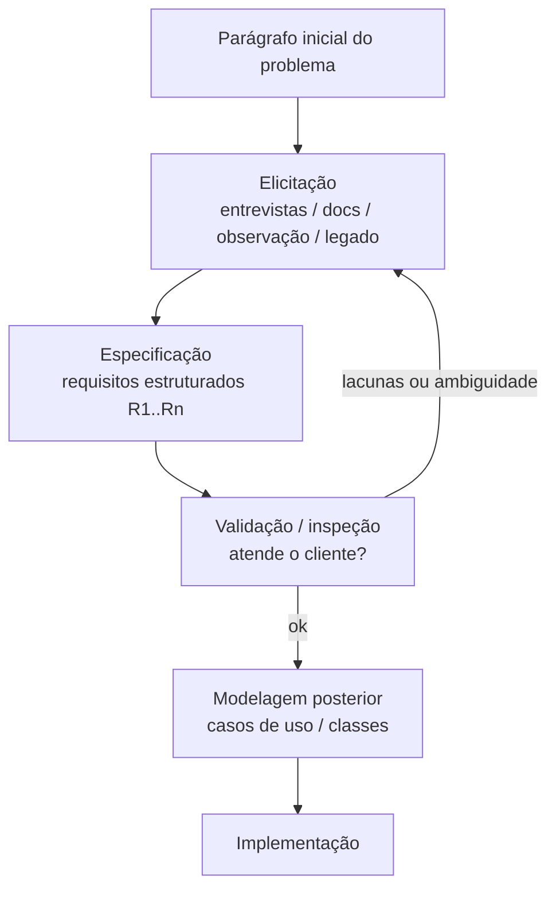
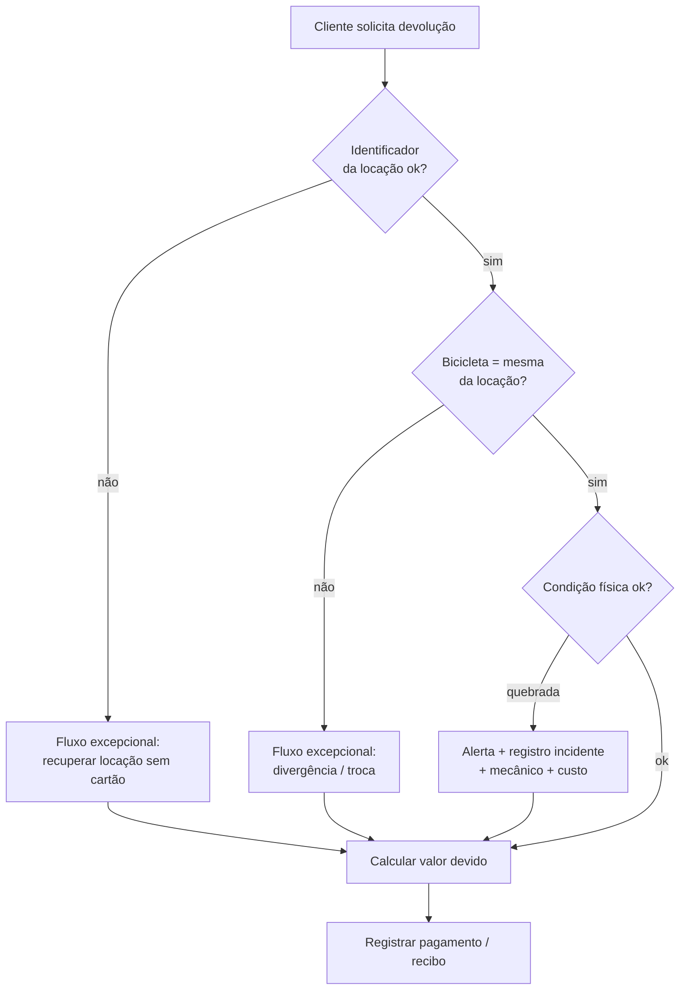

## Visão Geral do Conceito

Não existe projeto de software a implementar **sem** análise prévia do que o cliente precisa. Independentemente de cascata, modelo incremental, <mark style="background-color: #242424; padding: 2px 4px; border-radius: 3px; color: inherit;">`RUP`</mark> ou abordagem ágil, o time passa por <mark style="background-color: #242424; padding: 2px 4px; border-radius: 3px; color: inherit;">`engenharia de requisitos`</mark>: entender, documentar e validar o que deve ser feito.

Nesta lição o fio condutor é um **estudo de caso** de aluguel de bicicletas (referido na aula como sistema-padrão para modelagem — nome próximo de *Wheels* na literatura; a transcrição ASR oscila entre formas). O mesmo raciocínio se estende a problemas análogos (biblioteca: empréstimo de livros em vez de bicicletas) e a um segundo domínio (estação ferroviária) para praticar glossário, entidades e papéis.

> **Regra:** metodologia é livre no Projeto de Bloco — desde que você **justifique**. O que não é opcional é passar por elicitação → especificação → validação. Sem isso, entrega-se “uma coisa que não tem nada a ver com o que o cliente pediu”.

## Modelo Mental

Pense em três camadas de conversa com o domínio:

1. **Problema de negócio** — “precisamos alugar e devolver bicicletas, calcular valores, cuidar de estoque e clientes”.
2. **Como o trabalho acontece hoje** — passo a passo narrado por quem vive a loja (gerente, atendimento, mecânico).
3. **O que o software deve fazer** — requisitos numerados, cenários normais e excepcionais, atores com permissões.

Um parágrafo de marketing **não** é especificação. Ele só dá uma ideia superficial. Competência técnica (“já fizemos sistemas parecidos”) também não autoriza pular a coleta: cada loja tem particularidades de regra de negócio.

**Analogia útil:** automatizar o balcão sem observar o fluxo é como desenhar o caixa de um supermercado só pelo slogan “vendemos produtos”. Você precisa ver fila, consulta de preço, estoque paralelo em agenda e o “peraí que eu vou olhar no salão”.



## Mecânica Central

### 1. As três etapas da engenharia de requisitos

Na aula, o processo é apresentado assim (a palavra “licitação” na legenda ASR corresponde a **elicitação**):

| Etapa | Objetivo | Forma típica |
|-------|----------|--------------|
| **Elicitação** | Coletar o máximo de informação sobre necessidades | Entrevistas, questionários, estudo de documentos, observação de tarefas, avaliação do sistema existente |
| **Especificação** | Registrar de modo estruturado o que foi coletado | Documento em linguagem que o cliente entende; mais formal em cascata/RUP; em ágil ainda precisa ser guia clara (não texto vago) |
| **Validação** | Verificar se o documentado atende o cliente/usuário | Inspeção: omissões, erros, inconsistências |

> **Independente do modelo:** ágil também precisa de guia mínima; RUP/cascata tendem a documentação mais abrangente — mas **ninguém foge da especificação**.

### 2. Técnicas de elicitação (não são mutuamente excludentes)

1. **Entrevista** — peça o dia a dia em **linguagem natural** e, sobretudo, **passo a passo**: “conte o que normalmente acontece quando alguém quer alugar uma bicicleta”. O passo a passo vira esqueleto de regra de negócio, modelo e, depois, algoritmo.
2. **Estudo de documentos** — formulários manuais, fichas, recibos: “cadê o documento que a secretaria preenche?” Tudo que existe em papel (ou planilha) é candidato a dado do sistema.
3. **Observação de tarefas** — assista o fluxo real; o que é “normal” para quem trabalha há anos pode ser gargalo (consulta lenta, estoque só no olho).
4. **Avaliação do sistema legado** — peça para mostrar o que já existe: o que atende, o que falta (ex.: perda de bicicleta nunca foi tratado), o que o usuário quer **replicar** por hábito.
5. **Questionário** — útil para muitos usuários finais; pode ser online (escala 1–5 em cadastro/devolução, sugestões curtas). Não substitui ouvir os **principais** que interagem com o sistema.

**Trade-off:** em teoria, quanto mais gente ouvir, melhor; na prática, priorize quem representa o negócio e quem opera o fluxo (gerente, portaria/atendimento, eventualmente mecânico e amostra de clientes). Não há “número mágico” (30/50/100); depende do sistema.

### 3. Atores e papéis ≠ “todo mundo que passa na loja”

No aluguel de bicicletas, papéis típicos citados na aula:

- **Proprietário / dono** — visão de negócio e decisões de regra (“permito alugar duas bicicletas no mesmo recibo?”).
- **Gerente** — autorizações, visão gerencial.
- **Atendimento / portaria (“secretaria”)** — cadastro, histórico, liberação no balcão.
- **Mecânico** — verificação de condição, peças, custo de dano (pode interagir com o sistema ou receber demanda dele).
- **Cliente da loja** — muitas vezes **usuário indireto** do processo; só vira ator do software se houver canal próprio (app, self-service).

Cada papel enxerga funções diferentes. Isso alimenta permissões e, mais adiante, diagramas de casos de uso (cobrados na disciplina).

### 4. Cenários: fluxo normal × excepcional

Um <mark style="background-color: #242424; padding: 2px 4px; border-radius: 3px; color: inherit;">`cenário`</mark> é uma sequência de interações usuário–sistema para atingir um objetivo. Serve para:

- descrever processos;
- identificar **exceções**;
- antecipar requisitos futuros.

**Cenário normal (exemplo):** cliente devolve a bicicleta; o sistema calcula automaticamente o valor devido (duração × tipo/tarifa; possível sinal no início e acerto na devolução; extensão de tempo).

**Cenários excepcionais (exemplos da aula):**

- cartão / ticket / identificador da locação **perdido**;
- bicicleta **perdida** ou **atrasada**;
- bicicleta devolvida **quebrada** → alerta ao funcionário, registro do incidente no histórico do cliente, possível multa/custo, acionamento do mecânico, depósito caução, bloqueio ou sobretaxa em locações futuras (a regra **é do dono do projeto**, não do desenvolvedor sozinho);
- conferir se a bicicleta devolvida é a **mesma** que foi alugada (evitar troca);
- aluguel de **várias** bicicletas com **recibo único** (e períodos eventualmente diferentes).



### 5. Do relato ao requisito funcional numerado

Depois da coleta, formalize uma lista <mark style="background-color: #242424; padding: 2px 4px; border-radius: 3px; color: inherit;">`R1 … Rn`</mark>. Exemplos alinhados ao estudo de caso (formulados na aula):

- Manter lista completa de bicicletas e detalhes (número, tipo, tamanho, marca, modelo, tarifa, depósito/caução…).
- Manter registro de clientes e transações de aluguel anteriores (identificação do cliente; histórico atrelado).
- Calcular automaticamente o custo de alugar por um número de dias/horas.
- Registrar detalhes da transação (início, duração prevista, cliente, bicicleta…).
- Controlar quantas bicicletas um cliente aluga com **recibo único**.
- Permitir alugar mais de uma, inclusive por períodos diferentes (se a regra de negócio permitir).
- Calcular na devolução tempo usado, valores já pagos e saldo.
- Imprimir recibo.

**Boas práticas enfatizadas:**

- **Não misturar** listar + cadastrar + remover num único requisito “CRUD”.
- Atributos extras (ex.: cor) só entram se a regra de negócio importar (tarifa diferente por cor).
- O “certo” sobre permitir duas bicicletas no mesmo cadastro **não é opinião do time**: é decisão do dono do projeto após a entrevista. Se for proibido, o sistema deve **impedir**; se for permitido e hoje for trabalhoso (dois cadastros, dois recibos), proponha melhoria de processo.

Requisitos funcionais expressam o que o usuário quer que seja implementado; na disciplina, caminham para <mark style="background-color: #242424; padding: 2px 4px; border-radius: 3px; color: inherit;">`casos de uso`</mark> (diagrama cobrado depois). A aula diferencia isso de “história de usuário” ágil: a ideia de valor é próxima, mas o artefato formal aqui aponta para casos de uso.

### 6. Segundo estudo: estação ferroviária (extrair entidades e glossário)

Com um texto inicial de gerenciamento operacional de estação, a aula treina:

- **Glossário / dicionário de dados** — trem = composição de vagões + locomotivas; recursos podem estar isolados na linha.
- **Identificadores** — estação (sigla, descrição opcional), linha (número único na estação), vagão (série, tipo, capacidade), locomotiva (série, capacidade de tração), trem (prefixo, data/hora, origem/destino).
- **Entidade principal vs relacionadas** — no domínio ferroviário, o trem é núcleo de controle; no Wheels, a pergunta análoga: entidade principal = **bicicleta**.
- **Atores com nível de acesso** — operador ferroviário (registrar/atualizar/consultar), chefe de estação (aprovar formações, monitorar), gestor (relatórios), técnico (status manutenção). Traduzir “aprovar formação” em comportamento de sistema (lista, botão, status).
- **Regras de negócio explícitas** — ex.: trem precisa de pelo menos uma locomotiva e um vagão; a cada N vagões, locomotiva adicional (valores do texto do caso).
- **Cenários principais e alternativos** — formação com locomotiva disponível vs. sem recurso disponível.

### 7. Recorte do TP1 (entrega da disciplina)

Conteúdo pedido na aula para a primeira entrega (sem código):

1. **Integrantes do time** (nomes claros; individual também permitido).
2. **Linguagem de implementação** (ex.: C# ou Java) — evitar trocar depois.
3. **Tema / título** do projeto.
4. **Objetivo** em um parágrafo que sintetiza a intenção do sistema.
5. **Requisitos funcionais** enumerados (e, no modelo citado, também requisitos técnicos / estruturação formal).
6. Metodologia: o enunciado pode citar RUP/iniciação; o professor aceita abordagem iterativa/cascata/ágil **com justificativa** — no TP1 o foco é entendimento do projeto; formalização forte de processo pode aprofundar nas entregas seguintes.

Há sugestão de tema no Infinity se o grupo não tiver; projetos reais da empresa do aluno são bem-vindos se fizerem sentido.

**Não coberto com profundidade nesta aula (declarar lacuna):** template completo de SRS IEEE, técnica formal de prototipação, e distinção exaustiva requisito funcional vs não funcional com catálogo NFR — o material enfatiza elicitação, cenários e lista funcional do caso.

## Uso Prático

### Exemplo 1 — Entrevista → notas → requisitos

Trecho típico (gerente, linguagem natural):

1. Cliente pede bicicleta para a tarde.
2. Pergunto o tipo desejado.
3. Verifico se está cadastrado; olho histórico / VIP.
4. Hoje, disponibilidade = olhar o salão (sem estoque sistêmico confiável).
5. Cartões organizados por número.

Tradução para engenharia:

```text
R-Estoque-01  Manter disponibilidade de bicicletas no sistema (não depender só da inspeção visual).
R-Cliente-01  Verificar cadastro do cliente antes de iniciar locação.
R-Cliente-02  Consultar histórico de locações do cliente.
R-Locacao-01  Registrar tipo de bicicleta solicitado e período pretendido.
```

### Exemplo 2 — Decisão de negócio: recibo único

| O dono diz | Impacto no requisito |
|------------|----------------------|
| “Não permitimos duas bicicletas na mesma pessoa” | Regra de validação: no máximo 1 bicicleta ativa por cliente; impedir segundo aluguel |
| “Permitimos (família / adulto+criança), mas hoje geramos dois recibos” | Melhoria: locação com múltiplos itens + recibo unificado; opcionalmente períodos distintos por item |

### Exemplo 3 — Estrutura mínima de especificação (estilo TP1)

```markdown
# Projeto: Locadora Urbana de Bicicletas
## Objetivo
Sistema para a loja registrar clientes, estoque de bicicletas, locações e devoluções,
calculando valores e tratando incidentes (atraso, dano, identificador perdido).

## Requisitos funcionais
R1. Listar bicicletas do estoque com número, tipo, marca, modelo e tarifa.
R2. Cadastrar nova bicicleta no estoque.
R3. Cadastrar e consultar clientes (nome, documento, contato).
R4. Registrar locação associando cliente, bicicleta(s) e período.
R5. Calcular valor devido na devolução com base no tempo efetivo e tarifa.
R6. Registrar incidente de dano e sinalizar o cliente em futuras locações.
...
```

### Exemplo 4 — Representação estruturada (para o laboratório ISS)

No editor integrado, modelamos requisitos como dados — o mesmo raciocínio da especificação, em formato inspecionável:

```javascript
const requisitosWheels = [
  {
    id: "R1",
    tipo: "funcional",
    ator: "atendimento",
    enunciado: "Listar bicicletas do estoque com atributos de identificação e tarifa",
    cenario: "normal",
  },
  {
    id: "R7",
    tipo: "funcional",
    ator: "atendimento",
    enunciado: "Registrar devolução com bicicleta danificada e acionar alerta interno",
    cenario: "excepcional",
  },
];
```

## Erros Comuns

1. **Começar pelo código após o parágrafo inicial**  
   **Sintoma:** endpoints sem regra de devolução/dano/recibo.  
   **Correção:** fechar elicitação mínima + lista R1..Rn validada com o “cliente” (professor/dono).

2. **Entrevistar só um papel**  
   **Sintoma:** sistema ótimo para o gerente e inviável no balcão (ou o contrário).  
   **Correção:** cruzar gerente, atendimento e, se fizer sentido, mecânico e amostra de clientes.

3. **Aceitar o “sempre foi assim” sem questionar**  
   **Sintoma:** estoque só no salão, histórico em agenda paralela, consulta que “demora um minuto e é normal”.  
   **Correção:** anotar como problema operacional e candidato a requisito de melhoria.

4. **Desenvolvedor inventar multa, depósito e bloqueio**  
   **Sintoma:** regra financeira sem dono do negócio.  
   **Correção:** traduzir opções (alerta, multa, contrato, notificação interna) e **decidir com o stakeholder**.

5. **Aglutinar CRUD num único requisito**  
   **Sintoma:** “manter bicicletas” sem saber o que testar/priorizar.  
   **Correção:** separar listar, cadastrar, atualizar, remover / dar baixa.

6. **Confundir cliente da loja com ator do software**  
   **Sintoma:** casos de uso “Cliente altera estoque”.  
   **Correção:** mapear quem de fato usa a interface do sistema da loja.

7. **Ignorar fluxos alternativos**  
   **Sintoma:** só “aluga e devolve feliz”.  
   **Correção:** cartão perdido, dano, atraso, múltiplas bicicletas — preparar o sistema.

## Visão Geral de Debugging

Quando a especificação “não fecha”, depure nesta ordem:

1. **Fonte da necessidade** — veio de entrevista, documento, observação ou achismo do time?
2. **Papel** — qual ator executa? Qual permissão?
3. **Fluxo** — é cenário normal ou excepcional? O que dispara o desvio?
4. **Dado** — quais atributos identificam bicicleta, cliente, locação? Falta glossário?
5. **Regra** — quem autorizou (dono)? Está explícita e testável?
6. **Granularidade** — o requisito mistura várias funções? Quebre.
7. **Validação** — releia com o stakeholder: falta algo? Algo está errado? Algo é ouro de tolo (detalhe irrelevante)?

<details>
<summary>Checklist rápido de inspeção (validação)</summary>

- Todo objetivo de negócio citado nas entrevistas aparece em algum Rn?
- Toda exceção importante tem tratamento ou está marcada como fora de escopo?
- Atores e permissões estão coerentes com o texto?
- Identificadores (CPF/código da bike/número do cartão) estão definidos?
- Cálculo de valor tem unidade (hora/dia) e momento (sinal vs acerto)?

</details>

## Principais Pontos

- Engenharia de requisitos é obrigatória em qualquer metodologia do Projeto de Bloco.
- Elicitação → especificação → validação; ágil não elimina especificação clara.
- Técnicas: entrevista (passo a passo), documentos, observação, legado, questionário.
- Priorize atores principais; trade-off no volume de entrevistas.
- Cenários normal e excepcional revelam requisitos escondidos.
- Traduza linguagem natural em Rn separados e rastreáveis.
- Decisões de regra (duas bikes, multa, depósito) são do dono do projeto.
- Estudo ferroviário treina glossário, entidades, papéis e regras — mesmo método do Wheels.
- TP1: time, linguagem, tema, objetivo e requisitos — **sem código**.

## Preparação para Prática

Antes do laboratório, você deve conseguir:

1. Listar as três etapas da engenharia de requisitos e o papel de cada uma.
2. Propor perguntas de entrevista “passo a passo” para um domínio de locação.
3. Separar atores do software de usuários indiretos da loja.
4. Escrever requisitos funcionais numerados a partir de um cenário excepcional.
5. Montar o esqueleto textual do TP1 (objetivo + Rn) sem implementar API.

## Laboratório de Prática

Contexto ADS: você é analista em um time backend que vai especificar o domínio antes de qualquer controller. Use o editor integrado (`javascript`) para estruturar artefatos de requisitos — o código só organiza a especificação.

### Exercício Easy — Classificar falas de elicitação

Dado trechos de conversa na loja, classifique a técnica predominante e o próximo passo do analista.

```javascript
/**
 * Para cada item, preencha:
 * { id, tecnica, proximoPasso }
 * tecnica: "entrevista" | "documento" | "observacao" | "legado" | "questionario"
 */
function classificarFalhasElicitacao() {
  const falas = [
    {
      id: 1,
      texto: "Me explica passo a passo o que acontece quando alguém quer alugar.",
    },
    {
      id: 2,
      texto: "Posso ver a ficha de papel que a secretaria preenche no balcão?",
    },
    {
      id: 3,
      texto: "Vou ficar 30 minutos só olhando vocês liberarem bicicleta no salão.",
    },
    {
      id: 4,
      texto: "Abre o sistema atual: o que você gosta e o que falta (ex.: bike perdida)?",
    },
    {
      id: 5,
      texto: "Link do form: de 1 a 5, o quão satisfeito você fica na devolução?",
    },
  ];

  const resultado = [];

  // TODO: para cada fala, empurrar { id, tecnica, proximoPasso }
  // proximoPasso deve ser uma ação concreta do analista (1 frase).
  void falas;

  return resultado;
}

if (require.main === module) {
  for (const r of classificarFalhasElicitacao()) {
    console.log(`#${r.id} ${r.tecnica} -> ${r.proximoPasso}`);
  }
}

module.exports = { classificarFalhasElicitacao };
```

### Exercício Medium — Cenário excepcional → requisitos

Modele a devolução com bicicleta danificada e cartão ausente como requisitos funcionais separados (não um bloco único).

```javascript
/**
 * Retorne requisitos no formato:
 * {
 *   id: "R-...",
 *   ator: string,
 *   enunciado: string,          // linguagem de requisito (sistema deve...)
 *   cenario: "normal" | "excepcional",
 *   origem: string              // de qual fato do domínio veio
 * }
 *
 * Exija pelo menos 6 requisitos cobrindo:
 * - localizar locação sem cartão
 * - validar bicicleta devolvida = alugada
 * - registrar dano / alerta interno
 * - acionar ou registrar demanda ao mecânico
 * - calcular valor (tempo + possível custo de dano) — sem inventar % de multa;
 *   deixe multa/caução como pendência de stakeholder se não estiver decidida
 * - atualizar histórico do cliente para futuras locações
 */
function especificarDevolucaoComDano() {
  const requisitos = [];

  // TODO: preencher requisitos rastreáveis e separados (sem CRUD aglutinado).

  return requisitos;
}

if (require.main === module) {
  for (const r of especificarDevolucaoComDano()) {
    console.log(`${r.id} [${r.cenario}] (${r.ator}): ${r.enunciado}`);
  }
}

module.exports = { especificarDevolucaoComDano };
```

### Exercício Hard — Mini TP1 do domínio bicicleta + analogia

Monte o pacote de especificação inicial (estilo TP1) e mostre a analogia biblioteca ↔ bicicleta para um dos requisitos.

```javascript
/**
 * Retorne um objeto:
 * {
 *   integrantes: string[],
 *   linguagem: "csharp" | "java" | "outra",
 *   titulo: string,
 *   objetivo: string,                 // 1 parágrafo
 *   requisitosFuncionais: Array<{ id, enunciado, ator }>,  // >= 8
 *   decisoesPendentesStakeholder: string[],               // >= 2
 *   analogiaBiblioteca: Array<{ requisitoBikeId, equivalenteBiblioteca }>
 * }
 *
 * Regras:
 * - nada de código de API/SQL no objetivo
 * - requisitos separados (listar ≠ cadastrar)
 * - incluir ao menos 2 requisitos de cenário excepcional
 * - analogia: aluguel/devolução de bike ↔ empréstimo/devolução de livro
 */
function montarMiniTp1Wheels() {
  const entrega = {
    integrantes: [],
    linguagem: "csharp",
    titulo: "",
    objetivo: "",
    requisitosFuncionais: [],
    decisoesPendentesStakeholder: [],
    analogiaBiblioteca: [],
  };

  // TODO: preencher entrega completa conforme regras acima.

  return entrega;
}

if (require.main === module) {
  const e = montarMiniTp1Wheels();
  console.log(JSON.stringify(e, null, 2));
}

module.exports = { montarMiniTp1Wheels };
```

<!-- lessons.json (NÃO editar neste worker — integração serial pelo orquestrador)
discipline: projeto-bloco-backend
slug: engenharia-requisitos-estudo-caso-bike
title: Engenharia de requisitos e estudo de caso (aluguel de bicicletas)
order: 4
file: projeto-bloco-backend/aula-04-engenharia-requisitos-estudo-caso-bike.md
-->

<!-- CONCEPT_EXTRACTION
concepts:
  - engenharia de requisitos
  - elicitação de requisitos
  - especificação de requisitos
  - validação / inspeção de requisitos
  - técnicas de levantamento (entrevista, questionário, documentos, observação, legado)
  - atores e papéis
  - cenários normal e excepcional
  - requisitos funcionais numerados
  - regras de negócio
  - glossário / dicionário de dados
  - entidade principal vs relacionadas
  - estudo de caso aluguel de bicicletas (Wheels)
  - estudo de caso estação ferroviária
  - analogia biblioteca (empréstimo)
  - entregável TP1 (tema, linguagem, requisitos)
skills:
  - Conduzir elicitação com perguntas passo a passo em linguagem natural
  - Escolher técnicas de levantamento adequadas ao stakeholder
  - Separar atores do software de usuários indiretos do negócio
  - Escrever cenários normais e alternativos a partir de exceções do domínio
  - Traduzir relatos em requisitos funcionais R1..Rn sem aglutinar CRUD
  - Extrair entidades, atributos e regras de um texto de estudo de caso
  - Montar pacote inicial de especificação no formato do TP1
examples:
  - pipeline-elicitacao-especificacao-validacao
  - devolucao-bike-fluxos-excepcionais
  - recibo-unico-multiplas-bicicletas
  - entrevista-gerente-passo-a-passo
  - entidades-estacao-ferroviaria
  - mini-tp1-wheels
-->

<!-- EXERCISES_JSON
[
  {
    "id": "pb04-classificar-tecnicas-elicitacao",
    "slug": "pb04-classificar-tecnicas-elicitacao",
    "difficulty": "easy",
    "title": "Classificar falas de elicitação",
    "discipline": "projeto-bloco-backend",
    "editorLanguage": "javascript",
    "tags": ["elicitacao", "requisitos", "engenharia-software"],
    "summary": "Associar trechos de conversa na loja à técnica de levantamento e ao próximo passo do analista."
  },
  {
    "id": "pb04-especificar-devolucao-com-dano",
    "slug": "pb04-especificar-devolucao-com-dano",
    "difficulty": "medium",
    "title": "Especificar devolução com dano e cartão ausente",
    "discipline": "projeto-bloco-backend",
    "editorLanguage": "javascript",
    "tags": ["cenarios", "requisitos-funcionais", "excecoes", "wheels"],
    "summary": "Derivar pelo menos seis requisitos funcionais separados a partir do cenário excepcional de devolução."
  },
  {
    "id": "pb04-mini-tp1-wheels",
    "slug": "pb04-mini-tp1-wheels",
    "difficulty": "hard",
    "title": "Montar mini TP1 do domínio bicicleta",
    "discipline": "projeto-bloco-backend",
    "editorLanguage": "javascript",
    "tags": ["tp1", "especificacao", "analogia-biblioteca", "requisitos"],
    "summary": "Produzir objetivo, oito ou mais requisitos, pendências de stakeholder e analogia biblioteca↔bicicleta sem código de API."
  }
]
-->
