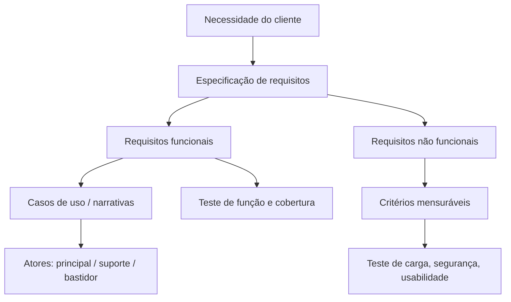

## Visão Geral do Conceito

Na concessão do projeto — independentemente de cascata, RUP ou ágil — o time precisa transformar o **problema real do cliente** em um produto de software. Isso exige especificar, com clareza, o que o sistema **faz** e **como** ele deve se comportar sob restrições de qualidade.

Essa especificação é o núcleo da <mark style="background-color: #242424; padding: 2px 4px; border-radius: 3px; color: inherit;">`engenharia de requisitos`</mark> (ou especificação de requisitos). Nesta lição, a classificação central é:

| Tipo | Responde | Exemplos da aula |
|------|----------|------------------|
| <mark style="background-color: #242424; padding: 2px 4px; border-radius: 3px; color: inherit;">`requisito funcional`</mark> (RF) | **O que** o sistema faz | Adicionar produto ao carrinho; login; registrar venda |
| <mark style="background-color: #242424; padding: 2px 4px; border-radius: 3px; color: inherit;">`requisito não funcional`</mark> (RNF) | **Como** o sistema se comporta / atributos de qualidade | Responder em ≤ 2 s; suportar 1000 acessos simultâneos; dados criptografados |

> **Regra:** RF descreve funções ligadas ao objetivo do usuário. RNF descreve atributos de qualidade (tempo de resposta, carga, segurança, usabilidade mensurável). Não misture “quero um botão” com “quero que seja rápido” sem dizer o critério.

No Projeto de Bloco Backend, essa distinção alimenta a **primeira entrega (TP1)**: objetivo do sistema, RF, RNF, integrantes e linguagem (Java ou C#). Casos de uso entram como ponte: eles **representam** RF pela narrativa da interação ator–sistema; o detalhamento profundo e o diagrama UML ficam para a próxima etapa (TP2).

## Modelo Mental

Pense em duas camadas do mesmo contrato com o cliente:

1. **Camada de função** — se eu removo o RF, some uma capacidade (“não dá mais para alugar bicicleta / emprestar livro / finalizar compra”).
2. **Camada de qualidade** — se eu removo o RNF, a função ainda “existe”, mas falha sob carga, demora demais, vaza dado ou fica impossível de usar.

Analogia de backend: um endpoint `POST /carrinho/itens` **é** a função (RF). Exigir p95 de latência < 200 ms sob 1k RPS **é** qualidade (RNF). Os dois precisam existir; só um deles não fecha o contrato.

Para RNF vagos (“amigável”, “flexível”, “intuitivo”), o modelo mental correto é: **traduzir o adjetivo em métrica acordada com o cliente**. Sem métrica, não há aceite — só opinião.



## Mecânica Central

### 1. Requisitos funcionais — o que o sistema faz

RF descrevem **funções** do sistema alinhadas ao objetivo do usuário. Devem ser claros, sem contradição, e transformáveis em verificação (teste manual, automatizado ou com usuário final).

Exemplos da aula:

- O cliente deve poder adicionar produtos ao carrinho de compras.
- O sistema deve enviar um e-mail de confirmação após o registro (pode embutir duas ideias: **registrar** + **notificar** — vale separar quando a notificação for opcional).
- O usuário deve conseguir fazer login com nome de usuário e senha (pode evoluir para OAuth/Google — ainda é função).

No domínio de aluguel de bicicletas / biblioteca, o RF nasce da frase do cliente (“quero emprestar / alugar”) e vira especificação sem ambiguidade.

**Como saber se o RF foi implementado corretamente?**

1. Identificar o RF aceito pelo cliente.
2. Verificar a função (teste automatizado, homologação com usuário, ou ambos).
3. Medir andamento com métricas, por exemplo:
   - percentual de RF implementados vs planejados;
   - percentual testados;
   - percentual de funcionalidades integradas corretamente;
   - quantidade de erros encontrados por RF;
   - falhas em dependências de sistemas externos.

### 2. Homologação vs produção (contexto de verificação)

A aula descreve prática de mercado (não é o núcleo teórico da classificação, mas amarra **como** se valida RF):

- Ambiente de **homologação**: link provisório, cenário simulado, banco **não** de produção — o cliente “brinca” com segurança (ex.: carrinho com itens pré-carregados).
- **Produção**: entrega oficial / incremento real.
- **Observabilidade** (ex.: Grafana citada na aula): o time observa o comportamento sem depender só do usuário ligar para reportar.

Isso reforça engenharia: RF sem caminho de teste e feedback vira documentação morta.

### 3. Requisitos não funcionais — como o sistema se comporta

RNF são <mark style="background-color: #242424; padding: 2px 4px; border-radius: 3px; color: inherit;">`atributos de qualidade`</mark>: tempo de resposta, velocidade de processamento, taxa de falha, tolerância, segurança, usabilidade **quando mensurável**.

Exemplos da aula:

- O sistema deve responder a qualquer solicitação em **no máximo 2 segundos**.
- O sistema deve suportar até **1000 acessos simultâneos**.
- Os dados do usuário devem ser **criptografados** (inicialmente RNF de segurança).

**Fronteira RF × RNF (caso segurança):**

- Só “criptografar dados” → RNF.
- “Tela de login, gerar token, botão para autenticar” → passa a envolver **funções** (RF) que realizam a política de segurança.

**RNF difíceis de medir:** “amigável”, “fácil de usar”, “intuitivo”.

- Sem definição do cliente, o time não sabe o que construir.
- Métricas possíveis citadas / derivadas na aula:
  - tempo de conclusão de tarefas;
  - número máximo de passos / cliques para uma tarefa;
  - tempo de aprendizado / treinamento;
  - satisfação do usuário (avaliação explícita);
  - confiabilidade via <mark style="background-color: #242424; padding: 2px 4px; border-radius: 3px; color: inherit;">`tempo médio entre falhas`</mark>;
  - desempenho: transações por segundo / limite de latência.

Exemplo real da aula: “amigável” para um público idoso significava **aumentar fonte e trocar cor** — aí o RNF vira critério concreto (e pode gerar RF de configuração de UI, tipicamente responsabilidade de front; latência e disponibilidade caem no backend).

**“Flexível” vs “personalizável” (interpretação):**

- *Personalizável*: UI (cor, posição de menu, estilo).
- *Flexível / parametrizável*: formulários e regras menos “travados” (listas abertas, menos hardcode) — **sem** confundir com “aceitar CPF no campo de CNPJ”. Flexibilidade ≠ invalidar regra de negócio.

> **Trade-off:** RNF vagos são baratos de escrever e caros de implementar. Preferir menos RNF, todos com critério numérico ou procedimento de teste.

### 4. Atores

Um <mark style="background-color: #242424; padding: 2px 4px; border-radius: 3px; color: inherit;">`ator`</mark> é pessoa, sistema ou organização que **interage** com o sistema (inclui APIs e serviços externos).

| Tipo | Papel | Exemplo biblioteca |
|------|-------|--------------------|
| Principal | Objetivos do usuário satisfeitos pelos serviços do sistema | Usuário (empresta / busca livro) |
| Suporte | Fornece serviço ou informação ao sistema | Bibliotecário; outro sistema que devolve dado |
| Bastidor | Interesse no comportamento do caso de uso, sem ser principal nem suporte | Editora |

No Projeto de Bloco, o professor pede foco no **ator principal** (suporte opcional; bastidor não é obrigatório).

### 5. Casos de uso — ponte para RF (introdução)

<mark style="background-color: #242424; padding: 2px 4px; border-radius: 3px; color: inherit;">`Casos de uso`</mark> são descrições detalhadas de como atores interagem com o sistema para alcançar objetivos. Representam RF: narram a interação que realiza a função.

Componentes principais (aula):

- **Atores**
- **Cenários**: sequência de ações/interações
  - **Cenário principal / feliz**: caminho esperado de sucesso (ex.: devolução de bicicleta no prazo; pagamento aprovado no PDV)
  - **Cenários alternativos**: desvios e falhas (bicicleta extraviada; cartão recusado; produto não encontrado)

Níveis de narrativa (ligados a RUP / documentação textual):

1. **Resumo** — parágrafo curto do sucesso.
2. **Informal** — alguns parágrafos (principal + alternativas), ainda leve.
3. **Completo** — passos detalhados, pré-condições, pós-condições / garantias de sucesso.

Boas práticas citadas:

- Nome começa com **verbo** (Registrar venda, Cadastrar bicicleta, Consultar produto).
- Definir fronteira do sistema (ex.: PDV separado de outros sistemas).
- Criação é **iterativa e evolutiva**: refinar por ciclos; não extrair “todos” os casos de uso de uma vez em duas reuniões.

**Exercício PDV da aula (esqueleto):**

- Caso principal: **Registrar venda**
- Ator principal: atendente / caixa
- Pré-condição: caixa aberto / sistema em funcionamento
- Fluxo: iniciar venda → ler código → sistema adiciona e mostra total → finalizar → calcular → método de pagamento → registrar e imprimir recibo
- Alternativas: produto não encontrado; pagamento recusado
- Pós-condição: venda registrada; estoque atualizado

Diagrama UML de casos de uso: **próxima aula** (não cobrir formalismo gráfico aqui além do conceito).

## Uso Prático

### Classificar sentenças (hospital — exercício da aula)

Enunciado condensado:

1. Médico registra prescrição de medicamento para paciente.
2. Informações médicas acessíveis somente a usuários autorizados.
3. Consultas/alterações/exclusões de dados clínicos registradas em log (usuário, data, operação).
4. Antes de confirmar, o sistema verifica alergias e medicamentos em uso.
5. Interação medicamentosa grave: não confirma sem justificativa médica registrada.

Classificação alinhada à discussão em aula:

| Sentença | Tipo | Por quê |
|----------|------|---------|
| Registrar prescrição | RF | Função do médico no sistema |
| Verificar alergias / interações e bloquear ou exigir justificativa | RF | Comportamento funcional obrigatório no fluxo |
| Acesso só a autorizados | RNF (segurança/autorização) | Política de qualidade; detalhar login/roles gera RF |
| Log de auditoria | tratado na aula como RNF | Atributo de rastreabilidade/auditoria (alguns times modelam “registrar log” também como RF — declare a convenção do time) |
| “Sistema não pode cair no horário da consulta” | RNF | Disponibilidade |

### Streaming (proposta do professor — inspiração de RF/RNF)

Problemas: descoberta por interesse, retomar conteúdo, sincronizar histórico entre dispositivos, recomendações relevantes, planos gratuito/premium, até 3 perfis.

Exemplos de RF derivados do cenário: buscar catálogo; retomar progresso; marcar favorito; autenticar por e-mail; integrar pagamento.

Exemplos de RNF: personalização por perfil; funcionamento em vários dispositivos; sincronização de progresso (qualidade de consistência/experiência — detalhar métrica quando for aceite).

### Artefato mínimo TP1 (contrato da entrega)

Conteúdo pedido na aula (máx. ~2 páginas):

- título do projeto e integrantes;
- objetivo principal (o que o sistema faz);
- lista de RF e RNF;
- linguagem (Java ou C#) — **não muda depois**;
- metodologia (cascata / RUP / ágil) se possível — não cobrada com o mesmo peso;
- descrição leve o suficiente para o professor entender o projeto (não narrativa completa de todos os casos de uso).

Escopo mínimo do domínio (material do bloco / Aula 1): entidade principal com ≥5 atributos, ≥2 correlatas, perfis de usuário — a modelagem profunda e implementação parcial vêm depois.

```javascript
// Exemplo de registro estruturado de requisito (artefato de análise — não UI)
const requisitosTp1 = {
  projeto: "Biblioteca acadêmica",
  linguagem: "C#",
  rf: [
    {
      id: "RF-01",
      texto: "O usuário deve poder registrar empréstimo de um exemplar disponível",
      criterioAceite: "Empréstimo persistido e exemplar marcado como emprestado"
    }
  ],
  rnf: [
    {
      id: "RNF-01",
      texto: "Qualquer solicitação de API deve responder em no máximo 2 segundos sob carga normal",
      metrica: { tipo: "latencia_max_s", valor: 2 }
    }
  ]
};
```

## Erros Comuns

1. **Escrever só adjetivos** (“rápido”, “seguro”, “amigável”) sem número, procedimento de teste ou definição do cliente.  
   **Sintoma:** disputa infinita no aceito. **Correção:** negociar métrica (latência, cliques, MTBF, checklist de acessibilidade).

2. **Misturar duas funções em um RF** (registro + e-mail opcional) sem deixar opcionalidade explícita.  
   **Correção:** RF de cadastro + RF/RNF de notificação conforme obrigatoriedade.

3. **Tratar RNF de performance como problema “só de front”**.  
   Latência e disponibilidade sob carga são tipicamente backend/infra; usabilidade visual é front — o backlog é **único** e os times conversam.

4. **Achar que RNF vira RF por “tradução mágica”**.  
   A aula é explícita: não se transforma RNF em RF; mensura-se o RNF (ou deriva-se RF **adicionais** quando há fluxo concreto, como login).

5. **Detalhar diagrama e narrativa completa no TP1**.  
   TP1 = entender projeto + RF/RNF. TP2 = casos de uso aprofundados.

6. **Inventar ator bastidor obrigatório** ou backlog separado “só backend / só front” sem alinhar requisitos.  
   Análise de requisitos cobre o sistema; a implementação divide responsabilidade.

7. **Nomear caso de uso sem verbo** (“Venda”, “Carrinho”).  
   Prefira “Registrar venda”, “Adicionar item ao carrinho”.

## Visão Geral de Debugging

Quando o cliente diz “não era isso” ou “está lento / difícil”:

1. **Localize a classe do requisito.** Falha de função (botão não adiciona) → RF. Função ok mas 8 s de espera → RNF de desempenho. Função ok mas 15 cliques → RNF de usabilidade (ou RF de atalho se combinado).
2. **Peça o critério de aceite.** Se não existir no documento, o bug é de especificação — corrija o requisito antes de “otimizar no escuro”.
3. **Separe ambiente.** Reproduza em homologação com dados controlados; use observabilidade em produção para confirmar.
4. **Rastreie RF → cenário de caso de uso → teste.** Sem rastreio, cobertura percentual mente.
5. **Ambiguidade de fronteira (criptografia / log / autorização):** documente a convenção do time (qualidade vs função) e derive RF de mecanismo quando necessário.

<details>
<summary>Checklist rápido RF vs RNF</summary>

- Posso apontar um ator e uma ação? → candidato a RF / caso de uso.
- Estou falando de limite, taxa, segurança, disponibilidade, esforço de uso? → RNF; exija métrica.
- A frase mistura os dois? → divida em dois IDs.

</details>

## Principais Pontos

- RF = **o que** o sistema faz; RNF = **como** se comporta (qualidade).
- Engenharia de requisitos formaliza ambos antes (e durante) a implementação.
- RF se verifica por teste e cobertura; RNF exige métrica — adjetivo sozinho não basta.
- Segurança/criptografia começa como RNF; fluxos de login/token são RF.
- Atores: principal, suporte, bastidor; foque no principal no PB.
- Casos de uso narram RF (feliz + alternativos); níveis resumo / informal / completo.
- TP1: objetivo, RF, RNF, time, linguagem; TP2: formalização de casos de uso.
- Não invente escopo depois: o que entrar no TP1 “vale”.

## Preparação para Prática

Ao final desta lição você deve conseguir:

- classificar sentenças de um enunciado em RF e RNF com justificativa;
- reescrever RNF vagos com métrica;
- montar um pacote mínimo de requisitos para TP1;
- esboçar ator principal + cenário feliz/alternativo de um RF (sem exigir diagrama UML completo).

## Laboratório de Prática

> Editor ISS: `editorLanguage` = `javascript` (mapa da disciplina). Os exercícios modelam **artefatos de engenharia de software** (classificação e mensuração de requisitos), não UI. A implementação-alvo do PB continua sendo Java ou C#.

### Easy — Classificar RF e RNF

Dado um array de sentenças de um sistema hospitalar / PDV, classifique cada uma.

```javascript
function classificarRequisito(sentenca) {
  // sentenca = { id, texto, tags: string[] }
  // tags possíveis (use-as; não invente fora da lista):
  // "funcao_usuario", "fluxo_interacao", "latencia", "carga", "seguranca",
  // "disponibilidade", "auditoria", "usabilidade_vaga"

  // TODO: se tags incluir "funcao_usuario" OU "fluxo_interacao" → { id, tipo: "RF" }
  // TODO: se tags incluir "latencia" OU "carga" OU "seguranca" OU "disponibilidade"
  //       OU "auditoria" OU "usabilidade_vaga" → { id, tipo: "RNF" }
  // TODO: se misturar tags de RF e RNF → { id, tipo: "misto", aviso: "dividir em dois requisitos" }
  // TODO: se tags vazias → { id, tipo: "indefinido", aviso: "falta critério de classificação" }

  return { id: sentenca.id, tipo: "indefinido", aviso: "TODO" };
}

const exemplos = [
  { id: "S1", texto: "Médico registra prescrição", tags: ["funcao_usuario", "fluxo_interacao"] },
  { id: "S2", texto: "Resposta em no máximo 2 segundos", tags: ["latencia"] },
  { id: "S3", texto: "Dados clínicos só para autorizados", tags: ["seguranca"] },
  { id: "S4", texto: "Interface amigável", tags: ["usabilidade_vaga"] },
  { id: "S5", texto: "Login e gerar token JWT", tags: ["funcao_usuario", "seguranca"] }
];

exemplos.forEach((s) => console.log(classificarRequisito(s)));
```

**Critérios:**

- S1 → RF; S2/S3/S4 → RNF; S5 → misto (dividir).
- Não classificar por “achismo” do texto se as tags já vierem no objeto.

### Medium — Tornar RNF mensurável

Transforme requisitos não funcionais vagos em especificações com métrica. Recuse o que não puder medir.

```javascript
function tornarMensuravel(rnf) {
  // rnf = { id, texto, adjetivo }
  // adjetivo exemplos: "amigavel", "rapido", "confiavel", "flexivel"

  const presets = {
    amigavel: { metrica: "max_cliques_tarefa", valorSugerido: 3, unidade: "cliques" },
    rapido: { metrica: "latencia_max_s", valorSugerido: 2, unidade: "s" },
    confiavel: { metrica: "mtbf_horas", valorSugerido: 720, unidade: "h" },
    flexivel: { metrica: "campos_parametrizaveis_pct", valorSugerido: 80, unidade: "%" }
  };

  // TODO: se !rnf.id ou !rnf.adjetivo → { ok: false, erro: "rnf incompleto" }
  // TODO: se adjetivo não estiver em presets → { ok: false, erro: "sem métrica acordada" }
  // TODO: senão retornar {
  //   ok: true,
  //   id: rnf.id,
  //   textoOriginal: rnf.texto,
  //   criterio: presets[rnf.adjetivo],
  //   enunciado: string legível incluindo metrica e valorSugerido
  // }

  return { ok: false, erro: "TODO" };
}

console.log(tornarMensuravel({
  id: "RNF-UI-01",
  texto: "O sistema deve ser amigável",
  adjetivo: "amigavel"
}));

console.log(tornarMensuravel({
  id: "RNF-X",
  texto: "Deve ser moderno",
  adjetivo: "moderno"
}));
```

**Critérios:**

- `amigavel` / `rapido` / `confiavel` / `flexivel` produzem critério numérico.
- Adjetivo desconhecido → erro explícito (não inventar métrica).

### Hard — Pacote TP1 + esboço de caso de uso

Valide um rascunho de TP1 e gere o esqueleto do caso de uso principal a partir do RF principal (nível resumo — não diagrama UML).

```javascript
function validarTp1(pacote) {
  // pacote = {
  //   titulo, integrantes: string[], linguagem,
  //   objetivo, rf: [{id, texto}], rnf: [{id, texto, metrica?}]
  // }
  // TODO: titulo e objetivo não vazios
  // TODO: integrantes length entre 1 e 3
  // TODO: linguagem === "Java" || linguagem === "C#"
  // TODO: rf.length >= 1 e rnf.length >= 1
  // TODO: cada rf/rnf com id e texto não vazios
  // TODO: se ok → { ok: true }; senão { ok: false, erros: string[] }

  return { ok: false, erros: ["TODO"] };
}

function esbocarCasoDeUso(rfPrincipal, atorPrincipal) {
  // TODO: se faltar rfPrincipal.id, rfPrincipal.texto ou atorPrincipal →
  //       { ok: false, erro: "dados insuficientes" }
  // TODO: nome = verbo no infinitivo + objeto curto derivado do texto
  //       (heurística aceitável: "Realizar: " + rfPrincipal.texto)
  // TODO: retornar {
  //   ok: true,
  //   nome, atorPrincipal,
  //   nivel: "resumo",
  //   cenarioFeliz: "Ator alcança o objetivo descrito em " + rfPrincipal.id,
  //   cenariosAlternativos: ["falha de validação", "dependência externa indisponível"],
  //   precondicoes: ["sistema disponível", "ator autenticado quando exigido"],
  //   poscondicoes: ["resultado do RF persistido ou confirmado ao ator"],
  //   representaRequisito: rfPrincipal.id
  // }

  return { ok: false, erro: "TODO" };
}

const tp1 = {
  titulo: "Aluguel de bicicletas campus",
  integrantes: ["Ana", "Bruno"],
  linguagem: "Java",
  objetivo: "Permitir aluguel e devolução de bicicletas por alunos",
  rf: [{ id: "RF-01", texto: "Registrar aluguel de bicicleta disponível" }],
  rnf: [{ id: "RNF-01", texto: "API responde em até 2s", metrica: { latencia_max_s: 2 } }]
};

console.log(validarTp1(tp1));
console.log(esbocarCasoDeUso(tp1.rf[0], "Aluno"));
```

**Critérios:**

- Rejeitar linguagem fora de Java/C#, time > 3, ausência de RF ou RNF.
- Caso de uso referencia o `id` do RF e distingue cenário feliz de alternativos.
- Nível `resumo` — sem fingir diagrama UML completo.

---

<!-- lessons.json (orquestrador): discipline=projeto-bloco-backend slug=requisitos-funcionais-nao-funcionais title="Requisitos funcionais e não funcionais" order=5 file=content/projeto-bloco-backend/aula-05-requisitos-funcionais-nao-funcionais.md -->

<!-- CONCEPT_EXTRACTION
concepts:
  - requisitos funcionais
  - requisitos não funcionais
  - atributos de qualidade
  - especificação de requisitos
  - engenharia de requisitos
  - métricas de cobertura de requisitos
  - homologação e produção
  - observabilidade
  - atores principal suporte bastidor
  - casos de uso
  - cenário feliz
  - cenários alternativos
  - pré-condições e pós-condições
  - níveis de narrativa de caso de uso
skills:
  - Classificar sentenças em RF e RNF com justificativa
  - Escrever RF testáveis ligados a objetivo de ator
  - Converter RNF vagos em critérios mensuráveis
  - Medir cobertura e verificação de RF
  - Identificar atores principal, suporte e bastidor
  - Esboçar caso de uso resumido a partir de um RF
  - Montar pacote mínimo de requisitos para TP1
examples:
  - carrinho-email-login-rf
  - latencia-2s-carga-1000
  - criptografia-vs-login-token
  - amigavel-cliques-fonte
  - biblioteca-atores
  - pdv-registrar-venda
  - hospital-prescricao-rf-rnf
  - streaming-proposta-pb
-->

<!-- EXERCISES_JSON
[
  {
    "id": "pb05-classificar-rf-rnf",
    "slug": "pb05-classificar-rf-rnf",
    "difficulty": "easy",
    "title": "Classificar RF e RNF",
    "discipline": "projeto-bloco-backend",
    "editorLanguage": "javascript",
    "tags": ["requisitos-funcionais", "requisitos-nao-funcionais", "engenharia-software"],
    "summary": "Classificar sentenças hospitalares/PDV em RF, RNF, misto ou indefinido com base em tags."
  },
  {
    "id": "pb05-rnf-mensuravel",
    "slug": "pb05-rnf-mensuravel",
    "difficulty": "medium",
    "title": "Tornar RNF mensurável",
    "discipline": "projeto-bloco-backend",
    "editorLanguage": "javascript",
    "tags": ["requisitos-nao-funcionais", "metricas", "qualidade", "aceitacao"],
    "summary": "Traduzir adjetivos vagos (amigável, rápido, confiável, flexível) em métricas; recusar o sem acordo."
  },
  {
    "id": "pb05-tp1-caso-uso-resumo",
    "slug": "pb05-tp1-caso-uso-resumo",
    "difficulty": "hard",
    "title": "Validar TP1 e esboçar caso de uso",
    "discipline": "projeto-bloco-backend",
    "editorLanguage": "javascript",
    "tags": ["tp1", "casos-de-uso", "atores", "projeto-bloco-backend"],
    "summary": "Validar pacote TP1 (time, linguagem, RF/RNF) e gerar esqueleto resumido de caso de uso a partir do RF principal."
  }
]
-->
