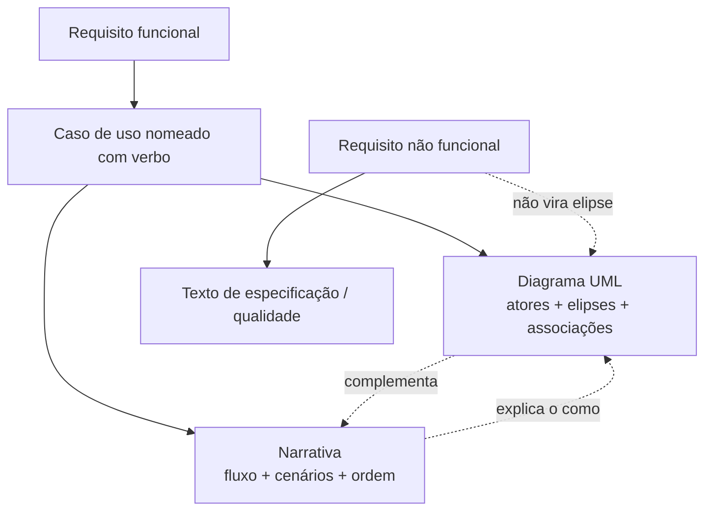
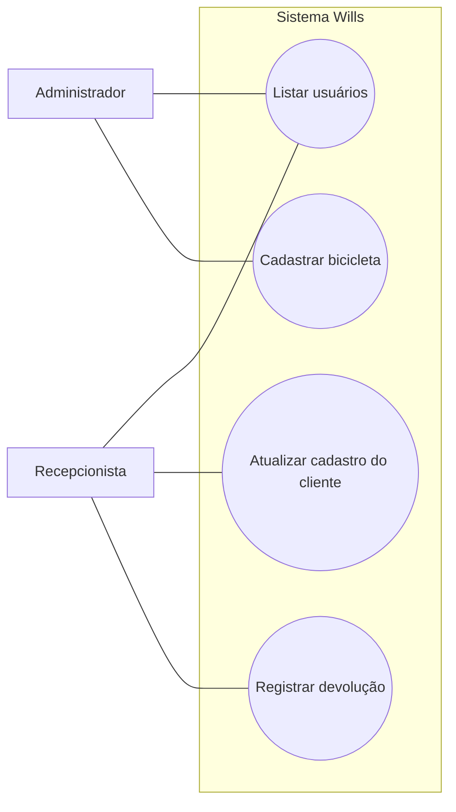
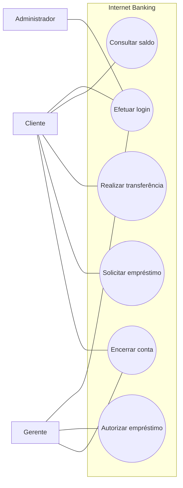

## Visão Geral do Conceito

Depois de especificar requisitos e separar o que é **funcional** do que é **não funcional**, o Projeto de Bloco exige **formalizar** o comportamento esperado do sistema. O instrumento dessa formalização é o <mark style="background-color: #242424; padding: 2px 4px; border-radius: 3px; color: inherit;">`caso de uso`</mark>.

Um caso de uso representa **uma ação ou um conjunto de ações** que um ator realiza **com a ajuda do sistema** — por exemplo: <mark style="background-color: #242424; padding: 2px 4px; border-radius: 3px; color: inherit;">`Registrar cliente`</mark>, <mark style="background-color: #242424; padding: 2px 4px; border-radius: 3px; color: inherit;">`Efetuar login`</mark>, <mark style="background-color: #242424; padding: 2px 4px; border-radius: 3px; color: inherit;">`Emitir relatório`</mark>. O nome **sempre carrega um verbo**: é funcionalidade que entrega valor, não um substantivo solto (“conta”, “segurança”, “gerência”).

> **Regra:** o caso de uso **não descreve implementação**. Linguagem, banco, arquitetura, padrão de desenho e relacionamento entre classes ficam fora. Ele traduz o requisito funcional em algo que implementador, dono do produto e equipe entendem da mesma forma.

A formalização tem **duas faces que se complementam**:

1. **Narrativa (textual)** — passo a passo, cenários (fluxo feliz e alternativos), ordem do que acontece.
2. **Diagrama de casos de uso (UML / visual)** — atores, elipses e associações; visão geral intuitiva **sem** sequência temporal.

Só o diagrama sem texto deixa o time sem fluxo. Só a narrativa sem diagrama dificulta ver quem faz o quê no escopo. No PB Backend, os dois vêm juntos — alinhados à competência de “formalizar requisitos através de casos de uso” e à fase de análise do ciclo de vida (onde o material da disciplina já aponta diagramas de caso de uso como ferramenta).

## Modelo Mental

Pense em três camadas:

| Camada | Pergunta que responde | Onde vive |
|--------|------------------------|-----------|
| Requisito funcional | O sistema deve permitir X? | Documento de requisitos |
| Caso de uso (valor) | Qual ação o ator realiza com o sistema? | Nome da elipse + narrativa |
| Passo / cenário | Em que ordem? E se der errado? | Descrição textual (não o diagrama) |

**Analogia:** a elipse no diagrama é a placa da porta da sala (“Empréstimo de bicicleta”). A narrativa é o roteiro de quem entra, o que fala no balcão, o que acontece se a bicicleta estiver indisponível. Você não escreve o roteiro na placa — e não tenta colocar o roteiro inteiro no desenho UML.

**Fronteira do sistema:** o retângulo (ou caixa) agrupa os casos de uso do sistema sob análise (ex.: Wills). Atores ficam **fora**; o que está dentro é comportamento do software. Outro sistema externo pode ser ator se **interage** com o seu.

**Independência de tempo:** no diagrama, “Efetuar login” e “Fazer empréstimo” **não** levam números 1 e 2. Na vida real login vem antes do empréstimo — isso aparece na **descrição**, não na posição das elipses.



## Mecânica Central

### 1. O que o modelo de casos de uso precisa ter

A aula organiza o modelo em peças que trabalham juntas:

1. **Diagrama de casos de uso** — visão gráfica: atores que interagem com o sistema e funcionalidades (elipses).
2. **Descrições dos casos de uso** — texto da funcionalidade (narrativa); o diagrama **complementa**, não substitui.
3. **Descrições dos atores** — quem são os papéis e o que fazem no sistema.
4. **Cenários** — interação concreta (fluxo feliz, alternativos) para identificar os casos de uso principais.

Sem cenário, o time inventa elipses demais ou de menos. Com cenário (“o gerente acessa o Wills, informa usuário e senha, entra na conta…”), você reconhece o caso de uso **Efetuar login** e deixa os passos na narrativa.

### 2. Notação UML usada nesta aula

| Elemento | Representação | Observação da aula |
|----------|---------------|-------------------|
| Caso de uso | Elipse com nome no meio | Verbo + objeto; nome curto e legível |
| Ator | Boneco palito (ou figura equivalente) | Papel no **singular**, sem nome próprio |
| Associação ator–CU | **Linha** (tracinho) | Sentido de “quem usa”; seta não é obrigatória |
| Fronteira | Caixa em torno das elipses | Nome do sistema (ex.: Wills) |
| Generalização | Seta com **triângulo aberto** (não preenchido) | Hierarquia; **não** usar como associação ator–CU |
| Inclusão | Linha **tracejada** + rótulo *include* | Relação **entre** casos de uso (detalhe na próxima aula) |
| Extensão | Linha **tracejada** + rótulo *extend* | Relação **entre** casos de uso (detalhe na próxima aula) |

> **Sintaxe vs. estética:** dá para estilizar o boneco do ator (logo, ícone), desde que **não conflite** com sintaxe UML. Elipse tracejada “porque ficou bonito”, seta de generalização no lugar da associação, ou rótulos *include*/*extend* errados **são penalizados** — mudam o significado.

### 3. Diagrama: só funcional, sem ordem, sem microfluxo

Propriedades enfatizadas:

- **Requisitos funcionais apenas.** Segurança, performance, “em dois segundos” etc. **não** viram elipse; podem aparecer na narrativa/especificação.
- **Independente do tempo.** O diagrama não registra a sequência nem todos os passos internos.
- **Associação, não seta de generalização.** Recomendação: linha simples. Se usar seta “para ficar claro”, **não** use o triângulo aberto de generalização.
- **Layout legível.** Evitar cruzamento de linhas; posicionar casos compartilhados de forma que as associações não “atravessem” o desenho. Cruzamento feio ≠ erro de significado, mas atrapalha a leitura — o diagrama existe para **simplificar**.

Exemplo Wills (aluguel de bicicletas): atores **Administrador** e **Recepcionista**; casos como listar usuários (compartilhado), e ações só da recepcionista (ex.: devolução / operações de bicicleta conforme o escopo do papel).



### 4. Narrativa: onde mora o “como”

Na narrativa você coloca o que o diagrama **omite de propósito**:

- Ordem dos passos (informar usuário → informar senha → entrar).
- Cenário feliz e alternativas (senha inválida, usuário bloqueado — conforme o domínio).
- Pré-condições / pós-condições quando o time já as usa na especificação (a aula reforça cenário e passo a passo; **template tabular completo campo a campo não foi o foco desta sessão** — ver lacunas).

Exemplo mínimo de narrativa (login do gerente no Wills):

1. O gerente acessa o sistema Wills.
2. Informa usuário.
3. Informa senha.
4. Solicita entrada.
5. O sistema autentica e abre a sessão do perfil gerente.

O diagrama correspondente mostra apenas: ator **Gerente** (ou o papel equivalente no seu modelo) associado a **Efetuar login**.

### 5. Relacionamentos entre casos de uso (prévia)

A aula **apresenta** inclusão, extensão e generalização, mas **adiou o detalhe** para a próxima. Ideia antecipada:

- **Inclusão:** um caso de uso **sempre** contém outro no fluxo (ex.: antes de confirmar prescrição, **verificar alergias** como parte obrigatória do processo — motivação clínica da aula).
- **Extensão:** sob **condição**, um fluxo adicional pode disparar outro caso de uso.
- **Generalização:** hierarquia mais geral / mais específico (atores ou casos de uso).

Não invente *include*/*extend* no TP só por “ficar profissional”: use quando o relacionamento for real e você souber a semântica (próxima aula).

### 6. Erros de modelagem (checklist da disciplina)

| Erro | Por que falha |
|------|----------------|
| Ator no **plural** (“Recepcionistas”) | O ator é o **papel**, não a quantidade de pessoas |
| Nome próprio (“Recepcionista Maria”) | Pessoa ≠ papel no diagrama |
| Repetir o mesmo ator várias vezes | Um símbolo por papel; se João e Pedro são o mesmo papel, um ator |
| Dois “administradores” distintos no desenho sem ser papéis diferentes | Só se forem **papéis** diferentes (ex.: Admin + “Admin de integração”); aí não são o mesmo ator |
| Associação ator↔ator no lugar de ator↔CU | Em geral a associação relevante é com o caso de uso |
| Relação desenhada com sintaxe errada | Conflito com generalização / include / extend |
| Elipses demais | Polui; priorize CUs principais ou **particione** por tema (ex.: só domínio bicicleta) ou por ator |
| Nome de CU longo demais / sem verbo | Dificulta leitura; prefira “Cadastrar bicicleta”, “Efetuar login” |
| Não funcional no diagrama | Erro conceitual; NFR fica fora das elipses |
| Microação como CU | “Informar dose”, “selecionar paciente” costumam ser **passos** da narrativa de um CU maior |

### 7. Quem pode ser ator?

- **Pessoa em um papel** (Cliente, Médico, Gerente).
- **Sistema externo** que interage com o seu sistema — **sim**, pode ser ator.
- **O próprio sistema sob análise interagindo consigo** — **não** coloca-se como ator do próprio diagrama.
- Quem **não interage** com o software (ex.: paciente que só recebe impressão do médico, sem login) **não** entra como ator — até existir canal de interação (app do paciente, pré-questionário, etc.).

Ferramentas: UML dedicada, Draw.io, ferramenta paga ou **folha + caneta** (print) — a aula aceita qualquer entrega **desde que a sintaxe conceitual esteja correta**.

## Uso Prático

### Internet banking (exercício guiado da aula)

Atores citados: **Cliente**, **Gerente**, **Administrador** (monitoramento / manutenção).

Casos de uso possíveis (sempre com verbo): criar conta bancária, efetuar login, consultar saldo, realizar transferência, pagar conta, solicitar empréstimo, autorizar empréstimo, encerrar conta…

Pontos de engenharia:

- **Efetuar login** pode ser compartilhado pelos três papéis.
- **Encerrar conta** pode envolver cliente **e/ou** gerente (domínio real: política do banco); o diagrama mostra associações — a narrativa/regra de negócio define aprovação.
- “Principal de segurança” como NFR **não** vira elipse.



### Livraria online (fluxo narrado → diagrama)

Narrativa resumida da aula: criar conta → login → pesquisar por autor → adicionar ao carrinho → checkout / pagamento / entrega → verificar status do pedido → cancelar se ainda não enviado; se não autenticado, autenticar.

No texto dado, o ator explícito é **Cliente**. O entregável pedido não é lista solta de nomes: é **diagrama** com elipses e associações.

Extraia CUs com verbo, por exemplo: Criar conta, Efetuar login, Pesquisar livro, Adicionar ao carrinho, Finalizar compra, Verificar status do pedido, Cancelar pedido.

### Evolução médica / prescrição (pensar atores de verdade)

- Ator principal típico: **Médico** (registrar prescrição, ver dados clínicos, verificar alergias, verificar interação medicamentosa, registrar justificativa médica quando houver interação).
- “Usuários autorizados” no requisito de segurança pode revelar **outro papel** (enfermeira, equipe de UTI) — aí sim segundo ator.
- “Informar dose” tende a ser **passo** dentro de Registrar prescrição, não CU isolado.
- Inteligência interna (checagem de interação) **não** é ator do sistema consigo mesmo.

### Pseudomodelo JSON para o PB (rastreabilidade)

No Projeto de Bloco, manter narrativa e diagrama alinhados a IDs ajuda TPs e apresentação:

```javascript
const casoDeUso = {
  id: "UC-WILLS-LOGIN",
  nome: "Efetuar login",
  atores: ["Gerente", "Recepcionista"],
  requisitoFuncionalIds: ["RF-01"],
  // NÃO colocar RF de performance/segurança aqui como se fosse CU
  narrativa: {
    fluxoPrincipal: [
      "Ator acessa o sistema Wills",
      "Informa usuário",
      "Informa senha",
      "Solicita autenticação",
      "Sistema valida e inicia sessão"
    ],
    // cenários alternativos: detalhar conforme regras do domínio
    alternativas: []
  },
  diagrama: {
    tipo: "use-case",
    // ordem das elipses no desenho NÃO implica sequência
    independenteDeTempo: true
  }
};

console.log(casoDeUso.nome, casoDeUso.atores.length);
```

## Erros Comuns

1. **Tratar caso de uso como design técnico**  
   Sintoma: elipse “Usar PostgreSQL” ou “Aplicar Repository”.  
   Correção: voltar ao valor para o usuário; persistência e padrão vão para design/classes.

2. **Diagrama sem narrativa (ou o contrário)**  
   Sintoma: boneco + elipses sem fluxo; ou três páginas de texto sem visão de atores.  
   Correção: entregar o par; o desenho orienta, o texto implementa o entendimento do fluxo.

3. **Numerar elipses “1. Login, 2. Empréstimo” no diagrama**  
   Sintoma: ordem espacial/numérica como se fosse BPMN.  
   Correção: ordem só na descrição; diagrama independente do tempo.

4. **Seta de generalização como “fica mais claro”**  
   Sintoma: triângulo aberto ator → CU.  
   Correção: associação com linha; reserve generalização para hierarquia real.

5. **Ator plural ou com nome próprio**  
   Sintoma: “Clientes”, “Maria”.  
   Correção: “Cliente”; papéis, não indivíduos.

6. **NFR no diagrama**  
   Sintoma: elipse “Garantir segurança” / “Responder em 2s”.  
   Correção: NFR na especificação; no máximo influencia atores autorizados na narrativa.

7. **Granularidade errada**  
   Sintoma: dezenas de elipses (“clicar botão”, “selecionar paciente”).  
   Correção: CU = unidade de valor; passos ficam na narrativa. Particionar diagramas grandes por tema ou por ator.

8. **Incluir quem não interage**  
   Sintoma: Paciente no diagrama só porque é “importante no domínio”.  
   Correção: ator = quem **usa** o sistema (ou sistema externo que troca mensagens).

## Visão Geral de Debugging

Quando o modelo “não fecha”, debugue nesta ordem:

1. **Partir do cenário escrito** — quem toca a tela/API? Só esses são candidatos a ator.
2. **Listar verbos de valor** — cada verbo+objeto vira candidato a CU; microcliques viram passos.
3. **Classificar RF vs NFR** — tudo que for qualidade/restrição sai do conjunto de elipses.
4. **Checar sintaxe UML** — linha de associação vs generalização vs include/extend (se ainda não estudou o detalhe, **não force** o traço tracejado).
5. **Ler o diagrama em voz alta** — “Recepcionista pode Registrar devolução”: se a frase for falsa no negócio, a associação está errada.
6. **Olhar cruzamentos e densidade** — se ninguém entende em 10 segundos, particione o diagrama; o erro pode ser de layout, não de domínio.
7. **Confrontar com a competência do PB** — formalizar requisitos → depois classes; se você já está discutindo atributos de tabela no UC, voltou fase demais.

<details>
<summary>Exemplo de diagnóstico rápido</summary>

Texto: “O sistema deve ser seguro e o médico registra a prescrição após ver alergias.”

- “Ser seguro” → NFR (fora do diagrama como elipse).
- “Registrar prescrição” → CU.
- “Ver alergias” → passo obrigatório ou futuro *include* (próxima aula), não necessariamente elipse isolada sem critério.
- Ator: Médico (e outros só se houver interação real).

</details>

## Principais Pontos

- Caso de uso formaliza **requisito funcional** com foco em valor para o ator — sem implementação.
- Nome do CU: **verbo + objeto**; ator: **papel no singular**, sem nome próprio.
- Representação **gráfica + textual**: diagrama e narrativa se complementam.
- Diagrama UML: elipse, ator, associação por **linha**, fronteira do sistema; **independente do tempo**.
- Passos, ordem e cenários ficam na **narrativa**.
- NFR **não** vira elipse; sistema externo **pode** ser ator; o sistema sob análise **não** é ator de si mesmo.
- Erros graves: sintaxe UML conflitada, poluição visual, granularidade errada, plural/nome próprio.
- *Include* / *extend* / generalização entre CUs: apresentados; **aprofundamento na próxima aula**.

## Preparação para Prática

Antes do laboratório, você deve conseguir:

1. Extrair atores e CUs de um parágrafo de domínio (banking, livraria, Wills, saúde).
2. Separar o que é elipse do que é passo de narrativa.
3. Validar um “modelo” JSON/estruturado contra regras da aula (verbo, singular, sem NFR no diagrama).
4. Detectar associações e nomes inválidos programaticamente (treino para revisão de TP).

No Editor Integrado use JavaScript como veículo de validação de regras de modelagem (o corpo da disciplina continua em engenharia de software / UML — não em framework web).

## Laboratório de Prática

### Easy — Validar nome de caso de uso e ator

Você recebe candidatos a elementos do diagrama Wills. Aceite só CUs com verbo de ação reconhecível e atores no singular sem nome próprio.

```javascript
const VERBOS = [
  "efetuar", "registrar", "cadastrar", "atualizar", "listar",
  "solicitar", "autorizar", "consultar", "realizar", "encerrar",
  "adicionar", "pesquisar", "cancelar", "verificar", "emitir", "fazer"
];

function validarNomeCasoDeUso(nome) {
  // TODO: trim; exigir pelo menos 2 palavras; primeira palavra (lower) em VERBOS
  // TODO: rejeitar se nome estiver vazio → { ok: false, erro: "nome vazio" }
  // TODO: se ok → { ok: true }
  return { ok: false, erro: "TODO" };
}

function validarNomeAtor(nome) {
  // TODO: rejeitar se incluir espaço e segunda palavra parecer nome próprio (ex.: "Recepcionista Maria")
  //       heurística: segunda palavra começa com maiúscula e não é "de"/"do"/"da"
  // TODO: rejeitar plural simples terminado em "s" com mais de 3 letras (ex.: "Clientes") → erro "ator no plural"
  // TODO: aceitar "Cliente", "Recepcionista", "Administrador", "Sistema de pagamento"
  return { ok: false, erro: "TODO" };
}

console.log(validarNomeCasoDeUso("Efetuar login"));
console.log(validarNomeCasoDeUso("Segurança"));
console.log(validarNomeAtor("Recepcionista"));
console.log(validarNomeAtor("Recepcionistas"));
console.log(validarNomeAtor("Recepcionista Maria"));
```

**Critérios:**

- “Efetuar login” ok; “Segurança” ou “Conta” sem verbo → inválido.
- Plural e nome próprio → inválido.

### Medium — Classificar elemento: elipse, passo ou NFR

Dado o domínio de internet banking / livraria, classifique frases do levantamento.

```javascript
function classificarElemento(texto) {
  // texto: string do levantamento
  // TODO: se mencionar segurança, performance, "em X segundos", disponibilidade, criptografia
  //       → { tipo: "nfr", noDiagrama: false }
  // TODO: se for microação típica de UI/fluxo ("informar senha", "selecionar paciente", "clicar em entrar")
  //       → { tipo: "passo_narrativa", noDiagrama: false }
  // TODO: se começar com verbo de valor (transferir, solicitar empréstimo, criar conta, efetuar login…)
  //       → { tipo: "caso_de_uso", noDiagrama: true }
  // TODO: caso ambíguo → { tipo: "revisar", noDiagrama: null }
  return { tipo: "revisar", noDiagrama: null };
}

const amostras = [
  "Efetuar login",
  "Informar usuário e senha",
  "O sistema deve garantir acesso apenas a usuários autorizados",
  "Realizar transferência",
  "Responder a consulta de saldo em dois segundos"
];

for (const s of amostras) {
  console.log(s, classificarElemento(s));
}
```

**Critérios:**

- Login/transferência → caso de uso (`noDiagrama: true`).
- Informar senha → passo de narrativa.
- Autorizados / dois segundos → NFR.

### Hard — Montar e validar um diagrama lógico (associações)

Modele a livraria online da aula como estrutura de dados e valide regras: ator único quando o texto só cita cliente; CUs com verbo; nenhuma associação usando tipo `generalizacao` entre ator e CU; proibir NFR como nó.

```javascript
function validarDiagrama(modelo) {
  // modelo = {
  //   sistema: "LivrariaOnline",
  //   atores: [{ id, nome }],
  //   casosDeUso: [{ id, nome, tipo: "uc"|"nfr" }],
  //   associacoes: [{ de, para, tipo: "associacao"|"generalizacao"|"include"|"extend" }]
  // }
  // TODO: erros[]:
  //  - CU com tipo "nfr"
  //  - associação ator–UC com tipo "generalizacao"
  //  - ator ou UC referenciado em associação inexistente
  //  - nome de UC que falha validarNomeCasoDeUso (reutilize a ideia do Easy)
  //  - se textoFonte === "apenas_cliente" e atores.length !== 1 → erro
  // TODO: retornar { ok: erros.length === 0, erros }
  return { ok: false, erros: ["TODO"] };
}

const livraria = {
  sistema: "LivrariaOnline",
  textoFonte: "apenas_cliente",
  atores: [{ id: "a1", nome: "Cliente" }],
  casosDeUso: [
    { id: "uc1", nome: "Criar conta", tipo: "uc" },
    { id: "uc2", nome: "Efetuar login", tipo: "uc" },
    { id: "uc3", nome: "Pesquisar livro", tipo: "uc" },
    { id: "uc4", nome: "Adicionar ao carrinho", tipo: "uc" },
    { id: "uc5", nome: "Finalizar compra", tipo: "uc" }
  ],
  associacoes: [
    { de: "a1", para: "uc1", tipo: "associacao" },
    { de: "a1", para: "uc2", tipo: "associacao" },
    { de: "a1", para: "uc3", tipo: "associacao" },
    { de: "a1", para: "uc4", tipo: "associacao" },
    { de: "a1", para: "uc5", tipo: "associacao" }
  ]
};

console.log(validarDiagrama(livraria));
```

**Critérios:**

- Modelo da livraria com um ator Cliente e associações simples → `ok: true`.
- Se trocar uma associação para `generalizacao` ou inserir CU `tipo: "nfr"` → `ok: false` com erro explícito.

---

<!-- lessons.json (orquestrador): discipline=projeto-bloco-backend slug=casos-de-uso-formalizacao-narrativa title="Casos de uso: formalização e narrativa" order=6 file=content/projeto-bloco-backend/aula-06-casos-de-uso-formalizacao-narrativa.md -->

<!-- CONCEPT_EXTRACTION
concepts:
  - caso de uso
  - narrativa de caso de uso
  - diagrama de casos de uso UML
  - ator e papel
  - associação ator–caso de uso
  - fronteira do sistema
  - cenário principal e alternativo
  - independência temporal do diagrama
  - requisitos funcionais vs não funcionais no modelo
  - erros de modelagem de casos de uso
  - inclusão e extensão (prévia)
  - generalização UML (sintaxe)
skills:
  - Nomear casos de uso com verbo e objeto
  - Separar passos de narrativa de elipses do diagrama
  - Desenhar associação ator–CU sem conflitar com generalização
  - Identificar atores reais inclusive sistemas externos
  - Excluir NFR do diagrama de casos de uso
  - Detectar erros de plural, nome próprio e poluição visual
  - Extrair diagrama a partir de fluxo narrado de domínio
examples:
  - wills-login-gerente
  - wills-admin-recepcionista
  - internet-banking-atores
  - livraria-online-fluxo
  - evolucao-medica-prescricao
  - validacao-json-caso-de-uso
-->

<!-- EXERCISES_JSON
[
  {
    "id": "pb06-validar-nome-uc-ator",
    "slug": "pb06-validar-nome-uc-ator",
    "difficulty": "easy",
    "title": "Validar nome de caso de uso e ator",
    "discipline": "projeto-bloco-backend",
    "editorLanguage": "javascript",
    "tags": ["casos-de-uso", "uml", "atores", "nomenclatura", "engenharia-de-software"],
    "summary": "Aceitar só CUs com verbo e atores no singular sem nome próprio."
  },
  {
    "id": "pb06-classificar-elipse-passo-nfr",
    "slug": "pb06-classificar-elipse-passo-nfr",
    "difficulty": "medium",
    "title": "Classificar elemento: elipse, passo ou NFR",
    "discipline": "projeto-bloco-backend",
    "editorLanguage": "javascript",
    "tags": ["casos-de-uso", "requisitos-funcionais", "nfr", "narrativa"],
    "summary": "Separar o que vai no diagrama UML do que fica na narrativa ou como não funcional."
  },
  {
    "id": "pb06-validar-diagrama-livraria",
    "slug": "pb06-validar-diagrama-livraria",
    "difficulty": "hard",
    "title": "Montar e validar diagrama lógico da livraria",
    "discipline": "projeto-bloco-backend",
    "editorLanguage": "javascript",
    "tags": ["casos-de-uso", "uml", "associacao", "validacao", "livraria"],
    "summary": "Validar atores, CUs e associações de um modelo estruturado sem generalização indevida nem NFR."
  }
]
-->
