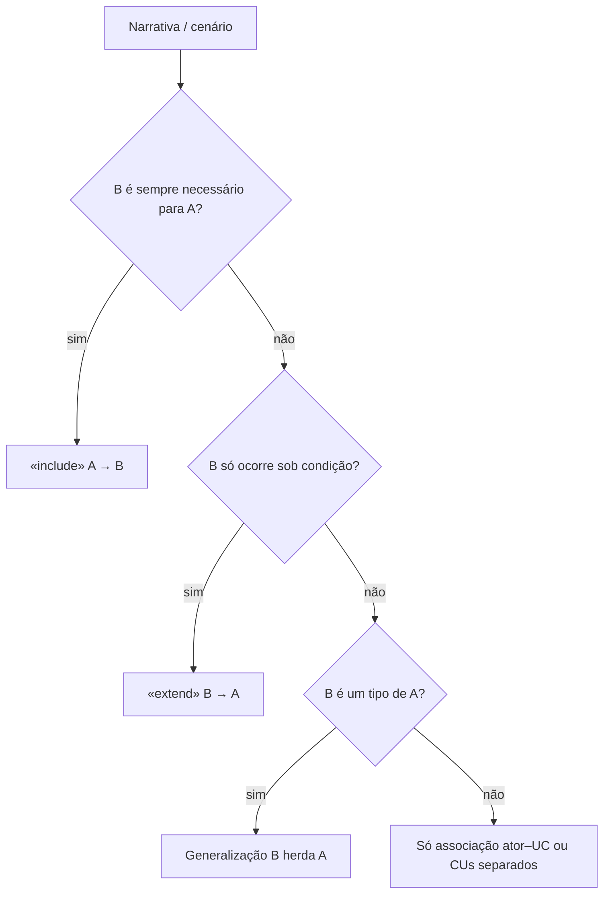
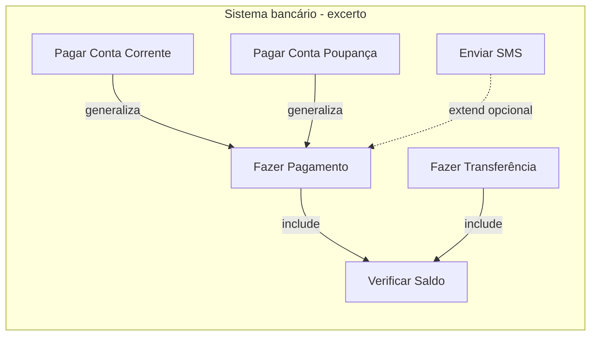
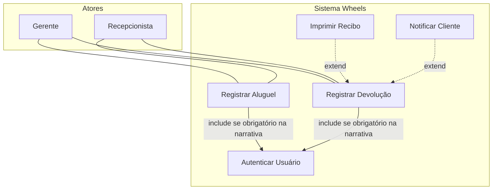

## Visão Geral do Conceito

Na aula anterior, o caso de uso formalizou o requisito funcional em **narrativa** + **diagrama UML** (atores, elipses, associação, fronteira). Nesta continuação, o foco deixa de ser “quem usa o quê” e passa a ser **como funcionalidades e papéis se relacionam entre si**.

Casos de uso **não precisam ser totalmente independentes**. Quando dois ou mais compartilham comportamento, ou quando um trecho só ocorre sob condição, o modelo UML oferece relacionamentos estruturados:

| Relacionamento | Nome UML (ferramentas) | Ideia central |
|----------------|------------------------|---------------|
| Inclusão | <mark style="background-color: #242424; padding: 2px 4px; border-radius: 3px; color: inherit;">`«include»`</mark> | B é **obrigatório** para completar A |
| Extensão | <mark style="background-color: #242424; padding: 2px 4px; border-radius: 3px; color: inherit;">`«extend»`</mark> | B é **opcional/condicional** a partir de A |
| Especialização | <mark style="background-color: #242424; padding: 2px 4px; border-radius: 3px; color: inherit;">`generalization`</mark> | B é um **tipo** de A (herança de comportamento) |

> **Regra:** relacionamentos existem para **evitar duplicação** e **deixar explícitas as dependências** entre funcionalidades — não para “enfeitar” o diagrama.

A mesma aula abre com **feedback do TP1** (tema, complexidade, escopo solo vs time) e fecha com o aviso crítico para o **TP2**: quem trabalha em metodologia ágil (ex.: Scrum) **não** deve colar include/extend em histórias de usuário; o trabalho pede **casos de uso**.

## Modelo Mental

Pense em três perguntas antes de desenhar qualquer seta tracejada:

1. **Obrigatório?** Se A nunca completa sem B → candidato a <mark style="background-color: #242424; padding: 2px 4px; border-radius: 3px; color: inherit;">`include`</mark>.
2. **Opcional com condição?** Se A funciona sozinho, mas às vezes dispara B → candidato a <mark style="background-color: #242424; padding: 2px 4px; border-radius: 3px; color: inherit;">`extend`</mark>.
3. **Variante tipada?** Se B é “um tipo de A” (mesma essência, regras/etapas próprias) → candidato a <mark style="background-color: #242424; padding: 2px 4px; border-radius: 3px; color: inherit;">`generalization`</mark>.

**Analogia de engenharia:**  
- *include* = sub-rotina obrigatória no fluxo (sempre chama).  
- *extend* = hook/plugin opcional (só se o flag/condição existir).  
- *generalization* = hierarquia de tipos (classe base + especializações), não um “extra”.

Para **atores**, a generalização responde: “este papel faz **tudo** que o genérico faz **e mais**?”. Se sim, o ator especializado **herda** as associações do genérico — você não precisa redesenhar todas as setas.



## Mecânica Central

### 1. Inclusão (`«include»`)

A relação de inclusão ocorre quando um caso de uso **depende obrigatoriamente** de outro. O caso base só é executado por completo se o incluído também for executado.

- O incluído é **incondicional**: sempre acontece quando o base inicia.
- Formulário mental: *“Para fazer A, sempre é preciso fazer B.”*

**Exemplo canônico (slides):**

| Papel | Caso de uso |
|-------|-------------|
| Base | Realizar Pagamento |
| Incluído | Verificar Saldo |

O cliente não realiza o pagamento sem verificar se há saldo → <mark style="background-color: #242424; padding: 2px 4px; border-radius: 3px; color: inherit;">`Verificar Saldo`</mark> está incluído em <mark style="background-color: #242424; padding: 2px 4px; border-radius: 3px; color: inherit;">`Realizar Pagamento`</mark>.

**Outros exemplos da aula (oral):** realizar compra / autenticar usuário; cancelar pedido / autenticar; consultar pedido / autenticar — o mesmo trecho de autenticação vira UC reutilizável ligado por include a vários bases.

> **Por que extrair o incluído?** Você *poderia* embutir autenticação dentro de “Realizar compra”. O include aparece quando **outro** caso de uso também precisa do mesmo trecho: evita reimplementar e deixa a dependência explícita no diagrama.

### 2. Extensão (`«extend»`)

A extensão modela comportamentos **opcionais e condicionais**. Diferente da inclusão, **não** é obrigatória: ocorre só se uma condição for atendida.

- Formulário mental: *“Durante A, às vezes também é possível/necessário fazer B.”*
- Objetivo de modelagem: anexar opcionalidades **sem poluir** o fluxo principal do base.

**Exemplo canônico (slides):**

| Papel | Caso de uso |
|-------|-------------|
| Base | Gerar Relatório de Vendas |
| Extensão | Enviar Relatório por E-mail |

Só ocorre se o usuário marcar “enviar por e-mail”.

**Exemplos discutidos na aula:** cupom de desconto em compra; rastreio opcional de pedido; impressão de comprovante / envio de SMS em pagamento (como *possíveis* extensões, não obrigatórias).

**Atenção de ciclo de vida:** a aula lembra que o diagrama captura a intenção **no momento da modelagem**. Se depois o negócio torna o e-mail “sempre ativo” via flag permanente, o comportamento operacional muda — mas o modelo original foi pensado como extensão. Não reescreva a história: documente a evolução.

### 3. Generalização / especialização de casos de uso

Funciona como **herança**: o pai é genérico; os filhos são versões especializadas. O especializado herda o comportamento básico e pode **adicionar etapas**, **modificar regras** ou **complementar detalhes**.

**Exemplo canônico:**

- Genérico: Realizar Pagamento  
- Específicos: Realizar Pagamento com Cartão de Crédito · Realizar Pagamento com Boleto  

Ambos são pagamentos; cada um tem particularidades (validação de CVV, geração de código de barras).

**Outro exemplo da aula:** Validar Cliente como genérico; Validar por Senha e Validar por Biometria como especializações.

### 4. Como identificar pela narrativa

| Sinal na narrativa | Relacionamento |
|--------------------|----------------|
| Trecho de comportamento **similar** em outros CUs; **obrigatório**; base **não** executa sem isso | Inclusão |
| Mesmos passos do base **mais** passos extras; **sempre** há condição | Extensão |
| “B é um tipo de A”; mesmas etapas iniciais + particularidades por variante | Especialização |

### 5. Notação visual (o que a aula exige)

- Ferramentas costumam rotular em inglês: <mark style="background-color: #242424; padding: 2px 4px; border-radius: 3px; color: inherit;">`include`</mark>, <mark style="background-color: #242424; padding: 2px 4px; border-radius: 3px; color: inherit;">`extend`</mark>, <mark style="background-color: #242424; padding: 2px 4px; border-radius: 3px; color: inherit;">`generalization`</mark>.
- Include/extend: linha **tracejada** + rótulo do estereótipo.
- Generalização: seta com **triângulo** (hierarquia) — **não** usar linha tracejada de include/extend no lugar.
- Estética do boneco/ator pode variar; **sintaxe** do relacionamento não.



### 6. Generalização entre atores

Atores também generalizam quando um papel específico realiza **tudo** que o genérico faz **e** atribuições adicionais. Isso:

- evita **duplicar setas** no diagrama;
- expressa **hierarquia de papéis**.

**Exemplos (slides):**

| Genérico | Específicos | Extra do especializado |
|----------|-------------|------------------------|
| Cliente | Cliente Premium, Cliente Comum | Premium: pagamentos internacionais, transferências ilimitadas |
| Funcionário | Gerente | Aprovar reembolsos, gerenciar estoque |

Não é obrigatório ligar Cliente Premium a todos os CUs do Cliente Comum: a herança de ator cobre as associações do genérico.

**Heurística da aula (Wheels):** só relacione Gerente e Recepcionista por generalização se um fizer **tudo** que o outro faz **e mais**. Se cada um domina fatias distintas (ex.: um foca bicicletas, outro usuários), podem permanecer **atores separados** sem generalização.

### 7. Feedback do TP1 (contexto de entrega)

Da abertura da aula (transcrição), para calibrar o projeto:

- Sem comentário na correção → tratado como **ok para continuar**.
- Alguns trabalhos: **simples demais** → aumentar um pouco a complexidade.
- Temas **parecidos** com o caso de sala (aluguel de bicicletas / Wills, PDV, biblioteca) foram **aceitos**, com cuidado para **não reproduzir exatamente** o conteúdo da aula — acrescente outros casos de uso / funcionalidades.
- Meta de implementação citada: **pelo menos 3 ou 4 funcionalidades principais**.
- Escopo: quem faz **sozinho** não será cobrado na mesma quantidade de funcionalidades que um **time de três**.
- Turma: ~36 projetos, tema livre; professor planeja **vários dias** de apresentação (ex.: quatro) pelo volume.

### 8. Casos de uso × histórias de usuário (aviso para TP2)

Vários alunos escolheram metodologia **ágil** (Scrum). No ágil clássico, o artefato cotidiano é a **história de usuário**, não o diagrama de casos de uso com include/extend/generalização.

- Histórias: foco em **valor** ao cliente, fatias pequenas, feedback rápido; grandes histórias se **quebram**.
- Entre histórias fala-se em **dependências** (ex.: comprar depende de endereço cadastrado), **não** no estereótipo «include» reutilizável como no UC.
- **TP2** pede diagrama de **caso de uso**. Não entregue “US1 include US2”. Faça o trabalho em casos de uso; a metodologia ágil no restante do projeto pode coexistir (**híbrido**), desde que o artefato cobrado esteja correto.

**Não coberto nas fontes com data fechada além do citado:** detalhes administrativos de apresentação no Drive (planilha de datas) — apenas a intenção de coletar preferências após o TP2.

## Uso Prático

### Exercício 1 — domínio bancário (solução alinhada à aula)

Casos dados: Fazer Transferência, Fazer Pagamento, Verificar Saldo, Pagar da Conta Corrente, Pagar da Conta Poupança.

| Relação | Tipo | Justificativa |
|---------|------|---------------|
| Fazer Pagamento → Verificar Saldo | include | Pagamento inválido sem saldo |
| Fazer Transferência → Verificar Saldo | include | Idem |
| Pagar Conta Corrente / Poupança → Fazer Pagamento | generalização | Variantes tipadas do pagamento |
| — | extend | **Não há** extend nos cinco nomes dados |

Extensões *ilustrativas* (fora da lista obrigatória): imprimir comprovante, enviar SMS — opcionais sobre o pagamento.

### Exercício 2 — Sistema Wheels (enunciado)

Empresa de aluguel de bicicletas urbanas. Atores internos: **Gerente** e **Recepcionista**. Modelar:

- atores e relacionamentos entre eles (se houver);
- todos os casos de uso;
- relacionamentos entre casos de uso.

| ID | Caso de uso |
|----|-------------|
| UC01 | Cadastrar Bicicleta |
| UC02 | Alterar Bicicleta |
| UC03 | Excluir Bicicleta |
| UC04 | Visualizar Lista de Bicicletas |
| UC05 | Visualizar Detalhes da Bicicleta |
| UC06 | Cadastrar Usuário |
| UC07 | Autenticar Usuário |
| UC08 | Visualizar Lista de Usuários |
| UC09 | Visualizar Detalhes de Usuário |
| UC10 | Atualizar Usuário |
| UC11 | Excluir Usuário |
| UC12 | Visualizar Histórico de Locações |
| UC13 | Registrar Aluguel |
| UC14 | Registrar Devolução |
| UC15 | Imprimir Recibo |
| UC16 | Notificar Cliente da Devolução |

**Leituras discutidas em sala (não são a única solução válida):**

- UC15 / UC16 como candidatos a **extend** de UC14 (recibo e notificação opcionais na devolução) — sempre nomear **os dois** lados do relacionamento.
- UC07 (Autenticar) como candidato a **include** de fluxos que exigem sessão (ex.: operações sensíveis) — só se a narrativa tornar autenticação obrigatória nesses bases.
- CRUD de bicicleta vs usuário: pode ficar com atores distintos **sem** generalização Gerente⊃Recepcionista, a menos que a narrativa diga que o gerente faz tudo da recepção e mais.



### Representação estrutural (para o laboratório)

No editor ISS, modelamos o diagrama como JSON validável: nós (atores/CUs) + arestas tipadas (`include` | `extend` | `generalization` | `associacao`).

```javascript
const pagamentoModelo = {
  sistema: "InternetBanking",
  casosDeUso: [
    { id: "fp", nome: "Fazer Pagamento" },
    { id: "ft", nome: "Fazer Transferencia" },
    { id: "vs", nome: "Verificar Saldo" },
    { id: "pcc", nome: "Pagar Conta Corrente" },
    { id: "pcp", nome: "Pagar Conta Poupanca" }
  ],
  relacionamentos: [
    { de: "fp", para: "vs", tipo: "include" },
    { de: "ft", para: "vs", tipo: "include" },
    { de: "pcc", para: "fp", tipo: "generalization" },
    { de: "pcp", para: "fp", tipo: "generalization" }
  ]
};
```

## Erros Comuns

| Erro | Sintoma | Correção |
|------|---------|----------|
| Trocar include por extend | Pagamento “opcionalmente” verifica saldo | Se o base **não** completa sem B → include |
| Trocar especialização por extend | Conta corrente como “extra” do pagamento | Variante tipada → generalization; SMS/comprovante → extend |
| Colocar include/extend entre **histórias de usuário** no TP2 | Artefato ágil com estereótipos UML de UC | Entregar diagrama de **casos de uso** |
| Generalização Gerente–Recepcionista sem narrativa | Hierarquia inventada | Só se um fizer tudo do outro + extras |
| Nomear só um lado do relacionamento | “UC16 é extend” sem base | Sempre: *extensão de quem?* / *incluído em quem?* |
| Linha tracejada na generalização | Sintaxe UML errada | Triângulo de generalização ≠ tracejado include/extend |
| Copiar Wills/bicicletas no TP1 sem diferenciação | Feedback de similaridade ao caso de sala | Aceito se houver **outros** CUs/funcionalidades próprias |
| Embutir tudo num único UC e nunca extrair include | Duplicação quando surge segundo fluxo | Extrair o trecho reutilizável obrigatório |

## Visão Geral de Debugging

Quando o diagrama “não fecha”, debugue nesta ordem:

1. **Liste os CUs e atores** a partir da narrativa (texto-fonte), sem setas.
2. Para cada par suspeito, aplique o teste das três perguntas (obrigatório / condicional / tipo de).
3. Verifique **direção semântica**: include = base depende do incluído; extend = extensão condicionada ao base; generalization = filho → pai.
4. Confira **sintaxe visual**: tracejado+rótulo vs triângulo.
5. Para atores: pergunte se a hierarquia **elimina setas duplicadas** de verdade; se não, mantenha associações separadas.
6. Cruzamento ágil: se o artefato for TP2, remova qualquer tentativa de «include» entre user stories.

<details>
<summary>Checklist rápido de revisão do Exercício 1</summary>

- [ ] Verificar Saldo incluído em Pagamento **e** Transferência  
- [ ] Conta Corrente e Poupança generalizam Pagamento  
- [ ] Nenhum extend inventado só porque “parece opcional” sem condição na lista dada  
</details>

## Principais Pontos

- Relacionamentos evitam duplicação e tornam dependências explícitas.
- <mark style="background-color: #242424; padding: 2px 4px; border-radius: 3px; color: inherit;">`include`</mark> = obrigatório e incondicional.
- <mark style="background-color: #242424; padding: 2px 4px; border-radius: 3px; color: inherit;">`extend`</mark> = opcional e condicional; não polui o fluxo base.
- Generalização de UC = herança de comportamento (variantes tipadas).
- Generalização de ator = herda casos de uso do genérico + extras.
- Identifique pela narrativa antes de desenhar setas.
- TP1: silêncio na correção ≈ ok; simples demais ou cópia do caso de sala pedem ajuste; solo ≠ cobrança de time.
- TP2: diagrama de **casos de uso**; não use include/extend em histórias de usuário.

## Preparação para Prática

Ao final desta lição você deve conseguir:

1. Classificar um par de CUs como include, extend, generalization ou nenhum.
2. Validar um modelo JSON de relacionamentos contra regras da aula.
3. Propor relacionamentos coerentes para um subconjunto do Wheels (UC13–UC16 + autenticação).
4. Explicar por que o TP2 não aceita estereótipos de UC sobre user stories.

## Laboratório de Prática

### Easy — Classificar o tipo de relacionamento

Dado um par `(base, outro, pistaNarrativa)`, retorne `"include"`, `"extend"`, `"generalization"` ou `"nenhum"`.

```javascript
function classificarRelacionamento(base, outro, pistaNarrativa) {
  // pistaNarrativa: string livre descrevendo a relação
  // TODO: se indicar obrigação incondicional ("sempre precisa", "não completa sem") → "include"
  // TODO: se indicar opcionalidade com condição ("quando solicitado", "se marcar opção") → "extend"
  // TODO: se indicar variante tipada ("é um tipo de", "cartão/boleto/conta corrente") → "generalization"
  // TODO: caso contrário → "nenhum"
  return "nenhum";
}

const casos = [
  ["Fazer Pagamento", "Verificar Saldo", "pagamento nunca completa sem verificar saldo"],
  ["Gerar Relatorio", "Enviar por Email", "so ocorre se usuario marcar enviar por e-mail"],
  ["Fazer Pagamento", "Pagar Conta Corrente", "pagar da conta corrente e um tipo de fazer pagamento"],
  ["Listar Bicicletas", "Cadastrar Bicicleta", "sao funcionalidades distintas sem dependencia estrutural"]
];

for (const [a, b, pista] of casos) {
  console.log(a, "↔", b, "→", classificarRelacionamento(a, b, pista));
}
```

**Critérios:** três primeiros → include, extend, generalization; o quarto → nenhum.

### Medium — Validar modelo bancário (Exercício 1)

Valide se o JSON do domínio bancário respeita a solução da aula.

```javascript
function validarModeloBancario(modelo) {
  // modelo.relacionamentos: [{ de, para, tipo }]
  // ids esperados: fp, ft, vs, pcc, pcp
  // TODO: erros[] se faltar include fp→vs ou ft→vs
  // TODO: erros[] se faltar generalization pcc→fp ou pcp→fp
  // TODO: erros[] se existir extend entre esses cinco CUs
  // TODO: erros[] se tipo invalido ou id inexistente
  // TODO: retornar { ok: erros.length === 0, erros }
  return { ok: false, erros: ["TODO"] };
}

const modelo = {
  casosDeUso: ["fp", "ft", "vs", "pcc", "pcp"],
  relacionamentos: [
    { de: "fp", para: "vs", tipo: "include" },
    { de: "ft", para: "vs", tipo: "include" },
    { de: "pcc", para: "fp", tipo: "generalization" },
    { de: "pcp", para: "fp", tipo: "generalization" }
  ]
};

console.log(validarModeloBancario(modelo));
```

**Critérios:** modelo acima → `ok: true`; se adicionar `{ de: "sms", para: "fp", tipo: "extend" }` com `sms` fora da lista → erro de id; se trocar um include por extend → erro de regra.

### Hard — Montar relacionamentos Wheels (UC13–UC16 + UC07)

A partir de flags de narrativa, gere as arestas `include`/`extend` coerentes e valide ausência de generalização inventada entre Gerente e Recepcionista quando `gerenteFazTudoDaRecepcao === false`.

```javascript
function montarRelacionamentosWheels(narrativa) {
  // narrativa = {
  //   reciboOpcionalNaDevolucao: boolean,
  //   notificarOpcionalNaDevolucao: boolean,
  //   autenticacaoObrigatoriaEmAluguelEDevolucao: boolean,
  //   gerenteFazTudoDaRecepcao: boolean
  // }
  // TODO: se reciboOpcionalNaDevolucao → { de: "UC15", para: "UC14", tipo: "extend" }
  // TODO: se notificarOpcionalNaDevolucao → { de: "UC16", para: "UC14", tipo: "extend" }
  // TODO: se autenticacaoObrigatoria... → include UC13→UC07 e UC14→UC07
  // TODO: atores.generalizacao = ["Gerente","Recepcionista"] somente se gerenteFazTudoDaRecepcao
  // TODO: retornar { relacionamentos, atores: { generalizacao: []|par } }
  return { relacionamentos: [], atores: { generalizacao: [] } };
}

const n1 = {
  reciboOpcionalNaDevolucao: true,
  notificarOpcionalNaDevolucao: true,
  autenticacaoObrigatoriaEmAluguelEDevolucao: true,
  gerenteFazTudoDaRecepcao: false
};

console.log(montarRelacionamentosWheels(n1));
```

**Critérios:**

- Com `n1`: dois extends (UC15/UC16 → UC14), dois includes (UC13/UC14 → UC07), `generalizacao` vazia.
- Se `gerenteFazTudoDaRecepcao: true`: incluir o par Gerente–Recepcionista em `atores.generalizacao`.

---

<!-- lessons.json (orquestrador): discipline=projeto-bloco-backend slug=casos-de-uso-avancado-feedback-tp1 title="Casos de uso (continuação) e feedback do TP1" order=7 file=content/projeto-bloco-backend/aula-07-casos-de-uso-avancado-feedback-tp1.md -->

<!-- CONCEPT_EXTRACTION
concepts:
  - relacionamento entre casos de uso
  - include (inclusão)
  - extend (extensão)
  - generalização / especialização de casos de uso
  - generalização de atores
  - comportamento reutilizável obrigatório
  - comportamento opcional condicional
  - dependência entre funcionalidades
  - identificação pela narrativa
  - notação UML include/extend/generalization
  - feedback TP1 (complexidade e similaridade)
  - casos de uso vs histórias de usuário
  - Sistema Wheels UC01–UC16
skills:
  - Distinguir include, extend e generalization em pares de CUs
  - Extrair relacionamentos a partir da narrativa de requisitos
  - Modelar generalização de atores sem poluir o diagrama
  - Validar sintaxe visual (tracejado vs triângulo)
  - Aplicar o Exercício 1 bancário com include e especialização
  - Propor extends/includes no Wheels sem inventar hierarquia de atores
  - Separar artefato TP2 (casos de uso) de práticas ágeis (user stories)
examples:
  - pagamento-include-verificar-saldo
  - relatorio-extend-email
  - pagamento-cartao-boleto-generalization
  - cliente-premium-ator-generalization
  - exercicio1-banco-solucao
  - wheels-uc15-uc16-extend-devolucao
  - tp2-nao-include-user-story
-->

<!-- EXERCISES_JSON
[
  {
    "id": "pb07-classificar-relacionamento-uc",
    "slug": "pb07-classificar-relacionamento-uc",
    "difficulty": "easy",
    "title": "Classificar tipo de relacionamento entre casos de uso",
    "discipline": "projeto-bloco-backend",
    "editorLanguage": "javascript",
    "tags": ["casos-de-uso", "include", "extend", "generalization", "uml", "engenharia-de-software"],
    "summary": "Classificar pares de CUs como include, extend, generalization ou nenhum a partir da pista narrativa."
  },
  {
    "id": "pb07-validar-modelo-bancario",
    "slug": "pb07-validar-modelo-bancario",
    "difficulty": "medium",
    "title": "Validar modelo bancário do Exercício 1",
    "discipline": "projeto-bloco-backend",
    "editorLanguage": "javascript",
    "tags": ["casos-de-uso", "include", "generalization", "validacao", "internet-banking"],
    "summary": "Validar includes de Verificar Saldo e especializações Conta Corrente/Poupança sem extend indevido."
  },
  {
    "id": "pb07-montar-relacionamentos-wheels",
    "slug": "pb07-montar-relacionamentos-wheels",
    "difficulty": "hard",
    "title": "Montar relacionamentos Wheels UC13–UC16 + autenticação",
    "discipline": "projeto-bloco-backend",
    "editorLanguage": "javascript",
    "tags": ["casos-de-uso", "wheels", "extend", "include", "atores", "uml"],
    "summary": "Gerar extends/includes e generalização de atores conforme flags da narrativa do Sistema Wheels."
  }
]
-->
