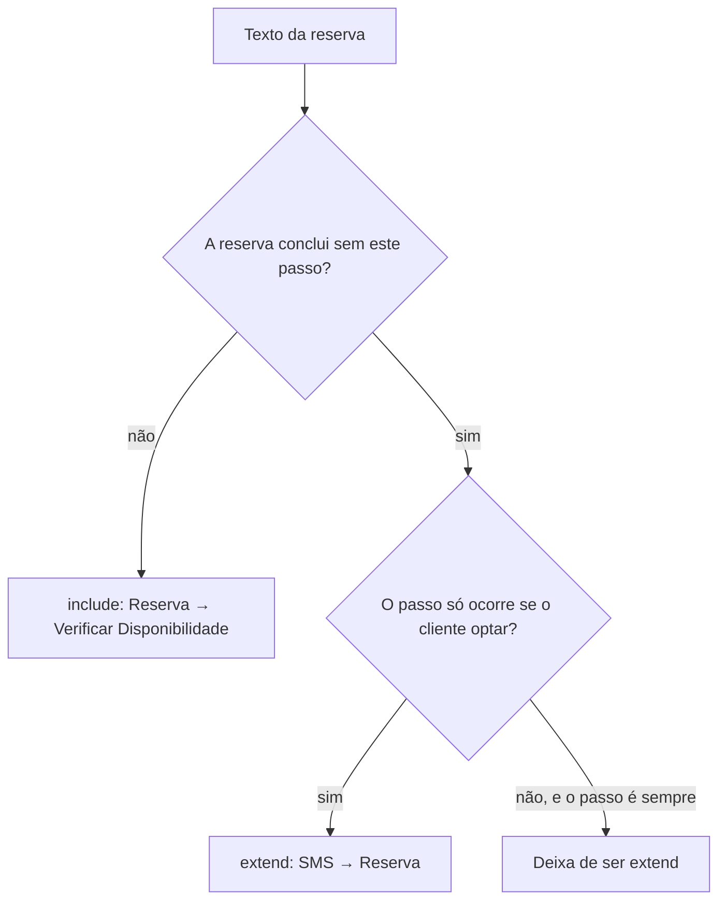
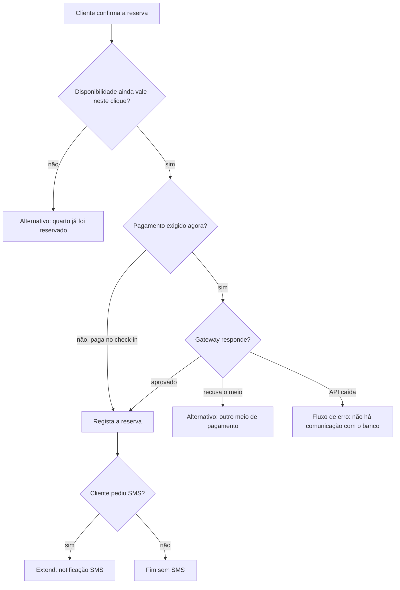

## Visão Geral do Conceito

A lição [[casos-de-uso-avancado-feedback-tp1]] fixou a regra: <mark style="background-color: #242424; padding: 2px 4px; border-radius: 3px; color: inherit;">`«include»`</mark> é obrigatório e incondicional; <mark style="background-color: #242424; padding: 2px 4px; border-radius: 3px; color: inherit;">`«extend»`</mark> é opcional e condicional. Esta aula aplica a regra a um texto novo — reserva de hotel — e exige a **narrativa** que o diagrama sozinho não carrega.

O enunciado (PDF e leitura em sala) é curto:

> O sistema de reservas de hotel deve permitir que um cliente realize uma reserva de hospedagem informando o período desejado, tipo de quarto e dados pessoais. Antes de confirmar a reserva, o sistema deve verificar se há disponibilidade para as datas e opções solicitadas. Caso o cliente deseje, o sistema deve enviar uma notificação de confirmação por SMS após a conclusão da reserva.

Deste parágrafo saem três casos de uso nomeados na solução: <mark style="background-color: #242424; padding: 2px 4px; border-radius: 3px; color: inherit;">`Realizar Reserva de Hotel`</mark>, <mark style="background-color: #242424; padding: 2px 4px; border-radius: 3px; color: inherit;">`Verificar Disponibilidade`</mark> e <mark style="background-color: #242424; padding: 2px 4px; border-radius: 3px; color: inherit;">`Enviar Notificação de Confirmação por SMS`</mark>.

> **Regra:** só o diagrama não basta. A narrativa declara ator, objetivo, pré-condição, pós-condição, fluxo principal e fluxo alternativo.

**Conflito de fontes (e-mail vs SMS).** Num ponto da fala o professor diz “enviar notificação por e-mail” ao listar os três casos. O PDF e o resto da aula nomeiam **SMS**. A solução ensinada aqui segue o PDF: a extensão é SMS. O e-mail entra depois, como hipótese oral (“e se o e-mail fosse sempre enviado?”), não como o caso do enunciado.

## Modelo Mental

Leia o parágrafo e faça duas perguntas, nesta ordem:

1. A reserva **fecha** se este passo não acontecer? Se não fecha, o passo é candidato a <mark style="background-color: #242424; padding: 2px 4px; border-radius: 3px; color: inherit;">`include`</mark>.
2. A reserva **fecha** e o passo só ocorre se alguém optar? Candidato a <mark style="background-color: #242424; padding: 2px 4px; border-radius: 3px; color: inherit;">`extend`</mark>.

Disponibilidade: não há reserva válida de um quarto já ocupado. O include é o da verificação. SMS: o cliente marca um flag; sem o flag a reserva já está registada. Extensão é sinónimo de opcional na fala do professor — quem informa a opção pode ser o cliente ou uma regra interna (“para esta faixa etária, enviar a dois e-mails”).

A seta não é decoração. O aluno Pedro ligou o tracejado da reserva para o SMS. O professor inverteu: no extend, pensa-se a partir do caso **estendido** (“o SMS estende a reserva”). No include do exemplo bancário relembrado em sala, a seta sai de Realizar Saque e entra em Validar Cliente.



## Mecânica Central

### Include e extend neste domínio

| Caso | Relação | Porquê, segundo PDF e aula |
|------|---------|----------------------------|
| Verificar Disponibilidade | <mark style="background-color: #242424; padding: 2px 4px; border-radius: 3px; color: inherit;">`include`</mark> de Realizar Reserva | Parte obrigatória. O fluxo principal diz: “O sistema inclui o caso de uso Verificar Disponibilidade.” |
| Enviar Notificação de Confirmação por SMS | <mark style="background-color: #242424; padding: 2px 4px; border-radius: 3px; color: inherit;">`extend`</mark> de Realizar Reserva | O base funciona sem o SMS. Ocorre “apenas sob certas condições, como se o cliente optar”. A seta vai do SMS para a reserva. |

O caso estendido e o caso base têm de ser nomeados os dois. “É extend” sem dizer de quem não fecha o diagrama.

**Quando o opcional deixa de ser extend.** Se toda reserva dispara o e-mail de confirmação, o envio é obrigatório: deixa de ser extensão. Se há condição (cliente pede, ou uma regra dispara só às vezes), permanece extensão. Pedro perguntou se Enviar Notificação poderia ser generalização, com filhos SMS e e-mail. O professor aceitou a generalização **nesse** desenho (um caso particular de notificação), e manteve o SMS do enunciado como extensão porque há condição.

### Narrativa que acompanha o diagrama

A solução do PDF preenche estes campos. Nenhum é “sempre obrigatório” na fala: escreve-se o que o time precisa para não perder a regra. Neste exercício o professor preencheu todos.

| Campo | Conteúdo da solução |
|-------|---------------------|
| Ator principal | Cliente — inicia a interação |
| Ator secundário | Sistema de Pagamento |
| Resumo | Reserva de hospedagem com datas, tipo de quarto e dados pessoais; o sistema verifica disponibilidade e confirma |
| Pré-condições | Cliente com acesso ao sistema; hotel com cadastro de quartos e disponibilidade configurada |
| Pós-condições | Reserva válida registada; se solicitado, SMS enviado |
| Fluxo principal | Ver passos abaixo |
| Fluxos alternativos | Quarto indisponível; dados incompletos |

**Fluxo principal (PDF):**

1. O cliente seleciona Realizar Reserva.
2. O sistema solicita datas de entrada e saída.
3. O cliente informa o período.
4. O sistema solicita o tipo de quarto.
5. O cliente seleciona o tipo de quarto.
6. O sistema inclui Verificar Disponibilidade.
7. O sistema exibe as opções disponíveis.
8. O cliente confirma a opção e informa dados pessoais.
9. O sistema regista a reserva.
10. O sistema apresenta o comprovante.
11. Se o cliente solicitar, o sistema estende Enviar Notificação por SMS.

**Fluxos alternativos (PDF):**

- Quarto não disponível: informa indisponibilidade e pede novas datas ou outro tipo de quarto.
- Dados incompletos: pede correção ou complemento.

**Tensão PDF × fala na pós-condição do SMS.** O PDF lista o SMS “caso solicitado” como pós-condição **e** como extend no passo 11. O professor disse que colocaria essa condição mais no caso de uso de extensão do que como pós-condição. As duas formulações estão nas fontes; não apague uma delas ao entregar — escolha uma e seja consistente entre narrativa e diagrama.

### Atores que o parágrafo não nomeia

O PDF fecha com Cliente e Sistema de Pagamento. A fala acrescenta leituras que **não** estão no parágrafo inicial:

- **Sistema de Pagamento** entra na solução porque “estamos falando de pagamento”: outro sistema, consultado por API, faz a ponte com o banco ou valida o cartão. O professor lembra três papéis de ator já vistos (principal, secundário, bastidor) e classifica este como secundário.
- **Recepcionista** e **administrador** poderiam iniciar ou conferir reserva, mas o texto não os cita. Ficaram de fora.
- **Sistema de envio de SMS** pode ser ator secundário se a notificação sai por API (o professor cita API de WhatsApp como serviço externo). Não está na lista de atores do PDF.
- **Disponibilidade** foi tratada como regra interna deste sistema, não como ator. Só seria ator secundário se a rede de hotéis expusesse um sistema externo (exemplo oral: reserva numa unidade e pulseira válida noutra).

**Conflito sobre pagamento.** O parágrafo do exercício não menciona pagamento, cartão nem banco. A narrativa resolvida mesmo assim coloca Sistema de Pagamento como ator secundário. Mais tarde o professor descreve uma reserva real em que nada foi debitado: o pagamento ocorreu no check-in. Nessa variante, processar pagamento **não** faria parte de Realizar Reserva; seria outro caso de uso, pensado na chegada. A aula não fecha o nome desse caso. Não transforme o check-in numa especificação que o material não escreveu.

### Login: pré-condição, não include — neste texto

O professor colocou no chat a hipótese “fazer reserva include fazer login” e respondeu: **depende da orientação do projeto**. Para este hotel ele **não** considerou o include certo. O acesso ficou na pré-condição “o cliente deve ter acesso ao sistema”, com a imagem de cliente já autenticado. Também admitiu reserva “meio anónima” por telefone, com cadastro só na chegada — caso que ele diz não ter visto como padrão, mas que impediria tratar login como obrigatório universal.

Login inválido, por isso, nem entra no fluxo de Realizar Reserva: a pré-condição já falhou antes.

### Fluxo alternativo e fluxo de erro

| Situação trazida em sala | Classificação na fala |
|--------------------------|------------------------|
| Quarto lotado para o tipo pedido | Alternativo: oferecer outras datas ou outro tipo |
| Dados incompletos ou formato inválido (telefone sem a quantidade de dígitos, e-mail sem formato) | Alternativo: não conclui até corrigir |
| Telefone com quantidade certa de dígitos, mas número de outra pessoa | A reserva **pode** seguir; o SMS vai para o número informado. A aula diz que o sistema não controla a titularidade |
| Pagamento recusado | Alternativo: pedir outro meio (outro cartão, boleto, Pix) |
| API de pagamento caída | Fluxo de **erro / exceção**: situação fora do controlo esperado. Mensagem, guardar o que já foi preenchido e tentar de novo, ou esperar o serviço. Não é o mesmo balde do “dado digitado errado” |
| Dois clientes confirmam o único quarto de casal com segundos de diferença | Alternativo de concorrência: a disponibilidade tem de ser revista **no clique de confirmar**, não só na consulta anterior |
| Desistir a meio, antes de concluir | Alternativo de interrupção. Cancelar uma reserva **já feita** seria outro caso de uso |
| Pagamento só no check-in | Não é include desta reserva |

O PDF só escreve os dois alternativos (indisponibilidade e dados incompletos). Os restantes são da transcrição. Use-os como repertório de análise, e marque na entrega o que veio do enunciado e o que foi hipótese de sala.



## Uso Prático

### Modelo mínimo para validar no editor

O editor do ISS não desenha UML. O mesmo contrato da aula cabe num objeto: três casos, duas arestas com direção, e a narrativa com os campos que o PDF preencheu.

```javascript
const reservaHotel = {
  atorPrincipal: "Cliente",
  atoresSecundarios: ["Sistema de Pagamento"],
  casosDeUso: [
    "Realizar Reserva de Hotel",
    "Verificar Disponibilidade",
    "Enviar Notificacao de Confirmacao por SMS"
  ],
  relacionamentos: [
    { de: "Realizar Reserva de Hotel", para: "Verificar Disponibilidade", tipo: "include" },
    { de: "Enviar Notificacao de Confirmacao por SMS", para: "Realizar Reserva de Hotel", tipo: "extend" }
  ],
  preCondicoes: [
    "cliente com acesso ao sistema",
    "cadastro de quartos e disponibilidade configurada"
  ],
  fluxosAlternativosDoPdf: ["quarto nao disponivel", "dados incompletos"]
};
```

A aresta de include sai do caso base. A aresta de extend sai do SMS. Inverter qualquer uma delas reproduz o erro corrigido em sala.

### O que o TP2 pede nesta aula

Na abertura da entrega (transcrição de 09/09), o professor fixou o TP2 para o dia 21, uma segunda-feira, sem prorrogação — doze dias a contar daquela aula. O que ele disse que corrige:

- Atores e funcionalidades do sistema que o aluno está a implementar.
- Narrativa dos casos de uso (ator, resumo, fluxos). Explicar **alguns**, não obrigatoriamente todos. Quantidade: “dez melhor, vinte melhor”; não quer diagrama simples.
- Diagrama com atores, casos de uso, relacionamentos entre casos (include, extend ou generalização — a seta sem tipo não vale), relacionamentos entre atores e associação ator–caso de uso.
- Tabela ator × caso de uso: opcional. Fazer não penaliza; não fazer também não.
- Conteúdo já bem feito no TP1 pode ser reaproveitado.

Quem trabalha com Scrum ou outra abordagem ágil **também** entrega casos de uso e o diagrama. História de usuário olha para a intenção da pessoa (“eu, como administrador, quero registar o pedido porque…”). Caso de uso olha para a funcionalidade e para quem interage com o sistema. Não são concorrentes, e **não** há conversão um-para-um.

Exemplo oral da biblioteca: o usuário quer levar o livro emprestado — uma história. Por trás há dois casos de uso: realizar o empréstimo (ator: bibliotecário) e a rotina que verifica empréstimos atrasados. Nenhum cliente pede “quero que o sistema saiba os meus atrasos” como história; a rotina existe mesmo assim.

Recomendação da aula para o documento ágil: listar as histórias e, nas que precisarem de explicação, anexar a narrativa e o diagrama de caso de uso. Quem não escrever histórias e entregar só casos de uso corretos também é aceite. O formato “como um X, eu quero Y, para Z” é o da literatura; na prática descrita em sala ele não é obrigatório, e um objetivo óbvio pode ficar por escrever.

**Não coberto:** o nome do projeto de um aluno (aplicação ligada ao Google Drive) — o professor disse que precisaria rever o trabalho, sem fechar atores na hora.

## Erros Comuns

| Erro | Sintoma | Correção |
|------|---------|----------|
| Setar o extend da reserva para o SMS | Tracejado invertido em relação à aula | A seta sai do caso estendido (SMS) e aponta para Realizar Reserva |
| Tratar o SMS como include | Notificação obrigatória sem o “caso o cliente deseje” | Enquanto for opcional, é extend |
| Tratar e-mail **sempre** enviado como extend | Estereótipo opcional num passo incondicional | Obrigatório deixa de ser extensão |
| Include de login neste enunciado | Seta login–reserva copiada do banco | Neste texto o acesso ficou em pré-condição |
| Associação sem estereótipo entre dois casos | Linha ligando elipses sem include, extend ou generalização | O feedback do TP2, na aula seguinte, penaliza exatamente isto; já aqui a regra é a mesma |
| Chamar API caída de “fluxo alternativo” no mesmo sentido de “dado incompleto” | Erro de integração misturado com correção de formulário | A fala separa exceção (serviço fora) de alternativo (outro caminho de negócio) |
| Confirmar o quarto sem rever disponibilidade | Dois clientes levam o mesmo quarto | A verificação entra de novo no momento da confirmação |
| Inventar recepcionista ou administrador no diagrama deste parágrafo | Atores que a fala citou e depois excluiu | Só entram se o texto do projeto os tiver |

## Visão Geral de Debugging

Quando a reserva “não fecha”, percorra nesta ordem:

1. Copie os três nomes do enunciado antes de desenhar setas.
2. Teste obrigatoriedade: sem disponibilidade a reserva não existe → include, seta do base para o incluído.
3. Teste opção: SMS só com pedido → extend, seta do SMS para o base.
4. Confira se a narrativa e o diagrama contam a mesma história. Se o SMS está no passo 11 como extend, não o reclassifique só na pós-condição sem o dizer.
5. Separe o que o PDF escreveu (dois alternativos, ator de pagamento) do que a fala explorou (API caída, check-in, concorrência).
6. Para o TP2, procure seta entre casos sem rótulo e história de usuário no lugar da elipse.

<details>
<summary>Checklist da solução do hotel</summary>

- [ ] Include: Realizar Reserva → Verificar Disponibilidade
- [ ] Extend: SMS → Realizar Reserva
- [ ] Ator principal: Cliente
- [ ] Pré-condição de acesso, sem include de login neste enunciado
- [ ] Fluxos do PDF: quarto indisponível e dados incompletos
</details>

## Principais Pontos

- Disponibilidade é <mark style="background-color: #242424; padding: 2px 4px; border-radius: 3px; color: inherit;">`include`</mark>; SMS sob pedido é <mark style="background-color: #242424; padding: 2px 4px; border-radius: 3px; color: inherit;">`extend`</mark>.
- A seta do extend sai do caso estendido e aponta para o base.
- A narrativa traz ator, resumo, pré-condição, pós-condição e fluxos; o diagrama não a substitui.
- Login, neste texto, ficou em pré-condição. Noutro projeto pode ser include.
- Envio sempre disparado não é extensão.
- Alternativo é outro caminho de negócio; API caída foi chamada de fluxo de erro.
- A disponibilidade confirma-se de novo no clique final.
- O TP2 pede casos de uso e diagrama mesmo para quem usa história de usuário; não há mapa 1:1 entre os dois.

## Preparação para Prática

Ao final desta lição você deve conseguir:

1. Classificar disponibilidade e SMS com o tipo e a direção da aula.
2. Recusar login como include quando a regra estiver declarada como pré-condição.
3. Montar a narrativa mínima (atores, pré-condições, passos, alternativos do PDF) e apontar um passo que é erro de integração, não alternativo de formulário.

## Laboratório de Prática

O editor não executa UML. Os três desafios modelam a regra da reserva em JavaScript. O código abaixo já corre: as funções devolvem um valor seguro enquanto o `TODO` não for preenchido.

### Easy — Classificar disponibilidade e SMS

Dada a pista, devolva `"include"`, `"extend"` ou `"nenhum"`. Não inverta os papéis do enunciado.

```javascript
function classificarPassoDaReserva(passo, pista) {
  // passo: "verificar-disponibilidade" | "sms" | "listar-hoteis-da-rede"
  // TODO: verificar-disponibilidade é obrigatório para concluir a reserva → "include"
  // TODO: sms só se o cliente optar → "extend"
  // TODO: qualquer outro passo sem esses sinais → "nenhum"
  return "nenhum";
}

const pistas = [
  ["verificar-disponibilidade", "a reserva nao confirma se nao houver quarto nas datas"],
  ["sms", "so envia se o cliente marcar que quer SMS"],
  ["listar-hoteis-da-rede", "nao faz parte do paragrafo da reserva"]
];

for (const [passo, pista] of pistas) {
  console.log(passo, classificarPassoDaReserva(passo, pista));
}
```

**Critérios:** `"include"`, `"extend"`, `"nenhum"`, nesta ordem.

### Medium — Validar direção e campos da narrativa

Receba o modelo e devolva a lista de erros. Modelo alinhado ao PDF deve produzir `erros` vazio.

```javascript
function validarNarrativaReserva(modelo) {
  const erros = [];
  // modelo.relacionamentos: [{ de, para, tipo }]
  // modelo.atorPrincipal, modelo.preCondicoes (array), modelo.alternativosPdf (array)
  // TODO: erro se não houver include de "Realizar Reserva de Hotel" para "Verificar Disponibilidade"
  // TODO: erro se não houver extend de "Enviar Notificacao de Confirmacao por SMS" para "Realizar Reserva de Hotel"
  // TODO: erro se a seta de extend sair da reserva e apontar para o SMS
  // TODO: erro se atorPrincipal for diferente de "Cliente"
  // TODO: erro se faltar a pré-condição de acesso ou a de cadastro de quartos
  // TODO: erro se faltar algum dos alternativos "quarto nao disponivel" ou "dados incompletos"
  if (erros.length === 0 && modelo == null) {
    erros.push("modelo ausente");
  }
  return erros;
}

const modeloPdf = {
  atorPrincipal: "Cliente",
  preCondicoes: ["acesso do cliente", "cadastro de quartos e disponibilidade"],
  alternativosPdf: ["quarto nao disponivel", "dados incompletos"],
  relacionamentos: [
    { de: "Realizar Reserva de Hotel", para: "Verificar Disponibilidade", tipo: "include" },
    { de: "Enviar Notificacao de Confirmacao por SMS", para: "Realizar Reserva de Hotel", tipo: "extend" }
  ]
};

console.log(validarNarrativaReserva(modeloPdf));
```

**Critérios:** `modeloPdf` → `[]`. Se o extend for invertido, a lista deixa de ser vazia. Se `atorPrincipal` for `"Recepcionista"`, também.

### Hard — Login, e-mail obrigatório e API caída

Aplique as decisões da aula a um cenário que o PDF não fecha sozinho. Não lance exceção: acumule códigos em `decisoes`.

```javascript
function decidirCaminhosDaReserva(cenario) {
  // cenario = {
  //   loginExigidoAntes: boolean,
  //   emailSempreEnviado: boolean,
  //   smsSoSeClientePedir: boolean,
  //   pagamentoNoCheckIn: boolean,
  //   apiPagamentoCaida: boolean,
  //   quartoConfirmadoPorOutroCliente: boolean
  // }
  // TODO: se loginExigidoAntes → push "login-pre-condicao" (não "login-include")
  // TODO: se emailSempreEnviado → push "email-nao-e-extend"
  // TODO: se smsSoSeClientePedir → push "sms-extend"
  // TODO: se pagamentoNoCheckIn → push "pagamento-fora-deste-caso-de-uso"
  // TODO: se apiPagamentoCaida → push "fluxo-de-erro"
  // TODO: se quartoConfirmadoPorOutroCliente → push "rever-disponibilidade-na-confirmacao"
  return { decisoes: [] };
}

const cenario = {
  loginExigidoAntes: true,
  emailSempreEnviado: true,
  smsSoSeClientePedir: true,
  pagamentoNoCheckIn: true,
  apiPagamentoCaida: false,
  quartoConfirmadoPorOutroCliente: true
};

console.log(decidirCaminhosDaReserva(cenario));
```

**Critérios:** para `cenario`, as decisões incluem `login-pre-condicao`, `email-nao-e-extend`, `sms-extend`, `pagamento-fora-deste-caso-de-uso` e `rever-disponibilidade-na-confirmacao`, e não incluem `fluxo-de-erro`. Com `apiPagamentoCaida: true` e `pagamentoNoCheckIn: false`, entra `fluxo-de-erro` e não entra `pagamento-fora-deste-caso-de-uso`.

---

<!-- lessons.json (não editar neste ciclo): discipline=projeto-bloco-backend slug=reserva-hotel-inclusao-extensao-narrativa title="Reserva de hotel: inclusão, extensão e narrativa" order=8 file=content/projeto-bloco-backend/aula-08-reserva-hotel-inclusao-extensao-narrativa.md -->

<!-- CONCEPT_EXTRACTION
concepts:
  - include Verificar Disponibilidade
  - extend SMS de confirmação
  - direção da seta include e extend
  - narrativa de caso de uso
  - ator principal Cliente
  - ator secundário Sistema de Pagamento
  - pré-condição de acesso
  - fluxo alternativo
  - fluxo de erro de API
  - concorrência na confirmação do quarto
  - TP2 casos de uso e histórias de usuário
skills:
  - Classificar passos da reserva como include, extend ou nenhum
  - Orientar a seta do extend a partir do caso estendido
  - Preencher ator, pré-condição, fluxo principal e alternativos do PDF
  - Manter login como pré-condição neste enunciado
  - Separar recusa de pagamento, API caída e pagamento no check-in
  - Explicar por que história de usuário e caso de uso não são 1:1
examples:
  - reserva-include-disponibilidade
  - sms-extend-seta-para-a-reserva
  - login-como-pre-condicao
  - email-sempre-enviado-nao-e-extend
  - api-caida-fluxo-de-erro
  - biblioteca-uma-historia-dois-casos
-->

<!-- EXERCISES_JSON
[
  {
    "id": "pb08-classificar-passo-reserva",
    "slug": "pb08-classificar-passo-reserva",
    "difficulty": "easy",
    "title": "Classificar disponibilidade e SMS na reserva",
    "discipline": "projeto-bloco-backend",
    "editorLanguage": "javascript",
    "tags": ["casos-de-uso", "include", "extend", "hotel", "uml"],
    "summary": "Classificar verificação de disponibilidade como include e SMS opcional como extend."
  },
  {
    "id": "pb08-validar-narrativa-reserva",
    "slug": "pb08-validar-narrativa-reserva",
    "difficulty": "medium",
    "title": "Validar direção e narrativa da reserva de hotel",
    "discipline": "projeto-bloco-backend",
    "editorLanguage": "javascript",
    "tags": ["casos-de-uso", "narrativa", "include", "extend", "hotel"],
    "summary": "Validar atores, pré-condições, alternativos do PDF e a direção include/extend."
  },
  {
    "id": "pb08-decidir-caminhos-reserva",
    "slug": "pb08-decidir-caminhos-reserva",
    "difficulty": "hard",
    "title": "Decidir login, e-mail obrigatório, check-in e API caída",
    "discipline": "projeto-bloco-backend",
    "editorLanguage": "javascript",
    "tags": ["casos-de-uso", "pre-condicao", "fluxo-de-erro", "hotel"],
    "summary": "Aplicar as decisões da aula a login, e-mail sempre enviado, pagamento no check-in e falha de API."
  }
]
-->
