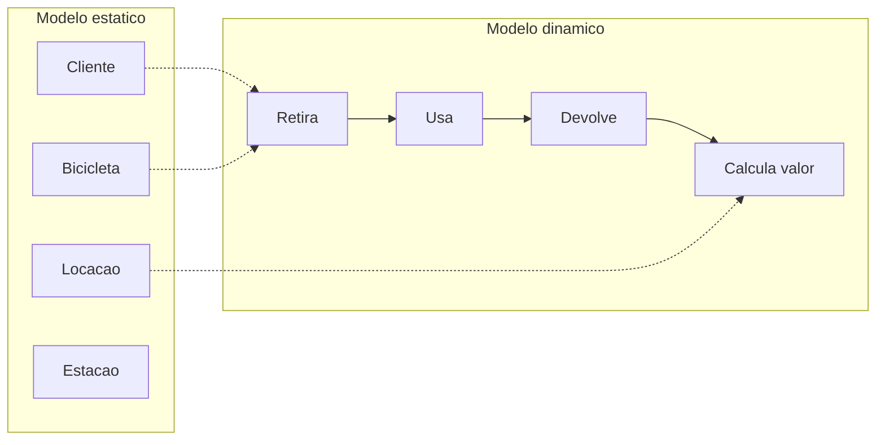
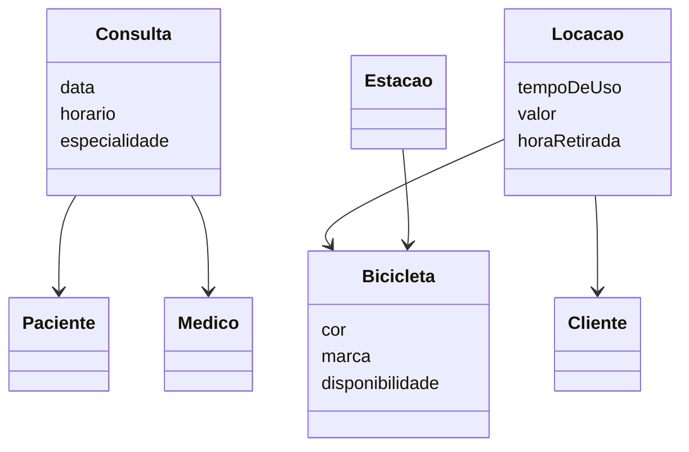

## Visão Geral do Conceito

Até aqui o Projeto de Bloco especificou o problema com requisitos e casos de uso. Esta aula muda a pergunta: **que conceitos existem no negócio**, antes de escolher Java, C#, tabela ou tipo.

<mark style="background-color: #242424; padding: 2px 4px; border-radius: 3px; color: inherit;">`análise conceitual`</mark> compreende o domínio e captura elementos, responsabilidades e relações que poderão existir no sistema. Não trata ainda de tipos de dados, padrões de projeto nem estrutura de código. É investigação: interpretar e abstrair.

O erro que o professor nomeou, ao ouvir “quero um sistema de aluguel de bicicletas”, é abrir o editor e escrever `public class Bicicleta` com `int` e `string`, ou desenhar a chamada de API. Isso é uma etapa seguinte. Nesta, a pergunta é quais **coisas** do mundo do aluguel (ou da clínica) merecem representação.

> **Regra:** primeiro o problema e o vocabulário do negócio; a classe de software vem depois e herda o nome, não o contrário.

**Figuras.** Os slides 6 e 7 do PDF não têm texto extraído. O que se ensina sobre eles vem da transcrição: um desenho de Pagamento e Venda no modelo de domínio (conceito, sem relação desenhada nesse quadro; venda com data e hora, pagamento com quantia) e, por baixo, um modelo de projeto já com relação, tipos e a operação obter total — ainda sem código. Onde o PDF está mudo, esta lição não inventa caixas que a fala não descreveu.

## Modelo Mental

Pense em três camadas, na ordem que a aula empilhou. Não são camadas de código; são momentos do trabalho.

1. **Regra de negócio em texto** — o que o cliente descreve do mundo real.
2. **Modelo de domínio** — abstração: conceitos, sem implementação.
3. **Projeto de software** — classes, relações e, quando já fizer sentido, tipos e assinaturas de operações, ainda sem corpo de método. A implementação é a camada seguinte.

Um pagamento no modelo de domínio é um **conceito**. Um pagamento no modelo de projeto é uma **classe de software**. O primeiro inspira o nome e a definição do segundo.

O mesmo termo muda de significado quando muda o dicionário. “Tempo de uso” no aluguel é quanto a bicicleta ficou fora (exemplo oral: duas horas). Na clínica, a mesma expressão pode ser o tempo de uso de uma medicação. São glossários diferentes. Por isso o modelo de domínio é um <mark style="background-color: #242424; padding: 2px 4px; border-radius: 3px; color: inherit;">`dicionário visual`</mark>: as pessoas do negócio e as de software passam a apontar para a mesma palavra.

<mark style="background-color: #242424; padding: 2px 4px; border-radius: 3px; color: inherit;">`modelo estático`</mark> é a foto. Mostra o que existe e permanece: paciente, médico, consulta, bicicleta, cliente. Não diz o que acontece primeiro.

<mark style="background-color: #242424; padding: 2px 4px; border-radius: 3px; color: inherit;">`modelo dinâmico`</mark> é a sequência. No aluguel: o cliente chega, retira a bicicleta, usa, devolve, e só então há valor a calcular. Não se anda sem ter retirado. O dinâmico mostra ações, fluxos e responsabilidades — não “cria” as entidades; descreve o que acontece com elas.

O professor foi explícito: include e extend dão uma ordem fraca (“quando este caso ocorre, aquele também”), mas **não** colocam o tempo do negócio no modelo estático.



## Mecânica Central

### O que entra no domínio

Reconhecer elementos significativos, entender comportamento e responsabilidade, distinguir o que faz parte do sistema do que se ignora, e marcar fronteira conceitual — sem estrutura técnica.

Classe conceitual é abstração de algo importante no domínio. Pode ser tangível (<mark style="background-color: #242424; padding: 2px 4px; border-radius: 3px; color: inherit;">`Paciente`</mark>, <mark style="background-color: #242424; padding: 2px 4px; border-radius: 3px; color: inherit;">`Bicicleta`</mark>) ou intangível (<mark style="background-color: #242424; padding: 2px 4px; border-radius: 3px; color: inherit;">`Agendamento`</mark>, <mark style="background-color: #242424; padding: 2px 4px; border-radius: 3px; color: inherit;">`Locação`</mark>). O analista decide o que é entidade que permanece e o que é secundário ou transitório. Nem todo substantivo do texto chega à implementação.

Exemplo oral do médico que só atende segunda-feira: Paciente, Médico e Consulta ficam no domínio. “Segunda-feira” não. Jorge observou que é restrição daquele médico, não um conceito amplo. O professor concordou: o dia pode ser parte da data da consulta (preferência dele) ou, em outra modelagem, do médico. Nesta etapa não se fala em formulário, botão nem em “validar se o dia clicado é segunda”.

A fala também descreve um vai-e-vem entre modelo de domínio e modelo de casos de uso: um altera o outro. Do domínio segue-se, mais à frente, diagrama de interação e classe de implementação. Termo muito específico do negócio vai para o glossário. **Não coberto nesta aula:** como desenhar o diagrama de interação (o professor disse que ainda não tinha sido estudado).

### Duas técnicas, usadas juntas

O PDF e a aula nomeiam duas técnicas. A fala pede as duas: não são exclusivas.

| Técnica | Olha para | Produz |
|---------|-----------|--------|
| <mark style="background-color: #242424; padding: 2px 4px; border-radius: 3px; color: inherit;">`análise gramatical`</mark> | Substantivos do requisito | Candidatos a classe; parte deles cai para atributo |
| Identificação de responsabilidades | O que cada conceito guarda ou faz | Decisão de “isto merece classe” |

Substantivos apontam entidades (lado estático). Verbos apontam ações, métodos ou responsabilidades (lado dinâmico). Nem todo substantivo vira classe: alguns são irrelevantes ou parte de outra entidade.

**Perguntas de responsabilidade (PDF):**

- Quem armazena esta informação?
- Quem executa esta ação?
- Quem deve conhecer este dado?
- Quem deve decidir este comportamento?

Se as respostas apontam sempre para o mesmo conceito, esse conceito tende a ser classe.

### Clínica — filtro do PDF

Texto: “Os pacientes podem agendar consultas com médicos. Cada consulta deve registrar data, horário e especialidade. O sistema deve permitir ao médico visualizar sua agenda.”

| Substantivo | Destino na solução |
|-------------|-------------------|
| Pacientes, Consultas, Médicos | Classes principais: Paciente, Médico, Consulta |
| Data, Horário | Conceitos auxiliares: atributos |
| Especialidade | Atributo do médico, ou classe própria se a complexidade crescer |
| Agenda | Muitas vezes só a coleção de consultas do médico; poderia ser classe, mas neste filtro ficou de fora |

A fala reforça: Agenda está “muito atrelada à consulta”. Paciente guarda idade, endereço, prontuário. Consulta organiza horários e especialidade e liga paciente a médico. Médico mantém disponibilidade e visualiza a agenda. A aula nota que o texto não traz rececionista; não se inventa o papel.

### Estação de bicicletas — filtro do PDF

Texto: “O cliente pode retirar uma bicicleta em qualquer estação, utilizar por um período e devolver em outra estação. O sistema deve registrar o tempo de uso e calcular o valor da locação.”

| Destino | Nomes |
|---------|--------|
| Classes | Cliente, Bicicleta, Estação, Locação |
| Atributos | tempo de uso, valor |
| Não é classe | Período = diferença entre retirada e devolução |

Em sala, parte da turma leu Locação como verbo (“locar”) ou como atributo de outra classe. O professor **selecionou Locação como classe**. Responsabilidades que fecham essa escolha:

| Conceito | Responsabilidade citada |
|----------|-------------------------|
| Locação | Registrar retirada e devolução |
| Bicicleta | Dados físicos e disponibilidade (alugada ou não) |
| Estação | Conjunto de bicicletas disponíveis num local |
| Cliente | Informações pessoais e cartão de crédito |

A bicicleta não carrega o histórico da locação. Quem sabe a hora de retirada é a Locação. Quem “locar” como ação foi atribuído, na fala, ao cliente — a classe Locação guarda o fato (hora de retirada, hora de devolução), não substitui o cliente.

Cor e marca descrevem a bicicleta (exemplo oral: Caloi, cor, 10h). Não viram classe. As 10h ligam-se à Locação. Especialidade e período só ganhariam classe própria se o relacionamento ficasse complexo o bastante para não caber em atributo — a aula não fixou um limiar numérico.



O diagrama acima é reconstrução dos dois exercícios do PDF (clínica e estação), não um slide único da aula. Especialidade está no compartimento de Consulta como no quadro “atributos: data, horário, especialidade”; o mesmo PDF também admite especialidade como atributo do médico. Não há multiplicidade desenhada nas fontes — o diagrama não inventa `1..*`.

## Uso Prático

### Onde colocar o verbo “retirar”

Frase isolada da aula: “o cliente pode retirar a bicicleta da loja”. Substantivos: cliente, bicicleta, loja. Verbo: retirar. As três palavras podem chegar a classe, e ainda falta decidir **quem** tem o método. A fala não fecha uma única resposta: pode ser o cliente (`retirar` a bicicleta) ou a loja (que precisa saber que aquela bicicleta saiu). O que fica fechado é o método da pergunta: a responsabilidade não flutua no texto; alguém a possui.

No exercício da estação, a retirada já não fica nessa dúvida: Locação registra retirada e devolução; Estação representa o lugar.

### O que esta aula não pede na implementação

No fim da sessão, Lucas perguntou se o sistema final cabe só nos TPs. O professor adiantou: no último TP (TP5) pediria uma ou duas funções, mas a apresentação exige o sistema a funcionar; a cobrança forte desta disciplina é modelagem (casos de uso, e mais à frente interação, atividade e classe), não o domínio de Java ou C#, que ele disse não estar a ensinar aqui. Uso de IA para gerar código: aceitável se o aluno souber explicar; a recomendação para quem está a começar é implementar por conta própria sempre que não estiver bloqueado. Isso é contexto de avaliação, não técnica de identificação de classes.

**Não coberto:** nome de padrão do livro do Larman além de “responsabilidade e classe”; o professor citou o livro e elogiou-o, sem extrair um padrão nesta aula.

## Erros Comuns

| Erro | Sintoma | Correção |
|------|---------|----------|
| Abrir a classe na linguagem ao ouvir o requisito | `public class` com tipos antes do vocabulário | Listar conceitos; tipo fica no modelo de projeto |
| Promover todo substantivo a classe | Data, horário, período, cor, “segunda-feira” viram retângulos | Atributo ou cálculo quando não têm responsabilidade própria |
| Descartar o intangível | Locação ou agendamento somem porque “não se pega na mão” | O PDF usa os dois como exemplo de classe conceitual |
| Tratar Agenda como classe só porque é substantivo | Caixa extra ao lado de Consulta neste texto | No filtro da aula, agenda é a coleção de consultas |
| Pedir ao modelo estático a ordem retirar → usar → devolver | Foto com setas de tempo | Isso é modelo dinâmico |
| Confundir include com dinâmica do negócio | “Já tenho a ordem porque há include” | Include liga casos de uso; não narra o uso da bicicleta |
| Usar o mesmo significado de “tempo de uso” na clínica e no aluguel | Atributo homónimo com regra trocada | Cada domínio tem o seu dicionário |

## Visão Geral de Debugging

Se a lista de classes “não convence”, volte ao texto, não ao IDE.

1. Sublinhe substantivos e verbos em separado.
2. Para cada substantivo: é coisa com responsabilidade ou é detalhe de outra coisa (cor, hora, dia da semana, período)?
3. Faça as quatro perguntas (armazena, executa, conhece, decide). Se apontam para conceitos diferentes, não junte os dados na classe errada — foi o que separou histórico de locação e ficha da bicicleta.
4. Marque o que é foto (quais conceitos existem) e o que é sequência (o que tem de acontecer antes).
5. Se dois projetos usam a mesma palavra, escreva a definição no glossário daquele domínio antes de reutilizar o atributo.

<details>
<summary>Filtro rápido dos dois exercícios</summary>

- Clínica: Paciente, Médico, Consulta. Data, horário e especialidade como atributos neste filtro. Agenda fora.
- Estação: Cliente, Bicicleta, Estação, Locação. Tempo de uso e valor na locação. Período = retirada menos devolução.
</details>

## Principais Pontos

- Análise conceitual mapeia o mundo real e adia tipo, banco e padrão.
- Modelo de domínio é dicionário visual de conceitos, não de objetos Java ou C#.
- Estático = o que existe. Dinâmico = o que acontece, em ordem.
- Substantivo é candidato; verbo é responsabilidade. As duas técnicas usam-se juntas.
- Data, horário, período, cor e marca caem a atributo nos exemplos desta aula.
- Locação é classe no exercício da estação: guarda retirada, devolução e o cálculo associado.
- “Segunda-feira” não é classe; é restrição da consulta.

## Preparação para Prática

Ao final desta lição você deve conseguir:

1. Extrair substantivos de um requisito curto e separá-los em classe candidata ou atributo, como na clínica.
2. Dizer se um termo descreve a foto do domínio ou um passo no tempo.
3. Atribuir retirada, disponibilidade, conjunto de bicicletas e dados do cliente às classes do exercício da estação.

## Laboratório de Prática

JavaScript modela o filtro. Sem `TODO` preenchido, cada função devolve um resultado vazio ou neutro e o script termina sem exceção.

### Easy — Filtrar o texto da clínica

Receba substantivos já extraídos e devolva só os que o PDF tratou como classes principais, na ordem Paciente, Médico, Consulta.

```javascript
function classesPrincipaisDaClinica(substantivos) {
  // substantivos: lista como ["Pacientes", "Consultas", "Medicos", "Data", "Horario", "Especialidade", "Agenda"]
  // TODO: mapear Pacientes→Paciente, Consultas→Consulta, Medicos→Medico
  // TODO: deixar de fora Data, Horario, Especialidade e Agenda neste filtro
  // TODO: devolver ["Paciente", "Medico", "Consulta"] quando a entrada for a do PDF
  return [];
}

console.log(classesPrincipaisDaClinica([
  "Pacientes", "Consultas", "Medicos", "Data", "Horario", "Especialidade", "Agenda"
]));
```

**Critérios:** a chamada acima devolve `["Paciente", "Medico", "Consulta"]`. `"Segunda-feira"` na lista não aparece no resultado.

### Medium — Classificar foto ou passo no tempo

Para cada termo do aluguel em estação, devolva `"estatico"` ou `"dinamico"`.

```javascript
function classificarDimensao(termo) {
  // TODO: Cliente, Bicicleta, Estacao, Locacao → "estatico"
  // TODO: retirar, utilizar, devolver, calcular valor → "dinamico"
  // TODO: termo desconhecido → "indefinido"
  return "indefinido";
}

const termos = ["Cliente", "retirar", "Bicicleta", "devolver", "Locacao", "calcular valor"];
for (const termo of termos) {
  console.log(termo, classificarDimensao(termo));
}
```

**Critérios:** estático, dinâmico, estático, dinâmico, estático, dinâmico.

### Hard — Atribuir responsabilidades da estação

Dada uma pergunta da aula, devolva a classe responsável. Não invente Rececionista: o texto da estação não a tem.

```javascript
function responsavelNaEstacao(pergunta) {
  // pergunta é uma destas chaves:
  // "registrar-retirada-e-devolucao"
  // "dados-fisicos-e-disponibilidade"
  // "conjunto-de-bicicletas-no-local"
  // "dados-pessoais-e-cartao"
  // "hora-da-retirada"
  // TODO: mapear para Locacao, Bicicleta, Estacao, Cliente, Locacao respectivamente
  // TODO: chave desconhecida → "nao-coberto"
  return "nao-coberto";
}

console.log(responsavelNaEstacao("registrar-retirada-e-devolucao"));
console.log(responsavelNaEstacao("hora-da-retirada"));
console.log(responsavelNaEstacao("validar-botao-da-tela"));
```

**Critérios:** `Locacao`, `Locacao`, `nao-coberto`. A última chave não está nas quatro perguntas do PDF.

---

<!-- lessons.json (não editar neste ciclo): discipline=projeto-bloco-backend slug=modelo-dominio-estatico-dinamico title="Modelo de domínio: estático, dinâmico e classes" order=9 file=content/projeto-bloco-backend/aula-09-modelo-dominio-estatico-dinamico.md -->

<!-- CONCEPT_EXTRACTION
concepts:
  - análise conceitual
  - modelo de domínio como dicionário visual
  - conceito versus classe de software
  - modelo estático
  - modelo dinâmico
  - análise gramatical
  - responsabilidade
  - Paciente Médico Consulta
  - Cliente Bicicleta Estação Locação
skills:
  - Adiar tipo e linguagem durante a análise conceitual
  - Filtrar substantivos em classe ou atributo
  - Distinguir foto do domínio de sequência no tempo
  - Atribuir responsabilidade com as quatro perguntas
  - Manter Locação como classe no exercício da estação
  - Recusar dia da semana e período como classes neste filtro
examples:
  - pagamento-conceito-versus-classe-de-projeto
  - clinica-filtro-agenda-fora
  - estacao-locacao-classe
  - caloi-cor-atributo-hora-na-locacao
  - segunda-feira-nao-e-classe
-->

<!-- EXERCISES_JSON
[
  {
    "id": "pb09-classes-principais-clinica",
    "slug": "pb09-classes-principais-clinica",
    "difficulty": "easy",
    "title": "Filtrar classes principais da clínica",
    "discipline": "projeto-bloco-backend",
    "editorLanguage": "javascript",
    "tags": ["modelo-de-dominio", "substantivos", "clinica", "classes"],
    "summary": "Separar Paciente, Médico e Consulta de data, horário, especialidade e agenda."
  },
  {
    "id": "pb09-classificar-estatico-dinamico",
    "slug": "pb09-classificar-estatico-dinamico",
    "difficulty": "medium",
    "title": "Classificar termos estáticos e dinâmicos do aluguel",
    "discipline": "projeto-bloco-backend",
    "editorLanguage": "javascript",
    "tags": ["modelo-estatico", "modelo-dinamico", "bicicleta"],
    "summary": "Marcar conceitos da estação como foto do domínio ou passo no tempo."
  },
  {
    "id": "pb09-responsavel-estacao",
    "slug": "pb09-responsavel-estacao",
    "difficulty": "hard",
    "title": "Atribuir responsabilidades da estação de bicicletas",
    "discipline": "projeto-bloco-backend",
    "editorLanguage": "javascript",
    "tags": ["responsabilidades", "locacao", "estacao", "modelo-de-dominio"],
    "summary": "Mapear retirada, disponibilidade, estação, cliente e hora para a classe da aula."
  }
]
-->
