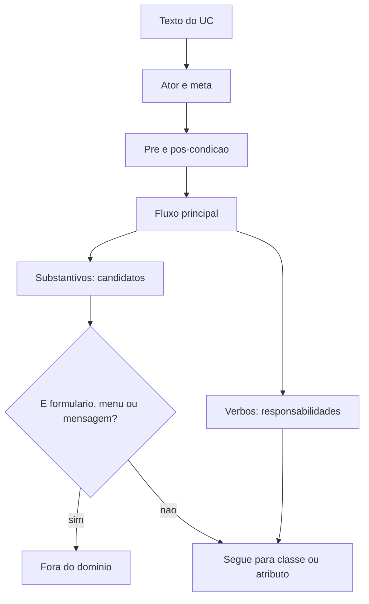
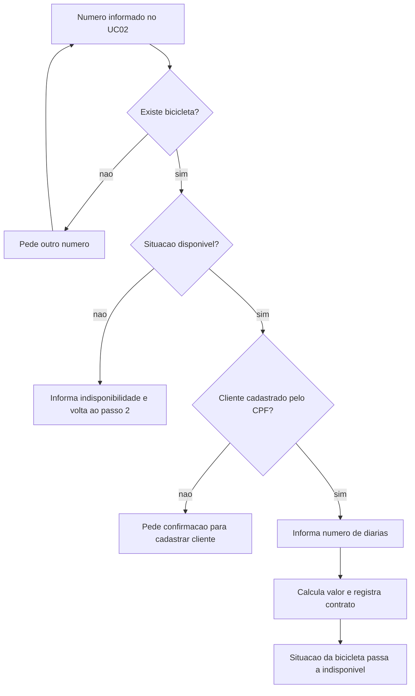

## Visão Geral do Conceito

A lição [[modelo-dominio-estatico-dinamico]] treinou o filtro em frases curtas (clínica e estação). Esta aula aplica as mesmas duas técnicas a narrativas completas do <mark style="background-color: #242424; padding: 2px 4px; border-radius: 3px; color: inherit;">`Sistema Wheels`</mark>: <mark style="background-color: #242424; padding: 2px 4px; border-radius: 3px; color: inherit;">`UC01`</mark> Cadastrar nova bicicleta e <mark style="background-color: #242424; padding: 2px 4px; border-radius: 3px; color: inherit;">`UC02`</mark> Efetuar aluguel de bicicleta.

O PDF desta aula é o enunciado (casos de uso). A transcrição percorre o enunciado e também a limpeza que o PDF da aula seguinte regista por escrito. Aqui o foco é **ler o caso de uso e decidir o que o texto sustenta**. A lista já normalizada (Bicicleta, Cliente, Aluguel, UsuárioDoSistema, tabela de sinónimos) fica na lição seguinte, para não misturar o enunciado com o artefacto de solução.

O professor avisou que, no TP3, não exigiria o filtro enorme passo a passo: dá para ir filtrando durante a leitura (“nova bicicleta” já é Bicicleta; “sucesso” não entra). O exercício de sala mostra o caminho lento de propósito.

Antes do exercício, a mesma aula deu feedback do TP2. Interessa à modelagem, não ao Wheels em si:

- Trabalho sem acesso na correção conta como não entregue.
- Associação entre casos de uso **sem** include, extend ou generalização não vale; é preciso o tipo e o argumento.
- Ator pode não ser o boneco padrão; o que não vale é diagrama que não seja de casos de uso (a fala critica entrega feita “por chat”, com traços no lugar de elipse e ator).
- Diagrama de atividade, interação ou estado **não** foi pedido. O professor disse que não os corrigiu; se corrigisse e houvesse erro, penalizaria. Entregar além do pedido não substitui o pedido.
- Sem comentário no feedback: tratado como correto dentro do que foi solicitado.

## Modelo Mental

Cada caso de uso já traz a estrutura da narrativa. Leia nesta ordem, porque cada campo empurra um tipo diferente de conceito:

| Campo | O que procurar para o domínio |
|-------|--------------------------------|
| Ator principal | Papel que inicia: Gerente no UC01, Rececionista no UC02 |
| Meta | A intenção que o nome do UC só sugere |
| Pré-condição | O que já tem de ser verdade; nem toda pré-condição “óbvia” muda o modelo |
| Pós-condição | Estado que passa a existir e pode virar atributo |
| Fluxo principal | Verbos do caminho feliz e substantivos dos dados |
| Fluxo alternativo | Regra que volta a um passo do principal, ou que recusa a ação |



## Mecânica Central

### UC01 — Cadastrar nova bicicleta

| Campo | Texto do PDF |
|-------|----------------|
| Ator principal | Gerente |
| Meta | Disponibilizar uma nova bicicleta para aluguel no sistema Wheels |
| Pré-condição | Gerente autenticado |
| Pós-condição | A bicicleta cadastrada fica disponível para aluguel |

**Fluxo principal:** o ator escolhe Cadastrar nova bicicleta; o sistema mostra formulário com número da bicicleta, marca, modelo, cor, tipo, tamanho, valor da diária e valor do depósito; o ator preenche e escolhe Salvar; o sistema grava e informa sucesso.

**Alternativo — número já cadastrado:** o sistema avisa, pede outro número, o ator informa e salva de novo, e o fluxo volta ao último passo do principal (gravar e informar sucesso).

O que a aula fixa em cima deste texto:

- A meta escreve-se mesmo quando o nome do UC parece óbvio.
- O identificador **deste** exercício é um único atributo: o <mark style="background-color: #242424; padding: 2px 4px; border-radius: 3px; color: inherit;">`número`</mark> da bicicleta. Marca, modelo, cor ou tipo não distinguem duas bicicletas. O professor disse que uma chave composta (número e marca) seria possível noutro desenho; aqui há uma chave só. “Plaqueta” de património foi citada como equivalente real do número, não como segundo campo do PDF.
- Número repetido não grava. Muda-se o número; não se grava a segunda cópia.

### UC02 — Efetuar aluguel de bicicleta

| Campo | Texto do PDF |
|-------|----------------|
| Ator principal | Rececionista |
| Meta | Registrar o aluguel de uma bicicleta para um cliente |
| Pré-condições | Rececionista autenticado; bicicleta cadastrada no sistema |
| Pós-condição | A bicicleta fica marcada como indisponível para novos aluguéis |

**Fluxo principal (PDF):** iniciar registro; informar número; o sistema mostra os dados da bicicleta; o ator confirma; informar CPF; o sistema mostra os dados do cliente; o ator confirma; informar número de diárias; o sistema calcula e mostra o valor total do contrato; o ator confirma com o aceite do cliente; o sistema registra o contrato e informa sucesso.

**Alternativos do PDF:**

| Situação | O que o sistema faz | Para onde volta |
|----------|---------------------|-----------------|
| Número não cadastrado | Avisa e pede outro número | Passo de consulta da bicicleta no fluxo principal |
| Bicicleta indisponível | Mostra os dados, informa indisponibilidade, o ator confirma | Passo 2 do fluxo principal |
| Cliente não cadastrado | Avisa e pede confirmação para cadastrar; o ator escolhe Cadastrar novo cliente | O PDF **termina** neste passo |

**Lacuna do PDF do enunciado.** O texto extraído do alternativo “cliente não cadastrado” acaba em “seleciona a opção Cadastrar novo cliente”. Não há, nesse PDF, o regresso ao fluxo principal nem o formulário do cliente. A fala continua: a confirmação é dirigida ao cliente; depois do cadastro habilitado, o fluxo retomaria o principal. Isso é fala, não passo escrito no enunciado.

### Pré-condição, chave e estado

Autenticação está nos dois UCs. A fala: é pré-condição, sim, mas como fica óbvia muitas vezes **não se escreve**. A pré-condição com valor no UC02 é “bicicleta cadastrada”, porque liga este caso ao UC01.

O formulário do UC01 não pergunta se a bicicleta está disponível. A pós-condição do UC02 exige essa marca. Conclusão da aula: <mark style="background-color: #242424; padding: 2px 4px; border-radius: 3px; color: inherit;">`situação`</mark> (disponível / indisponível) é atributo da bicicleta, mesmo tendo nascido da pós-condição e não da lista de campos.

Consulta por CPF, no texto, é busca que “apresenta os dados do cliente”. A fala diz que o enunciado não deixa explícito se o cadastro é interno. Um aluno poderia ler busca externa (exemplo oral: API da Receita). **Hipótese de sala, não requisito do PDF.** Não modele integração com a Receita a partir deste UC.

O número de diárias “pode ter restrição” (exemplo chutado em sala: não mais que três dias) e o valor do contrato “pode variar” conforme regra de negócio. O professor disse que o fluxo geral **não** fixou essa regra. Não transforme o exemplo “três dias” em validação do Wheels.

### O que o rececionista não faz

No alternativo do número inexistente, a aula recusa “então cadastra a bicicleta”. Motivo: não está na regra; o ator do UC02 não cadastra bicicleta. Outra rede em que a bicicleta chega de outra loja e precisa de registo foi citada como cenário **diferente**, não como correção deste UC.

Cliente não cadastrado é o inverso: o PDF abre a opção de cadastrar o cliente. Idade mínima para alugar foi especulação oral (“treze anos”, “maior de idade”) sem valor no enunciado. Não faça dela regra do Wheels.

Quando a bicicleta está indisponível, a fala recomenda não despejar cor e vantagens ao cliente: basta dizer que não está disponível, salvo se houver data de retorno e a interface queira convidar a voltar. O PDF, porém, diz que o sistema **apresenta os dados** da bicicleta consultada e informa a indisponibilidade. **Conflito:** o enunciado mostra os dados; a fala pede contenção do que se exibe. Ao especificar, escolha um dos dois e não misture.

### Substantivos e verbos — primeiro corte

Técnica 1, como a aula a aplica a estes UCs: levantar substantivos (e grupos como “bicicleta indisponível”), ainda sem o filtro fino. Técnica 2: verbos.

Verbos do UC01 citados na solução percorrida em sala: selecionar a opção, apresentar formulário, preencher, salvar, informar sucesso, informar número já cadastrado, solicitar novo número.

Verbos do UC02: iniciar registro, solicitar e informar número, apresentar e confirmar dados, solicitar e informar CPF, solicitar e informar diárias, apresentar valor total, confirmar contrato, informar sucesso — e, nos alternativos, informar inexistência, indisponibilidade ou cliente não cadastrado.

Destino que a aula já fecha **nesta** leitura, antes da tabela de sinónimos:

- Número, marca, modelo, cor, tipo, tamanho, valor da diária e valor do depósito descrevem a bicicleta. O valor da diária foi discutido (“poderia ser a locação, se o preço variasse com um indicador externo”); a conclusão usada no cálculo do contrato é: a diária **pertence à bicicleta**; o aluguel multiplica número de diárias por esse valor.
- Formulário, opção de menu, mensagem de sucesso e mensagem de erro são interface ou comportamento do sistema, não classe de domínio.
- “Sistema” no texto é o software, não uma classe de negócio.

A limpeza para nomes únicos (singular, sem artigo, sinónimos unidos) e a ficha de atributos por classe estão na lição [[classes-candidatas-normalizadas-wheels]].



## Uso Prático

### Campos que o UC01 realmente pede

Isto é o formulário do PDF, não a classe já normalizada:

```javascript
const formularioUc01 = {
  ator: "Gerente",
  campos: [
    "numero",
    "marca",
    "modelo",
    "cor",
    "tipo",
    "tamanho",
    "valorDiaria",
    "valorDeposito"
  ],
  naoPedeNoFormulario: ["situacao"]
};
```

`situacao` não está em `campos`. Ela aparece como efeito do UC02. Quem colocar “disponível” como campo obrigatório do cadastro está a acrescentar o que o fluxo principal do UC01 não pede — a pós-condição do UC01 diz que, ao gravar com sucesso, a bicicleta **fica** disponível, sem o ator marcar essa opção.

### Feedback que não é regra do Wheels

A data de entrega do TP3 foi dita em outubro, com aulas em dia 7 e dia 14 antes dessa entrega. O áudio não fixa o dia do mês de forma legível (“desse nove”). Não use uma data fechada que a transcrição não confirma. O enunciado publicado do TP3 não está nestas duas fontes (PDF do exercício e transcrição da aula).

## Erros Comuns

| Erro | Sintoma | Correção |
|------|---------|----------|
| Chave = marca ou cor | Duas bicicletas “iguais” não se distinguem | Neste UC a chave é o número |
| Campo situação no formulário do UC01 | O ator escolhe disponível no cadastro | O PDF não pede o campo; a situação muda na pós-condição do aluguel |
| Rececionista cadastra bicicleta se o número não existe | Alternativo do UC02 vira UC01 | Pede outro número e volta à consulta |
| Autenticação modelada com o mesmo peso da bicicleta cadastrada | Pré-condição óbvia a guiar o desenho | A fala mantém as duas no texto, e destaca a que liga os UCs |
| Formulário ou “sucesso” como classe | Caixa de domínio chamada Mensagem | Interface / comportamento |
| Três dias como máximo de diárias | Validação que a aula chamou de chute | Só entra se a regra de negócio do projeto a escrever |
| API da Receita no modelo | Integração não escrita no UC | Hipótese oral; o PDF só diz que o sistema consulta e apresenta o cliente |

## Visão Geral de Debugging

1. Separe UC01 e UC02 pelo ator antes de misturar verbos. Gerente cadastra; rececionista aluga.
2. Liste campos do formulário à parte da pós-condição. Se um dado só aparece depois do sucesso do outro UC, é estado, não campo de ecrã.
3. Em cada alternativo, escreva o passo do fluxo principal para o qual se volta. Se não houver regresso no PDF, não o invente — foi o caso do fim do texto “cadastrar novo cliente”.
4. Risque substantivos de interface (formulário, opção, mensagem) antes de discutir nome de classe.
5. Se duas leituras do que mostrar ao cliente divergem (PDF mostra os dados; fala pede mensagem curta), registe o conflito em vez de fundir as duas frases num único passo.

<details>
<summary>O que já está fechado sem abrir a tabela de sinónimos</summary>

- Chave da bicicleta neste exercício: número.
- Diária: atributo da bicicleta; o contrato multiplica.
- Situação: atributo de estado, efeito do aluguel.
- Menu, formulário e mensagem: fora do domínio.
</details>

## Principais Pontos

- UC01 é do gerente; UC02 é do rececionista. O ator limita o alternativo.
- Número identifica a bicicleta neste enunciado. Número repetido não grava.
- Situação disponível/indisponível não é campo do formulário de cadastro; é efeito do aluguel.
- Pré-condição “bicicleta cadastrada” liga o UC02 ao UC01. Autenticação está escrita, e a fala trata-a como óbvia.
- Alternativo de número inexistente pede outro número; não abre o cadastro da bicicleta.
- Substantivo de ecrã não é classe de domínio. Verbo vira responsabilidade de alguém.
- O cálculo do contrato usa a diária da bicicleta.

## Preparação para Prática

Ao final desta lição você deve conseguir:

1. Dizer se um campo do Wheels veio do formulário do UC01, da pós-condição do UC02 ou de nenhum dos dois.
2. Escolher o regresso certo dos alternativos de bicicleta (outro número, ou passo 2 se indisponível).
3. Rejeitar classe de domínio para formulário e mensagem, e rejeitar cadastro de bicicleta no meio do UC02.

## Laboratório de Prática

Os scripts modelam regras do Wheels. Com os `TODO` por fazer, devolvem listas vazias ou `"indefinido"` e terminam sem exceção.

### Easy — Separar campo de formulário e estado

Dado o nome de um dado, devolva `"campo-uc01"`, `"estado-pos-uc02"` ou `"nao-esta-no-enunciado"`.

```javascript
function origemDoDado(nome) {
  // TODO: numero, marca, modelo, cor, tipo, tamanho, valorDiaria, valorDeposito → "campo-uc01"
  // TODO: situacao → "estado-pos-uc02"
  // TODO: idadeMinima, maximoDeDiarias, receitaFederal → "nao-esta-no-enunciado"
  return "indefinido";
}

console.log(origemDoDado("valorDeposito"));
console.log(origemDoDado("situacao"));
console.log(origemDoDado("idadeMinima"));
```

**Critérios:** `"campo-uc01"`, `"estado-pos-uc02"`, `"nao-esta-no-enunciado"`.

### Medium — Classificar o substantivo na primeira leitura

Devolva `"dominio"`, `"interface"` ou `"software"`.

```javascript
function classificarSubstantivoUc(termo) {
  // TODO: bicicleta, cliente, contrato de aluguel, numero, cpf → "dominio"
  // TODO: formulario, opcao de menu, mensagem de sucesso, mensagem de erro → "interface"
  // TODO: sistema → "software"
  // TODO: resto → "indefinido"
  return "indefinido";
}

const termos = ["formulario", "bicicleta", "mensagem de sucesso", "sistema", "cpf"];
for (const termo of termos) {
  console.log(termo, classificarSubstantivoUc(termo));
}
```

**Critérios:** interface, dominio, interface, software, dominio.

### Hard — Próximo passo do alternativo do UC02

Não deixe o rececionista cadastrar bicicleta. Não invente o regresso do cliente se a opção for só a que o PDF escreve até ao fim.

```javascript
function proximoPassoUc02(situacao) {
  // situacao: "numero-inexistente" | "bicicleta-indisponivel" | "cliente-nao-cadastrado" | "contrato-confirmado"
  // TODO: numero-inexistente → "pedir-outro-numero-e-voltar-a-consulta"
  // TODO: bicicleta-indisponivel → "informar-indisponibilidade-e-voltar-ao-passo-2"
  // TODO: cliente-nao-cadastrado → "pedir-confirmacao-para-cadastrar-cliente"
  // TODO: contrato-confirmado → "registrar-contrato-e-marcar-bicicleta-indisponivel"
  // TODO: outra situação → "nao-coberto"
  return "nao-coberto";
}

console.log(proximoPassoUc02("numero-inexistente"));
console.log(proximoPassoUc02("bicicleta-indisponivel"));
console.log(proximoPassoUc02("cliente-nao-cadastrado"));
console.log(proximoPassoUc02("contrato-confirmado"));
```

**Critérios:** as quatro strings dos `TODO`, nesta ordem. Nenhuma resposta é `"cadastrar-bicicleta"`.

---

<!-- lessons.json (não editar neste ciclo): discipline=projeto-bloco-backend slug=substantivos-responsabilidades-wheels title="Wheels: substantivos e responsabilidades nos casos de uso" order=10 file=content/projeto-bloco-backend/aula-10-substantivos-responsabilidades-wheels.md -->

<!-- CONCEPT_EXTRACTION
concepts:
  - UC01 cadastrar bicicleta
  - UC02 efetuar aluguel
  - número como chave
  - situação da bicicleta
  - pré-condição bicicleta cadastrada
  - fluxo alternativo com retorno
  - substantivo de domínio versus interface
  - diária na bicicleta e total no contrato
  - ator limita o alternativo
skills:
  - Ler meta, pré-condição, pós-condição e fluxos do Wheels
  - Distinguir campo de formulário de atributo de estado
  - Encaminhar número inexistente para nova consulta e não para cadastro
  - Classificar formulário e mensagem fora do domínio
  - Recusar regra chutada (dias máximos, idade, API externa) como requisito do PDF
examples:
  - formulario-uc01-sem-situacao
  - alternativo-numero-duplicado
  - uc02-indisponivel-volta-passo-2
  - diária-da-bicicleta-vezes-diarias
  - mensagem-nao-e-classe
-->

<!-- EXERCISES_JSON
[
  {
    "id": "pb10-origem-do-dado-wheels",
    "slug": "pb10-origem-do-dado-wheels",
    "difficulty": "easy",
    "title": "Separar campo do UC01 e estado do UC02",
    "discipline": "projeto-bloco-backend",
    "editorLanguage": "javascript",
    "tags": ["wheels", "uc01", "uc02", "atributos"],
    "summary": "Classificar dados do Wheels como campo de cadastro, estado após o aluguel ou fora do enunciado."
  },
  {
    "id": "pb10-classificar-substantivo-uc",
    "slug": "pb10-classificar-substantivo-uc",
    "difficulty": "medium",
    "title": "Classificar substantivo de domínio, interface ou software",
    "discipline": "projeto-bloco-backend",
    "editorLanguage": "javascript",
    "tags": ["substantivos", "dominio", "interface", "wheels"],
    "summary": "Separar bicicleta e CPF de formulário, mensagem e sistema."
  },
  {
    "id": "pb10-proximo-passo-uc02",
    "slug": "pb10-proximo-passo-uc02",
    "difficulty": "hard",
    "title": "Próximo passo dos alternativos do aluguel",
    "discipline": "projeto-bloco-backend",
    "editorLanguage": "javascript",
    "tags": ["wheels", "fluxo-alternativo", "uc02", "recepcionista"],
    "summary": "Encaminhar número inexistente, indisponibilidade, cliente novo e contrato confirmado sem cadastrar bicicleta."
  }
]
-->
