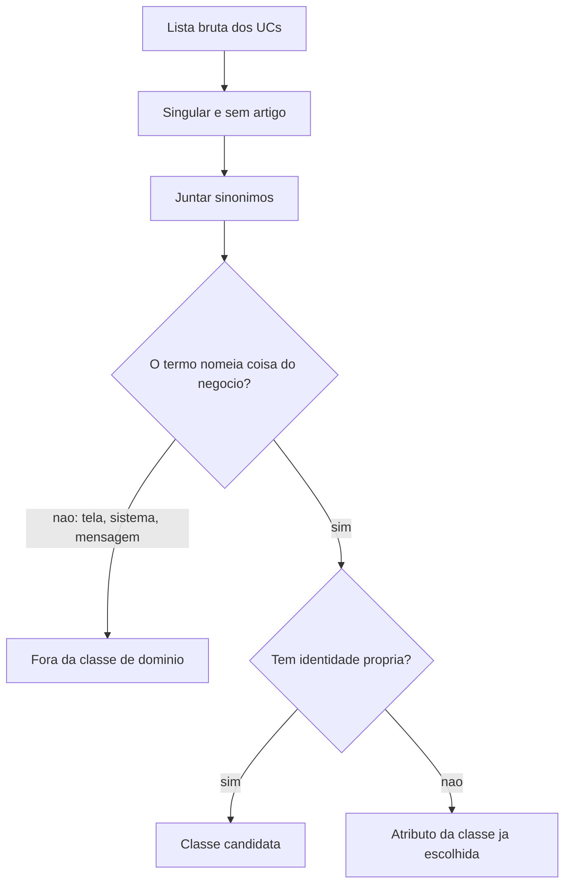
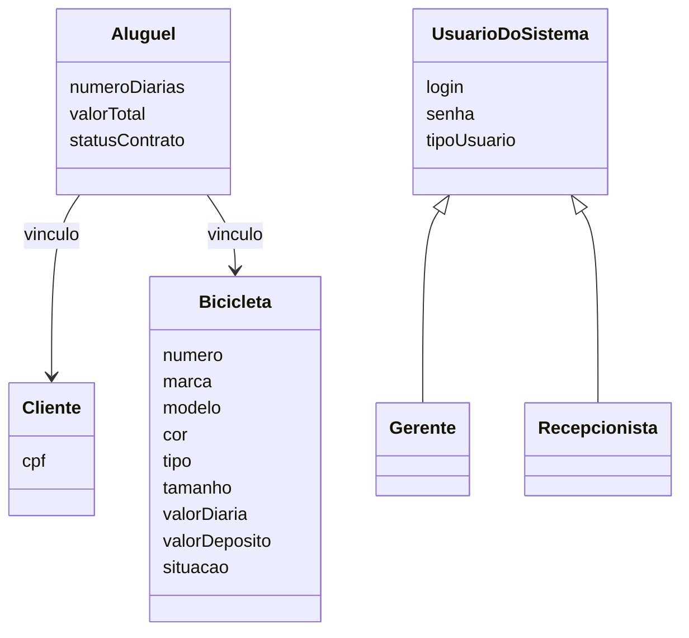

## Visão Geral do Conceito

A lição [[substantivos-responsabilidades-wheels]] leu o UC01 e o UC02. Esta lição é a **solução escrita**: normalizar a lista, fechar classes candidatas, atributos e responsabilidades, e unificar sinónimos.

> **Conflito de fontes.** O PDF desta aula é esse exercício resolvido (técnica dos substantivos e técnica das responsabilidades no Wheels). A transcrição datada 07/10/2026, arquivada como Aula 11, **não** percorre esse PDF. O professor abre a dizer que a sessão é a “aula número doze” e ensina dicionário de dados e diagrama de classes — o tema do PDF da aula seguinte. Esta lição ensina o PDF da solução e o que a transcrição de **30/09** corrigiu em voz alta ao passar o mesmo material. A fala de 07/10 não entra aqui como conteúdo.

O professor, em 30/09, também disse que no trabalho não cobraria este filtro em dois passos tão longos: a pessoa pode ir limpando na leitura. O PDF mostra o caminho completo. As duas indicações coexistem: o documento didático é exaustivo; a entrega do aluno pode ser mais curta, desde que a classe e o atributo sobrevivam ao filtro.

## Modelo Mental

Normalizar, no sentido desta aula, é três operações mecânicas antes de batizar classe:

1. Singular, sem artigo.
2. Juntar formas equivalentes e sinónimos.
3. Separar o que é classe, o que é atributo e o que é só comportamento de ecrã.

“Bicicleta disponível para aluguel” não é uma segunda classe ao lado de Bicicleta. É <mark style="background-color: #242424; padding: 2px 4px; border-radius: 3px; color: inherit;">`Bicicleta.situação = disponível`</mark>. “Dados da bicicleta” não é entidade: é o conjunto dos atributos. “Mensagem de sucesso” não é classe: é comportamento do sistema.



## Mecânica Central

### Classes que o PDF fecha

1. <mark style="background-color: #242424; padding: 2px 4px; border-radius: 3px; color: inherit;">`Bicicleta`</mark>
2. <mark style="background-color: #242424; padding: 2px 4px; border-radius: 3px; color: inherit;">`Cliente`</mark>
3. <mark style="background-color: #242424; padding: 2px 4px; border-radius: 3px; color: inherit;">`Aluguel`</mark> (ou ContratoDeAluguel)
4. <mark style="background-color: #242424; padding: 2px 4px; border-radius: 3px; color: inherit;">`UsuárioDoSistema`</mark>, com papéis Gerente e Rececionista

O PDF escreve as duas coisas ao mesmo tempo: papéis como “subclasses” **e** atributo <mark style="background-color: #242424; padding: 2px 4px; border-radius: 3px; color: inherit;">`tipoUsuário`</mark> (gerente, rececionista). Isso repete a mesma informação. A aula não escolhe uma das duas formas. Ao desenhar, não deixe o papel nas duas sem o notar. A fala chega a citar administrador como papel possível; o PDF não o inclui.

### Atributos no PDF — texto versus inferência

| Classe | No texto do UC | Marcado como inferido ou “pode existir” |
|--------|----------------|------------------------------------------|
| Bicicleta | número (chave), marca, modelo, cor, tipo, tamanho, valorDiária, valorDepósito, situação | — |
| Cliente | cpf (chave) | outros dados (nome, endereço, telefone); statusCadastro |
| UsuárioDoSistema | login, senha e tipo nascem das pré-condições de autenticação e dos papéis, não de um formulário de usuário no UC | — |
| Aluguel | numeroDiarias, valorTotal | dataInício, dataFim; statusContrato |

<mark style="background-color: #242424; padding: 2px 4px; border-radius: 3px; color: inherit;">`statusCadastro`</mark> do cliente está no PDF (cadastrado / não cadastrado). Na fala de 30/09 o professor oferece duas leituras: se o registo está no banco, “cadastrado” já está implícito e o flag perde sentido; o flag ainda serve se o cadastro for parcial (falta pagamento ou endereço). Não apague o atributo do PDF, e não o trate como obrigatório único.

Status do contrato no PDF: ativo e concluído. A fala acrescenta cancelado (diferente de concluído), pendente e rascunho, e nota que data/hora de finalização pode coexistir com o status “finalizado” sem ser a mesma informação. Esses valores extra **não** estão na lista escrita.

### Responsabilidades

**Bicicleta**

- Identificar-se pelo número único.
- Manter marca, modelo, cor, tipo, tamanho, valorDiária, valorDepósito.
- Informar disponibilidade.
- Possível validação: valor da diária maior que zero (o PDF diz “possível”, não mostra a regra no fluxo).
- No UC02: poder ser associada a um contrato; passar a indisponível quando o aluguel é criado.

**Cliente**

- Identificar-se pelo CPF.
- Possuir dados cadastrais para exibição e validação.
- Possível regra: não permitir aluguel se não estiver cadastrado.
- O PDF também escreve “ser associado a aluguéis”.

**Aluguel**

- Registrar o vínculo entre um Cliente e uma Bicicleta.
- Armazenar o número de diárias.
- Manter valorTotal calculado por número de diárias × valor da diária da bicicleta.
- Manter status do contrato.
- Registrar data/hora de início e, possivelmente, de término.

**Gerente / UsuárioDoSistema (UC01):** iniciar o cadastro, fornecer os dados, corrigir o número quando há duplicidade.

**Rececionista / UsuárioDoSistema (UC02):** iniciar o aluguel, informar número e CPF, conferir, informar diárias, confirmar com o aceite do cliente.

**Sistema (não vira classe de domínio):** mostrar formulário, validar número duplicado, gravar, buscar bicicleta e cliente, verificar disponibilidade, calcular o total, registrar o contrato, mudar o status da bicicleta, exibir mensagens. A fala lembra que “responsabilidade do sistema” pode incluir um terceiro (assinatura digital foi exemplo oral, não passo do UC).

> **Correção oral sobre o Cliente.** Em 30/09 o professor disse que “ser associado a aluguéis” fica ambíguo e que **não** a poria como responsabilidade do Cliente. O vínculo é responsabilidade do Aluguel. Ele avisou que reveria o documento. O PDF que temos ainda traz a frase na ficha do Cliente. Trate isso como conflito aberto: o escrito e a fala não dizem o mesmo.



Datas de início e fim e os “outros dados” do cliente ficaram de fora dos compartimentos de propósito: o PDF não os lê no fluxo, só os admite como inferência. A herança Gerente/Rececionista está no PDF (“subclasses/papéis”). A multiplicidade não está escrita; o diagrama não a inventa.

### Tabela de unificação (PDF)

| Expressões | Forma unificada |
|------------|-----------------|
| nova bicicleta, bicicleta cadastrada, bicicleta consultada | Bicicleta |
| número da bicicleta, número de bicicleta | Bicicleta.número |
| bicicleta disponível para aluguel | Bicicleta.situação = disponível |
| bicicleta indisponível para aluguel | Bicicleta.situação = indisponível |
| dados da bicicleta | conjunto de atributos de Bicicleta |
| dados do cliente | conjunto de atributos de Cliente |
| CPF do cliente | Cliente.cpf |
| registro de aluguel, contrato de aluguel | Aluguel (ContratoDeAluguel) |
| valor total do contrato de aluguel | Aluguel.valorTotal |
| número de diárias do aluguel | Aluguel.numeroDiarias |
| ator autenticado, usuário autenticado | UsuárioDoSistema logado |
| mensagem de sucesso/erro | comportamento do Sistema |

“Bicicleta consultada” não pede atributo `consultada`. A busca pelo identificador não muda o estado de domínio.

## Uso Prático

### O que entra num objeto fiel ao PDF, com a ressalva oral

```javascript
const modeloEscrito = {
  classes: ["Bicicleta", "Cliente", "Aluguel", "UsuarioDoSistema"],
  papeis: ["Gerente", "Recepcionista"],
  atributosNoTexto: {
    Bicicleta: ["numero", "marca", "modelo", "cor", "tipo", "tamanho", "valorDiaria", "valorDeposito", "situacao"],
    Cliente: ["cpf"],
    Aluguel: ["numeroDiarias", "valorTotal"]
  },
  inferidos: {
    Cliente: ["outros dados", "statusCadastro"],
    Aluguel: ["dataInicio", "dataFim", "statusContrato"]
  },
  responsabilidadeDoVinculo: "Aluguel"
};
```

`responsabilidadeDoVinculo` segue a **fala** que revisou o PDF, não a linha “ser associado a aluguéis” do Cliente. Se a entrega copiar o PDF à letra, a linha continua no Cliente — e o conflito tem de ficar visível, não “resolvido em silêncio”.

### O que esta solução ainda não é

Não é dicionário de dados (notação `+`, opcional, alternativa) nem diagrama de classes com operações `calcularValorTotal()`. Isso é outra aula e outro PDF. Também não fixe multiplicidade: este documento não a escreve.

## Erros Comuns

| Erro | Sintoma | Correção |
|------|---------|----------|
| Uma classe por sinónimo | NovaBicicleta, BicicletaCadastrada, BicicletaConsultada | Uma Bicicleta |
| Atributo `consultada` ou `sucesso` | Flag que a tabela de unificação não cria | Consulta é comportamento; sucesso é mensagem |
| Datas tratadas como se estivessem no fluxo | dataInício obrigatória “porque o UC mandou” | O PDF diz que não aparecem explicitamente |
| Nome e endereço do cliente como extraídos do UC | Ficha completa sem lacuna | O PDF diz que não aparecem e que podem existir |
| “Associar-se a aluguéis” como método do Cliente, ignorando a fala | Comportamento no sítio que o professor marcou para rever | O vínculo está na responsabilidade do Aluguel |
| tipoUsuário e subclasse a dizer o mesmo papel sem nota | Gerente nas duas formas, como se fossem factos diferentes | O PDF lista as duas; isso é redundância, não duas descobertas |
| Status cancelado/pendente/rascunho como lista do PDF | Valores só ditos em sala | PDF: ativo e concluído |

## Visão Geral de Debugging

1. Pegue a expressão do UC e procure-a na tabela de unificação antes de criar classe nova.
2. Marque cada atributo como “está no fluxo” ou “inferido”. Se a implementação exigir data de início, a origem é a inferência, não uma frase do UC02.
3. Para cada responsabilidade, pergunte se é comportamento ou apenas “estas classes ligam-se”. Ligação é associação; quem a registra, na fala, é Aluguel.
4. Confira se Gerente e Rececionista não ficaram ao mesmo tempo como único mecanismo e como `tipoUsuário` sem você ter escolhido.
5. Não complete esta ficha com operações do dicionário da aula seguinte. São artefactos diferentes; os atributos nem coincidem todos.

<details>
<summary>Núcleo que texto e fala concordam</summary>

- Quatro classes de domínio: Bicicleta, Cliente, Aluguel, UsuárioDoSistema.
- Chaves: número da bicicleta e CPF do cliente.
- valorTotal = diárias × valorDiária da bicicleta.
- Sistema, formulário e mensagem ficam de fora.
</details>

## Principais Pontos

- Normalizar é singular, sem artigo, sinónimos no mesmo conceito.
- Classes escritas: Bicicleta, Cliente, Aluguel, UsuárioDoSistema; papéis Gerente e Rececionista.
- Situação da bicicleta absorve “disponível” e “indisponível”.
- Datas do contrato e demais dados do cliente estão marcados como inferência.
- O PDF põe “ser associado a aluguéis” no Cliente; a fala de 30/09 tira essa responsabilidade e deixa o vínculo no Aluguel.
- `tipoUsuário` e subclasses repetem o papel. O PDF não desfaz a repetição.
- A transcrição de 07/10 não é a narração deste PDF.

## Preparação para Prática

Ao final desta lição você deve conseguir:

1. Unificar uma expressão do UC no nome da tabela (classe ou classe.atributo).
2. Montar a ficha mínima com o que o texto sustenta e à parte o que é inferido.
3. Apontar o conflito da responsabilidade de associação do Cliente e não “corrigir” o PDF sem o declarar.

## Laboratório de Prática

As funções devolvem estrutura vazia ou lista vazia enquanto o `TODO` não for feito. Não lançam exceção.

### Easy — Unificar a expressão

Devolva a forma unificada do PDF, ou `"nao-unificado"` se a expressão não estiver na tabela.

```javascript
function unificarExpressao(expressao) {
  // TODO: "nova bicicleta" | "bicicleta cadastrada" | "bicicleta consultada" → "Bicicleta"
  // TODO: "numero da bicicleta" | "numero de bicicleta" → "Bicicleta.numero"
  // TODO: "CPF do cliente" → "Cliente.cpf"
  // TODO: "registro de aluguel" | "contrato de aluguel" → "Aluguel"
  // TODO: "valor total do contrato de aluguel" → "Aluguel.valorTotal"
  // TODO: "mensagem de sucesso" → "comportamento do Sistema"
  return "nao-unificado";
}

console.log(unificarExpressao("bicicleta consultada"));
console.log(unificarExpressao("mensagem de sucesso"));
console.log(unificarExpressao("idade minima"));
```

**Critérios:** `"Bicicleta"`, `"comportamento do Sistema"`, `"nao-unificado"`.

### Medium — Separar atributo do texto e atributo inferido

```javascript
function separarAtributos(classe) {
  // TODO: Bicicleta → { noTexto: [numero, marca, modelo, cor, tipo, tamanho, valorDiaria, valorDeposito, situacao], inferidos: [] }
  // TODO: Cliente → { noTexto: ["cpf"], inferidos: ["outros dados", "statusCadastro"] }
  // TODO: Aluguel → { noTexto: ["numeroDiarias", "valorTotal"], inferidos: ["dataInicio", "dataFim", "statusContrato"] }
  // TODO: classe desconhecida → { noTexto: [], inferidos: [] }
  return { noTexto: [], inferidos: [] };
}

console.log(separarAtributos("Cliente"));
console.log(separarAtributos("Aluguel"));
```

**Critérios:** Cliente tem `cpf` em `noTexto` e não tem `nome` em `noTexto`. Aluguel tem `valorTotal` em `noTexto` e `dataInicio` em `inferidos`.

### Hard — Ficha de classes e o conflito do vínculo

Monte a ficha e registe a divergência. Não apague a linha do PDF nem finja que a fala não existe.

```javascript
function fichaDeDominio(opcao) {
  // opcao.seguirFala === true usa a correção de 30/09
  // TODO: classes sempre ["Bicicleta", "Cliente", "Aluguel", "UsuarioDoSistema"]
  // TODO: papeis sempre ["Gerente", "Recepcionista"] — não incluir administrador
  // TODO: se seguirFala → vinculoRegistradoPor = "Aluguel" e conflitos inclui "pdf-lista-associacao-no-cliente"
  // TODO: se não seguirFala → vinculoRegistradoPor = "Cliente" e conflitos fica []
  // TODO: devolver { classes, papeis, vinculoRegistradoPor, conflitos }
  return { classes: [], papeis: [], vinculoRegistradoPor: "", conflitos: [] };
}

console.log(fichaDeDominio({ seguirFala: true }));
console.log(fichaDeDominio({ seguirFala: false }));
```

**Critérios:** com `seguirFala: true`, o vínculo é `"Aluguel"` e os conflitos citam o PDF. Com `false`, o vínculo é `"Cliente"` e `conflitos` é `[]`. Administrador não entra em `papeis`.

---

<!-- lessons.json (não editar neste ciclo): discipline=projeto-bloco-backend slug=classes-candidatas-normalizadas-wheels title="Wheels: normalização e classes candidatas" order=11 file=content/projeto-bloco-backend/aula-11-classes-candidatas-normalizadas-wheels.md -->

<!-- CONCEPT_EXTRACTION
concepts:
  - normalização singular e sinónimo
  - Bicicleta Cliente Aluguel UsuarioDoSistema
  - situação disponível e indisponível
  - atributo inferido
  - statusCadastro
  - responsabilidade do vínculo no Aluguel
  - conflito PDF versus fala de 30/09
  - tipoUsuário e subclasse redundantes
  - transcrição de 07/10 fora deste PDF
skills:
  - Unificar expressões do UC na tabela de sinónimos
  - Separar atributo lido no fluxo de atributo inferido
  - Montar a ficha das quatro classes e dos dois papéis
  - Declarar o conflito da associação do Cliente
  - Não promover mensagem de sucesso a classe
examples:
  - tabela-sinonimos-bicicleta
  - datas-inferidas-do-aluguel
  - vinculo-responsabilidade-do-aluguel
  - tipo-usuario-e-subclasse
  - mensagem-comportamento-do-sistema
-->

<!-- EXERCISES_JSON
[
  {
    "id": "pb11-unificar-expressao-wheels",
    "slug": "pb11-unificar-expressao-wheels",
    "difficulty": "easy",
    "title": "Unificar sinónimos do Wheels",
    "discipline": "projeto-bloco-backend",
    "editorLanguage": "javascript",
    "tags": ["normalizacao", "sinonimos", "wheels", "classes"],
    "summary": "Mapear expressões do UC para Bicicleta, atributos ou comportamento do sistema."
  },
  {
    "id": "pb11-separar-atributos-inferidos",
    "slug": "pb11-separar-atributos-inferidos",
    "difficulty": "medium",
    "title": "Separar atributo do texto e atributo inferido",
    "discipline": "projeto-bloco-backend",
    "editorLanguage": "javascript",
    "tags": ["atributos", "inferencia", "cliente", "aluguel"],
    "summary": "Listar o que o UC escreve e o que o PDF só admite como inferência."
  },
  {
    "id": "pb11-ficha-conflito-vinculo",
    "slug": "pb11-ficha-conflito-vinculo",
    "difficulty": "hard",
    "title": "Ficha de domínio e conflito do vínculo",
    "discipline": "projeto-bloco-backend",
    "editorLanguage": "javascript",
    "tags": ["responsabilidades", "aluguel", "cliente", "conflito-de-fontes"],
    "summary": "Fechar as quatro classes e registar se o vínculo segue o PDF ou a fala de 30/09."
  }
]
-->
