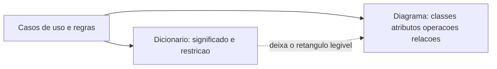
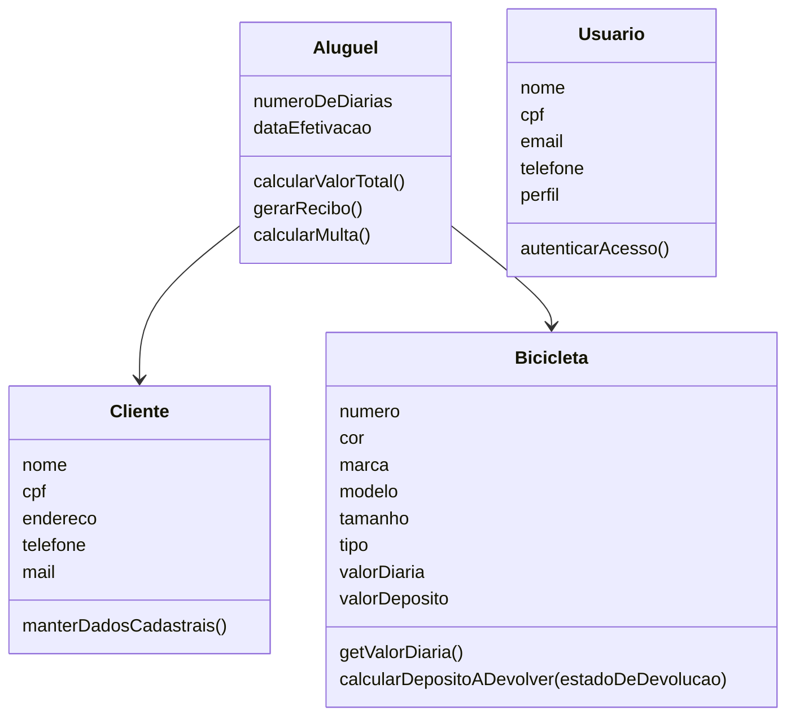

## Visão Geral do Conceito

O <mark style="background-color: #242424; padding: 2px 4px; border-radius: 3px; color: inherit;">`dicionário de dados`</mark> documenta, de forma estruturada, os dados relevantes do sistema: significado, estrutura e restrições. O PDF chama-o de fonte de verdade semântica. Ele existe para o <mark style="background-color: #242424; padding: 2px 4px; border-radius: 3px; color: inherit;">`diagrama de classes`</mark> poder ficar limpo: o desenho mostra classes, atributos, operações e relações; o dicionário guarda formato, valor válido e regra que poluiriam o retângulo.

Dois objetivos têm de coexistir:

1. **Precisão técnica** — analista, desenvolvedor e arquiteto sabem quais dados existem, quais formatos são permitidos, quais valores são válidos e quais restrições se aplicam. A meta é evitar interpretação divergente na implementação, no teste e na manutenção.
2. **Legibilidade** — quem é do negócio também lê. Definição clara, vocabulário do domínio, discussão e refinamento em conjunto.

> **Lacuna:** não há transcrição atribuída à Aula 12. O que segue apoia-se no PDF. Onde uma figura não tem texto extraído (slides de exemplo visual do retângulo e do diagrama sem legenda), a lição não inventa o desenho.

> **Conflito de rótulo, não usado como fonte desta lição.** A transcrição de 07/10/2026 está arquivada como Aula 11, o professor chama essa sessão de “aula número doze” e acompanha este mesmo tema. Esta lição não reproduz essa fala. Cardinalidade desenhada, símbolo de nulidade, enunciado de TP e ferramenta de diagrama não estão no PDF: ficam não cobertos.

## Modelo Mental

Pense no par dicionário + diagrama como ficha e mapa.

- A ficha (dicionário) responde “o que esta palavra significa, do que ela é feita, o que esta classe faz e a quem ela pede ajuda”.
- O mapa (diagrama de classes) responde “quais abstrações existem, o que armazenam, que comportamento têm e como se relacionam”.

O mapa não nasce sozinho da notação UML. A UML só desenha um entendimento que a análise já construiu, e o desenho evolui com casos de uso, diagramas de interação e regras de negócio. Detalhe novo de formato ou de regra entra no dicionário sem obrigar o retângulo a crescer.

Classe conceitual, neste PDF, sai da linguagem do negócio, não de uma lista arbitrária. Dados e comportamentos da mesma regra ficam na mesma classe: contrato e dinheiro em Aluguel; bem físico e depósito em Bicicleta; quem contrata em Cliente; quem opera o sistema em Usuário.



## Mecânica Central

### Notação

| Símbolo | Nome no PDF | Efeito |
|---------|-------------|--------|
| `+` | Concatenação | Composição de elementos |
| `{ }` | Repetição | O elemento pode ocorrer várias vezes |
| `( )` | Opcionalidade | O elemento é opcional |
| `[ \| ]` | Seleção alternativa | Uma escolha entre alternativas |
| itálico | Comentário | Esclarece o significado |

O PDF não mostra um termo deste domínio escrito com `{ }`. Não invente uma lista formal só para “gastar” o símbolo. Onde ele usa a notação, os exemplos são os das classes abaixo.

### Quatro classes do dicionário

O PDF fixa Aluguel, Bicicleta, Cliente e Usuário. Não é a mesma ficha da solução de substantivos da lição anterior.

**Conflito entre artefactos (PDF da solução de classes × este dicionário):**

| Ponto | Solução de substantivos | Este dicionário |
|-------|-------------------------|-----------------|
| Nome do operador interno | UsuárioDoSistema, com subclasses Gerente e Rececionista e atributo tipoUsuário | Usuário, com `perfil = [Gerente \| Rececionista]` |
| Situação da bicicleta | Atributo | Não aparece na composição de Bicicleta |
| valorTotal, status, dataInício, dataFim | Atributos de Aluguel (parte inferida) | Não entram na composição; valor total vira responsabilidade “informar o valor total” |
| Dados do Cliente | CPF no texto; nome e endereço só como possibilidade | nome, cpf, endereco, telefone e e-mail opcional passam a composição |

Não “alinhe” os dois PDFs por conta própria. Este dicionário é o que esta aula escreve.

#### Aluguel

Definição do PDF: contrato de empréstimo de **uma ou mais** bicicletas da loja para um cliente cadastrado, por um número determinado de diárias.

Composição escrita:

`Aluguel = cliente + bicicleta + numeroDeDiarias + dataEfetivacao`

| Atributo | Tipo no PDF |
|----------|-------------|
| cliente | Cliente |
| bicicleta | Bicicleta |
| numeroDeDiarias | inteiro (quantidade de dias do contrato) |
| dataEfetivacao | data |

Responsabilidades: informar o valor total do contrato; gerar recibo; calcular o valor da multa.

Colaborações: solicita à Bicicleta o valor da diária; solicita o valor do depósito a ser devolvido; **consolida os valores de todas as bicicletas alugadas**.

**Conflito dentro deste PDF.** A definição e a colaboração falam em várias bicicletas no mesmo aluguel. A composição usa `bicicleta` no singular. O exercício 1, mais à frente, diz que cada instância de Aluguel representa **uma** bicicleta específica. As três frases não fecham um único modelo. Ao implementar, é preciso escolher e registrar a escolha; o PDF não a desfaz.

#### Bicicleta

Ativo da loja que pode ser alugado.

`Bicicleta = numero + cor + marca + modelo + tamanho + tipo + valorDiaria + valorDeposito`

| Atributo | Tipo no PDF |
|----------|-------------|
| numero | inteiro (identificador único) |
| cor, marca, modelo, tamanho, tipo | texto |
| valorDiaria, valorDeposito | monetário |

Responsabilidades: informar o valor da diária; informar o valor do depósito; calcular o depósito a devolver conforme o estado de devolução.

Colaborações: recebe do Aluguel o pedido de valores; avalia o estado de devolução para o cálculo do depósito.

O “estado de devolução” aparece na responsabilidade e **não** aparece na composição de atributos. O PDF não nomeia esse atributo.

#### Cliente

Indivíduo cadastrado que pode alugar uma bicicleta.

`Cliente = nome + cpf + endereco + telefone + (email)`

| Atributo | Tipo no PDF |
|----------|-------------|
| nome, endereco, telefone | texto |
| cpf | digito11 (documento identificador) |
| mail | texto |

O PDF escreve `(email)` na composição e `mail` na lista de atributos. É o mesmo dado opcional com dois nomes. Não crie email e mail como dois campos.

Responsabilidades: manter os dados cadastrais; associar-se a contratos de aluguel.

A linha “associar-se a contratos” reaparece aqui. A fala que a questionou está na aula da solução de substantivos, não neste PDF. Este documento mantém a frase.

#### Usuário

Indivíduo cadastrado que, conforme o perfil, executa operações administrativas e operacionais.

`Usuario = nome + cpf + email + telefone + perfil`

| Atributo | Tipo no PDF |
|----------|-------------|
| nome, email, telefone | texto |
| cpf | digito11 |
| perfil | `[Gerente \| Recepcionista]` |

Responsabilidades: autenticar acesso; alterar informações de perfil; executar operações conforme o perfil (cadastros e contratos são o exemplo do PDF).

E-mail do Usuário está na composição **sem** parênteses. E-mail do Cliente está opcional. O PDF não explica a diferença.

### Diagrama de classes

Estrutura estática: classes (abstrações do domínio), atributos, métodos e relações (associações, heranças, dependências — o PDF nomeia os três tipos e não desenha um exemplo legendado).

O retângulo tem três compartimentos:

1. Nome da classe — obrigatório.
2. Atributos — o PDF marca este compartimento como opcional na análise inicial: o desenho pode nascer só com o nome e ganhar atributos quando a ficha estabilizar.
3. Operações — comportamento: regra do domínio, serviço interno, cálculo, validação, mudança de estado. O PDF chama este compartimento de responsabilidades.

Operações que o PDF diz fazerem sentido:

| Classe | Operações |
|--------|-----------|
| Aluguel | <mark style="background-color: #242424; padding: 2px 4px; border-radius: 3px; color: inherit;">`calcularValorTotal()`</mark>, <mark style="background-color: #242424; padding: 2px 4px; border-radius: 3px; color: inherit;">`gerarRecibo()`</mark>, <mark style="background-color: #242424; padding: 2px 4px; border-radius: 3px; color: inherit;">`calcularMulta()`</mark> |
| Bicicleta | <mark style="background-color: #242424; padding: 2px 4px; border-radius: 3px; color: inherit;">`getValorDiaria()`</mark>, <mark style="background-color: #242424; padding: 2px 4px; border-radius: 3px; color: inherit;">`calcularDepositoADevolver(estadoDeDevolucao)`</mark> |

Os identificadores estão no PDF como escritos acima. O PDF não declara tipo de retorno nem visibilidade.

Como evitar classe errada, na lista do PDF:

1. Atributo não vira classe. Valor da diária é atributo de Bicicleta.
2. Evitar redundância. “Número de dias”, “duração estimada” e “tempo do aluguel” podem ser a mesma ideia; escolhe-se um nome no dicionário.
3. Recibo não é classe de domínio. É documento derivado.
4. Aluguel é a relação entre Cliente e Bicicleta **e** tem dados próprios (data, diárias, multa, recibo), logo é entidade. “Recibo” nesta frase do PDF aparece entre os dados próprios e, no item 3, deixa de ser classe. Leitura consistente com o resto do slide: o dado da multa e a operação de gerar recibo ficam em Aluguel; a classe Recibo não.



Sem multiplicidade: o PDF do diagrama não a escreve. O exercício 1 diz, em prosa, que um cliente pode alugar uma ou mais bicicletas e que cada bicicleta pode ser alugada várias vezes ao longo do tempo. Isso é requisito do exercício, não um número na ponta da seta.

### Exercício 1 — onde guardar o histórico

Requisito: um cliente pode alugar uma ou mais bicicletas; cada bicicleta pode ser alugada várias vezes; cada aluguel registra data de início, número de diárias, valor pago antecipadamente e possíveis descontos no depósito (atraso ou dano); o sistema mantém o histórico.

| Tentativa | O que quebra |
|-----------|----------------|
| Atributos em Cliente (`nome`, `cpf`, `endereco`, `dataInicio`, `numeroDeDiarias`) | Um escalar não guarda o segundo aluguel nem casa data com bicicleta |
| Atributos em Bicicleta | A mesma bicicleta volta a ser alugada; um único `dataInicio` não basta. Listas são “solução forçada” |
| Classe Aluguel | Cada instância: um cliente, uma bicicleta, um período, um conjunto de valores financeiros |

O PDF não mostra o conteúdo das listas nem um índice a emparelhar data e diárias. Diz apenas que a lista é forçada e que o aluguel não é atributo simples.

### Exercício 2 — por que Pagamento é classe

Novos requisitos: pagamento antecipado; um único recibo quando o cliente aluga várias bicicletas ao mesmo tempo; registrar a data de cada pagamento, o valor efetivamente pago e o depósito devolvido no fim; histórico financeiro completo.

O PDF responde: pagamento é independente, com dados próprios, histórico próprio e responsabilidades distintas do contrato e do cliente. Cada instância é um evento financeiro numa data, associado a um aluguel específico, com valores efetivamente registados.

Não há, neste PDF, atributos nomeados de Pagamento nem a relação desenhada. Não complete a ficha com campos que o exercício não listou para além de data, valor pago e depósito devolvido — e esses três estão no enunciado do exercício, não numa composição `Pagamento = ...`.

## Uso Prático

Entrada mínima fiel à composição escrita, com o e-mail do cliente ausente (o parêntese permite):

```javascript
const dicionario = {
  Aluguel: {
    composicao: ["cliente", "bicicleta", "numeroDeDiarias", "dataEfetivacao"],
    responsabilidades: ["informar valor total", "gerar recibo", "calcular multa"]
  },
  Cliente: {
    obrigatorios: ["nome", "cpf", "endereco", "telefone"],
    opcionais: ["email"]
  },
  Usuario: {
    perfil: ["Gerente", "Recepcionista"]
  },
  naoSaoClasses: ["valorDiaria", "recibo"]
};
```

`valorDiaria` continua atributo de Bicicleta. `recibo` continua fora da lista de classes. `perfil` só aceita as duas alternativas do colchete.

**Não coberto no PDF:** multiplicidade numérica, símbolo de atributo obrigatório, tipos de linguagem (String, SQL), nome de ferramenta, e o texto integral de um trabalho para nota.

## Erros Comuns

| Erro | Sintoma | Correção |
|------|---------|----------|
| Valor da diária como classe | Retângulo ValorDiaria | Atributo monetário de Bicicleta |
| Recibo como classe | Entidade só para imprimir | Operação `gerarRecibo()` em Aluguel |
| Um `dataInicio` no Cliente para todo o histórico | O segundo aluguel sobrescreve o primeiro | Entidade Aluguel |
| Listas paralelas em Bicicleta | Data numa lista, diárias noutra, sem par estável | O PDF rejeita essa solução forçada |
| email e mail como dois atributos | Composição e lista de tipos divergem no nome | Um opcional só |
| Várias bicicletas e uma bicicleta ao mesmo tempo, sem nota | Definição, colaboração e exercício 1 discordam | Declarar o conflito e escolher |
| Situação da bicicleta “porque a aula passada tinha” | Atributo que este dicionário não compõe | Não importar a ficha anterior como se fosse este PDF |
| Pagamento só com um valor dentro de Aluguel | Perde-se o histórico de mais de um evento | O exercício 2 pede a classe pelo evento e pelo histórico |

## Visão Geral de Debugging

1. Leia a composição (`=`) e a lista de tipos. Se o nome divergir (email / mail), una antes de gerar campo.
2. Veja se um “atributo novo” é na verdade o histórico de algo que acontece muitas vezes. Se for, a tentativa 1 e a tentativa 2 do exercício 1 já mostram o fracasso do escalar.
3. Separe operação (`gerarRecibo`) de classe (`Recibo`). O PDF fica com a operação.
4. Se a definição diz “uma ou mais bicicletas” e o exercício diz “uma bicicleta por instância”, não implemente as duas. Registe qual frase você seguiu.
5. Restrição que não cabe no retângulo (dígito 11, monetário, texto) fica no dicionário, não numa nota gráfica inventada.

<details>
<summary>Frases do PDF que não devem ser fundidas</summary>

- Definição de Aluguel: uma ou mais bicicletas.
- Composição: um elemento `bicicleta`.
- Colaboração: consolida todas as bicicletas alugadas.
- Exercício 1: cada instância liga um cliente, uma bicicleta, um período e valores.
</details>

## Principais Pontos

- Dicionário = significado, formato e restrição. Diagrama = estrutura legível.
- `+` compõe, `( )` é opcional, `[ | ]` escolhe, `{ }` repete. Chaves não têm exemplo neste domínio.
- Aluguel, Bicicleta, Cliente e Usuário são as classes deste dicionário, com ficha diferente da solução de substantivos.
- E-mail do cliente é opcional; o PDF chama-o email e mail.
- Perfil do usuário é Gerente ou Rececionista.
- Histórico de aluguel não cabe num atributo escalar de Cliente nem de Bicicleta.
- Recibo é operação e documento derivado, não classe.
- Pagamento vira classe quando é evento com data, valor e histórico próprios.
- Há conflito interno sobre quantas bicicletas uma instância de Aluguel contém.

## Preparação para Prática

Ao final desta lição você deve conseguir:

1. Ler uma composição com `+` e `( )` e listar obrigatórios e opcionais.
2. Rejeitar Cliente ou Bicicleta como lugar do histórico de vários aluguéis.
3. Separar o que é classe (Aluguel, Pagamento) do que é atributo ou operação (valor da diária, gerar recibo).

## Laboratório de Prática

JavaScript aplica a notação e os dois exercícios. Sem o `TODO`, as funções devolvem estrutura vazia e o processo termina sem exceção.

### Easy — Ler a composição do Cliente e o perfil

```javascript
function lerComposicaoCliente(composicao) {
  // composicao exemplo: ["nome", "cpf", "endereco", "telefone", "(email)"]
  // TODO: token entre parênteses vai para opcionais, sem os parênteses
  // TODO: os outros tokens vão para obrigatorios
  // TODO: devolver { obrigatorios: [], opcionais: [] }
  return { obrigatorios: [], opcionais: [] };
}

function perfilValido(perfil) {
  // TODO: true só para "Gerente" ou "Recepcionista"
  return false;
}

console.log(lerComposicaoCliente(["nome", "cpf", "endereco", "telefone", "(email)"]));
console.log(perfilValido("Gerente"));
console.log(perfilValido("Administrador"));
```

**Critérios:** opcionais = `["email"]`; obrigatórios com os quatro nomes; `perfilValido` verdadeiro só para os dois papéis do PDF.

### Medium — Recusar histórico escalar

Diga onde o histórico **não** pode ficar, segundo o exercício 1, e qual classe o PDF adota.

```javascript
function ondeGuardarHistorico(tentativa) {
  // tentativa: "atributos-em-cliente" | "atributos-em-bicicleta" | "listas-paralelas" | "classe-aluguel"
  // TODO: as três primeiras → { aceita: false, classe: "Aluguel" }
  // TODO: "classe-aluguel" → { aceita: true, classe: "Aluguel" }
  // TODO: outra → { aceita: false, classe: "nao-coberto" }
  return { aceita: false, classe: "" };
}

console.log(ondeGuardarHistorico("atributos-em-cliente"));
console.log(ondeGuardarHistorico("listas-paralelas"));
console.log(ondeGuardarHistorico("classe-aluguel"));
```

**Critérios:** as duas primeiras chamadas têm `aceita: false` e `classe: "Aluguel"`. A terceira tem `aceita: true`.

### Hard — Pagamento, recibo e o conflito das bicicletas

Não escolha em silêncio quantas bicicletas cabem numa instância. Devolva a decisão e o conflito quando as frases do PDF discordam.

```javascript
function modelarFinanceiro(pedido) {
  // pedido = {
  //   variosEventosDePagamento: boolean,
  //   querClasseRecibo: boolean,
  //   umaInstanciaVariasBicicletas: boolean
  // }
  const conflitos = [];
  // TODO: se variosEventosDePagamento → pagamentoComoClasse = true
  // TODO: se não → pagamentoComoClasse = false
  // TODO: reciboComoClasse = false sempre que querClasseRecibo for true ou false
  //       (o PDF não promove recibo a classe); se querClasseRecibo → conflitos.push("recibo-e-operacao")
  // TODO: se umaInstanciaVariasBicicletas === true → conflitos.push("definicao-varias-bicicletas")
  // TODO: se umaInstanciaVariasBicicletas === false → conflitos.push("exercicio-1-uma-bicicleta-por-instancia")
  // TODO: devolver { pagamentoComoClasse: false, reciboComoClasse: false, conflitos }
  return { pagamentoComoClasse: false, reciboComoClasse: false, conflitos };
}

console.log(modelarFinanceiro({
  variosEventosDePagamento: true,
  querClasseRecibo: true,
  umaInstanciaVariasBicicletas: true
}));
```

**Critérios:** `pagamentoComoClasse === true`, `reciboComoClasse === false`, e `conflitos` contém `"recibo-e-operacao"` e `"definicao-varias-bicicletas"`. Com `umaInstanciaVariasBicicletas: false`, o conflito citado é o do exercício 1, não o da definição.

---

<!-- lessons.json (não editar neste ciclo): discipline=projeto-bloco-backend slug=dicionario-dados-diagrama-classes title="Dicionário de dados e diagrama de classes" order=12 file=content/projeto-bloco-backend/aula-12-dicionario-dados-diagrama-classes.md -->

<!-- CONCEPT_EXTRACTION
concepts:
  - dicionário de dados
  - concatenação repetição opcionalidade seleção
  - Aluguel Bicicleta Cliente Usuário
  - diagrama de classes em três compartimentos
  - operação versus classe Recibo
  - histórico que exige entidade Aluguel
  - classe Pagamento
  - conflito uma ou mais bicicletas
  - lacuna sem transcrição da Aula 12
skills:
  - Ler composição com + e parênteses
  - Restringir perfil a Gerente ou Rececionista
  - Recusar atributo escalar como histórico de aluguel
  - Manter valor da diária como atributo e recibo como operação
  - Justificar Pagamento como evento com histórico
  - Declarar o conflito interno sobre quantas bicicletas há em um Aluguel
examples:
  - cliente-email-opcional
  - usuario-perfil-alternativa
  - tentativa-historico-no-cliente
  - aluguel-calcular-valor-total
  - pagamento-evento-financeiro
-->

<!-- EXERCISES_JSON
[
  {
    "id": "pb12-ler-composicao-cliente",
    "slug": "pb12-ler-composicao-cliente",
    "difficulty": "easy",
    "title": "Ler composição do Cliente e perfil do Usuário",
    "discipline": "projeto-bloco-backend",
    "editorLanguage": "javascript",
    "tags": ["dicionario-de-dados", "opcionalidade", "perfil", "notacao"],
    "summary": "Separar atributos obrigatórios e o e-mail opcional, e aceitar só Gerente ou Recepcionista."
  },
  {
    "id": "pb12-onde-guardar-historico",
    "slug": "pb12-onde-guardar-historico",
    "difficulty": "medium",
    "title": "Recusar histórico de aluguel em atributo escalar",
    "discipline": "projeto-bloco-backend",
    "editorLanguage": "javascript",
    "tags": ["diagrama-de-classes", "aluguel", "historico", "entidade"],
    "summary": "Rejeitar Cliente, Bicicleta e listas paralelas como lugar do histórico e adotar a classe Aluguel."
  },
  {
    "id": "pb12-modelar-financeiro",
    "slug": "pb12-modelar-financeiro",
    "difficulty": "hard",
    "title": "Pagamento, recibo e conflito das bicicletas",
    "discipline": "projeto-bloco-backend",
    "editorLanguage": "javascript",
    "tags": ["pagamento", "recibo", "aluguel", "conflito-de-fontes"],
    "summary": "Promover Pagamento a classe, manter recibo como operação e declarar o conflito do PDF sobre várias bicicletas."
  }
]
-->
