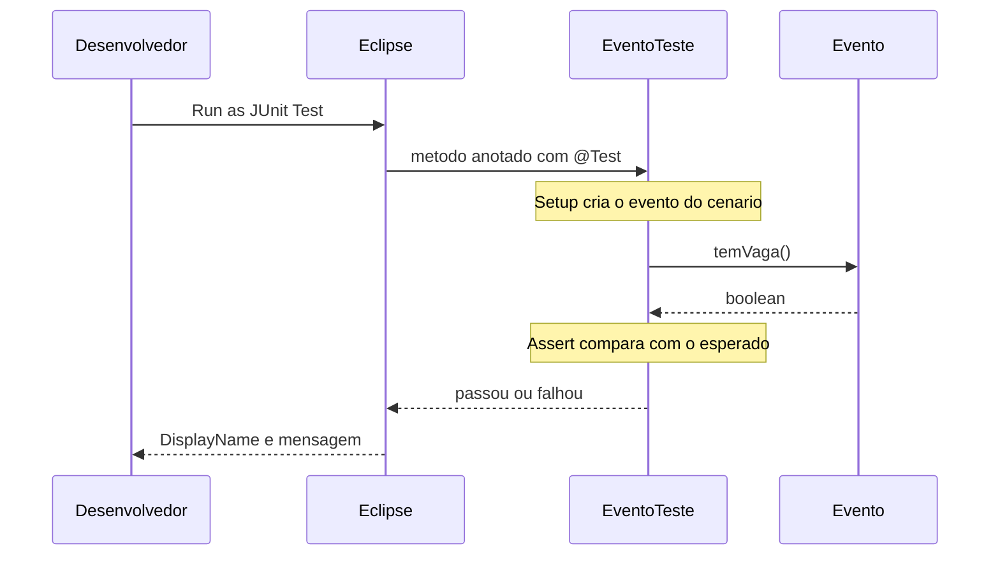

## Visão Geral do Conceito

Um programa que “rodou e mostrou o resultado certo” provou um exemplo, não a regra. Na fala da aula, um método de desconto pode acertar um preço e falhar com percentual 0, 100 ou negativo. A mesma dúvida vale para o domínio já construído no trimestre anterior: o <mark style="background-color: #242424; padding: 2px 4px; border-radius: 3px; color: inherit;">`Evento`</mark> consulta vaga e inscreve até a capacidade. Executar o <mark style="background-color: #242424; padding: 2px 4px; border-radius: 3px; color: inherit;">`main`</mark> e ler o console não registra o que deveria acontecer na próxima mudança.

O teste unitário automatizado transforma essa expectativa em código. A ferramenta usada no Eclipse é o <mark style="background-color: #242424; padding: 2px 4px; border-radius: 3px; color: inherit;">`JUnit`</mark> (a transcrição soletra “JUnit”, “Day Unit” e variações de legenda; é a mesma biblioteca). Um método anotado deixa de ser “um procedimento que eu rodei na mão” e passa a ser um cenário repetível: preparar o evento, chamar o comportamento, comparar com o valor esperado.

Nesta disciplina a ordem anunciada é testar, depois consumir serviço, depois publicar o próprio serviço. HTTP, API REST e o código desses serviços **não foram implementados neste encontro**. O objeto de aprendizagem aqui é a verificação automática de <mark style="background-color: #242424; padding: 2px 4px; border-radius: 3px; color: inherit;">`temVaga()`</mark>.

> **Lacuna de fonte:** o PDF `Etapa-01-1-Desenvolvimento-de-Servicos-Web-e-Testes-com-Java` não tem camada de texto (o extrato em memória é só quebra de página). Competências, blocos e calendário entram apenas pelo que foi falado. Nomes das nove etapas, datas numéricas de TP e o enunciado escrito dos trabalhos não estão na transcrição — não são reconstruídos aqui.

## Modelo Mental

Pense no teste como uma ficha de cenário, não como um segundo programa de negócio. A ficha responde três perguntas, sempre nesta ordem:

| Fase (nome usado na aula) | Pergunta | No exemplo da vaga |
|---------------------------|----------|--------------------|
| Setup | O que preciso deixar pronto? | <mark style="background-color: #242424; padding: 2px 4px; border-radius: 3px; color: inherit;">`new Evento(...)`</mark> com a capacidade do cenário |
| Execução | Qual comportamento eu disparo? | <mark style="background-color: #242424; padding: 2px 4px; border-radius: 3px; color: inherit;">`temVaga()`</mark>, resultado guardado num <mark style="background-color: #242424; padding: 2px 4px; border-radius: 3px; color: inherit;">`boolean`</mark> |
| Verificação | O que eu espero encontrar? | <mark style="background-color: #242424; padding: 2px 4px; border-radius: 3px; color: inherit;">`assertTrue`</mark> ou <mark style="background-color: #242424; padding: 2px 4px; border-radius: 3px; color: inherit;">`assertFalse`</mark> |

A especificação lida em aula já vem nesse formato, mesmo sem usar os rótulos em inglês:

- **Dado** um evento com capacidade para 10 e nenhuma inscrição.
- **Quando** a disponibilidade é consultada.
- **Então** o retorno é <mark style="background-color: #242424; padding: 2px 4px; border-radius: 3px; color: inherit;">`true`</mark>.

O método de teste não recalcula a regra “do zero” com variáveis locais soltas. Ele chama a classe de negócio. Se o assert falha, a leitura da aula é: o teste que já descrevia a regra continua sendo a expectativa; a alteração suspeita está em <mark style="background-color: #242424; padding: 2px 4px; border-radius: 3px; color: inherit;">`Evento`</mark>. Mudar o assert para a barra ficar verde apaga o alerta.



Há um desenho de papéis, ainda sem ferramenta além do JUnit: quem testa pode escrever a classe de teste (e, no relato de TDD, um esqueleto de <mark style="background-color: #242424; padding: 2px 4px; border-radius: 3px; color: inherit;">`Evento`</mark> com método vazio ou exceção de “ainda não implementado”) e quem implementa o backend preenche o miolo sem reescrever a expectativa. A aula cita desenvolvimento orientado a testes e diz que o ciclo será trabalhado depois. **Não coberto aqui:** anotações de ciclo de vida, dublês, agrupamento de testes e a diferença formal entre erro e falha (anunciada para um encontro seguinte; neste dia a barra vermelha é tratada como “o teste reclamou”).

## Mecânica Central

### Biblioteca no projeto que já existe

O projeto aberto é o de integração do trimestre anterior: Java comum, não projeto web. Para o JUnit entrar no classpath a aula usa o Eclipse nesta sequência:

1. Clique no projeto.
2. <mark style="background-color: #242424; padding: 2px 4px; border-radius: 3px; color: inherit;">`Build Path`</mark> → <mark style="background-color: #242424; padding: 2px 4px; border-radius: 3px; color: inherit;">`Add Libraries`</mark>.
3. Selecionar <mark style="background-color: #242424; padding: 2px 4px; border-radius: 3px; color: inherit;">`JUnit`</mark>, Next, Finish.

A biblioteca passa a aparecer no projeto. Sem ela, o menu de execução não oferece JUnit Test. Com ela, <mark style="background-color: #242424; padding: 2px 4px; border-radius: 3px; color: inherit;">`Run As`</mark> → <mark style="background-color: #242424; padding: 2px 4px; border-radius: 3px; color: inherit;">`JUnit Test`</mark> varre métodos de teste e abre a vista própria, separada do console do <mark style="background-color: #242424; padding: 2px 4px; border-radius: 3px; color: inherit;">`main`</mark>.

> **Lacuna:** a fala não lê a versão no diálogo (JUnit 4 ou Jupiter) nem a linha de <mark style="background-color: #242424; padding: 2px 4px; border-radius: 3px; color: inherit;">`import`</mark>. Os trechos abaixo usam os nomes que a aula executou (<mark style="background-color: #242424; padding: 2px 4px; border-radius: 3px; color: inherit;">`@Test`</mark>, <mark style="background-color: #242424; padding: 2px 4px; border-radius: 3px; color: inherit;">`@DisplayName`</mark>, <mark style="background-color: #242424; padding: 2px 4px; border-radius: 3px; color: inherit;">`assertTrue`</mark>, <mark style="background-color: #242424; padding: 2px 4px; border-radius: 3px; color: inherit;">`assertFalse`</mark>). <mark style="background-color: #242424; padding: 2px 4px; border-radius: 3px; color: inherit;">`@DisplayName`</mark> existe no JUnit Jupiter (`org.junit.jupiter.api`). Não há evidência, neste encontro, de <mark style="background-color: #242424; padding: 2px 4px; border-radius: 3px; color: inherit;">`@BeforeEach`</mark> nem de teste com parâmetro: a aula diz que parâmetro no método de teste não é o caminho inicial e que outras formas de reaproveitar cenário ficam para depois.

Documentação das anotações usadas: [JUnit 5 User Guide](https://junit.org/junit5/docs/current/user-guide/).

### `@Test` não verifica nada sozinho

Um método <mark style="background-color: #242424; padding: 2px 4px; border-radius: 3px; color: inherit;">`void`</mark> sem parâmetro, com <mark style="background-color: #242424; padding: 2px 4px; border-radius: 3px; color: inherit;">`@Test`</mark>, entra na suite. A aula demonstrou um método vazio de “soma”: o JUnit marcou sucesso porque nenhuma condição foi checada. Em seguida a soma `2 + 3` foi comparada com `5` via <mark style="background-color: #242424; padding: 2px 4px; border-radius: 3px; color: inherit;">`assertTrue`</mark>. Trocar o esperado para `4` fez a vista apontar o método e a linha. Uma mensagem no assert aparece só na falha.

A ordem que passou, depois de a primeira tentativa ser invertida na hora, foi condição e depois mensagem. Isso coincide com <mark style="background-color: #242424; padding: 2px 4px; border-radius: 3px; color: inherit;">`assertTrue(condição, mensagem)`</mark>. A assinatura não foi lida em voz alta.

Esse exemplo da soma **não** é o teste do sistema: a conta nasce dentro do próprio método. O professor descarta o trecho e passa a especificação do evento. Serve para ver a vista ficar vermelha e a mensagem subir. Não serve como modelo de teste de regra.

### A regra que os três testes observam

<mark style="background-color: #242424; padding: 2px 4px; border-radius: 3px; color: inherit;">`Evento`</mark> já existia. O construtor recebe nome, local e capacidade. <mark style="background-color: #242424; padding: 2px 4px; border-radius: 3px; color: inherit;">`temVaga()`</mark> compara inscritos e capacidade: há vaga enquanto a quantidade de inscritos é **menor** que a capacidade. Igualdade significa lotado. <mark style="background-color: #242424; padding: 2px 4px; border-radius: 3px; color: inherit;">`inscrever()`</mark> chama <mark style="background-color: #242424; padding: 2px 4px; border-radius: 3px; color: inherit;">`temVaga()`</mark> e só então incrementa.

```java
public boolean temVaga() {
    return this.quantidadeInscritos < this.capacidade;
}

public void inscrever() {
    if (temVaga()) {
        this.quantidadeInscritos++;
    }
}
```

A fala do construtor, neste dia, é: se a capacidade “tiver valor”, ela vai para o atributo. O detalhe `capacidade > 0` senão o <mark style="background-color: #242424; padding: 2px 4px; border-radius: 3px; color: inherit;">`int`</mark> permanece 0 é explicado no encontro seguinte, quando a regra de capacidade inválida muda. Aqui o efeito usado pelo terceiro teste é observável: capacidade 0 faz <mark style="background-color: #242424; padding: 2px 4px; border-radius: 3px; color: inherit;">`temVaga()`</mark> retornar <mark style="background-color: #242424; padding: 2px 4px; border-radius: 3px; color: inherit;">`false`</mark>.

### Três especificações, três métodos

Identificadores Java não têm espaço. A aula dita o nome por extenso (“deve possuir vagas quando não há inscritos”). A lição usa camelCase com as mesmas palavras. <mark style="background-color: #242424; padding: 2px 4px; border-radius: 3px; color: inherit;">`@DisplayName`</mark> é o texto da vista de testes; o nome do método continua sendo o identificador.

Requisito lido: o sistema deve permitir consultar a disponibilidade de vagas considerando capacidade e quantidade de inscritos.

```java
import static org.junit.jupiter.api.Assertions.assertFalse;
import static org.junit.jupiter.api.Assertions.assertTrue;

import org.junit.jupiter.api.DisplayName;
import org.junit.jupiter.api.Test;

public class EventoTeste {

    @Test
    @DisplayName("Deve possuir vagas ao criar um evento")
    void devePossuirVagasQuandoNaoHaInscritos() {
        // Setup — preparar o cenário
        Evento evento = new Evento("Java", "Infinite", 10);

        // Execução — só o método sob verificação
        boolean possuiVaga = evento.temVaga();

        // Verificação
        assertTrue(possuiVaga, "Um evento vazio deve possuir vagas disponíveis");
    }

    @Test
    @DisplayName("Evento lotado não deve possuir vagas")
    void naoDevePossuirVagasQuandoOEventoEstaLotado() {
        Evento evento = new Evento("Java", "Infinite", 2);
        evento.inscrever();
        evento.inscrever();

        boolean possuiVaga = evento.temVaga();

        assertFalse(possuiVaga, "Um evento não deve possuir vagas disponíveis");
    }

    @Test
    @DisplayName("Evento com capacidade zero não possui vagas")
    void naoDevePossuirVagasComCapacidadeZero() {
        Evento evento = new Evento("Java", "Infinite", 0);

        boolean possuiVaga = evento.temVaga();

        assertFalse(possuiVaga,
                "Um evento com capacidade zero não deve possuir vagas disponíveis");
    }
}
```

O nome `"Java"` e o local `"Infinite"` são os que a fala monta na hora (o nome é puxado de um exemplo já existente na classe; o local é dito como “infinite”). A tela não foi lida: não há como confirmar o literal exato do construtor antigo.

| Teste | Setup | Execução | Assert |
|-------|--------|----------|--------|
| Vaga no evento novo | capacidade 10, zero chamadas a <mark style="background-color: #242424; padding: 2px 4px; border-radius: 3px; color: inherit;">`inscrever()`</mark> | <mark style="background-color: #242424; padding: 2px 4px; border-radius: 3px; color: inherit;">`temVaga()`</mark> | <mark style="background-color: #242424; padding: 2px 4px; border-radius: 3px; color: inherit;">`assertTrue`</mark> |
| Lotado | capacidade 2 e duas inscrições | <mark style="background-color: #242424; padding: 2px 4px; border-radius: 3px; color: inherit;">`temVaga()`</mark> | <mark style="background-color: #242424; padding: 2px 4px; border-radius: 3px; color: inherit;">`assertFalse`</mark> |
| Capacidade zero | capacidade 0, sem inscrição | <mark style="background-color: #242424; padding: 2px 4px; border-radius: 3px; color: inherit;">`temVaga()`</mark> | <mark style="background-color: #242424; padding: 2px 4px; border-radius: 3px; color: inherit;">`assertFalse`</mark> |

<mark style="background-color: #242424; padding: 2px 4px; border-radius: 3px; color: inherit;">`assertTrue(possuiVaga)`</mark> já testa o boolean. Escrever `possuiVaga == true` é redundante com esse assert. Existe <mark style="background-color: #242424; padding: 2px 4px; border-radius: 3px; color: inherit;">`assertFalse`</mark> para o caso em que o valor certo é falso; a aula não lista os outros asserts nesse dia (fica para o encontro seguinte).

Guardar o retorno numa variável local separa execução e verificação. Chamar <mark style="background-color: #242424; padding: 2px 4px; border-radius: 3px; color: inherit;">`temVaga()`</mark> direto dentro do assert funcionaria, e a aula escolhe não fazer isso para manter as três fases visíveis.

O comentário `// Setup` é andaime da aula. O professor avisa que o nome do método e o <mark style="background-color: #242424; padding: 2px 4px; border-radius: 3px; color: inherit;">`@DisplayName`</mark> é que comunicam o cenário. A fase em si permanece.

## Uso Prático

Cenário de conferência interna, o mesmo <mark style="background-color: #242424; padding: 2px 4px; border-radius: 3px; color: inherit;">`Evento`</mark> do projeto de integração. A equipe de qualidade recebe três fichas e não reimplementa a conta de vaga: só observa <mark style="background-color: #242424; padding: 2px 4px; border-radius: 3px; color: inherit;">`temVaga()`</mark>.

Passos que a aula executa de fato:

1. Manter <mark style="background-color: #242424; padding: 2px 4px; border-radius: 3px; color: inherit;">`EventoTeste`</mark> com os três métodos acima (a classe antiga tinha <mark style="background-color: #242424; padding: 2px 4px; border-radius: 3px; color: inherit;">`main`</mark> que imprimia inscrições; esse <mark style="background-color: #242424; padding: 2px 4px; border-radius: 3px; color: inherit;">`main`</mark> não é o teste).
2. Rodar a classe como JUnit Test.
3. Na vista, ler o <mark style="background-color: #242424; padding: 2px 4px; border-radius: 3px; color: inherit;">`@DisplayName`</mark>, não só o identificador.
4. Provar a falha de propósito: no teste do lotado, chamar <mark style="background-color: #242424; padding: 2px 4px; border-radius: 3px; color: inherit;">`inscrever()`</mark> uma vez só (capacidade 2). <mark style="background-color: #242424; padding: 2px 4px; border-radius: 3px; color: inherit;">`assertFalse`</mark> falha porque ainda há vaga. A mensagem do assert identifica o cenário. Restaurar a segunda inscrição devolve o verde.
5. Cobertura: executar de novo com Coverage. No relato, o projeto apareceu em 40%, uma classe em 33% e <mark style="background-color: #242424; padding: 2px 4px; border-radius: 3px; color: inherit;">`Evento`</mark> em 55%. Linha verde foi exercitada; vermelha, não; amarela, em parte (o boolean de <mark style="background-color: #242424; padding: 2px 4px; border-radius: 3px; color: inherit;">`temVaga()`</mark> ficou amarelo: um ramo foi visto, outro ainda pode existir). Trecho sem marcação foi atingido por dentro de outro método (construtor, <mark style="background-color: #242424; padding: 2px 4px; border-radius: 3px; color: inherit;">`toString`</mark>). O formato do <mark style="background-color: #242424; padding: 2px 4px; border-radius: 3px; color: inherit;">`toString`</mark> não foi relido; a aula só diz que ele aparece vermelho enquanto ninguém o chama no teste.
6. O <mark style="background-color: #242424; padding: 2px 4px; border-radius: 3px; color: inherit;">`main`</mark> dentro da classe de teste derruba a cobertura dessa classe. A aula move o <mark style="background-color: #242424; padding: 2px 4px; border-radius: 3px; color: inherit;">`main`</mark> para outra classe, dita como aplicação (<mark style="background-color: #242424; padding: 2px 4px; border-radius: 3px; color: inherit;">`EventoApp`</mark>). Depois da separação, a classe de teste fica em 100% na vista, a classe do <mark style="background-color: #242424; padding: 2px 4px; border-radius: 3px; color: inherit;">`main`</mark> em 0% (ninguém a executa na suite) e <mark style="background-color: #242424; padding: 2px 4px; border-radius: 3px; color: inherit;">`Evento`</mark> continua incompleta. Percentuais novos do projeto inteiro não foram ditados.

No relato de empresa, um critério de liberação citado é cerca de 90% de cobertura; o restante, no mesmo relato, deixa de fora verificação de pouco valor (getter, algum construtor). A aula não transforma 90% em regra da disciplina. 100% em <mark style="background-color: #242424; padding: 2px 4px; border-radius: 3px; color: inherit;">`toString`</mark> é apresentado como desejo possível e, ao mesmo tempo, como motivo de a meta real ficar abaixo de 100%.

Quem escreve o teste, no fluxo descrito, sai da reunião com a mesma especificação de quem implementa <mark style="background-color: #242424; padding: 2px 4px; border-radius: 3px; color: inherit;">`Evento`</mark>. Desacordo de regra volta para conversa; não se “acerta” a barra só no assert.

## Erros Comuns

**Assert que só olha conta local.** Sintoma: o teste passa com `2 + 3 == 5` e nunca instancia <mark style="background-color: #242424; padding: 2px 4px; border-radius: 3px; color: inherit;">`Evento`</mark>. Causa: o cenário foi simulado dentro do teste. Correção: setup cria o objeto da especificação; execução chama o método de negócio.

**Falta de `@Test`.** O método existe e o JUnit Test não o lista. A anotação é o que inclui o método na suite.

**`inscrever()` no cenário “nenhuma inscrição”.** Aí <mark style="background-color: #242424; padding: 2px 4px; border-radius: 3px; color: inherit;">`temVaga()`</mark> deixa de representar o dado da ficha. A falha, ou a passagem acidental, não é a da especificação 1.

**Uma inscrição no cenário de capacidade 2.** <mark style="background-color: #242424; padding: 2px 4px; border-radius: 3px; color: inherit;">`assertFalse`</mark> falha com a mensagem do evento que não deveria ter vaga. Não é defeito de <mark style="background-color: #242424; padding: 2px 4px; border-radius: 3px; color: inherit;">`temVaga()`</mark>: o setup não lotou.

**Virar o assert para combinar com o bug.** A implementação passou a dizer que há vaga num evento lotado e alguém troca <mark style="background-color: #242424; padding: 2px 4px; border-radius: 3px; color: inherit;">`assertFalse`</mark> por <mark style="background-color: #242424; padding: 2px 4px; border-radius: 3px; color: inherit;">`assertTrue`</mark>. A suite fica verde e a regra some. A aula manda voltar em <mark style="background-color: #242424; padding: 2px 4px; border-radius: 3px; color: inherit;">`Evento`</mark>.

**Mensagem e condição invertidas.** A primeira tentativa da aula não compilou ou não casou com a assinatura; a ordem que executou foi condição, depois texto. Sintoma típico: erro de tipo no argumento, não falha de negócio.

**Tratar `<=` como a regra de vaga.** A comparação ensinada é estrita (`<`). Capacidade 2 e 2 inscritos deve falhar <mark style="background-color: #242424; padding: 2px 4px; border-radius: 3px; color: inherit;">`assertFalse`</mark> se alguém trocar o operador. Esse acidente é o tema do próximo encontro; aqui a expectativa correta já está nos testes 2 e 3.

## Visão Geral de Debugging

1. Rodar JUnit Test, não o <mark style="background-color: #242424; padding: 2px 4px; border-radius: 3px; color: inherit;">`main`</mark>. O console da aplicação não é a vista da suite.
2. Ler o <mark style="background-color: #242424; padding: 2px 4px; border-radius: 3px; color: inherit;">`@DisplayName`</mark> do nó vermelho. “Evento lotado não deve possuir vagas” já diz qual ficha quebrou.
3. Clicar a falha. A aula mostra o salto até a linha do assert e a mensagem (“um evento não deve possuir vagas disponíveis”).
4. Conferir as três fases nessa ordem: capacidade e número de <mark style="background-color: #242424; padding: 2px 4px; border-radius: 3px; color: inherit;">`inscrever()`</mark> batem com o texto da ficha? A execução chamou <mark style="background-color: #242424; padding: 2px 4px; border-radius: 3px; color: inherit;">`temVaga()`</mark>? O assert é o da ficha (`true` no evento vazio, `false` no lotado e no zero)?
5. Se o setup está fiel e o assert é o da especificação, a próxima leitura é o corpo de <mark style="background-color: #242424; padding: 2px 4px; border-radius: 3px; color: inherit;">`temVaga()`</mark> e de <mark style="background-color: #242424; padding: 2px 4px; border-radius: 3px; color: inherit;">`inscrever()`</mark>, não o texto do teste.
6. Coverage por último, para achar método intocado (vermelho) ou ramo parcial (amarelo). Verde não substitui ler o cenário: a linha pode ter sido executada com o dado errado.

Diferença oficial entre *failure* (assert) e *error* (exceção inesperada no teste) **não foi definida** neste encontro. Não invente o critério a partir do nome da vista.

## Principais Pontos

- Teste unitário registra expectativa; <mark style="background-color: #242424; padding: 2px 4px; border-radius: 3px; color: inherit;">`main`</mark> só mostra uma execução.
- JUnit entra por Build Path → Add Libraries; a execução é JUnit Test.
- <mark style="background-color: #242424; padding: 2px 4px; border-radius: 3px; color: inherit;">`@Test`</mark> inclui o método; sem assert, vazio conta como sucesso.
- Três fases: setup, execução, verificação com <mark style="background-color: #242424; padding: 2px 4px; border-radius: 3px; color: inherit;">`assertTrue`</mark> / <mark style="background-color: #242424; padding: 2px 4px; border-radius: 3px; color: inherit;">`assertFalse`</mark> e mensagem.
- <mark style="background-color: #242424; padding: 2px 4px; border-radius: 3px; color: inherit;">`@DisplayName`</mark> e o nome “deve … quando …” identificam o cenário na lista.
- Há vaga só enquanto inscritos &lt; capacidade; lotado e capacidade 0 esperam <mark style="background-color: #242424; padding: 2px 4px; border-radius: 3px; color: inherit;">`false`</mark> neste encontro.
- Barra vermelha com a ficha correta: revisar <mark style="background-color: #242424; padding: 2px 4px; border-radius: 3px; color: inherit;">`Evento`</mark>, não o assert.
- Cobertura: verde exercitado, vermelho não, amarelo parcial; tirar o <mark style="background-color: #242424; padding: 2px 4px; border-radius: 3px; color: inherit;">`main`</mark> da classe de teste.

## Preparação para Prática

Você deve conseguir, sem olhar a solução:

- Montar um cenário de <mark style="background-color: #242424; padding: 2px 4px; border-radius: 3px; color: inherit;">`temVaga()`</mark> nas três fases e dizer qual assert a ficha pede.
- Explicar por que o teste do evento vazio não chama <mark style="background-color: #242424; padding: 2px 4px; border-radius: 3px; color: inherit;">`inscrever()`</mark> e o do lotado chama duas vezes para capacidade 2.
- Dizer o que fazer quando a mensagem do assert aparece: conferir o setup e, se ele estiver fiel, a classe de negócio.
- O laboratório espelha essa lógica em JavaScript para o editor do ISS. A assinatura Java equivalente está no comentário. O arquivo inicial executa sem lançar exceção; os comentários <mark style="background-color: #242424; padding: 2px 4px; border-radius: 3px; color: inherit;">`TODO`</mark> marcam o que falta implementar.

## Laboratório de Prática

> Editor ISS: boilerplate em JavaScript espelhando a lógica Java da aula (`Evento` / JUnit). Nos comentários, a chamada Java equivalente. Não altere o esperado da ficha para “fazer passar”.

### Easy — Uma ficha, três fases

**Contexto:** consulta de vaga numa conferência. Capacidade 10, ninguém inscrito. A ficha espera disponível.

```javascript
function verificarFichaVazia() {
  // Setup — Espelho Java: new Evento("Java", "Infinite", 10)
  const evento = { nome: "Java", local: "Infinite", capacidade: 10, quantidadeInscritos: 0 };

  // Execução — Espelho Java: boolean possuiVaga = evento.temVaga();
  // TODO: possuiVaga = quantidadeInscritos < capacidade
  const possuiVaga = false;

  // Verificação — Espelho Java: assertTrue(possuiVaga, mensagem)
  const mensagem = "Um evento vazio deve possuir vagas disponíveis";
  // TODO: passou = possuiVaga === true
  const passou = false;

  return { possuiVaga, passou, mensagem };
}

const ficha = verificarFichaVazia();
console.log(ficha.possuiVaga); // esperado: true
console.log(ficha.passou); // esperado: true
```

### Medium — As três especificações da aula

**Contexto:** a mesma suite (vazio, lotado, capacidade zero). Conte quantas fichas passam sem mudar o campo <mark style="background-color: #242424; padding: 2px 4px; border-radius: 3px; color: inherit;">`esperado`</mark>.

```javascript
function temVaga(evento) {
  // Espelho Java: return quantidadeInscritos < capacidade
  // TODO: implementar a comparação estrita
  return false;
}

function inscrever(evento) {
  // Espelho Java: if (temVaga()) quantidadeInscritos++
  // TODO: incrementar só quando temVaga(evento) for true
  return evento;
}

function avaliarFicha(ficha) {
  const evento = {
    nome: ficha.nome,
    local: "Infinite",
    capacidade: ficha.capacidade,
    quantidadeInscritos: 0
  };

  // TODO: chamar inscrever exatamente ficha.inscricoes vezes
  // TODO: possuiVaga = temVaga(evento)
  // TODO: passou = possuiVaga === ficha.esperado
  const possuiVaga = false;
  const passou = false;
  return { nome: ficha.displayName, possuiVaga, passado: passou };
}

const fichas = [
  { nome: "Java", displayName: "Deve possuir vagas ao criar um evento", capacidade: 10, inscricoes: 0, esperado: true },
  { nome: "Java", displayName: "Evento lotado não deve possuir vagas", capacidade: 2, inscricoes: 2, esperado: false },
  { nome: "Java", displayName: "Evento com capacidade zero não possui vagas", capacidade: 0, inscricoes: 0, esperado: false }
];

const resultados = fichas.map(avaliarFicha);
const aprovadas = resultados.filter(function (item) { return item.passado; }).length;
console.log(aprovadas); // esperado: 3
console.log(resultados);
```

### Hard — A falha denuncia a regra, não a ficha

**Contexto:** alguém troca a consulta de vaga para `inscritos <= capacidade`. O evento de capacidade 2 com duas inscrições passa a “ter vaga”. O teste lotado deve registrar falha e manter o esperado `false`. Não rewrite o esperado para `true`.

```javascript
function temVagaComRegra(evento, regra) {
  if (regra === "menor-ou-igual") {
    return evento.quantidadeInscritos <= evento.capacidade;
  }
  // regra correta da aula
  return evento.quantidadeInscritos < evento.capacidade;
}

function inscreverComRegra(evento, regra) {
  if (temVagaComRegra(evento, regra)) {
    evento.quantidadeInscritos = evento.quantidadeInscritos + 1;
  }
  return evento;
}

function suiteLotado(regra) {
  const evento = { capacidade: 2, quantidadeInscritos: 0 };
  inscreverComRegra(evento, regra);
  inscreverComRegra(evento, regra);

  const possuiVaga = temVagaComRegra(evento, regra);
  const esperado = false;
  let falha = null;

  // TODO: se possuiVaga !== esperado, preencher falha com a mensagem
  // "Um evento não deve possuir vagas disponíveis"
  // TODO: não altere `esperado`

  return {
    regra: regra,
    inscritos: evento.quantidadeInscritos,
    possuiVaga: possuiVaga,
    esperado: esperado,
    falha: falha
  };
}

console.log(suiteLotado("menor"));
// esperado com a regra da aula: possuiVaga false, falha null
console.log(suiteLotado("menor-ou-igual"));
// esperado com o operador trocado: possuiVaga true, falha com a mensagem, esperado continua false
```

---

<!-- LESSONS_JSON_META
discipline: servicos-web-java
slug: teste-unitario-junit-tres-fases
title: Teste unitário com JUnit: da especificação às três fases
order: 1
file: content/servicos-web-java/aula-01-teste-unitario-junit-tres-fases.md
NOTE: lessons.json / search-index.json NÃO editados nesta missão (integração serial pelo orquestrador).
-->

<!-- CONCEPT_EXTRACTION
concepts:
  - teste unitário automatizado
  - especificação dado quando então
  - JUnit no Build Path
  - @Test
  - @DisplayName
  - assertTrue
  - assertFalse
  - mensagem de falha no assert
  - setup execução verificação
  - temVaga inscritos menor que capacidade
  - inscrever só com vaga
  - falha revisa a classe de negócio
  - cobertura verde amarelo vermelho
  - separar main da classe de teste
skills:
  - Traduzir uma ficha de vaga em método @Test
  - Acrescentar JUnit pelo Build Path do Eclipse
  - Separar preparação, chamada e assert
  - Escolher assertTrue ou assertFalse conforme o então da ficha
  - Nomear o teste pelo comportamento e pela condição
  - Localizar a falha na vista JUnit pela mensagem
  - Recusar ajustar o assert para esconder mudança em Evento
  - Ler cobertura verde, amarela e vermelha no Evento
examples:
  - evento-teste-vaga-capacidade-dez
  - evento-teste-lotado-duas-inscricoes
  - evento-teste-capacidade-zero
  - assert-true-com-mensagem
  - falha-proposital-uma-inscricao
  - coverage-evento-e-main-separado
-->

<!-- EXERCISES_JSON
[
  {
    "id": "swj01-ficha-tres-fases",
    "slug": "swj01-ficha-tres-fases",
    "difficulty": "easy",
    "title": "Uma ficha, três fases",
    "discipline": "servicos-web-java",
    "editorLanguage": "javascript",
    "tags": ["junit", "temVaga", "assertTrue", "setup"],
    "summary": "Consultar vaga de um evento vazio (capacidade 10) e marcar passou quando o boolean é true."
  },
  {
    "id": "swj01-tres-especificacoes",
    "slug": "swj01-tres-especificacoes",
    "difficulty": "medium",
    "title": "As três especificações da aula",
    "discipline": "servicos-web-java",
    "editorLanguage": "javascript",
    "tags": ["junit", "assertFalse", "inscrever", "temVaga"],
    "summary": "Rodar as fichas de evento vazio, lotado e capacidade zero e obter 3 aprovações."
  },
  {
    "id": "swj01-falha-denuncia-regra",
    "slug": "swj01-falha-denuncia-regra",
    "difficulty": "hard",
    "title": "A falha denuncia a regra, não a ficha",
    "discipline": "servicos-web-java",
    "editorLanguage": "javascript",
    "tags": ["junit", "regressao", "assertFalse", "temVaga"],
    "summary": "Com o operador <=, registrar falha do evento lotado sem trocar o esperado false."
  }
]
-->
