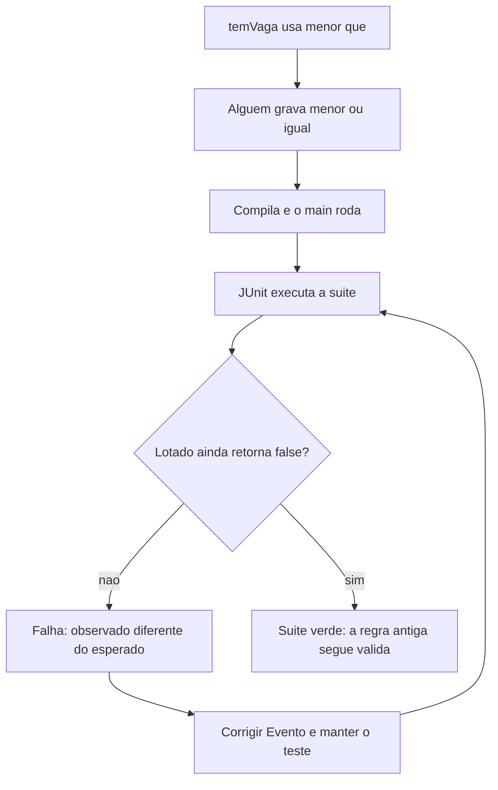

## Visão Geral do Conceito

Compilar e ver o <mark style="background-color: #242424; padding: 2px 4px; border-radius: 3px; color: inherit;">`main`</mark> imprimir não significa que a regra de negócio ainda vale. No <mark style="background-color: #242424; padding: 2px 4px; border-radius: 3px; color: inherit;">`Evento`</mark> da aula anterior ([[teste-unitario-junit-tres-fases]]), a lotação é: não inscrever além da capacidade, e <mark style="background-color: #242424; padding: 2px 4px; border-radius: 3px; color: inherit;">`temVaga()`</mark> responde <mark style="background-color: #242424; padding: 2px 4px; border-radius: 3px; color: inherit;">`false`</mark> quando inscritos e capacidade se encontram. Um colega troca um caractere — `<` vira `<=` — “porque dez inscritos em dez vagas parece justo”. O arquivo continua compilando. <mark style="background-color: #242424; padding: 2px 4px; border-radius: 3px; color: inherit;">`EventoApp`</mark> continua executando. Nenhuma exceção precisa aparecer. A terceira pessoa entra num evento que já lotou.

O teste automatizado é essa expectativa escrita em Java e repetida pelo <mark style="background-color: #242424; padding: 2px 4px; border-radius: 3px; color: inherit;">`JUnit`</mark> depois de cada alteração. A falha, nesse desenho, é o aviso de regressão: um comportamento que já estava certo foi comprometido. Achar isso na suite, durante o desenvolvimento, é o resultado útil. Achar a mesma lotação furada em produção é reclamação, inscrição indevida e investigação atrasada — o exemplo da aula empurra o mesmo tipo de estrago para sistema de pagamento ou benefício, sem mostrar código desses domínios.

A suite não prova ausência de defeito. Ela só vigia os comportamentos que alguém conseguiu transformar em cenário. HTTP, API e serviço web continuam fora destas aulas.

> **Lacuna de fonte:** o PDF da etapa 1 segue sem texto extraível. Livro e intranet citados (“por que gastar tempo com teste se já executei”) não foram nomeados nem lidos. Normas, selo e o site interno de processos da empresa não têm conteúdo ditado — só o fato de que a equipe de qualidade adapta literatura externa. Diferença formal entre erro e falha de JUnit continua não definida; a aula chama de falha o caso em que o valor observado não é o esperado.

## Modelo Mental

Cada teste responde, de novo, três perguntas. A literatura que a aula nomeia usa Arrange, Act e Assert. São os mesmos blocos de ontem (setup, execução, verificação):

| Letra | Nome dito na aula | Pergunta |
|-------|-------------------|----------|
| A | Arrange (“arranjo” / setup) | O que preciso preparar? |
| A | Act (ação) | Qual comportamento eu executo? |
| A | Assert | Qual resultado eu espero? |

No primeiro teste já existente, Arrange cria o evento com capacidade 10. Act chama <mark style="background-color: #242424; padding: 2px 4px; border-radius: 3px; color: inherit;">`temVaga()`</mark> e guarda o <mark style="background-color: #242424; padding: 2px 4px; border-radius: 3px; color: inherit;">`boolean`</mark>. Assert usa <mark style="background-color: #242424; padding: 2px 4px; border-radius: 3px; color: inherit;">`assertTrue`</mark> porque o esperado é verdadeiro. Se não for, a mensagem da aula sobe e o teste para naquele ponto.

O nome do método é documentação executável. `teste73` numa suite de centenas de testes não diz o que quebrou. <mark style="background-color: #242424; padding: 2px 4px; border-radius: 3px; color: inherit;">`naoDevePossuirVagasQuandoOEventoEstaLotado`</mark> diz. A convenção praticada: primeiro o comportamento esperado, depois a condição. Não é exigência do JUnit. É para gente ler — inclusive o autor, meses depois. Comentário que repete o nome da variável é o hábito que a aula rejeita; o comentário que marca Arrange / Act / Assert ainda ajuda a enxergar os blocos, e o professor diz que aos poucos tira o andaime sem dissolver os blocos.



Falha verde-no-sentido-útil: o teste 2 (lotado) e o teste 3 (capacidade 0, ainda na regra antiga de “retorna false”) ficam vermelhos com `<=`, porque `2 <= 2` e `0 <= 0` são verdadeiros e os asserts esperavam falso. O teste do evento vazio (0 &lt; 10) pode continuar verde — e isso localiza o bug na fronteira, não na criação. Reverter para `<` faz os três passarem de novo. Isso é regressão: a alteração prejudicou comportamento que a suite já protegia.

Uma funcionalidade pede vários cenários. “Não há vaga quando lotou” (boolean) e “a quantidade não passa da capacidade depois de uma tentativa extra” (número) observam a mesma regra por lados diferentes. Os dois precisam existir.

## Mecânica Central

### O que a regressão altera, e o que ela não altera

```java
public boolean temVaga() {
    return this.quantidadeInscritos < this.capacidade;
}
```

A condição compara quantidade de inscritos e capacidade. Enquanto inscritos é menor, o método devolve <mark style="background-color: #242424; padding: 2px 4px; border-radius: 3px; color: inherit;">`true`</mark> e <mark style="background-color: #242424; padding: 2px 4px; border-radius: 3px; color: inherit;">`inscrever()`</mark> ainda pode incrementar. Quando os dois números são iguais, o limite foi atingido: não há vaga para o próximo. <mark style="background-color: #242424; padding: 2px 4px; border-radius: 3px; color: inherit;">`<=`</mark> faz o próprio estado lotado parecer disponível e autoriza mais uma inscrição.

A aula executa <mark style="background-color: #242424; padding: 2px 4px; border-radius: 3px; color: inherit;">`EventoApp`</mark> depois da troca: a aplicação sobe. Em seguida roda a suite: os testes 2 e 3 falham. Restaurar `<` devolve o verde. Não há, na transcrição, a mensagem literal do JUnit nessa demonstração — só quais testes quebraram e a leitura “observado verdadeiro, esperado falso”.

### Quarto cenário: a inscrição aumenta o contador em um

Requisito lido: o sistema deve permitir consultar quantos participantes estão inscritos; cada inscrição com sucesso incrementa uma unidade.

Cenário: capacidade 10, nenhuma inscrição, uma chamada a <mark style="background-color: #242424; padding: 2px 4px; border-radius: 3px; color: inherit;">`inscrever()`</mark>, quantidade final 1.

<mark style="background-color: #242424; padding: 2px 4px; border-radius: 3px; color: inherit;">`temVaga()`</mark> não serve: devolve boolean, não a contagem. O atributo <mark style="background-color: #242424; padding: 2px 4px; border-radius: 3px; color: inherit;">`quantidadeInscritos`</mark> é <mark style="background-color: #242424; padding: 2px 4px; border-radius: 3px; color: inherit;">`private`</mark>. A aula gera só o getter (Eclipse: Source → Generate Getters and Setters, apenas o get). Sem setter. O teste lê por <mark style="background-color: #242424; padding: 2px 4px; border-radius: 3px; color: inherit;">`getQuantidadeInscritos()`</mark>.

```java
public int getQuantidadeInscritos() {
    return this.quantidadeInscritos;
}
```

O assert novo é <mark style="background-color: #242424; padding: 2px 4px; border-radius: 3px; color: inherit;">`assertEquals`</mark>. A fala descreve os parâmetros como esperado, atual, e uma mensagem opcional de falha. O <mark style="background-color: #242424; padding: 2px 4px; border-radius: 3px; color: inherit;">`1`</mark> não fica solto no assert: mora em <mark style="background-color: #242424; padding: 2px 4px; border-radius: 3px; color: inherit;">`quantidadeEsperada`</mark>. Dá para inlinar o getter e o literal; a aula prefere as variáveis para copiar a linha do assert e mudar só o valor.

```java
@Test
@DisplayName("Uma inscrição deve aumentar a quantidade de participantes")
void deveIncrementarAQuantidadeDeInscritos() {
    int quantidadeEsperada = 1;
    Evento evento = new Evento("Java", "Infinite", 10);

    evento.inscrever();
    int quantidadeInscritos = evento.getQuantidadeInscritos();

    assertEquals(quantidadeEsperada, quantidadeInscritos,
            "Uma inscrição deve aumentar o total para um");
}
```

Act concentra a inscrição e a leitura. Assert só compara. Se <mark style="background-color: #242424; padding: 2px 4px; border-radius: 3px; color: inherit;">`inscrever()`</mark> deixar de incrementar, este teste quebra — e os que dependem de lotar o evento também.

### Quinto cenário: a terceira tentativa não passa do limite

Requisito lido: o sistema deve impedir que a quantidade de inscritos ultrapasse a capacidade.

Capacidade 2. Duas inscrições lotam. A terceira é tentada no Act. O esperado continua 2. A aula nomeia a variável <mark style="background-color: #242424; padding: 2px 4px; border-radius: 3px; color: inherit;">`capacidadeEsperada`</mark> para não obrigar o leitor a lembrar que o terceiro argumento do construtor é a capacidade.

```java
@Test
@DisplayName("Não deve ultrapassar a capacidade máxima")
void naoDeveUltrapassarCapacidade() {
    int capacidadeEsperada = 2;
    Evento evento = new Evento("Java", "Infinite", capacidadeEsperada);

    evento.inscrever();
    evento.inscrever();
    evento.inscrever();

    int quantidadeInscritos = evento.getQuantidadeInscritos();

    assertEquals(capacidadeEsperada, quantidadeInscritos,
            "A quantidade de inscritos não pode ultrapassar dois");
}
```

Demonstração feita na aula: apagar a condição dentro de <mark style="background-color: #242424; padding: 2px 4px; border-radius: 3px; color: inherit;">`inscrever()`</mark> e incrementar sempre. O quinto teste falha. A expectativa mostrada é 2; o obtido passa a ser 3; a mensagem do assert aparece. Recolocar o <mark style="background-color: #242424; padding: 2px 4px; border-radius: 3px; color: inherit;">`if (temVaga())`</mark> devolve o verde. O teste 2 (boolean do lotado) e o teste 5 (contador) não são redundância inútil: na hora em que a barreira some, a aula usa o quinto para exibir esperado 2 contra atual 3.

A aula não implementa retorno de erro para a terceira inscrição (“não cabe mais”). Isso fica como ideia futura, não como código.

### Sexto cenário: capacidade inválida estoura no construtor

Nova regra, lida como pedido do responsável pelo sistema: não criar evento com capacidade zero nem negativa. O exemplo numérico é −5. Ignorar o valor, ou gravar 0 e seguir, é rejeitado na conversa. O comportamento escolhido é lançar exceção. O tipo nomeado é <mark style="background-color: #242424; padding: 2px 4px; border-radius: 3px; color: inherit;">`IllegalArgumentException`</mark>: argumento de fora inválido. A mensagem de negócio dita no lançamento é da forma “capacidade deve ser maior que zero”.

O teste é escrito **antes** de mudar <mark style="background-color: #242424; padding: 2px 4px; border-radius: 3px; color: inherit;">`Evento`</mark>. Na primeira execução ele falha: a expectativa era a exceção e nada foi lançado. Isso é intencional. O teste descreve comportamento que o código ainda não tem. A aula chama isso de testes orientando a evolução e adia o TDD “de verdade” para depois — o que este encontro faz é o ensaio: falha primeiro, implementa o lançamento, roda de novo.

<mark style="background-color: #242424; padding: 2px 4px; border-radius: 3px; color: inherit;">`assertThrows`</mark> junta Act e Assert. Não há Arrange separado: o objeto nem deve nascer. Parâmetros mostrados:

1. A classe da exceção, com <mark style="background-color: #242424; padding: 2px 4px; border-radius: 3px; color: inherit;">`.class`</mark>.
2. A ação, no formato de seta <mark style="background-color: #242424; padding: 2px 4px; border-radius: 3px; color: inherit;">`() ->`</mark>, cujo corpo é o <mark style="background-color: #242424; padding: 2px 4px; border-radius: 3px; color: inherit;">`new Evento(...)`</mark>.
3. A mensagem se a exceção não vier.

A aula nomeia a seta como lambda e adia programação funcional. Aqui a seta só é o “executável” que o assert dispara. Não há outro uso.

```java
@Test
@DisplayName("Um evento não poderá ser criado com capacidade inválida")
void deveRejeitarCapacidadeNegativa() {
    int capacidadeInvalida = -5;

    assertThrows(IllegalArgumentException.class, () -> {
        new Evento("Java", "Infinite", capacidadeInvalida);
    }, "Uma capacidade negativa deve ser rejeitada");
}
```

Construtor antigo, explicado neste encontro para justificar o teste 3 da aula passada: se a capacidade era maior que zero, copiava para o atributo; senão o <mark style="background-color: #242424; padding: 2px 4px; border-radius: 3px; color: inherit;">`int`</mark> ficava no padrão 0 e ninguém era inscrito. Por isso capacidade 0 devolvia <mark style="background-color: #242424; padding: 2px 4px; border-radius: 3px; color: inherit;">`false`</mark> em <mark style="background-color: #242424; padding: 2px 4px; border-radius: 3px; color: inherit;">`temVaga()`</mark> sem exceção.

Construtor novo: os campos podem ser atribuídos, e a exceção sai quando a capacidade é inválida, interrompendo a criação. A fala oscila entre “menor ou igual a zero” e, linhas depois, “menor do que zero”. O que fecha com os testes que voltam a passar é **menor ou igual a zero**: o caso −5 e o caso 0 são os dois rejeitados. A posição exata do <mark style="background-color: #242424; padding: 2px 4px; border-radius: 3px; color: inherit;">`if`</mark> (antes ou depois das atribuições) não foi ditada linha a linha. O efeito observado no teste é o que importa: capacidade inválida não entrega um evento utilizável.

```java
public Evento(String nome, String local, int capacidade) {
    if (capacidade <= 0) {
        throw new IllegalArgumentException("capacidade deve ser maior que zero");
    }
    this.nome = nome;
    this.local = local;
    this.capacidade = capacidade;
}
```

O teste 3 antigo (capacidade 0 + <mark style="background-color: #242424; padding: 2px 4px; border-radius: 3px; color: inherit;">`assertFalse`</mark>) perde o sentido: a criação já falha, e a mensagem passa a ser a da exceção (“capacidade deve ser maior que zero”). A aula manda falar com o cliente e reescrever a ficha, não manter as duas regras. O teste 3 vira rejeição de zero, método próprio, separado do negativo:

```java
@Test
@DisplayName("Não deve permitir capacidade zerada")
void deveRejeitarCapacidadeZero() {
    assertThrows(IllegalArgumentException.class, () -> {
        new Evento("Java", "Infinite", 0);
    });
}
```

A fala renomeia esse método na hora (“não deve permitir capacidade zerada” / “deve rejeitar a capacidade”) sem ditar o identificador final. O <mark style="background-color: #242424; padding: 2px 4px; border-radius: 3px; color: inherit;">`@DisplayName`</mark> acima usa a frase dita. A mensagem de falha do assert, no caso zero, não foi soletrada — por isso o exemplo fica nos dois parâmetros (classe e executável). A mensagem soletrada é a do caso negativo.

Um teste, uma coisa — no mesmo espírito de um método, uma responsabilidade. Zero e negativo parecem repetidos e são fronteiras diferentes. A cobertura amarela citada de ontem (um boolean, mais de um ramo) é o argumento: menor que zero, igual a zero e maior que zero não são o mesmo caso. Agrupar testes fica para um encontro posterior; neste dia cada método roda solto.

> **Lacuna:** pacote do <mark style="background-color: #242424; padding: 2px 4px; border-radius: 3px; color: inherit;">`import`</mark> de <mark style="background-color: #242424; padding: 2px 4px; border-radius: 3px; color: inherit;">`assertEquals`</mark> / <mark style="background-color: #242424; padding: 2px 4px; border-radius: 3px; color: inherit;">`assertThrows`</mark> não foi lido. <mark style="background-color: #242424; padding: 2px 4px; border-radius: 3px; color: inherit;">`assertThrows`</mark> com classe, executável e mensagem é a operação do JUnit Jupiter. A transcrição não mostra <mark style="background-color: #242424; padding: 2px 4px; border-radius: 3px; color: inherit;">`@Test(expected = ...)`</mark>. Também não mostra asserção da mensagem interna da exceção — só o tipo e a mensagem do próprio assert, se a exceção não ocorrer.

## Uso Prático

Conferência com vagas limitadas, vários desenvolvedores no mesmo <mark style="background-color: #242424; padding: 2px 4px; border-radius: 3px; color: inherit;">`Evento`</mark>. A suite que a aula deixa verde, depois dos seis métodos e da reescrita do terceiro, cobre:

| Ficha | Arrange / Act | Assert |
|-------|----------------|--------|
| Evento novo | capacidade 10, sem inscrição, <mark style="background-color: #242424; padding: 2px 4px; border-radius: 3px; color: inherit;">`temVaga()`</mark> | <mark style="background-color: #242424; padding: 2px 4px; border-radius: 3px; color: inherit;">`assertTrue`</mark> |
| Lotado | capacidade 2, duas inscrições, <mark style="background-color: #242424; padding: 2px 4px; border-radius: 3px; color: inherit;">`temVaga()`</mark> | <mark style="background-color: #242424; padding: 2px 4px; border-radius: 3px; color: inherit;">`assertFalse`</mark> |
| Capacidade zero (regra nova) | <mark style="background-color: #242424; padding: 2px 4px; border-radius: 3px; color: inherit;">`new Evento(..., 0)`</mark> dentro do executável | <mark style="background-color: #242424; padding: 2px 4px; border-radius: 3px; color: inherit;">`assertThrows`</mark> |
| Uma inscrição | capacidade 10, um <mark style="background-color: #242424; padding: 2px 4px; border-radius: 3px; color: inherit;">`inscrever()`</mark>, getter | <mark style="background-color: #242424; padding: 2px 4px; border-radius: 3px; color: inherit;">`assertEquals(1, atual, mensagem)`</mark> |
| Terceira tentativa | capacidade 2, três chamadas, getter | <mark style="background-color: #242424; padding: 2px 4px; border-radius: 3px; color: inherit;">`assertEquals(2, atual, mensagem)`</mark> |
| Capacidade negativa | <mark style="background-color: #242424; padding: 2px 4px; border-radius: 3px; color: inherit;">`new Evento(..., -5)`</mark> | <mark style="background-color: #242424; padding: 2px 4px; border-radius: 3px; color: inherit;">`assertThrows`</mark> |

Ordem de trabalho que a aula segue no sexto, e que vale como procedimento:

1. Escrever <mark style="background-color: #242424; padding: 2px 4px; border-radius: 3px; color: inherit;">`assertThrows`</mark> com −5 e ver a falha “nada foi lançado”.
2. No construtor, lançar <mark style="background-color: #242424; padding: 2px 4px; border-radius: 3px; color: inherit;">`IllegalArgumentException`</mark> quando a capacidade não é positiva.
3. Rodar a suite. O sexto passa. O terceiro antigo quebra.
4. Reescrever o terceiro para capacidade 0 com <mark style="background-color: #242424; padding: 2px 4px; border-radius: 3px; color: inherit;">`assertThrows`</mark>, outro método, outro caso.
5. Rodar de novo e exigir os seis verdes.

O getter nasce de uma conversa entre teste e backend: o requisito pede a quantidade, o campo privado não aparece, o get é o acordo. O teste não abre o atributo.

Quem for procurar vaga, a aula sugere olhar também analista de qualidade, não só desenvolvedor. Isso não muda a mecânica dos asserts.

## Erros Comuns

**`<=` em `temVaga` “porque igual ainda cabe”.** Cabe no número, não na regra. O próximo <mark style="background-color: #242424; padding: 2px 4px; border-radius: 3px; color: inherit;">`inscrever()`</mark> usaria essa consulta e passaria do limite. Sintoma: teste do lotado vermelho, aplicação ainda sobe.

**Apagar o `if` de `inscrever`.** Sintoma do quinto teste: esperado 2, atual 3, mensagem “não pode ultrapassar”. Correção na classe de negócio. O segundo teste (boolean) não mostra o 3; o quinto mostra.

**Literal dentro de `assertEquals`.** O teste passa e ninguém sabe se aquele `1` é quantidade, capacidade ou código de erro. Variável com nome de papel.

**Ordem esperado/atual invertida.** A fala fixa esperado primeiro e atual depois. Invertidos, a vista troca “o que eu queria” e “o que veio” na hora de ler a falha. A assinatura exata não foi lida em voz; a ordem pedagógica da aula é essa.

**Ler `quantidadeInscritos` direto do teste.** O campo é privado. Sem o getter o teste não compila contra o encapsulamento. Gerar todos os setters junto abriria um caminho que a aula não usou: a quantidade muda por <mark style="background-color: #242424; padding: 2px 4px; border-radius: 3px; color: inherit;">`inscrever()`</mark>, não por atribuição livre.

**Manter `assertFalse` para capacidade 0 depois da exceção.** O método de teste nem chega no boolean: a exceção estoura no <mark style="background-color: #242424; padding: 2px 4px; border-radius: 3px; color: inherit;">`new`</mark>. Sintoma: o terceiro teste quebra com a mensagem de capacidade. Correção: <mark style="background-color: #242424; padding: 2px 4px; border-radius: 3px; color: inherit;">`assertThrows`</mark>, não engolir a exceção para “voltar ao false”.

**Um único teste para −5 e para 0.** A aula separa. Juntar os dois esconde qual fronteira quebrou e foge do “um caso por teste” dito no fechamento.

**Lançar a exceção para capacidade positiva.** Os testes 1, 2, 4 e 5 deixam de conseguir criar o evento. A condição é a inválida (`<= 0`), não o construtor inteiro.

## Visão Geral de Debugging

1. Ler o nome do método e o <mark style="background-color: #242424; padding: 2px 4px; border-radius: 3px; color: inherit;">`@DisplayName`</mark> antes do stack. “Não deve ultrapassar a capacidade máxima” já aponta o contador, não o boolean.
2. Na falha de <mark style="background-color: #242424; padding: 2px 4px; border-radius: 3px; color: inherit;">`assertEquals`</mark>, anotar o par que a aula mostrou: expectativa 2, apareceram 3. Se os papéis estiverem trocados na chamada, desconfie da ordem dos argumentos antes de desconfiar da aritmética.
3. Se só os testes de fronteira (lotado e zero-antigo) ficam vermelhos e o evento vazio continua verde, a alteração recente em <mark style="background-color: #242424; padding: 2px 4px; border-radius: 3px; color: inherit;">`temVaga()`</mark> é a primeira suspeita — em especial um sinal a mais no operador.
4. Se o sexto diz que esperava <mark style="background-color: #242424; padding: 2px 4px; border-radius: 3px; color: inherit;">`IllegalArgumentException`</mark> e nada foi lançado, o construtor ainda aceita a capacidade. Não mude o teste para <mark style="background-color: #242424; padding: 2px 4px; border-radius: 3px; color: inherit;">`assertTrue`</mark>.
5. Se o sexto passa e o terceiro antigo quebra, a regra mudou. Atualize a ficha do zero para <mark style="background-color: #242424; padding: 2px 4px; border-radius: 3px; color: inherit;">`assertThrows`</mark>. Isso não é regressão escondida: é contrato novo.
6. Suite verde não autoriza <mark style="background-color: #242424; padding: 2px 4px; border-radius: 3px; color: inherit;">`<=`</mark> “porque ninguém viu”. Alguém viu: o teste, se ele ainda espera <mark style="background-color: #242424; padding: 2px 4px; border-radius: 3px; color: inherit;">`false`</mark> no lotado.

## Principais Pontos

- Executar sem exceção não garante a regra de lotação.
- Regressão: `<` virou `<=`, a suite ficou vermelha, corrigir <mark style="background-color: #242424; padding: 2px 4px; border-radius: 3px; color: inherit;">`Evento`</mark> devolveu o verde. Falhar nesse momento é o teste cumprindo a função.
- Arrange, Act, Assert são setup, execução e verificação com nome de literatura.
- O nome “deve … quando …” comunica o cenário; `teste1` não.
- <mark style="background-color: #242424; padding: 2px 4px; border-radius: 3px; color: inherit;">`assertEquals(esperado, atual, mensagem)`</mark> compara a contagem; o atual sai de <mark style="background-color: #242424; padding: 2px 4px; border-radius: 3px; color: inherit;">`getQuantidadeInscritos()`</mark>.
- Três inscrições com capacidade 2 deixam o contador em 2 enquanto <mark style="background-color: #242424; padding: 2px 4px; border-radius: 3px; color: inherit;">`inscrever()`</mark> respeitar <mark style="background-color: #242424; padding: 2px 4px; border-radius: 3px; color: inherit;">`temVaga()`</mark>.
- Capacidade `<= 0` passa a lançar <mark style="background-color: #242424; padding: 2px 4px; border-radius: 3px; color: inherit;">`IllegalArgumentException`</mark>; <mark style="background-color: #242424; padding: 2px 4px; border-radius: 3px; color: inherit;">`assertThrows`</mark> descreve isso antes da implementação.
- O teste antigo do zero com <mark style="background-color: #242424; padding: 2px 4px; border-radius: 3px; color: inherit;">`assertFalse`</mark> é reescrito. Um caso por teste: negativo num método, zero noutro.
- A suite não cobre defeito que ninguém especificou.

## Preparação para Prática

Você deve conseguir:

- Prever quais testes da suite antiga ficam vermelhos se <mark style="background-color: #242424; padding: 2px 4px; border-radius: 3px; color: inherit;">`temVaga()`</mark> usar `<=`, sem rodar o <mark style="background-color: #242424; padding: 2px 4px; border-radius: 3px; color: inherit;">`main`</mark> como se ele fosse prova.
- Montar <mark style="background-color: #242424; padding: 2px 4px; border-radius: 3px; color: inherit;">`assertEquals`</mark> com variável de esperado, leitura por getter e mensagem.
- Dizer por que a terceira <mark style="background-color: #242424; padding: 2px 4px; border-radius: 3px; color: inherit;">`inscrever()`</mark> não pode elevar o contador acima da capacidade.
- Escrever a expectativa de capacidade inválida como “esta criação deve lançar”, e separar zero de negativo.
- O laboratório está em JavaScript, com a mesma regra. O inicial não lança exceção para fora do arquivo; onde a aula usa <mark style="background-color: #242424; padding: 2px 4px; border-radius: 3px; color: inherit;">`assertThrows`</mark>, o espelho captura o erro dentro da função.

## Laboratório de Prática

> Editor ISS: boilerplate em JavaScript espelhando a lógica Java (`assertEquals`, limite de inscrição, `assertThrows`). Comentários trazem o equivalente Java. O arquivo executa sem exceção não tratada.

### Easy — Uma inscrição, esperado e atual

**Contexto:** secretaria da conferência consulta o contador depois de uma inscrição. Capacidade 10, contador nasce em 0, uma inscrição com sucesso, esperado 1.

```javascript
function resultadoDeUmaInscricao() {
  const quantidadeEsperada = 1;
  const evento = { capacidade: 10, quantidadeInscritos: 0 };

  // Act — Espelho Java: evento.inscrever(); getQuantidadeInscritos()
  // TODO: se houver vaga (inscritos < capacidade), incrementar em 1
  // TODO: quantidadeAtual = evento.quantidadeInscritos
  const quantidadeAtual = 0;

  // Assert — Espelho Java: assertEquals(quantidadeEsperada, quantidadeAtual, mensagem)
  const mensagem = "Uma inscrição deve aumentar o total para um";
  // TODO: passou = quantidadeAtual === quantidadeEsperada
  const passou = false;

  return { quantidadeEsperada, quantidadeAtual, passou, mensagem };
}

const um = resultadoDeUmaInscricao();
console.log(um.quantidadeAtual); // esperado: 1
console.log(um.passou); // esperado: true
```

### Medium — Três tentativas, contador parado na capacidade

**Contexto:** capacidade 2 e uma tentativa a mais. O contador permanece 2. Sem a barreira, o atual seria 3 e o teste falha — não mude o esperado para 3.

```javascript
function inscrever(evento) {
  // Espelho Java: if (temVaga()) quantidadeInscritos++
  // TODO: incrementar somente quando quantidadeInscritos < capacidade
  return evento;
}

function contadorDepoisDeTentativas(capacidade, tentativas) {
  const capacidadeEsperada = capacidade;
  const evento = { capacidade: capacidade, quantidadeInscritos: 0 };
  let i = 0;

  // TODO: o laço já chama inscrever; a regra mora em inscrever
  while (i < tentativas) {
    inscrever(evento);
    i = i + 1;
  }

  const quantidadeAtual = evento.quantidadeInscritos;
  const mensagem = "A quantidade de inscritos não pode ultrapassar a capacidade";
  // TODO: passou = quantidadeAtual === capacidadeEsperada
  const passou = false;

  return { capacidadeEsperada, quantidadeAtual, passou, mensagem };
}

const lote = contadorDepoisDeTentativas(2, 3);
console.log(lote.quantidadeAtual); // esperado: 2
console.log(lote.passou); // esperado: true
```

### Hard — Capacidade inválida rejeitada, zero separado do negativo

**Contexto:** o construtor novo recusa `<= 0` com o papel de <mark style="background-color: #242424; padding: 2px 4px; border-radius: 3px; color: inherit;">`IllegalArgumentException`</mark>. Capacidade positiva ainda cria o evento com contador 0. Dois casos, duas chamadas — não junte −5 e 0 no mesmo boolean.

```javascript
function criarEvento(capacidade) {
  // Espelho Java: if (capacidade <= 0) throw new IllegalArgumentException(...)
  // TODO: se capacidade <= 0, lançar Error("IllegalArgumentException")
  // TODO: senão retornar o evento com quantidadeInscritos 0
  return { capacidade: capacidade, quantidadeInscritos: 0 };
}

function esperaRejeicao(capacidade) {
  // Espelho Java: assertThrows(IllegalArgumentException.class, () -> new Evento(...))
  let lancou = false;
  try {
    criarEvento(capacidade);
  } catch (erro) {
    lancou = erro && erro.message === "IllegalArgumentException";
  }
  // TODO: retornar true somente se lancou for true
  return false;
}

function esperaCriacao(capacidade) {
  let evento = null;
  let lancou = false;
  try {
    evento = criarEvento(capacidade);
  } catch (erro) {
    lancou = true;
  }
  // TODO: retornar true quando lancou for false, evento existir e quantidadeInscritos for 0
  return false;
}

console.log(esperaRejeicao(-5)); // esperado: true
console.log(esperaRejeicao(0)); // esperado: true
console.log(esperaCriacao(10)); // esperado: true
```

---

<!-- LESSONS_JSON_META
discipline: servicos-web-java
slug: regressao-aaa-assertequals-assertthrows
title: Regressão, AAA e asserts: igualdade da inscrição e capacidade inválida
order: 2
file: content/servicos-web-java/aula-02-regressao-aaa-assertequals-assertthrows.md
NOTE: lessons.json / search-index.json NÃO editados nesta missão (integração serial pelo orquestrador).
-->

<!-- CONCEPT_EXTRACTION
concepts:
  - expectativa repetível
  - regressão menor versus menor-ou-igual
  - Arrange Act Assert
  - nome do método como documentação
  - assertEquals esperado atual mensagem
  - getQuantidadeInscritos
  - atributo private
  - inscrição não ultrapassa capacidade
  - assertThrows
  - IllegalArgumentException
  - construtor rejeita capacidade menor ou igual a zero
  - teste antigo de capacidade zero reescrito
  - um caso por teste
skills:
  - Reconhecer regressão quando o programa ainda executa
  - Manter o teste e corrigir temVaga ou inscrever
  - Nomear o teste pelo comportamento e pela condição
  - Comparar contador com assertEquals sem número mágico
  - Expor quantidade privada só por getter
  - Escrever assertThrows antes de lançar a exceção no construtor
  - Separar rejeição de zero e rejeição de negativo
  - Atualizar a ficha quando a regra de capacidade zero muda
examples:
  - temvaga-menor-ou-igual-falha-lotado
  - assert-equals-uma-inscricao
  - assert-equals-terceira-tentativa-capacidade-dois
  - inscrever-sem-barreira-esperado-dois-atual-tres
  - assert-throws-capacidade-menos-cinco
  - teste-zero-reescrito-assert-throws
-->

<!-- EXERCISES_JSON
[
  {
    "id": "swj02-uma-inscricao-equals",
    "slug": "swj02-uma-inscricao-equals",
    "difficulty": "easy",
    "title": "Uma inscrição, esperado e atual",
    "discipline": "servicos-web-java",
    "editorLanguage": "javascript",
    "tags": ["junit", "assertEquals", "inscrever", "getter"],
    "summary": "Após uma inscrição em evento de capacidade 10, comparar quantidade atual com esperado 1."
  },
  {
    "id": "swj02-nao-ultrapassar-capacidade",
    "slug": "swj02-nao-ultrapassar-capacidade",
    "difficulty": "medium",
    "title": "Três tentativas, contador parado na capacidade",
    "discipline": "servicos-web-java",
    "editorLanguage": "javascript",
    "tags": ["junit", "assertEquals", "capacidade", "inscrever"],
    "summary": "Tentar inscrever 3 vezes com capacidade 2 e manter o contador em 2."
  },
  {
    "id": "swj02-rejeitar-capacidade-invalida",
    "slug": "swj02-rejeitar-capacidade-invalida",
    "difficulty": "hard",
    "title": "Capacidade inválida rejeitada, zero separado do negativo",
    "discipline": "servicos-web-java",
    "editorLanguage": "javascript",
    "tags": ["junit", "assertThrows", "IllegalArgumentException", "construtor"],
    "summary": "Rejeitar capacidade -5 e 0 com exceção e ainda criar evento de capacidade 10."
  }
]
-->
