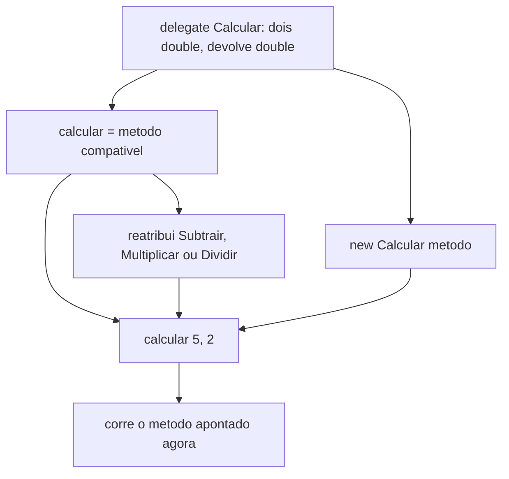
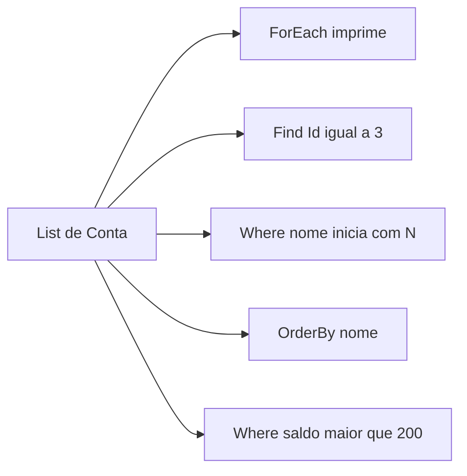

## Visão Geral do Conceito

Esta lição é C#. O professor Luiz Paulo Maia (nas falas, Luiz Maia) abriu a disciplina Desenvolvimento Web .NET e Bases de Dados Relacionais em 5 de outubro de 2026 dizendo que as aulas iniciais **não são ASP.NET**: a competência lida do plano foi utilizar <mark style="background-color: #242424; padding: 2px 4px; border-radius: 3px; color: inherit;">`delegate`</mark> e eventos em programas C#. Eventos, passagem de método como parâmetro e o restante do assunto ficaram para a aula seguinte.

Um <mark style="background-color: #242424; padding: 2px 4px; border-radius: 3px; color: inherit;">`delegate`</mark> é um tipo que armazena uma **referência para um método** com uma assinatura fixa. A variável não guarda o resultado da conta: guarda *qual método* será executado quando alguém a invocar. Em execução, a mesma variável pode deixar de apontar para <mark style="background-color: #242424; padding: 2px 4px; border-radius: 3px; color: inherit;">`Somar`</mark> e passar a apontar para <mark style="background-color: #242424; padding: 2px 4px; border-radius: 3px; color: inherit;">`Dividir`</mark>, desde que os dois métodos concordem no que entra e no que sai.

O mesmo encontro introduziu os delegates genéricos prontos <mark style="background-color: #242424; padding: 2px 4px; border-radius: 3px; color: inherit;">`Func`</mark> e <mark style="background-color: #242424; padding: 2px 4px; border-radius: 3px; color: inherit;">`Action`</mark>, e a <mark style="background-color: #242424; padding: 2px 4px; border-radius: 3px; color: inherit;">`lambda`</mark>: função anônima, parecida com as arrow functions de JavaScript e com a lambda de Python, como o professor comparou. A lambda foi apresentada como a parte mais importante do bloco, porque o Entity Framework — ainda não implementado — a usa muito. Delegates personalizados, na avaliação do professor, são específicos e pouco reutilizados na vida profissional; entram na disciplina porque o TP1 e o AT pedem.

> **Problema que resolve:** escolher, durante a execução, qual operação de mesma assinatura roda, e escrever o critério de uma consulta (qual conta, qual nome, qual saldo) no ponto da chamada, sem um método nomeado só para isso.

> **Lacuna de fonte:** não há PDF desta disciplina no StripperScrapper. O código foi mostrado pronto (cerca de catorze projetos no Drive, entre eles Lambda 1 e Lambda 2, citados como os mais importantes) e **não está neste repositório**. Os exemplos abaixo seguem o que foi ditado na transcrição `Desenvolvimento_Web_.NET_e_Bases_de_Dados_Relacionais__Aula_01_-_05102026.txt`, não um dump do Drive. Bibliografia do plano de ensino foi mencionada e os títulos não foram lidos.

> **Não coberto nesta lição (apenas anunciado):** ASP.NET com Razor Pages, Entity Framework, SQL puro sem o ORM, aplicação web completa, eventos, <mark style="background-color: #242424; padding: 2px 4px; border-radius: 3px; color: inherit;">`multicast`</mark>, callback com método passado como parâmetro. Programação assíncrona e programação orientada a eventos foram citadas como estilos em que delegate aparece; o professor não montou exemplo real delas neste encontro, por tempo de aula.

Documentação de referência (não substitui a aula): [delegates](https://learn.microsoft.com/dotnet/csharp/programming-guide/delegates/), [`Func<T1,T2,TResult>`](https://learn.microsoft.com/dotnet/api/system.func-3), [`Action<T1,T2>`](https://learn.microsoft.com/dotnet/api/system.action-2), [expressões lambda](https://learn.microsoft.com/dotnet/csharp/language-reference/operators/lambda-expressions).

## Modelo Mental

### Ponteiro para método, não objeto

No exemplo da calculadora não existe um objeto `Calcula`. Existem métodos. A variável do delegate é o ponteiro: na hora da chamada, corre o método que está apontado naquele momento.

| Peça | O que guarda | No exemplo |
|------|----------------|------------|
| Tipo delegate | Contrato: o que entra e o que sai. Sem corpo | `Calcular` recebe dois <mark style="background-color: #242424; padding: 2px 4px; border-radius: 3px; color: inherit;">`double`</mark> e devolve <mark style="background-color: #242424; padding: 2px 4px; border-radius: 3px; color: inherit;">`double`</mark> |
| Variável | Referência para um método compatível | aponta para `Somar`, depois para outro |
| Método alvo | Corpo da operação | `Somar`, `Subtrair`, `Multiplicar`, `Dividir` |
| Chamada | Operandos | `5` e `2`, lidos como entrada do usuário |

Analogia curta, a que o professor usou com ressalva: o delegate lembra uma interface porque declara entrada e saída sem corpo. Ele disse que **não é** interface. A associação “parece interface” foi memória de estudo, não identidade dos dois mecanismos.

### Três formas de obter o mesmo contrato

1. **Delegate personalizado** — você declara o tipo (`Calcular`).
2. **`Func`** — o contrato já existe na plataforma; o último parâmetro de tipo é o retorno.
3. **`Action`** — o contrato já existe; não há retorno. O que o método faz (na aula, imprimir) fica dentro dele.

Tudo o que a aula fez com <mark style="background-color: #242424; padding: 2px 4px; border-radius: 3px; color: inherit;">`Func`</mark> e <mark style="background-color: #242424; padding: 2px 4px; border-radius: 3px; color: inherit;">`Action`</mark> também pode ser feito com delegate personalizado. Os genéricos eliminam a declaração do tipo próprio.

### Lambda é anônima e não nasce presa ao delegate

Uma lambda não tem nome de método. O valor dela é guardado numa variável, ou entregue direto a um método que espera um critério (`Find`, `Where`). Ela pode existir **sem** delegate na linha que você escreve — e, no encontro seguinte, o professor dirá que o compilador a transforma em delegate por baixo. Esse “por baixo” não foi mostrado aqui.

Há dois formatos, ambos demonstrados com `5` e `2` produzindo `7`:

- **Lambda expression** — uma linha, sem bloco. É o formato que a aula indicou como o uso normal.
- **Lambda statement** — bloco com `{ }` e corpo (na aula, um <mark style="background-color: #242424; padding: 2px 4px; border-radius: 3px; color: inherit;">`return`</mark>).

<mark style="background-color: #242424; padding: 2px 4px; border-radius: 3px; color: inherit;">`var`</mark> foi introduzido aqui para não escrever o tipo à esquerda. O professor descreveu o compilador trocando `var` pelo tipo da atribuição. No exemplo da lista, `var contas` foi igualado a `List<Conta> contas`. No exemplo da soma, ele disse que o compilador tratava o caso como <mark style="background-color: #242424; padding: 2px 4px; border-radius: 3px; color: inherit;">`double`</mark> porque a operação devolve double e a chamada `somar1(5, 2)` imprime 7. A transcrição não mostra a declaração completa do tipo da variável que *guarda a lambda* (se ficou só `var` ou se em algum trecho foi `Func<...>`).

## Mecânica Central

### 1. Delegate personalizado

Sintaxe ditada: o tipo diz o retorno e os parâmetros e **não tem corpo**.

```csharp
public delegate double Calcular(double op1, double op2);

static double Somar(double op1, double op2) => op1 + op2;
static double Subtrair(double op1, double op2) => op1 - op2;
static double Multiplicar(double op1, double op2) => op1 * op2;
static double Dividir(double op1, double op2) => op1 / op2;
```

Os quatro métodos têm a mesma assinatura. Na definição falada, assinatura é o que vem depois do nome do método: os parâmetros. Na mesma explicação, o retorno também entra no contrato — “receber dois double, retornar um double”. Os dois critérios foram exigidos juntos.

Forma **explícita** (a aula a chamou de menos usual): instanciar o delegate passando o método.

```csharp
Calcular calcular = new Calcular(Somar);
double resultado = calcular(5, 2);
```

Forma **usual**, a que o professor mostrou em seguida: atribuir o método à variável. `Subtrair` não é variável; é método. A variável é que passa a apontar para ele.

```csharp
calcular = Somar;
resultado = calcular(5, 2);       // executa Somar
calcular = Subtrair;
resultado = calcular(5, 2);       // executa Subtrair
calcular = Multiplicar;
resultado = calcular(5, 2);
calcular = Dividir;
resultado = calcular(5, 2);
```

A invocação é a mesma. Muda o alvo. Operandos mostrados: `5` e `2`.



> **Regra:** só entra no delegate um método com a mesma assinatura. A aula não chegou a compilar um contra-exemplo neste dia; a pergunta sobre sobrecarga de delegate ficou para o encontro seguinte e, lá, **não foi testada**.

### 2. Func e Action

O professor enunciou: <mark style="background-color: #242424; padding: 2px 4px; border-radius: 3px; color: inherit;">`Func`</mark> pode receber até dezesseis parâmetros de entrada e tem um parâmetro de tipo a mais, o retorno. <mark style="background-color: #242424; padding: 2px 4px; border-radius: 3px; color: inherit;">`Action`</mark> pode receber até dezesseis parâmetros de entrada e não tem retorno.

No projeto chamado de delegate 2A, o personalizado some. Os dois primeiros tipos são entrada; o último é saída.

```csharp
// Explícita — a aula disse que ninguém usa; ficou no arquivo como informação.
Func<double, double, double> calcularExplicito = new Func<double, double, double>(Somar);

// Simplificada — forma que a aula indicou como a usada.
Func<double, double, double> calcular = Somar;
double resultado = calcular(5, 2);
calcular = Subtrair;
resultado = calcular(5, 2);
```

A execução narrada fez soma, subtração, multiplicação e divisão, como no delegate personalizado.

<mark style="background-color: #242424; padding: 2px 4px; border-radius: 3px; color: inherit;">`Action`</mark> repete o exemplo **sem** <mark style="background-color: #242424; padding: 2px 4px; border-radius: 3px; color: inherit;">`return`</mark>. A impressão ocorre dentro dos métodos. Não há valor para o chamador receber.

```csharp
static void Somar(double op1, double op2) => Console.WriteLine(op1 + op2);
static void Subtrair(double op1, double op2) => Console.WriteLine(op1 - op2);
static void Multiplicar(double op1, double op2) => Console.WriteLine(op1 * op2);
static void Dividir(double op1, double op2) => Console.WriteLine(op1 / op2);

Action<double, double> calcular = Somar;
calcular(5, 2);
calcular = Dividir;
calcular(5, 2);
```

> **Regra da aula:** o último parâmetro de tipo de `Func` é o retorno. `Action` não tem parâmetro de saída. A diferença entre os dois exemplos da calculadora é só essa.

### 3. Lambda expression e lambda statement

Símbolo mostrado: `=>` (arrow, “função de seta”).

Expression — uma linha, sem bloco. A chamada com `5` e `2` produz `7`.

```csharp
var somar1 = (double op1, double op2) => op1 + op2;
Console.WriteLine(somar1(5, 2));
```

Statement — há corpo entre chaves. A aula também obteve `7`.

```csharp
var somar2 = (double op1, double op2) =>
{
    return op1 + op2;
};
Console.WriteLine(somar2(5, 2));
```

Não existe um método chamado `Somar` nessas linhas. O resultado da função anônima fica na variável.

`var` não é um tipo que muda em execução. O professor o descreveu como pedido ao compilador: resolver o tipo na compilação, para escrever menos. Motivo de introduzi-lo agora: os templates de .NET que virão usam `var` com frequência. Limitação (“existe caso em que não se deve usar `var`?”) foi perguntada no dia seguinte e **ficou sem resposta** — ele disse que precisaria pesquisar.

### 4. Lambda atribuída a Func ou a Action

Delegar não exige lambda. Lambda não exige delegate na sua declaração. A aula cruzou os dois de propósito.

O trecho narrado tem três somas, todas com resultado `7`:

- `somar1` — lambda statement **sozinha**, sem `Func` naquela variável. O professor parou para dizer que aquilo não é delegate.
- `somar2` — <mark style="background-color: #242424; padding: 2px 4px; border-radius: 3px; color: inherit;">`Func`</mark> com lambda statement.
- `somar3` — <mark style="background-color: #242424; padding: 2px 4px; border-radius: 3px; color: inherit;">`Func`</mark> com lambda expression.

```csharp
var somar1 = (double op1, double op2) =>
{
    return op1 + op2;
};

Func<double, double, double> somar2 = (op1, op2) =>
{
    return op1 + op2;
};

Func<double, double, double> somar3 = (op1, op2) => op1 + op2;
```

O fechamento do dia repetiu a ideia com <mark style="background-color: #242424; padding: 2px 4px; border-radius: 3px; color: inherit;">`Action`</mark>: uma lambda statement sem delegate, e uma `Action` com lambda statement. `Action` não devolve valor. A saída narrada foi de novo “soma sete” duas vezes — a impressão está dentro do bloco, não num `return`.

```csharp
var imprimirSoma = (double op1, double op2) =>
{
    Console.WriteLine(op1 + op2);
};

Action<double, double> somarAction = (op1, op2) =>
{
    Console.WriteLine(op1 + op2);
};
```

## Uso Prático

O uso que a aula tratou como o mais importante não é a calculadora. É a lista de contas, no projeto Lambda 2, ainda em memória — “muito parecido” com o que o Entity Framework oferecerá, **sem** banco e **sem** SQL nesta aula.

Classe <mark style="background-color: #242424; padding: 2px 4px; border-radius: 3px; color: inherit;">`Conta`</mark>: <mark style="background-color: #242424; padding: 2px 4px; border-radius: 3px; color: inherit;">`Id`</mark>, <mark style="background-color: #242424; padding: 2px 4px; border-radius: 3px; color: inherit;">`Nome`</mark>, <mark style="background-color: #242424; padding: 2px 4px; border-radius: 3px; color: inherit;">`Saldo`</mark>, construtor e um <mark style="background-color: #242424; padding: 2px 4px; border-radius: 3px; color: inherit;">`ToString`</mark> para imprimir. O texto devolvido por `ToString` não foi ditado; a interpolação abaixo só lista os três campos.

```csharp
public class Conta
{
    public int Id { get; }
    public string Nome { get; }
    public double Saldo { get; }

    public Conta(int id, string nome, double saldo)
    {
        Id = id;
        Nome = nome;
        Saldo = saldo;
    }

    public override string ToString()
        => $"Id: {Id}, Nome: {Nome}, Saldo: {Saldo}";
}
```

> **Nota de correção do AT anterior, dita neste ponto da aula:** classes no padrão que ele ensinou para C# / .NET ficam na pasta `Models`. Quem não usou essa pasta no AT de C# perde ponto. Não é regra nova de delegate; é critério de correção que ele reafirmou ao abrir a classe `Conta`.

Lista. As duas declarações foram igualadas na lousa falada:

```csharp
List<Conta> contas = new List<Conta>();
// var contas = new List<Conta>();  // mesma coisa, segundo a aula
```

Contas mocadas, nesta ordem de menção: Francisco, Guilherme, Lucas, Nath, Natália. Resultados que a execução mostrou:

- <mark style="background-color: #242424; padding: 2px 4px; border-radius: 3px; color: inherit;">`Find`</mark> com Id `3` → conta do Lucas.
- Id `10` → mensagem de conta não encontrada (a fala: “Erro conta não encontrada”).
- <mark style="background-color: #242424; padding: 2px 4px; border-radius: 3px; color: inherit;">`Where`</mark> com nome iniciando em `N` → contas nesse critério (Nath e Natália estão nesse grupo de nomes).
- <mark style="background-color: #242424; padding: 2px 4px; border-radius: 3px; color: inherit;">`OrderBy`</mark> por nome → a ordem mudou; ele viu Francisco e Guilherme e a troca entre Natália e Nath; “o resto manteve”. A sequência completa ordenada não foi lida item a item.
- <mark style="background-color: #242424; padding: 2px 4px; border-radius: 3px; color: inherit;">`Where`</mark> com saldo maior que `200` → Lucas, Nath e Natália.

Saldos numéricos e os Ids diferentes de `3` e de `10` **não foram lidos**. O bloco abaixo é reconstrução didática só para reproduzir esses três filtros. Não é o literal do Drive.

```csharp
var contas = new List<Conta>
{
    new Conta(1, "Francisco", 100),
    new Conta(2, "Guilherme", 150),
    new Conta(3, "Lucas", 300),
    new Conta(4, "Nath", 250),
    new Conta(5, "Natália", 400),
};

contas.ForEach(conta => Console.WriteLine(conta));

Conta porId = contas.Find(conta => conta.Id == 3);
Console.WriteLine(porId != null ? porId.ToString() : "Erro conta não encontrada");

Conta inexistente = contas.Find(conta => conta.Id == 10);
Console.WriteLine(inexistente != null ? inexistente.ToString() : "Erro conta não encontrada");

foreach (Conta conta in contas.Where(conta => conta.Nome.StartsWith("N")))
    Console.WriteLine(conta);

foreach (Conta conta in contas.OrderBy(conta => conta.Nome))
    Console.WriteLine(conta);

foreach (Conta conta in contas.Where(conta => conta.Saldo > 200))
    Console.WriteLine(conta);
```

O critério “nome iniciando com N” foi dito; o identificador <mark style="background-color: #242424; padding: 2px 4px; border-radius: 3px; color: inherit;">`StartsWith`</mark> é a escrita desse critério no exemplo, não um nome lido na transcrição.

<mark style="background-color: #242424; padding: 2px 4px; border-radius: 3px; color: inherit;">`ForEach`</mark> imprime em uma chamada, com a lambda no argumento. <mark style="background-color: #242424; padding: 2px 4px; border-radius: 3px; color: inherit;">`ExibirContas`</mark> e <mark style="background-color: #242424; padding: 2px 4px; border-radius: 3px; color: inherit;">`ConsultarContas`</mark> permaneceram no arquivo como a versão **sem** lambda (consultar recebendo a lista e o Id) e **não foram chamados**. Servem de comparação: o mesmo resultado cabe numa lambda entregue a `Find` / `Where` / `OrderBy`.



No dia seguinte o professor completa este `Find`: a lambda entregue ao método vira um delegate <mark style="background-color: #242424; padding: 2px 4px; border-radius: 3px; color: inherit;">`Func`</mark> que devolve verdadeiro ou falso. A expansão gerada pelo compilador **não** foi escrita em nenhuma das duas aulas.

Contexto que ele citou e não exercitou: linguagens de programação funcional (Kotlin como exemplo) usam lambda com frequência. Isso não faz parte da disciplina; ficou como parentesco, não como conteúdo cobrado.

## Erros Comuns

**Tratar delegate como interface.** Causa: os dois declaram um contrato sem corpo. Sintoma: procurar `implements` / classe que implementa o delegate, ou esperar herança. Correção alinhada à aula: é uma referência para método. Herança de delegate, hierarquia e “dá para fazer este callback com interface?” **não foram estabelecidas neste dia**. O professor só registrou a semelhança e negou a identidade.

**Apontar um método com outra assinatura.** Causa: parâmetros ou retorno diferentes de `Calcular` / `Func<double, double, double>` / `Action<double, double>`. Sintoma esperado pela regra da aula: o método não associa. O texto do erro de compilação **não foi lido** em 5 de outubro. Confirmação na IDE ficou para a aula de callback.

**Procurar `return` num `Action`.** Causa: copiar o `Func` e manter o último parâmetro de tipo, ou tentar usar o valor da chamada. Sintoma: não há valor de volta; a aula imprime dentro do método. Correção: efeito interno no `Action`; valor de volta no `Func`, no último parâmetro de tipo.

**Achar que lambda só existe colada em delegate.** Causa: a aula mistura os assuntos de propósito. Sintoma: não reconhecer `somar1` (lambda statement isolada) nem o `Find` da lista. Correção: lambda é anônima e entra em vários contextos; delegate pode ser escrito com método nomeado, sem `=>`.

**Ler `var` como tipo dinâmico em execução.** Causa: a palavra substitui o tipo no fonte. O professor foi explícito: na compilação o `var` vira o tipo da atribuição. Cenários em que `var` não seria recomendado: **não respondido**.

**Cobrar desta aula Entity Framework, SQL ou Razor.** Foram nomeados como continuação. Nenhum deles foi escrito no código deste dia.

## Visão Geral de Debugging

Quando a chamada “não faz a conta que você esperava”, a primeira pergunta da aula não é o operador `+` ou `/`. É: **para qual método a variável aponta agora?** A mesma chamada `calcular(5, 2)` muda de resultado porque a referência mudou.

Ordem sugerida pelo que foi demonstrado:

1. Conferir a assinatura do método alvo (dois `double` de entrada e, no `Func` / delegate `Calcular`, um `double` de saída).
2. Ver se a forma usada é a usual (`calcular = Somar`) ou a explícita (`new Calcular(Somar)` / `new Func<...>(Somar)`). As duas foram mostradas; a explícita foi descrita como fora do uso normal.
3. Se não há `return`, o tipo é `Action`: o efeito está no `Console.WriteLine` interno, não numa variável de resultado.
4. Na lista, se “não achou” a conta, distinguir Id ausente (o teste com `10` imprimiu conta não encontrada) de lambda que compara o campo errado. O `Find` devolve a conta ou a ausência; a aula trata o nulo imprimindo a mensagem, em vez de imprimir a conta.
5. Se a ordenação “quase não mudou”, a aula mostrou exatamente isso: `OrderBy` por nome alterou o par Natália / Nath e manteve o restante reconhecível. Não é falha do `ForEach`.

Não há, na transcrição, mensagem de compilador, stack trace ou nome de exceção para estes exemplos. Dividir por zero não foi discutido.

## Principais Pontos

- Delegate personalizado declara retorno e parâmetros, sem corpo, e a variável aponta para um método.
- A forma usual é `calcular = Somar`; `new Calcular(Somar)` é a forma explícita, menos usada.
- `Somar`, `Subtrair`, `Multiplicar` e `Dividir` compartilham dois `double` de entrada e um `double` de saída; a reatribuição é em tempo de execução; operandos mostrados: `5` e `2`.
- `Func<double, double, double>`: o último tipo é o retorno. Até dezesseis entradas, mais o tipo de retorno, segundo a aula.
- `Action<double, double>`: até dezesseis entradas e nenhum retorno; a impressão fica dentro do método.
- Lambda expression é uma linha com `=>`. Lambda statement é um bloco `{ }`. As duas somaram `5 + 2 = 7`.
- Lambda pode existir sem delegate escrito na linha; delegate pode existir sem lambda.
- `var` é inferência na compilação. Na lista, equivale a escrever `List<Conta>`.
- `ForEach`, `Find`, `Where` e `OrderBy` receberam lambdas. Id `3` é Lucas; Id `10` não existe; saldo `> 200` lista Lucas, Nath e Natália.
- Entity Framework, SQL, Razor, eventos e callback como parâmetro não foram ensinados neste encontro.

## Preparação para Prática

Antes do laboratório, você deve conseguir:

1. Criar um contrato de dois números de entrada e um número de saída e apontá-lo para mais de um método, um por vez.
2. Separar o caso com `return` (`Func`) do caso que só produz efeito (`Action`).
3. Escrever a mesma soma como expression e como statement.
4. Dada uma lista de contas no formato da aula, localizar por Id, filtrar nome e saldo, e ordenar por nome com uma função anônima no argumento — sem método auxiliar nomeado.

A continuação direta está em [[callback-multicast-delegate-eventos-csharp]]: método passado como parâmetro, multicast, download com callback e eventos de saldo.

## Laboratório de Prática

> Exemplos do corpo em C#. No Editor Integrado ISS use o boilerplate JavaScript abaixo (espelha a lógica). Equivalências: variável de função ≈ delegate / `Func` / `Action`; `(a, b) => a + b` ≈ lambda expression; bloco com `return` ≈ lambda statement; `find` / `filter` / `slice().sort` ≈ `Find` / `Where` / `OrderBy`. Não há `TODO` que lance exceção se ficar sem implementação: os retornos iniciais são `0`, `[]` ou `null`.

### Easy — Apontar o cálculo e trocar o método

Contexto ADS: um ajuste de tarifa de serviço (acréscimo, desconto, fator, rateio) usa as quatro operações da calculadora da aula. A chamada recebe sempre os operandos `5` e `2`; o que muda é qual função está apontada. Modelo C#: `Calcular calcular = Somar` e depois `calcular = Dividir`.

```javascript
function somar(a, b) {
  return a + b;
}

function subtrair(a, b) {
  return a - b;
}

function multiplicar(a, b) {
  return a * b;
}

function dividir(a, b) {
  // A aula não discutiu divisão por zero.
  return a / b;
}

function executarCalculo(operacao, a, b) {
  // TODO: invocar operacao(a, b) e devolver o número.
  // Modelo C#: calcular = Somar; return calcular(a, b);
  return 0;
}

const op1 = 5;
const op2 = 2;
executarCalculo(somar, op1, op2);
executarCalculo(subtrair, op1, op2);
executarCalculo(multiplicar, op1, op2);
executarCalculo(dividir, op1, op2);
```

### Medium — Expression, statement, Func e Action

Contexto ADS: o mesmo par de operandos precisa (1) devolver o total para um relatório e (2) apenas registrar uma linha de log, sem devolver número. Modelo C#: `Func<double, double, double>` versus `Action<double, double>`.

```javascript
function aplicarFunc(op1, op2, funcao) {
  // TODO: devolver funcao(op1, op2).
  // Expression: (a, b) => a + b
  // Statement: (a, b) => { return a + b; }
  return 0;
}

function aplicarAction(op1, op2, acao, linhas) {
  // TODO: chamar acao(op1, op2, linhas). Action não devolve número.
  // O efeito fica na lista `linhas`.
  return linhas;
}

const expression = (a, b) => a + b;
const statement = (a, b) => {
  return a + b;
};
const registrar = (a, b, linhas) => {
  linhas.push("soma " + (a + b));
};

const linhas = [];
aplicarFunc(5, 2, expression);
aplicarFunc(5, 2, statement);
aplicarAction(5, 2, registrar, linhas);
```

### Hard — Consultar a lista de contas com critério anônimo

Contexto ADS: extrato em memória (ainda não há banco). Reproduza os resultados que a aula mostrou. Os saldos e os Ids diferentes de 3 e 10 são reconstrução para o filtro bater com a fala — não foram lidos na transcrição.

Resultados esperados quando os `TODO` forem preenchidos:

- Id `3` → Lucas; Id `10` → `null` (na aula, “conta não encontrada”).
- Nome iniciando com `N` → Nath e Natália.
- Saldo maior que `200` → Lucas, Nath e Natália.
- Ordenação por nome sem alterar o array original.

```javascript
function criarContas() {
  return [
    { id: 1, nome: "Francisco", saldo: 100 },
    { id: 2, nome: "Guilherme", saldo: 150 },
    { id: 3, nome: "Lucas", saldo: 300 },
    { id: 4, nome: "Nath", saldo: 250 },
    { id: 5, nome: "Natália", saldo: 400 },
  ];
}

function buscarPorId(contas, id) {
  // TODO: equivalente a List.Find — devolver a conta ou null.
  // Critério anônimo: conta.id === id
  return null;
}

function nomesIniciandoCom(contas, prefixo) {
  // TODO: equivalente a Where + StartsWith. Devolver array novo.
  return [];
}

function saldoMaiorQue(contas, minimo) {
  // TODO: equivalente a Where saldo > minimo. Devolver array novo.
  return [];
}

function ordenarPorNome(contas) {
  // TODO: equivalente a OrderBy nome. Não mutar `contas`.
  // A aula não leu a lista ordenada inteira; só a troca Natália/Nath e o início Francisco, Guilherme.
  return [];
}

const contas = criarContas();
buscarPorId(contas, 3);
buscarPorId(contas, 10);
nomesIniciandoCom(contas, "N");
saldoMaiorQue(contas, 200);
ordenarPorNome(contas);
```

<!-- CONCEPT_EXTRACTION
concepts:
  - delegate personalizado
  - assinatura parâmetros e retorno
  - referência para método
  - forma explícita new Delegate
  - atribuição direta calcular = Somar
  - Func até 16 entradas mais retorno
  - Action sem retorno
  - lambda expression
  - lambda statement
  - var inferido na compilação
  - List Conta
  - ForEach Find Where OrderBy
  - lambda sem delegate na linha
  - Func com lambda
  - Action com lambda
skills:
  - Declarar um delegate com retorno e parâmetros e sem corpo
  - Apontar a variável para Somar, Subtrair, Multiplicar e Dividir
  - Instanciar Func e Action na forma simplificada
  - Distinguir Func com retorno de Action com efeito interno
  - Escrever lambda expression e lambda statement para a soma 5 + 2
  - Consultar List com Find, Where e OrderBy sem método nomeado
  - Tratar Find sem resultado como conta não encontrada
  - Reconhecer var como inferência de compilação, não como tipo dinâmico
examples:
  - calcular-explicito-e-atribuicao
  - func-calculadora-5-e-2
  - action-impressao-sem-return
  - lambda-expression-e-statement-soma-7
  - func-e-action-com-lambda
  - list-conta-find-where-orderby
  - lab-js-delegate-func-contas
-->

<!-- EXERCISES_JSON
[
  {
    "id": "dotnet-apontar-calculo-trocar-metodo",
    "slug": "dotnet-apontar-calculo-trocar-metodo",
    "difficulty": "easy",
    "title": "Apontar o cálculo e trocar o método",
    "discipline": "web-dotnet-relacional",
    "editorLanguage": "javascript",
    "tags": ["csharp", "delegate", "func", "assinatura"],
    "summary": "Invocar a função apontada com os operandos 5 e 2, trocando soma, subtração, multiplicação e divisão."
  },
  {
    "id": "dotnet-func-action-lambda",
    "slug": "dotnet-func-action-lambda",
    "difficulty": "medium",
    "title": "Expression, statement, Func e Action",
    "discipline": "web-dotnet-relacional",
    "editorLanguage": "javascript",
    "tags": ["csharp", "func", "action", "lambda"],
    "summary": "Devolver a soma via função com retorno e registrar a soma via ação sem retorno numérico."
  },
  {
    "id": "dotnet-lista-contas-lambda",
    "slug": "dotnet-lista-contas-lambda",
    "difficulty": "hard",
    "title": "Consultar a lista de contas com critério anônimo",
    "discipline": "web-dotnet-relacional",
    "editorLanguage": "javascript",
    "tags": ["csharp", "lambda", "list", "find", "where", "orderby"],
    "summary": "Localizar conta por Id, filtrar nome e saldo e ordenar por nome sem mutar a lista original."
  }
]
-->

<!--
lessons.json (NÃO aplicado por este worker — integração serial do orquestrador):
{
  "discipline": "web-dotnet-relacional",
  "slug": "delegate-func-action-lambda-csharp",
  "title": "Delegate, Func, Action e expressão lambda em C#",
  "order": 1,
  "file": "content/web-dotnet-relacional/aula-01-delegate-func-action-lambda-csharp.md"
}
-->
