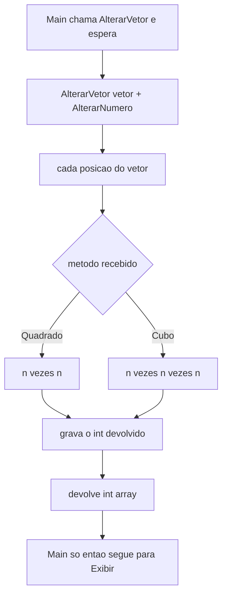
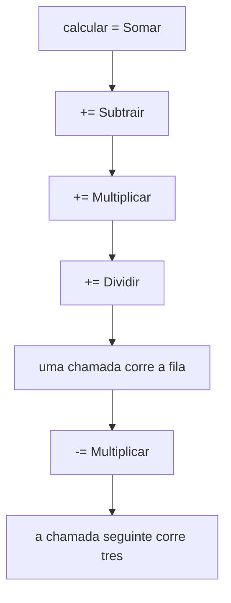
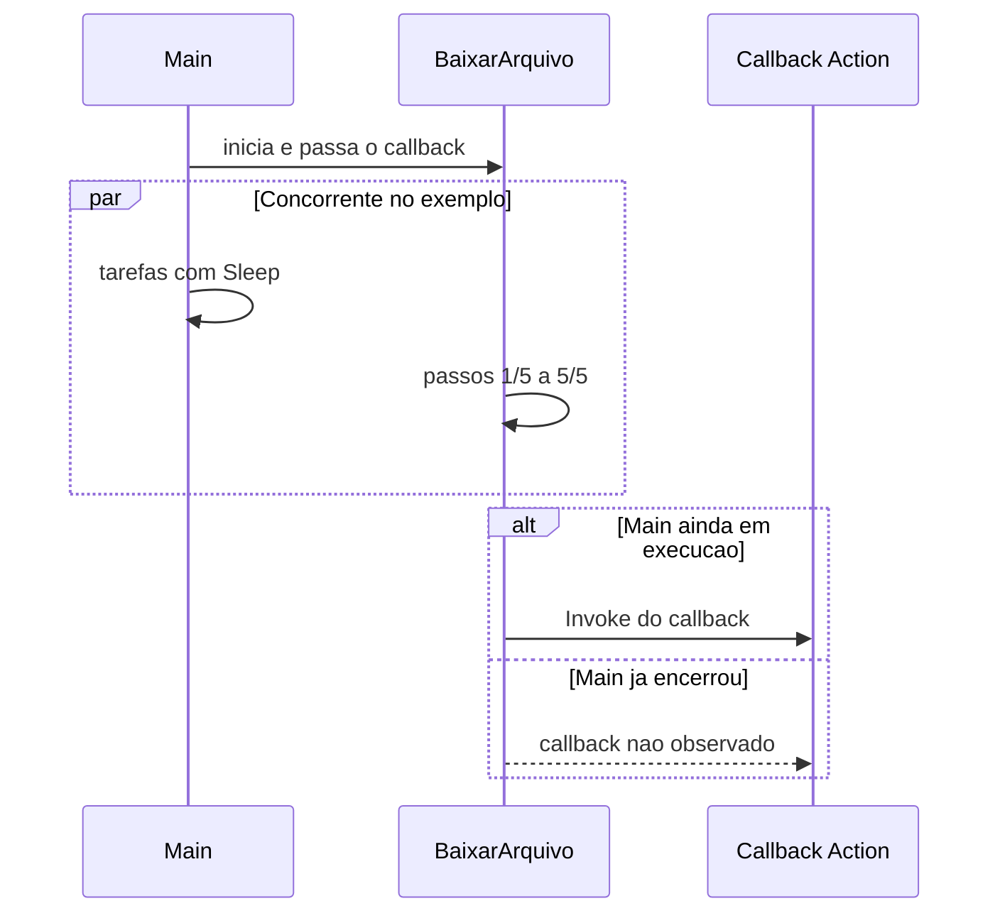

## Visão Geral do Conceito

A aula de 6 de outubro de 2026 continua o C# de [[delegate-func-action-lambda-csharp]]. Ainda não é ASP.NET. O professor encerra aqui delegate, <mark style="background-color: #242424; padding: 2px 4px; border-radius: 3px; color: inherit;">`Func`</mark>, <mark style="background-color: #242424; padding: 2px 4px; border-radius: 3px; color: inherit;">`Action`</mark>, lambda e eventos. A aula seguinte, na terça depois do feriado de 12 de outubro, é .NET.

O uso que ele chamou de o mais claro: **passar um método como parâmetro de outro método**. Isso tem o nome de <mark style="background-color: #242424; padding: 2px 4px; border-radius: 3px; color: inherit;">`callback`</mark>. No vetor `{2, 3, 4}`, um único <mark style="background-color: #242424; padding: 2px 4px; border-radius: 3px; color: inherit;">`AlterarVetor`</mark> percorre as posições; <mark style="background-color: #242424; padding: 2px 4px; border-radius: 3px; color: inherit;">`Quadrado`</mark> ou <mark style="background-color: #242424; padding: 2px 4px; border-radius: 3px; color: inherit;">`Cubo`</mark> diz *como* cada número muda. O Main espera o retorno — callback **síncrono**.

Em seguida o mesmo contrato vira parâmetro <mark style="background-color: #242424; padding: 2px 4px; border-radius: 3px; color: inherit;">`Func<int, int>`</mark> (não cabe <mark style="background-color: #242424; padding: 2px 4px; border-radius: 3px; color: inherit;">`Action`</mark>, porque há retorno) e, por fim, a lambda entra direto na chamada. Uma chamada que executa **vários** métodos inscritos com <mark style="background-color: #242424; padding: 2px 4px; border-radius: 3px; color: inherit;">`+=`</mark> é o <mark style="background-color: #242424; padding: 2px 4px; border-radius: 3px; color: inherit;">`multicast delegate`</mark>. O fechamento justifica delegate em dois cenários mais próximos de programa real, nos termos dele: um download simulado em que o Main **não** espera (callback que ele chamou de assíncrono) e um <mark style="background-color: #242424; padding: 2px 4px; border-radius: 3px; color: inherit;">`event`</mark> disparado quando o saldo de uma conta muda.

> **Problema que resolve:** o código que percorre a coleção, espera o fim de uma operação ou reage a uma mudança de saldo não precisa conhecer cada operação concreta. Ele recebe, ou escuta, um método compatível com a assinatura.

> **Lacuna de fonte:** não há PDF desta disciplina no StripperScrapper. O exemplo 5 (download) foi incluído naquele dia e não existia na véspera. O código continua só no Drive, fora deste repositório. A transcrição é `Desenvolvimento_Web_.NET_e_Bases_de_Dados_Relacionais__Aula_02_-_06102026.txt`.

> **Não coberto:** a forma correta de programação assíncrona (ele disse que o exemplo **não** é a implementação adequada e não mostrou outra); <mark style="background-color: #242424; padding: 2px 4px; border-radius: 3px; color: inherit;">`async`</mark> / <mark style="background-color: #242424; padding: 2px 4px; border-radius: 3px; color: inherit;">`await`</mark> e <mark style="background-color: #242424; padding: 2px 4px; border-radius: 3px; color: inherit;">`Task`</mark> não foram nomeados; a API que dispara a rotina concorrente dentro de `BaixarArquivo` não foi lida; o nome da ferramenta que mostra o código gerado pelo compilador não foi dito (ele nunca a usou em aula); sobrecarga de delegate e “este callback cabe em interface?” ficaram como opinião **sem teste**; limites de <mark style="background-color: #242424; padding: 2px 4px; border-radius: 3px; color: inherit;">`var`</mark> ficaram sem resposta; qual front-end o mercado mais usa ficou sem resposta; Entity Framework, SQL e Razor Pages continuam só anunciados.

Documentação de referência: [delegates](https://learn.microsoft.com/dotnet/csharp/programming-guide/delegates/), [eventos](https://learn.microsoft.com/dotnet/csharp/language-reference/keywords/event).

## Modelo Mental

### Um percurso, várias transformações

Sem delegate, `ElevarAoQuadrado` e `ElevarAoCubo` são dois métodos quase iguais: andam o vetor posição a posição e só muda a conta. Com delegate, o percurso mora num método só. O parâmetro <mark style="background-color: #242424; padding: 2px 4px; border-radius: 3px; color: inherit;">`AlterarNumero`</mark> é o encaixe: entra um <mark style="background-color: #242424; padding: 2px 4px; border-radius: 3px; color: inherit;">`int`</mark>, sai um <mark style="background-color: #242424; padding: 2px 4px; border-radius: 3px; color: inherit;">`int`</mark>. Quadrado, cubo, dobro ou resto caberiam nesse encaixe; outro número de parâmetros, `string` ou um `double` no lugar do `int` não cabem — a IDE acusa antes mesmo de compilar, como ele demonstrou ao tentar dois parâmetros e uma `string`.

Passar o **objeto** vetor para um método é passagem comum de argumento. Passar **o método** Quadrado é o callback. Delegate, na frase da aula, não tem herança nem hierarquia.

| Chamada | Quem espera | Nome na aula |
|---------|-------------|--------------|
| `AlterarVetor` no Main | O Main para até o método devolver o vetor | callback síncrono |
| `BaixarArquivo` no Main | O Main segue nas tarefas enquanto o download anda | callback assíncrono (exemplo simplificado) |

### Fila de métodos e escuta de saldo

Multicast: a variável deixa de apontar para um método e passa a guardar uma sequência. <mark style="background-color: #242424; padding: 2px 4px; border-radius: 3px; color: inherit;">`+=`</mark> entra na fila; uma invocação corre todos, na ordem de inscrição (ele comparou a uma fila FIFO); <mark style="background-color: #242424; padding: 2px 4px; border-radius: 3px; color: inherit;">`-=`</mark> tira um. O nome “multicast” vem de redes; ele disse que acha o nome ruim e que é o nome que o C# usa. Entrou na aula porque o TP1 pergunta isso.

Evento de conta: alterar o saldo **gera** um aviso. Quem tiver inscrito o tratador recebe o aviso — log, tela ou gravação, nos exemplos que ele citou como possibilidade. Sem ninguém inscrito, a invocação com <mark style="background-color: #242424; padding: 2px 4px; border-radius: 3px; color: inherit;">`?.`</mark> não quebra por nulo. A segunda versão do evento carrega uma mensagem (crédito, débito, conta negativa), não só o fato “saldo alterado”.

A lambda da véspera, inclusive a do <mark style="background-color: #242424; padding: 2px 4px; border-radius: 3px; color: inherit;">`Find`</mark>, foi retomada assim: o compilador a transforma num <mark style="background-color: #242424; padding: 2px 4px; border-radius: 3px; color: inherit;">`Func`</mark>. No `Find` da conta com Id `3`, esse `Func` devolve verdadeiro ou falso para a comparação. O código que o compilador emite **não** foi aberto em aula; ele pediu para pesquisar e adiou a forma explícita porque “não é simples”.

## Mecânica Central

### 1. Dois métodos parecidos, depois um callback

Vetor de três posições: `2`, `3`, `4`. Primeiro sem delegate: elevar ao quadrado, exibir, elevar ao cubo, exibir. Cada elevação percorre o vetor. A saída numérica **não foi lida** — só a narrativa “vetor elevado ao quadrado / ao cubo”. Também não foi dito se o cubo parte de `{2, 3, 4}` ou do vetor já quadrado. Os métodos de exibição não mudam no passo seguinte.

O delegate e o método que recebe o callback:

```csharp
public delegate int AlterarNumero(int numero);

static int Quadrado(int numero) => numero * numero;
static int Cubo(int numero) => numero * numero * numero;

static int[] AlterarVetor(int[] vetor, AlterarNumero alterarNumero)
{
    // Posição a posição, como na versão sem delegate.
    // A transcrição diz que entra um vetor e sai um vetor de int.
    // Não foi lido se o array original é mutado ou copiado.
    for (int i = 0; i < vetor.Length; i++)
        vetor[i] = alterarNumero(vetor[i]);
    return vetor;
}
```

Chamadas narradas: `AlterarVetor` com Quadrado, exibir; `AlterarVetor` com Cubo, exibir. Dentro do laço, `alterarNumero` é Quadrado (`n * n`) ou Cubo. Exibir vetor permanece o método de impressão, fora do delegate.



> **Regra:** callback síncrono, neste exemplo, significa que o Main não continua enquanto `AlterarVetor` não devolve. A assinatura de `AlterarNumero` é um `int` de entrada e um `int` de saída.

Testes feitos na hora, todos recusados como assinatura diferente:

- dois parâmetros no método alvo — a IDE acusa sem precisar compilar;
- `string` no lugar do `int`;
- `double`: ele procurou conversão implícita, viu um cast e, ao executar, houve erro. O texto da mensagem **não foi lido**. Conclusão dita: a assinatura tem de ser exatamente a mesma.

`0` ao quadrado e `0` ao cubo foram executados e deram `0`, sem exceção (`0 * 0`, `0 * 0 * 0`). “Qualquer número elevado a 0 é 1” foi aceito como outra conta, não como o que esse código faz. Um `Func` / delegate que devolve `int` não pode, na mesma assinatura, devolver uma mensagem `string`. Tratamento de erro, na fala: <mark style="background-color: #242424; padding: 2px 4px; border-radius: 3px; color: inherit;">`try`</mark> / <mark style="background-color: #242424; padding: 2px 4px; border-radius: 3px; color: inherit;">`catch`</mark> e lançar exceção dentro do método — ilustrado como possibilidade (raiz quadrada), **não demonstrado**.

Sobrecarga de delegate: pergunta da véspera. Resposta deste dia: ele **acha** que não existe, porque a assinatura é uma só; **não testou** e **não pesquisou**. Não é regra verificada em aula.

Interface no lugar deste callback: parece interface, não é o conceito de interface, e não há herança. O raciocínio que ele fez em voz alta, também **sem teste**: uma interface precisaria ser implementada; ele não viu como ter Quadrado e Cubo como duas implementações da mesma interface nesse desenho, porque aqui se passam métodos, não objetos de uma classe. Passar o vetor (objeto) é outra coisa. Ficou em aberto pesquisar.

### 2. O mesmo parâmetro como Func, depois como lambda

Versão em que o delegate personalizado sai e o parâmetro é declarado no método:

```csharp
static int[] AlterarVetor(int[] vetor, Func<int, int> alterarNumero)
{
    for (int i = 0; i < vetor.Length; i++)
        vetor[i] = alterarNumero(vetor[i]);
    return vetor;
}
```

`Func<int, int>`: o primeiro `int` entra, o segundo volta (o número já alterado). <mark style="background-color: #242424; padding: 2px 4px; border-radius: 3px; color: inherit;">`Action`</mark> foi a pergunta que ele fez à turma e respondeu ele mesmo: **não** serve aqui, porque `Action` não devolve nada e o laço precisa do `int` alterado.

Última forma desta sequência: não há métodos `Quadrado` e `Cubo`. A chamada leva a lambda, que ele afirmou virar `Func` por baixo — de novo sem mostrar o código gerado.

```csharp
AlterarVetor(vetor, n => n * n);
AlterarVetor(vetor, n => n * n * n);
```

É possível passar parâmetros para o callback: neste `Func`, o `int` do vetor é o parâmetro. No download assíncrono ele disse que dá para passar parâmetro **na largada** de `BaixarArquivo`; **durante** a execução, acha que não, não lembra, e não implementou. A ideia de mandar o texto “download concluído” como parâmetro do callback ficou só na fala.

### 3. Multicast

Vários métodos na mesma variável, em geral <mark style="background-color: #242424; padding: 2px 4px; border-radius: 3px; color: inherit;">`Action`</mark>, porque <mark style="background-color: #242424; padding: 2px 4px; border-radius: 3px; color: inherit;">`Func`</mark> devolve valor. Operações da calculadora: somar, subtrair, multiplicar, dividir. Operandos dessa execução **não foram lidos** (no dia anterior, a calculadora usou `5` e `2`).

```csharp
Action<double, double> calcular = Somar;
calcular += Subtrair;
calcular += Multiplicar;
calcular += Dividir;
calcular(op1, op2);   // quatro operações, nesta ordem

calcular -= Multiplicar;
calcular(op1, op2);   // soma, subtração e divisão
```

Forma explícita e forma simplificada foram mencionadas de novo, como na aula anterior (`new` versus atribuição). O `+=` / `-=` é o mecanismo novo. A execução narrada: quatro operações; depois três, sem a multiplicação.



> **Regra:** a ordem de execução é a ordem em que os métodos foram associados. Retirar da fila é `-=`. O que cada método devolve, se fosse `Func`, não foi especificado — a aula escolheu `Action` justamente porque não há retorno.

## Uso Prático

### Download: Main bloqueado, depois Main em paralelo

Isto não baixa arquivo de verdade. É simulação para separar os dois callbacks.

Versão **sem** delegate: o Main chama o download e fica parado em <mark style="background-color: #242424; padding: 2px 4px; border-radius: 3px; color: inherit;">`Thread.Sleep`</mark>. O argumento é milissegundo. `5000` → cinco segundos; ele aumentou para `10000` e contou dez segundos até a mensagem de arquivo baixado. Só então o programa segue. Um método termina para o próximo comando começar — o mesmo padrão síncrono do vetor.

```csharp
static void BaixarArquivo()
{
    Thread.Sleep(5000);
    Console.WriteLine("arquivo baixado");
}
```

Versão com callback: o Main chama `BaixarArquivo` e passa o método “download concluído”. O parâmetro é um <mark style="background-color: #242424; padding: 2px 4px; border-radius: 3px; color: inherit;">`Action`</mark>, porque não devolve valor. Dentro de `BaixarArquivo` uma rotina corre **junto** com o Main. As duas imprimem: tarefas do Main e progresso do download (`1/5` … `5/5`). Quando o download termina, chama o callback.

```csharp
static void DownloadConcluido()
{
    Console.WriteLine("download concluído");
}

static void BaixarArquivo(Action callback)
{
    // A API que dispara a rotina concorrente não foi lida
    // (não houve Thread, Task nem async/await na fala).
    // O que foi narrado: cinco passos com Sleep, mensagens i/5,
    // e, no fim, callback().
}
```

Uma execução observada (ele avisou que **outra execução pode sair noutra ordem**):

1. início e “download iniciado”;
2. tarefa 1 do Main;
3. passos 1/5 e 2/5 do download;
4. tarefa 2 do Main;
5. passo 3/5;
6. tarefa 3 do Main;
7. passos 4/5 e 5/5;
8. tarefa 4 do Main;
9. callback de download concluído;
10. uma última tarefa do Main.

Com os dois `Sleep` em `1000` ms, a saída ficou sequencial (`1, 2, 3, 4, 5`): os dois lados esperam o mesmo tempo. Com Main em `900` ms e o passo interno em `1000` ms, cinco vezes no download (ele falou em cinco segundos), o **callback sumiu**. Motivo dito: o Main terminou antes de `BaixarArquivo` acabar, então o download não chega ao fim dentro da vida do processo. Subir o `Sleep` do Main para `1100` ms fez o callback voltar, porque o Main durou mais que o download.



> **Regra observada:** o callback do fim do download só aparece se o Main ainda está em execução quando os cinco passos acabam. A aula não fixou quantas vezes o `Sleep` do Main rodou; fixou o contraste 900 ms (sumiu) versus 1100 ms (apareceu) contra o miolo de cerca de cinco segundos.

Ele foi explícito: essa **não** é a forma correta de implementar assincronismo. É um exemplo curto para o delegate aparecer num fluxo em que duas partes andam juntas.

### Evento quando o saldo muda

Classe de conta corrente com nome, saldo e consulta. Há um tratador de evento (<mark style="background-color: #242424; padding: 2px 4px; border-radius: 3px; color: inherit;">`EventHandler`</mark>). Cada alteração de saldo dispara o evento; o método inscrito corre. Na demonstração, “Saldo alterado” apareceu duas vezes — duas alterações, sem mensagem extra.

O tipo do evento foi chamado de event. A invocação usa <mark style="background-color: #242424; padding: 2px 4px; border-radius: 3px; color: inherit;">`Invoke`</mark> com <mark style="background-color: #242424; padding: 2px 4px; border-radius: 3px; color: inherit;">`?.`</mark> na frente para não falhar se ninguém registrou o handler. <mark style="background-color: #242424; padding: 2px 4px; border-radius: 3px; color: inherit;">`EventArgs`</mark> aparece nesse desenho. Nomes exatos de campo e do arquivo no Drive não foram lidos. <mark style="background-color: #242424; padding: 2px 4px; border-radius: 3px; color: inherit;">`EventArgs.Empty`</mark> abaixo é a forma de não carregar mensagem; esse identificador não foi lido na chamada. O papel do primeiro evento foi este:

```csharp
public class Conta
{
    public string Nome { get; }
    public double Saldo { get; private set; }

    public event EventHandler SaldoAlterado;

    public Conta(string nome, double saldo)
    {
        Nome = nome;
        Saldo = saldo;
    }

    public void AlterarSaldo(double novoSaldo)
    {
        Saldo = novoSaldo;
        SaldoAlterado?.Invoke(this, EventArgs.Empty);
    }
}

static void TratarAlterarSaldo(object sender, EventArgs e)
{
    Console.WriteLine("Saldo alterado");
}

// Inscrição narrada: alterar saldo / tratar alterar saldo.
// conta.SaldoAlterado += TratarAlterarSaldo;
```

Evento 2 é a evolução: além do aviso, passam argumentos — crédito feito, débito feito, conta negativa. Para isso ele declarou uma classe de argumentos (na fala, “EventArgs”) com a mensagem do evento. O nome da classe no Drive não foi lido. Linhas que ele leu na execução: “crédito de cem”, “crédito de cento e cinquenta”, “conta negativa”. Um valor de débito **não** foi lido nessa saída; débito foi descrito como um dos dados que o argumento pode carregar.

```csharp
public class MensagemEventArgs : EventArgs
{
    public string Mensagem { get; }

    public MensagemEventArgs(string mensagem)
    {
        Mensagem = mensagem;
    }
}

// Invoke com o objeto da mensagem, no lugar de EventArgs.Empty.
// Tratador imprime a mensagem recebida.
// Textos mostrados: "crédito de 100", "crédito de 150", "conta negativa".
```

Quem escuta pode, nas palavras dele, gerar log, jogar na tela ou gravar em banco. O código mostrado imprimiu a mensagem; a gravação em banco **não** foi implementada.

Perguntas da abertura que ficaram em aberto, para não misturar com o que foi respondido:

- <mark style="background-color: #242424; padding: 2px 4px; border-radius: 3px; color: inherit;">`var`</mark>: ele o entende como escrever menos; o compilador troca pelo tipo da atribuição. Não soube dizer se há cenário em que não se deve usar. A resposta ficou devida.
- Lambda dentro de `Find`: vira delegate `Func` com retorno `bool` (`Id == 3` é verdadeiro ou falso). A forma explícita do que o compilador gera não foi escrita.
- Front mais usado no lugar de Razor: sem resposta.

## Erros Comuns

**Assinatura “quase” igual.** Causa: dois parâmetros, `string`, ou `double` onde `AlterarNumero` / `Func<int, int>` exige `int` → `int`. Sintoma: a IDE marca antes de compilar; no ensaio com `double`, ainda apareceu cast e a execução falhou. Correção: a entrada e o retorno são exatamente os declarados. O texto do erro não está na transcrição.

**Usar `Action<int>` no `AlterarVetor`.** Causa: `Action` não devolve o número novo. Sintoma: o laço não tem o `int` alterado para gravar. Correção da aula: `Func<int, int>`.

**Querer que o callback avise erro mudando o tipo de retorno.** Causa: a assinatura é `int`. Sintoma: não há como devolver `int` ou `string` na mesma variável. Correção dita: `try`/`catch` e exceção dentro do método — não demonstrado com raiz quadrada. `0` ao quadrado não é esse caso: o resultado foi `0`.

**Achar que sobrecarga de delegate foi provada.** Não foi. Ficou opinião.

**Multicast com expectativa de um único retorno útil.** A aula não especificou o que um `Func` multicast devolveria. Ela usa `Action` porque não há retorno, e a chamada existe para **encadear efeitos** na ordem de `+=`.

**Callback de download “não chama”.** Causa demonstrada: Main em `900` ms termina antes dos cinco passos de `1000` ms. Não é falha de inscrição do `Action` enquanto o processo ainda está vivo. Com `1100` ms no Main, o mesmo callback correu. Outra execução pode intercalar as mensagens noutra ordem; isso não é defeito, foi dito como característica do exemplo.

**`Invoke` sem `?.` quando ninguém assinou.** Causa: o event está nulo. O professor colocou `?.` exatamente para esse caso. Sintoma de nulo não foi reproduzido na transcrição porque a proteção já estava no código; o risco foi nomeado.

**Tratar o exemplo do `Sleep` como o padrão assíncrono da plataforma.** Ele disse o contrário: não é a forma correta, e a matéria de assincronismo é mais difícil do que esse trecho.

## Visão Geral de Debugging

1. Se o vetor não muda como você esperava, veja qual método entrou em `AlterarVetor` naquela chamada (Quadrado, Cubo ou a lambda `n => …`) e se o cubo está a partir do vetor original. A transcrição não fecha essa segunda dúvida: não houve números impressos.
2. Se a IDE sublinha a passagem do método, conte parâmetros e compare o tipo de retorno com o delegate ou com o `Func<int, int>`. Não espere conversão implícita de `double` para `int`: o ensaio falhou.
3. Se uma chamada dispara várias operações, olhe a cadeia `+=` de cima para baixo. Se falta a multiplicação, procure `-= Multiplicar` antes da segunda chamada.
4. Se “download concluído” não aparece, compare a duração do Main com a dos cinco `Sleep` internos **antes** de inspecionar o corpo do callback. O caso `900` versus `1000` × 5 foi esse bug, narrado de propósito.
5. Se a alteração de saldo não imprime, confira o `+=` do `EventHandler` **e** se a invocação está protegida com `?.` quando a lista de ouvintes está vazia. No evento 2, a mensagem vem do objeto passado a `Invoke`; “Saldo alterado” sem parâmetros é o evento 1.
6. Lambda dentro de `Find` que “não compila na sua cabeça”: o retorno da lambda, na explicação da aula, é o `bool` da comparação, não a conta. A conta é o que `Find` devolve quando acha `true`.

## Principais Pontos

- `{2, 3, 4}` é elevado ao quadrado e ao cubo; sem delegate são dois laços parecidos; com delegate, `AlterarVetor` recebe o método.
- `delegate int AlterarNumero(int)` e `Func<int, int>` têm a mesma função nesse exemplo. `Action` não serve porque não há retorno.
- A chamada é síncrona: o Main espera o vetor voltar. Dois parâmetros, `string` ou `double` no lugar do `int` foram recusados.
- A lambda `n => n * n` na chamada é, segundo a aula, um `Func` gerado pelo compilador. O código gerado não foi mostrado.
- `0 * 0` e `0 * 0 * 0` resultam em `0`, sem erro. A assinatura `int` não devolve mensagem `string`.
- Multicast: `+=` na ordem Soma, Subtração, Multiplicação, Divisão; uma chamada executa a fila; `-= Multiplicar` deixa três. Preferência dita: `Action`.
- `Thread.Sleep` bloqueia. `5000` ms e `10000` ms foram contados no download síncrono.
- No exemplo concorrente, `Action` é o callback de conclusão. Main em `900` ms some com o callback; `1100` ms deixa o callback correr. A ordem das mensagens pode mudar entre execuções. Não é o padrão correto de assincronismo.
- Evento de saldo: `EventHandler`, `Invoke` com `?.`, duas impressões de “Saldo alterado”. Evento 2 leva mensagem: crédito de 100, crédito de 150, conta negativa.
- .NET, Entity Framework, SQL e Razor ficam para a próxima aula. Sobrecarga de delegate, interface equivalente, limites de `var` e o decompilador não foram fechados.

## Preparação para Prática

Antes do laboratório, você deve conseguir:

1. Aplicar Quadrado e Cubo a `{2, 3, 4}` através de um único percurso que recebe a função.
2. Recusar, no desenho, um alvo que não seja `int` → `int`.
3. Inscrever quatro operações, executá-las na ordem e remover a multiplicação.
4. Decidir se um callback de fim de download seria observado, comparando a duração do Main com a do download.
5. Alterar saldo sem ouvinte sem lançar erro, e com ouvinte entregando a mensagem do evento.

## Laboratório de Prática

> Exemplos do corpo em C#. No Editor Integrado ISS use o boilerplate JavaScript abaixo (espelha a lógica). Equivalências: parâmetro função ≈ `AlterarNumero` / `Func<int, int>`; array de funções ≈ multicast `+=` / `-=`; lista de ouvintes vazia ≈ `?.Invoke`; durações em ms ≈ `Thread.Sleep`. O arquivo executa sem exceção se os `TODO` continuarem nos retornos iniciais (`[]`, `false`, saldo inalterado de propósito).

### Easy — Um percurso, dois callbacks

Contexto ADS: normalizar um vetor de quantidades (`2`, `3`, `4`) com a mesma varredura da aula. Quadrado é `n * n`. Cubo é `n * n * n`. Cada chamada parte de uma cópia do vetor original — a transcrição não diz se o cubo encadeava no resultado do quadrado, e os números impressos não foram lidos.

```javascript
function quadrado(n) {
  return n * n;
}

function cubo(n) {
  return n * n * n;
}

function alterarVetor(vetor, alterarNumero) {
  // TODO: percorrer vetor, aplicar alterarNumero em cada item.
  // Devolver um array novo. Não alterar `vetor`.
  // Modelo C#: Func<int, int> / delegate AlterarNumero.
  return vetor.slice();
}

const original = [2, 3, 4];
alterarVetor(original, quadrado);
alterarVetor(original, cubo);
```

### Medium — Fila multicast da calculadora

Contexto ADS: um fecho de tarifa dispara várias operações inscritas e depois tira a multiplicação, como no multicast da aula. Efeito em lista de textos (modelo `Action`: sem retorno numérico). Operandos `5` e `2` são os da calculadora da aula anterior; esta transcrição não releu os operandos.

```javascript
function criarMulticast() {
  const fila = [];
  return {
    adicionar(metodo) {
      // TODO: equivalente a +=
      void metodo;
      void fila;
    },
    remover(metodo) {
      // TODO: equivalente a -= (primeira ocorrência)
      void metodo;
      void fila;
    },
    executar(a, b, linhas) {
      // TODO: chamar cada método da fila, na ordem, passando (a, b, linhas).
      void a;
      void b;
      void linhas;
      void fila;
      return linhas;
    },
  };
}

function somar(a, b, linhas) {
  linhas.push("somar " + (a + b));
}

function subtrair(a, b, linhas) {
  linhas.push("subtrair " + (a - b));
}

function multiplicar(a, b, linhas) {
  linhas.push("multiplicar " + a * b);
}

function dividir(a, b, linhas) {
  linhas.push("dividir " + a / b);
}

const calcular = criarMulticast();
const primeira = [];
const segunda = [];
calcular.adicionar(somar);
calcular.adicionar(subtrair);
calcular.adicionar(multiplicar);
calcular.adicionar(dividir);
calcular.executar(5, 2, primeira);
calcular.remover(multiplicar);
calcular.executar(5, 2, segunda);
```

### Hard — Callback que só corre se o Main vive, e evento de saldo

Contexto ADS: (1) um job de “download” simulado não pode avisar conclusão se o processo principal já morreu; (2) mudança de saldo notifica ouvintes, com mensagem, e não quebra se ninguém assinou.

Critério do download, como a aula concluiu: o callback é observado quando o Main ainda está em execução ao fim dos passos do download. O download foi cinco passos de `1000` ms. O `Sleep` do Main em `900` ms fez o callback sumir; em `1100` ms, aparecer. A transcrição não conta quantas esperas o Main fez. O laboratório pede o produto passo × repetições. O par de chamadas usa **5** esperas no Main só como hipótese para esse contraste: cinco vezes 900 ms fica abaixo de cinco vezes 1000 ms; cinco vezes 1100 ms fica acima. Não está na fala que o Main também iterou cinco vezes.

```javascript
function callbackObservado(sleepMainMs, esperasMain, sleepDownloadMs, passosDownload) {
  // TODO: true somente se sleepMainMs * esperasMain > sleepDownloadMs * passosDownload.
  void sleepMainMs;
  void esperasMain;
  void sleepDownloadMs;
  void passosDownload;
  return false;
}

function criarConta(nome, saldo) {
  const ouvintes = [];
  return {
    nome,
    saldo,
    inscrever(handler) {
      // TODO: += do EventHandler
      void handler;
      void ouvintes;
    },
    remover(handler) {
      // TODO: -= 
      void handler;
      void ouvintes;
    },
    alterarSaldo(novoSaldo, mensagem) {
      // TODO:
      // 1. atualizar this.saldo
      // 2. se ouvintes.length === 0, não chamar ninguém (?.Invoke)
      // 3. senão chamar cada handler com { saldo: this.saldo, mensagem }
      void novoSaldo;
      void mensagem;
      void ouvintes;
    },
  };
}

callbackObservado(900, 5, 1000, 5);
callbackObservado(1100, 5, 1000, 5);

const conta = criarConta("Oficina Norte", 0);
conta.alterarSaldo(100, "crédito de 100");
conta.inscrever(function tratar(args) {
  void args;
});
conta.alterarSaldo(250, "crédito de 150");
conta.alterarSaldo(0, "conta negativa");
```

<!-- CONCEPT_EXTRACTION
concepts:
  - callback síncrono
  - AlterarNumero
  - AlterarVetor
  - vetor 2 3 4
  - assinatura exata
  - Func int int
  - Action inadequado quando há retorno
  - lambda na chamada
  - compilador gera Func
  - Find devolve bool na lambda
  - multicast += -=
  - fila FIFO
  - Thread.Sleep
  - callback assíncrono simplificado
  - Main termina antes do callback
  - event EventHandler
  - Invoke com ?.
  - EventArgs com mensagem
  - var sem limite respondido
  - sobrecarga de delegate não testada
skills:
  - Extrair o percurso do vetor e receber Quadrado ou Cubo como parâmetro
  - Recusar método cuja assinatura não seja um int de entrada e um int de saída
  - Trocar o delegate personalizado por Func<int, int>
  - Passar lambda no lugar dos métodos Quadrado e Cubo
  - Inscrever e remover métodos com += e -= e executá-los na ordem
  - Explicar o callback ausente quando o Main acaba antes do download
  - Proteger Invoke com ?. quando não há ouvinte
  - Carregar crédito, débito ou conta negativa na mensagem do evento
examples:
  - vetor-sem-delegate
  - alterar-vetor-quadrado-cubo
  - func-int-int-no-lugar-do-delegate
  - lambda-na-chamada
  - multicast-quatro-depois-tres
  - download-sleep-sincrono
  - download-callback-900-versus-1100
  - evento-saldo-e-mensagem
  - lab-js-callback-multicast-evento
-->

<!-- EXERCISES_JSON
[
  {
    "id": "dotnet-alterar-vetor-quadrado-cubo",
    "slug": "dotnet-alterar-vetor-quadrado-cubo",
    "difficulty": "easy",
    "title": "Um percurso, dois callbacks",
    "discipline": "web-dotnet-relacional",
    "editorLanguage": "javascript",
    "tags": ["csharp", "delegate", "callback", "func"],
    "summary": "Aplicar quadrado e cubo ao vetor 2, 3, 4 por um único percurso que recebe a função e não muta o original."
  },
  {
    "id": "dotnet-multicast-calculadora",
    "slug": "dotnet-multicast-calculadora",
    "difficulty": "medium",
    "title": "Fila multicast da calculadora",
    "discipline": "web-dotnet-relacional",
    "editorLanguage": "javascript",
    "tags": ["csharp", "multicast", "action", "delegate"],
    "summary": "Inscrever soma, subtração, multiplicação e divisão, executar na ordem e remover a multiplicação antes da segunda execução."
  },
  {
    "id": "dotnet-callback-evento-saldo",
    "slug": "dotnet-callback-evento-saldo",
    "difficulty": "hard",
    "title": "Callback que só corre se o Main vive, e evento de saldo",
    "discipline": "web-dotnet-relacional",
    "editorLanguage": "javascript",
    "tags": ["csharp", "callback", "thread-sleep", "event", "eventargs"],
    "summary": "Comparar durações de Main e download e notificar alteração de saldo só quando houver ouvinte, levando a mensagem."
  }
]
-->

<!--
lessons.json (NÃO aplicado por este worker — integração serial do orquestrador):
{
  "discipline": "web-dotnet-relacional",
  "slug": "callback-multicast-delegate-eventos-csharp",
  "title": "Callback síncrono, multicast delegate e eventos em C#",
  "order": 2,
  "file": "content/web-dotnet-relacional/aula-02-callback-multicast-delegate-eventos-csharp.md"
}
-->
